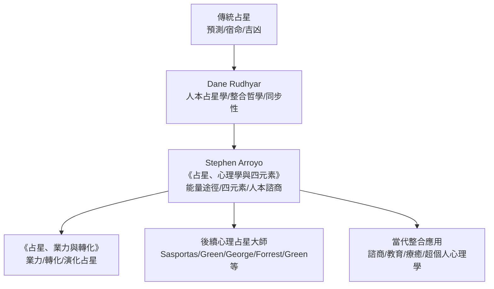

# 斯蒂芬·阿若優《占星、心理學與四元素》經典著作總覽

> **書目資訊**  
> 原書名：*Astrology, Psychology and the Four Elements: An Energy Approach to Astrology and Its Use in the Counseling Arts*  
> 作者：Stephen Arroyo（斯蒂芬·阿若優）  
> 譯者：胡因夢  
> 出版：心靈工坊／圓方出版社（心理占星學叢書前導）  
> 核心定位：以「能量途徑」重構占星理論，融合榮格深度心理學、人本心理學、全息宇宙觀，確立「人本占星學」作為心理諮商與自我成長的整合工具。

---

## 一、 書寫緣起與核心主張

### 譯者序要旨（胡因夢）
- **人本占星學**可完整描述「生而為人的意義」，涵蓋成長、進化、退化傾向、外在制約互動、主體經驗範疇、宇宙定位、感受思想行動潛能（引用 Bugental）。
- **預測與自由意志**：引用 Dane Rudhyar 與 Carl Rogers——「人最終的自由乃是選定心態面對情境」；占星連結小宇宙（人）與大宇宙（行星勢力），洞悉業力脈絡，以開放心態接納挑戰，達成淨化成長，**預知不限制自由，反而增強穿越命定事件的能力**。
- **超個人心理學缺口**：缺乏針對個人超驗次元的詮釋系統，**只有人本占星學能用天體週期象徵語言呈現危機與超驗經驗的心理真相**。
- **脈輪與行星對應**：七大脈輪與十大行星落星座能量波息息相關；黃道十二星座由地水火風四元素構成，四元素不僅是占星與玄學基礎，也是靈魂在肉體產生作用力的必要條件、意識體動力來源。
- **另類療法診斷鍵**：涉及能量層面的療法幾乎都能與四元素意義結合，做出正確診斷。

### 作者前言要旨
- **嶄新占星學形式**：將傳統理論由裡向外翻轉，去蕪存菁，保留呈現宇宙真理的智慧。
- **集體意識轉型**：20 世紀心理學突破現被集體消化；1936 Rudhyar《The Astrology of Personality》啟動重構風潮。
- **預測的侷限**：細胞、化學元素可預測；季節難預測；**人類最難預測，因擁有理性、意志、抽離能力、多樣反應方式**。覺知越敏銳越難預測；**嶄新占星學對象是已採取行動增強自我覺知者**。
- **本命盤非宿命**：面臨情況極大程度由「表現方式」設定——「你給出什麼得到什麼」。現代化運用應為**轉化修正本命盤能量模式，呈現最正向表現**。
- **兩大障礙**：占星著作缺乏綜合研判法；語言難描述超驗能量（諒解表達失誤）。
- **神話功能**：引用 Joseph Campbell——神話三大作用力：激發神聖感、提出宇宙觀、促使內省。占星結構自帶神話架構，為當代提供實際活力的神話。

---

## 二、 第一部：占星與心理（六大章節）

### 第一章：現代科學與心理學
- **世界性轉捩點**：舊發展階段結束，新生命循環萌芽；科學與心理學須以開放創意態度面對。
- **專家困境**：多數心理學家拒絕冒險，隱身專業領域；極少具創造力與勇氣者（Jung、Teilhard de Chardin）追求生命最高理想。
- **文化解離**：西方人與文化根源脫節，急需回歸精神核心超越時空侷限。**心理學無人格理論能描述「宇宙人」**。
- **三大文明互補**（Huston Smith）：西方研究自然、中國重社會關係、印度重心理關係。西方幾乎只追求快樂與世俗成就，忽略責任義務與終極解脫。
- **新文明三預測**：更重生態、更多靈性發展、統合自然/人類/自身三面向。
- **核心需求**：「發展更深入、更具宇宙性靈性的理解，與宇宙結為一體」（Hans Stossel）。占星提供此啟示。
- **科學範式批判**：
  - 西方科學被「操縱」模式掌控（含心理學）。
  - 物理學發展（反物質、測不準原理）近似神秘主義開悟表白，心理學却仍按生化/唯物模式運作。
  - **Jung**：「占星能給心理學許多幫助，心理學卻無法給占星帶來助力。」
  - **Whitehead**：科學可從人類對無意識的深入認識獲益。
- **歷史見證**：Kepler、Bacon、Franklin、Napier、Newton 皆研究占星；Newton 曾言「數學，這樣我就有能力檢驗占星學是否準確了。」

### 第二章：老架構的侷限
- **現代困境**：知道太多，深層理解太少；專注細節失去統合性與和諧感，喪失宇宙真理的復原力。
- **生態危機根源**：缺乏智慧——對整個生態體系的了解。
- **科學轉向**：
  - Sir James Jeans：《The Mysterious Universe》——宇宙更像偉大構思而非機器；心智或為物質次元掌理者/創造者；物質成心智示現。
  - **現代人被占星吸引，因其揭露宇宙構思力，以數學精密架構呈現。**
  - Irving F. Laucks：「上帝已死」指物質上帝已死；東方宗教視世界為能量構成，西方科學發現能量為更基本勢力，兩者可合作無間。
- **能量本體論**：能量構成物質宇宙，概念形成不滿百年，深層重要性尚未被覺知。**本書第二部將詳細討論能量比物質更基本的現實，尤其能量與占星關係。**

### 第三章：知識及其證據問題
- **西方學術「解離」傾向**（Whitehead）：用頭腦指揮行為、對自然研究運作，導致身心、自我與自然、心智與直覺解離，呈現在知識、宗教、政治、經濟層面，造成文化瓦解（大戰、生態危機、心理問題）。
- **兩大陣營**：原子論者（分析）vs 整合論者（形式與基本模式覺知）。整合觀提供無可反駁事實，看見大自然與事物背後基本模式。
- **存在主義視角**：Rollo May——打破主客觀鴻溝；Gabriel Marcel——存在無法被解釋，必須體悟；Pascal——理性分析無法了解宇宙人類，透視核心奧秘才是關鍵。**整合觀即今日所謂「同時發生性」視野。**
- **希臘轉捩點**：「認識你自己」、哲學即「愛智慧」；科學非蒐集數據，乃系統研究生命本質宇宙法則；理性奠基於優雅平衡法則之整合分析與直觀認識。
- **科學家遺忘理想**：最融通理論最優雅、最美、最單純；過度強調理性分析忽略融通真理。
- **認知四作用力（Jung）**：思想、感受、知覺、直覺。
  - **思想組**（思想+知覺）：基於感官外在資訊、系統分類、邏輯模式、靜態概念、解決問題、外在世界、符號、量。
  - **直覺組**（直覺+感受）：內在產生、不受社會侷限、直觀個人性、無法客觀證實、超越邏輯、審美相關、綜合秩序、動態進展、探索奧秘、整體形式模式、象徵、質、內在世界。
- **占星為「質」的語言**：有效描述人類經驗與主觀性；大眾自然視為理解經驗方式。
- **Niproah Dobyns**：占星為「人類對宇宙整體秩序的洞悉，成功轉化為概念形式」；人類發展出兩種宇宙語言——數學（量化）與占星（質大於量）；**未來心理學將被淨化統合的占星取代**。
- **證據雙軌**：
  - 統計/客觀/靜態：處理集體「量」與概略現象，**無法處理個人/「質」現象**（人本心理學/占星焦點）。
  - 經驗性/存在式/實在證據：Rudhyar——「實在證據」只能從複雜無法複製的個人經驗取得；當人發現混亂生命遭遇原有目的意義，並洞見自己如何障蔽領悟，即得實在證據。
- **統計侷限**（Jung）：統計顯現一般事實，無法了解經驗性現實；最真實狀態常違背常規；科學教育建立合理但不真實觀點；**具體個人才是現實真正載具**。
- **占星優勢**：提供特殊公式與原型通則，兼顧正確性/藝術性/細節精確/科學性；本命盤提供象徵系統認識個人獨特性；以地球為中心計算重視個人中心觀點。
- **Ruperti 醫師**：科學態度強化心理混亂，破壞個人價值，製造機械化生活破壞參與自然韻律；**占星本有基礎可解放人類，讓現代文明重新連結自然韻律。**

### 第四章：原型及宇宙法則
- **哲學目的**：尋求事物精髓底層本質（基於愛智慧），現代視角即尋求「原型次元」。
- **比較宗教/神話學**顯現人宇宙合一；Jung 闡明原型為集體潛意識，個人與集體心理底層宇宙法則。
- **占星 vs 神話**：神話強調原型顯現的文化現象；占星用原型法則理解人/社會基本模式勢力。**占星可視為最簡明易懂的神話學**。
- **神話隨意識淨化而改變**（Campbell）；占星不會消失，須重新評估態度——**不視為象徵命運線索，而用於了解生命本質、體悟宇宙位置、活出創意圓滿**。
- **宇宙法則定義**：位於個人與超個人邊緣，促成物質模式背後的勢力；無形構成模式，引領決定能量運作形式。
- **形式/精髓/永恆理念**：希臘（柏拉圖永恆形式、畢達哥拉斯數幾何）、中世紀（精髓為活動源頭、源自宇宙意識，類似 Jung 集體潛意識）。**現代物理學回歸：物質粒子為延展模型，原子為能量場，實相為能量振動。**
- **Whitehead**：「自然律法最顯特質是構成形式傾向」；“若想真正了解任何事物，必須深入洞察其終極模型”；理解宇宙構成法則助物理/生物/心智模式，達成內心祥和。
- **占星核心價值**：提供一切形式中的合一性；將每人視為整體、宇宙法則模式與能量獨特表現；黃道十二宮為「自然本質」，賦予生命形式秩序。
- **本命盤**：完整圖像，了解宇宙性韻律能量如何在個人運作。
- **原型本質（Jung）**：類似水晶軸心系統，無物質性質卻能形成結晶體；純粹形式或預先存在可能性；超驗狀態，難意識到。
- **Edward Whitmont**：「原型能量場」與行星相關；定義為「宇宙性模式與原動力」；類似 Whitehead 構成法則。
- **臨床驗證**：
  - Jung 常用占星理解難解個案：「經常發現占星數據確能提供其他方式無法提供的解說」；「發現明確心理狀態時，星盤行星星座會出現類似情況」；「個人內建精神模式似可完全從星宮圖看出來」；行星顯示心理發展明確階段/重大事件（特別是土星天王星困難相位）。
  - Whitmont：占星對深層心理學家價值不亞於夢解析；提供個案抗拒的潛意識基本動力模式，終身持續反應。
  - Dobyns：占星為人格系統外在參考架構，優於人為系統；提供象徵人類心智命運藍圖，不可被主觀好惡操控；產生洞見，發現潛力/才華/整合昇華管道；幫助僱傭/婚姻/治療關係了解相稱性。**未來心理治療將固定採用天宮圖。**
  - Ralph Metzner：《Maps of Consciousness》；占星比任何分析系統更複雜微妙，更能闡述人類本質多樣性；獨立於主體行為外擺脫心理偏見；具先天動力；資深占星師詮釋能綜合描述世代傾向、指出潛力發展方向——**提供自我了悟發展地圖**；建議占星成為心理學精神醫學附屬品，定名「運用於心理治療的天文學」。
- **象徵語言優勢**：超越文化/國族/教育限制；心理學人格理論只能適用少部分人；**占星為最完整人格理論**，能統合提供基礎；**兼具象徵符號與數學計算，混合成和諧系統**；正確描述意識類型/獨特性/能量運作模式，揭露宇宙律法兩極性/調和性/身心能量。

### 第五章：占星學的理論基礎
> **三大理論途徑**：

#### 因果律途徑
- **宇宙性先決條件**：人與太陽系間維持巧妙平衡的電磁場；行星位置改變產生場變化。
- **Rex Pay / Sliopog**：地球-電離層中空地帶為共振系統，週期 1/8 秒（光繞地球一周），頻率 ~8 c/s，類似腦 α 波；若人類行為受此共振影響，行星扮演重要角色。
- **Green 電磁波理論**：因果鏈鎖圖（含「加快誕生速度」——Eugen Jonas 發現嬰兒誕生時新陳代謝巔峰，釋放腎上腺素促進誕生，巔峰常現於日月特定角度；胎兒與生俱來人格特質，誕生時刻行星位置強烈影響胎兒，**本命盤確能顯示最敏感行星位置**）。

#### 象徵途徑
- 行星星座為宇宙法則與進化的象徵符號。
- Ebertin 理論對照十二星座與節氣心理狀態（表列：牡羊萌芽/意志行動、金牛形式創造/堅忍模塑、雙子醒活綻放/活潑多藝、巨蟹受胎施肥/豐富感受、獅子種子成熟/創造自信、處女收成利用/勤勞批判、天平適應天則/正義和諧、天蠍生命終止/耐力生存、射手冬眠/靈性樂觀規劃、魔羯形式結晶/耐性執著、寶瓶春來前等待/觀察規劃、雙魚種子膨脹/激發新生）。
- **象徵途徑須奠基於整合途徑框架內，始能完整有用。**

#### 整合途徑（核心）
- **哲學假定**：宇宙為完整系統，存在許多不完整片段體，結構模式作用力與整體息息相關。
- **小宇宙/大宇宙**：整個大宇宙在人這小宇宙裡；天上行星排列為巨大宇宙人；類比單一原子與太陽系關係。——**一致性法則**。
- **重點**：研究行星週期循環模式，認清人身上生命週期循環。
- **非因果律**：宇宙若為完整整體，無任何東西導致另一東西；整體內每部分息息相關——**古老法則更貼切**。
- **Jung「同時發生性」**：無肇因連結法則；某時刻誕生/行為不可避免帶著該時刻特質。品酒師類比：透過酒味判斷產區年份。同時發生性解釋本命盤須按出生時刻設定——**初生嬰兒刻開始與大宇宙韻律交感**。
- **Dobyns**：行星為宇宙秩序一部分，模式提供線索看見無處不在秩序；行星非維持/創造秩序關鍵，**較像代表秩序的地圖或藍圖**。
- **愛默生**：「事物每個細部可看出構成宇宙法則。」**Barnett**：愛因斯坦理論說明自然一切形式遵從同樣宇宙律法。**占星最大價值：將宇宙律法知識運用於個人生活。**
- **Dane Rudhyar**：最清楚闡釋整合途徑；哲學奠基於整合觀——萬物顯現最終為完整息息相關整體活動；占星為詮釋整體形式結構週期性最完整語言。
  - 早期《The Astrology of Personality》稱占星為「生命代數」。
  - 後期：象徵語言代表宇宙整體時空結構，與個人/人類發展關聯；**詮釋存在的整合性哲學**——每一存在整體包含於更大整體，同時被更大整體包容；任何有機系統皆能包含較不完整局部，也被更大系統包含。
  - **占星主要處理宇宙週期循環**；觀察形式/完型——每個有機系統活動內建法則；**不意味地球存有直接受外在天體影響**。
  - 研究理解每個整體性活動中的驅力主要作用力序列；古人詮釋為小大宇宙一致性；耶穌「天國就在你們中間」指此事實。
- **Teilhard de Chardin**：單純事物只能藉由更複雜事物理解。
- **Rollo May**：從演化較低層次單純元素了解有機體，只看到一半真相；每個新作用力形成新複雜性，制約內部較單純元素。
- **能量途徑**：本質上亦屬整合途徑，因能同時容納人生命所有面向；焦點鎖定活化每人基本能量。**本書第二部即從此觀點系統詮釋占星。**
- **現代研究證實自然界/人類確有精微能量存在**；盲目依循因果律架構永無法發展占星綜合理論，甚至阻礙正確用法解說。
- **Alexander Ruperti**：雖 Paracelsus 提大小宇宙關係、Rudhyar 提整體宇宙和諧共振法則、Jung 提同時發生性法則掌管時間內精神現象，**現代占星追隨科學態度，堅持客觀因果律看待大小宇宙一致性，反因迷信科學崇高地位而違背古老傳承。**
- **占星師真正角色**：闡明宇宙秩序，就人任何時刻成長說明；物質次元秩序功能已由現代科學完成，**心理層次人性顯然處於混亂，占星最高使命為提出心理層面和諧秩序可能性——現代人最關鍵需求。**

### 第六章：人本心理學與人本占星學
- **第三勢力**：人本心理學，與機械化典範截異；從整合觀看待精神情感生活，強調主觀性完整性，難從客觀可測角度研究。
- **占星為觀察人格類型差異的心理學工具。**
- **核心差異**：
  - 人本心理學家信人人有成長潛力與完整本質（Rogers：「主觀個人具有根本價值……不僅是機械裝備、刺激反應聚合體」）。
  - 治療目標非可測可控（Terman：「愈成功愈難預測發展，因僵固傾向減輕，自發性創造性增強」）——**與流行占星預測面向衝突**。
  - **人本占星重點在人而非特定事件**；Rudhyar：「事件是由人造成的」——**人本占星與其他占星最大差異**。
  - 疾病詮釋：從「人會有什麼問題」轉向「什麼樣的人會有什麼樣問題」。
  - 重視創造自我實現潛力，較侷限/反常/適應困難更重要；**唯一能發展獨特性與個人存在基調的途徑，占星在此獨到。**
  - Rollo May：「存在定義為個人潛力模式；人人擁有潛力，但每人獨特模式」——**本命盤象徵即每人獨特潛力模式。**
- **Bugental《The Challenge That is Man》**：
  - 闡述人如闡述遙遠銀河系般困難；訂定集體行為律法即提出人在世界存在方式假設。
  - **人本心理學主要目標**：完整描述生而為人意義；必須包含天分、感受思想行動潛能、成長進化退化傾向、外在制約互動、經驗範疇種類、宇宙位置意義。
  - **除非熟悉占星運用精確性，否則不知達成此目標很容易**；採用占星作治療工具易達成目標，保有人本心理學強調的成長/潛能/開放性。
  - **預測性與自由不衝突**：人本心理學描述人經驗讓人更能預知掌握經驗（拒絕被操控）；Rudhyar 追求相同目標；Rogers：「自由意味為自己選擇存在方式負責，認清自己非靜止產物而是不斷顯化過程」；Buber：「自由人既相信命運也相信命運能滿足自身需求……命運非界線而是自我實現契機」。
- **人本心理學缺口**：試圖維持開放理解態度，**卻缺乏與個人相關、不斷蛻變的分類法**；占星恰能填補此缺。

---

## 三、 第七章：占星學在諮商藝術中的應用（16 項貢獻）

1. **脫離心智自我模式瞥見真相**——本命盤清晰揭露模式，有效轉化習性（引用《Bhagavad Gita》「心智謀殺真相」、現代作家「自我死亡是其他事物誕生」）。
2. **發展耐性**——發現存在結構受既定週期影響，知週期完成任務後終止，耐性安住當下（「積極跟上神的節奏」）。
3. **卓越成長發展模式**——顯示應努力部分、經驗核心意義、必須轉化內在模式、經驗持續多久、關鍵生命變化階段。
4. **與內在力量相應**——運用思維意志創造力達成更佳存在方式；認清何時發展新途徑、何時遭試煉、當前方式是否帶來創造滿足。
5. **深入了解宇宙律法**——依內心宇宙真理生活：宇宙秩序、因果律、業報償還、兩極性、生命週期、能量振動頻律、「境由心生」、「物以類聚」。
6. **認識生命與大宇宙秩序相融**——構成基本生命結構/生命雛型。
7. **洞見與自我覺察**——不再執著經驗/挫折/阻礙；連結生命動力週期。
8. **對宏大事物產生信心**——進而信賴核心本體。
9. **幫助諮商師進入個案內在世界**——依個案本質深入理解，而非投射潛意識預設；選擇正確治療方法。
10. **提供成長挑戰啟蒙時段線索**——西方文化長期忽略的模式與需求。
11. **覺察個案潛意識渴望深層感受**——含糊困擾感轉化為新創造力、新方向意義。
12. **認清生命力最自在展現活動**——獲得滿足。
13. **發展自信心自主力**——確知感覺/心理暗示/內在認知並勇敢表達；**正確運用占星反而幫助發展自信自主**（例：有特殊才能缺乏信心者）。
14. **認清「世界是舞台，我們是角色」**——帶來洞見幽默感，輕鬆面對人生；引發終極議題：演員/導演/編劇是誰？
15. **看見內在相互交流驅力**——存在由勢力需求驅力構成；認同生命過程整體而非一兩個面向。
16. **幫助個案與本質存在調和一致**——而非套用人為理論。

---

## 四、 第八章：占星諮商師的教育訓練（節錄）

- **教育語源**：「開導」、「引出」——將人「從黑暗導向光明」或「導引內在精華」；真正目的非記住資料變電腦，**乃去除恐懼、逐漸發展深刻自我覺知**。
- **專業技術非無重要，但無超過個人心理情緒成長**；大學若只為職業訓練，勿誤以為追求真理塑造人格。
- （原文中斷，完整內容待補充）

---

## 五、 核心理論架構總圖

| 維度 | 傳統/主流觀點 | 阿若優《占星、心理學與四元素》重構觀點 |
|---|---|---|
| **本體論** | 唯物/機械因果 | **能量本體論**——能量比物質更基本；四元素為能量語言基礎 |
| **認知論** | 客觀/統計/量化 | **整合/直覺/質性**——思想與直覺雙軌；占星為「質」的宇宙語言 |
| **方法論** | 因果律/預測事件 | **同時發生性/整合途徑**——行星為宇宙秩序地圖/藍圖；本命盤為生命雛型 |
| **人性觀** | 機械/刺激-反應/病理導向 | **人本/潛力/成長導向**——人人有完整本質與成長潛力；事件由人造成 |
| **自由意志** | 預測限制自由 | **預知增強自由**——選擇心態面對情境；命運為自我實現契機 |
| **神話功能** | 迷信/過時 | **活力來源**——激發神聖感、提出宇宙觀、促使內省；占星為當代實際神話 |
| **諮商定位** | 算命/建議給予 | **藝術/能量交換/自我了悟地圖**——幫助個案與本質調和、發展自信自主 |
| **教育目標** | 知識傳遞/職業訓練 | **開導/引出/去除恐懼/發展自我覺知**——超越專業技術的心理情緒成長 |

---

## 六、 四元素能量理論預覽（第二部核心，另見專頁）

> **「學占星必須先徹底了解四元素內涵、意義及彼此關係，才能領略真正本質。」** ——譯者序

| 元素 | 能量特質 | 對應星座 | 心理功能（Jung） | 脈輪關聯 | 臨床診斷鍵 |
|---|---|---|---|---|---|
| **火** | 主動、啟動、熱情、理想、靈感 | 牡羊、獅子、射手 | 直覺 | 太陽神經叢/心輪 | 缺乏動力/過度衝動/倦怠 |
| **土** | 實際、穩定、建構、感官、物質 | 金牛、處女、摩羯 | 感覺 | 海底輪/脐輪 | 不安全感/僵化/身心症狀 |
| **風** | 智性、溝通、社交、抽象、客觀 | 雙子、天秤、寶瓶 | 思想 | 喉輪/眉心輪 | 焦慮/過度理智化/斷聯 |
| **水** | 情感、直覺、共情、流動、深層 | 巨蟹、天蠍、雙魚 | 情感 | 心輪/頂輪 | 情緒淹沒/防衛/界限模糊 |

- **四元素非孤立**，每人星盤含四元素特定組合，**單一元素無法掌控整盤**；綜合研判須看整體模式。
- **另類療法診斷**：幾乎所有能量層面療法皆可與四元素意義結合診斷。

---

## 七、 關鍵人物與思想淵源交叉引用

| 人物/流派 | 核心貢獻 | 本書引用/呼應處 | 相關知識頁 |
|---|---|---|---|
| **Dane Rudhyar** | 人本占星學奠基人、《The Astrology of Personality》作者、整合哲學、同步性應用 | 全書核心對話者；前言、Ch1、Ch3、Ch5、Ch6 大量引用 | [[arroyo-astrology-karma-transformation]]、[[zhanxing-zhe-xue-ji-chu-bohm-hun-dun-jung]] |
| **C.G. Jung** | 集體潛意識、原型、四心理機能、同步性、占星臨床應用 | Ch1、Ch3、Ch4 大量引用；原型/宇宙法則/臨床驗證 | [[zhanxing-zhe-xue-ji-chu-bohm-hun-dun-jung]]、[[nei-xing-xing]] |
| **A.N. Whitehead** | 過程哲學、整合觀、形式強調、科學與無意識 | Ch1、Ch2、Ch3、Ch4 引用「形式」、「解離」、「宇宙法則」 | [[zhanxing-zhe-xue-ji-chu-bohm-hun-dun-jung]] |
| **Teilhard de Chardin** | 現象須從宇宙角度思考、單純事物由複雜事物理解、人類真相即宇宙真相 | Ch1、Ch3、Ch5 關鍵引用 | [[zhanxing-zhe-xue-ji-chu-bohm-hun-dun-jung]] |
| **Carl Rogers** | 以人為中心療法、主觀自由、覺知發展 | Ch1、Ch6 自由意志論述 | — |
| **Rollo May** | 存在主義心理學、打破主客觀鴻溝、潛力模式 | Ch3、Ch5、Ch6 | — |
| **Joseph Campbell** | 神話三大功能、神話隨意識演進 | 前言、Ch4 | — |
| **Niproah Dobyns** | 心理學與占星整合、占星為宇宙秩序洞悉、實在證據 | Ch3、Ch4 | — |
| **Ralph Metzner** | 《Maps of Consciousness》、占星為心理治療天文學 | Ch4 | — |
| **Alexander Ruperti** | 科學態度批判、占星解放人類 | Ch3、Ch5 | — |
| **Bugental** | 人本心理學目標完整描述 | Ch6 | — |
| **Eugen Jonas** | 胎兒誕生巔峰與日月角度相關 | Ch5 因果律途徑 | — |
| **Rex Pay / Green** | 電磁場/共振/因果鏈模型 | Ch5 因果律途徑 | — |

---

## 八、 本書在占星經典谱系中的定位

- **里程碑意義**：
  1. 將 Rudhyar 整合哲學**操作化**為四元素能量語言與諮商實務框架。
  2. 確立**「人本占星學」**作為心理諮商獨立工具體系（非附屬）。
  3. 為後續心理占星大師（Sasportas、Liz Greene、Demetra George、Steven Forrest 等）奠基能量/原型/發展導向三大支柱。
  4. **胡因夢譯本**引入華語圈，直接啟動 1990s 台灣心理占星學熱潮，影響至今教學與諮商實務。

---

## 九、 學習與應用建議路徑

| 階段 | 研讀重點 | 實作練習 | 進階延伸 |
|---|---|---|---|
| **入門** | 前言、Ch1-Ch2：認清舊範式侷限、能量本體論、整合觀必要性 | 觀察自身對「預測/宿命/科學」的預設；記錄一週內在能量波動 | 閱讀 Rudhyar《The Astrology of Personality》前三章 |
| **理論建構** | Ch3-Ch5：認知雙軌、證據雙軌、原型/宇宙法則、三大途徑比較、同步性機制 | 繪製自身「思想 vs 直覺」認知風格表；以同步性視角回顧三個關鍵人生事件 | 深研 Jung《Synchronicity》、Whitehead《Process and Reality》選讀 |
| **人本整合** | Ch6：人本心理學六大核心差異、Bugental 目標、自由意志新詮釋 | 撰寫「我的獨特潛力模式」敘事（參考本命盤）；練習「選擇心態面對情境」 | 研讀 Rogers《On Becoming a Person》、May《The Discovery of Being》 |
| **諮商應用** | Ch7：16 項貢獻逐項內化；Ch8：教育訓練哲學 | 模擬諮商：以本命盤為地圖引導當事者覺察模式/潛力/週期；記錄過程反思 | 實習督導；研讀《Astrology and the Authentic Self》(George)、《The Twelve Houses》(Sasportas) |
| **四元素精通** | **第二部全文**（另見專頁） | 四元素能量辨識：自身/他人/當事者；元素缺失/過剩/平衡調適方案 | 結合脈輪/身心症狀/另類療法診斷；研讀《內在的宇宙》（Arroyo 另作） |

---

## 十、 相關知識頁交叉引用索引

### 阿若優著作體系
- [[arroyo-astrology-karma-transformation]] — 《占星、業力與轉化》：三種業力、土星業力王、水象宮位業債、日月法則（厄洛斯/邏各斯極性）、高層意識演化占星。
- [[內在的宇宙-史蒂芬·阿若優]] — 《內在的宇宙》：四元素能量語言、行星本質與星座落點、整合分析方法論、出生星圖實用框架。

### 哲學與理論基石
- [[zhanxing-zhe-xue-ji-chu-bohm-hun-dun-jung]] — 占星哲學基礎：大衛·波姆全息宇宙、混沌/複雜科學碎形、榮格集體無意識/原型/同步性、量子占星隱喻。
- [[zhanxing-yu-zhen-wo]] — 迪米特拉·喬治《占星與真我》：柏拉圖《蒂邁歐》、希爾曼「橡實理論」、整宮制、行星狀態、本命主星、一小時諮詢模式、四柱生命骨架。

### 心理占星核心派系
- [[nei-xing-xing]] — 薩司波塔斯/麗茲·格林《內行星》：水星/金星/火星為心理占星基石、榮格心理學/個體化/原型/神話框架。
- [[sasportas-twelve-houses]] — 薩司波塔斯《占星十二宮位研究》：自然黃道對應、宮位為生命過程、上升點/天底深度心理詮釋。
- [[darby-costello-moon-in-astrology]] — 達比·卡斯提拉月亮研討會：月亮神話/靈魂發展/二推月亮/母子關係/養育模式。
- [[ming-wang-xing-ling-hun-yan-hua-zhi-lv-juan-yi]] — 傑夫·格林《冥王星：靈魂演化之旅》：冥王星雙欲望、南北交點業力軸、四演化階段、演化驅力三反應。

### 華語圈心理占星實務延伸
- [[han-lianglu-astrology-mom-handbook]] — 韓良露《占星媽媽手冊》：月亮星座/宮位、谷神星、親子養育、本命星圖速查。
- [[han-lianglu-synastry-law-of-attraction]] — 韓良露《占星合盤的吸引力法則》：天/地/人三因、行星落對方十二宮位吸引力法則、實戰斷驗。
- [[tian-xie-zuo-yuan-xing-neng-liang-ceng-ci]] — 韓良露《千里姻緣何處牽》：天蠍座三階段演化、婚神星/冥王星雙主星、婚姻制度扼殺性欲、靈魂伴侶進化路徑。
- [[hun-shen-xing-jin-shen-xing-ai-shen-xing]] — 韓良露四小行星體系：婚神星/智神星/靈神星/愛神星、天蝎八宮/天秤七宮、靈魂伴侶心電感應定位。

### 四元素與能量療法相關
- [[四性質寒熱濕燥與四元素]] — 寇佩珀占星藥草：四性質分級選藥、四元素為四性質再組合、反感醫學操作依據。
- [[土元素魔法體系]]、[[水系魔法體系]]、[[火元素魔法體系]]、[[風元素魔法體系]] — 四大元素自然魔法體系、神話生物/神明/神話鄉、實務喚起祈請。
- [[chakra-clearing-doreen-virtue]] — 朵琳·芙秋《淨化脈輪》：九大脈輪系統、晨昏冥想、視覺化觀想、天使療癒、多元淨化法。
- [[neng-liang-ping-heng]] — 卡比爾·賈菲等《關於能量》：核心通道、四向能量流動、能量場清理、居中接地、FEBE 完整練習。

---

## 十一、 版本與流傳備註

| 版本 | 年份 | 出版社/譯者 | 備註 |
|---|---|---|---|
| 英文原版初版 | 1975 | CRCS Publications | 獲 1973 英國占星學會大獎（碩士論文基礎） |
| 英文修訂版 | 1989 | CRCS | 增補第二部四元素能量理論完整體系 |
| 中文版（心靈工坊） | 1990s | 胡因夢譯／圓方出版社 | **心理占星學叢書前導**，奠定華語圈心理占星術語與教學基準 |
| 中文再版 | 2000s後 | 圓方/心靈工坊多次重印 | 封面設計更新，內容未大幅修訂 |

> **提示**：建議搭配 **英文原版修訂版** 對照閱讀，關鍵術語（如 *synchronicity* 同步性、*archetype* 原型、*energy approach* 能量途徑、*humanistic astrology* 人本占星學、*whole sign houses* 整宮制等）中英對照可深化理解。

---

## 十二、 結語

《占星、心理學與四元素》不僅是占星學著作，更是**跨學科整合的典範**：以能量本體論為基、以整合哲學為骨、以人本心理學為魂、以四元素語言為用、以諮商藝術為果。它將占星從「預測宿命的偽科學」重構為**「自我了悟發展地圖」與「心理諮商的精密工具」**，為後世心理占星學、演化占星學、超個人心理學、能量療法等領域奠定了不可替代的理論與實務基石。

> **「占星學能提供人類的禮物，就是它為科學無法解答的領域提供了解釋。我們需要更大的視野以及更具有建設性的想像力，但前提是必須從目前的分析途徑和數學統計之中解脫出來。」**  
> —— Stephen Arroyo，《占星、心理學與四元素》前言

## 来源

- [占星心理学与四元素](../sources/占星心理学与四元素.md)
