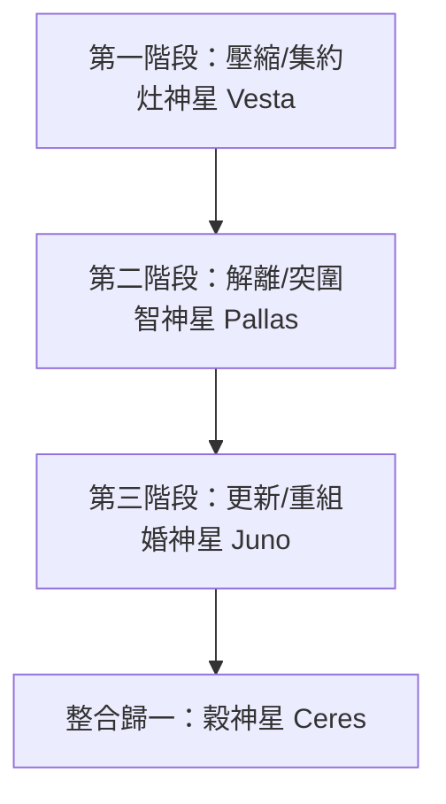

## 核心框架總覽

《四女神星》第三章「曼陀羅之於四女神星」建立了一個整合性的視覺與心理模型——**小行星曼陀羅**。此曼陀羅以**月亮**為陰性根基（未分化的陰性能量），以**金星**為陰性本質的核心活力（生育與吸引力），四大女神小行星分別駐守星盤四軸（IC/MC/ASC/DSC），共同構建陰性能量的完整圖譜。此框架不僅補足傳統占星中僅有月亮、金星表達女性/陰性原型的缺口，更揭示個體從「自我約束」到「創造性解離」、再到「關係重組」、最終達到「滋養與整合」的轉化路徑。

> **曼陀羅核心公式**：月亮（根基） → 金星（核心/活力） → 四女神星分居四軸（功能分化） → 穀神星（整合回歸）

## 一、曼陀羅結構解析

### 中心雙核：月亮與金星

| 層級 | 天體 | 象徵意涵 | 關鍵詞 |
|------|------|----------|--------|
| **根基** | **月亮** | 陰性能量的未分化泉源，包含所有可能的陰性表達；對應生物學月經/懷孕週期，象徵孕育與轉化雙重力量。 | 未分化陰性、潛能、孕育、轉化、三相女神（阿提密斯/塞勒涅/黑卡蒂） |
| **核心** | **金星** | 從月亮中心升起的活力中心，以神聖之美、性吸引力、愛喚起生命慾望；代表陰性表述的「生育面向」被激活。 | 生育極性、吸引力、愛與慾望、阿芙蘿黛蒂三面向（潘德摩斯/烏拉尼亞/阿波斯托菲亞） |

- **月亮**：對應「陰」，黑暗、潮濕、接納、創造力的承載者；三相女神循環展現少女-母親-老婦的完整生命週期。
- **金星**：對應「生育的表徵」，從海浪泡沫誕生，腳下生花；其陰性能量原型細分為「平凡之愛」「靈性之愛」「轉身離開」，教導愛的責任與無常。

> 交叉引用：[[darby-costello-moon-in-astrology]]（月亮心理占星框架）、[[golden-venus-love-style]]（金星星座戀愛風格）、[[zodiac-sign-correspondences]]（星座象徵對應）

### 四軸分佈：四女神星的功能分化

曼陀羅外圈以**子午線（IC-MC）**與**地平線（ASC-DSC）**為兩條特殊軸線，四女神星各司其職：

| 軸點 | 位置 | 女神星 | 神話角色 | 陰性功能 | 核心主題 | 元素屬性 |
|------|------|--------|----------|----------|----------|----------|
| **IC（下中天）** | 北/底部 | **穀神星** | 母親/大母神 | 生理繁衍、滋養、供給食物、無條件之愛 | 根基、家庭、依戀與分離、死亡重生 | 土（綠/藍黑） |
| **MC（上中天）** | 南/頂部 | **智神星** | 女兒/戰神女王 | 精神創造、心智產物、藝術/療癒/政治智慧 | 事業成就、創造性智慧、父權脫離、梅杜莎整合 | 風（黃） |
| **ASC（上升點）** | 東/左側 | **灶神星** | 姊妹/處女/聖火守護者 | 自我更新、專注承諾、內化性能量、靈性整合 | 自我認同、獨立自主、童貞/獻身、疏離與犧牲 | 火（白/透晶） |
| **DSC（下降點）** | 西/右側 | **婚神星** | 妻子/神聖配偶 | 關係更新、承諾連結、譚崔性愛、平等結盟 | 親密關係、嫉妒/權力/寬恕、婚姻鍊金術 | 水（紅/藍紫） |

#### 軸線對應關係
- **IC-MC 軸（南北軸）**：穀神星（物質繁衍） ↔ 智神星（精神創造） → **創造性能量與才智軸**
- **ASC-DSC 軸（東西軸）**：灶神星（自我整合） ↔ 婚神星（他人結合） → **女性角色能量軸/意識結合迴路**

> 交叉引用：[[ceres-asteroid-nurturing]]（穀神星詳論）、[[han-lianglu-juno-marriage-asteroid]]（婚神星朱諾）、[[four-asteroids-human-relationships]]（四小行星人際關係）、[[zheng-gong-zhi-yu-shier-gong-wei]]（整宮制與四軸）

### 蛇與恆星星座的回應
- **巨蛇座**與**長蛇座**分佈於處女座、天秤座、天蠍座兩側，蛇為女性轉化力量首要象徵，呼應四女神星所在過渡星座（處女/天秤/天蠍）的催化角色。
- 三大系統共振：**黃道十二星座週期**（個人→過渡→集體意識）、**太陽系行星序列**（個人行星→社會行星→世界行星，小行星帶為橋樑）、**恆星星座**（蛇形象徵轉化）。

## 二、個人轉化三階段模型

第一章「小行星作為個人轉化的媒介」提出轉化動力來自情緒能量壓抑積累，經三階段螺旋上升：

| 階段 | 象徵星體 | 核心動力 | 心理體驗 | 轉化任務 | 關鍵智慧 |
|------|----------|----------|----------|----------|----------|
| **1. 壓縮** | **灶神星** | 自我約束、內斂 | 分離、失去、悲傷、痛苦、絕望、觸底 | 向內拉攏能量，建立專注與承諾 | 定期閉關歸己，淨化重生，迷惘轉為承諾 |
| **2. 解離** | **智神星** | 創造力爆發、打破結構 | 混沌、恐慌、焦慮、或解放興奮、新願景 | 打破舊限制，釋放自由能量 | 心智明眸蘊含顯現種子，運用創造力將理想轉化為現實 |
| **3. 更新** | **婚神星** | 連結渴望、參與重組 | 療癒、關係重組、新形式創造 | 重組能量，建立平等結盟關係 | 寬恕與平等對待，自私慾望轉化為結盟合作 |
| **整合** | **穀神星** | 滋養循環、生死重生 | 分享、放手、團聚 | 完成轉化螺旋，奠定下一輪基礎 | 分享與放手帶來團聚，佔有轉化為慷慨 |

> **關鍵洞見**：小行星在本命盤顯著者，善用轉化能量，常成社會變革齒輪；帶著覺知經歷轉化，可穿越處女-天秤-天蠍過渡階段，邁向射手-摩羯-水瓶-雙魚的集體願景，實現個體與集體意識接軌。

## 三、陰性功能與社會角色對照表

書中提供詳細對照，區分「陰性功能」與「社會刻板角色」，並列出男女表達陰性能量的替代途徑：

### 穀神星 vs 智神星（IC-MC 軸）
| 維度 | 穀神星 | 智神星 |
|------|--------|--------|
| 陰性功能 | 創造/支持/維持生命後代、身體滋養（食物） | 創造心智產物、精神滋養（願景） |
| 傳統女性角色 | 母親 | 女兒 |
| 刻板原型 | 待在家中廚房的母親、透過小孩活著 | 無性戀友伴/亞馬遜/職業婦女/爸爸的小女孩 |
| 替代表達（男女皆可） | 兒童教育/助產/農業園藝/營養健康/單親議題/世界飢餓救濟/臨終關懷 | 才能藝術/智力發展/教育職業潛能/政治社會意識/去極化性別角色/愛與創造力整合 |
| 神奇實踐 | 轉化與死亡儀式、女性血液奧祕（月經/停經/初潮） | 創造性觀想/儀式/心靈發展 |

### 灶神星 vs 婚神星（ASC-DSC 軸）
| 維度 | 灶神星 | 婚神星 |
|------|--------|--------|
| 陰性功能 | 自我更新再生、與內在自我結合 | 關係更新再生、與他人結合 |
| 傳統女性角色 | 姊妹 | 妻子 |
| 刻板原型 | 老小姐/獨身/工作狂/狂熱修女祭司 | 交出經濟決策權的妻子/一夫一妻制/丈夫為身分成就唯一來源 |
| 替代表達（男女皆可） | 事業/信仰承諾/靈性奉獻途徑/定期閉關/從性禁忌解放/健康健身整合 | 家庭主夫/適應女性角色變化/平等觀念/切斷嫉妒依戀/創造新關係形式 |
| 神奇實踐 | 創造性觀想/儀式/心靈發展 | 譚崔性愛實踐 |

> 交叉引用：[[han-lianglu-astrology-mom-handbook]]（月亮穀神星親子養育）、[[synastry-planets-in-houses]]（合盘行星落宮關係模型）、[[universal-spiritual-laws-manifestation]]（宇宙顯化法則與轉化）

## 四、小行星意識中心覺醒的集體意義

1. **突破性別刻板**：穀神星（母職）、婚神星（伴侶承諾）不再專屬女性；土星（父職）不再專屬男性。男女皆可整合四大功能。
2. **男性陰性面向釋放**：男性不再將情感/滋養/敏感投射於女性，開始正視並發展內在陰性特質（如家庭主夫、護理、爭取監護權、同性戀表達）。
3. **右腦功能全面發展**：整體醫學、復健、教育、治療、心靈意識等領域興起，對應右腦（直覺/藝術/情感）的集體喚醒。
4. **水瓶世紀先導**：小行星發現與女權運動同步，陰性能量覺醒預示水瓶座「兄弟姊妹情誼、天下一家」理想的醞釀；占星師需小行星解讀新興議題（平衡陰陽、關係新模式、創造力多元表達）。

## 五、實務應用指引

### 星盤閱讀步驟（推薦序建議）
1. 觀察本命月相與金星狀態（參考《占星與真我》）。
2. 啟用四女神星，檢視是否落於**角宮**（1/4/7/10宮）或與**角宮主星、角宮內內行星**有緊密托勒密相位（合/對/刑/拱）。
3. 放下書本菜單式解析，**單純咀嚼神話**，從神話片段尋找核心能力/需求/糾葛。
4. 不以生理性別對號入座，**以陰陽能量區分**（女性可能扮演朱庇特，男性可能扮演朱諾）。
5. 閱讀後**閉書反芻**，容許情緒風暴自然發生，待機緣成熟真我浮現。

### 四女神星相位關鍵斷語方向
- **穀神星相位**：依戀/分離、飲食/親子/關係情結、無條件之愛給予與接納。
- **智神星相位**：創造性智慧/藝術/療癒/政治、父權脫離/梅杜莎整合/成功恐懼。
- **灶神星相位**：專注/承諾/童貞/性壓抑/靈性獻身/自我疏離犧牲。
- **婚神星相位**：嫉妒/權力/不忠/犧牲/恐懼/寬恕/平等結盟/譚崔鍊金術。

> 交叉引用：[[asteroid-goddesses-book]]（四女神星總覽）、[[aspect-interpretation-framework]]（相位詮釋框架）、[[han-lianglu-synastry-law-of-attraction]]（合盘吸引力法則）

## 六、歷史脈絡與文化迴響

- **1801-1807** 四女神星相繼發現，命名源自奧林帕斯主神系女性原型（維斯塔/希瑞斯/朱諾為朱庇特姊妹，帕拉斯為其愛女）。
- **19世紀** 女權運動興起，陰性表述新概念萌芽。
- **1970s** 埃莉諾·巴赫發表首份小行星星曆，陰性新原型滲入大眾意識，女性廣泛進入政治/藝術/專業領域。
- **1986** 《四女神星》首版出版，經15刷暢銷，1990s 進入《柯夢波丹》年運預測，小行星邁入主流。
- **2003** 朱鷺出版社再版，作者迪米特拉·喬治轉向古典占星教學與希臘醫療占星翻譯，惟小行星仍居核心神聖地位。

## 七、關鍵引用與延伸閱讀

- **本書核心頁面**：[[asteroid-goddesses-book]]（總覽）、[[ceres-asteroid-nurturing]]（穀神星）、[[four-asteroids-human-relationships]]（四小行星人際關係）、[[han-lianglu-juno-marriage-asteroid]]（婚神星朱諾）。
- **理論淵源**：[[darby-costello-moon-in-astrology]]（月亮心理占星）、[[nei-xing-xing]]（內行星：水金火心理占星）、[[arroyo-astrology-psychology-four-elements]]（四元素心理占星）。
- **神話與原型**：[[zhanxing-zhongjian-xingzuo-xinli]]（星座心理學）、[[lunwen-fuwen-hexin-tixi]]（盧恩符文原型心理學）、[[seth-philosophy-jane-roberts]]（賽斯信念創造實相）。
- **轉化與療癒**：[[belief-creates-reality-practice]]（信念創造實相四步法）、[[shamanic-journeying-time]]（薩滿時空遊歷與靈魂復元）、[[zero-limits-hooponopono-system]]（零極限荷歐波諾波諾清理）。
- **技法工具**：[[aspect-interpretation-framework]]（相位容許度/情意結）、[[zheng-gong-zhi-yu-shier-gong-wei]]（整宮制四軸）、[[zhanxing-liu-nian-rudolf]]（流年推運技法）。

---

> **編輯備註**：本頁聚焦《四女神星》第1、3章曼陀羅框架與轉化模型；四女神星各論神話、心理主題、星座宮位相位斷驗詳見各單獨頁面（穀神星、智神星、灶神星、婚神星）。曼陀羅視覺圖像（圖3-1至3-6）建議參考實體書高清插圖。

## 来源

- [四女神星](../sources/四女神星.md)
