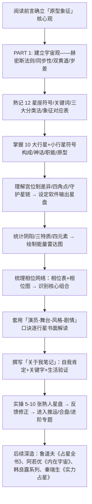

# 《图解象征占星学全书》—— 《占星学其实很简单！》系列终极完整版

## 版本演进与定位

> **核心更新**：本书为《占星学其实很简单！》丛书**融合「入门篇」与「进阶篇」并重新架构的最新完整版本**。作者在完成原计划「本命盘全书」编辑八成时停笔，耗时八年回溯占星本源——「宇宙的基本原理」，以**原型象征**为核心切入点，构筑出从零基础到实战解盘的完整占星知识体系。

| 原丛书规划 | 现状 | 本书定位 |
|------------|------|----------|
| 入门篇、进阶篇、本命分析篇、流年大运篇、合盘篇 | 入门篇与进阶篇已停止再版 | **单卷完结**：融合前两册精华，补足八年心得，确立「原型象征」为贯穿始终的教学主轴 |

**作者序言关键句**：「占星学非常渊深，但也非常容易理解……人人都应该学会算命，天底下最了解自己的就是自己。」

---

## 核心理论架构：三大支柱

### 赫密斯七大宇宙法则 —— 占星术的运作底本
> 占星学是运用宇宙基本法则的一套最有效工具（《凯巴利昂》Kybalion 口传心授）。

| 法则 | 核心意涵 | 占星应用映照 |
|------|----------|--------------|
| **唯心法则** | 宇宙万物皆为心所造（万物唯心造） | 星盘反映的是心智与灵性层面的蓝图，物质现象为内在投射 |
| **上下一致法则** | 大宇宙与小宇宙同构，「在天成象，在地成形」 | 星盘结构与人生命题具同构意义（荣格同步性基础） |
| **振动法则** | 一切皆在振动，改变频率即改变现实 | 行星周期、相位相角即特定振动模式；推运即频率共振 |
| **二元对立法则** | 对立两面本质同一（阴/阳、内/外、吉/凶） | 相位：180°对分相为对立互补；星座阴阳极性 |
| **周期循环法则** | 万物皆有生灭循环，死亡即新开端 | 行星回归周期、大年/大月时代更迭、推运触发节点 |
| **因果法则** | 业力（Karma）无巧合，念念皆有果 | 本命相位为因，行运触发为果；咨询伦理强调自负因果 |
| **阴阳法则** | 万物皆具阴阳两面，视角转换即属性互换 | 星座/行星/宫位的阴阳属性；吉凶相位的双面性 |

> **交叉引用**：[[zhanxing-zhan-xue-yu-tian-wen-xue-shi#赫密斯传统]]、[[alchemy-comprehensive-guide#赫密斯主义]]、[[tujie-xiangzheng-zhanxue-quanshu#赫密斯七大法则]]

### 原型象征与碎形全息观 —— 认知宇宙的钥匙
- **象征即实相**：玫瑰象征爱、金星象征价值，通过象征链接天、地、人三界。[[zhanxing-yu-zhen-wo#橡实理论与同时性]]
- **碎形自相似**：从夸克到星系、从细胞到国家、从手纹到星盘，同一层级结构在不同尺度重复显现。[[zhanxing-zhe-xue-ji-chu-bohm-hun-dun-jung#碎形结构与自相似性]]
- **曼陀罗星盘**：圆盘合闭即人生圆满；以曼陀罗绘制凝聚占星系统完整性。[[asteroid-goddesses-mandala#曼陀罗框架]]

### 荣格同步性 —— 非因果关联的连接原理
- **同时性原理**：同一时间点的星象与人间事件虽无因果，却具相同意义。[[zhanxing-zhe-xue-ji-chu-bohm-hun-dun-jung#荣格同步性与集体无意识]]
- **星盘非决定论**：行星不「影响」人，而是「共时性关联」；个体透过自由意志在河流分支点选择剧情。[[zhanxing-yu-zhen-wo#咨询伦理与自由意志]]
- **占星师介入实验**：荣格婚姻统计实验显示占星师心理状态参与共创结果，印证「意识决定显化」。[[zhanxing-yu-zhen-wo#一小时咨询模式]]

---

## 天文基础与坐标系统：双黄道制的清晰辨析

### 核心坐标定义
| 概念 | 定义/数值 | 关键区别 |
|------|-----------|----------|
| **天球** | 以地心为中心的假想投影球面 | 观测基准 |
| **黄道** | 太阳视运动轨迹，黄赤交角 ≈ 23°26′ | 行星运行带 |
| **春分点** | 黄赤道交点，定义为 0° 白羊座起点 | **回归黄道锚点** |
| **岁差** | 春分点每年西移 ~50.25″，约 25,800 年一周 | 导致两黄道制分离 |

### 回归黄道 vs 恒星黄道 —— 书立场明确：采用回归制
| 维度 | **回归黄道制** | **恒星黄道制** |
|------|----------------|----------------|
| 定义锚点 | 春分点固定为 0° 白羊座 | 实恒星群位置（如室女座 Spica 对齐） |
| 星座本质 | **季节/原型代码**，非实星群 | 实测恒星星座 |
| 当前偏移 | 春分点落在天文双鱼座 ~29° | 与恒星大致重合 |
| 主流流派 | **西方现代占星主流（本书采用）** | 印度吠陀占星、古代占星 |
| 核心主张 | **星座 = 12 种基本原型能量模式** | 星座 = 实星群能量 |

> **书中金句**：「现在大家口中的星座早已不是指现在天上的星座了……如果你是白羊座，其真实应该是『白羊原型』比较恰当。」  
> **交叉引用**：[[zhanxing-tianwen-jichu-yu-huangdao-tixi#回归黄道与恒星黄道]]、[[indian-astrology-jyotish-overview#恒星黄道与整宫制]]、[[liang-zi-zhan-xing-xue#岁差回归/恒星黄道之辨]]

### 中国二十八宿体系对照
- 古代观测日月五星运行的 28 星区，四象七宿（青龙/白虎/朱雀/玄武）。  
- 十二生肖由二十八宿配十二地支演变而来。  
- **交叉引用**：[[twenty-eight-lunar-mansions#中国二十八宿与四象]]、[[chinese-star-divination#果老星宗与二十八宿]]、[[qin-dun-ershiba-xiu-fenye#禽遁二十八宿分野]]

---

## 星盘四大要素：解读骨干的「演员-舞台-风格-剧情」模型

| 要素 | 角色比喻 | 核心内容 | 关键技术指标 |
|------|----------|----------|--------------|
| **行星** | **演员 / 动力来源** | 10 大行星 + 四小行星（婚神/灶神/谷神/智神）+ 凯龙星 + 南北交点 | 行星符号构成逻辑：圆圈(精神) + 新月(灵魂) + 十字(物质) [[nei-xing-xing#行星符号与原型]] |
| **星座** | **表演风格 / 12 原型** | 黄道 12 等分 30°，每座代表一种基本原型能量 | 三大分类法（二分/三分/四分）快速统计能量雷达图 [[zodiac-sign-correspondences]] |
| **宫位** | **舞台 / 人生场域** | 以升点 ASC 为起点分 12 宫，对应 12 大生活领域 | 宫位制选择：普拉西德首选、整宫制进阶、科赫/科坎普参考 [[zheng-gong-zhi-yu-shier-gong-wei#宫位制比较表]] |
| **相位** | **剧情张力 / 互动关系** | 0°合、60°六分、90°四分、120°三分、180°对分等 | 容许度标准、相位网络、相位组合（T-square、Grand Trine 等） [[aspect-interpretation-framework#相位计算与容许度]] |

> **口诀**：「行星是演员，宫位是场景，星座是表演方式，相位是演员互动产生的剧情。」

### 四大角点 —— 命盘四根支柱
| 角点 | 符号 | 象征领域 | 关键度数 |
|------|------|----------|----------|
| **东升点** | ASC | 自我、体貌、人生面具、命运起点 | 第 1 宫宫头 |
| **中天点** | MC | 事业、地位、公众形象、最高成就 | 第 10 宫宫头 |
| **西降点** | DES | 伴侣、合作、他者投影、婚姻 | 第 7 宫宫头 |
| **天底点** | IC | 家庭、根基、祖先、内在安全感 | 第 4 宫宫头 |

**合轴星**：落入四角点 ±8° 内的行星，强化对应生命支柱能量。[[shengshang-xingzuo#上升点与四轴]]、[[zheng-gong-zhi-yu-shier-gong-wei#四角点与角点行星]]

### 守护星追踪链 —— 全盘统筹者
1.  命宫（第 1 宫）宫头星座 → 查其主宰行星（守护星）  
2.  守护星落入第 X 宫 → 该宫位主题成人生核心课题  
3.  守护星的相位网络 → 能量流动路径与挑战/资源 [[zhenggongzhi-yu-shier-gongwei#守护星追踪法]]、[[sasportas-twelve-houses#空宫分析的守护星追踪法]]

---

## 十二星座分类法：快速建立能量雷达图的三维坐标

| 分类维度 | 类别 | 包含星座 | 核心动机/特质 | 统计对象 |
|----------|------|----------|--------------|----------|
| **二分法（阴/阳）** | **阳性** | 白羊、双子、狮子、天秤、射手、水瓶 | 外向、主动、开创、投射 | 10 大行星 + ASC + MC |
| | **阴性** | 金牛、巨蟹、处女、天蝎、摩羯、双鱼 | 内向、被动、包容、吸纳 | 同上 |
| **三分法（四正/特质）** | **基本/主动** | 白羊、巨蟹、天秤、摩羯 | 开创、领导、启动、行动力 | 同上 |
| | **固定** | 金牛、狮子、天蝎、水瓶 | 稳定、坚持、抗变、聚焦 | 同上 |
| | **变动** | 双子、处女、射手、双鱼 | 适应、转换、沟通、调整 | 同上 |
| **四分法（元素）** | **火象** | 白羊、狮子、射手 | 直觉、冲动、热情、精神 | 同上 |
| | **土象** | 金牛、处女、摩羯 | 感官、务实、稳健、物质 | 同上 |
| | **风象** | 双子、天秤、水瓶 | 智性、社交、理性、资讯 | 同上 |
| | **水象** | 巨蟹、天蝎、双鱼 | 情感、直觉、共融、灵性 | 同上 |

**实务技巧**：统计命盘中行星落入各分类的数量 → 绘制「能量雷达图」 → 瞬间掌握行为倾向、决策风格、情感模式。[[zhanxing-quan-fang-wei#生命三机制]]、[[han-lianglu-12-zodiac-planetary-interactions#十二星座演化意识]]、[[xing-zhong-jian-xingzuo-xinli#强势星座与四象星座]]

### 星座象徵对应表（书中关键词表节选）
| 星座 | 身体部位 | 正向关键词 | 负向关键词 | 象征色/物/场 |
|------|----------|------------|------------|--------------|
| ♈ 白羊 | 头部 | 纯真、勇敢、正义 | 冲动、自我、粗心 | 红色、刀剑、战场 |
| ♉ 金牛 | 喉咙 | 耐心、艺术、稳重 | 固执、占有、享乐 | 绿色、项链、银行 |
| ♊ 双子 | 手/肺 | 机智、多才、沟通 | 善变、肤浅、焦虑 | 黄色、手机、书店 |
| ♋ 巨蟹 | 胸/胃 | 温柔、保护、直觉 | 情绪化、逃避、依赖 | 银白、相框、家庭聚餐 |
| ♌ 狮子 | 心脏 | 慷慨、领导、热情 | 傲慢、爱面子、剧烈 | 金色、皇冠、舞台 |
| ♍ 处女 | 肠/消化 | 细心、完美、服务 | 挑剔、焦虑、洁癖 | 米色、笔记本、诊所 |
| ♎ 天秤 | 肾脏 | 公正、优雅、合作 | 优柔寡断、依赖、虚荣 | 粉红、天平、美术馆 |
| ♏ 天蝎 | 生殖器 | 深沉、专注、再生 | 嫉妒、控制、报复 | 深红、显微镜、密室 |
| ♐ 射手 | 大腿 | 乐观、自由、哲学 | 鲁莽、不负责、夸大 | 紫色、护照、大学 |
| ♑ 摩羯 | 膝/骨骼 | 责任、自律、成就 | 冷酷、悲观、压抑 | 深绿、公文包、公司 |
| ♒ 水瓶 | 小腿/循环 | 创新、博爱、独特 | 叛离、冷漠、怪异 | 电蓝、电脑、实验室 |
| ♓ 双鱼 | 脚/体液 | 慈悲、想像、灵性 | 逃避、迷惑、自我牺牲 | 海蓝、音乐、医院 |

> 完整表含颜色、人物、事件、物件、场地五维，供自由联想扩充。[[zodiac-sign-correspondences#十二星座象征对应速查表]]

---

## 符号语言的结构逻辑：行星符号三要素

| 基本图形 | 象征层面 | 行星符号组合实例 |
|----------|----------|------------------|
| **○ 圆圈** | 精神 / 神性 / 无限 | 太阳 ☉（圆心有点＝混沌中萌芽） |
| **☽ 新月** | 灵魂 / 情感 / 过去 / 容器 | 月亮 ☽、水星 ☿（新月+圆+十字） |
| **✚ 十字** | 物质 / 现实限制 / 十字架 | 金星 ♀（新月在十字上＝精神凌驾物质）、火星 ♂（十字+箭头＝物质超越精神） |

> **核心洞见**：「符号本身即蕴含神话原型与心理动力，阅读符号即阅读能量结构。」[[nei-xing-xing#行星符号与原型]]、[[zhanxing-xingxing-tianwen-yu-yiyi#神话原型到心理机能映射]]

---

## 周期法则与人生地图：行星回归时间表

### 行星回归周期（占星周期的重要指标）
| 行星 | 回归周期 | 象征关注点 | 人生关键节点 |
|------|----------|------------|--------------|
| **太阳** | 1 年 | 生命能量、自我实现 | 每年生日太阳回归图 |
| **月亮** | 1 月 | 情绪、内在需求、习惯 | 月相回归、情绪周期 |
| **水星** | ~88 天 | 思维、沟通、学习 | 水星逆行/回归周期 |
| **金星** | 225 天 | 爱情、价值、财务 | 金星逆行 18 个月周期 |
| **火星** | ~2 年 | 行动、欲望、冲突 | 火星回归约 2 岁、20 岁、38 岁... |
| **木星** | ~12 年 | 扩张、机会、信念 | **12、24、36、48、60、72 岁** 木星回归 |
| **土星** | ~29.5 年 | 责任、结构、业力、成熟 | **29-30 岁首次土星回归（成人礼）**、59 岁二次 |
| **天王星** | ~84 年 | 变革、觉醒、突变 | **42 岁天王星对分相（中年危机）**、84 岁回归 |
| **海王星** | ~165 年 | 幻象、灵性、溶解 | **42-44 岁海王星四分相**、84 岁对分相 |
| **冥王星** | ~248 年 | 重生、权力、深度转化 | 冥王星四分相约 36-38 岁、对分相不可及 |

### 木土 20 年会合周期 —— 社会集体节奏
- 1980、2000、2020 年木土合相（风象时代开启）  
- 象征权力扩张（木）与结构压力（土）的周期性博弈  
- 美国总统「20 年诅咒」林肯/甘迺迪/里根/小布希等印证 [[zhanxing-liu-nian-rudolf#木土会合与社会周期]]

### 人生阶段关键相位时间表（书中观察表浓缩）
| 人生阶段 | 关键年龄 | 核心相位事件 | 主题 |
|----------|----------|--------------|------|
| **儿童反抗期** | 6-10 岁 | 木星对分、土星四分/三分 | 规则测试、权威建立 |
| **启蒙期/青春期** | 12-14 岁 | **木星首次回归**、土星对分 | 自我扩张、社会化入门 |
| **成年期** | 18-24 岁 | 木星对分/二次回归、土星三分/四分、天王星四分 | 独立、职业/学业选择 |
| **成熟期/土星回归** | **29-30 岁** | **土星首次回归**、木星三次回归 | **人生定型、责任确立、事业/婚姻大事** |
| **中年危机期** | 40-45 岁 | 天王星对分、海王星四分、土星四分/对分 | 结构崩解、意义重寻、婚姻/职业变革 |
| **更年期/智慧期** | 49-56 岁 | 土星二次回归、海王星三分/四分、天王星三分 | 内在整合、灵性觉醒、传承 |
| **前老年/老年期** | 59-84 岁 | 木星/土星多次回归、天王星回归（84 岁） | 生命总结、超越、准备离世 |

> **交叉引用**：[[zhanxing-liu-nian-rudolf#行星回归与推运技法]]、[[arroyo-astrology-karma-transformation#土星为业力之王]]、[[sasportas-gods-of-change#外行星行运与心理危机]]

---

## 星盘实作流程：从数据到解读的标准化 SOP

### PART 3 软体排盘实作（书中完整步骤）
1.  **资料准备**：出生日期（西元）、精确时间（分钟级）、地点（经纬度/时区）  
2.  **工具选择**：Astro.com、Astro-Seek、Solar Fire、中文免费网站（书附 QR Code）  
3.  **设定确认**：
    - 宫位制：**Placidus（预设/首选）** / Whole Sign（整宫制进阶研究）
    - 黄道制：**Tropical（回归制，预设）**
    - 显示项：行星、小行星、月交点、凯龙星、相位图、相位表、中点/阿拉伯点（进阶）
4.  **导出/列印**：PDF、图档、关键词表，供后续手工标注

### 解读四步骤「演员-舞台-风格-剧情」实战版
```mermaid
flowchart TD
    A[输出星盘确认四角点 ASC/MC/DES/IC] --> B[标记 10 大行星+小行星+交点落入星座/宫位]
    B --> C[统计阴阳/三特质/四元素能量分布 → 绘制雷达图]
    C --> D[找出守护星（命宫主宰星）及其落宫/相位]
    D --> E[梳理相位网络：重相位→次相位→相位组合]
    E --> F[套用口诀逐行星解读：行星(动力)在星座(风格)落宫(领域)产生相位(剧情)]
    F --> G[整合：人格面具(ASC)、核心自我(太阳)、情感内核(月亮)、沟通/爱欲/行动模式]
    G --> H[撰写「关于我笔记」：自我肯定 + 关键字速查 + 生活对应验证]
```

> **书中特色工具**：关键词表、中英对照表、符号速查卡、分类法统计表、守护星追踪表、软件操作截图步骤。[[zhanxing-biji-zhaohui-zhenshi-ziji#双轨制实作法]]、[[zhanxing-zixue-shengjing#乔安娜教学特色]]

---

## 时代周期与集体无意识：大年/大月视野

| 周期层级 | 周期长度 | 机制 | 当前所处 | 集体主题 |
|----------|----------|------|----------|----------|
| **大年** | ~25,800 年 | 岁差一周 | — | 文明层级跃迁 |
| **大月** | ~2,150 年 | 春分点穿越一星座 | **双鱼座末期 → 水瓶座初期** | **双鱼：牺牲/救赎/灵性寻求** → **水瓶：创新/自由/个体觉醒/科技伦理** |
| **木土 20 年** | 20 年 | 木土合相 | 2020 风象时代始 | 社会结构重组、科技治理、去中心化 |
| **外行星相位** | 不定 | 天海冥慢速相位 | 2020s 土冥合相/木土合/天冥四分 | 权力重构、制度崩解、集体疗愈 |

> **荣格视角**：时代原型投射于集体无意识，个体星盘与时代相位共振即显化命运剧情。[[zhanxing-zhe-xue-ji-chu-bohm-hun-dun-jung#时代原型与集体无意识]]、[[huanxiangxr-21-world-matrix-invasion#玄无自我更新与2012]]、[[zhongguo-yixue-wenhua-chuancheng-jiedu-congshu#易学与时代演进]]

---

## 与知识库既有页面的深度交叉引用索引

| 本书核心主题 | 对应章节 | 知识库页面 | 补充说明 |
|--------------|----------|------------|----------|
| **丛书定位与版本演进** | 前言、序 | [[astrology-made-simple-series]] (本页) | 更新为融合版终极完整版定位 |
| **赫密斯七大法则** | 1-1 宇宙法则 | [[tujie-xiangzheng-zhanxue-quanshu#赫密斯七大法则]]、[[alchemy-comprehensive-guide#赫密斯主义]] | 炼金术/占星/塔罗共同源头 |
| **荣格同步性/原型/集体无意识** | 1-1 容格与心理占星 | [[zhanxing-zhe-xue-ji-chu-bohm-hun-dun-jung#荣格同步性与集体无意识]]、[[zhanxing-yu-zhen-wo#橡实理论与同时性]] | 心理占星理论基石 |
| **天文基础/双黄道制/岁差** | 1-3 占星与天文学 | [[zhanxing-tianwen-jichu-yu-huangdao-tixi]]、[[liang-zi-zhan-xing-xue#岁差回归/恒星黄道之辨]] | 量子占星几何通俗解释 |
| **中国二十八宿/四象** | 1-2 中国占星学 | [[twenty-eight-lunar-mansions]]、[[chinese-star-divination]]、[[qin-dun-ershiba-xiu-fenye]] | 禽遁/擒遁体系对照 |
| **行星符号结构/神话原型** | 1-6 占星的符号 | [[zhanxing-xingxing-tianwen-yu-yiyi]]、[[nei-xing-xing]] | 天文参数+神话+心理三层验证 |
| **星座分类法/象征对应/关键词** | 2-3 分类法、2-4 十二星座 | [[zodiac-sign-correspondences]]、[[han-lianglu-12-zodiac-planetary-interactions]]、[[xing-zhong-jian-xingzuo-xinli]] | 演化意识/心理动力学深化 |
| **宫位制比较/整宫制/四角点** | 1-3 宫位系统、占星的宫位制 | [[zheng-gong-zhi-yu-shier-gong-wei]]、[[zhenggongzhi-yu-shier-gongwei]]、[[shengshang-xingzuo]] | 郑工智实务断语/韩良露四轴生命剧本 |
| **相位理论/容许度/相位组合** | 2-7 相位分析 | [[aspect-interpretation-framework]]、[[minor-aspects-psychological-astrology]]、[[sue-tompkins-aspect-theory]] | 情意结/投射/阴影/个体化模型 |
| **守护星追踪/宫主星链** | 2-5 十二宫位、初识星盘 | [[sasportas-twelve-houses#空宫分析的守护星追踪法]]、[[zhenggongzhi-yu-shier-gongwei]] | 整合式解读核心技法 |
| **行星回归/推运/流年/木土会合** | 1-4 周期法则、人生周期 | [[zhanxing-liu-nian-rudolf]]、[[arroyo-astrology-karma-transformation]]、[[sasportas-gods-of-change]] | 五大流年技法体系/外行星心理危机模型 |
| **星盘实作 SOP/软件操作** | PART 3、初识星盘 | [[zhanxing-biji-zhaohui-zhenshi-ziji]]、[[zhanxing-zixue-shengjing]] | 双轨制/自我肯定心法/关键字速查 |
| **占星历史脉络** | 1-2 占星学的历史 | [[xing-zhan-xue-yu-tian-wen-xue-shi]]、[[zhanxing-shuji-mulu-yu-zhuti-daohang]] | 巴比伦→希腊→阿拉伯→印度→现代 |
| **医学占星/身心对应** | 1-4 象征与周期、身体部位表 | [[ancient-egyptian-mythological-legends]]、[[huangdao-shier-gong-tixi]]、[[zhanxing-fang-liao-xi-tong]] | 全人健康/芳疗/行星药草配伍 |
| **业力/演化占星/灵魂合同** | 1-1 宿命论与自由意志、因果法则 | [[arroyo-astrology-karma-transformation]]、[[ming-wang-xing-ling-hun-yan-hua-zhi-lv-juan-yi]]、[[birth-pre-contract]] | 三种业力/冥王星演化阶段/出生前计划 |

---

## 学习路径建议（自学者视角·更新版）



---

## 版本与维护信息

- **页面版本**：v2.0（基于《图解象征占星学全书》全书内容重构，取代原 v1.0 仅覆盖入门篇的版本）  
- **对应书籍版本**：《图解象征占星学全书》初版（融合原入门篇+进阶篇+八年心得）  
- **最后更新**：2026-11-14  
- **维护建议**：若后续出版「流年大运篇」「合盘篇」等专题展开册，可在「丛书后续专题册预告」区块增补章节对照；软件界面更新时同步调整 PART 3 操作截图说明。

---

## 附录：本书书目信息速查

| 项次 | 内容 |
|------|------|
| **书名** | 《图解象征占星学全书》 |
| **系列渊源** | 《占星学其实很简单！》系列「入门篇」+「进阶篇」融合重构版 |
| **核心方法论** | 原型象征切入 + 赫密斯七大法则 + 荣格同步性 + 碎形全息观 |
| **适用对象** | 零基础入门者 → 进阶实战者 → 咨询师教学参考 |
| **特色工具** | 关键词表、中英对照表、符号速查卡、分类法统计表、守护星追踪表、软件逐步截图 |
| **参考书目** | 书末列举 17 部经典（阿若优、Sasportas、Tompkins、Arroyo、Rudolf 等）+ 网络多元 App |

## 来源

- [图解象征占星学全书](../sources/图解象征占星学全书.md)
