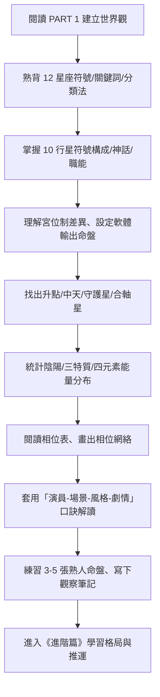

# 《占星其實很簡單》叢書總覽：入門到進階的教學架構與特色工具

## 叢書定位與教學宗旨

《占星學其實很簡單！》為一套分級教學叢書，規劃包含 **入門篇、進階篇、本命分析篇、流年大運篇、合盤篇** 等多冊。本頁以第一冊 **〈入門篇〉** 為核心，梳理其完整知識骨幹，呈現從「零基礎認識占星」到「獨立排盤解讀」的學習路徑。

> **核心主張**：占星學「非常淵深，但也非常容易理解」。書中以大量圖示、關鍵詞表、中英對照表、軟體操作指引，降低符號門檻，強調 **「人人都應該學會算命，天底下最了解自己的就是自己」**。

---

## 全書章節架構總覽

| 篇章 | 核心主題 | 對應書中 PART / 章節 |
|------|----------|----------------------|
| **PART 1** | 占星學是什麼？歷史演進、天文基礎、四大要素、星座系統、宮位系統、歲差與雙系統 | 1-1 占星學是什麼？ / 1-2 占星學的歷史 / 1-3 占星學與天文學 |
| **PART 2** | 出生圖內涵、符號系統、星座/行星/宮位/相位詳細解說、分類法、十二星座象徵對應 | 2-1 出生圖的內涵 / 2-2 占星學的符號 / 2-3 占星學的分類法 / 2-4 十二星座 / 2-5 十二宮位 / 2-6 行星系統 / 2-7 相位分析 / 2-8 解盤法則 |
| **PART 3** | 軟體排盤實作：免費網站/軟體操作步驟、出生資料輸入、命盤解讀入門 | 3 如何弄出你的命盤 |

---

## 核心知識體系詳細梳理

### 占星學的三重定義
- **符號語言**：以行星、星座、宮位、相位構成的圖像化編碼系統。
- **分析工具**：利用「行星—地球感應關連」於個人、人際、世事、股市、氣候等層面分析。
- **思考方式/哲學態度**：榮格「同時性原理」——同一時間點的星盤結構與人生命題具同構意義，**非行星影響人，而是共時性關聯**。[[zhanxing-yu-zhen-wo#橡實理論與同時性]]

### 天文基礎與座標系統
| 概念 | 定義 / 關鍵數值 | 交叉引用 |
|------|-----------------|----------|
| **天球** | 以地球為心的假想球，行星投影其上 | [[zhanxing-tianwen-jichu-yu-huangdao-tixi#天球與坐標系統]] |
| **黃道** | 太陽在天球視運動軌跡，地軸傾角 ≈ 23.5° (黃赤交角) | [[zhanxing-tianwen-jichu-yu-huangdao-tixi#黃道與回歸黃道]] |
| **春分點** | 黃赤道交點，定義為 0° 牡羊座起點 | [[zhanxing-tianwen-jichu-yu-huangdao-tixi#春分點與歲差]] |
| **白道** | 月球繞地軌道，與黃道交角 ≈ 5°，形成交點 (月交點) | [[han-lianglu-12-zodiac-planetary-interactions#月交點]] |

### 星盤四大要素 —— 解讀骨幹
| 要素 | 角色比喻 | 核心內容 | 相關頁面 |
|------|----------|----------|----------|
| **行星** | **演員 / 動力來源** | 10 大行星 (日月水金火木土天海冥) + 四小行星 (婚神/灶神/穀神/智神) + 凱龍星 + 月交點 | [[nei-xing-xing]]、[[arroyo-astrology-karma-transformation#行星權重]] |
| **星座** | **表演風格 / 12 原型** | 黃道 12 等分 (30°)，每座代表一種基本原型能量 | [[zodiac-sign-correspondences]]、[[han-lianglu-12-zodiac-planetary-interactions]] |
| **宮位** | **舞臺 / 人生場域** | 以升點 (ASC) 為起點分 12 宮，對應 12 大生活領域 | [[zheng-gong-zhi-yu-shier-gong-wei]]、[[zhenggongzhi-yu-shier-gongwei]] |
| **相位** | **劇情張力 / 互動關係** | 合相 0°、對分 180°、三分 120°、四分 90°、六分 60° 等 | [[zhanxing-quanshu-rudolf#相位理論]] |

> **書中口訣**：「行星是演員，宮位是場景，星座是表演方式，相位是演員互動產生的劇情。」

### 十二星座分類法 —— 記憶與判讀鍵
| 分類維度 | 類別 | 包含星座 | 核心特質 |
|------------|------|----------|----------|
| **二分法 (陰/陽)** | 陽性 | 牡羊、雙子、獅子、天秤、射手、水瓶 | 外向、主動、開創 |
| | 陰性 | 金牛、巨蟹、處女、天蠍、摩羯、雙魚 | 內向、被動、包容 |
| **三分法 (特質/四正)** | **基本/主動** | 牡羊、巨蟹、天秤、摩羯 | 開創、領導、啟動 |
| | **固定** | 金牛、獅子、天蠍、水瓶 | 穩定、堅持、抗變 |
| | **變動** | 雙子、處女、射手、雙魚 | 適應、轉換、溝通 |
| **四分法 (元素)** | **火象** | 牡羊、獅子、射手 | 直覺、衝動、熱情 |
| | **土象** | 金牛、處女、摩羯 | 感官、務實、穩健 |
| | **風象** | 雙子、天秤、水瓶 | 智性、社交、理性 |
| | **水象** | 巨蟹、天蠍、雙魚 | 情感、直覺、共融 |

> **應用技巧**：統計命盤中行星落入各分類的數量，即可快速掌握「行為傾向、決策風格、情感模式」。[[zhanxing-quan-fang-wei#生命三機制]]

### 星座象徵對應表 (節選自書中關鍵詞表)
| 星座 | 身體部位 | 正向關鍵詞 | 負向關鍵詞 | 顏色/物件/場景 |
|------|----------|------------|------------|----------------|
| ♈ 牡羊 | 頭部 | 純真、勇敢、正義 | 衝動、自我、粗心 | 紅色、刀劍、戰場 |
| ♉ 金牛 | 喉嚨 | 耐心、藝術、穩重 | 固執、佔有、享樂 | 綠色、項鍊、銀行 |
| ♊ 雙子 | 手/肺 | 機智、多才、溝通 | 善變、膚淺、焦慮 | 黃色、手機、書店 |
| ♋ 巨蟹 | 胸/胃 | 溫柔、保護、直覺 | 情緒化、逃避、依賴 | 銀白、相框、家庭聚餐 |
| ♌ 獅子 | 心臟 | 慷慨、領導、熱情 | 驕傲、愛面子、劇烈 | 金色、皇冠、舞台 |
| ♍ 處女 | 腸/消化 | 細心、完美、服務 | 挑剔、焦慮、潔癖 | 米色、筆記本、診所 |
| ♎ 天秤 | 腎臟 | 公正、優雅、合作 | 猶豫、依賴、虛榮 | 粉紅、天平、美術館 |
| ♏ 天蠍 | 生殖器 | 深沉、專注、再生 | 嫉妒、控制、報復 | 深紅、顯微鏡、密室 |
| ♐ 射手 | 大腿 | 樂觀、自由、哲學 | 魯莽、不負責、誇大 | 紫色、護照、大學 |
| ♑ 摩羯 | 膝/骨骼 | 責任、自律、成就 | 冷酷、悲觀、壓抑 | 深綠、公文包、公司 |
| ♒ 水瓶 | 小腿/循環 | 創新、博愛、獨特 | 叛離、冷漠、怪異 | 電藍、電腦、實驗室 |
| ♓ 雙魚 | 腳/體液 | 慈悲、想像、靈性 | 逃避、迷惑、犧牲 | 海藍、音樂、醫院 |

完整對應表含顏色、人物、事件、物件、場地五欄，可作 **自由聯想擴充** 之用。[[zodiac-sign-correspondences]]

### 行星符號構成邏輯 —— 三基本圖形
| 圖形 | 象徵層面 | 行星符號組合範例 |
|------|----------|------------------|
| ◯ 圓圈 | **精神 / 神性** | 太陽 ☉ (圓心有點＝混沌中萌芽) |
| ☽ 新月 | **靈魂 / 情感 / 過去** | 月亮 ☽、水星 ☿ (新月+圓+十字) |
| ✚ 十字 | **物質 / 現實限制** | 金星 ♀ (新月+十字＝精神凌駕物質)、火星 ♂ (十字+箭頭＝物質超越精神) |

> **書中強調**：符號本身即蘊含神話原型與心理動力，**閱讀符號即閱讀能量結構**。[[nei-xing-xing#行星符號與原型]]

### 宮位制比較與實務選擇
| 宮位制 | 分割原則 | 適用場景 | 書中建議 |
|--------|----------|----------|----------|
| **等分宮位制** | 升點起每 30° | 入門速查、極地 | 簡單直觀 |
| **普拉西德斯制** | 時空分割、最流行 | 一般命理諮詢 | **首選** |
| **科赫制** | 本地緯度為基準 | 美國慣用 | 參考對照 |
| **整宫制** | 升星座 = 第 1 宮整座 | 希臘化傳統、整宮制研究 | 進階研究 |

> **關鍵提醒**：不同宮位制會導致行星落宮不同，**解盤前必須宣告所用制式**，避免誤導。[[zheng-gong-zhi-yu-shier-gong-wei#宮位制比較表]]

### 歲差現象與雙系統差異
| 系統 | 定義基準 | 現狀 | 主流流派 |
|------|----------|------|----------|
| **回歸黃道制 (Tropical)** | 春分點固定為 0° 牡羊座 | 與四季對應，星座成「虛擬意象」 | 西方現代占星主流 |
| **恆星黃道制 (Sidereal)** | 實際恆星群位置 | 當前春分點落雙魚座 ≈ 29° | 印度占星、古代中西占星 |

- **歲差速率**：年均 50.25″，約 25,800 年行一周。
- **書中立場**：採用回歸制，**星座 = 季節/原型代碼，非實際星群**。[[zhanxing-tianwen-jichu-yu-huangdao-tixi#回歸黃道與恆星黃道]]

### 出生圖關鍵進階概念
| 概念 | 定義 | 實務價值 |
|------|------|----------|
| **上升星** | 升點 ±8° 內行星 | 命盤核心能量、外在人格面具 |
| **合軸星** | 四角點 (ASC/DESC/MC/IC) ±8° 內行星 | 對應生命四大支柱 (自我/伴侶/事業/根基) 的強化器 |
| **主宰星 / 宮主星** | 星座主宰行星 → 落宮位 = 宮主星 | 連結兩個生活領域能量流動 |
| **守護星** | 命宮 (第 1 宮) 宮主星 | **全圖統籌者**，落宮顯示人生核心課題 |
| **陰陽/三特質/四元素 統計** | 統計 10 大行星 + 升點/中天 落入各分類數量 | 快速繪製「能量雷達圖」 |

### 軟體排盤實作流程 (PART 3)
1. **資料準備**：出生日期 (西元)、精確時間 (分鐘級)、地點 (經緯度/時區)。
2. **工具選擇**：Astro.com、Astro-Seek、Solar Fire、中文免費網站 (書中附 QR Code)。
3. **設定確認**：
   - 宮位制：Placidus (預設) / Whole Sign
   - 黃道制：Tropical (預設)
   - 顯示項目：行星、小行星、月交點、凱龍星、相位圖、相位表
4. **匯出/列印**：PDF、圖檔、關鍵詞表，供後續手工標註。

---

## 叢書後續冊次預告與銜接點

| 後續冊次 | 核心推進 | 銜接本書知識點 |
|----------|----------|----------------|
| **進階篇** | 相位深度、行星相位組合、小行星/中點/阿拉伯點 | 2-7 相位分析 → 相位網絡動態 |
| **本命分析篇** | 格局識別 (T-square、Grand Trine 等)、行星相位權重、人格整合 | 2-8 解盤法則 → 結構化解讀流程 |
| **流年大運篇** | 推運 (Transits)、進展 (Progressions)、太陽回歸、行運觸發時機 | 本命星盤 + 運行星互動 = 時機地圖 |
| **合盤篇** | 雙人星盤 (Synastry)、合成盤、關係動力學 | 雙圖行星相位 → 緣分密碼 |

---

## 特色教學工具一覽

| 工具 | 形式 | 功能 |
|------|------|------|
| **關鍵詞表** | 附錄表格 | 行星/星座/宮位/相位核心詞彙速查 |
| **中英對照表** | 附錄表格 | 專用術語雙語對照 (如 Ascendant/上升點、Midheaven/中天) |
| **符號速查卡** | 內頁圖示 | 12 星座、10 行星、相位、特殊點符號一頁通 |
| **分類法統計表** | 空白表單 | 讀者自填：行星落入陰陽/三特質/四元素計數 |
| **守護星追蹤表** | 空白表單 | 步驟化找出守護星 → 落宮 → 生活重心 |
| **軟體操作截圖** | 逐步圖解 | 從註冊到匯出命盤的完整視覺化指引 |

---

## 學習路徑建議 (自學者視角)

---

## 與知識庫既有頁面的交叉引用索引

| 主題 | 本書對應章節 | 知識庫頁面 | 補充說明 |
|------|--------------|------------|----------|
| 占星書目總覽 | 全書定位 | [[zhanxing-shuji-mulu-yu-zhuti-daohang]] | 定位本叢書在華語占星入門書系中的位置 |
| 天文基礎與座標 | 1-3 | [[zhanxing-tianwen-jichu-yu-huangdao-tixi]] | 回歸/恆星黃道、歲差、春分點定義 |
| 行星原型與神話 | 2-6 | [[nei-xing-xing]]、[[arroyo-astrology-karma-transformation]] | 內行星心理職能、業力行星 (土冥) |
| 宮位系統與整宮制 | 2-5 | [[zheng-gong-zhi-yu-shier-gong-wei]]、[[zhenggongzhi-yu-shier-gongwei]] | 整宮制邏輯、鄭工智宮位實務斷語 |
| 星座象徵對應 | 2-4 關鍵詞表 | [[zodiac-sign-correspondences]] | 身體部位、顏色、人物/事件/物件/場域五維對應 |
| 十二星座演化意識 | 2-4 | [[han-lianglu-12-zodiac-planetary-interactions]] | 行星落座的演化心理層面 |
| 上升星座與四軸 | 2-1、2-5 | [[shengshang-xingzuo]] | 升點/中天/降點/天底的生命劇本 |
| 行星天文參數與占星意涵 | 2-6 | [[zhanxing-xingxing-tianwen-yu-yiyi]] | 八大行星+冥王星+小行星天文數據對照 |
| 占星歷史脈絡 | 1-2 | [[xing-zhan-xue-yu-tian-wen-xue-shi]] | 巴比倫→希臘→阿拉伯→印度→現代 |
| 心理占星與個體化 | 全書哲學 | [[zhanxing-yu-zhen-wo]]、[[ni-de-di-yi-ben-xin-li-zhan-xing-shu]] | 婚神/凱龍/月交點的靈性轉化視角 |

---

## 版本與維護資訊

- **頁面版本**：v1.0 (初建)
- **對應書籍版本**：《占星學其實很簡單！入門篇》初版
- **最後更新**：2025-01-15
- **維護建議**：後續冊次出版時，於「叢書後續冊次預告」區塊補充實際章節對照；若軟體介面更新，同步調整 PART 3 截圖說明。

## 来源

- [占星其实很简单1+2](../sources/占星其实很简单1+2.md)
