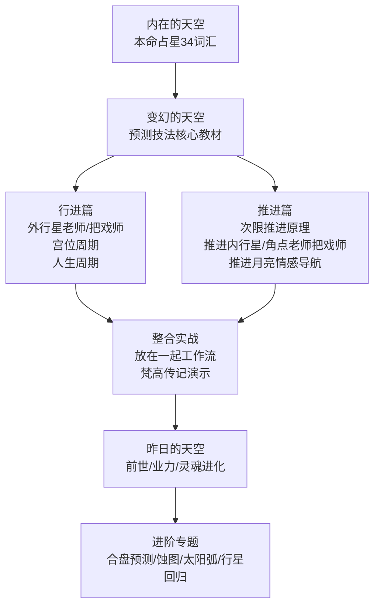

# 变幻的天空

> 斯蒂芬·福里斯特（Steven Forrest）进化占星学经典三部曲第二部，被公认为现代预测占星学最重要的教材之一。全书以「预测之本」为基石，系统阐述「行进」与「次限推进」两大核心技法，确立「老师/把戏师」人格化模型、「三层面预测理论」与「概率场」哲学框架，确立预测占星服务于自由意志、而非宿命论的核心立场。

---

## 书籍基础信息

| 项目 | 内容 |
|------|------|
| **原著** | *The Changing Sky* (1984) |
| **作者** | 斯蒂芬·福里斯特（Steven Forrest） |
| **译者** | 付凌宇（Cora） |
| **出版社** | 立品图书 / 吉林文史出版社 |
| **出版年** | 2015 年（中文版） |
| **定位** | 进化占星预测教材、实务操作手册 |
| **前作** | 《[内在的天空](neizai-de-tiankong.md)》（本命占星基础） |
| **后作** | 《昨日的天空》（前世/业力占星） |

---

## 核心哲学框架

### 谁在掌控：自由意志与概率场

> **核心论点**：行星设下舞台，但不同的人写出各自的剧本。占星预测的对象不是外在事件，而是内在的心理地貌与灵性课题。

#### 三层面预测理论
| 层面 | 名称 | 内容 | 预测准确度 | 占星作用 |
|------|------|------|------------|----------|
| **第一层** | 物质/行为层面 | 具体事件、行动、外在发生 | 最低（不可靠） | 非预测重点；执迷此层是占星史悲剧 |
| **第二层** | 情感/心理层面 | 感受、态度、主观反应 | 中等 | 重要参考；情绪反应由个人创造，需自担责任 |
| **第三层** | 灵性/意义层面 | 目的、课题、生命蓝图、成长方向 | **最高（可达 100%）** | **预测占星的真正目的与根本力量** |

#### 概率场
- 未来非命定，而是由**不断变化的、彼此交织的选择模式**组成
- 行星影响呈现「概率曲线」：阻力最小的路径常被算命先生预测中，但非唯一归宿
- **预测占星全部目的**：帮助人们了解如何将人生概率曲线扭转至最能带来幸福、成长、满足的方向
- 负面概率场可透过觉知、勇气、创造力转化为成长盟友

### 预测之本：出生星图

- 出生星图是占星预测的**唯一基石**与「预测之本」
- 所有预测技法（行进、推进、回归、蚀图等）皆作用于本命星图，**离开本命星图皆一文不值**
- **调频收音隐喻**：本命星图如有缺陷收音机，仅对特定频道（敏感度数、行星、宫位）情有独钟
- 三大预测原则：
  1. 本命星图中地位越重要的行星，其行进/推进影响越持久戏剧化
  2. 本命主导行星的行进/推进，个体能更本能地做出创造性反应
  3. 本命弱势行星触发敏感区时，虽长远发展性不显，但**情感冲击可能更强烈**（面对全新陌生挑战）

---

## 第一部分：创造未来（第 1–3 章）

### 第 1 章 谁在掌控
- **火星案例对比**：马丁·路德·金（行进火星合上升 → 公民不服从）vs 海明威（同一行进 → 自杀）
- 同一行星能量，不同意识层级写出不同剧本
- **宿命论批判**：算命先生预测事件（第一层面），现代占星描述心理地貌（第三层面）
- **不确定性 = 自由** 的同义词；占星抛出谜题，解法多样，选择权在个体

### 第 2 章 快速回顾：本命占星 34 词汇
| 系统 | 数量 | 核心功能 | 关键问题 |
|------|------|----------|----------|
| **行星** | 10 | 心识结构蓝图、意识独立组件 | **是什么**（What） |
| **星座** | 12 | 基本生命过程、目的与内置策略 | **为什么、怎样**（Why/How） |
| **宫位** | 12 | 行为领域、能量展现舞台 | **在哪里**（Where） |
| **相位** | 5 大相位 | 行星间几何角度、能量互动模式 | **如何互动**（How interact） |

> **分宫制说明**：全书案例均采用 **Placidus（普拉西德斯）分宫法**，不同分宫制可能导致宫位归属差异。

### 第 3 章 预测之本
- 卡斯特将军（George Armstrong Custer）星图深度实战演示
- **三倍射手**（太阳、月亮、上升均落射手座 12 宫）+ 第一宫水星/火星 + 天王星双鱼四分太月 + 土星合太月
- **1876.6.25 小大角战役** 触发配置：
  - 土星行进双鱼 9°：合本命天王星、四分本命太阳/月亮 → 现实考验与自我膨胀冲突
  - 火星行进巨蟹 20°：四分本命冥王星（白羊 4 宫）、对分本命火星（白羊 1 宫） → 攻击性顶点、对手显现（第七宫）
- **教训**：占星提出问题（尊重对手、现实考验），卡斯特以骄傲作答 → 结局非命定，而是拒绝学习的选择

---

## 第二部分：行进——宇宙天气（第 4–7 章）

### 第 4 章 行进的定义
> **定义**：站在地球视角观察，行星绕太阳做的真实物理运动。
- 地球为观测平台（旋转木马上的小马），产生视行差（顺行、留、逆、复行）
- 行进 = **外在触发器**、**宇宙天气**，作用于本命星图敏感点

### 第 5 章 老师与把戏师：外行星行进的人格化模型
> **仅适用于移动缓慢、能为长时段定下主题的行星**：木星、土星、天王星、海王星、冥王星

| 角色 | 含义 | 对应回应 |
|------|------|----------|
| **老师** | 行星发挥正面意义、助我们成长的那一面 | 正向回应、整合能量、习得课题 |
| **把戏师** | 行星表现负面特质、阻碍成长的那一面 | 恐惧、逃避、投射、陷入阴影模式 |

#### 五大外行星「老师/把戏师」核心对照
| 行星 | 老师面向（成长课题） | 把戏师面向（阴影陷阱） |
|------|----------------------|------------------------|
| **木星** | 扩展信念、抓住机会、幽默化解 | 过度膨胀、盲目乐观、浪费、教条主义 |
| **土星** | 自律、胜任、结构化现实、建立边界 | 压抑、恐惧、僵化、悲观、权威投射 |
| **天王星** | 个性化、革新、觉醒、打破陈规 | 叛逆为叛逆、混乱、冲动切断连结 |
| **海王星** | 自我超越、慈悲、想象、灵性连合 | 逃避、迷幻、牺牲者模式、界限溃散 |
| **冥王星** | 深度转化、权力回收、灵魂更新 | 控制欲、毁灭/自毁、强迫性权力斗争 |

> **内行星（火星、金星、水星、太阳、月亮）行进**：不赋予老师/把戏师角色，强调 **「触发」功能**——点燃外行星已铺设的长期主题。

### 第 6 章 宫位的周期：行进行星过宫
- 行进行星经过某宫位 = 激活该生命领域的 **进化过程**
- 每宫代表特定发展任务（如：四宫筑巢/内在工作、七宫伴侣关系、十宫社会角色、十二宫超越/解脱）
- **实务要点**：结合本命行星落宫、宫主星状况、相位网络综合判读

### 第 7 章 人生的周期：生物心理剧本
- 基于外行星稳定运行周期，全人类共享的 **关键人生转折节点**
| 行星 | 周期 | 关键节点 | 核心主题 |
|------|------|----------|----------|
| **木星** | ~12 年 | 12、24、36、48、60、72 岁 | 信念扩展、机会窗口、意义建构 |
| **土星** | ~29.5 年 | **29-30（首次回归）、58-60（二回归）、88-90（三回归）** | 成人礼、成熟考验、权威内化、收获/清算 |
| **天王星** | ~84 年 | **42-44（对分）、63-64（三分/四分）** | 中年觉醒、个性化突围、彻底重构 |
| **海王星** | ~165 年 | **42-44（四分）、55-56（六分）、82-84（对分）** | 幻象破灭、灵性深化、界限消融 |
| **冥王星** | ~248 年 | 视星位而异（常在 30-60 岁经历四分/六分/对分） | 深层权力转化、生死蜕变、灵魂更新 |

> **生物心理剧本**：非宿命时间表，而是「心理地貌的可预测轮廓」，个体如何穿越取决于自由意志。

---

## 第三部分：推进——内在发展韵律（第 8–10 章）

### 第 8 章 什么是推进
- **核心定义**：「一日顶一年」象征性时间映射，**出生后第 N 天行星位置 = 第 N 年内在发展状态**
- **次限推进**：本书主用、最标准推进法（Secondary Progressions）
- 其他六种简介：初限、三重、七分、太阳弧、行星回归、蚀图推进
- **第 9 章起所有「推进」均指「次限推进」**

### 第 9 章 更多的老师与把戏师：推进内行星与角点
> 推进系统中移动缓慢、书写长期主题的要素 → 赋予老师/把戏师角色

| 推进要素 | 移动速度 | 老师面向 | 把戏师面向 |
|----------|----------|----------|------------|
| **推进太阳** | ~1°/年 | 核心身份逐步蜕变、生命重心转移 | 拒绝成长、死守旧我、身份危机 |
| **推进水星** | ~1°/月（变速） | 思维模式升级、沟通深化、学习新技 | 僵化思维、沟通阻滞、焦虑反刍 |
| **推进金星** | ~1°/月（变速） | 价值观升华、关系深化、审美精进 | 依赖、讨好、情感勒索、自我贬低 |
| **推进火星** | ~0.5°/月（变速） | 行动力成熟、边界坚守、勇气内化 | 冲动攻击、被动攻击、能量耗散 |
| **推进上升点** | ~1°/年 | 人格面具更新、社交风格进化 | 假面僵化、社交退缩、身份混乱 |
| **推进天顶** | ~1°/年 | 职业/使命方向显化、公众形象重塑 | 野心膨胀/崩塌、社会角色迷失 |

### 第 10 章 推进月亮：情感潮汐的导航仪
- **速度**：~12-13°/月 → **约 27.3 年走完全圆**，与土星周期共振
- **核心功能**：标记 **情感焦点移动**、**心理需求变迁**、**安全感来源转换**
- **两大实务维度**：
  1. **推进月亮过宫**（~2.5 年/宫）：情感能量投入的生活领域轮换
  2. **推进月亮过星座**（~2.5 年/座）：情感反应模式、养育需求的质变
- **关键相位**：推进月亮与本命/行进行星的合/四/对 → 情感高潮/危机/突破窗口
- **推进月相周期**（新月→上弦→满月→下弦）：约 29.5 年一个完整「情感播种-成长-收获-释放」大周期

---

## 第四部分：整合与实战（第 11–13 章）

### 第 11 章 放在一起：整合操作方案
> **实战工作流**（核心干货）
1. **锚定预测之本**：彻底掌握本命星图（行星/星座/宫位/相位/相位型/行星状态）
2. **列出时间窗口**：目标年份内所有 **行进相位**（外行星优先）+ **推进相位/入宫/换星座**（推进太阳/月亮/上升/天顶/水金火）
3. **识别「主题行星」**：同时被行进触发、推进激活、本命强势的行星 → 该年核心课题载体
4. **分层解读**：
   - 第三层（灵性）：该行星代表的进化意图、课题、成长方向
   - 第二层（心理）：可能浮现的情绪反应、防御机制、阴影投射
   - 第一层（物质）：可能显现的事件类型、选择支点、行动建议
5. **概率场评估**：阻力最小路径 vs 创造性转化路径 → 给出具体觉知建议与行动策略
6. **时间锚点**：精确到相位入容许度/峰值/出容许度日期；推进月亮/水星/金星/火星作「触发器」锁定具体周

### 第 12 章 艺术家、传教士、疯子：梵高一生的占星传记
- **全书最长实战演示**：以梵高 37 年短促剧烈人生，演示行进/推进/周期/相位如何交织书写命运剧本
- **关键配置**：
  - 本命：太阳双鱼 10 宫、月亮人马 6 宫、上升双子、火星摩羯 8 宫、土星天蝎 5 宫、天王星金牛 11 宫、海王星白羊 10 宫、冥王星金牛 11 宫
  - **1880-1890 十年创作爆发期**：推进太阳入白羊/金牛、推进月亮过水瓶/双鱼/白羊、土星行进回归/对分、天王星对分本命太阳、海王星合本命海王星、冥王星四分本命月亮
  - **1888 阿尔勒时期**：行进火星合本命天王星（11 宫）→ 切断耳朵；推进火星四分本命土星 → 暴力冲动受阻
  - **1890 自杀**：行进土星合本命海王星（10 宫，事业/公众形象崩塌）、推进月亮对分本命火星、推进太阳四分本命冥王星
- **核心示范**：同一配置在不同意识层级（疯子/艺术家/传教士）呈现截然不同命运轨迹

### 第 13 章 天气工作：总结与心法
- 占星是 **「天气预报」**，非「命运判决书」
- **三大心法**：
  1. **尊重不确定性** → 尊重自由意志
  2. **服务第三层面** → 关意义、课题、成长，不迷事件
  3. **化敌为友** → 将把戏师转化为老师，将阻力转化为助力
- **占星师伦理**：不预言死期、离婚、中奖等具体事件；不制造恐惧；不替当事人做决定

---

## 关键术语统一译名表（译者规范）

| 英文原文 | 本书译法 | 备注 |
|----------|----------|------|
| Transits | **行进** | 非「行运」 |
| Progressions | **推进** | 非「推运」 |
| Secondary Progressions | **次限推进** | 核心推进法 |
| Conjunction | **合相** | 五大相位 |
| Sextile | **六分相** | 非「六合」 |
| Square | **四分相** | 非「刑」 |
| Trine | **三分相** | 非「拱/三合」 |
| Opposition | **对分相** | 非「冲」 |
| Quincunx (150°) | **补十二分相** | 非「梅花相位」 |
| Teachers / Tricksters | **老师 / 把戏师** | 外行星人格化模型 |
| Biopsychic Script | **生物心理剧本** | 人生周期普遍规律 |
| Root Prediction | **预测之本** | = 出生星图 |

---

## 实战案例深度：卡斯特将军星图复盘

> **教学功能**：展示「预测之本」如何锚定行进/推进解读，展示「老师/把戏师」与「三层面/概率场」在实战中的运作。

### 本命锚点
| 要素 | 位置 | 意义 |
|------|------|------|
| **太阳/月亮/上升** | 射手座 12°/20°/20°，均落 12 宫 | **三倍射手**：核心身份=探索/扩展/速度；12 宫=灵性超越或自我毁灭 |
| **水星/火星** | 白羊座 1 宫 | 面具=机敏战士、语言攻击性、冲动行动 |
| **天王星** | 双鱼座 9°，四分太阳/月亮 | 个性化冲动不稳定、直觉与自我膨胀张力 |
| **土星** | 射手座 12°，合太阳/月亮 | 唯一制衡力量、但被火星/天王星/三倍射手压制 |
| **冥王星** | 白羊座 4°，落 4 宫 | 英雄/阴影领域的极致权力、好战本能、掌控欲 |

### 触发配置三层面解读
| 层面 | 土星行进双鱼 9°（合本命天王、四分本命太月） | 火星行进巨蟹 20°（四分本命冥王、对分本命火星） |
|------|-----------------------------------------------|---------------------------------------------------|
| **第三层（灵性课题）** | 现实考验（土星）要求整合个性化冲动（天王）与核心身份（太月）；学习「现实有时与盲点冲突」 | 勇气考验：面对势均力敌对手（七宫火星），尊重对方实力，不低估、不鲁莽 |
| **第二层（心理反应）** | 可能：恐惧现实崩塌、防御性膨胀、拒绝谦卑 | 可能：肾上腺素激增、狂妄自大、毁灭性暴力冲动 |
| **第一层（物质事件）** | 军事失误、情报忽视、指挥僵化 | 冲锋陷阵、拒绝侦察、全军覆没 |

### 关键启示
- **土星为「老师」**：提供审慎策略、现实校准 → 卡斯特以把戏师回应（傲慢拒绝）
- **火星为「触发器」**：点燃本命冥王/火星毁灭力量 → 卡斯特以把戏师回应（冲动自毁）
- **同一配置，不同选择**：若卡斯特听取土星老师建议（撤军/侦察），历史改写；占星师警告能否成决定性推力？取决于当事人意识层级。

---

## 与现有知识库交叉引用

| 主题 | 关联页面 | 说明 |
|------|----------|------|
| **进化占星核心著作** | [[neizai-de-tiankong]] | 前作《内在的天空》奠定本命占星基础 |
| **预测技法体系** | [[zhanxing-yu-ce-ji-fa-ti-xi]] | 行进、推进、太阳弧、回归、蚀图完整技法网络 |
| **心理占星/人本占星** | [[humanistic-astrology]]、[[arroyo-astrology-psychology-four-elements]] | 阿若优四元素框架与福里斯特进化观的异同 |
| **相位心理诠释** | [[sue-tompkins-aspect-theory]]、[[aspect-interpretation-framework]] | 情意结、投射、阴影、个体化视角补强相位解读 |
| **行星状态/本命主星** | [[zhanxing-yu-zhen-wo]] | 迪米特拉·乔治整宮制与行星状态判断法 |
| **合盘/关系占星** | [[han-lianglu-synastry-law-of-attraction]]、[[synastry-planets-in-houses]] | 行进/推进在关系时间轴上的应用 |
| **业力/前世占星** | [[ming-wang-xing-ling-hun-yan-hua-zhi-lv-juan-yi]]、[[arroyo-astrology-karma-transformation]] | 福里斯特《昨日的天空》与格林/阿若优业力框架对照 |
| **中国占星史/分宫制** | [[zhanxing-tianwen-jichu-yu-huangdao-tixi]]、[[zheng-gong-zhi-yu-shier-gong-wei]] | Placidus 与整宫制、黄道系统差异对本案例的影响 |
| **量子/全息占星哲学** | [[zhanxing-zhe-xue-ji-chu-bohm-hun-dun-jung]]、[[liang-zi-zhan-xing-xue]] | 概率场、观察者效应、同步性与福里斯特「不确定性=自由」的理论共振 |

---

## 学习路径建议

---

## 版本与勘误说明

1. **中文版术语统一**：译者付凌宇与《昨日的天空》译者路瑶商定统一译名（见上表），后续再版沿用。
2. **分宫制提示**：全书案例采用 **Placidus**；若使用整宫制或 Koch，宫位归属可能变动，影响第六、七、十二章宫位周期解读。
3. **推进定义**：第八至十章所有「推进」=「次限推进」；其他推进法（初限、太阳弧等）仅第八章简介。
4. **容许度建议**：作者建议主要相位 7°、六分相 5°、日月可放宽 1-2°；实战中需结合相位精度、本命行星强弱、是否为精确相位综合判断。

---

## 核心金句摘录

> - 「火星设下舞台，但是不同的人写出各自的剧本。」
> - 「占星学的力量在于提出问题，而不是给出答案。」
> - 「不确定性，是自由最好的同义词。」
> - 「预测占星学的全部目的，就是帮助人们了解，如何将人生的概率曲线，扭转到最能给个人带来幸福、成长和满足感的方向。」
> - 「出生星图是占星学的预测之本。没有了它，占星学上的一切力量就失去了作用的对象。」
> - 「我们是自由的。那些死板、宿命的预言不可能圈住我们的人生。」
> - 「占星无法预测你哪天出门会撞车……现代预测占星学能做的是，告诉你有关你的生命韵律的信息以及你的情绪状态。」
> - 「让占星学帮助你、照亮你，成为你的自由的一部分。」

---

## 附录：行进/推进速查表（实战用）

### 外行星行进周期速查
| 行星 | 周期 | 关键相位年龄 | 核心课题 |
|------|------|--------------|----------|
| 木星 | 12 年 | 12, 24, 36, 48, 60, 72 | 信念扩展、机会、意义 |
| 土星 | 29.5 年 | **29-30(回归), 58-60(二回归), 88-90(三回归)** | 成熟、责任、权威、收获 |
| 天王星 | 84 年 | **42-44(对分), 63-64(三分/四分)** | 觉醒、个性化、突变 |
| 海王星 | 165 年 | **42-44(四分), 55-56(六分), 82-84(对分)** | 灵性、幻象、边界 |
| 冥王星 | 248 年 | 视星位而异（常 30-60 岁经历硬相位） | 转化、权力、生死 |

### 次限推进关键速度
| 要素 | 平均速度 | 全圆周期 | 实务重点 |
|------|----------|----------|----------|
| 推进太阳 | ~1°/年 | 30 年换星座 | 身份蜕变、生命重心转移 |
| 推进月亮 | ~13°/月 | **~27.3 年** | 情感焦点、安全感来源、月相周期 |
| 推进水星 | 变速（~1°/月） | 不固定 | 思维模式、沟通、学习窗口 |
| 推进金星 | 变速（~1°/月） | 不固定 | 价值观、关系、审美升华 |
| 推进火星 | 变速（~0.5°/月） | 不固定 | 行动力、勇气、边界成熟 |
| 推进上升/天顶 | ~1°/年 | 30 年换星座 | 人格面具/职业方向重塑 |

---

*页面建立日期：2025-01-15 | 最后更新：2025-01-15 | 维护者：数字知识库策展人*

## 来源

- [变幻的天空](../sources/变幻的天空.md)
