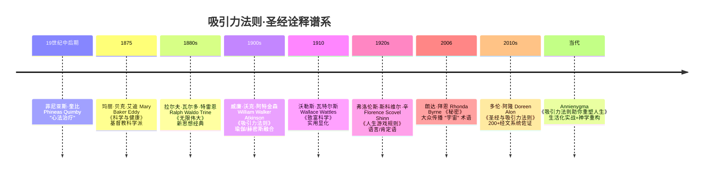

# 圣经与吸引力法则：神学重构与经文佐证体系

> **页面定位**：本页聚焦《吸引力法则助你重塑人生》第13章《圣经与吸引力法则》，系统整理其**经文引用矩阵**、**三大神学重构论点**及**历史溯源脉络**，建立吸引力法则与圣经教义的交叉引用知识库。

---

## 核心论点速览

| 维度 | 传统误读 | 本章重构 | 关键经文 |
|------|----------|----------|----------|
| **金钱观** | "金钱是万恶之源" | 金钱是中性工具，**贪爱金钱**才是万恶之根 | 提前 6:10 |
| **欲望观** | 压制/克制欲求 | 欲求是神赐予的创造力，**凭信心行事**可成就更大奇迹 | 约 14:12、太 17:20、申 8:18 |
| **本体论** | 上帝与宇宙分离 | **上帝即宇宙**，万有藉祂造、为祂造 | 西 1:16 |

---

## 一、 经文引用矩阵：200+ 经文的结构化分类

本章依据《繁荣的圣经》编选，将经文归为五大功能簇，**此处列出正文显性引用的 10 处核心经文**，其余 190+ 经文遵循相同分类逻辑（详见《繁荣的圣经》全书）。

### 祈求-信心-得着 法则簇
> 吸引力法则的 **"祈求/相信/接受"** 三步骤在圣经中的直接对应。

| 经文 | 核心句式 | 对应 LOA 步骤 |
|------|----------|---------------|
| **太 7:8** | "凡祈求的，就得到；寻找的，就找到；敲门的，就为他开门" | 祈求 → 允许 |
| **可 11:24** | "凡是你们所祷告和祈求的，**当相信已经得着了**，事情就将为你们成就" | 相信/视觉化 |
| **太 21:22** | "你们在祷告中无论求什么，**只要信，就必得着**" | 信心确定性 |
| **雅 1:6** | "只要凭着信仰祈求，**不要有任何疑惑**" | 排除抗拒/反效应 |

> **交叉引用**：这四节经文共同构成 [[law-of-attraction-canfield#三位一致]] 中 **"思想-情感-行动合一"** 的信心层面对应；另见 [[xianhua-shijian-yu-zhuanzhu-lianci#肯定语与视觉化]] 的 "T型表/正面宣言" 实操。

### 心意-实相 创造簇
> 思想/心念作为 **创造性振动源** 的圣经依据。

| 经文 | 核心句式 | 形而上学意涵 |
|------|----------|--------------|
| **箴 4:23** | "你要保守你心，胜过保守一切，因为一生的果效是由心发出" | 心为振动发射台 |
| **箴 23:7** | "因为他心怎样思量，他为人就是怎样" | 信念即身份/实相蓝图 |

> **关联页面**：[[belief-creates-reality-practice#覺察-外境觀照內在信念]]、[[seth-philosophy-jane-roberts#信念創造實相]]、[[universal-spiritual-laws-manifestation#思想法则]]。

### 负面吸引/反效应 簇
> **恐惧/忧虑**同为强烈振动，吸引对应实相。

| 经文 | 核心句式 | 实操警示 |
|------|----------|----------|
| **伯 3:25** | "因我所恐惧的临到我身，我所惧怕的迎我而来" | 恐惧是"负面祈求" |

> **作者亲证**：书中"前夫绑架女儿"案例（见原文"反效应太可怕"章）即此经文的现代活化。参阅 [[xianhua-shijian-yu-zhuanzhu-lianci#情绪导航系统与中性法则]] 的 "情绪温度计/不动点" 技法对抗恐惧振动。

### 神性内住/合一 簇
> 确立 **"神在心中"**，个体拥有共创权柄。

| 经文 | 核心句式 | 神学意义 |
|------|----------|----------|
| **林前 3:16** | "你们难道不知道自己就是神的圣所，而且神的灵住在你们里面吗？" | 内在圣灵 = 内在指引/高我 |

> **跨传统对照**：[[you-can-channel#超意识-潜意识-表意识]]、[[cong-xin-jue-xing#心的神圣空间]]、[[zhanxing-yu-zhen-wo#橡實理論]]。

### 本体论统一 簇
> **上帝 = 宇宙** 的经文基石，为"宇宙"一词替代"上帝"提供正统性。

| 经文 | 核心句式 | 重构逻辑 |
|------|----------|----------|
| **西 1:16** | "万有都是藉着他造的……一切都是藉着他造的，也是为他而造的" | 宇宙非独立实体，乃神显化之场域 |

---

## 二、 三大神学重构深度解析

### 金钱非万恶之源 —— 纠正提前 6:10 的千古误读

> **原文经文**："要知道，**贪爱**金钱是万恶之根"（提前 6:10，中文标准译本，重点为作者所加）

| 误读链条 | 重构解析 | 实操启示 |
|----------|----------|----------|
| "金钱是万恶之源" → 贫穷有理、富贵可耻 | **主语是"贪爱"**，非金钱本身；金钱如铲子、钢枪，**中性工具** | 关注"财务充盈感"而非"缺钱恐惧"，转振动频率吸引富足 |
| 亚伯拉罕、约伯、所罗门、波阿斯、大卫均为百万富翁代表 | **圣经叙事肯定财富**为神赐福证据（申 8:18） | 施舍/分享（美元纸条施舍法）验证"我有余力给予"的充盈振动 |

> **关联实操**：[[xianhua-shijian-yu-zhuanzhu-lianci#美元纸条施舍法]]、[[chuang-zao-jin-qian-tong-wang-feng-yu-zhi-lu#金钱即能量]]、[[xiang-yu-zhou-xia-ding-dan#显化法则]]。

### 欲求非压制对象 —— 耶稣授权的"更大奇迹"创造力

| 核心经文 | 重构要点 | LOA 映射 |
|----------|----------|----------|
| **约 14:12** "信我的人也要做，而且要做比这些更大的事" | 信徒继承 **创造性权柄**，非被动等待 | 有意识创造/显化 |
| **太 17:20** "像一粒芥菜种子那样的信仰……将没有不可能的事" | **微量纯净信心**即可撬动实相 | 情绪导航/振动校准 |
| **申 8:18** "得货财的力量是他给你的" | **获取资源能力**源于神性内住 | 内在指引/灵感行动 |

> **作者注**：多伦·阿隆《圣经与吸引力法则》指出："你的任务就是要具有信仰，**就像已经实现目标一样行事**，那么很快就能成功。"  
> **交叉引用**：[[xianhua-shijian-yu-zhuanzhu-lianci#摩天大楼视觉化]]、[[shakti-gawain-chuang-zao-xing-xiang-ti-xi#肯定陈述]]、[[belief-creates-reality-practice#讚美-催化美好能量]]。

### 上帝即宇宙 —— 术语替代的历史溯源与神学合法性

| 阶段 | 关键动因 | 神学依据 |
|------|----------|----------|
| **新思想运动早期** | 作家以**圣经为灵感源头**（非背道而驰） | 西 1:16 确立宇宙为神显化之媒介 |
| **逐渐普及期** | 为**跨越教派/无神论者门槛**,"上帝"→"宇宙" | 约定俗成，非本体论变更 |
| **当代实践** | 新一代误以为二者**无关/对立** | 本章旨在**追溯溯源**，重建关联 |

> **关键结论**："请不要在尊重《圣经》的同时鄙视吸引力法则。你会发现，吸引力法则将为你的信仰提供更多新的支持。"

---

## 三、 历史脉络：新思想运动与圣经诠释谱系

> **注**：本书作者 Annienygma 在"推荐读物"中明确列出《秘密》《吸引力法则(希克斯)》《繁荣圣经》《快乐地赚钱》《30天吸引力挑战》《能量平方》《萨拉系列》《圣经与吸引力法则(阿隆)》《现在开始吸引金钱的方法(维托)》构成个人研习书单，形成**新思想→圣经诠释→生活化实战**三阶段传承链。

---

## 四、 实操框架：将经文转化为日常振动练习

| 经文簇 | 对应练习 | 频率建议 | 关联页面 |
|--------|----------|----------|----------|
| 祈求-信心-得着 | **正面宣言/特定目标宣言** (早晚各1次) | 21天成习惯 | [[xianhua-shijian-yu-zhuanzhu-lianci#正面宣言]] |
| 心意-实相 | **愿景板/摩天大楼视觉化** (睡前5分钟) | 每日 | [[xianhua-shijian-yu-zhuanzhu-lianci#摩天大楼视觉化]]、[[chuang-zao-jin-qian-tong-wang-feng-yu-zhi-lu#显化法则]] |
| 负面吸引 | **情绪温度计/中性法则/不动点** (觉察即转化) | 随时 | [[xianhua-shijian-yu-zhuanzhu-lianci#情绪导航系统与中性法则]] |
| 神性内住 | **内在指引冥想/安静倾听** (晨间10分钟) | 每日 | [[you-can-channel#最后的启蒙]]、[[cong-xin-jue-xing#从心生活]] |
| 本体论统一 | **赫密斯七大法则/光语/本源连结** (周末深度) | 每周 | [[shengqi-lingxing-tianxian#赫密斯七大法则]]、[[soham-healing-system#光语]] |

---

## 五、 交叉引用索引：本知识库相关页面

| 主题 | 页面 | 核心连接点 |
|------|------|------------|
| **吸引力法则核心框架** | [[law-of-attraction-canfield]] | 三位一致、五大支柱、量子物理学视角 |
| **显化实操总图谱** | [[xianhua-shijian-yu-zhuanzhu-lianci]] | 量子显化/心理工程/能量学/生活样本四维度 |
| **创造金钱/丰裕之路** | [[chuang-zao-jin-qian-tong-wang-feng-yu-zhi-lu]] | Orin/DaBen 传导、金钱即能量、内在指引 |
| **宇宙订单/显化法则** | [[xiang-yu-zhou-xia-ding-dan]] | 正向思考、信任放手、内在指引、放松允许 |
| **宇宙灵性法则** | [[universal-spiritual-laws-manifestation]] | 观点/情绪/思想/意识/业力五大法则 |
| **灵性天线/频率调校** | [[shengqi-lingxing-tianxian]] | 赫密斯七大法则、情绪振动频率、光语疗愈 |
| **信念创造实相/赛斯** | [[seth-philosophy-jane-roberts]] | 多重转世、高灵视角、王怡仁临床整合 |
| **从心觉醒/梅尔卡巴** | [[cong-xin-jue-xing]] | 心的神圣空间、梅尔卡巴静心 |
| **启动神秘疗愈能量** | [[activating-mystical-healing-power]] | AME唱诵、四的法则、神经/能量经络双轨 |
| **SO-HAM 徒手能量疗愈** | [[soham-healing-system]] | 疗愈层次、R转换器、光语、星际沟通 |

---

## 六、 关键术语对照表

| 中文术语 | 英文原词/对应概念 | 本章语境定义 |
|----------|-------------------|--------------|
| 吸引力法则 | Law of Attraction | 量子层面"物以类聚"的科学规律 |
| 繁荣的圣经 | The Prosperity Bible | Jeremy P. Tarcher 刊行，汇编200+经文佐证LOA |
| 新思想运动 | New Thought Movement | 19世纪末兴起，以圣经为灵感源头的心灵治疗/显化传统 |
| 贪爱金钱 | Love of money | 提前6:10主语，非金钱本身，乃依附心态 |
| 芥菜种信心 | Mustard seed faith | 太17:20，微量纯净信心即可撬动实相 |
| 宇宙 | Universe | 西1:16语境下，上帝显化之场域，非独立实体 |
| 反效应 | Backlash/Reverse effect | 恐惧/忧虑等负面振动吸引对应实相 (伯3:25) |
| 内在指引 | Inner Guidance | 林前3:16语境下，圣灵/高我/超意识的引导 |

---

## 七、 修订记录

| 日期 | 版本 | 修订要点 |
|------|------|----------|
| 2025-01-20 | v1.0 | 初建：经文矩阵、三大神学重构、历史谱系、实操框架、交叉引用索引 |

---

> **页面维护提示**：若后续归档补充《繁荣的圣经》全书200+经文明细，可在"经文引用矩阵"节扩展为可筛选数据表；若新增作者访谈/读者见证，可增设"当代案例库"节。

## 来源

- [吸引力法则助你重塑人生](../sources/吸引力法则助你重塑人生.md)
