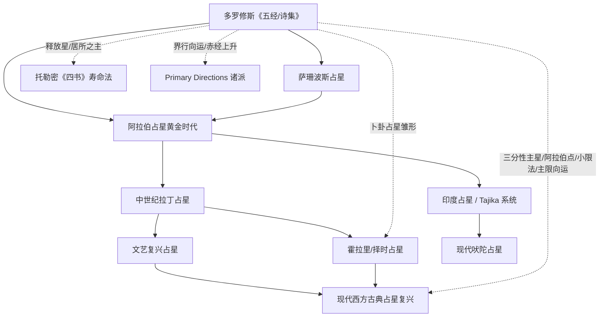

# 西顿多罗修斯《占星诗集》（Carmen Astrologicum）

## 概述

《占星诗集》（Carmen Astrologicum）是西元一世纪希腊占星师西顿多罗修斯（Dorotheus of Sidon）所著的五卷本占星教诲诗，原名《五经》（Pentateuch）。此书是现存最古老、最完整的希腊化时期天宫图式占星学著作，被公认为古典占星学四大经典之首（其余三部为托勒密《占星四书》、瓦伦斯《占星选集》、马特尔努斯《论数学》）。其内容经波斯、阿拉伯时期传承，于八世纪由乌玛·塔巴里译为阿拉伯文，成为中世纪伊斯兰占星学及后世欧洲拉丁占星学的核心源头。本杰明·戴克博士整合希腊、阿拉伯、拉丁多版本文本，修订平格瑞译本，出版现代关键校勘版。

## 一、历史传承脉络

### 原著与作者
- **作者**：西顿多罗修斯，约生活于西元一世纪（多米提安/涅尔瓦/图拉真时期），可能在埃及亚历山大港工作。
- **体裁**：六音步教诲诗（hexameter didactic poetry），便于口诀记忆与传抄。
- **原语言**：希腊文，原题《五经》，分五册。
- **核心主张**：多罗修斯游历埃及、巴比伦搜集占星精华，「如蜜蜂采花酿蜜」构建系统。

### 传译谱系
| 时期 | 关键事件 | 版本/人物 |
|------|----------|-----------|
| 3世纪 | 萨珊王朝下令翻译科学典籍 | 《五经》译为中古波斯语（巴列维文），列首批翻译名单（同托勒密、赫密斯、印度法玛西伯） |
| 8世纪晚期 | 乌玛·塔巴里翻译 | 将巴列维文《五经》译为阿拉伯文，即现存《诗集》 |
| 9-10世纪 | 阿拉伯占星家广泛引用 | 萨尔、西奥菲勒斯、纳迪姆等著作大量转引 |
| 12世纪 | 拉丁文翻译传入欧洲 | 影响中世纪欧洲占星学，第五册择时法演变为卜卦占星 |
| 1939 | 维克多·史岱格曼 | 《多罗修斯语录集》搜集134段原创片断（主要自赫菲斯提欧） |
| 1976 | 大卫·平格瑞 | 阿拉伯文校勘本+英文译本，附《片断作品》《摘录》 |
| 2017- | 本杰明·戴克 | **整合希腊、阿拉伯、拉丁文本**，修订平格瑞误译，增补《结果》《萨尔本命论》等平行资料，出版现代标准版 |

> **戴克版核心贡献**：修正平格瑞在阿拉伯点公式、星盘日期、技术术语上的系统性错误；提供《结果》（赫菲斯提欧）、《萨尔本命论》（阿拉伯文）、《瑞托瑞尔斯》等平行引文互证；建立统一章句编码（如 I.1, 1 表示第一册第一章第一句）。

### 手抄本情况
- **C本**：伊斯坦堡叶尼卡米 784号，完整五册，页边有胶布修补痕迹。
- **B本**：柏林 BSB Or.Oct. 2663，仅存第一至四册，推测抄自修补后的C本。
- 两本均为19世纪抄本，更早手抄本已佚。

## 二、五册体系架构

| 册次 | 主题 | 核心内容 | 对应章节 |
|------|------|----------|----------|
| **第一册** | 本命基础判断法则、出生/养育/父母/手足/荣华富贵/幸福 | 行星吉凶、四元素/三态、宫位吉凶、昼夜半球、行星强弱（庙旺/陷弱）、相位/不合意、相对太阳相位、容纳/互容、支配、护卫星、**阿拉伯点**、恒星、三分性主星系统 | I.1–I.29 |
| **第二册** | 婚姻与子女 | 男性/女性婚姻点、娱乐婚姻点、结婚点、子女点、生产点、儿子/女儿点、行星在始宫/各宫/相位/星座的菜单式断语 | II.1–II.12 |
| **第三册** | 寿命计算 | **释放星/征象星**、**居所之主/主管星**、**界行向运法**（主限向运法核心）、两张寿命星盘案例（III.1 西元381年萨珊星盘、III.2 西元44年星盘） | III.1–III.2 |
| **第四册** | 疾病、死亡、流年预测 | 慢性疾病点、死亡点、太阳回归法（仅两句）、**小限法**（整宫制、年主星）、**过运法**（触发理论、年度星座脆弱性、本命行星被引动机制） | IV.1–IV.5 |
| **第五册** | 择时/卜卦/事件占星 | 开始/事件/卜卦法则、窃贼外貌描述、同性性关系、婚姻与性、与丈夫争吵离家等社会民俗主题 | V.1–V.42 |

> **结构特色**：前四册以「代表因子+三分性主星」双轴解析本命，第五册开创择时占星独立体系，后世卜卦占星多由此演变。

## 三、核心技法体系

### 三分性主星 —— 多罗修斯体系的基石
> 「每件事都可透过三分性主星而决定」（I.1, 8）

#### 定义与分派规则
- **四元素三分性**：火/土/风/水各三星座为一组。
- **昼夜半球分派**：
  - **昼间盘**（太阳在上升-下降轴上方）：火/风组 → 太阳、木星、土星；土/水组 → 金星、月亮、火星。
  - **夜间盘**（太阳在下方）：火/风组 → 木星、太阳、土星；土/水组 → 金星、火星、月亮。
- **顺序**：第一、二、三主星依序管辖人生前、中、后三阶段（或依主题分工）。

#### 九大主要代表因子与对应三分性主星
| 代表因子 | 主题 | 出处 |
|----------|------|------|
| 上升 | 成长、身躯 | I.4, I.7 |
| 月亮 | 母亲、奴隸、家庭基础状态 | I.10, I.13 |
| 太阳 | 父亲、尊严 | I.13 |
| 火星 | 手足 | I.23 |
| 金星 | 婚姻/伴侣关系 | II.1, II.3, II.4 |
| 木星 | 子女 | II.8, II.9 |
| 同区分发光体 | 荣华富贵、生计本身 | I.24, I.26, I.28 |
| 幸運點 | 成长与荣华富贵 | I.4, I.28 |
| 天底 | 疾病、死亡 | IV.2, IV.3 |
| 第七宫 | 死亡 | IV.3 |
| 婚姻點 | 婚姻 | II.4 |

#### 核心功能：自然代表因子 vs 三分性主星
| 维度 | 自然代表因子 | 三分性主星 |
|------|--------------|------------|
| 本质 | 事物的**根本价值、尊严、适切性** | **持续的协助与支持**（增加/减少、保护/存续、存在/缺失） |
| 例子 | 太阳好 → 父亲社会地位高 | 太阳三分性主星好 → 父亲资产增加、受保护；坏 → 资产挥霍、命主被家族抛弃 |
| 关键词 | 价值、自尊、本质 | 增加/减少、保护/存续、协助/支持、准予/拒绝 |

> **戴克注**：三分性主星显示「特定主题在一生中是否获得支持、保护、持续显现」，若自然因子虽强但缺三分性主星护持，则才能难施展、资源难守成。

#### 与行星喜乐的渊源
- 戴克/布伦南研究指出：三分性主星派系源自**行星喜乐宫位**的三分性延伸（如太阳喜乐九宫→火象三分性第一主星）。
- 瓦伦斯称三分性主星为「支持」「基础」，多罗修斯则系统化为「增加/减少、保护/协助」的动态功能。

### 阿拉伯点 / 希腊乐透 —— 24大敏感点系统
《诗集》列出23个特殊点（阿拉伯点前身），戴克校勘修正平格瑞误译，确立统一计算公式。

#### 计算原则
- **通用公式**：`起点 - 终点 + 上升度数`，以黄道顺序计算度数差。
- **昼夜盘区别**：**仅部份点明确要求昼夜互换起终点**（如母亲点、婚姻点、结婚点）。戴克主张：**除行星→宫位/星座类点外，所有公式昼夜均应反转**。
- **投射方式**：得出度数后，从上升点零度起，每30°为一单位（即按整星座/整宫制）顺向投射，落入之星座度数即为该点位置。

#### 二十四大特殊点速查表
| 编号 | 中文名 | 公式（昼间盘） | 出处 | 备注 |
|------|--------|----------------|------|------|
| 1 | 幸运点 | 太阳 → 月亮 + 上升 | I.28, 11 | 即 Fortune |
| 2 | 精神点 | 月亮 → 太阳 + 上升 | I.9, 1 | 即 Spirit |
| 3 | 情欲点 | 幸运点 → 精神点 + 上升 | 《摘录》XVI, 6 | Eros |
| 4 | 父亲点 | 太阳 → 土星 + 上升 / 火星 → 木星 + 上升 | I.14, 2 / I.14, 5 | 双公式 |
| 5 | 母亲点 | 金星 → 月亮 + 上升 | I.15, 1 | **夜间盘反转** |
| 6 | 手足点 | 土星 → 木星 + 上升 | I.21, 1 | |
| 7 | 手足数目点 | 水星 → 木星 + 上升 | I.23, 1 | |
| 8 | 资产点 | 二宫主星 → 二宫 + 上升 | I.29, 17 | 戴克：昼夜同算 |
| 9 | 生计点 | 木星 → 土星 + 上升（推测） | I.29, 29 | 不确定 |
| 10 | 婚姻点(男) | 土星 → 金星 + 上升 | II.2, 2 | |
| 11 | 婚姻点(女) | 金星 → 土星 + 上升 | II.3, 1 | **夜间盘反转** |
| 12 | 婚姻点(备) | 不确定 | II.4 | |
| 13 | 娱乐婚姻点 | 金星 → 七宫度数 + 上升 | II.5, 4 | 从下降点度数起算 |
| 14 | 结婚点(男) | 太阳 → 月亮 + 金星 | II.6, 1 | **昼夜互换** |
| 15 | 结婚点(女) | 太阳 → 月亮 + 火星 | II.6, 5 | **昼夜互换** |
| 16 | 子女点 | 木星 → 土星 + 上升 | II.10, 1 | |
| 17 | 生产点 | 火星 → 木星 + 上升 | II.1, 2 | |
| 18 | 儿子点 | 木星 → 太阳 + 上升 | II.12, 1 | |
| 19 | 女儿点 | 月亮 → 金星 + 上升 | II.12, 2 | |
| 20 | 友谊点 | 月亮 → 水星 + 上升 | 《摘录》XVI, 6 | |
| 21 | 远征点 | 土星 → 月亮 + 上升 | 《结果》II.19 | |
| 22 | 奴仆点 | 水星 → 月亮 + 上升 | 《结果》II.20 | |
| 23 | 慢性疾病点 | 土星 → 火星 + 上升 | IV.2, 11 | |
| 24 | 死亡点 | 月亮 → 八宫 + 土星 | IV.3, 16 | 《五经》作「第八星座」 |

> **平格瑞误译关键**：在母亲点等条目中，平格瑞擅自加入「夜间盘从上升**减去**度数」的指示，实为阿拉伯文原文无此操作；导致昼间盘计算结果错误。戴克版已全面修正。

### 小限法 —— 整宫制年度推运
> 多罗修斯明确使用**整宫制**，非30°等分。

#### 操作步骤
1. 以**太阳回归日**为起点。
2. **零岁**：上升星座本身 = 流年小限星座。
3. **每年推进一宫**（顺向）：1岁→二宫星座，2岁→三宫星座……以此类推。
4. 流年小限星座的**主星 = 年主星**。
5. 结合**本命盘与太阳回归盘**中年主星的状态、相位、过运综合判读。

#### 关键判读规则
| 项目 | 判读要点 |
|------|----------|
| 年度星座 | 「如家需照顾」：最佳为同区分发光体三分相注视；次为年主星在尊贵位；若年主星落陷/弱宫且无吉星护持 → 事项极不稳定 |
| 年主星过运 | 东出、离光束、顺行、速度快 → 建设性；西入、入光束、逆行、速度慢 → 阻碍 |
| 本命行星在年度星座内 | 需**过运来引动**：(1) 自身过运回归/相位本命位；(2) 他星过运相位/合相引动。相位吉凶序：三分 > 支配 > 被支配 > 对分最凶 |
| 尖轴星座 | 过运行星以主相位/合相来到上升/下降/中天/天底星座，影响最剧 |

> **与现代流年法对照**：此法为后来印度「年度小限」及中世纪「Profection」之源，核心差异在于坚持整宫制与太阳回归日起算。

### 主限向运法 / 界行向运法 —— 寿命与重大事件定时
第三册核心技术，后世 Primary Directions 的雏形。

#### 核心概念
- **释放星 / 征象星**：象征生命力的行星（太阳、月亮、上升主星、幸运点等），用于主限向运测寿命终点。
- **居所之主 / 主管星**：释放星的定位星，对生命有「主导权力」。
- **界行向运法**：以**赤经上升时间**为单位，测算释放星/居所之主经由界到达尖轴/相位的时间。

#### 计算流程（依《诗集》I.28 与 III.1 萨珊星盘）
1. 确定**同区分发光体**（昼间盘看太阳、夜间盘看月亮）的三分性主星活跃度。
2. 以尖轴为起点，每 **15°赤经上升时间** 为一区间（非黄道度数）。
3. 前三区间（0-45赤经度）代表高至中等荣华富贵/寿命强度。
4. **赤经上升表法**：查表得各星座赤经上升时间，累加至45单位，换算年数。
5. **软件「前进」法（现代实操）**：
   - 打开本命盘动态功能。
   - 每前进1小时 = 15赤经度 = 1区间。
   - 观察三分性主星何时经过上升/中天/下降/天底尖轴，所经小时数即区间数。

#### 萨珊王朝精算改良（III.1 星盘#9 揭示）
- 按**第四气候区**（巴比伦地区，北纬36°30′）建立**每度赤经上升时间表**。
- 精确到**分数单位**（如 1/5 + 1/10 = 0.3，甚至 1/13），可快速换算具体天数。
- 岁差系统接近 Fagan-Bradley，但约多 1°，显示独特恒星黄道锚定。

> **戴克注**：此法本质为**主限向运法**雏形，后世托勒密、瓦伦斯、普拉西德斯等皆在此基础上发展出多种 Primary Direction 系统。

### 太阳回归法与过运法（第四册）
| 技法 | 《诗集》保留内容 | 戴克补注 |
|------|------------------|----------|
| **太阳回归法** | 仅两句：IV.1,4（多罗修斯观点：回归盘上升点计算）、IV.1,14-15（瓦伦斯法插入） | 解析部分佚失；戴克建议参考瓦伦斯《选集》第三册、赫菲斯提欧《结果》、萨尔《本命论》 |
| **过运法** | IV.4-5 完整保留：触发器理论、年主星过运优先、年度星座脆弱性、本命行星被引动双轨（自引动/他引动）、尖轴星座敏感性 | 构成多罗修斯过运核心理论，与小限法、太阳回归法形成「本命为因、流年为缘」的预测闭环 |

## 四、戴克版校勘贡献总览

| 领域 | 主要修正/贡献 | 影响 |
|------|----------------|------|
| **文本重建** | 整合希腊《片断》《摘录》、阿拉伯《诗集》《萨尔本命论》、拉丁译本、赫菲斯提欧《结果》、瑞托瑞尔斯，建立多版本互证体系 | 还原最接近原著面貌的《五经》文本 |
| **阿拉伯点公式** | 纠正平格瑞「夜间盘减去度数」等系统性误译；确立统一投射算法（昼夜同算/反转规则） | 修复传承千年的计算错误，使特殊点重获实用性 |
| **星盘考据** | 重新核算10张星盘日期，修正抄写/计算错误（如火星误置、金星不可能位置），识别西元381年萨珊星盘为后人插入 | 确立多罗修斯活跃于西元前7年-44年，著作成书不晚于二世纪 |
| **术语词典** | 梳理20+阿拉伯语/波斯语占星术语对照表（如 *haylāj* 释放星、*kadhudhāh* 居所之主、*Dwāzdah bahrī* 十二分部、*Nawbahrah* 九分部） | 为跨语言文献阅读提供标准锚点 |
| **技术实操现代化** | 引入软件动态「前进」法替代表格赤经表法；提供主限向运、小限法、过运法的标准化操作流程 | 使古典技法可在现代软件（Solar Fire, Morinus, Astro.com等）中精确实作 |
| **哲学定位** | 明确多罗修斯为「天宫图式占星学」首个完整系统呈现者，确立其为希腊化占星技术源头（择时/卜卦/本命/流年四支柱） | 纠正「托勒密为占星之父」的偏见，还原技术史真相 |

## 五、与后世占星体系的关联映射

### 关键传承节点
- **三分性主星** → 瓦伦斯、赫菲斯提欧、萨尔、波纳提乌斯、威廉·里利 → 现代古典占星核心模块。
- **阿拉伯点** → 阿拉伯占星家系统化为百余乐透 → 里利《基督教占星学》 → 现代敏感点体系。
- **小限法** → 印度 Tajika 年度小限 → 中世纪 Profection → 现代整宫制小限复兴。
- **主限向运/界行向运** → 托勒密《四书》IV.10 平等/比例向运 → 普拉西德斯/雷乔蒙塔努斯/普托勒密派向运 → 现代 Primary Directions。
- **择时/卜卦（第五册）** → 萨尔《询问书》、马沙阿拉《询问判断》 → 威廉·里利《基督教占星学》第三卷 → 现代霍拉里占星。

## 六、学习与实践路径建议

| 阶段 | 核心任务 | 推荐参考 |
|------|----------|----------|
| **入门** | 熟读《诗集》绪论、第一册基础法则（行星吉凶、宫位、相位、昼夜半球、强弱、容纳/互容） | 戴克版中译本第一册、[[planetary-condition-traditional-astrology]]、[[zheng-gong-zhi-yu-shier-gong-wei]] |
| **基础技法** | 掌握**三分性主星**分派与判读、**阿拉伯点**计算（含昼夜规则）、**整宫制小限法**年度推运 | 本页 3.1/3.2/3.3、[[classical-astrology-three-step-analysis]]、[[zhanxing-liu-nian-rudolf]] |
| **进阶预测** | 学习**主限向运法**（赤经上升/软件前进法）、**太阳回归法**、**过运触发理论**；结合小限法形成多层流年体系 | 本页 3.4/3.5、[[zhanxing-yu-ce-ji-fa-ti-xi]]、[[liang-zi-zhan-xing-xue]] |
| **源头研究** | 对照《结果》《萨尔本命论》《瑞托瑞尔斯》《瓦伦斯选集》平行段落，体会文本传承变异 | 戴克版附录、[[zhanxing-zhe-xue-ji-chu-bohm-hun-dun-jung]]（哲学基础） |
| **实战整合** | 以「代表因子+三分性主星」为骨架，阿拉伯点为补强，小限/主限/过运为三维流年网，完成完整咨询案例 | [[zhanxing-zhan-xin]]、[[qin-ruisheng-shi-li-zhan-xing-di-yi-ce]] |

## 七、交叉引用索引

| 专题 | 本库对应页面 | 说明 |
|------|--------------|------|
| 整宫制原理与实操 | [[zheng-gong-zhi-yu-shier-gong-wei]] | 多罗修斯全书采用整宫制，小限法、阿拉伯点投射均依此 |
| 行星状态评估（昼夜半球、庙旺陷弱、相位、光束） | [[planetary-condition-traditional-astrology]] | 第一册核心判断法则的现代整理 |
| 阿拉伯点/希腊乐透完整体系与恒星 | [[arabic-parts-and-fixed-stars]] | 含百余乐透公式、瓦伦斯/里利尊贵判断、案例验证 |
| 古典占星三步分析法 | [[classical-astrology-three-step-analysis]] | 命宫/事项宫/交互关联，源自多罗修斯代表因子逻辑 |
| 流年预测技法体系（推运/行运/太阳弧/回归/蚀图） | [[zhanxing-yu-ce-ji-fa-ti-xi]] | 多罗修斯小限/主限/过运为核心源头 |
| 黄道系统与岁差（回归/恒星黄道） | [[zhanxing-tianwen-jichu-yu-huangdao-tixi]] | 萨珊星盘揭示恒星黄道锚定差异 |
| 占星哲学基础（波姆/混沌/荣格/量子隐喻） | [[zhanxing-zhe-xue-ji-chu-bohm-hun-dun-jung]] | 理解古典占星本体论预设 |
| 秦瑞生《实力占星》古典+现代+印度整合框架 | [[qin-ruisheng-shi-li-zhan-xing-di-yi-ce]] | 当代古典占星教学代表作 |
| 鲁道夫《占星流年》五大流年技法 | [[zhanxing-liu-nian-rudolf]] | 现代流年教学标准参考 |

## 八、关键术语中英对照表

| 中文术语 | 英文术语 | 阿拉伯语/波斯语 | 备注 |
|----------|----------|-----------------|------|
| 三分性主星 | Triplicity Lords | *Arbāb al-Muthallathāt* | 核心技法 |
| 释放星/征象星 | Hyleg / Releaser | *Haylāj* / *Hilāj* | 第三册寿命法 |
| 居所之主/主管星 | Alcochoden / House Master | *Kadhudhāh* / *Kadkhudāh* | 释放星的定位星 |
| 界行向运法 | Direction by Term / Primary Direction | *Tasyīr bi-l-Hudūd* | 赤经上升时间制 |
| 小限法 | Profection | *Tasyīr al-Sughrā* / *Da'ira* | 整宫制年度推运 |
| 同区分发光体 | Sect Light | *Nūr al-Qism* / *Haylāj* | 昼间太阳/夜间月亮 |
| 区分/半球 | Sect | *Qism* / *Hay'a* | 昼夜盘区分 |
| 阿拉伯点/希腊乐透 | Arabic Parts / Greek Lots | *Al-Aqṭār* / *Al-Sahm* | 24大特殊点 |
| 幸运点 | Part of Fortune | *Sahm al-Sa'āda* | 太阳→月亮+上升 |
| 精神点 | Part of Spirit | *Sahm al-Rūḥ* | 月亮→太阳+上升 |
| 赤经上升时间 | Right Ascension / Temporal Hours | *Al-Maṭāli'* / *Sā'āt Zamāniyya* | 主限向运基本单位 |
| 气候区 | Climate / Clime | *Iqlīm* | 萨珊天文表分区依据 |
| 择时/卜卦占星 | Elections / Horary | *Ikhtiyārāt* / *Mas'ala* | 第五册源头 |

---

> **编辑说明**：本页面依据本杰明·戴克版《占星诗集》（中文版，星空凝视文化事业出版）绪论、第一章至第八章及附录编译整理，所有章句编码（如 I.1, 1）遵循戴克版统一标准。文中 [[wikilink]] 指向本知识库现有页面，便于构建古典占星技法的交叉引用网络。

## 来源

- [占星诗集](../sources/占星诗集.md)
