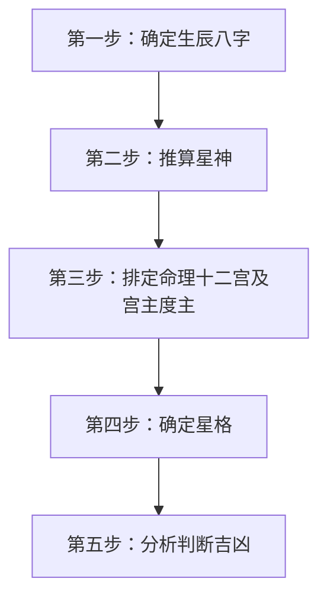

## 概述

中国星命学（星占推命）是中国传统方术命理学的重要分支，以人出生时的天象星曜位置为依据推断命运。其集大成之作《星学大成》（明·万民英编）被收录于《钦定四库全书》子部术数类，被誉为“五星之大全”。本页面依托《四库全书白话图解·图解星学大成》等归档资料，系统梳理其历史源流、理论基础、核心体系、工具与实操流程，并建立与现有占星、命理页面的交叉引用网络。

## 历史源流

### 起源与早期发展
- **上古星官**：黄帝时设星官，观“日月星辰之变动，以观天下之迁，辨其吉凶”。
- **占星肇始**：东汉王充《论衡》首将星象与五行结合，成命理学先驱。
- **唐代质变**：印度僧瞿昙悉达撰《开元占经》，将占星术与算命术结合，确立星命术体系。
- **宋元明清**：鲍云龙、耶律纯、郑希诚、刘基、万民英、杜全、李光地等名家辈出，著作日繁。

### 《星学大成》的编纂与地位
- **作者**：万民英（字育吾，嘉靖庚戌进士，历任御史、布政司参议）。
- **成书**：嘉靖四十二年（1563）序，汇集《星曜图例》《观星节要》《诸家限例》《耶律秘诀》《仙城望斗》《三辰通载》《总龟紫府》《碧玉真经》《光鹡渊微》十部珍本。
- **四库评价**：纪昀等称其“鸠集众说，多术家不传之本，实为五星之大全”，与子平《三命通会》并行不悖。
- **现代价值**：虽理论带唯心色彩，但保存了大量失传星学文献，为中国天文学史、术数史提供珍贵资料。

> 相关页面：[[xingxue-dacheng]]、[[zhanxing-shuji-mulu-yu-zhuti-daohang]]、[[bazi-mingli-xue-jichu-jiaocheng]]

## 理论基础

### 阴阳五行
- **阴阳**：万物皆有对立统一的阴阳两面（如动静、刚柔、贵贱），推动事物生灭变化。
- **五行**：金、木、水、火、土五种基本元素，循环相生（金→水→木→火→土→金）与相克（金→木→土→水→火→金）。
- **命理应用**：七政四余对应五行（日火、月水、木星木、火星火、土星土、金星金、水星水、罗睺火、计都土、紫气木、月孛水），以生克制化判吉凶。

> 详见：[[zhanxing-tianwen-jichu-yu-huangdao-tixi#五行与四元素]]、[[bazi-mingli-xue-jichu-jiaocheng#阴阳五行]]、[[wu-xing-fang-xiang-yu-si-yuan-su]]

### 天人感应
- **核心**：天地万物同构于阴阳五行，故“天道”与“人道”高度统一，天象变化必感应于人事。
- **西汉董仲舒**系统化“天人感应”说，成一切占卜术（星命、八字、风水、相面、测字）的理论基石。
- **批判视角**：现代唯物主义认为天地影响仅通过自然环境中介实现，星命术将其夸大为命运决定力，忽视主观能动性。

> 交叉引用：[[zhanxing-zhe-xue-ji-chu-bohm-hun-dun-jung#天人感应]]、[[divination-fundamentals#象征性思维与时间幻象]]

## 核心体系

### 七政四余（十一曜）
| 类别 | 星曜 | 象意 | 公转周期（推命约数） | 吉凶偏向 |
|------|------|------|------------------------|----------|
| **七政** | 太阳 | 人君、父、恩泽、命宫根源 | 1年（逆宫顺度） | 根本吉 |
| | 太阴(月) | 人臣、母、慈柔、身宫主宰 | 1月（13°/日，5日两宫） | 夜生晦日多孤独 |
| | 木星(岁星) | 主仁、君子性、东方 | 12年（逆宫，顺吉逆凶） | 顺行吉 |
| | 火星(荧惑) | 主礼、暴躁、南方 | 2年（顺吉逆凶） | 顺行吉 |
| | 土星(镇星) | 主信、西方 | 28年（逆行伏留均凶） | 凶多 |
| | 金星(太白) | 主义、刚直、西方 | 1年（不离日，留伏反吉） | 留伏吉 |
| | 水星(辰星) | 主智、北方 | 1年（不离日，喜顺忌逆） | 顺行吉 |
| **四余** | 罗睺(天首) | 火余、蚀神、北交点 | 18年 | 性急主凶 |
| | 计都(天尾) | 土余、蚀神、南交点 | 18年 | 多主灾祸 |
| | 紫气(景星) | 木余、道德星 | 29年 | 吉星，主富贵寿 |
| | 月孛(孛余) | 水余、彗星象 | 9年 | 喜怒无定 |

> 关联页面：[[zhanxing-tianwen-jichu-yu-huangdao-tixi#行星参数]]、[[zhanxue-quan-zhi-yin#行星意涵]]、[[zhanxing-zhongjian-yuexing-12#月亮星座]]

### 二十八宿（星曜运行的“客栈”）
- **三垣二十八宿**：紫微垣、太微垣、天市垣（代表皇廷）+ 黄道带二十八宿。
- **四象七宿**：
  - 东方青龙：角、亢、氐、房、心、尾、箕
  - 北方玄武：斗、牛、女、虚、危、室、壁
  - 西方白虎：奎、娄、胃、昴、毕、觜、参
  - 南方朱雀：井、鬼、柳、星、张、翼、轸
- **宿度不均**：最大井宿>30°，最小觜宿仅0.5°；《星学大成》用约数，现代推命需查现代星历表。
- **属性对应**：每宿配五行星主与动物象（如角木蛟、亢金龙、房日兔、心月狐…）。

> 参照：[[twenty-eight-lunar-mansions]]、[[nakshatra-27-lunar-mansions]]、[[qin-dun-ershiba-xiu-fenye]]

### 十二宫体系
| 宫系 | 含义 | 排布规则 |
|------|------|----------|
| **地支十二宫** | 黄道十二段，以子丑寅卯…命名，自寅逆布 | 子午各30°43′50″，其余30°43′49″ |
| **十二次** | 岁星纪年分野（玄枵、星纪、析木…） | 与地支宫一一对应 |
| **黄道十二宫** | 西方白羊至双鱼，明代引入配合地支 | 与节气、太阳黄经对应 |
| **命理十二宫** | 命、财帛、兄弟、田宅、男女、奴仆、妻妾、疾厄、迁移、官禄、福德、相貌 | 定命宫后逆时针依次布入 |
| **寄生十二宫(长生十二运)** | 长生、沐浴、冠带、临官、帝旺、衰、病、死、墓、绝、胎、养 | 按生年纳音五行对地支宫定状态 |

> 关联：[[zheng-gong-zhi-yu-shier-gong-wei]]、[[zhenggongzhi-yu-shier-gongwei]]、[[zhanxing-yu-ce-ji-fa-ti-xi#整宫制]]

### 天干地支（推命基础符号）
- **十天干**：甲乙丙丁戊己庚辛壬癸（阴阳五行：甲阳木、乙阴木…癸阴水）。
- **十二地支**：子丑寅卯辰巳午未申酉戌亥（阴阳五行、藏干、冲合刑害破）。
- **六十甲子**：干支配合纪年月日时，得生辰八字。
- **纳音五行**：为六十甲子赋属性（如甲子乙丑海中金），用于寄生十二宫起例。

> 基础页：[[bazi-mingli-xue-jichu-jiaocheng#天干地支]]、[[liuyao-qimeng-jieyao#十天干十二地支]]、[[ziwei-doushu-xiang-xing-lilun#干支类象]]

## 推命工具

### 星盘（排盘核心载体）
八层同心圆结构（由内向外）：
1. **命度圈**：太阳宫度对应的命宫度数，可填生年/身宫等辅助信息。
2. **地支十二宫**：固定子→亥逆序，作填写基准。
3. **七政四余位置**：按黄道宿度精确填入各宫。
4. **命理十二宫**：定命宫后逆时针布命、财帛…相貌；顺时针标行限起始岁数。
5. **宫度表**：每宫3层×10格=30格，对应30°，便于行限与宿度推算。
6. **二十八宿**：与地支宫永久对应，近似量天尺功能。
7. **星神、十二运**：左填星神（神煞），右填长生十二运。
8. **十二次、分野**：西方十二宫、地理分野，空白盘多预印。

> 实操页：[[zhanxing-shuji-mulu-yu-zhuti-daohang#排盘工具]]、[[astrology-chart-calculation-methods]]、[[ziwei-doushu-an-xing-fa]]

### 量天尺（过宫度数表）
- **功能**：详列十二宫与二十八宿度数对应，附行限岁数表，主用于**查行限**。
- **用法**：定命宫命度→在表中顺序向下查找→读取各宫行限岁数（如命宫巳宫翼宿17°，相貌限17岁、福德限27岁…）。

### 长历（星历表/万年历）
- **内容**：七政四余（含天王海王冥王“三王”）每日0时视位置（宫度分）。
- **来源**：古为钦天监推算，今由天文台精算，修正古法误差。
- **用法**：查出生年月日行，直读各曜位置，避免手工推算偏差。

> 对照：[[zhanxing-liu-nian-rudolf#星历表与软件]]、[[zhanxue-quan-zhi-yin#星历表]]

## 实操流程（五大步骤）

### 确定生辰八字
- 以出生年月日时换算干支（年月日时四柱八字）。
- 关键：月干用“五虎遁”，时干用“五鼠遁”；需修正真太阳时（经度时差、夏令时、闰月）。

### 推算星神（神煞）
- **七政四余位置**：查长历得黄道宿度，填星盘第三层。
- **神煞定位**：两百余种，常用数十种。分两大类：
  - **年干神煞**：如甲年火星变天禄（主禄）、酉宫飞刃（主横祸）。
  - **年支神煞**：如子年土星为爵星、戌宫血刃。
  - 另有月支神煞、纳音神煞（空亡、擎天、游奕等）。

### 排定命理十二宫及宫主度主
- **命宫**：以出生时太阳宫位起生时，顺数至卯（日出卯时），所得宫位为命宫。
- **身宫**：书主张从太阴(月)宫位起生时逆数至酉（书与他说不同）。
- **十二宫布局**：命宫定后逆时针依次布财帛、兄弟…相貌。
- **行限起例**：命宫30°分10行（3°/行），对应11-20岁；顺时针按宫位年限累加（相貌10、福德11、官禄15、迁移8、疾厄7、妻妾11、奴仆4.5、男女4.5、田宅5、财帛5）。
- **宫主/度主**：各命理宫所落地支宫的主星（如寅宫木星为主）即为宫主；宿度主星为度主。
- **生旺死绝**：按生年纳音五行查寄生十二宫表，定各地支宫长生/帝旺/墓/绝等状态。

### 确定星格（格局判断）
| 格局 | 定义 | 吉凶 |
|------|------|------|
| **入垣** | 宫主(七曜)居本宫（日在午、金在辰酉等） | 吉 |
| **升殿** | 度主(七曜)居本宿（月在张毕危心、火在觜室尾翼等） | 吉 |
| **庙旺** | 入庙(登庙堂，如月孛未、木亥)或乘旺(居强宫旺地) | 大贵/贵吉 |
| **喜乐** | 星曜居喜乐之地 | 悠闲安逸 |
| **贵格(合格)** | 星辰所居宫度与宫主度主相合相生不刑克 | 吉 |
| **贱格(忌格)** | 星辰所居宫度刑克不正 | 凶 |

> 详见：[[ziwei-gao-jie-zhi-yi#星曜铁关刀]]、[[ziwei-xingpan-liangda-jiegou#格局]]

### 分析判断
- 依历代星命家经验论断（《星学大成》卷五起收录大量案例），综合星格、星神、宫位、行限、生克制化，作最终吉凶推断。
- **局限**：各家论断多矛盾（如火居巳“苦命” vs 火临福德宫“福丰隆”；土戌遇水“艰难” vs 土水同“文武双全”），推命者常择吉言凶，准确性难证。

## 批判与现代视角

### 理论局限
1. **唯心决定论**：宣扬“天命”维护统治合法性，弱化个人奋斗。
2. **天文机制误读**：顺留伏逆实为地球与行星相对运动几何现象，非星曜本性吉凶。
3. **内部矛盾**：同一星曜同宫位，因引用典籍不同得出截然相反断语。
4. **伦理陈旧**：以官贵为荣、男尊女卑、多子为福，与现代价值观背离。

### 史料价值
- **天文考古**：连续观测记录为现代天文学（彗星、岁差、行星轨道）提供长基线数据。
- **文化全貌**：方术是传统文化不可分割部分，研究之可补史籍诗词之外的社会心理图景。

> 参考：[[zhanxing-shuji-mulu-yu-zhuti-daohang#批判传承观]]、[[divination-fundamentals#业力恐惧释放与改变未来]]、[[barnum-effect-in-self-assessment]]

## 交叉引用索引

| 主题 | 本库相关页面 |
|------|--------------|
| 紫微斗数体系 | [[ziwei-doushu-an-xing-fa]]、[[ziwei-gao-jie-zhi-yi]]、[[ziwei-jie-ti-chu-jie]] |
| 四柱八字/子平术 | [[bazi-mingli-xue-jichu-jiaocheng]]、[[bazi-mingli-xue-jin-jie-jiaocheng]]、[[shi-shen-xie-tian-ji]] |
| 六壬/六爻/奇门遁甲 | [[liuren-shen-ke-daquan]]、[[liuyao-jichu-rumen-qinglan]]、[[qimen-dunjia-fundamentals]] |
| 西洋占星对照 | [[zhanxing-tianwen-jichu-yu-huangdao-tixi]]、[[zhanxue-quan-zhi-yin]]、[[astrology-made-simple-series]] |
| 医学占星/芳疗 | [[zhanxing-fang-liao-xi-tong]]、[[gu-pai-zhan-xing-yi-xue]]、[[chinese-medical-astrology]] |
| 心理/演化占星 | [[humanistic-astrology]]、[[arroyo-astrology-karma-transformation]]、[[bian-huan-de-tiankong]] |
| 星历表/排盘软件 | [[zhanxing-liu-nian-rudolf]]、[[astrology-chart-calculation-methods]] |

## 附：关键术语速查

| 术语 | 定义 |
|------|------|
| **七政** | 日、月、金、木、水、火、土七曜 |
| **四余** | 罗睺、计都、紫气、月孛四隐曜 |
| **二十八宿** | 黄道带28个恒星分区，星曜运行背景 |
| **命宫** | 以太阳宫位起生时顺数至卯所得宫，命运根基 |
| **身宫** | 以太阴宫位起生时逆数至酉所得宫，躯命主宰 |
| **行限** | 各命理宫管辖的年龄段，用量天尺查算 |
| **星格** | 星神宫度组合成的吉凶格局（入垣、升殿、庙旺等） |
| **神煞** | 干支与星曜宫位排列组合虚构的吉凶符号（天禄、飞刃、血刃等） |
| **纳音** | 六十甲子配属的五行属性（如甲子海中金），用于寄生十二宫 |
| **真太阳时** | 依经度修正平太阳时，排盘必须量 |

---

> 本页面基于《四库全书白话图解·图解星学大成》（陕西师范大学出版社2009版）导读卷与卷一内容整理，融合既有占星、命理知识库交叉引用，旨在为研究中国传统星命学提供结构化导航。理论描述忠实原文，批判性评价归属编者视角，不代表本库立场。

## 来源

- [图解星学大成一](../sources/图解星学大成一.md)
