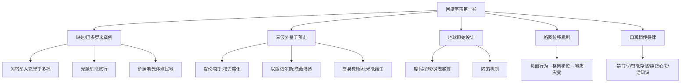

## 核心案例：琳达与巴多罗米的跨时空使命

### 催眠回溯的意外发现
德洛莉丝·侃南在阿肯色州小岩城演讲会上遇见琳达，后者虽无具体问题却感受到强烈冲动前来合作。首次催眠中，琳达进入中世纪前世，**巴多罗米**（Bartholomew）——一位王子，厌恶宫廷肤浅生活，热爱钻研星辰知识，独居森林劈柴为乐。

### 昴宿星人克里斯多福的传授
巴多罗米的老师**克里斯多福**自称来自**昴宿星团**（Pleiades），以光束形式跨越银河而来。他外表驼背白发长袍，实为高等存有，每日现身传授**宇宙知识**——涵盖多宇宙、遥远星球、上帝创造的一切。克里斯多福强调：
- 知识**严禁书写**，必须**口耳相传**（代代相传的活知识）
- 仅被选中者可得知，存储于智能深处，适当时机自动唤醒
- 书写会面临毁灭风险，且易被扭曲滥用

### 巴多罗米的星际寻人之旅
克里斯多福离世前嘱托巴多罗米寻找年轻传人。巴多罗米乘坐**椭圆形光舱**（无需驾驶，意念即达），穿越虚空前往**侨居地**（Colony/中介区）——一个无时空概念、不老化的光体存有聚居地。途中遇银色小灰人（来自麦康星），身着发光连身衣、腰系神秘银带。

## 光体殖民地教学体系

### 侨居地的光体存有
巴多罗米到达时，身体被圆柱光柱传送，感受**极轻无重、如飘浮、无肉身感知**。接待者为**高亮光体存有**，五官模糊、散发温暖喜悦、仅愿分享爱。巴多罗米意识到自身已穿越物质层面进入更高存在维度，但保留返回光舱的能力。

### 教学模式：学生提问驱动
巴多罗米采用**学生提问、教师回应**模式，首个问题由学生**阿特尼斯**提出：
> 「地球出了什么问题，为何地球人信仰体系如此狭隘？」

由此展开地球秘史的系统性揭示。

## 地球原始设计：度假星球与灵魂奖赏

### 整体规划的美好初衷
- 地球为宇宙中**最美行星**，其美为**实验设计**
- 原定功能：**情绪与物质/实体乐趣的体验星球**
- 灵魂因在其它世界贡献杰出，获奖来地球**短暂度假**
- 体验完物质乐趣后**离开**，继续原有高维生活

### 陷落机制
部分灵魂**过度沉迷物质欢乐**，失去离开能力，困陷地球实体特性。首批外星援助团来助其觉醒，反被困同频。

## 三波外星人干预史

### 第一波：提伦塔斯人——权力腐化
| 特征 | 详情 |
|------|------|
| **来源星球** | 提伦塔斯（Tyranthus），磁场与地球相似 |
| **外貌** | 长相酷似人类，不易被识别 |
| **初衷** | 提升地球原住民至高维存在层次 |
| **实况** | 沉溺**权力/贪婪**，私藏知识、奴役原住民、伪装神祇 |
| **手段** | 控制风光雨水威吓服从，展演「神迹」 |
| **后果** | 恐惧生根，人类信奉虚假神权，黑暗纪元开启 |
| **基因影响** | 与地球人繁衍，将权力特质融入人类基因库 |

### 第二波：以朗依尔斯人——隐蔽渗透
| 特征 | 详情 |
|------|------|
| **来源星球** | 以朗依尔斯（Iranius） |
| **真实外貌** | 极小身躯、巨大圆头、银灰色、四肢柔软（类似现代灰人描述） |
| **伪装策略** | 变形为**动物**进入人类梦境传递讯息 |
| **教导内容** | 爱、生命不朽、物种合作概念 |
| **失败原因** | 方式过于细微缓慢，受众极少；权力阶层抵制，民众嘲笑恐惧 |
| **文化印证** | 美洲印地安传说「动物传授知识」、现代UFO案例中外星人常以动物形象掩饰 |

### 第三波：高身教师团——光能维生
| 特征 | 详情 |
|------|------|
| **外貌** | 极高大、奇特手脚（戴手套穿鞋遮掩）、深色大眼、鼻孔双洞、嘴不语不食 |
| **能量系统** | **光合维生**——需定期进入飞船光室吸收源头之光 |
| **行动模式** | 母船释放卫星分赴各地，定期联络汇报 |
| **教导重点** | 农耕定居、善待动物、和谐共处、理性思考 |
| **成果** | 物质生活显著改善，**但仍被奉为神祇** |
| **关键差异** | 严守使命，**任务完成即集体离开**，未陷落地球 |

## 格网位移与大陆漂移机制

### 地质灾变的能量学成因
- 地表下存在**格网**（Grids）连接陆块
- 人类大规模负面行为（杀戮、仇恨、权斗）导致**格网移位**
- **连锁反应**：高温期→冰层融化→全球洪水→陆块分离（大陆漂移）→冷却期→新生演进

### 循环重演
灾后短暂和平→人类厌倦平静→寻求刺激→游戏升级为战争→再度坠落权力陷阱。巴多罗米指出：**「人类本性透过不同文化混合被扩大，外星基因助长此特性」**。

## 知识传承铁律与宇宙法则

### 口耳相传的绝对原则
1. **禁书写**：文字易毁、易篡改、易落入错误之手
2. **智能存储**：知识封存于深层智能，唯适配传人、适当时机自动解锁
3. **纯正心思**：传受者须无私利、无扭曲、无恐惧
4. **活知识**：随传人理解层次自动调序呈现

### 自由意志与不干预铁律
- 外星高等存有**必须尊重地球人自由意志**
- 仅能以**微妙方式点醒**（如光之灵协助转化思想、开启光体）
- **武力永远无效**——以朗依尔斯星人教训：「武力不是可行解法」
- 地球进化关键期，选择权始终在人类手中

## 跨页面概念映照

| 本页核心概念 | 关联既有页面 | 映照关系 |
|--------------|--------------|----------|
| QHHT量子疗愈催眠技术 | [[qhht-quantum-healing-hypnosis-technique]] | 本案例为QHHT经典实操范本：梦游状态、潜意识双向对话、高我/灵界图书馆接入 |
| 亚特兰提斯水晶科技 | [[atlantis-crystal-energy-technology]] | 巴多罗米时代或为亚特兰提斯晚期；格网位移机制与水晶能量网络呼应 |
| 昴宿星人/光体存有 | [[dolores-cannon-atlantis-revelations]] | 侃南系列统一宇宙观：昴宿星为知识源头，光体为高维存在常态 |
| 三波志愿者灵魂 | [[三波志愿者与新地球]] | 三波干预史与「三波志愿者转世」设定互为因果：干预失败致志愿者需亲身转世助升维 |
| 地球度假星球设定 | [[convoluted-universe-2-apostles-sleep-work]] | 后卷进一步展开：地球为「宇宙游乐场」，七使徒/志愿者在睡眠态协助灵魂过渡 |
| 格网/能量经络 | [[soham-techniques-and-meridians]]、[[activating-mystical-healing-power]] | 行星格网与人体经络同构；格网移位致地质灾变，经络阻滞致身心病痛 |
| 口耳相传/活知识 | [[seth-philosophy-jane-roberts]]、[[belief-creates-reality-practice]] | 赛斯教导亦强调「信念创造实相」、知识需内化为振动而非外求文字 |

## 知识图谱定位

## 实践启示

1. **知识内化胜于外求**——真实智慧需在深层智能中活化，非书本堆砌
2. **频率共振决定接入**——唯振动频率匹配者（纯正、无惧、无私）可得高维讯息
3. **地球进化关键在个体选择**——集体升维由每个灵魂「放下恐惧、开放心灵、不再自私」的微观决定累积而成
4. **历史循环可被打破**——觉察「厌倦平静→制造戏剧」模式，以意识转化替代业力重演

> 「宇宙奥秘如巨大拼图，透过催眠记实一块块拼凑。这本书只是开端，接下来探讨亚特兰提斯、金字塔、百慕达、复活岛等谜团，及其它星球生命、平行宇宙、量子力学与上帝。」——园丁话语

## 来源

- [回旋宇宙——序曲光之灵](../sources/回旋宇宙——序曲光之灵.md)
