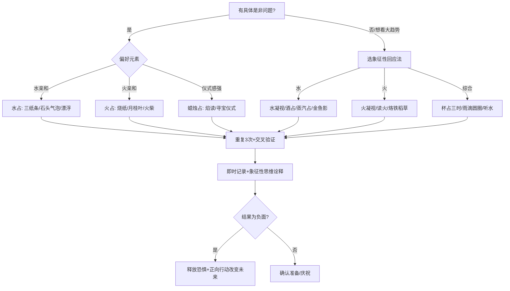

## 概述

本页面基于史考特·康宁罕《占卜大全》（Divination Compendium）第二部分“技巧”章节，系统整理**水、火、蜡烛**三大自然元素的占卜实操方法。康宁罕将占卜定义为“探索未知信息的工具”，强调**未来可改、无固定命运**，占卜提供的是“可能的未来”而非注定宿命。三大元素占卜均属**自然型占卜**（Natural Divination），利用自然界现象（水面倒影、火焰形态、烟雾流向）接收象征性或二元性回应，核心依托**象征性思维**与**直觉诠释**。

> 相关基础理论见：[[divination-fundamentals]]（占卜定义、分类、核心益处、通灵感知开发、提问技巧、准确度校验）、[[scott-cunningham-divination-compendium]]（康宁罕占卜哲学、塔罗判定法、时间范围测定、业力恐惧释放）。

---

## 一、水占 Hydromancy

水占（Hydromancy）据称由希腊水神涅柔斯创立，利用水的**流动性、反射性、包容性**接收讯息。传统视水为阴性元素，象征生长、净化、爱、灵性意识、疗愈与平静。

### 水凝视 Water Gazing / Scrying

**核心原理**：凝视水面/水下倒影，诱导象征性影像浮现，类似水晶球凝视。

**标准流程**：
1. **器具**：蓝色陶瓷碗（浅色碗效果佳），装满清水。可滴入几滴蓝色食用色素/墨水染色。
2. **环境**：黑暗房间，背对光源坐姿；或晴夜户外捕捉月光倒影；或烛光映照水面。
3. **操作**：
   - 默念/出声提问。
   - 凝视水中**而非**水面，放松焦距。
   - 水面可能先变混浊，随后浮现象征影像。
   - 影像停止显现后，立即以象征性思维诠释。
4. **变体**：
   - **酒占 Oinomancy**：洁净玻璃杯装葡萄酒，杯后置蜡烛点燃，凝视被照亮的酒面。
   - **杯占 Sycophancy**：三种材质杯对应三时——银杯装酒看**过去**，铜杯装油看**现在**，玻璃杯装水看**未来**。（占卜前三天需无风、占卜者穿白衣）
   - **金戒指水占**：金戒指置入水杯，杯前置镜子，凝视戒指在镜中的倒影。
   - **天然水体**：平静湖面、持续注水的小池塘为上佳凝视面。

> 交叉引用：[[divination-fundamentals#水晶球占卜]]、[[pendulum-divination#通灵感知开发]]（凝视态度与直觉养成一致）。

### 漂浮法 Floating

**适用**：是非题（二元回应）。
**操作**：湖边/泉边，手持轻物（面包片、树叶等），提问同时抛入水中。
- **沉没** = 是（肯定）
- **持续漂浮 / 沉后又浮 / 被冲上岸** = 否（否定）

> 古希腊至今沿用，最简易的水占二元判断法。

### 水井与池塘占卜 Wells & Ponds

| 场景 | 操作 | 判读规则 |
|------|------|----------|
| **测情人忠诚** | 圆巾抛入池塘/湖面 | 巾漂向**北** = 忠诚；漂向**南** = 存疑 |
| **花卉升沉** | 大碗底置一小花，注水提问 | 花**浮起** = 是；**先升后沉** = 无定论 |
| **三纸条法** | “是”“否”“空白”三纸投碗注水 | **最先浮起**者为答；空白浮起 = 当下无答案 |
| **海况预测** | 面包片投入水井 | **漂浮** = 风平浪静；**下沉** = 恶劣天气，勿出海 |
| **石头气泡法** | 石头投井，数沉入过程气泡数 | **奇数** = 否；**偶数** = 是 |
| **硬币/造型石投井** | 投入硬币或方/三角/圆三石 | 观察水面波纹形态、扩散速度、对称性诠释 |
| **水井凝视验证** | 黄昏/黎明独自凝视运作井中 | 见象征后投石，**听到水声回响** = 讯息真实 |

### 特殊水占形式

#### 雨滴圆圈法 Raindrop Circles
- **条件**：夜晚、浅人工池/喷泉池（水静止）、池边有灯光照射水面、细雨广泛散落。
- **操作**：坐池边提问，观察雨滴落水形成的同心圆圈。
- **判读**：**多小圈且<1秒消失** = 是；**多大圈且持久** = 否。

#### 听水法 Listening to Water
- **环境**：溪流/河流旁，水流经岩石发声。
- **操作**：沉心静气聆听水低语，心中浮现画面即为回应。

#### 金鱼影子法 Goldfish Shadows
- **器具**：鱼缸、金鱼、亮灯/手电筒（聚光束照射缸壁上方及后墙）。
- **原理**：光透缸体，鱼动投射墙面影子，形态变化显示未来。

#### 蒸汽占卜 Steam Scrying
- **器具**：墙挂镜子、矮桌、大锅烧开水。
- **流程**：开水离火置桌上隔热垫，蒸汽升腾使镜面起雾 → 凝视雾面或待蒸汽凝结成水滴滴落镜面 → 水滴可能形成字母/符号进行诠释。

---

## 二、火占 Pyromancy

火占（Pyromancy）包含对火焰、烟、灰、蜡烛的多重观察。火关联太阳、大地肥力，兼具神圣与毁灭双重性，**梦见火仍被视为吉兆**。操作须严守防火安全。

### 火凝视 Fire Gazing
- **操作**：熊熊炉火前坐定，提问，凝视火焰/灼灼余煤约 **5 分钟**（无需计时），以象征性思维诠释浮现影像。

### 读火 Reading the Fire
依火焰外观直接判读，**无需象征诠释**：

| 火象 | 预兆 |
|------|------|
| 拨火后**旺盛燃烧** | 远方爱人/亲人平安快乐 |
| **暗淡火焰** | 坏天气将至 |
| **突然猛烈燃烧** | 陌生人即将到访 |
| **蓝色火焰** | 暴风雨来临 |
| **火花四溅** | 不久将收重要消息 |
| **发嗡鸣声非劈啪声** | 暴风雨迫在眉睫 |
| **火星飘出** | 家中将生争吵 |
| **难以点燃** | 未来需辛苦努力 |
| **快速着火** | 将有访客到来 |
| **极亮火焰** | 下雨征兆 |
| **劈啪作响** | 预示降雪 |
| **火发“讯号”** | 麻烦临近 |

> 可积累个人火象对照表，形成专属“火语”词典。

### 烙铁与稻草 Sideromancy（热与稻草）
- **器具**：平底铁锅/煎锅、炉火、谷物秸秆（麦/燕麦/大麦杆，**非吸管**）。
- **流程**：锅加热翻扣耐热面 → 撒少许稻草于锅底 → 观察稻草燃烧冒烟时的**旋转、舞动轨迹** → 诠释动作象征未来。

### 烧纸法 Paper Burning
- **操作**：小纸条写问题，字面朝下置耐热面 → 火柴点燃一角。
- **判读**：**全烧** = 是；**仅部分烧毁** = 否。

### 月桂叶占卜 Daphnomancy（草药占卜）
- **咒语**（对火诵念）：
  > 火、火、祝福之火 / 带来我渴望的机运 / 现在我希望可以看见 / 即将降临在我身上的未来。
- **操作**：述问题同时投入 **五片月桂叶**。
- **判读**：**燃烧劈啪作响/喷溅** = 是；**静默燃烧** = 否。

### 易燃物投火 Causimomancy（燃烧占卜）
- **操作**：提问同时投入易燃物。
- **判读**：**未烧完/比常慢** = 吉/是；**烧尽** = 凶/否。

### 火柴占卜 Match Divination
- **操作**：是非题 → 点燃一根木柴，直立握持。
- **判读**：燃烧时柴头 **向左弯** = 否；**向右弯** = 是。

---

## 三、蜡烛占 Candle Divination / Lychnomancy

蜡烛占卜历史悠久，与油灯占卜同属“燭台占卜”。蜡烛被视为火元素的**可控载体**，适合室内仪式化操作。

### 基础准备
- **环境**：无风、无冷气流通房间。
- **蜡烛**：依目的选色（康宁罕未强制配色，但传统魔法常对应：红—爱情/勇气，绿—金钱/生长，白—净化/真理，蓝—疗愈/直觉，紫—灵性力量）。
- **心态**：同[[divination-fundamentals#适当的态度]]——严肃、专注、无戏谑。

### 寻宝蜡烛仪式 Treasure-Hunting Candle Ritual
> 书中记载的“古怪蜡烛占卜”，用于探测洞穴/地下宝藏。

**器具**：
- 提灯（照明备用）
- 蜂蜡蜡烛
- 自然形成 **“W” 形** 榛树枝

**流程**：
1. 蜡烛绑于 “W” 枝顶端，点燃。
2. 持枝深入洞穴，提灯作照明。
3. **观察烛焰**：
   - **产生火花** = 宝藏在附近。
   - **正常燃烧** = 无宝藏。
   - **焰突然旺盛、喷大量火花、随即熄灭** = 抵达宝藏确切位置（此时需提灯续行）。

> 实用性存疑，但展示“火作为指示针”的经典魔法思维：以元素精灵/能量对物质目标的反应定位。

### 蜡烛焰读取 Candle Flame Reading（可扩展实操）
虽书中未详列，但结合火占“读火”逻辑，常见判读：
- **焰高直稳** = 能量通畅、意图明确。
- **焰摇曳/分叉** = 干扰、对立能量、答案复杂。
- **焰发蓝/绿** = 灵性存在/元素精灵介入。
- **烟向特定方向** = 事件发生方位/能量流向。
- **蜡泪形态/流向** = 象征性讯息（如心形=爱情顺遂，泪向门=有人来访）。

> 进阶实操可参考：[[wicca-candle-magic-introduction]]（威卡蜡烛魔法入门：准备流程、咒语体系）、[[wicca-magic-starter-kit]]（蜡烛/水晶/草药三册递进框架）。

---

## 四、通用操作原则与进阶提示

### 提问技巧
- **明确、单一、可二元化**：“我遗失的钥匙在客厅吗？”优于“我钥匙在哪？”
- **分层追问**：由大范围缩小至具体位置（见[[divination-fundamentals#提问技巧]]）。
- **书写/出声/默念**均可，以占卜者最舒适方式为准。

### 重复验证
- **同一问题重复 3 次**（不同时间/同法），取一致结果。
- **交叉验证**：水占后改用火占/灵摆确认（见[[pendulum-divination]]、[[divination-fundamentals#塔罗判定占卜法]]）。

### 诠释象征性回应
- **即时记录、即时诠释**，避免记忆偏移。
- **依个人象征系统**：狗=忠诚（养狗者）vs 恐惧（被咬者），切勿套用书本固定象征表。
- **练习象征性思维**：日常随时观察物品（咖啡壶、铅笔）联想象征意义，强化“图像思维肌肉”（详见[[divination-fundamentals#象征性思维]]）。

### 缺乏回应的处理
- **非失败**＝能量过杂/时机未到/内建安全装置。
- **稍后再试**或**用占卜问“无回应原因”**。
- 切勿强行赋义。

### 改变不想要的未来
康宁罕核心主张：**占卜显示“若维持现状的可能未来”，非宿命**。
- **释放恐惧**：每日诵肯定句“我为自己的行为负责，释放对过去的愧疚与对未来的恐惧，我有力量改变未来”。
- **正向思考+积极行动**：肯定句需配合具体行动（搬离险地、调整饮食、终止有害关系）。
- **一次只改一个最负面警告**，成功后再处理次要。
- **正向预兆若不符愿望**（如非意愿怀孕），同理可用行动规避（避孕/避孕期避免性行为）。

> 详见：[[divination-fundamentals#改变未来]]、[[divination-fundamentals#业力恐惧释放]]。

### 为他人占卜伦理
- **熟练前勿为人占**——定义：多场合成功+象征性思维娴熟。
- **必须获明确同意**，隐私权不可侵犯。
- **不收费**（除非专业设立），避免法律风险。
- **正向措辞**：预见车祸→“周二避免开车/注意路况”，而非“你会摔断腿”。
- **告知未来可改**，引导对方自主行动而非依赖占卜师。

---

## 五、工具获取与成本提示

| 元素 | 核心工具 | 成本 | 备注 |
|------|----------|------|------|
| 水 | 蓝陶碗/玻璃杯/天然水体/鱼缸/镜子/锅 | 低/零 | 自来水、雨水、湖水皆可 |
| 火 | 壁炉/火盆/蜡烛/火柴/月桂叶/稻草/铁锅 | 低 | 家庭常备品即可 |
| 蜡烛 | 蜂蜡/石蜡烛、榛树枝（寻宝用） | 低 | 选无香/单色为佳 |

> 康宁罕强调：**“占卜使用的工具都可以极低的费用或免费的方式轻易取得”**——无需昂贵法器，核心在**心态与技巧**。

---

## 六、交叉引用索引

| 主题 | 页面 | 关联点 |
|------|------|--------|
| 占卜基础理论 | [[divination-fundamentals]] | 定义、分类、象征性思维、时间观、改变未来、塔罗判定法 |
| 康宁罕元素魔法 | [[史考特康宁罕元素魔法]] | 地风火水四元素魔法体系、预备仪式、石头/磁石/蜡烛工具法 |
| 灵摆占卜 | [[pendulum-divination]] | 二元问答、地图寻物、能量检测、多选决策、提问技巧 |
| 塔罗判定占卜法 | [[divination-fundamentals#塔罗判定占卜法]] | 用大阿尔卡那确定“最适合当下问题的占卜法” |
| 威卡蜡烛魔法 | [[wicca-candle-magic-introduction]] | 蜡烛准备、奉献、咒语体系（爱情/金钱/就业/疗愈） |
| 魔法四元素宇宙观 | [[魔法四元素与宇宙观]] | 四元素象征对应、万用预备仪式、午夜唱颂 |
| 土/水/风/火元素魔法 | [[土元素魔法体系]] / [[水系魔法体系]] / [[风元素魔法体系]] / [[火元素魔法体系]] | 各元素神话、神明、精灵、实操咒语、历史演化 |
| 云占术 | [[云占术]] / [[云占术象征辞典]] | 凝视占、预兆观察、象征解读原则、A-Z象征辞典 |
| 徒手占卜五法 | [[divination-fundamentals#徒手占卜]] | 物件象征法、凝视占、预兆观察、通灵信息、梦境占卜 |

---

## 七、速查表：三大元素占卜决策树

---

> **结语**：水、火、蜡烛占卜是**最古老、最低门槛、最直觉化**的自然占卜入门。掌握**提问分层、重复验证、象征性思维、恐惧释放、行动改变**五大核心技能，即可将元素占卜转化为“导航可能未来”的实用罗盘。

## 来源

- [占卜大全](../sources/占卜大全.md)
