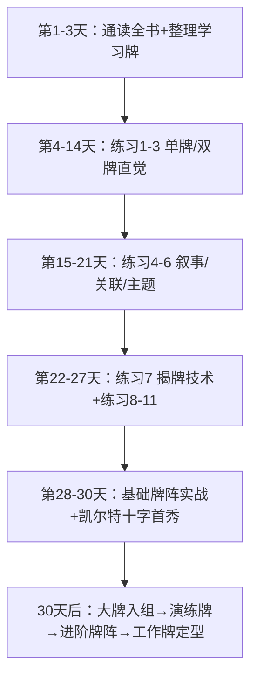

## 概述

《Easy Tarot Lessons》（轻松上手学塔罗）是一套以实操练习为核心的塔罗入门教学体系，强调「先跟牌建立关系，再查书本牌义」的直觉优先原则。全书构建了**三层牌组分级**、**七大基础练习**、**30天学习进度表**、**逆位牌处理原则**、**四元素方位对应**、**初学者牌组推荐**及**收纳净化实务**六大核心模块，旨在帮助零基础学习者在30天内建立扎实的解牌肌力与直觉连结。

> 核心理念：塔罗牌的神秘感由使用者营造，纸牌只是工具，真正的魔法在你自己身上。学习重点不在于死记硬背牌义，而在于磨练「心灵肌力」，学会聆听牌面图像当下的视觉刺激与直觉共鸣。

---

## 三层牌组分级体系

教学全程采用**三套牌组递进模式**，降低认知负荷，循序渐进：

| 牌组名称 | 组成 | 教学阶段 | 核心作用 |
|----------|------|----------|----------|
| **学习牌** | 56张小阿尔卡那（四组数字牌1-10 + 宫廷牌） | 练习1-7、基础牌阵 | 图像直观、贴近日常、易建立熟悉感，暂时移除大阿尔卡那的原型压迫感 |
| **演练牌** | 学习牌 + 22张大阿尔卡那 = 78张全副牌 | 练习8-11、进阶牌阵 | 将大牌作为「整体存在/社会状态」象征融入，体验牌与牌的深层能量互动 |
| **工作牌** | 你最信任、最顺手、用于正式占卜的那副牌 | 实战占卜、咨商、魔法施术 | 成为「面包与奶油」，助你改变生命；可拥有多副，但必有一副核心主力牌 |

> **操作建议**：练习1-7全程仅用学习牌；练习8起将大牌加入组成演练牌；正式为他人占卜时启用工作牌。[[tarot-spreads-fundamentals]] 中的基础牌阵可在学习牌阶段先行尝试。

---

## 练习1-7：核心训练法详解

所有练习均要求**彻底洗牌、默想提问、快速直觉反应、大声说出**，每组牌不超过10-15秒。重点在于「当下所见即所得」，不求标准答案。

### 练习1：表象含义
- **目的**：建立「看图说话」的直觉肌肉，确立「个人共鸣优于书本定义」的权威。
- **操作**：分组浏览四组小牌（权杖/圣杯/宝剑/星币），逐张凝视2-3分钟，问自己：「画面发生什么？若我身在其中感受如何？有何符号跳入眼帘？」
- **关键点**：不参考任何书本牌义；同一张牌不同次练习可给出完全不同解读；宫廷牌按「侍从-骑士-王后-国王」成熟度阶梯观察。
- **延伸**：将同组14张牌铺开（宫廷牌上排，数字牌下排两行），寻找主题旋律与模式。

### 练习1A：弦外之音
- **目的**：训练「表层含义 → 隐层暗示」的双层感知，突破字面图像。
- **操作**：单人或小组，每张牌限时5秒，说出第一印象之外的「隐含意味」（如：八杯非单纯离开，或为「蹑手蹑脚的夜奔」「灵性寻访」「逃避责任」等多重可能）。
- **原则**：无对错，唯「是否浮现」。若卡住立即跳过，保持轻松。

### 练习2：我的牌与你的牌
- **目的**：建立洗牌-切牌-抽牌完整流程；消除对「凶牌」的恐惧；确立「无牌比其他牌更重要」的等级观。
- **流程**：彻底洗牌 → 取首张置右「这是你发生的事」 → 取次张置左「这是我发生的事」 → 极速解读（每张≤4秒） → 两两配对贯穿全副牌。
- **核心口诀**：`「没有任何一张牌比其他牌更重要。」` 将每张牌视为同等必要的「一口气」。
- **实战价值**：将抽象牌义「个人化、情境化」，练习同理心与悲悯视角。

### 练习3：两张牌有何共同点
- **目的**：训练「跨牌关联」的横向思维，为多牌阵解读奠基。
- **操作**：随机抽两张，3-4秒内说出共通点（动作、情绪、元素、数字、场景、人物关系等）。
- **技巧**：若无共鸣立即换组，不强求；积累「关联词库」（如：交换、冲突、等待、守护、转折）。

### 练习4：从这张牌到那张牌
- **目的**：掌握「线性叙事」构建能力，理解牌与牌的因果/转化/递进关系。
- **操作**：抽两张，从第一张情节讲到第二张，编出微型故事（如：三角恋→失眠痛楚；宴会狂欢→酒后群架）。
- **进阶**：反向解读（调换顺序），体验叙事逆转带来的意义重构。

### 练习5：三张牌来回解读
- **目的**：整合「识别→关联→叙事」三步骤，建立「解牌顺序自主权」（左→右/右→左/中间向两侧），为凯尔特十字等复杂牌阵预演。
- **流程**：
  1. 翻三张，按「左→右」时间序解读（过去-现在-未来或 起-承-转）。
  2. **同组牌**改按「右→左」重解。
  3. 换新三张循环。
- **关键**：预先制定解读规则，中途不改；体会顺序如何改变因果归因与建议方向。

### 练习6：物以类聚
- **目的**：在多牌共存时提取「核心主题/共同线索」，抑制首张牌的首因效应偏见。
- **操作**：翻三张，10秒内说出共同点（颜色、元素、数字、场景、人物状态、结果导向等）。
- **心法**：`「并不是所有的牌都那么容易找到共同点，这件事本身就是一门值得学习的功课，知道何时该放下。」`

### 练习7：咦！这张牌是什么意思 —— 方向关联牌 / 揭牌
- **目的**：掌握「辅助澄清牌」技术，解锁牌阵中模糊/关键牌位的深层信息。
- **场景**：牌阵中某张牌（如宝剑九「痛苦」）含义模糊，需借其他牌澄清。
- **流程**：
  1. 确认目标牌（如宝剑九）。
  2. 扫描牌阵其他位置寻找「影响牌」（如权杖骑士在「外在影响」位 → 解读为「花心前任导致痛苦」）。
  3. 若牌阵内无足够信息，**额外洗全副牌、默想「此牌真意何在」、抽三张作为「揭牌/说明牌」**。
- **原则**：揭牌如报纸照片下的说明文字，专门解释目标牌；揭牌本身不另行解读，仅服务于目标牌。

> **进阶练习8-11**（见进度表）：一加一等于什么、一加一加一等于什么、说故事接龙、把整副牌贴墙全景扫描。均在演练牌（含大阿尔卡那）阶段进行。

---

## 30天学习进度表与每日记录表

### 30天进度追踪表
| 练习项目 | 正在努力 | 快要熟练 | 我觉得熟练 | 完全熟练 |
|----------|----------|----------|------------|----------|
| 练习1 表象含义 | ☐ ☐ | ☐ ☐ | ☐ ☐ | ☐ ☐ |
| 练习1A 弦外之音 | ☐ ☐ | ☐ ☐ | ☐ ☐ | ☐ ☐ |
| 练习2 我的牌与你的牌 | ☐ ☐ | ☐ ☐ | ☐ ☐ | ☐ ☐ |
| 练习3 两张牌共同点 | ☐ ☐ | ☐ ☐ | ☐ ☐ | ☐ ☐ |
| 练习4 从这张牌到那张牌 | ☐ ☐ | ☐ ☐ | ☐ ☐ | ☐ ☐ |
| 练习5 三张牌来回解读 | ☐ ☐ | ☐ ☐ | ☐ ☐ | ☐ ☐ |
| 练习6 物以类聚 | ☐ ☐ | ☐ ☐ | ☐ ☐ | ☐ ☐ |
| 练习7 方向关联牌/揭牌 | ☐ ☐ | ☐ ☐ | ☐ ☐ | ☐ ☐ |
| 练习8 一加一等于什么？ | ☐ ☐ | ☐ ☐ | ☐ ☐ | ☐ ☐ |
| 练习9 一加一加一等于什么？ | ☐ ☐ | ☐ ☐ | ☐ ☐ | ☐ ☐ |
| 练习10 说故事接龙 | ☐ ☐ | ☐ ☐ | ☐ ☐ | ☐ ☐ |
| 练习11 整副牌贴墙查看 | ☐ ☐ | ☐ ☐ | ☐ ☐ | ☐ ☐ |
| 基础牌阵（1/2/3张） | ☐ ☐ | ☐ ☐ | ☐ ☐ | ☐ ☐ |
| 进阶牌阵（凯尔特十字/环形/时钟） | ☐ ☐ | ☐ ☐ | ☐ ☐ | ☐ ☐ |

> **每日最低配置**：读全书1遍（前3天） → 每天15-30分钟实操练习 → 每周至少2次「纯粹好玩」式单张/两张/三张牌阵问琐事（午餐吃什么/老板几点溜号） → 第3-4周尝试凯尔特十字。[[tarot-daily-journaling]] 可作长期记录法补充。

### 每日记录表（示例）
| 日期 | 今日练习/收获/趣事 |
|------|-------------------|
| Day 1 | 阅读全书第一章，整理学习牌，完成练习1权杖组浏览 |
| Day 2 | 练习1圣杯组，尝试弦外之音独练，记录3张牌的隐层印象 |
| … | … |
| Day 30 | 完成凯尔特十字首次实战，记录牌阵照片与复盘笔记 |

---

## 逆位牌处理原则

1. **两种基本选择**：转正 / 保持逆位读牌 —— 任选其一，全程一致即可。
2. **逆位含义光谱**：
   - 正位意义的**相反**（如宝剑王牌正「胜利」→逆「失败」）
   - 正位能量的**减损/受阻/内化**（如圣杯王牌正「情感新开始」→逆「情感受挫/难以表达」）
3. **初学者建议**：前6-7天**全程转正**，专注建立正位直觉；待练习1-7熟练后再引入逆位。
4. **实战铁律**：**牌阵整体互证优于单张逆位死扣** —— 逆位仅提供额外信息维度，最终解释必须由全阵牌义互证支撑。

---

## 四元素方位对应表

本书采用最普遍共识的「黄金黎明/韦特系」对应，供方位占卜、魔法施术、元素平衡参考：

| 牌组 | 元素 | 方位 | 季节 | 核心意涵 |
|------|------|------|------|----------|
| **权杖** | 火 | 东 | 春 | 行动、灵感、事业、主动力 |
| **圣杯** | 水 | 北 | 夏 | 情感、直觉、关系、内在流动 |
| **宝剑** | 风 | 西 | 秋 | 思维、冲突、沟通、真理切割 |
| **星币** | 土 | 南 | 冬 | 物质、财务、身体、显化结果 |

> **注**：宝剑/权杖「风/火」互换派系存在，本书不展开，实战以此表为准。[[tarot-astrology-golden-dawn-correspondences]] 提供更详尽的黄金黎明元素-星座-十度面对照。

---

## 初学者塔罗牌推荐清单

| 牌组 | 特点 | 适合人群 | 备注 |
|------|------|----------|------|
| **莱德韦特系变体**（Rider-Waite / Original / Universal / Albano / Golden Rider / Radiant） | 图像标准、符号清晰、教学资源最丰富、彩度可选 | **首选入门标准牌**，长期主力牌 | 图案同源，仅色彩/线条差异 |
| **汉森罗伯特** | 特写视角、人物更近、亲切感强、风格偏插画 | 喜欢「面对面」代入感者 | 熟悉后难回接受传统构图 |
| **摩根吉尔** | 更极致特写、无边框、沉浸感极强 | 视觉导向、重氛围者 | 爱恨分明，不喜者完全无感 |
| **万圣节塔罗** | 忠于韦特原构图、幽默细节丰富、万圣节美学 | **第二副牌**进阶、节日氛围爱好者 | 学习传统符号略欠缺，建议先熟韦特牌 |

**避坑指南**：
- ❌ 简速版/关键词印在牌面牌 → 扼杀直觉、依赖外部权威
- ❌ 超现实/艺术派（达利/软糖熊等） → 象征系统破碎、难稳定解读
- ✅ 买新牌优于二手；二手必做「湿布擦拭+盐埋一夜」净化

---

## 塔罗牌收纳与净化实务

### 收纳容器（任选一，重「护牌」不「迷信」）
- **真丝巾/丝绸袋**：传统护符感强，需外套盒防散落
- **木盒**：容纳牌+丝巾，稳重护牌，市面「塔罗专用盒」多为此类
- **原包装盒**：极简实用，贴胶带加固耐用
- **原则**：干燥、洁净、不掉牌、顺手即可，无绝对规范。

### 净化流程（新牌开封/二手到手/能量沉重时）
1. **物理清洁**：微湿软布逐张擦拭 → 自然风干
2. **能量清洁**：整副牌埋入干净粗盐中静置一整夜（或放月光/熏香/敲音叉）
3. **建立连结**：握牌默想「你是我的工具，我们合作愉快」 → 逐张浏览完成「认主」

> **日常维护**：占卜后扇形扫一遍「刷场」、放回盒盖好；定期（月/季）重走净化流程。

---

## 学习路线图速览

---

## 交叉引用与延伸阅读

- **牌阵体系**：[[tarot-spreads-fundamentals]]、[[tarot-spreads-by-count]]、[[classic-tarot-spreads-detailed]]
- **大阿尔卡那深度**：[[tarot-major-arcana-consulting-0-6]]、[[tarot-nine-chapters]]、[[78度的智慧塔罗体系]]
- **小阿尔卡那结构**：[[tarot-minor-arcana-number-court]]
- **元素/占星对应**：[[tarot-astrology-golden-dawn-correspondences]]、[[tarot-eye-two-volumes]]
- **逆位/伦理/咨商框架**：[[consulting-tarot-framework]]、[[neizai-de-tiankong]]
- **每日记录/统计实证**：[[tarot-daily-journaling]]
- **其他入门教材对照**：[[learning-the-tarot-joan-bunning]]、[[illustrated-first-tarot-reading-guide]]、[[两小时学会塔罗]]、[[五分钟塔罗]]

---

## 核心金句摘录

> 「塔罗牌的神秘感其实是由使用者营造的……纸牌只是一项工具就像画家手上的画笔和画布。最终，你本身才是为每一次占卜读牌描绘图像的人。」
>
> 「你所学到的那些塔罗理论知识就派上用场了……但是，更重要的是你内在的声音以及微妙的牌义推演。」
>
> 「把你学到的东西当作起点，而不是终点。」
>
> 「唯有当你确实与它们互动，那些牌义才会被『活化』。」
>
> 「练习比看书更重要……研读和练习必须并行。」

---

> **持续更新提示**：本页仅覆盖《Easy Tarot Lessons》核心教学体系；书中第四、五篇「大/小阿尔卡那逐张牌义解析」因篇幅未收录，实战中请配合 [[tarot-keyword-correspondence]]、[[tarot-index-quick-reference]] 及各大阿尔卡那专页查阅。

## 来源

- [塔罗入门指南](../sources/塔罗入门指南.md)
