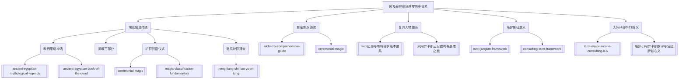

## 概述

本页面整合《埃及塔罗大阿卡那部分》归档资料，系统梳理**埃及赫密斯派塔罗历史谱系**、**塔罗复兴关键人物谱系**、**塔罗的象征意义**、**大阿卡那 0–21 核心牌义关键词**，并补充**埃及魔法传统**（欧西里斯神话、灵魂三部分 Ka/Ba/Akh、护符咒语仪式、常见护符）的完整知识图谱。通过 `[[wikilink]]` 与现有塔罗、埃及神话、仪式魔法、炼金术等页面建立交叉引用网络。

---

## 一、赫密斯派源流：从透特到赫密斯·特里斯墨吉斯忒斯

- **透特** —— 埃及智慧之神，鸟头人身，掌管书写、魔法、科学、历法，被视为《托特之书》作者。
- **赫密斯·特里斯墨吉斯忒斯** —— 希腊化时期将透特与希腊神赫密斯合一，称“三倍伟大的赫密斯”，成为**赫密斯派**核心形象。
- **历史脉络**：
  1. 公元前 4 世纪后，希腊哲学重释埃及宗教，古老碑文手稿归于“赫密斯”名下。
  2. 中世纪因解读门槛过高逐渐凋零。
  3. 阿拉伯传统经亚历山大文献重引入欧洲，经埃及文、希腊文、阿拉伯文、拉丁文多重翻译传播。
  4. 炼金术传播融合哲学与文化，催生**玫瑰十字会**、**共济会**等秘密结社。

> 交叉引用：[[alchemy-comprehensive-guide]]（赫密斯·特里斯墨吉斯忒斯在炼金术谱系中的定位）、[[ceremonial-magic]]（赫密斯魔法作为仪式魔法主要流派）、[[grimoire-comprehensive-guide]]（魔导书传承中的赫密斯文献）。

---

## 二、塔罗复兴关键人物谱系

| 人物 | 年代 | 核心贡献 | 关键著作/事件 |
|------|------|----------|---------------|
| **Court de Gébelin** | 18 世纪末 | 首次提出“塔罗 = 透特之书”，塔罗图案由透特设计，曾用于埃及祭司占卜与启蒙。 | 《Le Monde Primitif》第 8 卷 |
| **Etteilla (艾特拉)** | 1791 | 首位将塔罗魔法与占卜含义系统编撰成书，确立“塔罗起源于埃及”在法兰西的流行。 | 《透特之书字典》 |
| **Eliphas Lévi (利维)** | 19 世纪中叶 | 以塔罗为枢纽统一共济会符号、占星学、卡巴拉等西方秘传体系，奠定现代神秘主义塔罗框架。 | 《超越魔法》、《高等魔法仪式》 |
| **Papus (巴普蒂斯特·皮托斯 / 保罗·克里斯汀)** | 19 世纪末 | 利维学生，深化埃及起源论，建立马丁内斯派/马尔丹派塔罗体系。 | 《吉普赛人的塔罗》、《绝对启蒙》 |
| **Aleister Crowley (克劳利)** | 20 世纪初 | 黄金黎明体系继承者，创作《托特塔罗》，将埃及神话、赫密斯炼金、泰勒玛法则融入牌面。 | 《托特塔罗》、《托特塔罗之书》 |

> 交叉引用：[[tarot起源与韦特塔罗版本谱系]]（韦特—史密斯版本与托特版本的谱系对比）、[[大阿尔卡那三分结构与愚者之旅]]（利维/黄金黎明对大阿卡那三分结构的阐释）、[[78度的智慧塔罗体系]]（以愚者之旅为主轴的现代教学体系）。

---

## 三、塔罗的象征意义：知识之途径

> “塔罗应被看作一种途径——一种寻找知识的途径，一种在探索与潜意识道路上真实存在的途径，也是一种关于成长与收获的象征性路径。”

- **字母表隐喻**：塔罗 78 张牌如表达整个人类灵魂的字母表；学习永无止境。
- **牌阵即句法**：单张牌为字母，牌阵为词句；解读必须结合整个牌阵（上下文）。
- **核心追问**：
  - 你是谁？
  - 你的身份是什么？
  - 你由哪些部分构成？
  - 这些部分之间的关系如何？

> 交叉引用：[[tarot-jungian-framework]]（荣格原型与共时性解释塔罗运作机制）、[[consulting-tarot-framework]]（咨商塔罗的中性解读与金三角对话模型）、[[nei-zhi-liao-yu-taro]]（塔罗作为内在疗愈工具的自学框架）。

---

## 四、大阿卡那 0–21 核心牌义关键词（埃及塔罗体系）

| 编号 | 牌名 | 核心关键词（中文） | 核心关键词（英文参考） | 一句话意象 |
|------|------|-------------------|------------------------|------------|
| 0 | **愚者** | 盲目、忽视自我、困惑、迷失方向、危险、迟钝 | Folly, Ignorance, Blindness | 甘当物质奴隶者无法逃脱错误 |
| 1 | **魔术师** | 主动、机智、能力、潜力、事业开始、道路起点 | Willpower, Skill, Initiative | 完美的人，随时准备行动 |
| 2 | **女祭司** | 学习、智慧、直觉、神秘、秘密、研究 | Wisdom, Intuition, Mystery | 伊西斯神庙入口，耐寂寞者可达 |
| 3 | **女皇** | 多产、创造、智力、行动、自然、生命力 | Fertility, Creativity, Action | 象征女神伊西斯，内心公正 |
| 4 | **皇帝** | 稳定、权威、正直、坚固、创造性意志 | Authority, Stability, Structure | 方形石座象征稳固统治 |
| 5 | **教皇** | 指引、传统、忠告、经验、内心专注 | Guidance, Tradition, Counsel | 大祭司掌握神圣秘密 |
| 6 | **恋人** | 检验、尝试、契约、决断、播种 | Trial, Choice, Covenant | 激情与良心的斗争 |
| 7 | **战车** | 凯旋、成功、荣誉、野心、冲突 | Victory, Triumph, Ambition | 冲破障碍，勇敢面对未来 |
| 8 | **正义** | 法律、平衡、公正、因果、行为后果 | Justice, Balance, Karma | 在法律与责任间重建秩序 |
| 9 | **隐者** | 智慧、审慎、孤独、研究、判断力 | Prudence, Solitude, Wisdom | 审慎之光为智者盔甲 |
| 10 | **命运之轮** | 变化、机会、循环、重大时刻 | Change, Cycle, Opportunity | 善灵上升，恶灵下降 |
| 11 | **力量** | 勇气、力量、能量、自制、道德力量 | Strength, Courage, Self-Control | 神/理/物三界力量本质 |
| 12 | **倒吊人** | 赎罪、献祭、赔偿、宽恕、过渡、启发 | Sacrifice, Atonement, Transition | 神圣法则无人能逃避 |
| 13 | **死神** | 转变、结束与开始、重生、自由、平衡 | Transformation, Ending, Rebirth | 毁灭与重生贯穿生命 |
| 14 | **节制** | 中庸、和平、忍耐、谨慎、适应 | Temperance, Harmony, Patience | 滴水穿石 |
| 15 | **魔鬼** | 诱惑、创造力、多样性、毁灭、骚乱、蛊惑 | Temptation, Bondage, Chaos | 泰丰笼罩灾难中的人 |
| 16 | **塔** | 傲慢、放纵、监禁、毁灭、绝望、惩罚、失衡 | Destruction, Upheaval, Liberation | 断裂金字塔，幻灭崩塌 |
| 17 | **星星** | 信念、希望、优雅、美丽、顺利信号、抱负 | Hope, Inspiration, Faith | 星辰诞生于虚空照路 |
| 18 | **月亮** | 幻觉、怪癖、陷阱、幻想、虚假关系 | Illusion, Deception, Fear | 虚假保护无法逃避危险 |
| 19 | **太阳** | 和谐、真实、清晰、保障、诚实、荣耀 | Joy, Clarity, Success | 善用者清晰，滥用者盲目 |
| 20 | **审判** | 自我审视、决定性时刻、终点、转变、行为结果 | Judgement, Renewal, Reckoning | 一切改变，过去不再延续 |
| 21 | **世界** | 整体、成功、完美、狂喜、自由自足 | Completion, Integration, Fulfillment | 秘密揭开，伤口愈合 |

> 交叉引用：[[tarot-major-arcana-consulting-0-6]]（咨商塔罗视角的 0–6 号牌人生课题）、[[塔罗小阿尔卡那数字与宫廷牌核心义]]（小阿卡那数字/宫廷牌体系）、[[tarot-keyword-correspondence]]（主题速查关键词对照表）。

---

## 五、埃及魔法传统深度解析

### 欧西里斯神话：复活原型与王权合法性

- **核心情节**：欧西里斯（法老）遭弟塞特谋杀肢解 → 伊西斯收集肢体、托特咒语复活 → 生子荷鲁斯复仇 → 欧西里斯成冥界审判官。
- **关键神祇**：
  - **托特**：魔法与文字之神，教导象形文字与咒语，协助复活。
  - **伊西斯**：大魔法女神，掌握拉的秘密真名，象征魔法力量。
  - **荷鲁斯**：天空之王，四子守护四方与内脏罐。
- **意义**：埃及人模仿欧西里斯制作木乃伊、期盼复活；与耶稣复活叙事形成跨文化对照。

> 交叉引用：[[ancient-egyptian-mythological-legends]]（埃德富神庙荷鲁斯飞盘传说、拉与伊西斯秘名传说）、[[ancient-egyptian-book-of-the-dead]]（亡灵书中奥西里斯审判、心脏称量细节）、[[tujie-tianguo-yu-diyu]]（跨文化死后世界比较框架中的埃及章节）。

### 灵魂三部分

| 部分 | 含义 | 象形符号 | 护符功能 |
|------|------|----------|----------|
| **Ka** | 与肉体关联的生命力，死后仍留居墓中 | 举起的双臂 | 供给食物/供品维持 Ka |
| **Ba** | 可游走的灵魂人格，需夜ly 返回肉体 | 人头鸟身 | 保证 Ba 能自由出入 |
| **Akh** | 不依赖肉体的光灵，进入永恒星界 | 朱鹭 | 引导升入不朽领域 |

> 交叉引用：[[egyptian-cat-people-healing-temples]]（猫人/白光神殿对灵魂能量的疗愈）、[[dolores-cannon-atlantis-revelations]]（亚特兰提斯水晶疗愈与灵魂转世记忆）。

### 护符、咒语与符号体系

1. **名字即力量**：知晓神/人真名即掌握其力量（伊西斯骗取拉真名案例）。
2. **图像即魔法**：墓室壁画食物可供 Ka/Ba 食用（类比中式烧纸钱）。
3. **护符分类**：
   - 神名/象形文字类 —— 借神力。
   - 器官替身类 —— 补全缺失部位。
4. **开光必要**：所有护符须经仪式咒语激活。

> 交叉引用：[[ceremonial-magic]]（仪式魔法中符印/神名/开光流程）、[[magic-classification-fundamentals]]（交感魔法/模仿律与感染律在护符制作中的体现）、[[grimoire-comprehensive-guide]]（魔导书中护符制作规范）。

### 埃及魔法仪式

- **神圣空间构建**：四方位（东南西北）为轴，金字塔精准对准四方，象征世界中心与天地连接。
- **荷鲁斯四子守护四方/内脏**：
  - 人头 **伊姆塞特** → 肝 / 南
  - 豺头 **哈比** → 肺 / 北
  - 猿头 **哈匹** → 胃 / 东
  - 鹭头 **凯布森努夫** → 肠 / 西
- **开嘴仪式**：祭司象征性让死者复语，使《亡灵书》咒语生效。

> 交叉引用：[[divination-fundamentals]]（古代占卜史中的埃及祭司占卜）、[[ancient-egyptian-book-of-the-dead]]（亡灵书咒语与开嘴仪式的文本对照）。

### 日常魔法与感应魔法

- **世界观**：不可见存在（神/恶魔）干预人间；恶常现蛇、蝎、鳄、猿形。
- **防御优于治疗**：佩戴护符为主流防护手段。
- **感应魔法**：制作恶魔替身并破坏 → 象征性削弱目标（类比“扎草人”/巫毒）。

> 交叉引用：[[frazer-sympathetic-frazer]]（弗雷泽《金枝》中模仿律/感染律理论）、[[maleficium]]（欧洲猎巫档案中的变身术/荒天术/性爱魔法与感应魔法对照）。

---

## 六、常见埃及护符速查表

| 护符 | 名称 | 象征/神祇 | 核心功能 | 常用材质 |
|------|------|-----------|----------|----------|
| 👁️ | **Utchat** | 荷鲁斯之眼（左目=月、右目=日） | 力量、守护、安全、健康 | 天青石、玛瑙、花岗石、金、银、木 |
| 🪲 | **Scarab** | 凯普利/圣甲虫（滚粪球喻太阳运行） | 太阳活力、死后生活保障 | 蓝/绿石、陶瓷、象牙 |
| 🪢 | **Tyet** | 伊西斯之结（腰带扣） | 伊西斯魔力守护、通达冥界 | 红宝石、红玉髓、金 |
| ☥ | **Ankh** | 生命之符（鞋带/脊椎起源说） | 提升生命力 | 金、青金石、陶器 |
| 🏛️ | **Tet / Djed** | 节德柱（欧西里斯脊柱/神圣中心） | 死后复活、四方稳固 | 木、金 |

> 交叉引用：[[neng-liang-shi-liao-yu-xi-tong]]（宝石光线疗法与脉轮共振中的埃及护符石应用）、[[bach-flower-remedies-illustrated]]（花精与护符能量的中医整合视角）。

---

## 七、学习路径与跨页面导航

---

## 八、延伸阅读建议

1. **原典层**：
   - 《亡灵书》（多版本对照） → [[ancient-egyptian-book-of-the-dead]]
   - 《托特之书》（利维/克劳利注疏本）
   - Court de Gébelin《Le Monde Primitif》第 8 卷
   - Etteilla《透特之书字典》
   - Lévi《超越魔法》《高等魔法仪式》
   - Papus《吉普赛人的塔罗》
   - Crowley《托特塔罗之书》

2. **现代研究层**：
   - 《78度的智慧》（韦特塔罗愚者之旅教学） → [[78度的智慧塔罗体系]]
   - 《漫步灵魂森林》（波拉克偶然性占卜观） → [[塔罗占卜与自由意志]]
   - 《图解第一次塔罗占卜就上手》（入门实操） → [[illustrated-first-tarot-reading-guide]]
   - 《咨商塔罗》（中性解读/金三角对话） → [[consulting-tarot-framework]]

3. **埃及魔法专题**：
   - 草野巧《图解天国与地狱》埃及章节 → [[ancient-egyptian-mythological-legends]]
   - 《埃及魔法大全》（The Egyptian Book of Magic 现代编选）
   - 《赫密斯文集》希腊化赫密斯派文本选译

---

> **页面维护提示**：本页面为“埃及赫密斯派塔罗历史谱系”总览枢纽，后续可拆分为“赫密斯派源流考”、“复兴人物传”、“大阿卡那埃及牌义详解”、“埃及护符制作实操”等子页面，并在各子页面顶部回链 `[[egyptian-hermetic-tarot-history]]` 以保持知识图谱完整性。

## 来源

- [埃及塔罗大阿卡那部分](../sources/埃及塔罗大阿卡那部分.md)
