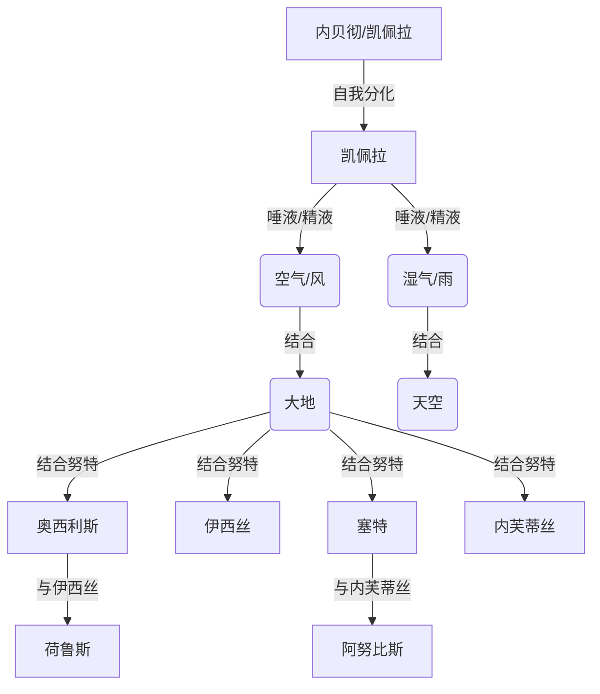

## 绪论

本页面系统汇编古埃及四大核心神话传说的原始经文翻译与学术解析，依托大英博物馆藏纸莎草纸10188号、塞提一世墓壁绘、埃德富神庙铭文等一手史料，重构古埃及神学体系的创世论、末世论、王权合法性叙事与魔法咒语传统。四大传说分别对应：赫利奥波利斯创世神学（纸莎草纸10188）、太阳神拉的统治危机与人类起源（天牛之书）、魔法女神伊西丝获取神性权柄（秘名传说）、荷鲁斯·贝胡泰特作为王权化身的军事征服史诗（飞盘传说）。这些文本不仅揭示古埃及宇宙秩序（玛特）的建立逻辑，更展现神话如何服务于法老王权、葬礼仪式与日常魔法实践。

> **跨学科关联**：古埃及《亡灵书》体系中的来世审判、心脏称量、巴与卡等核心观念，均可溯源于此处汇编的创世与神性传说。详见 [[ancient-egyptian-book-of-the-dead]]。

---

## 一、纸莎草纸10188号：内贝彻与凯佩拉的创世神话

### 文献学概况
- **藏品编号**：大英博物馆 Papyrus BM 10188
- **物理形制**：长约5米，宽24.5厘米，僧侣体书写，21篇韵文咒语 + 12篇长行手写体（约930行），红墨标注标题与魔神名
- **年代断代**：第二十六王朝（前672–前525）至托勒密王朝（前304–前30）
- **题署信息**：亚历山大四世执政第十二年四月一日（前311年）；僧侣内斯-梅努/内斯-阿姆苏为书写者或持有者
- **发现经过**：1861–1862年A.H.莱因德在底比斯西岸获赠于穆斯塔法·阿格哈，后经伯彻博士鉴定、布鲁格沙博士推荐、巴奇翻译刊行

### 创世叙事结构分析

#### 第一阶段：前存在的唯一神内贝彻
> **内贝彻** = "拥有最大限度权力的神"，指涉时空无限的宇宙神，后为科普特文学沿用。祂无生存地点与方式描述，仅具"至高无上、无踪无影的力量充满整个空间"。

#### 第二阶段：化身凯佩拉，在努恩原始之海中自我分化
| 关键动作 | 神学意义 | 对应神祇/概念 |
|----------|----------|----------------|
| 喊出自身名字"凯佩拉" | 言语创世：命名即赋予存在 | 凯佩拉（创造之神） |
| 以意念"打基础"创造立足处 | 心智前置的创造论：心中构想→言语实现 | 玛特（真理/秩序女神）协助 |
| 吐唾液/精液生休（风/空气）与特芙努特（湿气/雨水） | 身体分泌物创世，确立大气层 | 休、特芙努特（恩尼阿德前三神） |
| 哭泣流泪化生男女 | 神性情感溢出造人 | 人类起源 |
| 创造第二只眼（月亮）平衡第一只眼（太阳） | 天体双极秩序建立 | 太阳/月亮、丰饶周期 |

#### 第三阶段：恩尼阿德九神谱系展开

### 咒语功能与仪式语境
经文标题《推翻拉与昂-内夫敌人阿佩普之书》揭示其核心用途：**诅咒混沌蛇阿佩普的庆典咒语集**。创世神话嵌入咒语序列中，通过重述秩序初建过程，以"神话原型时间"强力对抗"现实仪式时间"的混沌威胁。巴奇推测：全卷经文被视为单一超级咒语，诵读即致阿佩普死地。

---

## 二、塞提一世墓《毁灭人类传说》（天牛之书）

### 考古语境
- **出土地**：底比斯西岸塞提一世墓（KV17）"圆柱大厅"深处小室
- **视觉程式**：红绘巨大天牛（女神努特化身），腹下十三星，两船（塞穆克泰特/曼彻特），休支撑牛腹，四腿各由二神扶持
- **文本版本**：墓室壁绘版与纸莎草纸版（后文引用）双轨传承

### 叙事三幕结构

#### 第一幕：统治危机与神罚（拉的衰老与人类叛逆）
- **时间锚点**：拉执政第565年（马内托王表：拉为人间王992年）
- **叛逆由来**：人类议论拉"骨如银、肉如金、发如青金石"——衰老即神性退场征兆
- **神罚决策**：拉召集努恩原始海诸神至赫利奥波利斯太阳神殿，采纳"派眼睛化身哈托尔毁灭叛徒"方案
- **屠杀实施**：哈托尔在赫拉科波利斯血流成河，拉首次称王于此（奥西利斯亦于此加冕）

#### 第二幕：欺骗与止杀（曼德拉草啤酒计）
| 步骤 | 执行者 | 关键材料 | 数量 | 神学隐喻 |
|------|--------|----------|------|----------|
| 1 | 信使 | 曼德拉草（Tataa，布鲁格沙认定为曼德拉草/西红柿） | 许许多多 | 致幻/致醉植物 = 神性迷醉剂 |
| 2 | 塞克赫特女神 | 碾磨草药 + 被杀者血 | — | 血祭激活植物神力 |
| 3 | 女奴酿造 | 小麦啤酒混合上述 | 7000罐 | "催眠酒" = 神性镇静剂 |
| 4 | 拉命令 | 倾洒沼泽地 | 全域覆盖 | 仪式性泛滥 = 混沌之水驯服 |
| 5 | 哈托尔 | 饮酒醉倒 | — | 狂暴神性被人类酒食驯化 |

- **制度化遗留**：拉敕令每逢哈托尔节酿造与宫女数等量催眠酒 → **醉酒节/哈托尔节**制度渊源

#### 第三幕：神性退位与新秩序建立
1. **拉升天**：努特化牛驮拉升天，休扶持四柱支天 → **天柱神学/四方位固定**
2. **托特继位**：拉授托特"阿斯蒂之拉"名号、伊比斯鸟、泰克尼鸟、月亮神、狒狒形态 → **书写/魔法/月相/平衡**四重职能神确立
3. **蛇咒传承**：拉恐蛇毒遗患，命凯布镇蛇、托特记名、咒语传奥西利斯/蛇术师 → **蛇咒医疗/魔法师阶层**起源
4. **亡者天堂**：拉创"和平之地"(Sekhet-hetep)与"芦苇地"(Sekhet-aaru)，星辰如花 → **来世乐土地理原型**

### 诵读规制与护身咒语
文本末附**诵读者净化规范**（新亚麻袍、尼罗河水洗、白凉鞋、圣油涂身、焚香、舌绘玛特像）与**护身咒核心段**：
> "我是神赫考，口腹洁净，我是创造众神之拉，我是光神库拉……以此咒晨夕诵，止诸活动，可胜拉之敌。"

---

## 三、拉与伊西丝秘名传说

### 叙事动因：伊西丝的神性野心
- **现状**：伊西丝为通晓咒语的女子（地位相当非洲巫医），厌倦人间法术，志在**升为天堂女神**
- **战略目标**：获取拉**赖以生存的秘密名称** —— 掌握真名即掌握本体本质（古埃及命名神学核心）
- **战术选择**：利用拉衰老流唾液 → 取唾液混尘造毒蛇 → 置拉必经之路 → 咬噬拉

> **民族志旁证**：苏丹巴尼奥罗人至今用毒蛇钉路杀野牛，首牛不食，其后可食，蛇日可杀十牛 —— 咒蛇术活态传承。

### 博弈过程：三轮真名谈判

| 轮次 | 拉的应对 | 伊西丝反制 | 关键转折 |
|------|----------|------------|----------|
| 1 | 列举功绩：造山、造水、造牛、赐喜悦、造天、藏地平线二神、赐众神魂、启闭眼定昼夜、令尼罗河涨、造生火、造节庆、造洪水 | 指出未言真名 | 拉自报三时名：**晨凯佩拉、午拉、暮泰穆** |
| 2 | 坚持三名足矣，期待伊西丝施咒解毒 | 直指未吐秘名，毒势更猛 | 拉允"名可从我身转至伊西丝身"，隐退于神船宝座空置 |
| 3 | 霍鲁斯建议誓约：违誓弃双眼（日月） | 接受誓约，取走拉心脏（真名藏处） | **真名转移完成**，伊西丝成全知全能女神 |

### 解毒咒语与后世传承
**伊西丝解毒咒**（兼作万能蛇咒）：
> "毒液啊，从拉身出！荷鲁斯之眼啊，从神身出，于其口外放光！我伊西丝诵咒，毒落地。伟神真名已出，拉当生，毒当亡。毒不亡，拉必死。凡人及其子皆当生，毒当亡。"

**制作规制**：绘泰穆/赫鲁-赫克努/伊西丝/荷鲁斯像于纸莎草/亚麻，书咒语其上，浸水饮服。

**活态延续**：现代埃及/苏丹仍溶《古兰经》纸于水、以书经碗饮水治病 —— **圣书水疗法直接继承古埃及"神力注水"传统**。

---

## 四、埃德富神庙荷鲁斯·贝胡泰特飞盘传说

### 文献与考古坐标
- **载体**：上埃及埃德富神庙墙壁象形文 + 浅浮雕插图
- **刊行史**：纳维尔教授1870年《荷鲁斯神话》收录全文图版
- **年代层位**：托勒密期（前332–前30）刻制，核心叙事溯源前王朝/早王朝征服史
- **神庙功能**：贝胡泰特（埃德富）为荷鲁斯主要崇拜中心，飞盘像遍布埃及庙宇门楣至今

### 史诗结构：四阶段征服叙事

#### 第一阶段：努比亚平叛与飞盘显圣（第363年）
- **背景**：拉-赫鲁-库蒂（拉-哈马基斯）执政363年，努比亚瓦乌亚特叛乱
- **关键转化**：荷鲁斯·贝胡泰特应召上船 → **化身巨大五彩飞盘升天** → 托特命名"赫鲁-贝胡泰特"（飞盘之荷鲁斯）
- **战果**：高空俯瞰锁定叛军 → 飞盘俯冲攻击 → 叛军眩目聋聩、自相残杀、全灭

#### 第二阶段：尼罗河追击与铁匠士兵建制
| 战役地点 | 敌人形态 | 我方编制 | 武器/战术 | 斩获 | 地名演变 |
|----------|----------|----------|------------|------|----------|
| 埃德富前 | 鳄鱼/河马(651) | 荷鲁斯+铁匠士兵 | 铁矛+锁链 | 651鳄 | 内克特-赫特(胜力殿) |
| 彻迈特 | 逃亡残部 | 同上 | 同上 | 大捷 | 赫特-拉(拉之殿) |
| 腾特拉 | 雄河马+142敌 | 同上 | 荷鲁斯跃马背刺杀 | 142+1河马 | "永驻背上者"祭司职名 |
| 梅泰特湖 | 塞特盟军381 | 同上 | 船载追击 | 381 | 佩尔-雷胡(二斗城) |

- **铁匠士兵** = Mesniu，最早金属武器部队（对手用石木），获封领土为食邑 → **冶金技术优势即王权合法性核心隐喻**

#### 第三阶段：终极对决——荷鲁斯斩塞特
1. **坦尼斯大捷**：荷鲁斯化人面狮身三冠兽，撕碎142敌，挖舌为记
2. **努比亚水战**：托特诵《护拉船篇》驱魔，叛军见飞盘/双蛇女神（瓦切特/奈赫贝特）魂飞魄散自毙
3. **塞特诅咒与改名**：塞特骂阵，托特命名其"内哈哈-赫尔"(臭脸)，名随身永存
4. **决战斩首**：荷鲁斯铁矛刺塞特头颈 → 棍抽咒嘴 → 铁索缚拖拉前 → **当众斩首、刺颈、拖尸示众**

#### 第四阶段：制度化收尾
- **神职设立**：伊西丝请拉封荷鲁斯·贝胡泰特为其子荷鲁斯护法神
- **飞盘法令**：拉命埃德富每殿绘飞盘，有盘处即贝胡泰特圣殿 → **飞盘成王权/神权视觉符号**
- **地名密码**：全程以战地命名机制（瓦乌亚特→泰布→彻迈特→赫本→佩尔-雷胡→瓦塞伯→特姆普特）将军事征服转化为**圣地地理体系**

### 神话原型与历史影像的辩证
| 维度 | 神话叙事 | 可能历史内核 |
|------|----------|--------------|
| 主角 | 荷鲁斯·贝胡泰特（神） | 早王朝/前王朝征服者（人类国王） |
| 武器 | 铁矛/锁链（铁器） | 青铜/早期铁器技术优势 |
| 敌人 | 塞特/鳄鱼/河马/叛军 | 南方势力/尼罗河游牧部落/政敌 |
| 飞盘 | 太阳神化身/飞行圆盘 | 王权徽章/日轮旗/神性光环视觉化 |
| 双蛇女神 | 船头护卫 | 上下埃及双冠女神护佑统一 |

> **学术提示**：文本混淆神王/人王、神话/历史、多版本战斗（荷鲁斯-乌尔/拉/奥西利斯/伊西丝之子荷鲁斯 各斗塞特），反映祭司**将历代征服叙事折叠投射至单一神性主角**的神学建构策略。

---

## 五、核心神祇速查表

| 神名 | 标准转写 | 核心职能 | 关键传说角色 | 象征/形象 |
|------|----------|----------|--------------|-----------|
| **内贝彻/凯佩拉** | Nb-ṯr / Ḫpr | 创造主/自生神 | 纸莎草10188创世主角 | 圣甲虫/升阳 |
| **拉/拉-哈马基斯** | Rꜥ / Rꜥ-Ḥr-m-ꜣḫt | 太阳神/人间王 | 毁灭人类/秘名/飞盘传说背景权威 | 日轮/隼头日轮 |
| **伊西丝** | ꜣst | 魔法/母性/王权守护 | 秘名传说主角/奥西利斯妻/荷鲁斯母 | 宝座头饰/牛角日轮 |
| **奥西利斯** | Wsjr | 死者之王/植被复苏 | 创世谱系/伊西丝夫/荷鲁斯父 | 木乃伊形/阿特夫冠 |
| **塞特** | Stẖ | 混沌/沙漠/暴力/外邦 | 毁灭人类/飞盘传说终极反派 | 豺头/方耳/叉杖 |
| **荷鲁斯·贝胡泰特** | Ḥr-Bḥdt | 埃德富主神/王权化身/飞盘神 | 飞盘传说主角/征服者/铁匠统帅 | 翼日轮/隼头/铁矛 |
| **托特** | Ḏḥwty | 书写/魔法/月相/调停 | 毁灭人类继位/飞盘传说记录者/命名者 | 伊比斯/狒狒/书卷 |
| **哈托尔** | Ḥwt-Ḥr | 爱欲/音乐/破坏/王权乳母 | 毁灭人类执行者/醉酒止杀 | 牛头/日轮牛角 |
| **努特** | Nwt | 天空女神/来世吞生 | 毁灭人类化牛驮拉/支天四柱 | 拱身星体女神 |
| **休** | Šw | 空气/风/支天神 | 创世谱系/支天/飞盘传说辅佐 | 鸵鸟羽/支天姿 |
| **玛特** | Mꜣꜥt | 真理/秩序/宇宙法则 | 创世辅助/诵读规制舌绘像 | 羽毛/平坐女神 |

---

## 六、研究视角与方法论提示

1. **文本考据学**：
   - 墓室壁绘 vs 纸莎草纸版本校勘（如《毁灭人类》双版本差异）
   - 红墨标注（魔神名/标题）的仪式功能分离
   - 僧侣体/手写体/韵文/散文混排的体裁分层

2. **神学演变追踪**：
   - 赫利奥波利斯恩尼阿德 → 孟菲斯造神论 → 底比斯阿蒙-拉融合
   - 创世神话从"自生论"到"心造论"（孟菲斯神学）的哲学深化

3. **仪式-神话互证**：
   - 醉酒节/哈托尔节/奥西利斯节与神话情节的仪式化对应
   - 飞盘像庙宇门楣布置与"飞盘法令"的物质化落地

4. **魔法实践连续性**：
   - 蛇咒/圣书水/真名咒在科普特/伊斯兰/现代民间医疗中的活态传承
   - 巴奇"全卷即超级咒语"假说的认知人类学检验

5. **王权神学解码**：
   - 飞盘传说将"冶金优势→军事征服→领土封赏→圣地命名"编码为神话叙事
   - 拉-奥西利斯-荷鲁斯三代王权传承模型的政治神学功能

---

## 七、交叉引用索引

- [[ancient-egyptian-book-of-the-dead]] —— 亡灵书体系中的来世审判、巴/卡、心脏称量直接继承本页创世与神性传说的核心母题
- 相关专题页面（待建立）：
  - `egyptian-cosmogony-heliopolitan` 赫利奥波利斯创世神学专题
  - `egyptian-myth-ra-destruction-mankind` 毁灭人类传说深度解析
  - `egyptian-magic-true-name` 古埃及真名魔法体系
  - `edfu-temple-horus-behdety` 埃德富神庙与荷鲁斯·贝胡泰特崇拜考古

---

## 八、主要参考文献提要

1. **Budge, E.A. Wallis**. *The Gods of the Egyptians* (Vol. I-II). 1904. —— 本页核心翻译底本
2. **Naville, É.**. *Mythe d'Horus*. 1870. —— 埃德富飞盘传说首刊
3. **Brugsch, H.**. *Thesaurus Inscriptionum Aegyptiacarum*. 1883–1891. —— 纸莎草10188早期研究
4. **Allen, James P.**. *Genesis in Egypt: The Philosophy of Ancient Egyptian Creation Accounts*. 1988. —— 创世神学现代学术框架
5. **Pinch, Geraldine**. *Egyptian Mythology: A Guide to the Gods, Goddesses, and Traditions of Ancient Egypt*. 2004. —— 神祇词典与神话手册
6. **Assmann, Jan**. *Ägyptische Theologie: Götterwelt, Weltordnung, Menschenbild*. 2015. —— 神学史视角的系统性重构

> **编注**：本页面文本主要依据巴奇（E.A. Wallis Budge）早期翻译整理，现代学术界对部分神名转写、神话段落解释有更新理解，引用时请对照最新埃及学刊行成果。

## 来源

- [古埃及的咒语](../sources/古埃及的咒语.md)
