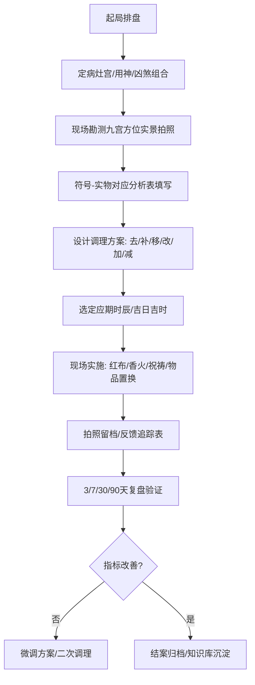

# 凤麟阴盘奇门疾病诊断框架与四大实战医疗案例

> **核心定位**：王凤麟《凤麟易理案例精解》（又名《凤麟易理——阴盘遁甲移星换斗实战案例精解》）是道家秘传阴盘奇门遁甲体系在现代医疗预测与环境调理领域的集大成之作。全书以「月相定局、没吉没凶、移星换斗」为核心理念，建立了从符号象意编码、排盘操作流程、疾病诊断思维模型到实战案例复盘的完整知识体系。

---

## 一、书籍脉络与核心理念

| 维度 | 内容 |
|------|------|
| **作者/传承** | 王凤麟，道家阴盘遁甲传人，《帝王之术》《凤鸣易理》《实战案例精解》三部曲作者 |
| **核心理念** | **月相定局**——依冬至/夏至阴阳遁划分局数；**没吉没凶**——符号本无吉凶，全息读象看组合能量；**移星换斗**——预测与环境调理一体化，通过布局改变信息场修正命运剧本 |
| **方法论特色** | 淡化生克、规范应期、强调神助大于一切、全息读象取代格局定式、万象相干/全息/系统/有意四论并用 |
| **知识架构** | 象意系统（7大符号体系）→ 排盘实操（11步法）→ 疾病诊断（整体+单宫、用神定坐标、环境场分析）→ 实战案例（4大医疗+环境调理）→ 移星换斗操作 |

> **交叉引用**：本体系与[[fenglin-qimen-fengshui]]（凤麟奇门风水学）、[[fenglin-qimen-xiangyi-zheng-shu]]（象意系统标准化）、[[yin-pan-qimen-paipan-shi-yi-bu]]（十一步排盘详解）构成「凤麟阴盘奇门」三大支柱页面，建议并行阅读。

---

## 二、阴盘奇门七大符号象意系统（全息编码表）

> **原理**：九宫八卦、十天干、十二地支、十二长生、八星、八门、八神是宇宙万事万物的全息代码，熟练掌握象意是驾驭遁甲的前提。

### 八卦象意（九宫定位）

| 卦/宫 | 五行 | 核心概念 | 人体对应 | 疾病倾向 | 时间/方位/色彩 |
|-------|------|----------|----------|----------|----------------|
| **乾一宫** 西北 | 金 | 威严、权力、创造、法则、圆满 | 头、颈、面部 | 头痛、脑淤血、心脏病 | 秋、戌亥、金黄/白 |
| **坎二宫** 正北 | 水 | 劳苦、险阻、交际、结合、悲哀 | 肾、膀胱、泌尿系统 | 肾病、耳病、水肿、疮 | 冬、子、黑/紫 |
| **艮三宫** 东北 | 土 | 静止、开始、变化、阻隔、诚实 | 背、腰、鼻、手指、关节 | 筋骨酸痛、脾胃病、消化不良 | 冬春交、丑寅、黄/棕/咖啡 |
| **震四宫** 正东 | 木 | 震动、奋进、冲动、显现、生长 | 足、大拇指、肝脏、发 | 神经病、足疾、扭伤、脚气 | 春、卯、青绿/碧 |
| **巽五宫** 东南 | 木 | 空虚、柔和、顺从、流动、渗透 | 股、胆、呼吸、食道、肠、神经、左肩、乳 | 伤风感冒、气管阻塞、哮喘 | 春夏交、辰巳、青绿/洁白 |
| **离六宫** 正南 | 火 | 光明、美丽、变化、文明、虚伪 | 眼睛、乳房、头部 | 心脏病、眼疾、视力减退 | 夏、午、红/赤/紫 |
| **坤七宫** 西南 | 土 | 大地、柔顺、包容、迟缓、优柔 | 腹、脾脏 | 口腔疾病、牙病 | 秋、酉、白/浅黄/金黄 |
| **兑八宫** 正西 | 金 | 口舌、议论、饮食、娱乐、色情、魅力 | 口、舌、牙齿、涎 | 胃病、消化系统疾病 | 夏秋交、未申、深黄/黑 |

> **详细象意表**：参见[[fenglin-qimen-xiangyi-zheng-shu]]「八卦九宫星座反编译表」与「十天干遁甲穿星注」。

### 十天干象意

| 天干 | 五行 | 核心概念 | 人体 | 动物/植物 | 方位/天时/色彩 |
|------|------|----------|------|-----------|----------------|
| **甲** | 阳木 | 直觉、高贵、首领、直/方/高 | 头、指甲、头发 | 穿山甲、龙虾、大树 | 东、风/春/晨、青绿 |
| **乙** | 阴木 | 希望达成、柔弱、艺术、依附 | 肝、胆、肠、发、神经 | 蚯蚓、蛇、花草、小树 | 东、风/月、苍碧绿 |
| **丙** | 阳火 | 希望、光明、雄威、圆状、权威 | 眼、血液、唇、心脏 | 马、牛、带柄果实 | 南、阳/晴/热、红/紫 |
| **丁** | 阴火 | 希望、执着、尖锐、突出 | 眼、牙、心脏、骨刺、生殖器 | 蚊蜂、带刺植物/玫瑰 | 南、星/夏/午、红/紫 |
| **戊** | 阳土 | 中正、厚德、资本、钱财、方大 | 鼻、胸、乳房 | 牛、猪、宽厚叶果 | 中/坤宫、星云、黄/棕 |
| **己** | 阴土 | 策划、欲望、邪念、节约、拐弯 | 嘴、乳头、肚脐、肛门、耳垂 | 蜗牛、章鱼、含苞花蕾 | 中/西南、星云、黄/黄绿 |
| **庚** | 阳金 | 阻碍、打斗、魄力、刚健、肃杀 | 头骨、骨骼、肺 | 老虎、植物干根果壳 | 西、秋、白/粉/金属 |
| **辛** | 阴金 | 革命、错误、叛逆、精致 | 牙、骨、肺、皮毛、疙瘩/瘤 | 寄生生物/病毒、颗粒粮食 | 西、秋、白/粉 |
| **壬** | 阳水 | 孕育、流动、智慧、困境、生产 | 发、眼、动脉 | 鱼虾蟹龟、荷花/海带 | 北、冬、黑/蓝 |
| **癸** | 阴水 | 制约、管束、艰难、流动、性/淫 | 足、私处、静脉、肾、精/泪/汗/尿 | 水鸟、水稻/水果/水仙 | 北、冬、黑/玄 |

### 十二地支象意（节选核心）

| 地支 | 五行 | 核心概念 | 人体 | 方位/天时/色彩 |
|------|------|----------|------|----------------|
| **子** | 阳水 | 首领、智慧、阴私、色欲 | 肾、膀胱、精神、血液 | 正北、雨、黑 |
| **丑** | 阴土 | 忠厚、职称、房产、官司 | 脾、胃、肠 | 北偏东、雨天、黄 |
| **寅** | 阳木 | 开始、文艺、婚姻、管理 | 肝、胆、发、手指甲、腿 | 东北、风、绿 |
| **卯** | 阴木 | 逃往、振动、消耗、欢乐 | 十指、毛发、肝 | 东、风、绿 |
| **辰** | 阳土 | 斗争、牢狱、孕育、邪梦 | 肠、胃、胸 | 东偏南、龙卷风、黄 |
| **巳** | 阴火 | 信息、惊扰、口舌、文艺 | 血液、心、面部、口腔 | 南偏东、炎热/星、红 |
| **午** | 阳火 | 惊恐、口舌、诚信、火光 | 心、口、目 | 正南、太阳、红 |
| **未** | 阴土 | 酒食、婚姻、小收获、否定 | 头、胃、肝 | 南偏西、燥热、黄 |
| **申** | 阳金 | 运动、传递、交易、阻碍 | 大肠、右胸 | 西偏南、闪电、白/金 |
| **酉** | 阴金 | 密谋、金融、交易、完美 | 右肋、手臂、口、耳 | 西、雪、白 |
| **戌** | 阳土 | 欺诈、虚伪、思考、宗教 | 命门、膀胱 | 西偏北、阴天、黄 |
| **亥** | 阴水 | 惊讶、流动、隐私、偷盗 | 眼、头发、毛发 | 北偏西、阴雨、黑/蓝 |

### 十二长生象意（疾病阶段判断核心）

| 阶段 | 核心概念 | 环境/地理 | 人物/动物/植物/静物映射 | 疾病隐喻 |
|------|----------|-----------|-------------------------|----------|
| **长生** | 依靠、根基、关爱、享受、长寿 | 客厅、田间、生活区、大自然 | 关爱他人者、抚育动物、生长植物、长寿面/镜子/茶壶/伞 | 病灶萌发、可逆、调理佳期 |
| **沐浴** | 暴露、简单、坦诚、失败、桃花 | 卫生间、美容院、游泳池、更衣室 | 穿得少者、清理工、失败者、水龙头/粪便/蜡烛/热水器 | 症状外显、急性发作、易诊断 |
| **冠带** | 包装、复杂、城府、伪装、遮盖 | 遮盖处、复杂环境、广告宣传处 | 化妆复杂者、戴帽者、伪装动物/孔雀、面具/包装品/帽子 | 病情隐匿、误诊风险、需深入排查 |
| **临官** | 保护、经济、领袖 | 工作场所、建筑区、车间、机场 | 正在工作者、领导、耕种者、帽子/钥匙/货币/商品 | 病情进入活跃期、需主动干预 |
| **帝旺** | 富有、巅峰、强大、收获、完美 | 京都、会所、最美之地 | 国家领导人、巅峰者、王者动物/虎狮蛇蝎鹰、名贵花/帝王树、完美物品 | 病情最重、功能严重受损、治疗难度最大 |
| **衰** | 衰败、破旧、虚弱、悲伤、走下坡 | 败落环境 | 疲倦者、衰老者、哀思哭泣者、破旧物品/伤感物品 | 病情缓解期、康复向好、防复发 |
| **病** | 问题、生病、突出、动、升迁、牵挂 | 废弃环境 | 疲倦/衰老/休息动物、败落植物/虫咬植物、破旧物品 | 并发症出现、病情反复、需调整方案 |
| **死** | 危险、黑暗、死亡、教条、稳重 | 土地、药店、医院、太平间、坟墓、监狱、寺庙、宇宙 | 过世者、灵异者、恐怖分子、医生护士、危险品/凶器/神佛用品/经书 | 器质性病变、功能丧失、姑息治疗 |
| **墓** | 遮盖、黑暗、模糊、被约束、捆绑 | 遮盖处、大雾、暗沟、山洞、坟地、关押处、库房、塔 | 藏起来者、被关押者、被束缚者、技术未发挥者、盒子/柜/袋/面具/鞋/壶/粮囤 | 病灶包裹、不易排出、需通络化瘀 |
| **绝** | 阻隔、失踪、珍稀、转换、独特、尽头 | 断处、尽头、隔绝处、顶峰 | 绝美者、挑战极限者、灭绝动物/极少动物、受孕植物、极致品/坏物/转换器/烟花/锁 | 病情极端、转机关口、绝处逢生或彻底崩溃 |
| **胎** | 酝酿、思考、根源、内部、怀孕 | 内部环境、孕育处、产房、卫生间 | 孕妇、思考者、酝酿者、含苞植物/玉米/向日葵、内部物品/车胎/内衣 | 病因酝酿期、先天因素、根源探寻 |
| **养** | 调理、教育、学习、懒散 | 休闲场所、调养室、教堂、寺院 | 拜佛者、休息者、美容师/气功师/教徒、休息动物、花期植物、睡床/健身器材/茶壶 | 康复调养期、生活方式干预、预防复发 |

> **应用口诀**：阳生阴死，十干配十二支轮转。断病看用神落宫长生状态，定病期、判预后、择时机。

### 八星象意（疾病特性定性）

| 星名 | 五行 | 疾病特性核心 | 医治策略 | 人体/动物/植物/地理/静物/方位/色彩 |
|------|------|--------------|----------|-----------------------------------|
| **天蓬星** | 水 | 病情善变、转化、转移 | 善于变化、灵活用药 | 耳/肾/膀胱、猪鼠蝙蝠、菇菌类、冠状大树/篷子/伞雨衣、北、冬、黑/蓝/玄 |
| **天任星** | 土 | 病情发展缓慢、时间长 | 耐心调理、疗程长 | 手/腰/脊柱/鼻、牛骆驼虎、谷穗稻黍/柳树、桥/台阶/山峦/盆景石积木、东北、雾、黄 |
| **天冲星** | 木 | 病情发展快、突然爆发 | 快速手法、抢时间 | 肝/筋骨、兔天鹅燕、竹树高粱玉米/塔高楼、枪炮炸药、东、地震风、碧绿 |
| **天辅星** | 木 | 传染、感染性疾病 | 切断感染源、隔离 | 大腿/呼吸/乳、鸡蛇泥鳅蚯蚓、柳葡萄葫芦/麦稻田竹林果园、东南、风祥云、绿 |
| **天英星** | 火 | 表症、表象、虚象 | 治标、对症下药 | 眼/血/心、孔雀鹦鹉火鸡锦鲤、开花植物/盆景花卉、高亢地/阳光地/炉冶地、发光物/电子元件、南、太阳、红/品红/绛红 |
| **天芮星** | 土 | **病灶、病部位、病因（核心用神）** | **治本、直击病灶** | 脾/胃/腹/肩/嘴/脐、牛羊家畜、庄稼/土豆地瓜、学校/医院/学府、医疗器械/药品/文具、西南、云、黄 |
| **天柱星** | 金 | 得病条件、病的温床、外因 | 改善环境、去除诱因 | 颈椎/大腿、公鸡鼹鼠羊鸟、直树芦苇毛竹胡杨、电杆铁塔/寺庙高楼碑、发声电器/乐器、西、秋、白 |
| **天心星** | 金 | 得病根源、内因、心态 | 心理疏导、调整心态 | 头/心、马猪狗狮虎熊天鹅鲸、菊花果树大树桔子草药、高亢地/客厅院落广场、球类珠类、西北、雪、白/金 |

> **临床口诀**：天芮为病灶（治本），天英为表象（治标），天心为内因（调心），天柱为外因（改环），天蓬主变（灵活），天任主慢（耐心），天冲主急（抢时），天辅主染（隔离）。

### 八门象意（人事/疾病状态）

| 门名 | 五行 | 疾病状态核心 | 人体对应 | 环境/动物/植物/方位/色彩 |
|------|------|--------------|----------|---------------------------|
| **休门** | 水 | 修复期、调理期、休眠潜伏、停止状态 | 生殖系统 | 漂亮/气质好/语音低、温顺动物/金鱼毛虫蜗牛水牛、水草白菜青菜萝卜、北、冬、蓝/黑 |
| **生门** | 土 | 活跃状态、发展状态、生长、生存 | 鼻/嘴/胃/脾/肠 | 方脸乐观、忠厚守时、泛生物植物、东北、阴天、黄 |
| **伤门** | 木 | 损害、消耗、妨碍、主动出击 | 脚/手/肝/胆 | 威严恐怖/丑陋、直爽雷厉、狮虎狗鹰、仙人掌金虎刺梅荆棘玫瑰、东、风、青/绿 |
| **杜门** | 木 | 隐藏、堵塞、性质不明显、不顺畅 | 呼吸系统/肝/胆/筋 | 晦涩呆滞/神色黯然、不爱言语/文静内向、夜行动物/黄鼠狼鼠猫猫头鹰蚊子、小草庄稼树木苔藓、东南、风/空气、绿 |
| **景门** | 火 | 活跃、发热、发烧、烫伤、烧伤 | 血液/心脏 | 漂亮红脸尖瘦、心直口快/脾气急/虚心知书、雉鸡孔雀雄鹰、漂亮花卉盆景、南、太阳晴热午、红/赤 |
| **死门** | 土 | 功能丧失、性质转变、固定不变、鬼神 | 病灶部位、无活力部位 | 呆板木纳/死板、固执迟钝/稳重保守、牛羊尸体、松柏/病枯植物、西南、雨、灰/黑/蓝 |
| **惊门** | 金 | 阵痛、抽搐、放射性酸麻胀咳喘 | 心脏/喉咙 | 瞪目结舌/大眼嘴闭不上、能说会道/惊恐不安、蝉蛙蝈蝈蟋蟀黄鹂、白杨沙沙/松涛、西、雷电、白 |
| **开门** | 金 | 性质明显、清晰、易判断、手术开刀 | 舒展宽广、公开暴露 | 脸方顶圆/鼻正口方/上身长直/不怒而威、西北、秋、绚烂五彩 |

> **断病口诀**：休修生长伤损杜塞，景热死绝惊阵开明。八门定状态，八星定特性，八神定总体。

### 八神象意（疾病总体状态/医疗资源）

| 神名 | 五行 | 疾病总体状态 | 医生/医药/治疗映射 | 环境/动物/植物/方位/色彩 |
|------|------|--------------|-------------------|---------------------------|
| **值符** | 木/土 | 病情明朗、痛苦难忍、易辨别治疗 | **高级药品、名医名院**（临值符） | 方脸粗眉重发鼻直大、名贵稀有动物/藏獒虎熊猫、金丝楠红木、中央、晴朗风和日丽、豁达爽朗谈吐不凡、头面/肺/大肠、虎狮豹马天鹅龙、高大树结果实、西北、秋、绚烂五彩 |
| **腾蛇** | 火 | 病情变化不定、惊疑扰乱、失眠惊悸梦多怪异 | 多虚假不实、假医假药、巫婆神汉仙姑 | 水蛇腰驼背发黄稀/大脑门、虚伪巧诈/奸佞心毒/惊恐心口不一、心/血/血管、喋喋不休颠三倒四、蛇蟒蚯蚓爬虫海参、龙爪槐爬山虎西瓜秧、南、太阳、杂色红 |
| **太阴** | 金 | 病在内部、沉疴、虚弱无力、精神萎靡 | 医生心理细腻、心细认真 | 脸白净/口樱桃/鼻挺直、品质优良/正直慷慨/助人为乐、嘴/肺/皮肤、柔声细语/声低、刺猬鼠猫猫头鹰/夜行、带壳果实/花生瓜子/苔藓沼泽植物苇子蒲草、西、月亮、灰/白 |
| **六合** | 木 | 病情综合、头晕身痛呕吐麻木多病共存 | 多方治疗、综合调理 | 圆脸兔牙/一团和气笑容可掬、开朗平和/仁慈谦让/荐贤不妒、兔鸳鸯狼麻雀蜻蜓蝴蝶蜜蜂、小树花草果树竹林柳树、东、和风旭日春晨、绿/多色组合 |
| **白虎** | 金 | **膏肓、伤病灾难、治疗难度大** | **医术一流、技术过硬、手术刀** | 圆眼虎头虎脑/面部严肃死板/多肌肉强健、凶猛刚毅大义凛然、骨骼拳头、话语强硬/污言秽语/詈骂、虎豹豺狼猎狗鹰/肉食动物、猪笼草蒺藜草蝎子草、西、秋、白/刺眼光 |
| **玄武** | 水 | 眩晕糊涂、呕吐怪异、治疗不对症 | 治疗无效、方向错误 | 贼眉鼠眼/神色不定/弯腰驼背、机智灵活/巧言善辩/干练虚伪/偷奸取巧、眼/发/肾、天花乱坠/无中生有/谎话连篇/百般抵赖、鼠鹰蛇猫头鹰鱼/喜水类、水草海带紫菜/蔬菜高水果、北、雨、黑/玄/蓝 |
| **九地** | 土 | 病情稳定、阴症、血压低昏迷懒言少语 | 基层医生、保守治疗 | 大腹肥厚/方脸多肉肥胖/五短/声如瓮、柔顺文静/自私消极/缺乏上进/吝啬节俭、胃脾肉、语速慢/被动低调、牛猪熊猫地蚕虫类、地瓜土豆农作物/地衣苔藓地丁、西南、多云阴天、黄 |
| **九天** | 金 | 病情逐渐加重、阳症、血压高兴奋多动 | 高级专家、前沿技术、高端设备 | 高大魁梧威严/脸方正/手绵软/言语掷地有声、不怒而威/刚强好动/志向远大、头/额头/肺/大肠、语速快/张扬沸沸扬扬、马龙飞鸟虎狮天鹅、高大树/高粱果树/高山高原植物、西北、蓝天雷电秋、白/青 |

> **医疗决策口诀**：值符名医名院，腾蛇假医假药，太阴心细内科，六合多科会诊，白虎手术技术，玄武不对症，九地保守稳定，九天高端前沿。克病神宫位为首选就医方位，阳克阳阴克阴同性相克力大。

---

## 三、阴盘奇门十一步排盘法（标准化操作流程）

> **核心原则**：画大方格定天地、分小方格定九洲、心平气和念口诀「无极生太极，太极生两仪，两仪生四象，四象生八卦，八卦定乾坤」，格局线交接紧密不相通。

| 步骤 | 名称 | 关键规则/操作 | 示例（2006-05-23 19:45 阳7局） |
|------|------|--------------|--------------------------------|
| **1** | **排四柱** | 阳历转干支 | 丙戌 癸巳 壬子 庚戌 |
| **2** | **定阴阳局数** | 冬至后夏至前=阳遁，夏至后冬至前=阴遁<br>局数 = (年支序数+月数+日数+时支序数) ÷ 9 余数 | 年支戌=11，月=4，日=26，时支戌=11 → (11+4+26+11)=52 ÷ 9 余 7 → **阳7局** |
| **3** | **画九宫格** | 戴九履一，左三右七，二四为肩，六八为足，五居中 | 标准洛书九宫 |
| **4** | **布地盘三奇六仪** | 阳局顺布、阴局逆布：戊己庚辛壬癸丁丙乙<br>几局戊落几宫 | 阳7局：戊落艮8宫 → 见下表地盘分布 |
| **5** | **找旬首** | 依时柱查旬首表：甲子戊、甲戌己、甲申庚、甲午辛、甲辰壬、甲寅癸 | 时柱庚戌 → 甲辰旬，**旬首壬** |
| **6** | **定值符值使门** | 旬首落宫的地盘星=值符，地盘门=值使门 | 旬首壬落坤2宫 → 地盘星**天芮星**=值符，地盘门**死门**=值使 |
| **7** | **排天盘三奇六仪八星** | 「旬首和值符随时干转」：时干落宫，旬首值符加其上，原宫三奇六仪随行 | 时干庚落离9宫 → 旬首壬+值符天芮加离9宫庚上，原坤2宫三奇六仪随壬至离9宫 |
| **8** | **排八神** | 八神顺序固定：值符、腾蛇、太阴、六合、白虎、玄武、九地、九天<br>阳遁顺时针转（1→8→3→4→9→2→7→6→1），阴遁逆时针<br>值符落时干宫，余神依序布 | 值符天芮落离9宫（时干庚宫）→ 顺时针布九天乾6、九地坤2、玄武坎1、白虎兑7、六合震3、太阴巽4、腾蛇艮8 |
| **9** | **定八门** | 值使门随时辰轮转：阳局按九宫顺序1234567891，阴局9876543219<br>找值使门落宫后，八门顺时针布（休→生→伤→杜→景→死→惊→开） | 甲辰旬值使死门在坤2宫，庚戌时在艮8宫 → 死门落艮8，惊门震3，开门巽4，休门离9，生门坤2，伤门兑7，杜门乾6，景门坎1 |
| **10** | **排隐干** | 时干加值使门上，按天盘三奇六仪顺序排一圈 | 时干庚加艮8宫死门上，顺序：庚→壬丙→戊→乙→辛→己→癸→丁 |
| **11** | **查空亡马星** | 空亡：甲子旬戌亥空(乾)，甲寅旬子丑空(坎艮)，甲辰旬寅卯空(艮震)，甲午旬辰巳空(巽)，甲申旬午未空(离坤)，甲戌旬申酉空(坤兑)<br>马星：亥卯未时巽，申子辰时艮，寅午戌时坤，巳酉丑时乾 | 甲辰旬 → **寅卯空（艮震宫空）**<br>庚戌时 → 寅午戌时组 → **马星在坤2宫** |

> **完整盘面示例**（阳7局 2006-05-23 19:45）：
```
乾6宫：丁(天英)  庚(开门)  玄武  癸  乙  白虎  己  辛  任  景
兑7宫：地(天辅)  丁  癸  白虎  庚  柱  生  心  伤
离9宫：天(天芮)  庚  丁  符  壬丙  庚  芮  休  蛇  戊  壬丙  生  阴  乙  戊  六  辛  乙
震3宫：癸(天冲)  丙  杜  玄  乙  丁  冲  死
巽4宫：己(天任)  辛  六  乙  冲  杜
坎1宫：戊(天蓬)  壬丙  庚  天  庚  丁  英  开
艮8宫：乙(天心)  辛  己  癸  丁  庚  任  伤  符  戊  癸  庚  柱  杜  心  景  蓬  死
坤2宫：马  己丙  癸  丁  庚  乙  辛  庚
中5宫：丙
```
> **详细排盘实操**：参见[[yin-pan-qimen-paipan-shi-yi-bu]]「阴盘奇门排盘十一步」完整图解教程。

---

## 四、疾病诊断核心框架与思维模型

### 诊断三大原则

| 原则 | 说明 | 实操要点 |
|------|------|----------|
| **全息读象** | 九宫格=人体全息模型（大无外、小无内），洛书九宫对应头(离)、肩(坤巽)、腰(艮)、足(震兑)等 | 粗分三分法(巽离坤=上三路/头)，细分九分法(离=头面、坤巽=左右肩、戊=鼻脸颊、癸=眼睛) |
| **用神定坐标** | **面诊→日干**；**电话诊→月干**；**代问长辈→年干**；**代问兄弟友→月干**；**代问子女晚辈→时干**<br>时干落宫=疾病当前状态 | 四柱天干全看：日干主体、年月时干辅助，哪个宫位有门迫/击刑/入墓/空亡/伏吟/反吟，哪宫有病 |
| **环境场分析** | 疾病=内因(天心/乙)+外因(天柱/庚)+病灶(天芮)+表象(天英)+状态(八门)+总体(八神)<br>**万象相干/全息/系统/有意**四论解除不良信息场组合 | 宫外隐干=导火索(病因)；宫内神星门干宫属性=多维反映；排除法层层圈定；理论联系实际、具体问题具体分析 |

### 关键断病信号速查表

| 信号 | 含义 | 疾病隐喻 |
|------|------|----------|
| **击刑** (庚艮、壬癸巽等) | 别扭、拧劲、不舒服 | **灾病主信号**：庚艮=车祸/伤灾/肠胃病/手脚伤；壬癸巽=肢体伤残/疼痛/喉咙肺炎 |
| **门迫** (门加同宫干克门) | 破损、压迫 | 外=肢体伤残，内=脏腑组织坏损 |
| **反吟** (天地盘同符号对冲) | 急性病、病情反复 | 突发、来势凶、需急救 |
| **伏吟** (天地盘同符号重叠) | 久病、慢性病、得病时间长 | 短期难愈、需长程调理 |
| **空亡/伏吟转宫** | 原宫病灶转移 | 用空亡转宫法查新宫状态 |
| **值符/天心/乙奇** | 医生医药 | 值符=高级/名医，天心=西医，乙奇=中医，腾蛇=假医，白虎=手术/技术流 |
| **九宫全病** | 人人有病灶(如血液癌细胞) | 量变质变有临界点(亚健康)；早发现早预防早治疗；70%疾病与基因异常关联 |

### 就医决策模型

1. **选方位**：克病神落宫方位为首选就医方向
2. **选医院/医生属性**：值符(名院)、白虎(技术硬/手术)、太阴(心细内科)、九天(高端前沿)、九地(基层保守)
3. **选时机**：病神旺相休囚、应期规范、流年流月填实/冲开病宫
4. **避坑**：腾蛇/死门/白虎临空亡=民间跳大神/附体风险，**切忌找民间巫婆神汉**

---

## 五、36种具体病症遁甲信息对照表（临床速查）

> **来源**：原书「第三章第一节第六小节 阴盘遁甲具体断病」完整记录，按病症分类整理。

| 编号 | 病症 | 核心遁甲信息组合（用神/宫位/星门神/干支/特殊信号） | 关键判断逻辑 |
|------|------|--------------------------------------------------|--------------|
| 1 | **感冒** | 日干/时干临丙；天芮临丙丁=发烧；戊加壬/癸=流鼻涕 | 丙丁火主热，壬癸水主液 |
| 2 | **腮腺炎** | 戊己关系，坤/巽宫病星，日时干加戊临巽坤 | 坤巽=腮腺区，戊己土主肌肉腺体 |
| 3 | **肝炎** | 乙加丁/丙=肝炎；乙加庚=肝硬化 | 乙木=肝，丙丁=炎，庚金=克木硬化 |
| 4 | **脊髓炎** | 天柱星=脊髓；天芮/日/时临离加庚=发热头痛；临兑遇惊门/天柱=咳嗽；戊己加癸壬=流涕；庚丙=恶心；庚己=呕吐；壬癸=汗；庚戊=食欲不振；乙壬癸坎=大便溏；己壬=糖尿病 | 多系统并发，分症断宫 |
| 5 | **糖尿病** | **必有水(壬癸=血) + 必有土(戊己=甜/血成分差) + 必有天芮/庚/白虎(血液粘稠)** | 三要素缺一不可 |
| 6 | **痢疾** | 天芮/日/时落火宫(离)，天心临庚同宫；戊庚=呕吐，天心庚=恶心；天芮坤坎+白虎/壬癸=腹痛泻；临六合=次数多 | 湿热下利，六合主频数 |
| 7 | **颈淋巴结核** | 乙加辛=淋巴结核；临腾蛇/天芮+戊癸/己癸=腐烂生脓；辛旺=结核大 | 乙木=结节，辛金=硬块 |
| 8 | **肺结核** | 天芮/日/时落乾/兑，有辛/白虎 | 金宫金星金神=肺痨 |
| 9 | **疟疾** | 乙庚离=脖子强硬；日时戊庚/癸庚=呕吐；丁辛景门=心烦；丙丁兑=口渴 | 寒热往来，多系统 |
| 10 | **中暑** | 日/时/天芮：甲庚离=头痛；玄武=眩晕；戊庚=呕吐；天心庚=心烦；巽白虎=气粗 | 热邪犯肺卫 |
| 11 | **肺炎** | 庚辛加丙丁/庚丙/辛丙/庚丁/辛丁落离兑；庚天柱=咳嗽；值符庚=头痛；坤坎庚/白虎=身痛；癸庚=白痰；癸戊=黄痰；癸丙=血痰 | 痰色辨寒热实虚 |
| 12 | **支气管炎** | 乙=气管，丙丁=炎，乙丙/乙丁临天芮/日/时，落巽宫 | 乙木主管气道 |
| 13 | **急性肠胃炎** | 乙/坤/艮/戊/己=肠胃；天芮/日/时落坤艮；乙戊己临庚/白虎/马星/惊门=呕吐肠鸣 | 马星惊门主急剧 |
| 14 | **胃炎** | 戊己加丙丁临坤艮 | 土宫火炎=胃火 |
| 15 | **肠炎** | 乙加丙丁落坤艮 | 乙木主肠，火炎 |
| 16 | **胆囊炎/胆结石** | 乙加辛临震巽；炎=加丙丁，石=加庚辛 | 震巽=胆，辛金=结石 |
| 17 | **肾炎** | 壬癸/玄武=肾，丙丁=炎，戊辛=肾小球，马星=急症，壬癸辛坎=肾结石 | 水宫水星水神 |
| 18 | **泌尿结石** | 坎震兑=腰；庚杜门=隐痛阵痛；马星=痛烈 | 杜门主塞阻 |
| 19 | **前列腺癌** | 乙丁/乙庚/乙辛/乙丙；看健康指数；有白虎/庚=重(癌)，无=炎症；丁用山楂枸杞，乙用葫芦藤蔓 | 乙木主腺体增生 |
| 20 | **癌症** | **白虎 + 庚 + 天芮** (三大恶性标志同现) | 铁律组合 |
| 21 | **冠心病** | 离震坎+马星+丙丁壬癸=心；乙壬=动脉；己庚/癸辛+乙=冠脉粥样硬化/管腔狭窄；杜门=闭塞不通 | 杜门主堵塞 |
| 22 | **风湿性心脏病** | 离震坎丙丁壬癸=心；六合=瓣膜，临天芮/白虎 | 六合主瓣膜开合 |
| 23 | **高血压** | 九天/天冲星=高压；临离/乾+景门/天英/丙丁/壬癸=特征 | 九天主升主高 |
| 24 | **低血压** | 九地/玄武=低压；临离/乾+景门/天英/丙丁/壬癸=特征；腾蛇=压力不稳 | 九地主降主低 |
| 25 | **甲亢** | 乙加戊己辛落离巽坤兑，临天芮/马星；壬癸丙丁加辛/己/戊 | 乙木主甲状腺，土金克泄 |
| 26 | **三叉神经痛** | 乙庚/乙丁+白虎落巽离坤 | 面部三支神经 |
| 27 | **面瘫** | 乙戊己/戊己乙临死门落离乾坤巽 | 死门主功能丧失 |
| 28 | **脑血栓/脑出血** | 乙丙丁辛临天芮/白虎/杜门落离乾巽坤 | 杜门主闭塞，白虎主破裂 |
| 29 | **坐骨神经痛** | 乙庚+白虎/天芮落艮乾坎 | 艮乾坎=腰腿路径 |
| 30 | **多发性神经炎** | 震艮=手足；乙庚临天芮落艮震 | 四肢末梢神经 |
| 31 | **癔病** | 腾蛇落巽离坤乾+白虎/天芮=癔病/精神创伤 | 腾蛇主虚幻精神 |
| 32 | **血液病** | 天芮/杜门落艮坤；壬癸水加杜门=血液问题 | 杜门主血液生成障碍 |
| 33 | **腰椎病** | 天柱星临坎兑乾震+天芮=腰椎病 | 天柱主脊柱骨骼 |
| 34 | **颈椎病** | 乙辛临巽离坤 | 乙木主颈椎韧带 |
| 35 | **妇科/子宫肌瘤** | 壬辛/壬己临坎震兑坤 | 壬水主妇科，辛己主肿块 |
| 36 | **便秘/腹泻** | 己庚坎=便秘；己癸=拉肚子 | 己土主大便，庚金燥，癸水溏 |

> **临床提示**：以上组合为**典型特征**，实战中须结合长生状态、旺相休囚、流年流月填冲、环境场验证，**不可机械套用**。

---

## 六、四大实战医疗案例深度复盘

### 案例一：前世炼丹童子，今世母子情深——儿童性格、自杀倾向、童子煞、环境调理

| 维度 | 详细内容 |
|------|----------|
| **起局信息** | 2007-05-16 17:48 阳1局，丁亥 乙巳 庚戌 乙酉 (午未空)，直符天冲，直使伤门，旬首甲申庚 |
| **求测人/关系** | 张小姐(母亲)代问儿子(时干乙=儿子，日干庚=母亲平台) |
| **核心断验** | 1. **性格**：时干乙落兑宫(天英火=脾气大/火山爆发，死门=固执，太阴=内向不语)<br>2. **特长**：兑宫乙=艺术/雕刻/绘画(丁=刀/细致，太阴=雕刻)<br>3. **自杀险**：兑宫乙=手，丁=刀，太阴/死门=轻生念头 → **卯年(2011)冲兑宫凶险**<br>4. **惊悸/大便异常**：乾宫流年填实+惊门=父母吵闹惊吓 → 乾宫己=肛门、壬癸=便稀、惊门=响声<br>5. **摔伤**：流年乾宫六合=摔腿、癸=足、马星=走动<br>6. **平台空亡**：日干庚空亡=母亲平台空，影响儿子发挥<br>7. **前世/童子煞**：飘转巽宫，九天=天宫、天任=老人(太上老君)、丙=火炉、辛=颗粒 → **前世炼丹童子**，未处理净致喉咙易炎/肺炎/发烧(巽宫引干乙=喉咙、丙=圆形/炎、辛=小骨) |
| **调理方案** | **移星换斗现场布局**儿子房间环境重组 |
| **反馈结果** | 不久身体好转，性格危机化解 |
| **核心教学点** | • **时干定子女、日干定父母平台**<br>• **流年冲克+凶门凶神=应期锁定**<br>• **前世信息飘转九宫、九天主天界/神佛**<br>• **童子煞未解→反复呼吸道疾病**<br>• **环境调理可改写命运剧本** |

---

### 案例二：为爱妻求医无路，遁甲局尽显天机——抑郁狂躁、阴宅神像煞、附体风险、分步调理

| 维度 | 详细内容 |
|------|----------|
| **起局信息** | 2007-06-08 09:08 阳9局，丁亥 丙午 癸酉 丁巳 (子丑空)，直符天禽(天英)，直使死门，旬首甲寅癸 |
| **求测人/关系** | 陈先生(日干癸)代问爱人(合干戊=妻子) |
| **核心断验** | 1. **病情**：合干戊落兑宫，地盘丙=内心狂燥，伤门=自我攻击(自己打自己)<br>2. **病程**：卯年(1999)震宫冲兑宫=潜伏期8年；酉年(2005)填实兑宫=前年苗头；酉月(2006下半年)加重<br>3. **病因**：**阴宅西北乾宫放神像**(戊七杀甲=值符在乾) → 供奉不当反招祸<br>4. **附体根源**：妻童年庙台小便、桥底小解带不洁之物<br>5. **验证**：陈先生后车胎易扎(庚癸=轮胎、丁=硬物、马星=动) |
| **调理方案** | 1. **阴宅优先**：后天7-11点(乾宫时)移开神像，红布包送西北寺庙，烧三柱香念叨送走<br>2. **就医禁忌**：**严禁找民间跳大神**(戊下步丙翻坎宫临腾蛇逢空=易附体身体更弱)<br>3. **药物策略**：中医调理内燥，汤药慢停不骤停<br>4. **分步处理**：主平台(阴宅)与本人关系处理好→病情控制→逐渐好转 |
| **反馈结果** | 环境处理后几天病情明显好转 |
| **核心教学点** | • **合干定配偶、年干定长辈、月干定兄弟、时干定子女**<br>• **阴宅七杀/值符落宫=住宅凶煞方位**<br>• **神像供奉讲方位时间，乱供反害人**<br>• **腾蛇逢空=虚幻/附体/假医假药陷阱**<br>• **慢性精神类疾病=先后天因果问题，需环境+医药+心理三位一体** |

---

### 案例三：珍爱生命，健康无价——企业家健康策划、痣相环境煞、颈椎肾结石、财运同调

| 维度 | 详细内容 |
|------|----------|
| **起局信息** | 2007-08-24 13:20 阴3局，丁亥 戊申 庚寅 癸未 (申酉空)，直符天芮，直使死门，旬首甲戌己 |
| **求测人** | 孙先生(日干庚=本人) |
| **核心断验** | 1. **肝功能/头晕**：日干庚落艮宫(肝信息)，玄武=头晕/眩晕，肝火犯上→早起口苦嗓子不适<br>2. **右肾结石**：乾宫癸=肾，丁=颗粒，庚=硬 → 结石信息；**原因**：第六颈椎(乾宫3/6/9数+九天=高处→第六节)压迫<br>3. **血流不畅**：乾宫癸=血液，庚=阻碍<br>4. **痣煞**：右眼角痣(乾宫=头、九天=高、丁=眼、癸=痣)；大腿根生殖器上部痣(乾宫天柱=大腿、九天=上部、丁=男性器官、癸=痣) → **两痣去除改善头晕肾结石**<br>5. **环境煞**：西北角高水龙头(乾宫天柱=管道、九天=高、癸=水、开门=开关)；西北灯不亮(丁=灯被癸克、九天=高处)<br>6. **东南煞**：巽宫杜门(堵)、乙辛=窗堵/花草/小件(六合=多、马星=动) → 清理利发展<br>7. **腿部神经堵**：巽宫乙=神经、杜门=堵<br>8. **财运/事业**：日干庚入墓击刑=偏弱；丑寅月(2007年底)填实本宫恢复快；丑寅年(2009)稳定发展 |
| **调理方案** | 1. **25/26日 9-11点(巽冲乾)** 去两痣<br>2. 东南窗边物品清理<br>3. 西北灯修亮<br>4. 隐性调理财运 |
| **反馈结果** | 疾病好转，事业发展，心安 |
| **核心教学点** | • **日干落宫=本人核心脏腑信息**(庚艮=肝)<br>• **九宫数字(3/6/9)+九天高处=脊椎节段定位**<br>• **痣=信息场干扰源，去痣=移除负面锚点**<br>• **环境方位对应九宫：乾=西北、巽=东南、坎=北...**<br>• **杜门主堵塞，马星主动态变化**<br>• **健康与财运同源同调** |

---

### 案例四：都市丽人结缘鹿鼎，阴盘遁甲伴你同行——女性乳腺增生、膀胱炎、心脏瓣膜、痣煞、防患未然

| 维度 | 详细内容 |
|------|----------|
| **起局信息** | 2007-09-17 11:14 阴7局，丁亥 己酉 甲寅 庚午 (戌亥空)，直符天柱，直使惊门，旬首甲子戊 |
| **求测人** | 周小姐(日干甲=本人) |
| **核心断验** | 1. **右乳增生**：日干甲落坤宫(右)，坤宫戊=乳房、癸壬=奶水、马=流动、庚=硬块、杜门=堵 → **不严重(入墓门迫)但不易好(临值符)**<br>2. **膀胱炎/小腹痛**：坤宫引干壬=膀胱、壬癸=尿液、庚=痛<br>3. **病因**：脊柱下痣(坤宫值符/天柱/癸)产生场致病 → **下午1-5点(未申酉时坤宫旺)去痣**<br>4. **心脏瓣膜**：兑宫己戊=心肌、景门=血液、引干辛=瓣膜 → 开合不良→胸闷心慌无力、血压易异常(不严重)<br>5. **防患未然**：无大病时全方位预测，建立健康基线 |
| **调理方案** | 1. 去脊柱痣(下午坤宫时)<br>2. 现场环境处理(约定后续) |
| **反馈结果** | 现场感叹「比医生细」，约定环境调理 |
| **核心教学点** | • **左右侧别：坤=右、巽=左**(日干落宫定侧别)<br>• **引干/隐干=内部器官精准定位**(壬=膀胱、辛=瓣膜)<br>• **值符临病宫=顽固/名医难治**<br>• **入墓/门迫=病势缓/不严重但缠绵**<br>• **预防医学：亚健康期建立遁甲健康档案** |

---

## 七、移星换斗环境调理实操体系

> **核心逻辑**：预测局=当下时空全息快照，环境布局=信息场物理锚点，**调整环境符号组合→改变信息场共振频率→修正命运剧本**。

### 操作三原则

| 原则 | 说明 | 实例 |
|------|------|------|
| **对应性** | 九宫方位严格对应住宅/房间八卦方位 | 乾宫=西北、坤宫=西南、震宫=东、巽宫=东南、离宫=南、坎宫=北、艮宫=东北、兑宫=西 |
| **象意置换** | 以吉祥象意物品替换/覆盖凶煞象意 | 案例三：西北高水龙头(癸水克丁火)→修灯亮丁火+去水龙头/改向；东南窗堵(杜门乙辛)→清空通风 |
| **时空锚定** | 关键动作在**应期时辰/流年流月填冲时刻**执行 | 案例三：巽冲乾时(辰巳时9-11点)去痣；案例二：乾宫时(戌亥时19-23点)移神像 |

### 常用调理物品与象意映射表

| 问题符号 | 代表实物/环境 | 调理替代物品 | 象意化解逻辑 |
|----------|--------------|--------------|--------------|
| **癸水/坎宫/玄武** | 水龙头、鱼缸、黑色物、低洼潮湿 | 红色/紫色装饰(丁/丙火)、高瓦数暖光灯(丁火)、土制品(戊己土) | 火克水/土制水 |
| **庚金/白虎/乾兑宫** | 金属尖角、刀剪、白色尖锐装饰、西北西尖煞 | 绿植/木质家具(甲乙木)、圆形陶瓷(戊己土)、黄/棕色织物 | 火克金/木泄金/土生金转化 |
| **腾蛇/离宫/丙丁** | 复杂灯具、镜子对床、红色过多、电子设备杂乱 | 简化布局、去镜子/遮盖、蓝/黑色调(壬癸水)、水晶球(水) | 水克火/简化化繁 |
| **杜门/巽震宫/乙辛** | 窗户堵塞、遮光过度、藤蔓植物缠绕、杂物堆积 | 清空通风、明亮窗帘、直立型植物(天柱星)、风铃(金生水泄木) | 通风泄滞/金克木/木疏肝 |
| **死门/坤艮宫/戊己** | 旧物堆积、枯死植物、沉重深色家具、阴暗角落 | 明亮照明、生机勃勃盆栽(长生)、黄/米色系(生门土)、流动水景(壬癸) | 生门生发/水木相生/土得水润 |
| **天芮星/病灶宫** | 对应脏腑方位污损、破损、阴暗 | 针对性放置：五帝钱(金制煞)、葫芦(木化病)、六字真言/经书(火明心)、盐水擦拭(水净) | 病灶宫定向化解 |

### 调理流程标准化（SOP）



> **实战铁律**：**不改环境不治顽疾，不除痣煞不愈久病，不顺时空不应吉凶**。移星换斗非迷信摆设，乃**时空信息场物理重构术**。

---

## 八、知识图谱交叉引用导航

### 本体系核心页面群

| 页面 | 定位 | 与本页关系 |
|------|------|------------|
| [[fenglin-qimen-fengshui]] | 凤麟奇门风水学总纲 | 本页「移星换斗」实操理论源头 |
| [[fenglin-qimen-xiangyi-zheng-shu]] | 象意系统标准化知识库 | 本页七大符号象意表的**规范化定义来源** |
| [[yin-pan-qimen-paipan-shi-yi-bu]] | 十一步排盘图解教程 | 本页排盘流程的**操作手册** |
| [[qi-men-dun-jia-ji-chu-yu-pai-pan]] | 奇门遁甲基础与排盘(通用) | 对比参考：阳盘/三元/旋盘等差异 |

### 同门异派奇门体系对照

| 派别/作者 | 代表页面 | 核心差异点 |
|-----------|----------|------------|
| **不吹牛(阳盘/教案版)** | [[bu-chui-niu-qimen-jiangyi-yi]]、[[bu-chui-niu-qimen-jiangyi-er-gongzuo-shiye-yuce]]、[[bu-chui-niu-qimen-jiangyi-wu]] | 星门神仪宫/能量旺弱/格局克应/主客动静/空亡用神，**重格局轻全息** |
| **东伯居士《奇门秒诀》** | [[dong-bo-ju-shi-qi-men-miao-jue]] | 三才盘式/定局超神接气置闰/诸格主客断法，**重古法源流** |
| **子奇《九宫奇门》** | [[jiu-gong-qi-men]]、[[jiu-gong-qi-men-2-liu-ci-yuan-gai-yun-shu]] | 单宫锁宫/符号吉凶断/生活化/六次元改运术，**重应用简化** |
| **一妙山人《六甲法术奇门》** | [[liu-jia-fa-shu-qi-men-ji-chu-pian]]、[[liu-jia-fa-shu-qi-men-fa-shu-pian]] | 符咒法/法术/坛场/神将/修炼三位一体，**重法术修炼** |
| **于城道人《天目奇门》** | [[yu-cheng-dao-ren-tian-mu-qi-men]] | 阴盘起局/北斗七星能量/七阳七阴风水/天目功法，**重功法内丹** |

### 医疗/健康交叉领域

| 领域 | 相关页面 | 结合点 |
|------|----------|--------|
| **中医理论** | [[yi-fei-wei-zong]](以肺为宗)、[[fei-wei-zong-qi-li-lun]](脉波论)、[[wang-wei-gong-mai-bo-lun]](脉诊)、[[neijing-huxi-yangsheng-fa]](内经呼吸) | 遁甲断病与中医脏腑经络/气血津液/脉诊**互证互补** |
| **体质/星座医学** | [[er-shi-wu-xing-ren-yang-sheng-gong-lue]](25形人)、[[zhong-guo-ren-jiu-zhong-ti-zhi-jie-kai-xing-zuo-mi-ma]](九体质星座)、[[huang-dao-shier-gong-ti-xi]](黄道十二宫体系) | **先天体质(八字/星座)+后天遁甲动态=精准健康管理** |
| **芳疗/经络** | [[zhong-yi-zheng-ti-fang-liao]](整体芳疗)、[[jing-luo-fang-liao]](经络芳疗)、[[jing-luo-chu-fang-yi-du-sai-xue-wei]](经络处方)、[[ren-ti-jing-luo-zi-yu-shou-ce]](经络自愈) | 遁甲定病位/病性 → 芳疗/经络精准用药/操作 |
| **六爻/八字病灾** | [[liu-yao-zai-huo-yu-ce]](六爻灾祸)、[[huang-ji-liu-yao-ti-xi]](皇极六爻)、[[bazi-fenxi-sigeyanshi-moxing]](八字四视角) | 多模型交叉验证，**三式同断大吉** |

### 灵性/能量/显化关联

| 主题 | 页面 | 关联逻辑 |
|------|------|----------|
| **移星换斗本质** | [[zai-lian-jie-liao-yu-fa]](再连接疗愈)、[[neng-liang-ping-heng]](能量平衡)、[[soham-healing-system]](SoHam疗愈) | 环境调理=**外场能量重组**，同频共振原理一致 |
| **命运剧本/出生前计划** | [[shen-ti-bing-tong-yu-chu-sheng-qian-ji-hua-an-li]](出生前计划案例)、[[ling-hun-xiao-zu-ji-ji-chu-sheng-qian-ji-hua]](灵魂小组) | 遁甲读剧本、移星换斗改剧本，**符合灵魂层面自由意志** |
| **显化/信念重写** | [[ru-huan-shi-jiao-yu-xin-ning-xian-hua]](如幻显化)、[[ling-deng-jian-qi-men-dun-jia]](灵灯剑奇门) | 物理环境锚点=**显化具象化载体** |

---

## 九、核心口诀速记卡（实战随身查）

```
【排盘十一步】 四柱定局画九宫，地盘三奇顺逆排。
旬首值符值使定，天盘随时转星仪。
八神顺逆值符领，八门轮转定休生。
隐干时干加值使，空亡马星查分明。

【断病三原则】 全息读象九宫身，用神定标分远近。
环境场效四论融，隐干引子宫内证。
击刑门迫反伏吟，值符天心医药寻。
白虎手术腾蛇假，九天高端九地根。

【36病核心】 感冒丙丁腮腺戊，肝炎乙丙硬化庚。
糖尿水土天芮聚，癌症白虎庚芮并。
冠心离震坎马丙，风心六合瓣膜凶。
高压九天冲星离，低压九地玄武随。
甲亢乙土金离巽，三叉乙庚白虎巡。
脑血乙丙辛芮杜，坐骨乙庚艮乾坤。
癔病腾蛇四宫守，血病天芮杜门艮坤。
腰椎天柱坎兑乾，颈椎乙辛巽离坤。
妇科壬辛己坎震，便秘己庚泻己癸。

【移星换斗】 乾西北坤西南震东巽东南，
离南坎北艮东北兑正西。
凶煞方位对应改，吉时吉日动手时。
痣煞去除环境净，信息场变命运移。
```

---

## 十、版本记录与贡献指引

| 版本 | 日期 | 更新内容 | 贡献者 |
|------|------|----------|--------|
| v1.0 | 2025-01-15 | 初版：完整整合《凤麟易理案例精解》象意系统、排盘法、诊断框架、36病表、四大案例、移星换斗SOP、交叉引用网络 | 知识库策展人 |

> **后续扩展建议**：
> 1. 增补《凤鸣易理》《帝王之术》心法与本页象意系统的深度映射表
> 2. 建立「遁甲医疗案例库」结构化数据表单(JSON/CSV)，便于程序化检索与AI辅助诊断
> 3. 开发「阴盘奇门排盘+断病辅助」小程序/Notion模板，内置本页所有查表逻辑
> 4. 邀请临床中医/西医专家共同标注「遁甲信息组合-ICD10编码」映射字典

---

> **结语**：凤麟阴盘奇门不仅是预测术，更是**时空医学**与**环境本体论**的实践体系。掌握其符号编码、排盘流程、诊断模型与调理技法，即掌握了「读剧本、改剧本」的密钥。愿此页成就更多有缘人「天人合一、移星换斗」的智慧之旅。

**[返回凤麟奇门总纲 → [[fenglin-qimen-fengshui]]] | [查阅象意标准库 → [[fenglin-qimen-xiangyi-zheng-shu]]] | [学习排盘实操 → [[yin-pan-qimen-paipan-shi-yi-bu]]]**

## 来源

- [凤麟易理案例精解](../sources/凤麟易理案例精解.md)
