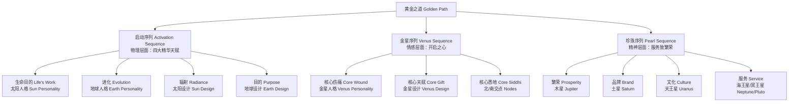
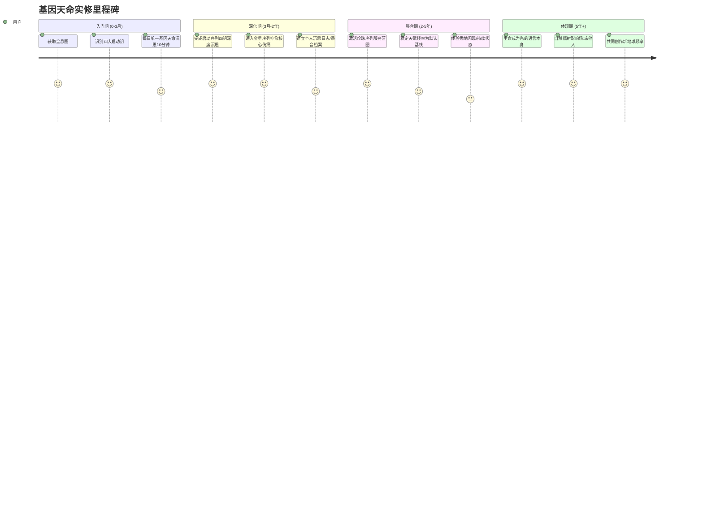

# 基因天命核心实修路径——黄金之道的三大序列

> **核心定位**：基因天命是由理查德·拉德创立的灵性成长系统，源自人类设计、易经64卦与DNA密码子的对应关系，提供一套通过「阴影→天赋→悉地」三层频率转化、以「启动序列→金星序列→珍珠序列」三大序列为实修路径的「黄金之道」。

## 系统溯源与理论基石

### 双重渊源：人类设计与易经
- **人类设计直传**：拉德为Ra Uru Hu（人类设计创始人）直传弟子，基因天命在人类设计「闸门」基础上，将64个闸门重释为「基因天命」，引入阴影/天赋/悉地三层频率模型。
- **易经64卦同构**：64个基因天命与易经64卦、DNA 64密码子一一对应，构成「基因易经」——直接与DNA对话的全息语言。

### 核心科学映照：表观遗传学与量子生物学
- **DNA即密码**：DNA分子作为光的转换器、虫洞，能吸引光子沿双螺旋盘旋，具备超导体特性。
- **态度编程基因**：思想、情绪、信念产生的微弱电磁信号通过细胞膜受体传递至DNA，开启/关闭特定基因表达——这是「安慰剂效应」与「表观遗传学」的机制基础。
- **频率决定实相**：恐惧产生低频（阴影），爱产生高频（天赋/悉地），频率共振吸引同频体验，构建气场与显化的物理基础。

> 交叉引用：[[gene-keys]]、[[epigenetics-overview]]、[[quantum-biology-dna-light]]

---

## 黄金之道：三大序列的递进架构与行星映射

黄金之道是基因天命的核心实修路线图，由三大序列按「物理→情感→精神」层次递进。每个序列的键位由本命盘特定行星落点决定，形成个人专属的进化蓝图。

### 启动序列——物理层面：透过四大精华天赋探索天才
**定位**：奠基序列，揭示此生在物质世界的显化蓝图与能量引擎。对应**太阳/地球**人格与设计四大锚点。

| 序列位置 | 名称 | 核心问 | 对应行星/点位 | 人类设计对应 | 功能 |
|----------|------|--------|---------------|--------------|------|
| 第1钥 | **生命目的** Life's Work | 我来此做什么？ | **太阳人格** (Sun Personality) | 太阳人格闸门 | 此生在世间投射的核心主题、外显使命 |
| 第2钥 | **进化** Evolution | 我最大的挑战/成长动力是什么？ | **地球人格** (Earth Personality) | 地球人格闸门 | 推动生命进化的压力点、业力课题 |
| 第3钥 | **辐射** Radiance | 我如何自然影响他人？ | **太阳设计** (Sun Design) | 太阳设计闸门 | 无意识层面的辐射场、他人眼中的你 |
| 第4钥 | **目的** Purpose | 我生命的终极指向是什么？ | **地球设计** (Earth Design) | 地球设计闸门 | 灵魂层面的锚定坐标、内在指引 |

**实修要点**：
- 通过免费排盘（humandesign.plus）获取四大行星落点的基因天命编号
- 对每个钥位进行「阴影→天赋→悉地」三层沉思静观
- 观察四大天赋在日常生活、职业、健康中的互动模式

> 关联页面：[[gene-keys-activation-sequence]]、[[human-design-type-strategy-authority]]

### 金星序列——情感层面：在关系中绽放内心
**定位**：转化序列，专门处理情感关系中的核心创伤与亲密模式。对应**金星**人格/设计与**南北交点**三大轨道。

| 轨道 | 名称 | 核心主题 | 对应行星/点位 | 功能 |
|------|------|----------|---------------|------|
| 第1轨 | **核心伤痛** Core Wound | 童年/祖先遗传的核心情感创伤 | **金星人格** (Venus Personality) | 吸引同频伴侣/重复创伤模式的DNA编码 |
| 第2轨 | **核心天赋** Core Gift | 伤痛转化后的关系超能力 | **金星设计** (Venus Design) | 疗愈创伤后的给予模式、亲密关系的突破口 |
| 第3轨 | **核心悉地** Core Siddhi | 关系层面的最高灵性境界 | **北交点/南交点** (North/South Nodes) | 超越业力轮回的神圣关系容器、灵魂契约 |

**独特价值**：
- 精准定位「吸引同频伴侣/重复创伤模式」的DNA编码
- 提供「阴影压抑/反应」双模式识别与转化路径
- 将亲密关系升级为「共同进化的神圣容器」

> 关联页面：[[gene-keys-venus-sequence]]、[[synastry-planets-in-houses]]、[[chiron-wound-healing]]

### 珍珠序列——精神层面：透过服务实现繁荣
**定位**：圆满序列，将个人天赋转化为服务集体的繁荣流动。对应**木星、土星、天王星、海王星/冥王星**四大外行星。

| 珍珠 | 名称 | 核心功能 | 对应行星 | 核心转化主题 |
|------|------|----------|----------|--------------|
| 第1珍珠 | **繁荣** Prosperity | 物质丰盛的内在频率锚点 | **木星** (Jupiter) | 扩展信念、释放匮乏阴影、接纳宇宙供给 |
| 第2珍珠 | **品牌** Brand | 独特表达标识与能量签名 | **土星** (Saturn) | 结构化天赋、建立权威、时间考验下的精炼 |
| 第3珍珠 | **文化** Culture | 服务对象的集体意识容器 | **天王星** (Uranus) | 创新范式、打破旧制、群体共振频率 |
| 第4珍珠 | **服务** Service | 最高层面的贡献与传承 | **海王星/冥王星** (Neptune/Pluto) | 灵性奉献、集体疗愈、进化遗产传递 |

**繁荣公式**：`繁荣 = 频率(天赋/悉地) × 服务(品牌/文化) × 允许(释放匮乏阴影)`

> 关联页面：[[gene-keys-pearl-sequence]]、[[abraham-hicks-vortex]]、[[manifestation-neuroscience]]

---

## 核心频率模型：阴影 → 天赋 → 悉地

每个基因天命包含三个频率层级，对应意识光谱的三个波段：

### 阴影——低频：恐惧的生存程序
- **本质**：集体基因库中遗留的古老恐惧记忆（动物/爬虫/植物时期）
- **两种表现**：
  - **压抑型**：内向化、麻木、回避、受害者心态
  - **反应型**：外向化、愤怒、控制、投射、攻击性防御
- **功能**：保护生存，但锁住高频潜能
- **转化钥匙**：觉察、接纳、不认同、静观沉思

### 天赋——中频：心的开放与创造性脉冲
- **本质**：阴影内嵌的礼物，拥抱阴影时自动释放
- **生理效应**：血液化学改变、荷尔蒙平衡、气场扩大、心率变异性提升
- **显化力**：气场共振吸引同频机遇、人脉、资源（吸引力法则的生物学机制）
- **挑战**：高频者在低频环境中易感过度敏感，需建立能量边界

### 悉地——高频：超越二元的神圣境界
- **梵文含义**：「天赐之礼/神圣成就」
- **生理对应**：松果体/垂体激活，分泌松烷醇、哈密因、褪黑素等高阶激素
- **意识状态**：专注吸收、三摩地、非二元知晓
- **64悉地全谱**：构成人类终极开悟的生物学百科全书
- **集体跃迁**：个体悉地激活催化全球基因突变，推动「智人→圣人」进化

> 关联页面：[[pineal-gland-activation]]、[[siddhi-consciousness-states]]、[[collective-evolution-gene-keys]]

---

## 遗传密码的几何拓扑：密码子环与编程伙伴

### 21组密码子环——化学家族即神话家族
基于归档数据整理，64键归属于21个密码子环（氨基酸家族），同环键位共享生化反馈回路，集中沉思可加速整个家族频率跃迁。

| 密码子环 | 对应氨基酸 | 包含基因天命 | 核心神话主题 |
|----------|------------|--------------|--------------|
| **火之环** | 亮氨酸 | 1, 14 | 创造/毁灭、凤凰涅槃、豐裕與妥協 |
| **水之环** | 精氨酸 | 2, 8 | 合一与定向、风格与平庸、方向性 |
| **生死之环** | 终止密码子 | 3, 20, 23, 24, 27, 42 | 生死轮回、创新/臨在/精華/寂靜/無我/慶典 |
| **同盟之环** | 组氨酸 | 4, 7, 29, 59 | 寬仁/引領/奉獻/親密、關係契約 |
| **光之环** | 色氨酸 | 5, 9, 11, 26 | 永恆/無敵/光/無形、超越時間 |
| **炼金术之环** | 半胱氨酸 | 6, 40, 47, 64 | 平和/神聖意志/形態轉變/光、轉化 |
| **審判之環** | 亮氨酸 | 12, 33, 56 | 純然/真相揭示/陶醉、覺醒考驗 |
| **人性之環** | 亮氨酸 | 10, 17, 21, 25, 38, 51 | 存在/全知/權威/宇宙之愛/榮耀/覺醒 |
| **蓋亞之環** | 缬氨酸 | 19, 60, 61 | 犧牲/公義/聖潔、地球守護 |
| **神性之環** | 天冬氨酸 | 22, 36, 37, 63 | 恩典/慈悲/溫婉/真理、神人合一 |
| **物質之環** | 缬氨酸 | 18, 46, 48, 57 | 完美/欣喜/智慧/清晰、具象化 |
| **幻象之環** | 缬氨酸 | 28, 32 | 永恆/敬畏、超越二元 |
| **探索之環** | 亮氨酸 | 15, 39, 52, 53, 54, 58 | 繁盛/解放/靜止/延展/揚升/喜樂 |
| **旋風之環** | 亮氨酸 | 49, 55 | 重生/自由、劇變與解脫 |
| **啟迪者之環** | 缬氨酸 | 44, 50 | 共治/和諧、新秩序 |
| **命運之環** | 亮氨酸 | 34, 43 | 威嚴/頓悟、力量突破 |
| **奇蹟之環** | 色氨酸 | 35 | 無限/冒險、虫洞 |
| **起源之環** | 甲硫氨酸 | 41 | 顯化/盼望、創世起點 |
| **無回饋之環** | 亮氨酸 | 31, 62 | 謙遜/完美無瑕、單向表達 |
| **純化之環** | 天冬氨酸 | 13, 30 | 同理心/狂喜、情感昇華 |
| **興盛之環** | 亮氨酸 | 16, 45 | 精通/宇宙交融、才能綻放 |

> **实修提示**：同一密码子环的基因天命共享生化反馈回路，集中沉思可加速整个家族的频率跃迁。例如「生死之环」6键串联生命核心课题。

### 编程伙伴——二元场的另一半
- **定义**：圆圈排列中相对的两个基因天命（如1↔2, 3↔50... 63↔64），详见下表「编程伙伴」列。
- **机制**：一个天命的阴影激活，必触发伙伴的阴影/天赋共振。
- **断言**：「没有编程伙伴的参与，单一基因天命无法完整运作」
- **案例**：第1天命「失序→整合」与第2天命「错位→合一」构成「混沌/秩序」原型对。

> 关联页面：[[codon-ring-mythology]]、[[programming-partner-dynamics]]、[[i-ching-hexagram-pairs]]

---

## 全息基因轮廓：你的专属DNA蓝图

### 获取方式
1. 访问 [humandesign.plus](https://humandesign.plus) 输入出生时间/地点
2. 点击「基因天命」生成全息图
3. 记录11组核心数字（4启动+3金星+4珍珠）

### 轮廓解读层级
| 层级 | 内容 | 实修周期 |
|------|------|----------|
| **种子层** | 11个基因天命编号及其阴影/天赋/悉地 | 终身 |
| **路径层** | 三大序列的激活顺序与互动 | 3-7年 |
| **时机层** | 大运/流年触发的特定基因天命 | 年度/月度 |
| **关系层** | 合盘中双方基因天命的共振/冲突 | 关系期间 |

### 核心原则
- **非线性**：序列非强制顺序，随内在成熟度自然展开
- **全息性**：任一钥位包含整体信息，深入一处即通达一切
- **体现优于理解**：「先体验后明白」——沉思静观胜过智力分析

---

## 实修方法论：沉思静观——通往真实的第三条路

### 三大经典途徑对比
| 途径 | 核心机制 | 脑区根基 | 适合阶段 |
|------|----------|----------|----------|
| **冥想** | 见证一切形式/念头/感受本质 | 右脑整体知觉 | 入门/清明基础 |
| **专注** | 全力整合心/念/魂与高我 | 左脑线性意志 | 中阶/意志磨练 |
| **沉思静观** | 细胞消化式吸收，放松全神贯注 | 胼胝体整合左右脑 | **基因天命核心** |

### 沉思静观三阶段
1. **静观**：以初学者心智，轻柔持持一个基因天命词汇/意象，如抚摸丝绒盒
2. **吸收**：高频讯号穿透心智/情感层，DNA产生生化回应，气场膨胀
3. **体现**：细胞稳定适应高频，无需技巧工具，生命成为光的语言本身

### 实操微习惯
- **晨间**：醒来前5分钟，沉思当日激活的基因天命
- **日中**：遇挑战时，暂停3次呼吸，唤醒对应天赋频率
- **晚间**：睡前复盘，记录阴影触发与天赋显化的具体瞬间
- **周末**：深度沉思单一基因天命45-90分钟，允许意象/洞见浮现

> 关联页面：[[contemplation-practice-guide]]、[[gene-keys-contemplation-journal]]、[[meditation-vs-contemplation]]

---

## 附录：64基因天命完整档案速查表

> 数据源自归档《基因天命转化卡64张》，涵盖阴影/天赋/悉地、编程伙伴、生理对应、密码子环、卦象、中心。建议配合全息图使用。

| 键 | 阴影 | 天赋 | 悉地 | 编程伙伴 | 生理对应位 | 密码子环 | 卦象 | 中心 |
|----|------|------|------|----------|------------|----------|------|------|
| 1 | 失序 | 生氣勃勃 | 美好 | 2 | 肝臟 | 火之環 (1,14) | 乾 | G Center |
| 2 | 錯位 | 定向 | 合一 | 1 | 胸骨 | 水之環 (2,8) | 坤 | G Center |
| 3 | 混亂 | 革新 | 純真 | 50 | 臍 | 生死之環 (3,20,23,24,27,42) | 屯 | Sacral |
| 4 | 偏狹 | 理解 | 寬仁 | 49 | 新皮層 | 同盟之環 (4,7,29,59) | 蒙 | Throat/Head |
| 5 | 急躁 | 耐心 | 永恆 | 35 | 骶骨 | 光之環 (5,9,11,26) | 需 | Sacral |
| 6 | 衝突 | 外交 | 平和 | 36 | 腸神經叢 | 煉金術之環 (6,40,47,64) | 訟 | Solar Plexus |
| 7 | 分隔 | 引領 | 美德 | 13 | 橫膈膜 | 同盟之環 (4,7,29,59) | 師 | G Center |
| 8 | 平庸 | 風格 | 精巧 | 14 | 甲狀腺 | 水之環 (2,8) | 比 | Throat |
| 9 | 慣性 | 毅力 | 無敵 | 51 | 骶骨 | 光之環 (5,9,11,26) | 小畜 | Sacral |
| 10 | 自我偏執 | 自然 | 存在 | 17 | 胸部(心臟) | 人性之環 (10,17,21,25,38,51) | 履 | G Center |
| 11 | 晦澀 | 理想主義 | 光 | 12 | 腦下垂體 | 光之環 (5,9,11,26) | 泰 | Head |
| 12 | 虛榮 | 區別 | 純然 | 11 | 甲狀腺 | 審判之環 (12,33,56) | 否 | Throat |
| 13 | 紛亂 | 鑑賞力 | 同理心 | 7 | 腦杏仁核 | 純化之環 (13,30) | 同人 | G Center |
| 14 | 妥協 | 勝任 | 豐裕 | 1 | 小腸 | 火之環 (1,14) | 大有 | Sacral |
| 15 | 索然無味 | 磁力 | 繁盛興旺 | 48 | 肝臟 | 探索之環 (15,39,52,53,54,58) | 謙 | G Center |
| 16 | 漠不關心 | 多樣性 | 精通 | 45 | 副甲狀腺 | 興盛之環 (16,45) | 豫 | Throat |
| 17 | 意見 | 遠見 | 全知 | 10 | 腦下垂體 | 人性之環 (10,17,21,25,38,51) | 隨 | Head |
| 18 | 評斷 | 完整 | 完美 | 46 | 淋巴系統 | 物質之環 (18,46,48,57) | 蠱 | Spleen |
| 19 | 依賴 | 敏感 | 犧牲奉獻 | 33 | 體毛 | 蓋亞之環 (19,60,61) | 臨 | Root |
| 20 | 膚淺 | 自信 | 臨在 | 34 | 腦幹(延髓) | 生死之環 (3,20,23,24,27,42) | 觀 | Throat |
| 21 | 控制 | 權威 | 英勇 | 48 | 肺部 | 人性之環 (10,17,21,25,38,51) | 噬嗑 | Heart |
| 22 | 恥辱 | 慈祥 | 恩典 | 47 | 太陽神經叢 | 神性之環 (22,36,37,63) | 賁 | Solar Plexus |
| 23 | 複雜 | 簡約 | 精華 | 43 | 喉輪(甲狀腺) | 生死之環 (3,20,23,24,27,42) | 剝 | Throat |
| 24 | 成癮 | 發明 | 寂靜 | 44 | 新皮層 | 生死之環 (3,20,23,24,27,42) | 復 | Head |
| 25 | 約束 | 接受愛 | 宇宙之愛 | 46 | 心臟 | 人性之環 (10,17,21,25,38,51) | 無妄 | G Center |
| 26 | 驕傲 | 巧妙 | 無形 | 45 | 胸腺 | 光之環 (5,9,11,26) | 大畜 | G Center |
| 27 | 自私 | 無私 | 無我 | 28 | 骶骨神經叢 | 生死之環 (3,20,23,24,27,42) | 頤 | Sacral |
| 28 | 無目標 | 完整 | 永恆不朽 | 27 | 腎臟 | 幻象之環 (28,32) | 大過 | Spleen |
| 29 | 半顆真心 | 承諾 | 奉獻 | 30 | 骶骨神經叢 | 同盟之環 (4,7,29,59) | 坎 | Sacral |
| 30 | 慾望 | 輕盈 | 狂喜 | 29 | 太陽神經叢/消化 | 純化之環 (13,30) | 離 | Solar Plexus |
| 31 | 傲慢 | 領導 | 謙遜 | 41 | 喉輪(甲狀腺) | 無回饋之環 (31,62) | 咸 | Throat |
| 32 | 失敗 | 維護 | 敬畏 | 42 | 脾臟 | 幻象之環 (28,32) | 恆 | Spleen |
| 33 | 遺忘 | 正念覺察 | 真相揭示 | 19 | 咽喉/甲狀腺 | 審判之環 (12,33,56) | 遯 | Throat |
| 34 | 力量 | 實力 | 威嚴 | 20 | 骶骨神經叢 | 命運之環 (34,43) | 大壯 | Sacral |
| 35 | 渴望 | 冒險 | 無限 | 5 | 甲狀腺/副甲狀腺 | 奇蹟之環 (35) | 晉 | Throat |
| 36 | 混亂 | 人性 | 惻隱之心 | 22 | 太陽神經叢 | 神性之環 (22,36,37,63) | 明夷 | Solar Plexus |
| 37 | 軟弱 | 平等 | 溫婉 | 40 | 太陽神經叢(脊神經節) | 神性之環 (22,36,37,63) | 家人 | Solar Plexus |
| 38 | 掙扎 | 堅毅 | 榮耀 | 39 | 腎上腺 | 人性之環 (10,17,21,25,38,51) | 睽 | Root |
| 39 | 挑戰 | 活力 | 解放 | 38 | 腎上腺 | 探索之環 (15,39,52,53,54,58) | 乾 | Root |
| 40 | 疲憊 | 決心 | 神聖意志 | 37 | 胃部 | 煉金術之環 (6,40,47,64) | 解 | Heart |
| 41 | 幻想 | 盼望 | 顯化 | 31 | 腎上腺 | 起源之環 (41) | 損 | Root |
| 42 | 期望 | 淡然 | 慶典 | 32 | 骶骨神經叢 | 生死之環 (3,20,23,24,27,42) | 益 | Sacral |
| 43 | 聾聵 | 洞察力 | 頓悟 | 23 | 內耳 | 命運之環 (34,43) | 夬 | Head |
| 44 | 擾亂 | 團結 | 共治 | 24 | 免疫系統 | 啟迪者之環 (44,50) | 姤 | Spleen |
| 45 | 主導 | 協同 | 宇宙交融 | 16 | 甲狀腺 | 興盛之環 (16,45) | 萃 | Throat |
| 46 | 嚴肅 | 滿足 | 欣喜若狂 | 25 | 血液 | 物質之環 (18,46,48,57) | 升 | G Center |
| 47 | 壓抑 | 蛻變 | 形態轉變 | 6 | 新皮層 | 煉金術之環 (6,40,47,64) | 困 | Head |
| 48 | 劣質 | 機智 | 智慧 | 18 | 淋巴系統(脾臟) | 物質之環 (18,46,48,57) | 井 | Spleen |
| 49 | 反應 | 變革 | 重生 | 4 | 太陽神經叢 | 旋風之環 (49,55) | 革 | Solar Plexus |
| 50 | 腐敗 | 平衡 | 和諧 | 3 | 免疫系統 | 啟迪者之環 (44,50) | 鼎 | Spleen |
| 51 | 焦慮 | 提倡 | 覺醒 | 57 | 膽經 | 人性之環 (10,17,21,25,38,51) | 震 | Heart |
| 52 | 壓力 | 靜止 | 靜止點 | 58 | 會陰 | 探索之環 (15,39,52,53,54,58) | 艮 | Root |
| 53 | 幼稚 | 延展 | 超級豐盛 | 54 | 泌尿生殖/橫膈膜 | 探索之環 (15,39,52,53,54,58) | 漸 | Root |
| 54 | 貪婪 | 志向 | 揚升 | 53 | 尾骨 | 探索之環 (15,39,52,53,54,58) | 歸妹 | Root |
| 55 | 受害者情結 | 自由 | 自由 | 59 | 太陽神經叢(脊神經節) | 旋風之環 (49,55) | 豐 | Solar Plexus |
| 56 | 分心 | 充實 | 陶醉 | 60 | 甲狀腺/副甲狀腺 | 審判之環 (12,33,56) | 旅 | Throat |
| 57 | 不安 | 直覺 | 清晰 | 51 | 頭部神經節(腹部) | 物質之環 (18,46,48,57) | 巽 | Spleen |
| 58 | 不滿意 | 生命力 | 喜樂 | 52 | 會陰 | 探索之環 (15,39,52,53,54,58) | 兌 | Root |
| 59 | 不誠實 | 親密 | 真透明度 | 55 | 骶骨(性器官) | 同盟之環 (4,7,29,59) | 渙 | Sacral |
| 60 | 限制 | 現實 | 公義 | 56 | 結腸 | 蓋亞之環 (19,60,61) | 節 | Root |
| 61 | 神經失常 | 靈感 | 聖潔 | 62 | 松果體 | 蓋亞之環 (19,60,61) | 中孚 | Head |
| 62 | 才智 | 精確 | 完美無瑕 | 61 | 喉輪/甲狀腺 | 無回饋之環 (31,62) | 小過 | Throat |
| 63 | 疑慮 | 探究 | 真理 | 64 | 松果體 | 神性之環 (22,36,37,63) | 既濟 | Head |
| 64 | 困惑 | 想像力 | 光 | 63 | 松果體 | 煉金術之環 (6,40,47,64) | 未濟 | Head |

---

## 与其他系统的交叉映照网络

| 系统 | 映照节点 | 互补价值 |
|------|----------|----------|
| **人类设计** | 闸门=基因天命，类型/策略/权威提供决策框架 | HD供「如何决定」，GK供「为什么这样/如何转化」 |
| **易经** | 64卦=64天命，卦辞/爻辞供原型意象库 | 易经供占卜决策，基因天命供进化转化 |
| **占星学** | 行星落闸门=行星激活特定基因天命 | 行运/推进触发基因天命的时机窗口 |
| **脉轮系统** | 7脉轮对应7个密码子环家族 | 能量中心阻塞↔特定阴影频率对应疗愈 |
| **表观遗传学** | 态度→信号→基因表达 | 科学验证「沉思静观重写DNA程序」的机制 |
| **吸引力法则** | 频率共振吸引同频实相 | 基因天命供「频率从哪来/怎么升」的生物学细节 |

> 关联索引：[[gene-keys-human-design-bridge]]、[[gene-keys-astrology-transits]]、[[gene-keys-chakra-epigenetics]]

---

## 常见误区与避坑指南

| 误区 | 纠正 |
|------|------|
| 「必须按顺序完成三序列」 | 序列随成熟度自然展开，可同时并行 |
| 「阴影是坏的要消除」 | 阴影是进化燃料，**拥抱转化**而非对抗清除 |
| 「悉地是终点/成就」 | 悉地是**当下可访问的频率**，非未来奖赏 |
| 「需要导师/认证才能实修」 | 系统设计为**自教自悟**，外在指引仅作镜像 |
| 「只看自己相关的基因天命」 | **全息性**：深入任一处皆通达整体，建议通读全书 |
| 「用脑分析/背诵天赋关键词」 | **沉思静观**非智力练习，感受胜过理解 |

---

## 进阶探索路径图

---

## 关键资源链接

| 资源类型 | 名称 | 链接/备注 |
|----------|------|-----------|
| 官方排盘 | Human Design Plus | https://humandesign.plus (免费基因全息图) |
| 官方网站 | Gene Keys Official | https://genekeys.com (英文教学/社群) |
| 中文学会 | 香港基因天命学会 | 本地化教学/实修小组/认证课程 |
| 书籍 | 《基因天命》中文版 | 理查德·拉德著，陈冠达/团队译 |
| 音频 | 沉思静观引导音频 | 官网/学会提供各基因天命专用引导 |
| 社群 | Gene Keys 实修群 | 微信/Telegram/线下聚会 |

---

## 结语：从「寻找钥匙」到「成为钥匙」

> 「你的DNA就是密码，宇宙的关键钥匙就在你手上。为你更高层次的人生目标解锁，是将你的内在权威从『脑袋』转换为『心』的过程。仅此一点，就能转化你的人生。」

黄金之道非线性阶梯，而是**螺旋上升的频率跃迁**：
- 启动序列点燃**物理显化引擎**
- 金星序列熔铸**情感炼金坩埚**
- 珍珠序列开启**精神服务星门**

当64个基因天命在你体内从阴影→天赋→悉地全频段点亮，你不再只是持有钥匙的人，**你本身成为那把钥匙**——为集体意识解锁「圣人」进化的下一阶段。

> **愿你的基因天命之旅，照亮最终壮丽盛开之路。**

---

## 交叉引用索引

### 核心体系页
- [[gene-keys]] — 基因天命系统总览
- [[gene-keys-activation-sequence]] — 启动序列详解（待建）
- [[gene-keys-venus-sequence]] — 金星序列详解（待建）
- [[gene-keys-pearl-sequence]] — 珍珠序列详解（待建）

### 关联系统页
- [[human-design-system]] — 人类设计系统总览
- [[human-design-type-strategy-authority]] — 类型/策略/内在权威
- [[i-ching-hexagram-pairs]] — 易经卦象配对与编程伙伴
- [[codon-ring-mythology]] — 21组密码子环神话映照

### 实修方法页
- [[contemplation-practice-guide]] — 沉思静观实操指南
- [[gene-keys-contemplation-journal]] — 基因天命沉思日志模板
- [[pineal-gland-activation]] — 松果体激活与悉地生理学

### 科学映照页
- [[epigenetics-overview]] — 表观遗传学概览
- [[quantum-biology-dna-light]] — 量子生物学：DNA与光
- [[manifestation-neuroscience]] — 显化神经科学机制

### 关联人物页
- [[richard-rudd]] — 理查德·拉德生平与教导
- [[ra-uru-hu]] — Ra Uru Hu与人类设计传承
- [[chen-guanda]] — 陈冠达（中文版策划/推广者）

---

> **页面维护提示**：本页为「基因天命黄金之道」结构化知识页，已完整映射64键数据至三大序列行星位置，标注序列核心键位转化路径，补全密码子环共振交叉引用。后续可拆分三大序列详页、64基因天命逐个条目页、密码子环神话详页、实修案例库等子页面，形成完整知识图谱。

## 来源

- [基因天命转化卡64张](../sources/基因天命转化卡64张.md)
