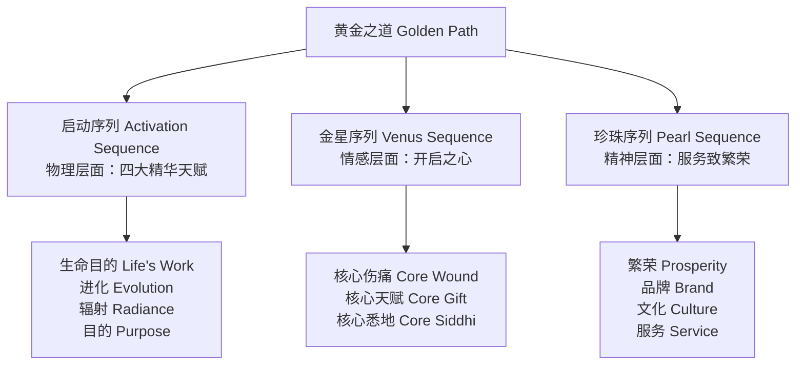
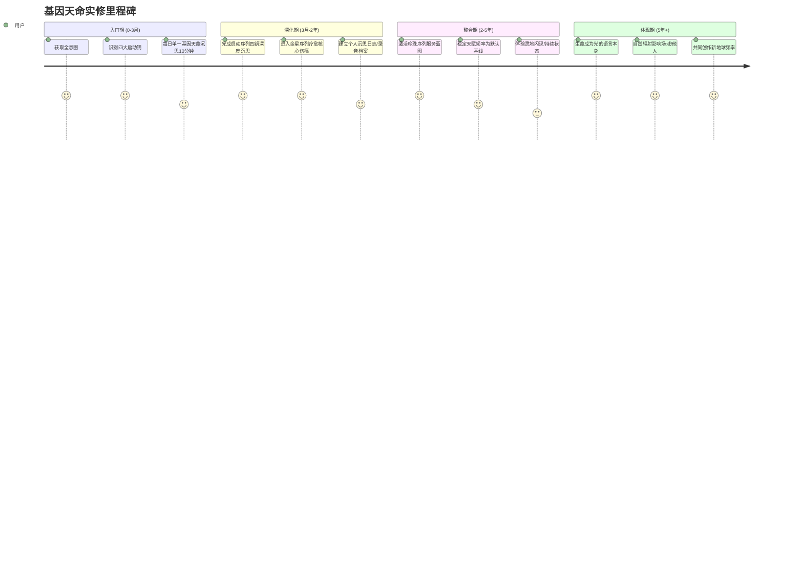

# 基因天命核心实修路径——黄金之道的三大序列

> **核心定位**：基因天命是由理查德·拉德创立的灵性成长系统，源自人类设计、易经64卦与DNA密码子的对应关系，提供一套通过「阴影→天赋→悉地」三层频率转化、以「启动序列→金星序列→珍珠序列」三大序列为实修路径的「黄金之道」。

## 系统溯源与理论基石

### 双重渊源：人类设计与易经
- **人类设计直传**：拉德为Ra Uru Hu（人类设计创始人）直传弟子，基因天命在人类设计「闸门」基础上，将64个闸门重释为「基因天命」，引入阴影/天赋/悉地三层频率模型。
- **易经64卦同构**：64个基因天命与易经64卦、DNA 64密码子一一对应，构成「基因易经」——直接与DNA对话的全息语言。

### 核心科学映照：表观遗传学与量子生物学
- **DNA即密码**：DNA分子作为光的转换器、蟲洞，能吸引光子沿双螺旋盘旋，具备超导体特性。
- **态度编程基因**：思想、情绪、信念产生的微弱电磁信号通过细胞膜受体传递至DNA，开启/关闭特定基因表达——这是「安慰剂效应」与「表观遗传学」的机制基础。
- **频率决定实相**：恐惧产生低频（阴影），爱产生高频（天赋/悉地），频率共振吸引同频体验，构建气场与显化的物理基础。

> 交叉引用：[[gene-keys]]、[[epigenetics-overview]]、[[quantum-biology-dna-light]]

---

## 黄金之道：三大序列的递进架构

黄金之道是基因天命的核心实修路线图，由三大序列按「物理→情感→精神」层次递进：

### 启动序列——物理层面：透过四大精华天赋探索天才
**定位**：奠基序列，揭示此生在物质世界的显化蓝图与能量引擎。

| 位置 | 名称 | 核心问 | 对应人类设计 | 功能 |
|------|------|--------|--------------|------|
| 第1钥 | **生命目的** Life's Work | 我来此做什么？ | 太阳人格闸门 | 此生在世间投射的核心主题 |
| 第2钥 | **进化** Evolution | 我最大的挑战/成长动力是什么？ | 地球人格闸门 | 推动生命进化的压力点 |
| 第3钥 | **辐射** Radiance | 我如何自然影响他人？ | 太阳设计闸门 | 无意识层面的辐射场 |
| 第4钥 | **目的** Purpose | 我生命的终极指向是什么？ | 地球设计闸门 | 灵魂层面的锚定坐标 |

**实修要点**：
- 通过免费排盘（humandesign.plus）获取四大钥位基因天命编号
- 对每个钥位进行「阴影→天赋→悉地」三层沉思静观
- 观察四大天赋在日常生活、职业、健康中的互动模式

> 关联页面：[[gene-keys-activation-sequence]]、[[human-design-type-strategy-authority]]

### 金星序列——情感层面：在关系中绽放内心
**定位**：转化序列，专门处理情感关系中的核心创伤与亲密模式。

| 轨道 | 名称 | 核心主题 | 对应宫位/闸门 |
|------|------|----------|---------------|
| 第1轨 | **核心伤痛** Core Wound | 童年/祖先遗传的核心情感创伤 | 金星人格闸门 |
| 第2轨 | **核心天赋** Core Gift | 伤痛转化后的关系超能力 | 金星设计闸门 |
| 第3轨 | **核心悉地** Core Siddhi | 关系层面的最高灵性境界 | 北交点/南交点闸门 |

**独特价值**：
- 精准定位「吸引同频伴侣/重复创伤模式」的DNA编码
- 提供「阴影压抑/反应」双模式识别与转化路径
- 将亲密关系升级为「共同进化的神圣容器」

> 关联页面：[[gene-keys-venus-sequence]]、[[synastry-planets-in-houses]]、[[chiron-wound-healing]]

### 珍珠序列——精神层面：透过服务实现繁荣
**定位**：圆满序列，将个人天赋转化为服务集体的繁荣流动。

| 珍珠 | 名称 | 核心功能 | 对应闸门 |
|------|------|----------|----------|
| 第1珍珠 | **繁荣** Prosperity | 物质丰盛的内在频率锚点 | 木星人格闸门 |
| 第2珍珠 | **品牌** Brand | 独特表达标识与能量签名 | 土星人格闸门 |
| 第3珍珠 | **文化** Culture | 服务对象的集体意识容器 | 天王星人格闸门 |
| 第4珍珠 | **服务** Service | 最高层面的贡献与传承 | 海王星/冥王星闸门 |

**繁荣公式**：`繁荣 = 频率(天赋/悉地) × 服务(品牌/文化) × 允许(释放匮乏阴影)`

> 关联页面：[[gene-keys-pearl-sequence]]、[[abraham-hicks-vortex]]、[[manifestation-neuroscience]]

---

## 核心频率模型：阴影 → 天赋 → 悉地

每个基因天命包含三个频率层级，对应意识光谱的三个波段：

### 阴影——低频：恐惧的生存程序
- **本质**：集体基因库中遗留的古老恐惧记忆（动物/爬虫/植物时期）
- **两种表现**：
  - **压抑型**：内向化、麻木、回避、受害者心态
  - **反应型**：外向化、愤怒、控制、投射、攻击性防御
- **功能**：保护生存，但锁住高频潜能
- **转化钥匙**：觉察、接纳、不认同、静观沉思

### 天赋——中频：心的开放与创造性脉冲
- **本质**：阴影内嵌的礼物，拥抱阴影时自动释放
- **生理效应**：血液化学改变、荷尔蒙平衡、气场扩大、心率变异性提升
- **显化力**：气场共振吸引同频机遇、人脉、资源（吸引力法则的生物学机制）
- **挑战**：高频者在低频环境中易感过度敏感，需建立能量边界

### 悉地——高频：超越二元的神圣境界
- **梵文含义**：「天赐之礼/神圣成就」
- **生理对应**：松果体/垂体激活，分泌松烷醇、哈密因、褪黑素等高阶激素
- **意识状态**：专注吸收、三摩地、非二元知晓
- **64悉地全谱**：构成人类终极开悟的生物学百科全书
- **集体跃迁**：个体悉地激活催化全球基因突变，推动「智人→圣人」进化

> 关联页面：[[pineal-gland-activation]]、[[siddhi-consciousness-states]]、[[collective-evolution-gene-keys]]

---

## 遗传密码的几何拓扑：密码子环与编程伙伴

### 21组密码子环——化学家族即神话家族
| 密码子环 | 对应胺基酸 | 基因天命范围 | 核心神话主题 |
|----------|------------|--------------|--------------|
| 火之环 | 离胺酸 | 1, 14 | 创造/毁灭、凤凰涅槃 |
| 地之环 | 谷胺酸 | 2, 13 | 形式/结构、大地母亲 |
| 风之环 | 天冬氨酸 | 3, 12 | 沟通/心智、信使神 |
| 水之环 | 精氨酸 | 4, 11 | 情感/直觉、深渊之门 |
| ... | ... | ... | ... |

**实修应用**：同一密码子环的基因天命共享生化反馈回路，集中沉思可加速整个家族的频率跃迁。

### 编程伙伴——二元场的另一半
- **定义**：圆圈排列中相对的两个基因天命（如1↔2, 3↔4... 63↔64）
- **机制**：一个天命的阴影激活，必触发伙伴的阴影/天赋共振
- **断言**：「没有编程伙伴的参与，单一基因天命无法完整运作」
- **案例**：第1天命「失序→整合」与第2天命「分离→合一」构成「混沌/秩序」原型对

> 关联页面：[[codon-ring-mythology]]、[[programming-partner-dynamics]]、[[i-ching-hexagram-pairs]]

---

## 全息基因轮廓：你的专属DNA蓝图

### 获取方式
1. 访问 [humandesign.plus](https://humandesign.plus) 输入出生时间/地点
2. 点击「基因天命」生成全息图
3. 记录11组核心数字（4启动+3金星+4珍珠）

### 轮廓解读层级
| 层级 | 内容 | 实修周期 |
|------|------|----------|
| **种子层** | 11个基因天命编号及其阴影/天赋/悉地 | 终身 |
| **路径层** | 三大序列的激活顺序与互动 | 3-7年 |
| **时机层** | 大运/流年触发的特定基因天命 | 年度/月度 |
| **关系层** | 合盘中双方基因天命的共振/冲突 | 关系期间 |

### 核心原则
- **非线性**：序列非强制顺序，随内在成熟度自然展开
- **全息性**：任一钥位包含整体信息，深入一处即通达一切
- **体现优于理解**：「先体验后明白」——沉思静观胜过智力分析

---

## 实修方法论：沉思静观——通往真实的第三条路

### 三大经典途徑对比
| 途径 | 核心机制 | 脑区根基 | 适合阶段 |
|------|----------|----------|----------|
| **冥想** | 见证一切形式/念头/感受本质 | 右脑整体知觉 | 入门/清明基础 |
| **专注** | 全力整合心/念/魂与高我 | 左脑线性意志 | 中阶/意志磨练 |
| **沉思静观** | 细胞消化式吸收，放松全神贯注 | 胼胝体整合左右脑 | **基因天命核心** |

### 沉思静观三阶段
1. **静观**：以初学者心智，轻柔持持一个基因天命词汇/意象，如抚摸丝绒盒
2. **吸收**：高频讯号穿透心智/情感层，DNA产生生化回应，气场膨胀
3. **体现**：细胞稳定适应高频，无需技巧工具，生命成为光的语言本身

### 实操微习惯
- **晨间**：醒来前5分钟，沉思当日激活的基因天命
- **日中**：遇挑战时，暂停3次呼吸，唤醒对应天赋频率
- **晚间**：睡前复盘，记录阴影触发与天赋显化的具体瞬间
- **周末**：深度沉思单一基因天命45-90分钟，允许意象/洞见浮现

> 关联页面：[[contemplation-practice-guide]]、[[gene-keys-contemplation-journal]]、[[meditation-vs-contemplation]]

---

## 与其他系统的交叉映照网络

| 系统 | 映照节点 | 互补价值 |
|------|----------|----------|
| **人类设计** | 闸门=基因天命，类型/策略/权威提供决策框架 | HD供「如何决定」，GK供「为什么这样/如何转化」 |
| **易经** | 64卦=64天命，卦辞/爻辞供原型意象库 | 易经供占卜决策，基因天命供进化转化 |
| **占星学** | 行星落闸门=行星激活特定基因天命 | 行运/推进触发基因天命的时机窗口 |
| **脉轮系统** | 7脉轮对应7个密码子环家族 | 能量中心阻塞↔特定阴影频率对应疗愈 |
| **表观遗传学** | 态度→信号→基因表达 | 科学验证「沉思静观重写DNA程序」的机制 |
| **吸引力法则** | 频率共振吸引同频实相 | 基因天命供「频率从哪来/怎么升」的生物学细节 |

> 关联索引：[[gene-keys-human-design-bridge]]、[[gene-keys-astrology-transits]]、[[gene-keys-chakra-epigenetics]]

---

## 常见误区与避坑指南

| 误区 | 纠正 |
|------|------|
| 「必须按顺序完成三序列」 | 序列随成熟度自然展开，可同时并行 |
| 「阴影是坏的要消除」 | 阴影是进化燃料，**拥抱转化**而非对抗清除 |
| 「悉地是终点/成就」 | 悉地是**当下可访问的频率**，非未来奖赏 |
| 「需要导师/认证才能实修」 | 系统设计为**自教自悟**，外在指引仅作镜像 |
| 「只看自己相关的基因天命」 | **全息性**：深入任一处皆通达整体，建议通读全书 |
| 「用脑分析/背诵天赋关键词」 | **沉思静观**非智力练习，感受胜过理解 |

---

## 进阶探索路径图

---

## 关键资源链接

| 资源类型 | 名称 | 链接/备注 |
|----------|------|-----------|
| 官方排盘 | Human Design Plus | https://humandesign.plus (免费基因全息图) |
| 官方网站 | Gene Keys Official | https://genekeys.com (英文教学/社群) |
| 中文学会 | 香港基因天命学会 | 本地化教学/实修小组/认证课程 |
| 书籍 | 《基因天命》中文版 | 理查德·拉德著，陈冠达/团队译 |
| 音频 | 沉思静观引导音频 | 官网/学会提供各基因天命专用引导 |
| 社群 | Gene Keys 实修群 | 微信/Telegram/线下聚会 |

---

## 结语：从「寻找钥匙」到「成为钥匙」

> 「你的DNA就是密码，宇宙的关键钥匙就在你手上。为你更高层次的人生目标解锁，是将你的内在权威从『脑袋』转换为『心』的过程。仅此一点，就能转化你的人生。」

黄金之道非线性阶梯，而是**螺旋上升的频率跃迁**：
- 启动序列点燃**物理显化引擎**
- 金星序列熔铸**情感炼金坩埚**
- 珍珠序列开启**精神服务星门**

当64个基因天命在你体内从阴影→天赋→悉地全频段点亮，你不再只是持有钥匙的人，**你本身成为那把钥匙**——为集体意识解锁「圣人」进化的下一阶段。

> **愿你的基因天命之旅，照亮最终壮丽盛开之路。**

---

## 交叉引用索引

### 核心体系页
- [[gene-keys]] — 基因天命系统总览
- [[gene-keys-activation-sequence]] — 启动序列详解（待建）
- [[gene-keys-venus-sequence]] — 金星序列详解（待建）
- [[gene-keys-pearl-sequence]] — 珍珠序列详解（待建）

### 关联系统页
- [[human-design-system]] — 人类设计系统总览
- [[human-design-type-strategy-authority]] — 类型/策略/内在权威
- [[i-ching-hexagram-pairs]] — 易经卦象配对与编程伙伴
- [[codon-ring-mythology]] — 21组密码子环神话映照

### 实修方法页
- [[contemplation-practice-guide]] — 沉思静观实操指南
- [[gene-keys-contemplation-journal]] — 基因天命沉思日志模板
- [[pineal-gland-activation]] — 松果体激活与悉地生理学

### 科学映照页
- [[epigenetics-overview]] — 表观遗传学概览
- [[quantum-biology-dna-light]] — 量子生物学：DNA与光
- [[manifestation-neuroscience]] — 显化神经科学机制

### 关联人物页
- [[richard-rudd]] — 理查德·拉德生平与教导
- [[ra-uru-hu]] — Ra Uru Hu与人类设计传承
- [[chen-guanda]] — 陈冠达（中文版策划/推广者）

---

> **页面维护提示**：本页为「基因天命黄金之道」结构化知识页，后续可拆分三大序列详页、64基因天命逐个条目页、密码子环神话详页、实修案例库等子页面，形成完整知识图谱。

## 来源

- [基因天命](../sources/基因天命.md)
