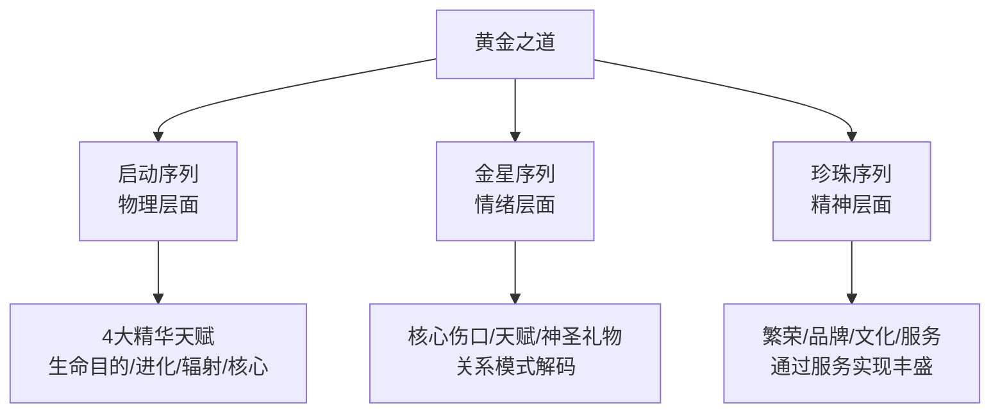
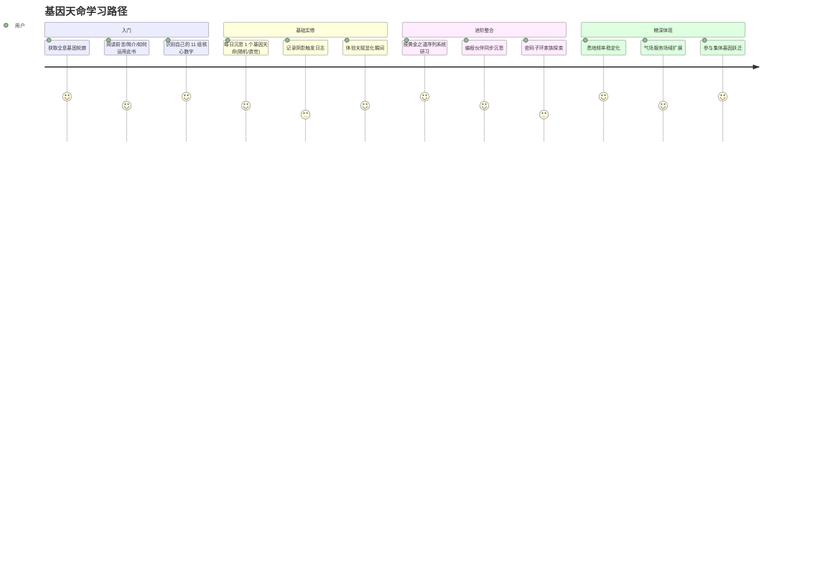

# 基因天命

## 系统溯源与核心定位

**基因天命** 是由 **理查德·拉德** 创立的灵性成长与自我实现系统。拉德曾是 **人类设计** 创始人 **拉·乌鲁·胡** 的直传弟子，基因天命在人类设计基础上独立演化，形成一套以 **“将内在权威从脑袋转换为心”** 为核心的实修框架。

> “基因天命欠了人类设计系统创始人拉·乌鲁·胡巨大债务。他打开了我的双眼，让我看到易经的真实本质，也教我如何阅读隐藏其中的代码。” —— 理查·拉德致谢词

### 核心理论支柱

| 维度 | 说明 | 交叉引用 |
|------|------|----------|
| **起源谱系** | 人类设计 → 基因天命；整合易经、DNA科学、表观遗传学、量子物理 | [[renlei-tu-zi-xue-sheng-jing]], [[liuyao-qimeng-jieyao]] |
| **核心隐喻** | DNA = 虫洞 = 光的转换器 = 全息宇宙入口 | [[convoluted-universe-book-1]], [[kryon-dna-12-secrets-book]] |
| **操作机制** | 态度 → 电磁信号 → DNA 表达 → 生化反应 → 生活实相 | [[xianhua-shijian-yu-zhuanzhu-lianci]], [[epigenetics]] |
| **实修主轴** | 沉思静观 → 吸收 → 体现（三阶段） | [[ming-xiang-gai-lun]], [[chu-xue-zhe-de-ming-xiang-shu]] |

---

## 三大序列：黄金之道

基因天命通过 **全息基因轮廓** 计算出个人专属的三组序列，合称 **“黄金之道”**：

### 启动序列 —— 物理层面：透过四大精华天赋探索天才
- **生命目的** —— 你此生要表达的核心主题
- **进化** —— 你的人生进化方向
- **辐射** —— 你向世界散发的能量品质
- **核心** —— 你内在最深处的稳定锚点

### 金星序列 —— 情绪层面：在关系中打开心扉
- 解码 **核心情感伤口** 与 **关系防御模式**
- 将 **阴影频率** 转化为 **亲密关系天赋**
- 对应 **金星** 在星盘中的相位与宫位 [[han-lianglu-juno-marriage-asteroid]], [[zhanxing-yu-ce-ji-fa-ti-xi]]

### 珍珠序列 —— 精神层面：透过服务获得成就
- **繁荣** —— 物质丰盛的内在密码
- **品牌** —— 你向世界呈现的独特印记
- **文化** —— 你参与共创的集体意识场域
- **服务** —— 最高频率的奉献路径

> **获取个人全息基因轮廓**：在 [humandesign.plus](https://humandesign.plus) 输入出生资料，点击右上角“基因天命”即可查看 11 组核心数字（如 28.6 代表第 28 基因天命第 6 线）。

---

## 基因天命：三层频率光谱

每个基因天命包含 **阴影 → 天赋 → 悉地** 三个频率层级，对应 **低 → 中 → 高** 振动态：

| 层级 | 梵文/英文 | 核心特质 | 生理对应 | 功能 |
|------|-----------|----------|----------|------|
| **阴影** | Shadow | 恐惧基础、生存导向、压抑/反应双极 | 低频电磁场、压力荷尔蒙 | 揭露无意识防御机制，面对集体基因记忆 |
| **天赋** | Gift | 创造性脉冲、心开放、气场扩展 | 高频电磁场、多巴胺/催产素 | 释放独特才华，吸引同频共振，疗愈他人 |
| **悉地** | Siddhi | 神圣恩典、超越二元、光体激活 | 松果体/垂体分泌 pinoline/harmine/melatonin | 体现最高意识状态，参与全球基因跃迁 |

### 频率转化机制
1. **沉思静观** 基因天命文本 → 激活想象力 → 产生高频电磁脉冲
2. **DNA 作为超导体** 吸引光子沿双螺旋螺旋 → 触发 **置换爆发**
3. **表观遗传学层面** 重写基因表达模式 → 细胞生化环境永久升级
4. **气场扩展** → 吸引同频共时性 → 显化生命目的

> “你的 DNA 是密码，宇宙的关键钥匙就在你手上。为你更高层次的人生目标解锁，是将你的内在权威从‘脑袋’转换为‘心’的过程。仅此一点，就能转化你的人生。”

---

## 易经 64 卦与 DNA 密码子的精确对应

| 易经结构 | DNA 结构 | 对应关系 |
|----------|----------|----------|
| 两仪（阴/阳） | 两条互补核苷酸链 | 二元模组基础 |
| 四象（太阳/少阴/少阳/太阴） | 四种碱基（A/T/C/G） | 编码字母表 |
| 三爻（8 卦） | 密码子（3 碱基一组） | 64 种基本单元 |
| 六爻（64 卦） | 64 个密码子 | **全息同构矩阵** |

**基因天命 = 基因易经** —— 直接与细胞对话的全息语言。

---

## 组密码子环与编程伙伴

### 密码子环：氨基酸家族的集体编程场
- 20 种标准氨基酸 + 1 个终止密码子 = **21 组密码子环**
- 每环具有特定 **生理功能**、**神话原型**、**希伯来字母/塔罗对应** [[lunwen-fuwen-hexin-tixi]], [[tarot-major-arcana-consulting-0-6]]
- 例：**火之环** = 第 1、14 基因天命（甲氨酸/色氨酸）→ 肝脏/离胺酸

### 编程伙伴：圆周对位的二元场
- 64 基因天命排列为圆环，**对位者即编程伙伴**（如 1↔2, 3↔4…63↔64）
- 伙伴共同创造 **生化反馈回路**：同步开启/关闭特定基因表达
- 实修时 **同步沉思伙伴组** 可加速阴影整合

---

## 实修方法论：从类比到数位的双轨导航

### 类比程序 —— 允许魔法发生
- **非线性阅读**：随意翻阅、重复停留、跟随直觉跳跃
- **心智分心法**：让逻辑脑“旁观”，心脏直接接收频率
- **生活即道场**：工作、洗碗、带孩子、睡眠中持续沉思

### 数位序列 —— 进入全息迪士尼乐园
1. **获取全息基因轮廓** → 确认 11 组核心数字
2. **按序列顺序深钻**：启动 → 金星 → 珍珠
3. **每个基因天命三读**：
   - 首读 **阴影** → 识别生活中的压抑/反应模式
   - 二读 **天赋** → 捕捉转化瞬间的创造性脉冲
   - 三读 **悉地** → 预演最高频率的体现状态
4. **记录同步性日志**：梦境、征兆、身体感受、外在事件

### 三阶段核心途径
| 阶段 | 关键词 | 身心状态 | 标志性体验 |
|------|--------|----------|------------|
| **沉思静观** | 耐心、放松、初学者心 | 心智敞开、感受体渗透 | 光的奔流感、顿悟突发 |
| **吸收** | 深刻情绪成熟、心智清晰 | 气场膨胀、DNA 吸光 | 悉地滋味、天赋最佳显化 |
| **体现** | 无技巧、无工具、纯频率 | 成为光的语言本身 | 独特声音浮现、服务自发发生 |

---

## 基因天命 1 号完整范例：从失序到整合

| 属性 | 内容 |
|------|------|
| **悉地** | **美好** |
| **天赋** | **生气勃勃** |
| **阴影** | **失序** |
| **编程伙伴** | 第 2 基因天命 |
| **密码子环** | 火之环（1, 14） |
| **生理对应** | 肝脏 |
| **氨基酸** | 离胺酸 |

### 阴影：失序 = 熵
- **核心隐喻**：封闭系统中无用能量累积 → 可用能量递减
- **心理体验**：麻木、阴郁、绝望、“爱”的对立面
- **集体层面**：文明周期性崩溃的底层驱动力
- **转化钥匙**：接纳二元性本质——无相对极性，生命不存

### 天赋：生气勃勃
- **触发条件**：拥抱失序阴影，停止对抗熵增
- **显化特质**：自发有序涌现、创造力喷发、生命力旺盛
- **生化标志**：肝脏解毒优化、线粒体效率跃升

### 悉地：美好
- **终极实相**：万物本具足圆满，无需增减
- **圣本笃之眼体验**：纯爱与全知的注视，超越时空
- **进化终点**：Homo Sanctus（圣人）诞生的生物学标志

---

## 关键概念速查表

| 概念 | 定义 | 实操入口 |
|------|------|----------|
| **全息基因轮廓** | 基于精确出生时空的个人基因地图 | [humandesign.plus](https://humandesign.plus) |
| **黄金之道** | 启动+金星+珍珠三序列合一的实修路径 | 依序沉思对应基因天命 |
| **阴影整合** | 觉察→接纳→转化，非消除对抗 | 每日记录触发情境的压抑/反应模式 |
| **编程伙伴同修** | 同步沉思对位基因天命（如 1+2） | 双页对照阅读，感受生化回路共振 |
| **密码子环探索** | 按氨基酸家族分组研习 21 环 | 关联生理症状、家族遗传模式 |
| **气场频率监测** | 观察吸引力法则在关系/财富/健康的显化 | 配合 [[zhanxing-fang-liao-xi-tong]] 精油/花精调频 |

---

## 与其他系统的交叉映照

| 系统 | 对应节点 | 互补价值 |
|------|----------|----------|
| **人类设计** | 9 中心/36 通道/64 闸门 | 提供策略/权威/类型操作手册 | [[renlei-tu-zi-xue-sheng-jing]] |
| **六爻/梅花易数** | 64 卦爻位动静 | 增加预测时空精度 | [[liuyao-qimeng-jieyao]], [[meihua-yishu]] |
| **印度占星** | 27 星宿/分盘图 | 补充业力时间线与灵魂蓝图 | [[indian-astrology-jyotish-overview]], [[vargas-divisional-charts]] |
| **表观遗传学** | DNA 甲基化/组蛋白修饰 | 科学验证“态度重写基因” | [[kryon-dna-12-secrets-book]] |
| **脉轮/能量医学** | 7/9/12 脉轮频率带 | 提供身体能量锚点与疗愈工具 | [[chakra-clearing-doreen-virtue]], [[villoldo-chakra-system]] |
| **吸引力法则/显化** | 振动频率/情绪引导系统 | 解释“高频吸引高频”机制 | [[abraham-hicks-law-of-attraction]], [[law-of-attraction-comprehensive-guide]] |

---

## 学习路径建议

---

## 资源链接

- **官方中文网站/排盘**：<https://humandesign.plus>
- **基因天命原版官网**：<https://genekeys.com>
- **香港基因天命学会 / 香港人类设计学会**：政府学术鉴定注册机构
- **推荐配套工具**：
  - 《基因天命》实体书（含 64 基因天命完整文本）
  - 沉思静观音频引导（官网提供）
  - 同频社群：线上研习小组、年度静修营

---

> “64 个基因天命的最高任务，是照亮你通往最终壮丽盛开的道路，让你和你的神性结合。届时，或许你的双眸也将闪耀著纯然的知晓之火，以及深刻的同情心和无惧的自由。”  
> —— 理查·拉德，《基因天命》前言

## 来源

- [基因天命](../sources/基因天命.md)
