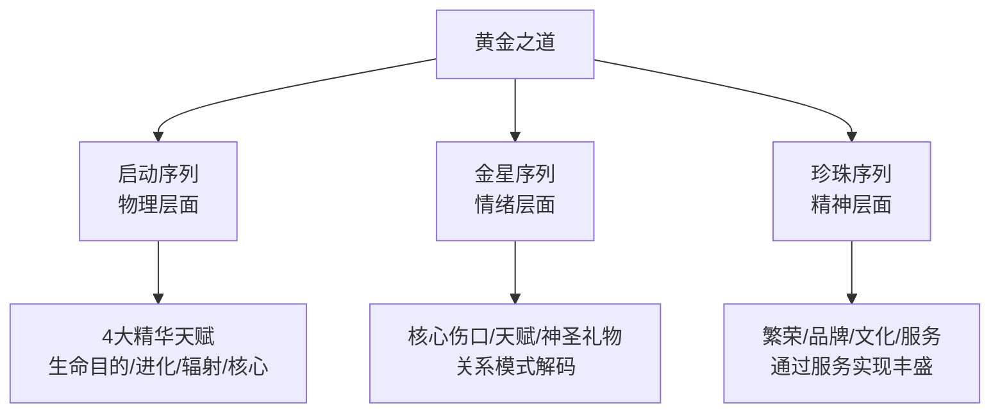
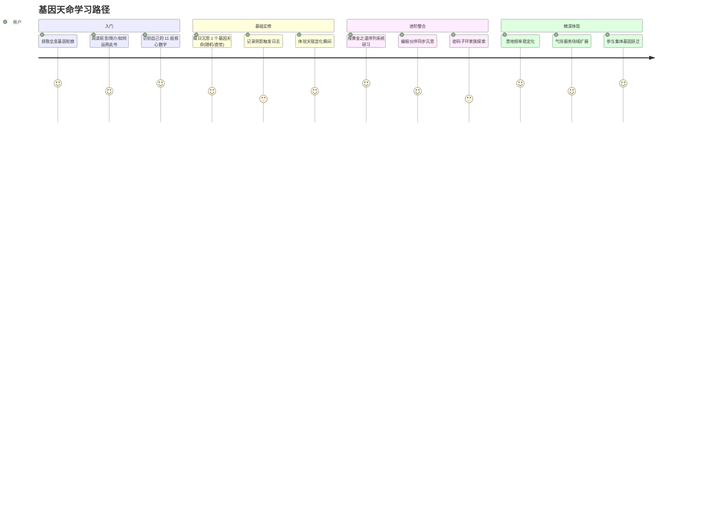

# 基因天命64键全息基因图谱

## 系统溯源与核心定位

**基因天命** 是由 **理查德·拉德** 创立的灵性成长与自我实现系统。拉德曾是 **人类设计** 创始人 **拉·乌鲁·胡** 的直传弟子，基因天命在人类设计基础上独立演化，形成一套以 **“将内在权威从脑袋转换为心”** 为核心的实修框架。

> “基因天命欠了人类设计系统创始人拉·乌鲁·胡巨大债务。他打开了我的双眼，让我看到易经的真实本质，也教我如何阅读隐藏其中的代码。” —— 理查·拉德致谢词

### 核心理论支柱

| 维度 | 说明 | 交叉引用 |
|------|------|----------|
| **起源谱系** | 人类设计 → 基因天命；整合易经、DNA科学、表观遗传学、量子物理 | [[renlei-tu-zi-xue-sheng-jing]], [[liuyao-qimeng-jieyao]] |
| **核心隐喻** | DNA = 虫洞 = 光的转换器 = 全息宇宙入口 | [[convoluted-universe-book-1]], [[kryon-dna-12-secrets-book]] |
| **操作机制** | 态度 → 电磁信号 → DNA 表达 → 生化反应 → 生活实相 | [[xianhua-shijian-yu-zhuanzhu-lianci]], [[epigenetics]] |
| **实修主轴** | 沉思静观 → 吸收 → 体现（三阶段） | [[ming-xiang-gai-lun]], [[chu-xue-zhe-de-ming-xiang-shu]] |

---

## 三大序列：黄金之道

基因天命通过 **全息基因轮廓** 计算出个人专属的三组序列，合称 **“黄金之道”**：

### 启动序列 —— 物理层面：透过四大精华天赋探索天才
- **生命目的** —— 你此生要表达的核心主题
- **进化** —— 你的人生进化方向
- **辐射** —— 你向世界散发的能量品质
- **核心** —— 你内在最深处的稳定锚点

### 金星序列 —— 情绪层面：在关系中打开心扉
- 解码 **核心情感伤口** 与 **关系防御模式**
- 将 **阴影频率** 转化为 **亲密关系天赋**
- 对应 **金星** 在星盘中的相位与宫位 [[han-lianglu-juno-marriage-asteroid]], [[zhanxing-yu-ce-ji-fa-ti-xi]]

### 珍珠序列 —— 精神层面：透过服务获得成就
- **繁荣** —— 物质丰盛的内在密码
- **品牌** —— 你向世界呈现的独特印记
- **文化** —— 你参与共创的集体意识场域
- **服务** —— 最高频率的奉献路径

> **获取个人全息基因轮廓**：在 [humandesign.plus](https://humandesign.plus) 输入出生资料，点击右上角“基因天命”即可查看 11 组核心数字（如 28.6 代表第 28 基因天命第 6 线）。

---

## 基因天命：三层频率光谱

每个基因天命包含 **阴影 → 天赋 → 悉地** 三个频率层级，对应 **低 → 中 → 高** 振动态：

| 层级 | 梵文/英文 | 核心特质 | 生理对应 | 功能 |
|------|-----------|----------|----------|------|
| **阴影** | Shadow | 恐惧基础、生存导向、压抑/反应双极 | 低频电磁场、压力荷尔蒙 | 揭露无意识防御机制，面对集体基因记忆 |
| **天赋** | Gift | 创造性脉冲、心开放、气场扩展 | 高频电磁场、多巴胺/催产素 | 释放独特才华，吸引同频共振，疗愈他人 |
| **悉地** | Siddhi | 神圣恩典、超越二元、光体激活 | 松果体/垂体分泌 pinoline/harmine/melatonin | 体现最高意识状态，参与全球基因跃迁 |

### 频率转化机制
1. **沉思静观** 基因天命文本 → 激活想象力 → 产生高频电磁脉冲
2. **DNA 作为超导体** 吸引光子沿双螺旋螺旋 → 触发 **置换爆发**
3. **表观遗传学层面** 重写基因表达模式 → 细胞生化环境永久升级
4. **气场扩展** → 吸引同频共时性 → 显化生命目的

> “你的 DNA 是密码，宇宙的关键钥匙就在你手上。为你更高层次的人生目标解锁，是将你的内在权威从‘脑袋’转换为‘心’的过程。仅此一点，就能转化你的人生。”

---

## 易经 64 卦与 DNA 密码子的精确对应

| 易经结构 | DNA 结构 | 对应关系 |
|----------|----------|----------|
| 两仪（阴/阳） | 两条互补核苷酸链 | 二元模组基础 |
| 四象（太阳/少阴/少阳/太阴） | 四种碱基（A/T/C/G） | 编码字母表 |
| 三爻（8 卦） | 密码子（3 碱基一组） | 64 种基本单元 |
| 六爻（64 卦） | 64 个密码子 | **全息同构矩阵** |

**基因天命 = 基因易经** —— 直接与细胞对话的全息语言。

---

## 组密码子环与编程伙伴

### 密码子环：氨基酸家族的集体编程场
- 20 种标准氨基酸 + 1 个终止密码子 = **21 组密码子环**
- 每环具有特定 **生理功能**、**神话原型**、**希伯来字母/塔罗对应** [[lunwen-fuwen-hexin-tixi]], [[tarot-major-arcana-consulting-0-6]]
- 例：**火之环** = 第 1、14 基因天命（甲氨酸/色氨酸）→ 肝脏/离胺酸

### 编程伙伴：圆周对位的二元场
- 64 基因天命排列为圆环，**对位者即编程伙伴**（如 1↔2, 3↔4…63↔64）
- 伙伴共同创造 **生化反馈回路**：同步开启/关闭特定基因表达
- 实修时 **同步沉思伙伴组** 可加速阴影整合

---

## 64键完整档案库

### 核心字段说明
| 字段 | 含义 |
|------|------|
| **编程伙伴** | 圆周对位键位，共同构成生化反馈回路 |
| **星座/宫位** | 对应黄道星座与人类设计中心 |
| **悉地** | 最高频率：神圣恩典/超越二元状态 |
| **天赋** | 中频频率：创造性表达/心开放品质 |
| **阴影** | 低频频率：恐惧模式/防御机制 |
| **生理对应位** | 身体器官/腺体/神经丛精确定位 |
| **密码子环** | 所属氨基酸家族编码环（21环之一） |
| **卦象** | 对应易经64卦卦名与卦象 |

---

### 第1-10键：启动与奠基频带

#### 第1键：乾卦 · 火之环 · G中心
| 字段 | 内容 |
|------|------|
| **编程伙伴** | 第2键 |
| **星座** | 天蝎座 |
| **悉地** | **美好** — 从失序到整合 |
| **天赋** | **生气勃勃** |
| **阴影** | **失序** — 熵增的封闭系统 |
| **生理对应位** | 肝脏 |
| **密码子环** | 火之环 (1, 14) |
| **卦象** | 乾 ☰ |

#### 第2键：坤卦 · 水之环 · G中心
| 字段 | 内容 |
|------|------|
| **编程伙伴** | 第1键 |
| **星座** | 金牛座 |
| **悉地** | **合一** — 返回合一 |
| **天赋** | **定向** |
| **阴影** | **错位** |
| **生理对应位** | 胸骨/小肌群 |
| **密码子环** | 水之环 (2, 8) |
| **卦象** | 坤 ☷ |

#### 第3键：屯卦 · 生死之环 · 骶骨中心
| 字段 | 内容 |
|------|------|
| **编程伙伴** | 第50键 |
| **星座** | 白羊座/金牛座 |
| **悉地** | **纯真** — 以孩子之眼见识世界 |
| **天赋** | **革新** |
| **阴影** | **混乱** |
| **生理对应位** | 脐/脐轮 |
| **密码子环** | 生死之环 (3, 20, 23, 24, 27, 42) |
| **卦象** | 屯 ☳☱ |

#### 第4键：蒙卦 · 同盟之环 · 喉轮/头部中心
| 字段 | 内容 |
|------|------|
| **编程伙伴** | 第49键 |
| **星座** | 狮子座 |
| **悉地** | **宽仁** — 万能药 |
| **天赋** | **理解** |
| **阴影** | **偏狭** |
| **生理对应位** | 新皮层 |
| **密码子环** | 同盟之环 (4, 7, 29, 59) |
| **卦象** | 蒙 ☱☰ |

#### 第5键：需卦 · 光之环 · 骶骨中心
| 字段 | 内容 |
|------|------|
| **编程伙伴** | 第35键 |
| **星座** | 射手座 |
| **悉地** | **永恒** — 时间的尽头 |
| **天赋** | **耐心** |
| **阴影** | **急躁** |
| **生理对应位** | 骶骨/骶神经叢 |
| **密码子环** | 光之环 (5, 9, 11, 26) |
| **卦象** | 需 ☱☵ |

#### 第6键：讼卦 · 炼金术之环 · 太阳神经叢
| 字段 | 内容 |
|------|------|
| **编程伙伴** | 第36键 |
| **星座** | 处女座 |
| **悉地** | **平和** — 平和之道 |
| **天赋** | **外交/手腕** |
| **阴影** | **冲突** |
| **生理对应位** | 腸系膜神经叢/腰神经节 |
| **密码子环** | 炼金术之环 (6, 40, 47, 64) |
| **卦象** | 讼 ☵☰ |

#### 第7键：师卦 · 同盟之环 · G中心
| 字段 | 内容 |
|------|------|
| **编程伙伴** | 第13键 |
| **星座** | 狮子座 |
| **悉地** | **美德** — 善有善报 |
| **天赋** | **引领** |
| **阴影** | **分隔** |
| **生理对应位** | 横膈膜 |
| **密码子环** | 同盟之环 (4, 7, 29, 59) |
| **卦象** | 师 ☷☵ |

#### 第8键：比卦 · 水之环 · 喉轮中心
| 字段 | 内容 |
|------|------|
| **编程伙伴** | 第14键 |
| **星座** | 双子座/金牛座 |
| **悉地** | **精巧** — 个性钻石 |
| **天赋** | **风格** |
| **阴影** | **平庸** |
| **生理对应位** | 甲状腺/喉结 |
| **密码子环** | 水之环 (2, 8) |
| **卦象** | 比 ☵☷ |

#### 第9键：小畜卦 · 光之环 · 骶骨中心
| 字段 | 内容 |
|------|------|
| **编程伙伴** | 第11键 |
| **星座** | 射手座 |
| **悉地** | **无敌** — 极小之力 |
| **天赋** | **毅力** |
| **阴影** | **惯性** |
| **生理对应位** | 骶神经叢 |
| **密码子环** | 光之环 (5, 9, 11, 26) |
| **卦象** | 小畜 ☰☴ |

#### 第10键：履卦 · 人性之环 · G中心
| 字段 | 内容 |
|------|------|
| **编程伙伴** | 第17键 |
| **星座** | 摩羯座/射手座 |
| **悉地** | **存在** — 自在生活 |
| **天赋** | **自然** |
| **阴影** | **自我偏执** |
| **生理对应位** | 胸部/心脏 |
| **密码子环** | 人性之环 (10, 17, 21, 25, 38, 51) |
| **卦象** | 履 ☰☱ |

---

### 第11-20键：觉醒与转化频带

#### 第11键：泰卦 · 光之环 · 头部中心
| 字段 | 内容 |
|------|------|
| **编程伙伴** | 第12键 |
| **星座** | 射手座 |
| **悉地** | **光** — 伊甸之光 |
| **天赋** | **理想主义** |
| **阴影** | **晦涩** |
| **生理对应位** | 脑下垂体 |
| **密码子环** | 光之环 (5, 9, 11, 26) |
| **卦象** | 泰 ☷☰ |

#### 第12键：否卦 · 审判之环 · 喉轮中心
| 字段 | 内容 |
|------|------|
| **编程伙伴** | 第11键 |
| **星座** | 双子座 |
| **悉地** | **纯然** — 纯真之心 |
| **天赋** | **区别** |
| **阴影** | **虚荣** |
| **生理对应位** | 甲状腺 |
| **密码子环** | 审判之环 (12, 33, 56) |
| **卦象** | 否 ☰☷ |

#### 第13键：同人卦 · 纯化之环 · G中心
| 字段 | 内容 |
|------|------|
| **编程伙伴** | 第7键 |
| **星座** | 水瓶座 |
| **悉地** | **同理心** — 以爱聆听 |
| **天赋** | **鉴赏力** |
| **阴影** | **纷乱** |
| **生理对应位** | 脑杏仁核 |
| **密码子环** | 纯化之环 (13, 30) |
| **卦象** | 同人 ☰☲ |

#### 第14键：大有卦 · 火之环 · 骶骨中心
| 字段 | 内容 |
|------|------|
| **编程伙伴** | 第8键 |
| **星座** | 射手座/天蝎座 |
| **悉地** | **丰裕** — 繁荣辐射 |
| **天赋** | **胜任** |
| **阴影** | **妥协** |
| **生理对应位** | 小肠 |
| **密码子环** | 火之环 (1, 14) |
| **卦象** | 大有 ☲☰ |

#### 第15键：谦卦 · 探索之环 · G中心
| 字段 | 内容 |
|------|------|
| **编程伙伴** | 第39键 |
| **星座** | 巨蟹座/双子座 |
| **悉地** | **繁盛兴旺** — 永恒繁花之春 |
| **天赋** | **磁力** |
| **阴影** | **索然无味** |
| **生理对应位** | 肝脏 |
| **密码子环** | 探索之环 (15, 39, 52, 53, 54, 58) |
| **卦象** | 谦 ☷☰ |

#### 第16键：豫卦 · 兴盛之环 · 喉轮中心
| 字段 | 内容 |
|------|------|
| **编程伙伴** | 第45键 |
| **星座** | 双子座 |
| **悉地** | **精通** — 神奇才赋 |
| **天赋** | **多样性** |
| **阴影** | **漠不关心** |
| **生理对应位** | 副甲状腺 |
| **密码子环** | 兴盛之环 (16, 45) |
| **卦象** | 豫 ☱☳ |

#### 第17键：随卦 · 人性之环 · 头部中心
| 字段 | 内容 |
|------|------|
| **编程伙伴** | 第10键 |
| **星座** | 白羊座 |
| **悉地** | **全知** — 内在之眼 |
| **天赋** | **远见** |
| **阴影** | **意见** |
| **生理对应位** | 脑下垂体 |
| **密码子环** | 人性之环 (10, 17, 21, 25, 38, 51) |
| **卦象** | 随 ☳☱ |

#### 第18键：蛊卦 · 物质之环 · 脾脏中心
| 字段 | 内容 |
|------|------|
| **编程伙伴** | 第48键 |
| **星座** | 天秤座 |
| **悉地** | **完美** — 心智疗愈力 |
| **天赋** | **完整** |
| **阴影** | **评判** |
| **生理对应位** | 淋巴系统 |
| **密码子环** | 物质之环 (18, 46, 48, 57) |
| **卦象** | 蛊 ☱☰ |

#### 第19键：临卦 · 盖亚之环 · 根中心
| 字段 | 内容 |
|------|------|
| **编程伙伴** | 第33键 |
| **星座** | 水瓶座 |
| **悉地** | **牺牲奉献** — 未来人类 |
| **天赋** | **敏感** |
| **阴影** | **依赖/共生依赖** |
| **生理对应位** | 体毛 |
| **密码子环** | 盖亚之环 (19, 60, 61) |
| **卦象** | 临 ☱☷ |

#### 第20键：观卦 · 生死之环 · 喉轮中心
| 字段 | 内容 |
|------|------|
| **编程伙伴** | 第34键 |
| **星座** | 双子座 |
| **悉地** | **临在** — 神圣Om |
| **天赋** | **自信** |
| **阴影** | **肤浅** |
| **生理对应位** | 脑干/延髓 |
| **密码子环** | 生死之环 (3, 20, 23, 24, 27, 42) |
| **卦象** | 观 ☵☷ |

---

### 第21-30键：心智与情感整合频带

#### 第21键：噬嗑卦 · 人性之环 · 心中心
| 字段 | 内容 |
|------|------|
| **编程伙伴** | 第48键 |
| **星座** | 白羊座 |
| **悉地** | **英勇** — 崇高生命 |
| **天赋** | **权威** |
| **阴影** | **控制** |
| **生理对应位** | 肺部 |
| **密码子环** | 人性之环 (10, 17, 21, 25, 38, 51) |
| **卦象** | 噬嗑 ☳☲ |

#### 第22键：贲卦 · 神性之环 · 太阳神经叢
| 字段 | 内容 |
|------|------|
| **编程伙伴** | 第47键 |
| **星座** | 双鱼座 |
| **悉地** | **恩典** — 压力下的恩典 |
| **天赋** | **慈祥** |
| **阴影** | **耻辱** |
| **生理对应位** | 太阳神经叢/腹神经节 |
| **密码子环** | 神性之环 (22, 36, 37, 63) |
| **卦象** | 贲 ☲☳ |

#### 第23键：剥卦 · 生死之环 · 喉轮中心
| 字段 | 内容 |
|------|------|
| **编程伙伴** | 第43键 |
| **星座** | 金牛座 |
| **悉地** | **精华** — 简约炼金术 |
| **天赋** | **简约** |
| **阴影** | **复杂** |
| **生理对应位** | 喉轮/甲状腺 |
| **密码子环** | 生死之环 (3, 20, 23, 24, 27, 42) |
| **卦象** | 剥 ☱☷ |

#### 第24键：复卦 · 生死之环 · 头部中心
| 字段 | 内容 |
|------|------|
| **编程伙伴** | 第44键 |
| **星座** | 金牛座 |
| **悉地** | **寂静** — 最终的成瘾 |
| **天赋** | **发明** |
| **阴影** | **成瘾** |
| **生理对应位** | 新皮层 |
| **密码子环** | 生死之环 (3, 20, 23, 24, 27, 42) |
| **卦象** | 复 ☳☷ |

#### 第25键：无妄卦 · 人性之环 · G中心
| 字段 | 内容 |
|------|------|
| **编程伙伴** | 第46键 |
| **星座** | 白羊座/双鱼座 |
| **悉地** | **宇宙之爱** — 神圣伤口迷思 |
| **天赋** | **接受爱** |
| **阴影** | **约束** |
| **生理对应位** | 心脏 |
| **密码子环** | 人性之环 (10, 17, 21, 25, 38, 51) |
| **卦象** | 无妄 ☰☳ |

#### 第26键：大畜卦 · 光之环 · 心轮/胸腺
| 字段 | 内容 |
|------|------|
| **编程伙伴** | 第45键 |
| **星座** | 射手座 |
| **悉地** | **无形** — 神圣戏子 |
| **天赋** | **巧妙** |
| **阴影** | **骄傲** |
| **生理对应位** | 胸腺 |
| **密码子环** | 光之环 (5, 9, 11, 26) |
| **卦象** | 大畜 ☰☱ |

#### 第27键：颐卦 · 生死之环 · 骶骨中心
| 字段 | 内容 |
|------|------|
| **编程伙伴** | 第28键 |
| **星座** | 金牛座 |
| **悉地** | **无我** — 上师甘露 |
| **天赋** | **无私** |
| **阴影** | **自私** |
| **生理对应位** | 骶神经叢/骶骨轮 |
| **密码子环** | 生死之环 (3, 20, 23, 24, 27, 42) |
| **卦象** | 颐 ☱☰ |

#### 第28键：大过卦 · 幻象之环 · 脾脏中心
| 字段 | 内容 |
|------|------|
| **编程伙伴** | 第27键 |
| **星座** | 天蝎座 |
| **悉地** | **永恒不朽** — 拥抱阴暗面 |
| **天赋** | **完整** |
| **阴影** | **无目标** |
| **生理对应位** | 肾脏 |
| **密码子环** | 幻象之环 (28, 32) |
| **卦象** | 大过 ☱☴ |

#### 第29键：坎卦 · 同盟之环 · 骶骨中心
| 字段 | 内容 |
|------|------|
| **编程伙伴** | 第30键 |
| **星座** | 处女座/狮子座 |
| **悉地** | **奉献** — 跃进空白 |
| **天赋** | **承诺** |
| **阴影** | **半颗真心** |
| **生理对应位** | 骶神经叢 |
| **密码子环** | 同盟之环 (4, 7, 29, 59) |
| **卦象** | 坎 ☵☵ |

#### 第30键：离卦 · 纯化之环 · 太阳神经叢
| 字段 | 内容 |
|------|------|
| **编程伙伴** | 第29键 |
| **星座** | 双鱼座/水瓶座 |
| **悉地** | **狂喜** — 天体之火 |
| **天赋** | **轻盈** |
| **阴影** | **欲望** |
| **生理对应位** | 太阳神经叢/消化系统 |
| **密码子环** | 纯化之环 (13, 30) |
| **卦象** | 离 ☲☲ |

---

### 第31-40键：表达与关系频带

#### 第31键：咸卦 · 不反馈之环 · 喉轮中心
| 字段 | 内容 |
|------|------|
| **编程伙伴** | 第41键 |
| **星座** | 狮子座 |
| **悉地** | **谦逊** — 锻炼真相 |
| **天赋** | **领导** |
| **阴影** | **傲慢** |
| **生理对应位** | 喉轮/甲状腺 |
| **密码子环** | 不反馈之环 (31, 62) |
| **卦象** | 咸 ☱☶ |

#### 第32键：恒卦 · 幻象之环 · 脾脏中心
| 字段 | 内容 |
|------|------|
| **编程伙伴** | 第42键 |
| **星座** | 天秤座 |
| **悉地** | **敬畏** — 敬畏祖光 |
| **天赋** | **维护** |
| **阴影** | **失败** |
| **生理对应位** | 脾脏/小肠 |
| **密码子环** | 幻象之环 (28, 32) |
| **卦象** | 恒 ☳☴ |

#### 第33键：遁卦 · 审判之环 · 喉轮中心
| 字段 | 内容 |
|------|------|
| **编程伙伴** | 第19键 |
| **星座** | 狮子座 |
| **悉地** | **真相揭示** — 最终揭示 |
| **天赋** | **正念觉察** |
| **阴影** | **遗忘** |
| **生理对应位** | 咽喉/甲状腺 |
| **密码子环** | 审判之环 (12, 33, 56) |
| **卦象** | 遁 ☰☶ |

#### 第34键：大壮卦 · 命运之环 · 骶骨中心
| 字段 | 内容 |
|------|------|
| **编程伙伴** | 第20键 |
| **星座** | 射手座 |
| **悉地** | **威严** — 野兽之美 |
| **天赋** | **实力** |
| **阴影** | **力量/强制** |
| **生理对应位** | 骶神经叢 |
| **密码子环** | 命运之环 (34, 43) |
| **卦象** | 大壮 ☳☳ |

#### 第35键：晋卦 · 奇迹之环 · 喉轮中心
| 字段 | 内容 |
|------|------|
| **编程伙伴** | 第5键 |
| **星座** | 双子座 |
| **悉地** | **无限** — 虫洞奇迹 |
| **天赋** | **冒险** |
| **阴影** | **渴望** |
| **生理对应位** | 甲状腺/副甲状腺 |
| **密码子环** | 奇迹之环 (35) |
| **卦象** | 晋 ☰☲ |

#### 第36键：明夷卦 · 神性之环 · 太阳神经叢
| 字段 | 内容 |
|------|------|
| **编程伙伴** | 第6键 |
| **星座** | 双鱼座 |
| **悉地** | **恻隐之心** — 成为人类 |
| **天赋** | **人性** |
| **阴影** | **混乱/动荡** |
| **生理对应位** | 太阳神经叢 |
| **密码子环** | 神性之环 (22, 36, 37, 63) |
| **卦象** | 明夷 ☷☲ |

#### 第37键：家人卦 · 神性之环 · 太阳神经叢
| 字段 | 内容 |
|------|------|
| **编程伙伴** | 第40键 |
| **星座** | 双鱼座 |
| **悉地** | **温婉** — 家庭炼金术 |
| **天赋** | **平等** |
| **阴影** | **软弱** |
| **生理对应位** | 太阳神经叢/背神经节 |
| **密码子环** | 神性之环 (22, 36, 37, 63) |
| **卦象** | 家人 ☲☴ |

#### 第38键：睽卦 · 人性之环 · 根中心
| 字段 | 内容 |
|------|------|
| **编程伙伴** | 第39键 |
| **星座** | 摩羯座 |
| **悉地** | **荣耀** — 光之勇士 |
| **天赋** | **坚毅** |
| **阴影** | **挣扎** |
| **生理对应位** | 肾上腺 |
| **密码子环** | 人性之环 (10, 17, 21, 25, 38, 51) |
| **卦象** | 睽 ☲☱ |

#### 第39键：乾卦 · 探索之环 · 根中心
| 字段 | 内容 |
|------|------|
| **编程伙伴** | 第38键 |
| **星座** | 巨蟹座 |
| **悉地** | **解放** — 超越张力 |
| **天赋** | **活力** |
| **阴影** | **挑战/激发** |
| **生理对应位** | 肾上腺 |
| **密码子环** | 探索之环 (15, 39, 52, 53, 54, 58) |
| **卦象** | 乾 ☰☰ |

#### 第40键：解卦 · 炼金术之环 · 心中心
| 字段 | 内容 |
|------|------|
| **编程伙伴** | 第37键 |
| **星座** | 处女座 |
| **悉地** | **神圣意志** — 臣服意志 |
| **天赋** | **决心** |
| **阴影** | **疲惫** |
| **生理对应位** | 胃部 |
| **密码子环** | 炼金术之环 (6, 40, 47, 64) |
| **卦象** | 解 ☱☳ |

---

### 第41-50键：深层转化频带

#### 第41键：损卦 · 起源之环 · 根中心
| 字段 | 内容 |
|------|------|
| **编程伙伴** | 第31键 |
| **星座** | 水瓶座 |
| **悉地** | **显化** — 基本显现 |
| **天赋** | **盼望/期待** |
| **阴影** | **幻想** |
| **生理对应位** | 肾上腺/小肠 |
| **密码子环** | 起源之环 (41) |
| **卦象** | 损 ☶☱ |

#### 第42键：益卦 · 生死之环 · 骶骨中心
| 字段 | 内容 |
|------|------|
| **编程伙伴** | 第32键 |
| **星座** | 白羊座 |
| **悉地** | **庆典** — 放下生死 |
| **天赋** | **淡然/超脱** |
| **阴影** | **期望** |
| **生理对应位** | 骶神经叢 |
| **密码子环** | 生死之环 (3, 20, 23, 24, 27, 42) |
| **卦象** | 益 ☴☳ |

#### 第43键：夬卦 · 命运之环 · 头部中心
| 字段 | 内容 |
|------|------|
| **编程伙伴** | 第23键 |
| **星座** | 天蝎座 |
| **悉地** | **顿悟** — 突破 |
| **天赋** | **洞察力** |
| **阴影** | **聋聩** |
| **生理对应位** | 内耳 |
| **密码子环** | 命运之环 (34, 43) |
| **卦象** | 夬 ☰☱ |

#### 第44键：姤卦 · 启迪者之环 · 脾脏中心
| 字段 | 内容 |
|------|------|
| **编程伙伴** | 第24键 |
| **星座** | 天蝎座 |
| **悉地** | **共治** — 因果关系 |
| **天赋** | **团结** |
| **阴影** | **扰乱/干涉** |
| **生理对应位** | 免疫系统 |
| **密码子环** | 启迪者之环 (44, 50) |
| **卦象** | 姤 ☰☴ |

#### 第45键：萃卦 · 兴盛之环 · 喉轮中心
| 字段 | 内容 |
|------|------|
| **编程伙伴** | 第16键 |
| **星座** | 双子座 |
| **悉地** | **宇宙交融** — 宇宙共融 |
| **天赋** | **协同** |
| **阴影** | **主导** |
| **生理对应位** | 甲状腺 |
| **密码子环** | 兴盛之环 (16, 45) |
| **卦象** | 萃 ☴☱ |

#### 第46键：升卦 · 物质之环 · G中心
| 字段 | 内容 |
|------|------|
| **编程伙伴** | 第25键 |
| **星座** | 处女座/天秤座 |
| **悉地** | **欣喜若狂** — 运气科学 |
| **天赋** | **满足/喜悦** |
| **阴影** | **严肃** |
| **生理对应位** | 血液/生理血液系统 |
| **密码子环** | 物质之环 (18, 46, 48, 57) |
| **卦象** | 升 ☷☰ |

#### 第47键：困卦 · 炼金术之环 · 头部中心
| 字段 | 内容 |
|------|------|
| **编程伙伴** | 第6键 |
| **星座** | 处女座 |
| **悉地** | **形态转变** — 彻底改变过去 |
| **天赋** | **蜕变** |
| **阴影** | **压抑** |
| **生理对应位** | 新皮层 |
| **密码子环** | 炼金术之环 (6, 40, 47, 64) |
| **卦象** | 困 ☵☶ |

#### 第48键：井卦 · 物质之环 · 脾脏中心
| 字段 | 内容 |
|------|------|
| **编程伙伴** | 第21键 |
| **星座** | 天秤座 |
| **悉地** | **智慧** — 未知奇迹 |
| **天赋** | **机智/足智多谋** |
| **阴影** | **劣质/不足感** |
| **生理对应位** | 淋巴系统/脾脏 |
| **密码子环** | 物质之环 (18, 46, 48, 57) |
| **卦象** | 井 ☵☷ |

#### 第49键：革卦 · 旋风之环 · 太阳神经叢
| 字段 | 内容 |
|------|------|
| **编程伙伴** | 第4键 |
| **星座** | 水瓶座 |
| **悉地** | **重生** — 由内改变世界 |
| **天赋** | **变革** |
| **阴影** | **反应** |
| **生理对应位** | 太阳神经叢 |
| **密码子环** | 旋风之环 (49, 55) |
| **卦象** | 革 ☴☲ |

#### 第50键：鼎卦 · 启迪者之环 · 脾脏中心
| 字段 | 内容 |
|------|------|
| **编程伙伴** | 第3键 |
| **星座** | 天秤座/天蝎座 |
| **悉地** | **和谐** — 宇宙秩序 |
| **天赋** | **平衡** |
| **阴影** | **腐败** |
| **生理对应位** | 免疫系统 |
| **密码子环** | 启迪者之环 (44, 50) |
| **卦象** | 鼎 ☴☲ |

---

### 第51-60键：精深觉醒频带

#### 第51键：震卦 · 人性之环 · 心中心
| 字段 | 内容 |
|------|------|
| **编程伙伴** | 第57键 |
| **星座** | 白羊座 |
| **悉地** | **昆达里尼觉醒** — 从提倡到实施 |
| **天赋** | **提倡/发起** |
| **阴影** | **焦虑** |
| **生理对应位** | 胆经/胆经经络 |
| **密码子环** | 人性之环 (10, 17, 21, 25, 38, 51) |
| **卦象** | 震 ☳☳ |

#### 第52键：艮卦 · 探索之环 · 根中心
| 字段 | 内容 |
|------|------|
| **编程伙伴** | 第58键 |
| **星座** | 巨蟹座 |
| **悉地** | **静止点** — 静止 |
| **天赋** | **克制/节制** |
| **阴影** | **压力** |
| **生理对应位** | 会阴 |
| **密码子环** | 探索之环 (15, 39, 52, 53, 54, 58) |
| **卦象** | 艮 ☶☶ |

#### 第53键：渐卦 · 探索之环 · 根中心
| 字段 | 内容 |
|------|------|
| **编程伙伴** | 第54键 |
| **星座** | 巨蟹座 |
| **悉地** | **超级丰盛** — 进化超越进化 |
| **天赋** | **延展/扩展** |
| **阴影** | **幼稚** |
| **生理对应位** | 泌尿生殖/横膈膜 |
| **密码子环** | 探索之环 (15, 39, 52, 53, 54, 58) |
| **卦象** | 渐 ☴☶ |

#### 第54键：归妹卦 · 探索之环 · 根中心
| 字段 | 内容 |
|------|------|
| **编程伙伴** | 第53键 |
| **星座** | 摩羯座 |
| **悉地** | **扬升** — 灵蛇道路 |
| **天赋** | **志向** |
| **阴影** | **贪婪** |
| **生理对应位** | 尾骨 |
| **密码子环** | 探索之环 (15, 39, 52, 53, 54, 58) |
| **卦象** | 归妹 ☳☷ |

#### 第55键：丰卦 · 旋风之环 · 太阳神经叢
| 字段 | 内容 |
|------|------|
| **编程伙伴** | 第59键 |
| **星座** | 双鱼座 |
| **悉地** | **自由** — 蜻蜓之梦 |
| **天赋** | **丰盛/自由** |
| **阴影** | **受害者情结** |
| **生理对应位** | 太阳神经叢/背神经节 |
| **密码子环** | 旋风之环 (49, 55) |
| **卦象** | 丰 ☳☲ |

#### 第56键：旅卦 · 审判之环 · 喉轮中心
| 字段 | 内容 |
|------|------|
| **编程伙伴** | 第60键 |
| **星座** | 巨蟹座/狮子座 |
| **悉地** | **陶醉** — 神圣沉溺 |
| **天赋** | **充实** |
| **阴影** | **分心** |
| **生理对应位** | 甲状腺/副甲状腺 |
| **密码子环** | 审判之环 (12, 33, 56) |
| **卦象** | 旅 ☶☰ |

#### 第57键：巽卦 · 物质之环 · 脾脏中心
| 字段 | 内容 |
|------|------|
| **编程伙伴** | 第51键 |
| **星座** | 天秤座 |
| **悉地** | **清晰** — 一阵温柔的风 |
| **天赋** | **直觉** |
| **阴影** | **不安/恐惧** |
| **生理对应位** | 头部神经节/腹部 |
| **密码子环** | 物质之环 (18, 46, 48, 57) |
| **卦象** | 巽 ☴☴ |

#### 第58键：兑卦 · 探索之环 · 根中心
| 字段 | 内容 |
|------|------|
| **编程伙伴** | 第52键 |
| **星座** | 摩羯座 |
| **悉地** | **喜乐** — 从紧绷到喜乐 |
| **天赋** | **生命力** |
| **阴影** | **不满意** |
| **生理对应位** | 会阴 |
| **密码子环** | 探索之环 (15, 39, 52, 53, 54, 58) |
| **卦象** | 兑 ☱☱ |

#### 第59键：涣卦 · 同盟之环 · 骶骨中心
| 字段 | 内容 |
|------|------|
| **编程伙伴** | 第55键 |
| **星座** | 处女座 |
| **悉地** | **真透明度** — 基因组中的龙 |
| **天赋** | **亲密** |
| **阴影** | **不诚实** |
| **生理对应位** | 骶神经叢/性器官 |
| **密码子环** | 同盟之环 (4, 7, 29, 59) |
| **卦象** | 涣 ☵☴ |

#### 第60键：节卦 · 盖亚之环 · 根中心
| 字段 | 内容 |
|------|------|
| **编程伙伴** | 第56键 |
| **星座** | 摩羯座/水瓶座 |
| **悉地** | **公义** — 船只破裂 |
| **天赋** | **现实** |
| **阴影** | **限制** |
| **生理对应位** | 结肠/肛门 |
| **密码子环** | 盖亚之环 (19, 60, 61) |
| **卦象** | 节 ☵☰ |

---

### 第61-64键：最高频率频带

#### 第61键：中孚卦 · 盖亚之环 · 头部中心
| 字段 | 内容 |
|------|------|
| **编程伙伴** | 第62键 |
| **星座** | 摩羯座 |
| **悉地** | **圣洁** — 至圣所 |
| **天赋** | **灵感** |
| **阴影** | **神经失常/精神病** |
| **生理对应位** | 松果体 |
| **密码子环** | 盖亚之环 (19, 60, 61) |
| **卦象** | 中孚 ☱☵ |

#### 第62键：小过卦 · 不反馈之环 · 喉轮中心
| 字段 | 内容 |
|------|------|
| **编程伙伴** | 第61键 |
| **星座** | 巨蟹座 |
| **悉地** | **完美无瑕** — 光之语 |
| **天赋** | **精确** |
| **阴影** | **才智/智力** |
| **生理对应位** | 喉轮/甲状腺 |
| **密码子环** | 不反馈之环 (31, 62) |
| **卦象** | 小过 ☳☶ |

#### 第63键：既济卦 · 神性之环 · 头部中心
| 字段 | 内容 |
|------|------|
| **编程伙伴** | 第64键 |
| **星座** | 双鱼座 |
| **悉地** | **真理** — 接近源头 |
| **天赋** | **探究/询问** |
| **阴影** | **疑虑** |
| **生理对应位** | 松果体 |
| **密码子环** | 神性之环 (22, 36, 37, 63) |
| **卦象** | 既济 ☵☲ |

#### 第64键：未济卦 · 炼金术之环 · 头部中心
| 字段 | 内容 |
|------|------|
| **编程伙伴** | 第63键 |
| **星座** | 处女座 |
| **悉地** | **光/照明** — 极光 |
| **天赋** | **想像力** |
| **阴影** | **困惑** |
| **生理对应位** | 松果体 |
| **密码子环** | 炼金术之环 (6, 40, 47, 64) |
| **卦象** | 未济 ☷☵ |

---

## 密码子环完整分布图

| 密码子环 | 包含键位 | 核心主题 | 生理系统 | 原型关联 |
|----------|----------|----------|----------|----------|
| **火之环** | 1, 14 | 启动/丰裕 | 肝脏/小肠 | 普罗米修斯/赫斯提亚 |
| **水之环** | 2, 8 | 合一/精巧 | 胸骨/甲状腺 | 波塞冬/墨透斯 |
| **生死之环** | 3, 20, 23, 24, 27, 42 | 轮回/转化 | 脐/脑干/喉/新皮层/骶骨 | 阿努比斯/哈迪斯 |
| **同盟之环** | 4, 7, 29, 59 | 关系/承诺 | 新皮层/横膈膜/骶骨/性器官 | 婚神/厄洛斯 |
| **光之环** | 5, 9, 11, 26 | 永恒/无形 | 骶骨/脑下垂体/胸腺 | 阿波罗/路西法 |
| **炼金术之环** | 6, 40, 47, 64 | 转化/照明 | 腸系膜/胃/新皮层/松果体 | 赫尔墨斯/玛利亚先知 |
| **人性之环** | 10, 17, 21, 25, 38, 51 | 英勇/存在 | 心/肺/胸腺/肾上腺/胆经 | 赫拉克勒斯/佛陀 |
| **纯化之环** | 13, 30 | 同理/狂喜 | 杏仁核/太阳神经叢 | 观音/狄俄尼索斯 |
| **探索之环** | 15, 39, 52, 53, 54, 58 | 磁力/扬升 | 肝/肾上腺/会阴/泌尿生殖/尾骨 | 阿尔忒弥斯/奥德修斯 |
| **兴盛之环** | 16, 45 | 精通/交融 | 甲状腺 | 密涅瓦/墨丘利 |
| **物质之环** | 18, 46, 48, 57 | 完美/智慧 | 淋巴/血液/脾/头部神经节 | 德墨忒尔/克洛诺斯 |
| **盖亚之环** | 19, 60, 61 | 奉献/圣洁 | 体毛/结肠/松果体 | 盖亚/克洛诺斯 |
| **命运之环** | 34, 43 | 实力/顿悟 | 骶骨/内耳 | 摩伊赖/诺恩斯 |
| **幻象之环** | 28, 32 | 永生/敬畏 | 肾/脾 | 玛雅/因陀罗 |
| **神性之环** | 22, 36, 37, 63 | 恩典/真理 | 太阳神经叢/松果体 | 基督/佛陀/克里希纳 |
| **审判之环** | 12, 33, 56 | 区别/揭示/陶醉 | 甲状腺/咽喉 | 拉/奥西里斯 |
| **起源之环** | 41 | 显化/期待 | 肾上腺 | 混沌/虚空 |
| **奇迹之环** | 35 | 无限/冒险 | 甲状腺/副甲状腺 | 爱丽丝/尼奥 |
| **旋风之环** | 49, 55 | 重生/自由 | 太阳神经叢 | 佛陀/帕德玛桑巴瓦 |
| **启迪者之环** | 44, 50 | 共治/和谐 | 免疫系统 | 梅尔基塞德/梅塔特隆 |
| **不反馈之环** | 31, 62 | 谦逊/完美 | 喉轮/甲状腺 | 天使/大天使 |

---

## 人类设计中心对应表

| 人类设计中心 | 对应基因天命键位 | 核心功能 |
|--------------|------------------|----------|
| **头部中心** | 11, 17, 24, 43, 47, 61, 63, 64 | 灵感/疑问/概念化/顿悟 |
| **Ajna/心智中心** | 43, 47, 61, 62, 63, 64 | 认知/处理/理解/分析 |
| **喉轮中心** | 4, 8, 12, 16, 20, 23, 31, 33, 35, 45, 56, 62 | 表达/显化/沟通/代谢 |
| **G中心/自我中心** | 1, 2, 7, 10, 13, 15, 25, 46 | 方向/爱/身份/几何/磁力 |
| **心中心/自我中心** | 21, 26, 40, 51 | 意志力/自我价值/物质/发起 |
| **脾脏中心** | 18, 28, 32, 44, 48, 50, 57 | 直觉/生存/健康/时间/味觉 |
| **太阳神经叢/情绪中心** | 6, 22, 30, 36, 37, 49, 55 | 情绪波/敏感/欲望/精神 |
| **骶骨中心** | 3, 5, 9, 14, 20, 27, 29, 34, 42, 59 | 生命力/性/工作/繁殖/响应 |
| **根中心** | 19, 38, 39, 52, 53, 54, 58, 60 | 压力/肾上腺/动力/进化 |

---

## 实修方法论：从类比到数位的双轨导航

### 类比程序 —— 允许魔法发生
- **非线性阅读**：随意翻阅、重复停留、跟随直觉跳跃
- **心智分心法**：让逻辑脑“旁观”，心脏直接接收频率
- **生活即道场**：工作、洗碗、带孩子、睡眠中持续沉思

### 数位序列 —— 进入全息迪士尼乐园
1. **获取全息基因轮廓** → 确认 11 组核心数字
2. **按序列顺序深钻**：启动 → 金星 → 珍珠
3. **每个基因天命三读**：
   - 首读 **阴影** → 识别生活中的压抑/反应模式
   - 二读 **天赋** → 捕捉转化瞬间的创造性脉冲
   - 三读 **悉地** → 预演最高频率的体现状态
4. **记录同步性日志**：梦境、征兆、身体感受、外在事件

### 三阶段核心途径
| 阶段 | 关键词 | 身心状态 | 标志性体验 |
|------|--------|----------|------------|
| **沉思静观** | 耐心、放松、初学者心 | 心智敞开、感受体渗透 | 光的奔流感、顿悟突发 |
| **吸收** | 深刻情绪成熟、心智清晰 | 气场膨胀、DNA 吸光 | 悉地滋味、天赋最佳显化 |
| **体现** | 无技巧、无工具、纯频率 | 成为光的语言本身 | 独特声音浮现、服务自发发生 |

---

## 关键概念速查表

| 概念 | 定义 | 实操入口 |
|------|------|----------|
| **全息基因轮廓** | 基于精确出生时空的个人基因地图 | [humandesign.plus](https://humandesign.plus) |
| **黄金之道** | 启动+金星+珍珠三序列合一的实修路径 | 依序沉思对应基因天命 |
| **阴影整合** | 觉察→接纳→转化，非消除对抗 | 每日记录触发情境的压抑/反应模式 |
| **编程伙伴同修** | 同步沉思对位基因天命（如 1+2） | 双页对照阅读，感受生化回路共振 |
| **密码子环探索** | 按氨基酸家族分组研习 21 环 | 关联生理症状、家族遗传模式 |
| **气场频率监测** | 观察吸引力法则在关系/财富/健康的显化 | 配合 [[zhanxing-fang-liao-xi-tong]] 精油/花精调频 |

---

## 与其他系统的交叉映照

| 系统 | 对应节点 | 互补价值 |
|------|----------|----------|
| **人类设计** | 9 中心/36 通道/64 闸门 | 提供策略/权威/类型操作手册 | [[renlei-tu-zi-xue-sheng-jing]] |
| **六爻/梅花易数** | 64 卦爻位动静 | 增加预测时空精度 | [[liuyao-qimeng-jieyao]], [[meihua-yishu]] |
| **印度占星** | 27 星宿/分盘图 | 补充业力时间线与灵魂蓝图 | [[indian-astrology-jyotish-overview]], [[vargas-divisional-charts]] |
| **表观遗传学** | DNA 甲基化/组蛋白修饰 | 科学验证“态度重写基因” | [[kryon-dna-12-secrets-book]] |
| **脉轮/能量医学** | 7/9/12 脉轮频率带 | 提供身体能量锚点与疗愈工具 | [[chakra-clearing-doreen-virtue]], [[villoldo-chakra-system]] |
| **吸引力法则/显化** | 振动频率/情绪引导系统 | 解释“高频吸引高频”机制 | [[abraham-hicks-law-of-attraction]], [[law-of-attraction-comprehensive-guide]] |

---

## 学习路径建议

---

## 资源链接

- **官方中文网站/排盘**：<https://humandesign.plus>
- **基因天命原版官网**：<https://genekeys.com>
- **香港基因天命学会 / 香港人类设计学会**：政府学术鉴定注册机构
- **推荐配套工具**：
  - 《基因天命》实体书（含 64 基因天命完整文本）
  - 沉思静观音频引导（官网提供）
  - 同频社群：线上研习小组、年度静修营

---

> “64 个基因天命的最高任务，是照亮你通往最终壮丽盛开的道路，让你和你的神性结合。届时，或许你的双眸也将闪耀著纯然的知晓之火，以及深刻的同情心和无惧的自由。”  
> —— 理查·拉德，《基因天命》前言

## 来源

- [基因天命转化卡64张](../sources/基因天命转化卡64张.md)
