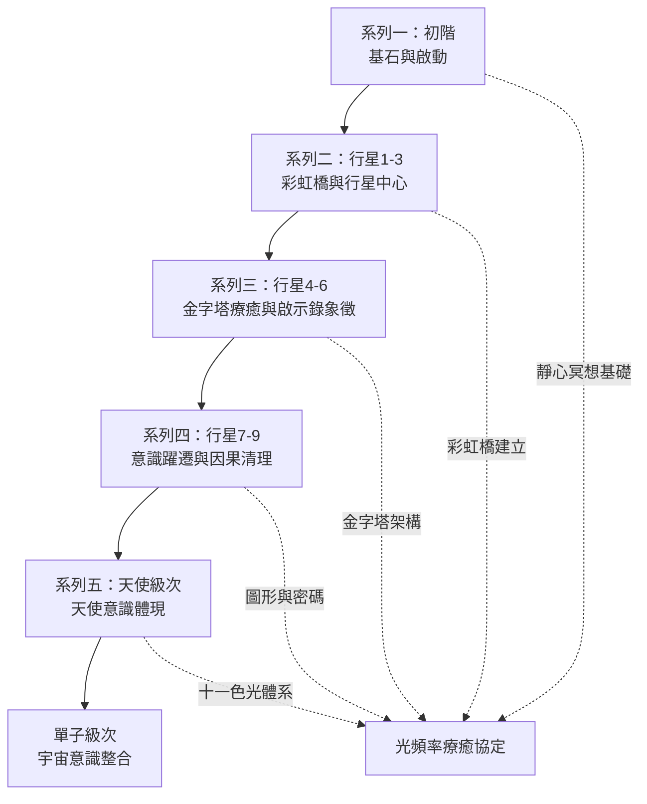

## 概述

《光的課程》A Course in Light 由美國靈媒 Antoinette Moltzan（安東尼·莫爾茨安）傳導淨光兄弟會上師訊息而成，以光的能量運作進行身心靈轉化的靜心冥想體系。全系列以意識層級遞進展開，共五大級次加單子級次，形成從人性意識向天使意識、再至宇宙意識的完整提升階梯。

**核心定位**：系列一初階為全系列基石，確立身體、情緒、思想、乙太星光體的基礎清理與光體脈輪啟動；系列二行星課程1-3建立彩虹橋、進入行星中心與智慧殿堂、學習銀色聖杯與單子能量；系列三行星課程4-6以金字塔架構將光頻率具體化為可操作療癒工具，並以啟示錄七教會七腺體象徵體系提供內在解剖圖；系列四行星課程7-9以療癒金字塔與圖形與密碼啟蒙、靈魂起因體因果清理、拙火啟動完成從人性意識向天使意識的躍遷；系列五天使級次以十一色光療癒體系與療癒與恢復聖殿，使學習者進入天使意識層面並成為執行任務的天使；單子級次再以圖形與密碼為工具，使學習者成為意識清淨、靈魂清澈、整合的自我。

## 傳導脈絡：安德魯與默基瑟德天使聖團

### 安德魯上師的靈性履歷
安德魯（Andrew）為耶穌十二門徒之一，弟弟即聖徒彼得。他曾任十二門徒團團長，耶穌升天後編寫耶穌嘉言懿行（後遭亞歷山大焚毀），足跡遍及亞美尼亞、小亞細亞、馬其頓等地傳道，最終同樣被釘十字架，於十字架上撐持兩天仍持續宣揚福音。杜恒芬譯者序記載：「在寬恕中，我們被寬恕」對他而言無需寬恕，因深知「這一切只是人世間的幻象」，靈魂本質未受傷害。

### 默基瑟德天使聖團與淨光兄弟會
- **默基瑟德天使聖團**（Order of Melchizedek）：負責督導人類意識改變，將天使聖團意識具體顯現在人類物質世界創造上
- **淨光兄弟會**（Great White Brotherhood）：光的委員會核心成員，由不再需要經歷物質體生命的上師團體組成
- **傳導鏈路**：默基瑟德天使聖團 → 淨光兄弟會 → 安德魯上師 → 靈媒安東尼·莫爾茨安 → 《光的課程》訊息

### 關鍵訊息來源
- 序言中愛瑟瑞爾（默基瑟德天使聖團上師，靈魂意識記錄保管者、淨光兄弟會成員）宣告：「你將成為一個光的教師做準備...地球人類迎接光明，向內探索真理，瞭解愛的心靈是生命最初始之源的時機已成熟」
- 全系列訊息主要來自安德魯上師，輔以愛瑟瑞爾等天使聖團成員的引導

## 五大級次課程架構總覽

### 系列一：初階——基石與啟動
**檔案**：[[guang-de-ke-cheng-xi-lie-1]]
**核心定位**：全系列基石，確立四大體系基礎清理與光體脈輪啟動
**七大教導單元**：
1. 鏡光法則——從鏡光倒影看自己，接受自己，知一切是自己慾望展現
2. 命運與選擇——天命來自靈魂同意，命運源於個性自我選擇，超越因果需理解心靈靈魂本質
3. 生命的連接——靜心冥想進入潛意識，觀想連接內在指引，紫色之光釋放頑固憤怒痛苦
4. 治癒地球——從自身開始治癒地球，覺醒「你是光、你是愛、你是訊息使者」
5. 治癒身體——身體反映思想情緒信念，觀想金色之光引導療癒能量，腦為連接中心
6. 愛的追尋與探索——愛是邁向完整關鍵，釋放恐懼，向合一心識打開，靈性導師以愛能量湧現為證
7. 宇宙意識——進入阿卡西記錄探索前世，理解「一」的宇宙法則，從個人意識轉入較高宇宙意識

**實操核心**：靜心冥想（聲音/燭光/咒語入靜）→ 觀想（熟悉安全地方/光能量清理負面）→ 脈輪色彩體驗（紫色釋放憤怒、金色療癒、彩虹頻譜注入）

### 系列二：行星課程1-3——彩虹橋與行星中心
**檔案**：[[guang-de-ke-cheng-xi-lie-2]]
**核心定位**：建立多維連接通道，進入行星中心與智慧殿堂
**三大級次架構**：
- 行星一：彩虹橋建立、行星中心初體驗、靜坐次第確立
- 行星二：銀色聖杯啟動、單子能量介紹、意識層面對應深化
- 行星三：智慧殿堂進入、高層次靈性工具運用、為系列三金字塔架構鋪路

**關鍵概念**：彩虹橋（連接人性與天使次元）、行星中心（多維意識入口）、銀色聖杯（單子能量容器）、靜坐次第標準化

### 系列三：行星課程4-6——金字塔療癒與啟示錄象徵
**檔案**：[[guang-de-ke-cheng-xi-lie-3]]、[[guang-de-ke-cheng-xingxing-si]]
**核心定位**：將光頻率具體化為可操作療癒工具，建立內在解剖圖
**三大級次架構**：
- 行星四（[[guang-de-ke-cheng-xingxing-si]]）：療癒金字塔靜坐次第、五色光操作（白/金/藍/綠寶石/紫）、啟示錄七教會對應七腺體象徵詳解
- 行星五：金字塔療癒深化、能量手術技術、跨維度療癒協定
- 行星六：金字塔能量架構整合、準備進入系列四的圖形與密碼啟蒙

**關鍵創新**：金字塔架構作為能量聚焦器、啟示錄七教會→七腺體→七脈輪的象徵對應系統、光頻率療癒協定標準化

### 系列四：行星課程7-9——意識層級躍遷與因果清理
**檔案**：[[guang-de-ke-cheng-xi-lie-4]]
**核心定位**：完成從人性意識向天使意識的躍遷
**三大級次架構**：
- 行星七：療癒金字塔靜坐次第進階、十二圖形與密碼啟蒙體系建立
- 行星八：因果認知深化、靈魂起因體清理、業力模式轉化
- 行星九：拙火啟動、天使意識全面整合、為系列五天使級次做準備

**關鍵轉折**：圖形與密碼作為光的語言，增強轉化較低意識力量，改變細胞覺知與頻率編碼

### 系列五：天使級次——天使意識體現與任務執行
**檔案**：[[guang-de-ke-cheng-xi-lie-5]]
**核心定位**：進入天使次元，成為執行任務的天使
**核心體系**：
- 療癒與恢復聖殿：高天使次元內在手術，由天使聖團療癒師（即自身天使自我）引導
- 十一色光療癒體系：黃/藍綠/紫紅/朱紅/金橘/桃/淡紫/深紅/琥珀/黃綠/櫻桃色光，各色光針對特定心理生理模式
- 靜坐次第：聚合覺知→進入白色之光→啟動靈魂光體脈輪→銀色聖杯→彩虹橋→天使次元→療癒聖殿→光頻率下引→接地回歸
- 第一課：黃色之光綜合燦爛白光與金光，清理治療思想理性體沮喪消沉

**終極目標**：完成三個天使級次後進入單子級次，學習宇宙意識，成為意識清淨、靈魂清澈、整合的自我

## 譯者杜恒芬翻譯緣起與《入門》啟蒙關聯

### 翻譯緣起三階段
1. **1983年初識**：杜恒芬偶然認識 Toni
2. **個人轉化與翻譯歷程**：見《光的課程》附錄一「Vicki的故事」
3. **關鍵轉機——博納與蒂娜園地**：《光之子的使命》討論觸發《入門》翻譯，進而催生全系列中文版

### 《入門》作為啟蒙樞紐
- **作者**：Elisabeth Haich（伊麗莎白·海希），匈牙利作家
- **內容**：古埃及女祭司入門自傳，橫跨三千年靈魂旅程，大祭司普塔霍特普教導
- **關鍵呼應**：諾瑪·米蘭若琪教授演講資料指出「許多光之子幾乎都曾在埃及全盛時期出現...學習各種形而上知識並感受到內在心靈的和平」，與《入門》作者古埃及廟宇記憶高度呼應
- **啟蒙定位**：杜恒芬指出《入門》就像《光的彩虹桥》一樣，是「引發生命靈性探索的啟蒙書」，若無此書開啟，「不會回應對內在心靈的呼喚，也不會產生將《光的課程》翻譯成中文的熱忱」
- **編輯策略**：保留作者自傳細節，每章後編排博納與蒂娜對話，搭建「作者故事與古老智慧之間的橋梁」，使讀者思索其與寶瓶座紀元《光的課程》的一致性與連續性
- **核心文獻關聯**：《光之子的使命》收錄於博納與蒂娜系列二《光的彩虹桥》；《入門》第二十四篇〈神之子〉與第三十篇〈未來〉闡明神之子即光之子淵源

詳細啟蒙脈絡見：[[ru-men-gu-ai-ji-nu-ji-si-de-ling-hun-lu-cheng]]、[[guang-de-ke-cheng-xi-lie-2]]

## 系列間交叉引用與學習路徑

### 學習建議路徑
1. **入門必讀**：《入門》→ 系列一初階（建立冥想習慣、脈輪啟動、鏡光法則認知）
2. **進階深造**：系列二行星1-3（彩虹橋體驗、行星中心連接、銀色聖杯啟動）
3. **療癒實修**：系列三行星4-6（金字塔療癒操作、七腺體對應、光頻率協定）
4. **意識躍遷**：系列四行星7-9（圖形密碼、因果清理、拙火啟動）
5. **天使任務**：系列五天使級次（療癒聖殿、十一色光、天使次元服務）
6. **究竟整合**：單子級次（宇宙意識、細胞頻率重編碼）

## 核心概念交叉引用表

| 核心概念 | 系列一定位 | 系列二發展 | 系列三深化 | 系列四躍遷 | 系列五體現 | 相關頁面 |
|----------|------------|------------|------------|------------|------------|----------|
| **靜心冥想** | 基礎入靜法（聲音/燭光/咒語） | 靜坐次第標準化 | 金字塔靜坐次第 | 圖形密碼冥想 | 天使級次靜坐次第 | [[guang-de-ke-cheng-xi-lie-1]] |
| **光頻率療癒** | 金色/白色/彩虹光基礎 | 銀色聖杯/單子能量 | 五色光/金字塔協定 | 圖形密碼光語言 | 十一色光療癒體系 | [[guang-de-ke-cheng-xingxing-si]] |
| **脈輪/光體** | 四大體系清理啟動 | 行星中心脈輪對應 | 七腺體/七脈輪/七教會 | 靈魂起因體脈輪 | 天使次元脈輪 | [[guang-de-ke-cheng-xi-lie-3]] |
| **阿卡西記錄** | 前世探索入門 | 靈魂意識記錄保管者 | 靈魂起因體記錄 | 因果模式深層清理 | 天使聖團記錄存取 | [[guang-de-ke-cheng-xi-lie-1#第七章-宇宙意識]] |
| **彩虹橋** | 彩虹頻譜注入體驗 | 正式建立連接通道 | 金字塔頂端連接 | 圖形密碼穿越 | 天使次元主要入口 | [[guang-de-ke-cheng-xi-lie-2]] |
| **鏡光法則** | 核心認知框架 | 行星中心鏡光反射 | 金字塔內部鏡光 | 圖形密碼鏡光轉化 | 天使次元鏡光實相 | [[guang-de-ke-cheng-xi-lie-1#第一章-鏡光倒影]] |
| **命運與選擇** | 天命/命運二元辨析 | 行星課程選擇機制 | 金字塔療癒選擇權 | 圖形密碼重寫命運 | 天使任務選擇自由 | [[guang-de-ke-cheng-xi-lie-1#第二章-命運與選擇]] |

## 相關資源索引

### 系列完整頁面
- [[guang-de-ke-cheng-xi-lie-1]] 系列一初階完整正文與七大教導單元詳解
- [[guang-de-ke-cheng-xi-lie-2]] 系列二行星課程1-3彩虹橋與行星中心架構
- [[guang-de-ke-cheng-xi-lie-3]] 系列三行星課程4-6金字塔療癒與啟示錄象徵
- [[guang-de-ke-cheng-xingxing-si]] 系列三行星四詳細：金字塔靜坐次第與七教會七腺體
- [[guang-de-ke-cheng-xi-lie-4]] 系列四行星課程7-9意識層級躍遷與圖形密碼
- [[guang-de-ke-cheng-xi-lie-5]] 系列五天使級次十一色光體系與療癒聖殿

### 啟蒙與傳承脈絡
- [[ru-men-gu-ai-ji-nu-ji-si-de-ling-hun-lu-cheng]] 《入門》：古埃及女祭司靈魂旅程與伊麗莎白·海希傳記
- [[drunvalo-melchizedek]] 德隆瓦洛·默基瑟德：生命之花與梅爾卡巴體系，關聯天使聖團傳承
- [[cong-xin-jue-xing]] 從心覺醒：默基瑟德心的神聖空間與梅爾卡巴靜心

### 交叉領域關聯
- [[guang-liao-yang-liao-hua-jing-zheng-he-liao-fa]] 光療氧療花精整合療法：光頻率療癒的跨領域應用
- [[shakti-gawain-chuang-zao-xing-xiang-ti-xi]] 創造性想像：觀想技術與光能量運作的共通原理
- [[nadi-leaf]] 納迪葉：阿卡西記錄與靈魂藍圖的印度傳統對應
- [[renlei-tu-zi-xue-sheng-jing]] 人類圖：能量中心與意識層級的另一體系對照

## 版本與來源說明

本總覽頁整合自：
1. **《光的課程》系列一初階中文版正文**（安東尼·莫爾茨安著，杜恒芬譯）—— 提供第一章至第七章完整訊息與安德魯上師核心教導
2. **杜恒芬譯者序**—— 提供安德魯靈性履歷、翻譯緣起、《入門》啟蒙關鍵作用
3. **既有知識庫系列頁面**—— 提供系列二至五、行星四等詳細架構的結構化沉澱
4. **博納與蒂娜園地《光的彩虹橋》與《光之子的使命》**—— 提供啟蒙文獻關聯背景

> **編輯者註**：本頁定位為《光的課程》全系列「總覽導航頁」，旨在建立五大級次架構的宏觀地圖、釐清傳導脈絡、錨定譯者緣起，各級次具體課程內容、靜坐次第操作細節、色光頻率參數請點擊對應系列頁面深入研讀。

## 来源

- [向光打开](../sources/向光打开.md)
