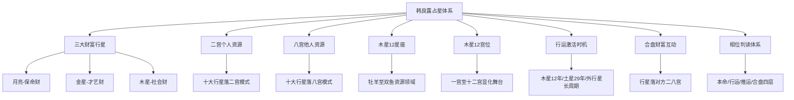

## 核心框架：三大财富行星与两大财富宫位

韩良露在《占星财富手册》中确立了**月亮、金星、木星**为三大财富行星，分别对应三种财富层面：

| 行星 | 财富类型 | 核心含义 |
|------|----------|----------|
| **月亮** | 保命财 | 安全感需求、固定必要支出、家庭观念、理财方式、来自母亲的情感模式 |
| **金星** | 才艺财 | 审美价值、讨人欢心的能量、才艺变现、奢侈消费、美感品味 |
| **木星** | 社会财 | 社会资源（金钱、人脉、名声、学历、贵人）、吉星、社会潮流与世代影响 |

> **关键洞见**：真正的财富流动是「具体金钱 ↔ 抽象资源」的互换。用物质资源换取精神财富（安全感、技艺、人脉），这些抽象资源再反哺金钱，形成活水般的财富循环。**智慧才是最大的财富**。

### 两大核心宫位

- **二宫（金钱宫/个人资源宫）**：自我价值、自力更生、一分耕耘一分收获、独资模式
- **八宫（共财宫/他人资源宫）**：集资、股份制、他人之财、继承、投资、性/金钱/权力的隐秘纠葛

> **空宫不代表无财运**：二宫/八宫无行星仅表示该领域非本生命主要功课，行运行星进入时仍会激活相关议题。参考 [[zhanxing-liu-nian-rudolf]] 中的行运技法。

---

## 二宫：个人资源的获得模式

二宫有行星者，**骨子里喜欢赚钱**，即使相位不佳也对自我赚钱、理财有浓厚兴趣。二宫核心驱动力是**通过金钱获得自我价值**。

### 太阳二宫
- **财富动机**：面子、展现生命光热
- **赚钱方式**：随太阳星座差异（牡羊=打拼、双子=口才、双鱼=想象力）
- **财缘特质**：发**男性财**，跟重要男性有关
- **风险**：坏相位导致赚钱也赔钱，财富波动大

### 月亮二宫
- **财富动机**：安全感、房产、衣食住行
- **赚钱态度**：不直接、不喜欢管钱、渴望「钱送上门」（如母乳般）
- **财缘特质**：**女性财/赠与财**，常获女性长辈/贵妇资助
- **案例**：柴可夫斯基（梅克夫人资助）、拜伦（贵妇支持）、秘书获老板娘赠房产

### 水星二宫
- **财富动机**：知识变现、教育/学历/沟通获利
- **赚钱方式**：知识产业、教学、媒体、财经记者、理财顾问
- **理财特质**：极有金钱意识与理财头脑，适合会计/经济师
- **坏相位**：金钱意识偏执，易引发争执

### 金星二宫
- **财富动机**：美感变现、才艺赚钱
- **适用领域**：化妆品、香水、精品、美容、服饰、时尚、音乐（非纯艺术）
- **消费观**：最舍得买美衣/美妆/珠宝，收藏古董因「美」而非投资
- **案例**：布拉姆斯、卡拉丝、录音师杜笃之（水金合相二宫）

### 火星二宫
- **财富动机**：冲动、争胜、证明自我
- **现金流**：来得快去得快，职场常为薪资福利争吵
- **晚年模式**：高薪退休后空虚、闲不住、易冲动创业亏损
- **家庭动态**：配偶常扮「持家者」，退休后摩擦加剧

### 木星二宫
- **财富层级**：**最丰厚的社会资源落入金钱宫**
- **赚钱模式**：不只靠自己，借社会主流价值、贵人、投资经营获利
- **守成与扩张**：好相位=巨富；坏相位=有钱后过度浪费/投机，但**前提是先有钱**
- **案例**：张小燕（主持→投资唱片/电台）、白先勇（作家+晨钟出版社+昆曲推广）

### 土星二宫
- **童年印记**：贫困或极度节俭家庭，金钱创伤
- **金钱态度**：终生无安全感，**只进不出**、小富由俭
- **破财模式**：非大胆投资，而是莫名其妙的倒霉（如邻居放炮烧房）
- **吝啬特质**：对己对人一视同仁，非对外小气对内大方

### 天王星二宫
- **财富特质**：**非典型获财**，巨大波动重塑自我价值
- **获财途径**：继承、联姻、合伙、突发横财（非劳而获）
- **与八宫区别**：夫妻间得财=二宫（无血缘=天上掉馅饼）；离婚赡养费=八宫（已成联盟=继承性质）
- **案例**：菲利普亲王（娶伊丽莎白二世得财）

### 海王星二宫
- **核心困境**：最不实际的行星落入最实际的宫位
- **金钱心态**：梦想家、感情用事、不承认爱钱、拒绝努力赚钱
- **投资行为**：盲目跟风、梦想越大越赚不到（如高尔夫球券暴雷）
- **结局风险**：一无所有，慷慨实为无金钱概念

### 冥王星二宫
- **财富动机**：**极致自我价值重塑**，非爱钱本身
- **赚钱能力**：**最强白手起家/巨富潜力**，即使坏相位也能赚大钱（只是守不住）
- **金钱心理**：操控工具、权力展现、只能主动给不能被要
- **内在冲突**：赚钱过程伴随剧烈人际/内在纠葛，通过金钱证明「战胜人生」

---

## 八宫：集资与共享财富的他人资源

八宫有行星者**对别人的钱敏锐**，易获他人资源；好相位=主动给予，坏相位=强取豪奪。八宫管理「大家的钱」，关联大钱、股票、合伙、税务、保险、赡养费。

> **空宫含义**：八宫空宫 = 此生少些性/钱/权纠葛，非无财运。

### 太阳八宫
- **核心特质**：神秘感强、潜意识深隐、能量强、影响他人潜意识
- **兴趣领域**：玄学、社会黑暗面、人性阴暗、性/金钱/权力隐秘
- **性张力**：渴望高度连結，非单纯性行为；坏相位易被误读为「好色」
- **财富模式**：奖助金、申请资源型（主动搜寻信息）；管大钱形象强，受重用升迁快
- **盲区**：对大钱敏锐，对小钱（生活开销）无概念

### 月亮八宫
- **母体投射**：母亲童年经历性/钱/权困扰 → 当事人潜意识植入不安
- **安全感来源**：**借他人钱权获安全感**，女性易被有钱有权男性吸引（甚至残障也在所不惜）
- **性态度**：理解性但非刚需，亲密感>性；钱权带来的安全感远胜性
- **坏相位**：童年创伤压抑 → 长大被大钱大权吸引，陷入纠葛

### 水星八宫
- **好奇心导向**：研究股票/期货/投资/神秘学/物理化学/生物基因
- **职业适配**：调查记者、神秘学研究者、深度分析师
- **近亲纠葛**：坏相位+配合相位 → 幼年与表亲等有性互动/性能量困扰
- **手足关系**：幼年与手足纠葛/长相极似 → 情结入潜意识 → 推动心理学探索

### 金星八宫
- **核心机制**：**以美感/亲和力出售自我换取他人资源**
- **婚姻模式**：嫁/娶有钱人，感情基础建立在对方有钱上；对方破产→感情恶化
- **同性伴侣案例**：金星八宫者不工作，靠富有伴侣养活；外遇穷小子但最终选富人
- **正面**：情感关系中常为获利方，男女皆然

### 火星八宫
- **冲突烈度最高**：性/钱/权三位一体，**最易撕破脸、动粗、大出手**
- **处理方式**：直接、粗暴、端上台面大闹（金星/水星/月亮/太阳皆更隐蔽）
- **虐待议题**：坏相位+星座配合 → 性虐待/精神虐待（受虐或施虐皆有可能）
- **案例**：誓不嫁懦夫→嫁大男人穷丈夫→靠娘家养→遭性暴力→离婚脱身

### 木星八宫
- **吉星本质**：**必有好运**，坏相位仅表现为过度乐观/期待落空，非无运
- **遗产双轨**：
  - **物质遗产**：金钱、房产、藏书
  - **精神遗产**：文学/历史/宗教/哲学/文化智慧、人脉
- **时机特质**：木土天海冥需待时机成熟显现（如艺文记者晚年嫁汉学大师）

### 土星八宫
- **核心冲突**：财务激烈纠葛，背后藏性不满+权力博弈
- **性冷感倾向** → 更看重金钱利益
- **修行课题**：**放手利益与占有欲**
- **税务/保险/赡养费陷阱**：强占有欲操作他人钱财却倒霉（如职位错植损失退休金）
- **业力显现**：非当事人过错，莫名其妙倒霉 → 怀疑前世业力

### 天王星八宫
- **无框架/无界限**：幼年早熟、易惹麻烦（土星八宫反而设限少惹事）
- **突发横财**：**意外获高等智慧资产**（科学突破/神秘学/哲学）
- **相位加成**：
  - 合水星120° → 学占星极快
  - 合金星/木星120° → 巨额横财
- **适配领域**：高等科学、神秘学、哲学、黑洞理论（霍金案例）

### 海王星八宫
- **金钱洁癖**：视钱如粪土/肮脏，**理想主义式挥霍/捐赠**
- **边界缺失**：不分彼此钱、不懂风险、易被骗/骗人（无恶意，纯糊涂）
- **合伙禁忌**：最不适合做生意伙伴，借贷随意、佛具店倒闭欠债案例
- **牺牲模式**：**为他人钱财牺牲**，非自愿乱花钱

### 冥王星八宫
- **最难功课**：走死荫幽谷，大破大立、大痛大悟
- **晚年悟道率高**：人生遇怪异教训 → 深度反思 → 转化
- **转化特质独有**：火星八宫遇冲突未必悟道，冥王星自带转化基因
- **案例**：美女制片人两任丈夫相继离世、遗产/重逢再婚/再丧 → 「挚爱死亡」成主旋律

---

## 木星十二星座：社会资源的星座表达

木星落星座揭示**此生社会资源易显化的领域**、**受惠的社会主流价值观**、**贵人类型**。

| 星座 | 核心资源领域 | 成功模式 | 典型案例 |
|------|--------------|----------|----------|
| **牡羊** | 特立独行、自我表达、冒险、媒体曝光 | 敢做自己、无视观感、领先潮流 | 达利（胆小私下vs怪诞公开、吹嘘成真） |
| **金牛** | 物质资源、实业、艺术变现 | 享受丰饶物质、好相位必现金钱运 | 欧纳西斯（木金日120°）、毕加索/马蒂斯/米罗（生前赚钱画家） |
| **双子** | 大众传媒、沟通、资讯、平民宗教、终身学习 | 大众接受度高、媒体/教育/文化获利 | 巴尔札克、普立兹奖创办人约瑟夫·普立兹 |
| **巨蟹** | 家庭滋养、房地产、家国情怀、保守价值 | 好家庭出身/资助、买房易获家庭助力、爱国乡土 | — |
| **狮子** | 聚光灯、个人英雄、明星效应、社交焦点 | 成众人焦点、适合个人英雄制工作、不适合团队隐姓埋名 | 太阳双鱼低调却抢镜的多领域重用者 |
| **处女** | 后勤、行政、会计、法规、服务、数字化管理 | 做超级总管、热爱工作本身、可量化成功 | 拒绝「给钱不工作」的工作狂 |
| **天秤** | 一对一合作、商业伙伴、贵人、均衡美感 | 对时遇对人、生意连接强、协调/公关/艺术 | 莫扎特/巴哈/盖希文/塞尚/亨利·摩尔 |
| **天蝎** | 隐秘/神秘/玄学、控制术、调查、性能量吸引 | 深度挖掘、神秘传承、权力运作 | 季辛吉、蒋介石、猫王、希区柯克、雷根 |
| **人马** | 探索未知、异国文化、外来宗教、传道、出版、运动 | 不断探索受益、晚年移民落地、腿部运动获社会缘 | 赫曼·赫塞（佛教/老庄）、卡尔文、海外通讯员 |
| **摩羯** | 政治/企业主流权威、传统价值、管理、政商关系 | 如鱼得水主流体制、越老越稳、敏感政治资源 | 柴契尔、尼克森、萨达姆、希特勒、文艺界政商高手 |
| **宝瓶** | 发明/科学/电子/占星/前卫创新、集体变迁 | 独特创新获利、拒随大流、早期切入新领域 | 居里夫人、沙克、爱因斯坦、布拉瓦茨基夫人 |
| **双鱼** | 艺术/音乐/宗教/灵性/密宗、集体潜意识 | 灵性艺术获社会认可、宗教题材变现 | 达芬奇（月木双鱼+水牡羊+日金金牛）、西藏欲经畅销案 |

> **木星双鱼关键**：赚钱的是「宗教/灵性」属性，非单纯「性爱」属性。

---

## 木星十二宫位：社会资源显化的生命舞台

木星落宫位指示**社会资源在哪个生命领域流动**、**愿在该领域投资**、及**投资回流路径**（人脉→名声→学历→金钱）。

### 木星一宫（命宫/上升宫）
- **童年资源**：优渥环境、独生/最宠/大房子/祖父母抚养/全家注意力聚焦
- **资源性质随星座**：
  - 木星狮子一宫 → 鼓励自我表达、奖状导向
  - 木星人马一宫 → 放任天真、无奖状压力
  - 木星巨蟹一宫 → 因乖巧受宠
- **家庭图景**：非孤岛、父母社交广、资源丰富
- **人生课题**：将先天资源转化为个人影响力

> **后续宫位内容**：原文截至木星一宫，木星二宫至十二宫详见完整书籍。可参考 [[zhenggongzhi-yu-shier-gongwei]] 十二宫位体系与 [[sasportas-twelve-houses]] 心理占星十二宫位深度解析。

---

## 实操方法论与交叉引用

### 本命星图查询步骤
1. 使用 [[占星之门]]（astrodoor.cc）输入出生时间地点
2. 选择 **Placidus 分宫制、回归黄道、地心说**
3. 关注 **月亮/金星/木星星座宫位**、**二宫/八宫行星**、**木星相位**

### 行运激活时机
- **行运木星**每12年回归/过境触发社会资源扩张
- **行运土星**每29年带来制约与结构化考验
- **行运天王星/海王星/冥王星**长周期激活突变/幻象/重生
- 详见 [[zhanxing-yu-ce-ji-fa-ti-xi]] 预测技法体系与 [[zhanxing-liu-nian-rudolf]] 流年实操

### 合盘财富互动
- 对方行星落入我二宫 → 对方助我增资/我愿为对方花钱
- 对方行星落入我八宫 → 共同资源/合伙/继承/性钱权纠葛
- 详见 [[han-lianglu-synastry-law-of-attraction]] 合盘吸引力法则与 [[synastry-planets-in-houses]] 行星落宫互动模型

### 相位判读优先序
1. **本命相位**（先天蓝图）
2. **行运相位**（时机触发）
3. **推运相位**（内在演化）
4. **合盘相位**（关系互动）
- 核心相位：合相(0°)、六分相(60°)、四分相(90°)、三分相(120°)、对分相(180°)
- 容许度：主相8°、六分相4°、次要2°
- 详见 [[aspect-interpretation-framework]] 相位深度诠释与 [[sue-tompkins-aspect-theory]] 汤普金情意结理论

---

## 核心书目与延伸阅读

| 书目 | 作者 | 核心贡献 | 关联页面 |
|------|------|----------|----------|
| 《占星财富手册》 | 韩良露 | 三大财富行星、二八宫财富模式、木星12星座12宫位 | 本页 |
| 《占星妈妈手册》 | 韩良露 | 月亮/谷神星亲子养育、本命星图速查 | [[han-lianglu-astrology-mom-handbook]] |
| 《千里姻缘何处牵》 | 韩良露 | 婚神星/冥王星/金星/火星/海王星亲密关系层级 | [[han-lianglu-juno-marriage-asteroid]] |
| 《占星合盘的吸引力法则》 | 韩良露 | 三因互动、行星落宫吸引力法则、实战断验 | [[han-lianglu-synastry-law-of-attraction]] |
| 《十二原型星座》 | 韩良露 | 原型神话/爱情/宿命/自我转化框架 | [[十二原型星座]] |
| 《内行星》 | 萨司波塔斯/格林 | 水金火心理占星核心基石 | [[nei-xing-xing]] |
| 《占星、心理学与四元素》 | 斯蒂芬·阿若优 | 人本占星、四元素能量语言、咨询应用 | [[arroyo-astrology-psychology-four-elements]] |
| 《占星十二宫位研究》 | 霍华德·萨司波塔斯 | 自然黄道生命过程、空宫守护星追踪 | [[sasportas-twelve-houses]] |

---

## 知识图谱导航

> **编注**：本页面依据《占星财富手册》归档文本整理，覆盖序言、二宫十行星、八宫九行星（缺冥王星八宫详文）、木星十二星座、木星一宫。木星二至十二宫、冥王星八宫完整内容、更多案例请阅读原书。

## 来源

- [占星财富手册](../sources/占星财富手册.md)
