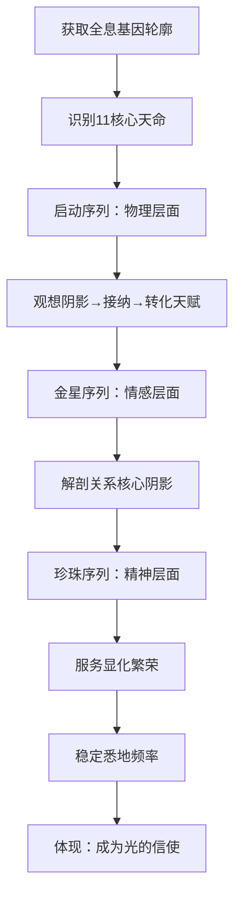

## 核心映照架构：易经与基因密码的精确同构

基因天命系统的理论基石，建立在**中国易经六十四卦**与**现代分子生物学基因编码**之间精确、可验证的结构同构之上。这种对应非比喻性，而是几何与数学层面的严格映照：

| 易经层面 | 基因编码层面 | 映照原理 |
|----------|--------------|----------|
| **阴阳二元** (陰/陽) | **双螺旋两条链** (互补链/模板链) | 两条核苷酸链完美映照，正如阴阳互为根基 |
| **四象** (太阳/少阴/少阳/太阴) | **四种碱基** (A腺嘌呤/T胸腺嘧啶/G鸟嘌呤/C胞嘧啶) | 两两配对：A↔T(两氢键)，G↔C(三氢键)，对应阴阳消长 |
| **三爻** (八卦) | **密码子** (三联体碱基序列) | 4³=64种组合，三爻三元结构与密码子三碱基结构同构 |
| **六十四卦** (六爻卦) | **六十四密码子** (编码20种氨基酸+起止密码子) | 64卦×64密码子一一对应，构成生命蓝图矩阵 |

> **引文佐证**：理查·拉德在《基因天命》前言指出：「你的DNA由两串核苷酸组成，而且一串完美地映照另一串。这个二元模组也是易经的阴阳两仪基础……易经中，阴与阳的基本排列只有四种，这些排列也被安排成三个编组，也就是我们知道的三爻……当两种符号配对时，就产生了六线卦，也就是易经的基础。如同DNA里有64组密码子，易经也有六十四个卦象。」（见[[gene-keys]]）

## 从「易经」到「基因易经」的演进

### 传统易经：占卜与哲学系统
- **伏羲先天八卦** → **文王后天八卦** → **六十四卦卦象卦辞爻辞**
- 核心功能：决策辅助、趋吉避凶、天人感应
- 局限：语言符号化程度高，缺乏生物物理层面的实证机制

### 人类设计系统：Ra Uru Hu 的首次整合 (1987)
- 将易经六十四卦映射至**身体图九大中心、三十六通道、六十四闸门**
- 引入**中性微子流穿透身体**的物理学机制解释闸门激活
- 仍以「命运蓝图」「策略与权威」为主，偏向宿命论框架

### 基因天命：Richard Rudd 的深化与超越
- **核心创见**：闸门即基因天命，**每个天命包含三层频率**——阴影(低频)、天赋(中频)、悉地(高频)
- **理论升级**：从「静态命盘」转向「动态频率转化」，强调**表观遗传学**层面的意识重写DNA
- **实修框架**：黄金之道三序列（启动→金星→珍珠）对应物理、情感、精神三层面觉醒

> **关键人物链接**：[[ra-uru-hu]] 创立人类设计，[[gene-keys]] 由 Richard Rudd 基其上发展，详见[[gene-keys-golden-path]]黄金之道实修体系。

## 三层频率模型：阴影 → 天赋 → 悉地

每个基因天命（对应一卦/一密码子）在意识光谱上呈现三个八度：

| 频率层 | 中文术语 | 梵文/英文 | 生物物理特征 | 心理/灵性功能 |
|--------|----------|-----------|--------------|---------------|
| **低频** | **阴影** | Shadow | DNA收缩、甲基化沉默、低频电磁脉冲 | 恐惧生存模式、集体无意识遗传包袱、压抑/反应双极 |
| **中频** | **天赋** | Gift | DNA舒展、组蛋白乙酰化、相干光子发射 | 创造性脉冲释放、心轮开启、气场扩大、共时性吸引 |
| **高频** | **悉地** | Siddhi | 超导体状态、光子漩涡、罕见激素分泌(松香烃/褪黑素) | 非二元知晓、全息共振、物种跃迁(homo sanctus) |

> **机制说明**：「消极的想法和情绪使你的DNA收缩，而积极的想法和情绪使它扩展和放松。」「你的态度决定进入DNA的电流信号性质。」（《基因天命》前言）这正是**表观遗传学**的核心发现：环境信号(含意识态度)调控基因表达，不改变DNA序列。

## 密码子环与编程伙伴：64卦的动态拓扑结构

### 21组密码子环
- 64密码子按**氨基酸归属**聚类为21组（20种氨基酸+1组终止密码子）
- 每组形成一个**密码子环**，在体内作为集体编程单元协同运作
- 对应**希伯来字母22字母**、**塔罗大阿尔卡那22张牌**等原型象征系统

### 编程伙伴：二元互补配对
- 64卦排列成圆环，**对径卦即为编程伙伴**（如第1卦↔第2卦，第63卦↔第64卦）
- **生化反馈回路**：一伙伴的阴影频率锁闭，另一伙伴的天赋即被压制；一伙伴激活天赋，另一伙伴同步升频
- **实修策略**：同步观想编程伙伴，打破「要不闭锁、要不解放」的二元生化循环

> **结构图示**：
> ```
> 第1基因天命(乾卦/密码子AAA) ──编程伙伴── 第2基因天命(坤卦/密码子TTT)
>      ↓ 密码子环：火之环(1,14)                    ↓ 密码子环：火之环(1,14)
> 生理对应：肝脏                              生理对应：肝脏
> 氨基酸：离胺酸                              氨基酸：离胺酸
> ```

## 全息基因轮廓：个体化的生命蓝图

基于**精确出生时间、地点、日期**计算，生成个体独有的**全息基因轮廓**，包含三大核心序列：

### 启动序列 —— 物理层面：四大精华天赋
| 位置 | 功能 | 对应人类设计 | 核心课题 |
|------|------|--------------|----------|
| **人生目的** (Life's Work) | 显性阳/人格太阳闸门 | 觉知太阳/人格太阳 | 此生投入的创造性工作 |
| **进化方向** (Evolution) | 显性阴/人格地球闸门 | 觉知地球/人格地球 | 进化压力与突破路径 |
| **光辉** (Radiance) | 隐性阳/设计太阳闸门 | 设计太阳/无意识太阳 | 无意识散发的磁场特质 |
| **目标** (Purpose) | 隐性阴/设计地球闸门 | 设计地球/无意识地球 | 灵魂层面的根本意图 |

> **操作入口**：https://www.humandesign.plus 输入出生资料 → 点击「基因天命」生成全息图 → 读取11组数字(如28.6) → 对照书中对应天命的阴影/天赋/悉地。

### 金星序列 —— 情感层面：打开心扉
- 解析**金星闸门**及其编程伙伴，揭示亲密关系中的核心心理阻碍与转化路径
- 对应**心轮/太阳神经丛**能量中心的开放与整合

### 珍珠序列 —— 精神层面：服务致繁荣
- 通过**珍珠路径**将个人天赋转化为集体服务，实现「繁荣即服务的自然果报」
- 对应**顶轮/松果体**层面的全息共振

## 观想静观：频率转化的核心技术

基因天命非认知学习，而需通过**观想静观**直接作用于DNA：

1. **放松入场**：以初学者心态，放下「理解」执着，进入Alpha/Theta脑波
2. **字词共振**：默念天命关键词(如「生气勃勃」「美好」)，让音韵在体腔产生电磁脉冲
3. **感受优先**：将觉知下沉至心轮/丹田，**感受胜于形式**，让频率穿透细胞膜直达细胞核
4. **持续渗透**：每日反复，待高频模式在DNA中建立稳定相干场，自然发生**量子跃迁**

> **三大经典途径对比**：
> - 冥想(右脑/见证) → 专注(左脑/努力) → **观想静观(胼胝体/消化吸收)**
> - 基因天命专用**观想静观**：「像抚摸丝绒盒子发现隐藏纽扣」般，以耐性柔软心激活深层知晓。

## 与跨学科知识体系的交叉映照

| 知识体系 | 映照节点 | 备注 |
|----------|----------|------|
| **表观遗传学** | 环境信号(意识态度)→组蛋白修饰/DNA甲基化→基因表达 | 科学实证基础 |
| **量子生物学** | DNA作为光子超导体/相干生物光子场 | Fritz-Albert Popp生物光子研究 |
| **印度瑜伽** | 7脉轮↔内分泌腺↔悉地激素(松香烃/褪黑素) | [[chakra-clearing-doreen-virtue]]、[[villoldo-chakra-system]] |
| **卡巴拉生命树** | 22路径↔22氨基酸组(含终止密码子)↔希伯来字母 | [[kabbalah-numerology]] |
| **塔罗大阿尔卡那** | 22张牌↔21密码子环+1整体场 | [[tarot-major-arcana-consulting-0-6]] |
| **人类设计** | 64闸门↔64基因天命，但频率模型从二元(有/无)升级为三层 | [[human-design]]、[[renlei-tu-zi-xue-sheng-jing]] |
| **克里昂DNA十二层** | 垃圾DNA即多维记忆存储，激活对应悉地显化 | [[kryon-dna-12-layers-hebrew]] |

## 实修路线图：从阴影穿越至悉地



### 关键提醒
- **非线性旅程**：可能反复回到同一天命，直到该课题完成
- **编程伙伴同步**：单独处理一卦易陷二元极端，需配对观想
- **耐性与幽默**：「基因天命是场猜谜游戏，唯有心能破题」
- **身体即实验室**：60万亿细胞同步见证，无需外部权威验证

## 相关核心页面索引

- [[gene-keys]] — 基因天命系统总览：起源、三层频率、全息基因轮廓、黄金之道
- [[gene-keys-golden-path]] — 黄金之道三序列详解：启动/金星/珍珠序列的实修框架与编程伙伴应用
- [[renlei-tu-zi-xue-sheng-jing]] — 人类设计自学圣经：闸门/通道/中心体系与基因天命的对应关系
- [[dolores-cannon-atlantis-revelations]] — 亚特兰提斯水晶科技与DNA重组记忆，提供远古基因工程视角
- [[kryon-dna-12-layers-hebrew]] — 克里昂DNA十二层教导：垃圾DNA的多维记忆功能与激活路径
- [[buddhist-mantra-quantum-theory]] — 咒语声韵振动与量子场互动，类比基因天命关键词共振机制
- [[activating-mystical-healing-power]] — AME唱诵/心轮呼吸激活内分泌系统，对应悉地层面激素分泌
- [[liuyao-bagua-quanxi-lun]] — 六爻八卦全息论：易经卦象与物质世界全息映照的传统理论基础

---

> **结语**：易经六十四卦与基因编码的精确对应，揭示了**生命蓝图的数学几何本质**——宇宙以64元基础矩阵，从微观DNA到宏观星系节律，分形全息地重复同一创造语法。基因天命系统将这古老智慧译码为**可操作的频率转化工具**，让每个个体得以在细胞层面参与物种跃迁：从「智人」向「圣人」进化。

## 来源

- [基因天命](../sources/基因天命.md)
