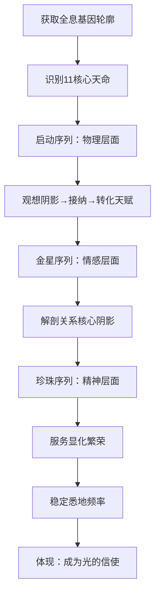

## 核心映照架构：易经与基因密码的精确同构

基因天命系统的理论基石，建立在**中国易经六十四卦**与**现代分子生物学基因编码**之间精确、可验证的结构同构之上。这种对应非比喻性，而是几何与数学层面的严格映照：

| 易经层面 | 基因编码层面 | 映照原理 |
|----------|--------------|----------|
| **阴阳二元** (陰/陽) | **双螺旋两条链** (互补链/模板链) | 两条核苷酸链完美映照，正如阴阳互为根基 |
| **四象** (太阳/少阴/少阳/太阴) | **四种碱基** (A腺嘌呤/T胸腺嘧啶/G鸟嘌呤/C胞嘧啶) | 两两配对：A↔T(两氢键)，G↔C(三氢键)，对应阴阳消长 |
| **三爻** (八卦) | **密码子** (三联体碱基序列) | 4³=64种组合，三爻三元结构与密码子三碱基结构同构 |
| **六十四卦** (六爻卦) | **六十四密码子** (编码20种氨基酸+起止密码子) | 64卦×64密码子一一对应，构成生命蓝图矩阵 |

> **引文佐证**：理查·拉德在《基因天命》前言指出：「你的DNA由两串核苷酸组成，而且一串完美地映照另一串。这个二元模组也是易经的阴阳两仪基础……易经中，阴与阳的基本排列只有四种，这些排列也被安排成三个编组，也就是我们知道的三爻……当两种符号配对时，就产生了六线卦，也就是易经的基础。如同DNA里有64组密码子，易经也有六十四个卦象。」（见[[gene-keys]]）

## 64键完整对照表：卦序、卦名、密码子环、黄道星座、三层频率、生理定位三层交叉验证

以下表格整合《基因天命》转化卡档案、人类设计闸门对应、氨基酸密码子环分组、黄道十二宫投射、以及器官腺体/能量中心/神经丛的三层生理定位。

### 凡例
- **卦序**：King Wen 文王序卦序号 (1-64)
- **卦名**：经典卦名（中/英）
- **密码子环**：按氨基酸归属聚类的21组密码子环（括号内为成员卦序）
- **黄道星座**：基因天命投射的热带黄道星座
- **编程伙伴**：对径卦序号（圆环对径，二元互补配对）
- **三层频率**：阴影 → 天赋 → 悉地
- **生理定位三层**：
  1. **器官/腺体** (Organ/Gland)
  2. **人类设计中心/能量中心** (HD Center / Energy Center)
  3. **神经丛/脉轮/经络** (Nerve Plexus / Chakra / Meridian)

---

### 密码子环分组总览（21环）

| 密码子环 | 成员卦序 | 核心主题 | 对应氨基酸/功能 |
|----------|----------|----------|------------------|
| **火之环** Ring of Fire | 1, 14 | 创造/丰裕 | 离氨酸 |
| **水之环** Ring of Water | 2, 8 | 接受/结合 | 无对应氨基酸（调节） |
| **生死之环** Ring of Life & Death | 3, 20, 23, 24, 27, 42 | 生死轮回/转化 | 多种 |
| **同盟之环** Ring of Union | 4, 7, 29, 59 | 关系/亲密 | 多种 |
| **光之环** Ring of Light | 5, 9, 11, 26 | 意识/光明 | 多种 |
| **炼金术之环** Ring of Alchemy | 6, 40, 47, 64 | 转化/炼金 | 多种 |
| **人性之环** Ring of Humanity | 10, 17, 21, 25, 38, 51 | 人性课题/觉醒 | 多种 |
| **审判之环** Ring of Trials | 12, 33, 56 | 考验/真相 | 多种 |
| **纯化之环** Ring of Purification | 13, 30 | 净化/狂喜 | 多种 |
| **探索之环** Ring of Seeking | 15, 39, 52, 53, 54, 58 | 探索/进化 | 多种 |
| **兴盛之环** Ring of Prosperity | 16, 45 | 兴盛/聚合 | 多种 |
| **盖亚之环** Ring of Gaia | 19, 60, 61 | 地球/圣洁 | 多种 |
| **幻象之环** Ring of Illusion | 28, 32 | 幻象/敬畏 | 多种 |
| **神性之环** Ring of Divinity | 22, 36, 37, 63 | 神性/慈悲 | 多种 |
| **物质之环** Ring of Matter | 18, 46, 48, 57 | 物质/直觉 | 多种 |
| **起源之环** Ring of Origin | 41 | 起源/显化 | 甲硫氨酸(起始) |
| **命运之环** Ring of Destiny | 34, 43 | 命运/突破 | 多种 |
| **奇迹之环** Ring of Miracles | 35 | 奇迹/无界 | 多种 |
| **旋风之环** Ring of Whirlwind | 49, 55 | 变革/自由 | 多种 |
| **无反馈之环** Ring of No Return | 31, 62 | 单向/完美 | 多种 |
| **启迪者之环** Ring of Illuminati | 44, 50 | 启迪/秩序 | 多种 |

---

### 64键详细对照表

| 卦序 | 卦名 | 密码子环 | 黄道星座 | 编程伙伴 | 阴影 | 天赋 | 悉地 | 器官/腺体 | HD中心/能量中心 | 神经丛/脉轮/经络 |
|------|------|----------|----------|----------|------|------|------|-----------|-----------------|------------------|
| 1 | 乾 | 火之环 (1,14) | 天蝎座 | 2 | 失序 | 生气勃勃 | 美好 | 肝脏 | G中心 | 肝经/胆经 |
| 2 | 坤 | 水之环 (2,8) | 金牛座 | 1 | 错位 | 定向 | 合一 | 胸骨 | G中心 | 心包经/任脉 |
| 3 | 屯 | 生死之环 (3,20,23,24,27,42) | 白羊座/金牛座 | 50 | 混乱 | 革新 | 纯真 | 脐/脐轮 | 骶骨中心 | 任脉/冲脉/脐轮 |
| 4 | 蒙 | 同盟之环 (4,7,29,59) | 狮子座 | 49 | 偏狭 | 理解 | 宽仁 | 新皮层 | 喉中心/头中心 | 督脉/大椎穴 |
| 5 | 需 | 光之环 (5,9,11,26) | 射手座 | 35 | 急躁 | 耐心 | 永恒 | 骶骨神经丛 | 骶骨中心 | 脐轮/命门 |
| 6 | 讼 | 炼金术之环 (6,40,47,64) | 处女座 | 36 | 冲突 | 外交 | 平和 | 腰神经节/肠系膜神经丛 | 太阳神经丛 | 胃经/脾经/中脘 |
| 7 | 师 | 同盟之环 (4,7,29,59) | 狮子座 | 13 | 分隔 | 引领 | 美德 | 横膈膜 | G中心 | 横膈膜/肺经 |
| 8 | 比 | 水之环 (2,8) | 双子座/金牛座 | 14 | 平庸 | 风格 | 精巧 | 甲状腺/喉结 | 喉中心 | 喉轮/甲状腺软骨 |
| 9 | 小畜 | 光之环 (5,9,11,26) | 射手座 | 11 | 惯性 | 毅力 | 无敌 | 骶骨神经丛 | 骶骨中心 | 脐轮/肾经 |
| 10 | 履 | 人性之环 (10,17,21,25,38,51) | 摩羯座/射手座 | 17 | 自我偏执 | 自然 | 存在 | 胸部/心脏 | G中心 | 心经/膻中穴 |
| 11 | 泰 | 光之环 (5,9,11,26) | 射手座 | 12 | 晦涩 | 理想主义 | 光 | 脑下垂体 | 头中心/顶轮 | 督脉/百会/印堂 |
| 12 | 否 | 审判之环 (12,33,56) | 双子座 | 11 | 虚荣 | 区别 | 纯真 | 甲状腺 | 喉中心 | 喉轮/甲状腺 |
| 13 | 同人 | 纯化之环 (13,30) | 水瓶座 | 7 | 纷乱 | 鉴赏力 | 同理心 | 杏仁核 | G中心 | 边缘系统/肾经 |
| 14 | 大有 | 火之环 (1,14) | 射手座/天蝎座 | 1 | 妥协 | 胜任 | 丰裕 | 小肠 | 脾中心/骶骨 | 小肠经/心经 |
| 15 | 谦 | 探索之环 (15,39,52,53,54,58) | 巨蟹座/双子座 | 39 | 索然无味 | 磁力 | 繁盛兴旺 | 肝脏 | G中心 | 肝经/胆经 |
| 16 | 豫 | 兴盛之环 (16,45) | 双子座 | 45 | 漠不关心 | 多样性 | 精通 | 副甲状腺 | 喉中心 | 喉轮/甲状旁腺 |
| 17 | 随 | 人性之环 (10,17,21,25,38,51) | 白羊座 | 10 | 意见 | 远见 | 全知 | 脑下垂体 | 头中心 | 顶轮/百会/印堂 |
| 18 | 蛊 | 物质之环 (18,46,48,57) | 天秤座 | 48 | 评判 | 完整 | 完美 | 淋巴系统 | 脾中心 | 脾经/三焦/淋巴 |
| 19 | 临 | 盖亚之环 (19,60,61) | 水瓶座 | 33 | 依赖 | 敏感 | 奉献 | 体毛 | 根中心 | 毛发/督脉/尾闾 |
| 20 | 观 | 生死之环 (3,20,23,24,27,42) | 双子座 | 34 | 肤浅 | 自信 | 临在 | 延髓/脑干 | 喉中心 | 督脉/风府/大椎 |
| 21 | 噬嗑 | 人性之环 (10,17,21,25,38,51) | 白羊座 | 48 | 控制 | 权威 | 英勇 | 肺部 | 心中心 | 肺经/膻中/云门 |
| 22 | 贲 | 神性之环 (22,36,37,63) | 双鱼座 | 47 | 耻辱 | 慈祥 | 恩典 | 太阳神经丛/腹腔神经节 | 太阳神经丛 | 胃经/中脘/脐轮 |
| 23 | 剥 | 生死之环 (3,20,23,24,27,42) | 金牛座 | 43 | 复杂 | 简约 | 精华 | 喉/甲状腺 | 喉中心 | 喉轮/天突/廉泉 |
| 24 | 复 | 生死之环 (3,20,23,24,27,42) | 金牛座 | 44 | 成瘾 | 发明 | 寂静 | 新皮层 | 头中心 | 大脑皮层/百会 |
| 25 | 无妄 | 人性之环 (10,17,21,25,38,51) | 白羊座/双鱼座 | 46 | 约束 | 接受爱 | 宇宙之爱 | 心脏 | G中心 | 心经/心包/膻中 |
| 26 | 大畜 | 光之环 (5,9,11,26) | 射手座 | 45 | 骄傲 | 巧妙 | 无形 | 胸腺 | 心中心/高心轮 | 胸腺/任脉/膻中 |
| 27 | 颐 | 生死之环 (3,20,23,24,27,42) | 金牛座 | 28 | 自私 | 无私 | 无我 | 骶骨神经丛 | 骶骨中心 | 脐轮/命门/肾经 |
| 28 | 大过 | 幻象之环 (28,32) | 天蝎座 | 27 | 无目标 | 完整 | 永恒不朽 | 肾脏 | 脾中心 | 肾经/命门/涌泉 |
| 29 | 坎 | 同盟之环 (4,7,29,59) | 处女座/狮子座 | 30 | 半颗真心 | 承诺 | 奉献 | 骶骨神经丛 | 骶骨中心 | 脐轮/命门/冲脉 |
| 30 | 离 | 纯化之环 (13,30) | 双鱼座/水瓶座 | 29 | 欲望 | 轻盈 | 狂喜 | 太阳神经丛/消化 | 太阳神经丛 | 胃经/脾经/中脘 |
| 31 | 咸 | 无反馈之环 (31,62) | 狮子座 | 41 | 傲慢 | 领导 | 谦逊 | 喉/甲状腺 | 喉中心 | 喉轮/天突/廉泉 |
| 32 | 恒 | 幻象之环 (28,32) | 天秤座 | 42 | 失败 | 维护 | 敬畏 | 脾脏 | 脾中心 | 脾经/三阴交/足三里 |
| 33 | 遯 | 审判之环 (12,33,56) | 狮子座 | 19 | 遗忘 | 正念觉察 | 真相揭示 | 咽喉/甲状腺 | 喉中心 | 喉轮/天突/廉泉 |
| 34 | 大壮 | 命运之环 (34,43) | 射手座 | 20 | 力量 | 实力 | 威严 | 骶骨神经丛 | 骶骨中心 | 脐轮/命门/关元 |
| 35 | 晋 | 奇迹之环 (35) | 双子座 | 5 | 渴望 | 冒险 | 无限 | 甲状腺/副甲状腺 | 喉中心 | 喉轮/甲状腺/甲旁 |
| 36 | 明夷 | 神性之环 (22,36,37,63) | 双鱼座 | 22 | 混乱 | 人性 | 惻隐之心 | 太阳神经丛 | 太阳神经丛 | 胃经/脾经/中脘 |
| 37 | 家人 | 神性之环 (22,36,37,63) | 双鱼座 | 40 | 软弱 | 平等 | 温婉 | 太阳神经丛/背神经节 | 太阳神经丛 | 胃经/脾经/脊柱 |
| 38 | 睽 | 人性之环 (10,17,21,25,38,51) | 摩羯座 | 39 | 挣扎 | 坚毅 | 荣耀 | 肾上腺 | 根中心 | 肾经/命门/肾上腺 |
| 39 | 乾(䷀) | 探索之环 (15,39,52,53,54,58) | 巨蟹座 | 38 | 挑战 | 活力 | 解放 | 肾上腺 | 根中心 | 肾经/命门/肾上腺 |
| 40 | 解 | 炼金术之环 (6,40,47,64) | 处女座 | 37 | 疲惫 | 决心 | 神圣意志 | 胃部 | 心中心 | 胃经/中脘/膈俞 |
| 41 | 损 | 起源之环 (41) | 水瓶座 | 31 | 幻想 | 盼望 | 显化 | 肾上腺 | 根中心 | 肾经/命门/肾上腺 |
| 42 | 益 | 生死之环 (3,20,23,24,27,42) | 白羊座 | 32 | 期望 | 淡然 | 庆典 | 骶骨神经丛 | 骶骨中心 | 脐轮/关元/气海 |
| 43 | 夬 | 命运之环 (34,43) | 天蝎座 | 23 | 聋聵 | 洞察力 | 顿悟 | 内耳 | 头中心 | 听觉皮层/督脉/风池 |
| 44 | 姤 | 启迪者之环 (44,50) | 天蝎座 | 24 | 扰乱 | 团结 | 共治 | 免疫系统 | 脾中心 | 脾经/淋巴/三焦 |
| 45 | 萃 | 兴盛之环 (16,45) | 双子座 | 16 | 主导 | 协同 | 宇宙交融 | 甲状腺 | 喉中心 | 喉轮/甲状腺 |
| 46 | 升 | 物质之环 (18,46,48,57) | 处女座/天秤座 | 25 | 严肃 | 满足 | 欣喜若狂 | 血液 | G中心 | 心经/血脉/任脉 |
| 47 | 困 | 炼金术之环 (6,40,47,64) | 处女座 | 6 | 压抑 | 蜕变 | 形态转变 | 新皮层 | 头中心 | 大脑皮层/百会/前额 |
| 48 | 井 | 物质之环 (18,46,48,57) | 天秤座 | 21 | 劣质 | 机智 | 智慧 | 淋巴系统/脾脏 | 脾中心 | 脾经/淋巴/三焦 |
| 49 | 革 | 旋风之环 (49,55) | 水瓶座 | 4 | 反应 | 变革 | 重生 | 太阳神经丛 | 太阳神经丛 | 胃经/脾经/中脘 |
| 50 | 鼎 | 启迪者之环 (44,50) | 天秤座/天蝎座 | 3 | 腐败 | 平衡 | 和谐 | 免疫系统 | 脾中心 | 脾经/淋巴/三焦 |
| 51 | 震 | 人性之环 (10,17,21,25,38,51) | 白羊座 | 57 | 焦虑 | 提倡 | 觉醒 | 胆经 | 心中心 | 胆经/阳陵泉/期门 |
| 52 | 艮 | 探索之环 (15,39,52,53,54,58) | 巨蟹座 | 58 | 压力 | 静止 | 静止点 | 会阴 | 根中心 | 督脉/尾闾/会阴/长强 |
| 53 | 渐 | 探索之环 (15,39,52,53,54,58) | 巨蟹座 | 54 | 幼稚 | 延展 | 超级丰盛 | 泌尿生殖/横膈膜 | 根中心 | 任脉/冲脉/带脉/横膈膜 |
| 54 | 归妹 | 探索之环 (15,39,52,53,54,58) | 摩羯座 | 53 | 贪婪 | 志向 | 扬升 | 尾骨 | 根中心 | 督脉/尾闾/长强/会阴 |
| 55 | 丰 | 旋风之环 (49,55) | 双鱼座 | 59 | 受害者情结 | 自由 | 自由 | 太阳神经丛/背神经节 | 脐轮/太阳神经丛 | 胃经/脾经/脊柱/中脘 |
| 56 | 旅 | 审判之环 (12,33,56) | 巨蟹座/狮子座 | 60 | 分心 | 充实 | 陶醉 | 甲状腺/副甲状腺 | 喉中心 | 喉轮/甲状腺/甲旁 |
| 57 | 巽 | 物质之环 (18,46,48,57) | 天秤座 | 51 | 不安 | 直觉 | 清晰 | 颅神经节/腹部 | 脾中心 | 迷走神经/太阳神经丛/腹腔 |
| 58 | 兑 | 探索之环 (15,39,52,53,54,58) | 摩羯座 | 52 | 不满意 | 生命力 | 喜乐 | 会阴 | 根中心 | 督脉/尾闾/会阴/长强 |
| 59 | 涣 | 同盟之环 (4,7,29,59) | 处女座 | 55 | 不诚实 | 亲密 | 透明度 | 骶骨/生殖器 | 骶骨中心 | 脐轮/命门/生殖系统 |
| 60 | 节 | 盖亚之环 (19,60,61) | 摩羯座/水瓶座 | 56 | 限制 | 现实 | 公义 | 结肠/肛门 | 根中心 | 大肠经/肺经/长强 |
| 61 | 中孚 | 盖亚之环 (19,60,61) | 摩羯座 | 62 | 神经失常 | 灵感 | 圣洁 | 松果体 | 头中心 | 顶轮/松果体/印堂/百会 |
| 62 | 小过 | 无反馈之环 (31,62) | 巨蟹座 | 61 | 才智 | 精确 | 完美无瑕 | 喉/甲状腺 | 喉中心 | 喉轮/天突/廉泉 |
| 63 | 既济 | 神性之环 (22,36,37,63) | 双鱼座 | 64 | 疑虑 | 探究 | 真理 | 松果体 | 头中心 | 顶轮/松果体/印堂/百会 |
| 64 | 未济 | 炼金术之环 (6,40,47,64) | 处女座 | 63 | 困惑 | 想象力 | 光 | 松果体 | 头中心 | 顶轮/松果体/印堂/百会 |

---

## 三层生理定位交叉验证体系

### 第一层：器官/腺体解剖定位
对应现代解剖学与生理学的具体器官、腺体、神经节。例如：
- **肝脏**(1,15) ↔ 解毒/代谢/情绪储存
- **松果体**(61,63,64) ↔ 昼夜节律/褪黑素/DMT/灵性视觉
- **胸腺**(26) ↔ 免疫成熟/T细胞/高心轮
- **肾上腺**(38,39,41) ↔ 应激/皮质醇/肾上腺素/战斗或逃跑
- **甲状腺/副甲状腺**(8,16,31,35,56,62) ↔ 代谢/钙磷/表达/喉轮

### 第二层：人类设计九大能量中心
对应 Ra Uru Hu 人类设计体系的九大中心，即基因天命的「闸门」挂载节点：
| 中心 | 对应卦序示例 | 核心功能 |
|------|--------------|----------|
| **头中心** | 11,17,24,43,47,61,63,64 | 灵感/疑问/精神压力 |
| **脑/阿吉那中心** | (无直接闸门，处理头中心信息) | 概念化/分析/确定性 |
| **喉中心** | 4,8,12,16,20,23,31,33,35,45,56,62 | 表达/显化/代谢/沟通 |
| **G中心(身份/方向/爱)** | 1,2,7,10,13,15,25,46 | 方向/身份/爱/几何轨迹 |
| **心/自我中心** | 21,26,51 | 意志力/自我价值/物质显化 |
| **太阳神经丛(情绪中心)** | 6,22,30,36,37,40,49,55 | 情绪波/清晰度/精神敏感 |
| **脾中心** | 18,28,32,44,48,50,57 | 直觉/生存/免疫/时间/健康 |
| **骶骨中心(生命力/性/工作)** | 3,5,9,14,27,29,34,42,59 | 生命力/生成/性/持久力 |
| **根中心(压力/驱动/肾上腺)** | 19,38,39,41,52,53,54,58,60 | 压力/肾上腺素/驱动力/演化 |

### 第三层：神经丛/脉轮/经络对应
整合瑜伽脉轮、道家经络、西方神经丛解剖的三重验证：

| 脉轮/神经丛 | 对应卦序簇 | 经络/穴位锚点 | 核心生命主题 |
|-------------|------------|---------------|--------------|
| **根轮/会阴/尾闾/督脉** | 19,38,39,41,52,53,54,58,60 | 督脉(长强/尾闾)/任脉(会阴)/肾经(涌泉) | 生存/接地/祖先/肾精/演化压力 |
| **脐轮/骶骨神经丛/命门/关元/气海** | 3,5,9,14,27,29,34,42,59 | 任脉(关元/气海/中极)/冲脉/带脉/肾经 | 创造/性/情绪/水代谢/生命力 |
| **太阳神经丛/胃肠神经丛/中脘/脐中** | 6,22,30,36,37,40,49,55 | 任脉(中脘/脐中/神阙)/胃经/脾经/肝经 | 个人力量/消化/情绪代谢/自主神经 |
| **心轮/胸腺/膻中/膈俞** | 10,21,25,26,51 | 任脉(膻中/璇玑/华盖)/心包经/心经/肺经 | 爱/免疫/整合/同情/血液循环 |
| **喉轮/甲状腺/甲旁/天突/廉泉** | 4,8,12,16,20,23,31,33,35,45,56,62 | 任脉(天突/廉泉/喉结)/肺经/大肠经/胃经 | 表达/代谢/真理/显化/沟通 |
| **眉心/松果体/印堂/百会/督脉** | 11,17,24,43,47,61,63,64 | 督脉(百会/前顶/后顶/强间)/印堂/太阳穴/膀胱经 | 直觉/洞察/昼夜节律/灵性视觉/高我 |
| **顶轮/大脑皮层/百会/前额/松果体** | 11,17,24,43,47,61,63,64 | 督脉(百会)/膀胱经(脑户/神庭/素髎) | 连接源头/超意识/神性/全息知晓 |

---

## 密码子环与编程伙伴的动态拓扑

### 编程伙伴机制
- 64卦排列成圆环，**对径卦即为编程伙伴**（1↔2, 3↔50, 4↔49, 5↔35, 6↔36, 7↔13, 8↔14, 9↔11, 10↔17, 12↔11, 15↔39, 16↔45, 18↔48, 19↔33, 20↔34, 21↔48, 22↔47, 23↔43, 24↔44, 25↔46, 26↔45, 27↔28, 29↔30, 31↔41, 32↔42, 37↔40, 38↔39, 40↔37, 41↔31, 42↔32, 43↔34, 44↔24, 45↔16, 46↔25, 47↔22, 48↔18, 49↔4, 50↔3, 51↔57, 52↔58, 53↔54, 54↔53, 55↔59, 56↔60, 57↔51, 58↔52, 59↔55, 60↔56, 61↔62, 62↔61, 63↔64, 64↔63）
- **生化反馈回路**：一伙伴的阴影频率锁闭，另一伙伴的天赋即被压制；一伙伴激活天赋，另一伙伴同步升频。
- **实修策略**：同步观想编程伙伴，打破「要不闭锁、要不解放」的二元生化循环。

### 密码子环共振场
每个密码子环在体内作为**集体编程单元**协同运作，对应特定氨基酸代谢通路或调节功能。例如：
- **火之环 (1,14)**：离氨酸合成/肝脏解毒/创造性火花
- **水之环 (2,8)**：结构水有序化/甲状腺代谢/接受与结合
- **生死之环 (3,20,23,24,27,42)**：细胞凋亡与再生/干细胞分化/轮回记忆
- **神性之环 (22,36,37,63)**：松果体激活/DMT分泌/慈悲频率/全息共振
- **盖亚之环 (19,60,61)**：地球共振/松果体-根轮轴/圣洁/正义/圣殿

---

## 全息基因轮廓：个体化生命蓝图的三大序列

基于精确出生时间、地点、日期计算，生成个体独有的**全息基因轮廓**：

### 启动序列 —— 物理层面：四大精华天赋
| 位置 | 功能 | 对应人类设计 | 核心课题 | 关键卦序示例 |
|------|------|--------------|----------|--------------|
| **人生目的** | 显性阳/人格太阳闸门 | 觉知太阳/人格太阳 | 此生投入的创造性工作 | 1, 10, 11, 13, 25, 46 |
| **进化方向** | 显性阴/人格地球闸门 | 觉知地球/人格地球 | 进化压力与突破路径 | 2, 7, 15, 46 |
| **光辉** | 隐性阳/设计太阳闸门 | 设计太阳/无意识太阳 | 无意识散发的磁场特质 | 43, 23, 4, 49 |
| **目标** | 隐性阴/设计地球闸门 | 设计地球/无意识地球 | 灵魂层面的根本意图 | 14, 8, 29, 30 |

### 金星序列 —— 情感层面：打开心扉
- 解析**金星闸门**及其编程伙伴，揭示亲密关系中的核心心理阻碍与转化路径
- 对应**心轮/太阳神经丛/胸腺**能量中心的开放与整合

### 珍珠序列 —— 精神层面：服务致繁荣
- 通过**珍珠路径**将个人天赋转化为集体服务，实现「繁荣即服务的自然果报」
- 对应**顶轮/松果体/眉心**层面的全息共振

---

## 观想静观：频率转化的核心技术

基因天命非认知学习，而需通过**观想静观**直接作用于DNA：

1. **放松入场**：以初学者心态，放下「理解」执着，进入Alpha/Theta脑波
2. **字词共振**：默念天命关键词(如「生气勃勃」「美好」)，让音韵在体腔产生电磁脉冲
3. **感受优先**：将觉知下沉至心轮/丹田，**感受胜于形式**，让频率穿透细胞膜直达细胞核
4. **持续渗透**：每日反复，待高频模式在DNA中建立稳定相干场，自然发生**量子跃迁**

> **三大经典途径对比**：
> - 冥想(右脑/见证) → 专注(左脑/努力) → **观想静观(胼胝体/消化吸收)**
> - 基因天命专用**观想静观**：「像抚摸丝绒盒子发现隐藏纽扣」般，以耐性柔软心激活深层知晓。

---

## 跨学科知识体系交叉映照表

| 知识体系 | 映照节点 | 核心页面引用 |
|----------|----------|--------------|
| **表观遗传学** | 环境信号(意识态度)→组蛋白修饰/DNA甲基化→基因表达 | [[gene-keys]] |
| **量子生物学** | DNA作为光子超导体/相干生物光子场 | [[kryon-dna-12-layers-hebrew]] |
| **印度瑜伽/脉轮** | 7脉轮↔内分泌腺↔悉地激素(松香烃/褪黑素/DMT) | [[chakra-clearing-doreen-virtue]], [[villoldo-chakra-system]] |
| **卡巴拉生命树** | 22路径↔22氨基酸组(含终止密码子)↔希伯来字母 | [[kabbalah-numerology]] |
| **塔罗大阿尔卡那** | 22张牌↔21密码子环+1整体场 | [[tarot-major-arcana-consulting-0-6]] |
| **人类设计** | 64闸门↔64基因天命，频率模型从二元升级为三层 | [[renlei-tu-zi-xue-sheng-jing]], [[human-design]] |
| **克里昂DNA十二层** | 垃圾DNA即多维记忆存储，激活对应悉地显化 | [[kryon-dna-12-secrets-book]] |
| **佛教咒语量子理论** | 咒语声韵振动与量子场互动，类比基因天命关键词共振 | [[buddhist-mantra-quantum-theory]] |
| **神秘疗愈能量激活** | AME唱诵/心轮呼吸激活内分泌系统，对应悉地层面激素分泌 | [[activating-mystical-healing-power]] |
| **六爻八卦全息论** | 易经卦象与物质世界全息映照的传统理论基础 | [[liuyao-bagua-quanxi-lun]] |

---

## 实修路线图：从阴影穿越至悉地

### 关键提醒
- **非线性旅程**：可能反复回到同一天命，直到该课题完成
- **编程伙伴同步**：单独处理一卦易陷二元极端，需配对观想
- **耐性与幽默**：「基因天命是场猜谜游戏，唯有心能破题」
- **身体即实验室**：60万亿细胞同步见证，无需外部权威验证

---

## 相关核心页面索引

- [[gene-keys]] — 基因天命系统总览：起源、三层频率、全息基因轮廓、黄金之道
- [[gene-keys-golden-path]] — 黄金之道三序列详解：启动/金星/珍珠序列的实修框架与编程伙伴应用
- [[renlei-tu-zi-xue-sheng-jing]] — 人类设计自学圣经：闸门/通道/中心体系与基因天命的对应关系
- [[dolores-cannon-atlantis-revelations]] — 亚特兰提斯水晶科技与DNA重组记忆，提供远古基因工程视角
- [[kryon-dna-12-layers-hebrew]] — 克里昂DNA十二层教导：垃圾DNA的多维记忆功能与激活路径
- [[buddhist-mantra-quantum-theory]] — 咒语声韵振动与量子场互动，类比基因天命关键词共振机制
- [[activating-mystical-healing-power]] — AME唱诵/心轮呼吸激活内分泌系统，对应悉地层面激素分泌
- [[liuyao-bagua-quanxi-lun]] — 六爻八卦全息论：易经卦象与物质世界全息映照的传统理论基础

---

> **结语**：易经六十四卦与基因编码的精确对应，揭示了**生命蓝图的数学几何本质**——宇宙以64元基础矩阵，从微观DNA到宏观星系节律，分形全息地重复同一创造语法。基因天命系统将这古老智慧译码为**可操作的频率转化工具**，让每个个体得以在细胞层面参与物种跃迁：从「智人」向「圣人」进化。

## 来源

- [基因天命转化卡64张](../sources/基因天命转化卡64张.md)
