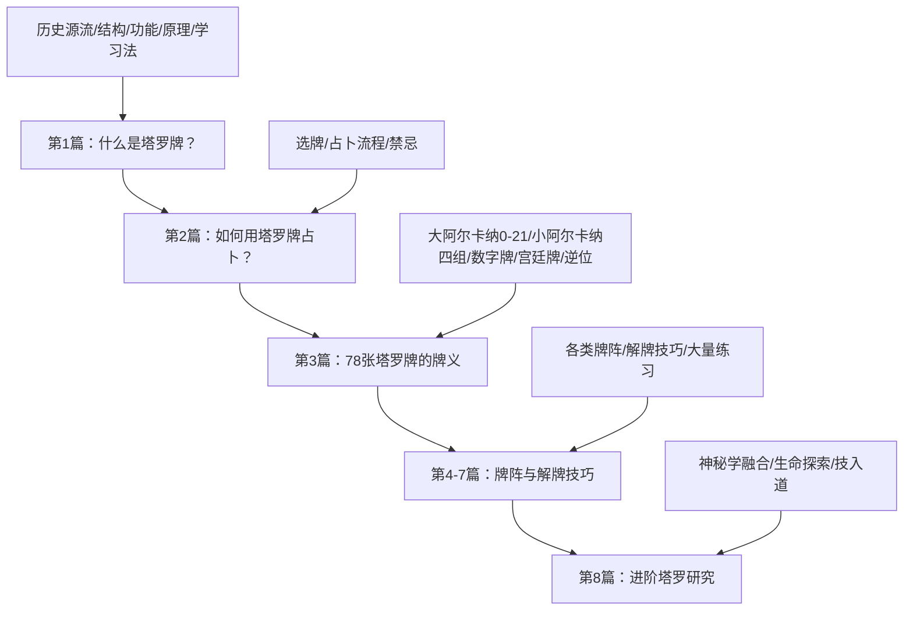
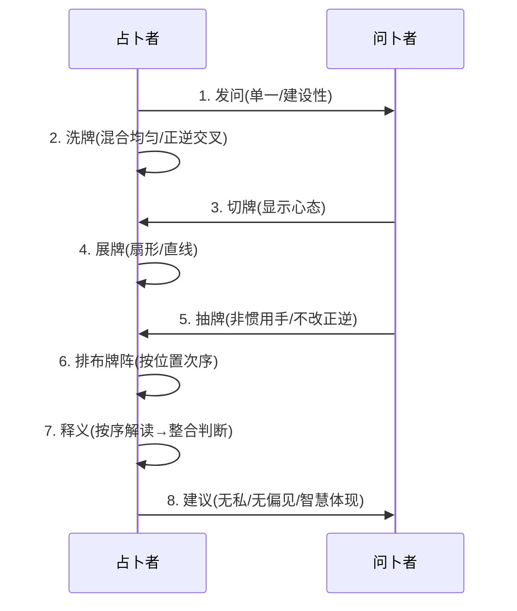
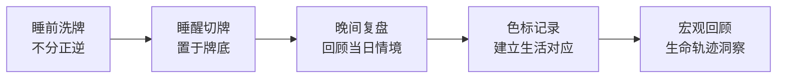
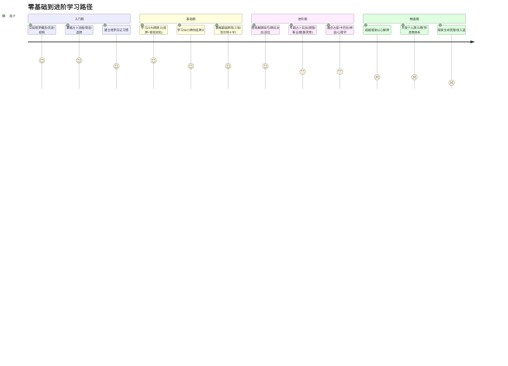

# 图解第一次塔罗占卜就上手：书籍体系总览

> **本书定位**：零基础入门至进阶的塔罗教学全书，以「图解+步骤+色标+故事」四维教学法，结合荣格心理学理论基础，构建从认知塔罗、掌握牌义、实操占卜到进阶研究的完整学习路径。

## 书籍元信息

| 项目 | 内容 |
|------|------|
| **书名** | 《图解第一次塔罗占卜就上手 修订版》 |
| **作者** | 清风（真理智慧探索者、心灵/哲学/神秘学老师、台大塔罗社创社老师、国际道家学术基金会理事暨讲师） |
| **出版** | 易博士出版 |
| **结构** | 八大篇章，循序渐进 |
| **教学特色** | 图解拆解、Step-by-step流程、Dr. Easy实务贴士、色标识别、标签索引、Info补充、Q&A答疑、Story案例 |

## 八大篇章学习地图



## 核心知识体系

### 塔罗牌历史源流与演进四阶段

| 阶段 | 时期 | 关键事件 |
|------|------|----------|
| **① 远古源流** | 众说纷纭 | 中国叶子戏说、埃及托特之书说、犹太卡巴拉说、印度阶级标志说等 |
| **② 中古流行** | 13-15世纪 | 欧洲出现图象占卜纸牌，15世纪中叶意大利北部修士使用现代形式78张牌 |
| **③ 近代深化** | 1888年 | **金色曙光协会**成立，深化塔罗内涵，创作韦特/托特/金色曙光三大经典牌组 |
| **④ 现代蓬勃** | 20世纪至今 | 资讯传播加速，上千种牌组涌现，塔罗全球化 |

> **跨页引用**：金色曙光协会对塔罗体系的重构详见 [[78度的智慧塔罗体系]]、[[塔罗起源与韦特塔罗版本谱系]]；韦特牌作为国际标准蓝本地位见 [[两小时学会塔罗]]、[[五分钟塔罗]]。

### 78张牌结构体系

#### 整体架构
```
78张塔罗牌
├── 22张 大阿尔卡纳 Major Arcana (0-21) → 精神/中心/象征 → 对应希伯来字母/生命之树22路径
└── 56张 小阿尔卡纳 Minor Arcana
    ├── 权杖组 Wands (火) - 行动/工作 - 10数字牌 + 4宫廷牌
    ├── 圣杯组 Cups (水) - 学习/情感 - 10数字牌 + 4宫廷牌
    ├── 宝剑组 Swords (风) - 思考/伤害 - 10数字牌 + 4宫廷牌
    └── 钱币组 Pentacles (土) - 物质/钱财 - 10数字牌 + 4宫廷牌
```

#### 牌组对应速查表
| 牌组 | 元素 | 核心特质 | 对应领域 | 神话原型 |
|------|------|----------|----------|----------|
| **权杖** | 火 | 积极/行动/热情/开朗 | 行动与职业 | 伊阿宋取金羊毛 |
| **圣杯** | 水 | 爱/感性/想像/灵感 | 感情与学习 | 厄洛斯与普赛克 |
| **宝剑** | 风 | 逻辑/理性/冷漠/痛楚 | 思考与伤害 | 俄瑞斯忒斯复仇 |
| **钱币** | 土 | 实际/保守/稳定/肉体 | 物质与财务 | 代达罗斯故事 |

> **跨页引用**：大阿尔卡纳三分结构与愚者之旅详见 [[大阿尔卡纳三分结构与愚者之旅]]、[[78度的智慧塔罗体系]]；小阿尔卡纳数字与宫廷牌核心义见 [[塔罗小阿尔卡那数字与宫廷牌核心义]]；权杖组深度解析见 [[塔罗权杖牌组分析]]。

### 占卜完整流程与禁忌体系

#### 标准占卜八步流程


#### 三阶段禁忌体系
| 阶段 | 核心禁忌 | 原理依据 |
|------|----------|----------|
| **占卜前** | 新牌拆封无需仪式、选天然材质包布、深色绒布占卜垫、避开子时/日落(敏感者)、身心状态不佳不占 | 保护牌具/环境共振/心理投射最小化 |
| **占卜时** | 专业领域回归专业(医/法/股)、相关性原则(仅占密切相关人事)、洗牌占卜者代劳但抽牌当事人亲抽 | 集体潜意识连结深度限制/能量交互完整性 |
| **占卜后** | 慎重收牌清点78张、触摸他人牌需征求同意、阴凉干燥收藏 | 牌具能量维护/边界伦理/物理保存 |

> **跨页引用**：占卜伦理与边界详见 [[塔罗牌阵基础与解牌流程]]、[[咨商塔罗框架]]；牌阵分类索引见 [[塔罗牌阵按牌数索引]]、[[经典塔罗牌阵详解]]。

### 塔罗日记实操法

#### 核心流程：Today's Card / A Card A Day


#### 色标记录系统
| 牌组 | 记录颜色 | 象征意义 |
|------|----------|----------|
| 大阿尔卡纳 | 紫色 | 精神/重大课题 |
| 权杖组 | 红色 | 行动/能量/火 |
| 圣杯组 | 蓝色 | 情感/水/流动 |
| 宝剑组 | 黄色 | 思考/风/清晰 |
| 钱币组 | 绿色 | 物质/土/实在 |

#### 实操贴士
- **不看即切**：早晨切牌后不立即看牌，避免「杞人忧天」与「自我实现预言」
- **晚间开牌**：复盘时再看切牌，寻找当日事件与牌义的共时性对应
- **故事验证**：如「死神」牌对应发现死老鼠，而非字面死亡

> **跨页引用**：塔罗日记详细实操见 [[塔罗日记每日抽牌]]、[[365天的塔罗魔法牌阵]]；每日抽牌哲学见 [[五分钟塔罗]]、[[你可以再塔罗一点]]。

### 三大学习法对比与本書雙軌策略

| 学习法 | 核心操作 | 优点 | 缺点 | 适用对象 |
|--------|----------|------|------|----------|
| **观牌学习法** | 深呼吸→柔和视线→宏观整体→微观细节(色/构图/表情/姿态)→想像处境→记录心得 | 拥有个人化牌义、联结深刻 | 效果因人而异、过度依赖直觉 | 直觉强/感性/一般人 |
| **客观学习法** | 研读理论(历史/神话/象征/神秘学)→掌握主流诠释→浓缩关键字→配合图象记忆→牌间对应推理 | 学术扎实、步骤明确、不易偏离 | 理解易受限、变通待加强 | 立志专家/逻辑强/一般人 |
| **日记学习法** | 每日一牌→晚间关联→色标记录→生活结合→生命轨迹探索 | 与生活结合、印象深刻、探索生命 | 进度难控、理解片面 | 有恒心/喜生活学习/有讨论环境 |

#### 本书采用策略：**观牌法 + 客观法 双轨并行**
- **前置观牌**：阅读本书牌义前先练习观牌，建立个人直觉连结
- **客观内化**：第三篇78张牌资料属客观学习法，精简高效引导
- **互补融合**：直觉提供活水，理论提供骨架，达成「以心解牌」境界

> **跨页引用**：学习法对比扩展见 [[两小时学会塔罗]]、[[无视论解牌法]]；专家级学习路径见 [[咨商塔罗框架]]、[[叙事塔罗]]。

### 荣格心理学运作原理：塔罗为何神准

#### 核心四重对应机制
```mermaid
graph TD
    A[塔罗占卜运作机制] --> B[集体潜意识]
    A --> C[原型]
    A --> D[共时性原理]
    A --> E[个人潜意识重叠]
    
    B --> B1[人类共通心理机能<br/>遗传承接太古潜意识<br/>解答讯息源头]
    C --> C1[理解典型方式/原始思考形式<br/>集体潜意识结构性元素<br/>显现为象徵(河流=感情/月亮=多变)]
    D --> D1[非因果关联巧合<br/>宇宙充满有意义巧合<br/>抽牌与占问事件关联机制]
    E --> E1[占卜师与问事者潜意识重叠<br/>相关性限制：仅占密切互动者<br/>代占需亲密+高频互动]
```

#### 关键理论支柱
| 荣格概念 | 塔罗对应 | 实操启示 |
|----------|----------|----------|
| **集体潜意识** | 牌面图象库/解答源头 | 忠实解读牌义即可，无需臆造「牌精」 |
| **原型** | 22大牌核心意象/小牌元素象徵 | 掌握原型即掌握牌义骨架 |
| **共时性原理** | 洗牌/切牌/抽牌的「有意义巧合」 | 信任过程，而非控制结果 |
| **个人潜意识重叠** | 占卜双方能量场共振 | 遵守相关性原则，不随意代占 |

> **跨页引用**：荣格塔罗理论深度解析见 [[塔罗荣格框架]]、[[内在疗愈塔罗]]；共时性与易经渊源见 [[塔罗占卜与自由意志]]、[[漫步灵魂森林]]。

## 进阶延伸：从技入道

### 第八篇进阶研究方向
- **神秘学融合**：占星术、卡巴拉、神话学、数字学、符号学
- **生命探索**：身心灵整合、潜意识挖掘、阴影工作、个体化历程
- **技入道境界**：超越牌阵与牌义框架，「以心解牌」，万变不离其宗

> **跨页引用**：进阶体系见 [[78度的智慧塔罗体系]]、[[河图塔罗体系]]、[[咨商塔罗框架]]；神秘学交叉见 [[占星魔法-丹尼尔斯]]、[[炼金术综合指南]]、[[卡巴拉数字密码]]。

## 经典牌组选购指南

| 牌组 | 核心特色 | 推荐指数 | 适合人群 |
|------|----------|----------|----------|
| **莱德·韦特** | 故事图象呈现小阿尔卡纳、简易兼具深度、全球销冠、新牌蓝本 | ⭐⭐⭐⭐⭐ | **初学者首选**、专业研究、教学标准 |
| **克劳利·托特** | 埃及神话/易经/卡巴拉/炼金/魔法融合、灵修首选、美系销冠 | ⭐⭐⭐⭐ | 灵修者、深度神秘学、进阶者 |
| **马赛** | 300年历史、朴素画风、小牌仅数字象徵、法普及度高 | ⭐⭐⭐ | 传统派、历史研究、欧洲本土实践 |
| **其他经典** | 1JJ/金色曙光/维斯康提古董牌 | ⭐⭐⭐ | 收藏家、特定传承研究 |

### 选牌四大法则
1. **专业选牌法**：以专业性为首要 → 专家/修行者/占卜师
2. **直觉选牌法**：以内心喜好为依据 → 直觉发展/心理投射
3. **娱乐选牌法**：以便宜轻松为主 → 业余玩家/收藏
4. **综合选牌法**：专业为主+直觉为辅 → **最推荐的两全其美策略**

> **跨页引用**：牌组谱系详见 [[塔罗起源与韦特塔罗版本谱系]]、[[动物塔罗]]；托特牌体系见 [[78度的智慧塔罗体系]]。

## 学习路径建议



## 交叉引用知识网络

### 本书核心概念对应页
| 概念 | 对应知识页 |
|------|------------|
| 荣格塔罗理论 | [[塔罗荣格框架]] |
| 塔罗日记实操 | [[塔罗日记每日抽牌]] |
| 78牌结构体系 | [[78度的智慧塔罗体系]]、[[塔罗小阿尔卡那数字与宫廷牌核心义]] |
| 大阿尔卡纳愚者之旅 | [[大阿尔卡纳三分结构与愚者之旅]] |
| 权杖组深度 | [[塔罗权杖牌组分析]] |
| 占卜流程伦理 | [[塔罗牌阵基础与解牌流程]]、[[咨商塔罗框架]] |
| 牌阵分类索引 | [[塔罗牌阵按牌数索引]]、[[经典塔罗牌阵详解]] |
| 韦特牌版本谱系 | [[塔罗起源与韦特塔罗版本谱系]] |
| 塔罗学习法对比 | [[两小时学会塔罗]]、[[无视论解牌法]] |
| 共时性与易经 | [[塔罗占卜与自由意志]]、[[漫步灵魂森林]] |

### 相关进阶体系
- **咨商导向**：[[咨商塔罗框架]]、[[叙事塔罗]]、[[内在疗愈塔罗]]
- **神秘学融合**：[[78度的智慧塔罗体系]]、[[河图塔罗体系]]、[[占星魔法-丹尼尔斯]]
- **每日修炼**：[[365天的塔罗魔法牌阵]]、[[五分钟塔罗]]、[[你可以再塔罗一点]]
- **牌义速查**：[[塔罗关键词对照表]]、[[塔罗大阿尔卡纳咨商0-6]]

---

> **编注**：本页面依据《图解第一次塔罗占卜就上手修订版》归档内容结构化整理，保留作者「清风」原教学体系框架，并建立与现有塔罗知识库的交叉引用网络。本书以「图解+步骤+色标+故事」四维教学法，结合荣格心理学理论基础，为零基础学习者提供从认知、实操到进阶的完整路径图。

## 来源

- [图解第一次塔罗占卜就上手修订版](../sources/图解第一次塔罗占卜就上手修订版.md)
