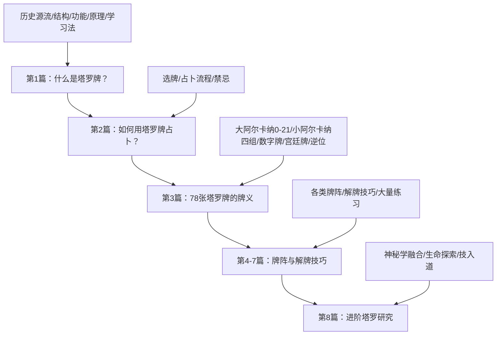
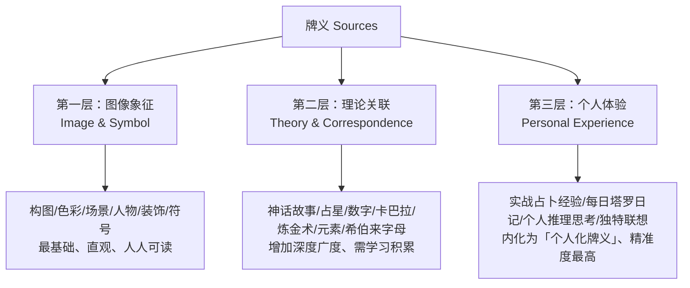
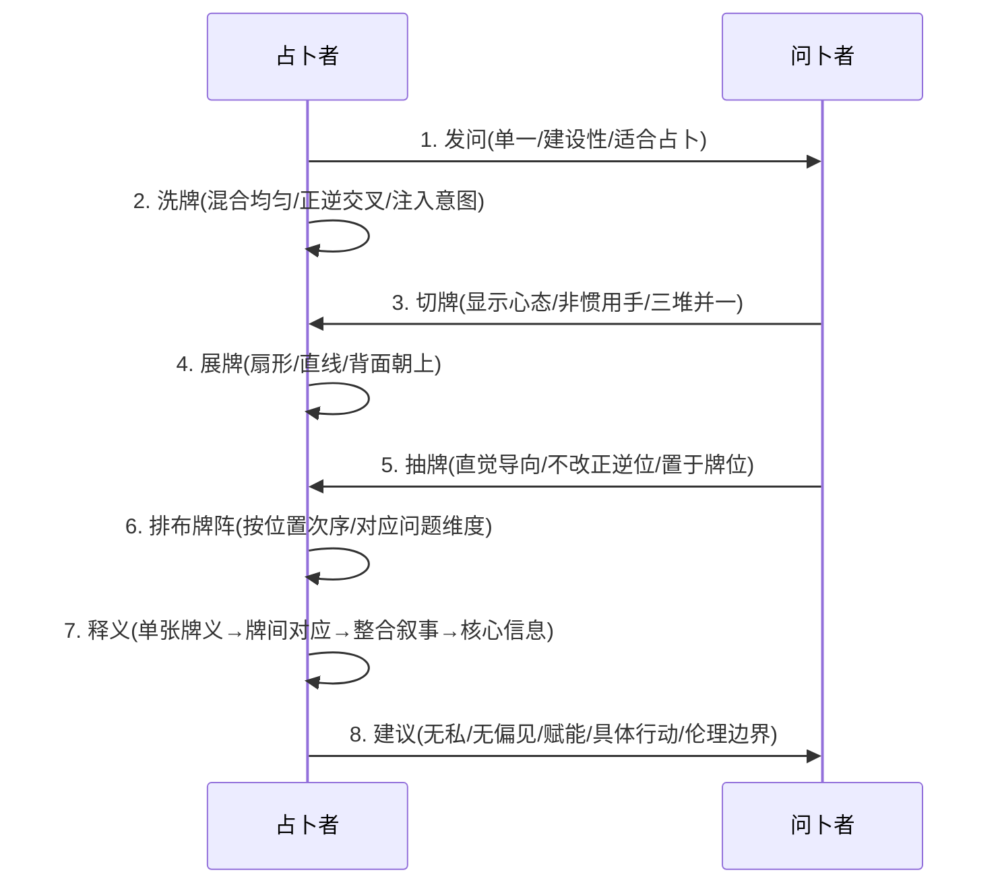
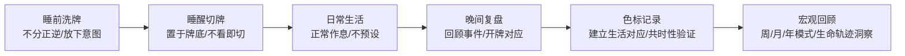
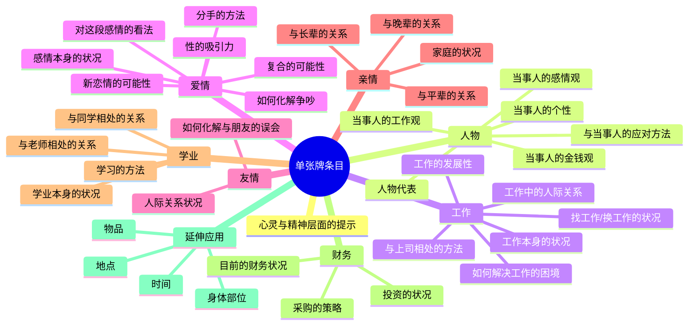
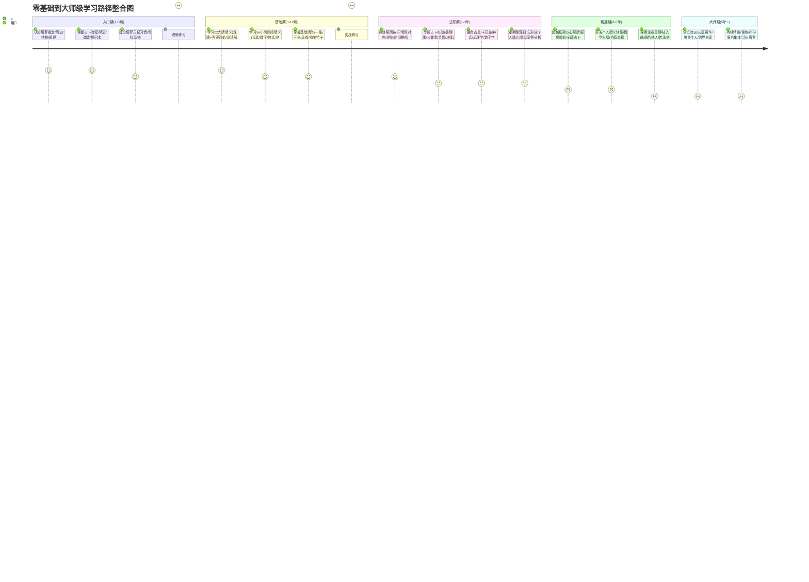

# 图解第一次塔罗占卜就上手：书籍体系总览与塔罗牌义学习理论框架

> **本页面整合定位**：融合《图解第一次塔罗占卜就上手》（清风著，易博士出版）的「图解+步骤+色标+故事」四维教学体系，与《塔罗之书解牌字典》（丹尼尔著）的牌义理论框架（占卜-牌阵-牌义关系、牌义三层级、四阶段学习法）及详细牌义分类体系，构建从认知塔罗、掌握牌义、实操占卜到进阶研究的完整知识库。

---

## 书籍元信息对照

| 项目 | 《图解第一次塔罗占卜就上手 修订版》 | 《塔罗之书解牌字典》 |
|------|--------------------------------------|----------------------|
| **作者** | 清风（真理智慧探索者、台大塔罗社创社老师、国际道家学术基金会理事暨讲师） | 丹尼尔（塔罗教师、占卜师、作者） |
| **出版** | 易博士出版 | 未注明（内部资料/出版书籍） |
| **核心定位** | 零基础入门至进阶教学全书，重流程、重图解、重实操 | 牌义查询工具书，重分类、重主题、重实战应用 |
| **教学特色** | 八大篇章循序渐进、Step-by-step流程、Dr. Easy贴士、色标识别、Q&A、Story案例 | 七十八张牌正逆位、六大主题分类（人物/工作/爱情/友情/亲情/学业/财务）、延伸应用（时间/地点/物品/身体） |
| **理论基础** | 荣格心理学（集体潜意识、原型、共时性）、韦特塔罗标准 | 黄金黎明体系（马瑟斯、伟特、雷加第）、个人占卜经验 |

---

## 八大篇章学习地图（清风体系）



---

## 核心知识体系：理论框架深度整合

### 占卜、牌阵、牌义的三元关系（丹尼尔体系）

> **核心公式**：问题 → 牌阵（框架） → 牌义（信息来源） → 解读 → 建议

| 环节 | 定义 | 关键原则 | 来源引用 |
|------|------|----------|----------|
| **占卜** | 塔罗牌的一种使用方法，起点是「有问题」 | 适用于**具体、单一、有界限**（时间/空间/对象）的问题 | 《塔罗之书解牌字典》§1 |
| **牌阵** | 呈现问题的方式、分析问题的框架 | 依问题性质选用适合牌阵，事半功倍；位置即问题维度 | 《塔罗之书解牌字典》§1 |
| **牌义** | 每张牌的特殊意义，占卜信息主要来源 | 78张牌为一**分类系统**，理论上涵盖所有概念/人物/事件；牌义即「类别」而非固定「关键词」 | 《塔罗之书解牌字典》§2 |

> **跨页引用**：牌阵分类与选择详见 [[塔罗牌阵基础与解牌流程]]、[[塔罗牌阵按牌数索引]]、[[经典塔罗牌阵详解]]、[[凯尔特十字牌阵大辞典]]。

### 牌义三层级来源模型（丹尼尔体系）



| 层级 | 内容范畴 | 习得方式 | 占卜应用价值 |
|------|----------|----------|--------------|
| **① 图像象征** | 牌面视觉元素：色彩、构图、人物姿态、道具、背景、符号 | 观牌练习、直觉联想 | 基础解读、快速启动、跨牌组通用 |
| **② 理论关联** | 黄金黎明对应体系：占星、卡巴拉生命之树、元素、数字、希伯来字母、神话原型 | 研读经典、神秘学课程、对照表记忆 | 深度解读、结构化分析、专业进阶 |
| **③ 个人体验** | 实战累积的案例库、日记复盘的共时性验证、个人化隐喻系统 | 坚持日记、复盘验证、反思整理 | 精准落地、风格形成、大师境界 |

> **实操启示**：初学者宜「观牌法」切入（建立①），配合「客观法」研读（构建②），坚持「日记法」积累（沉淀③），最终形成「以心解牌」的个人化牌义体系。

### 四阶段学习法：阅读 → 练习 → 记录 → 整理（丹尼尔体系）

| 阶段 | 核心动作 | 关键工具/方法 | 产出 | 对应清风体系 |
|------|----------|--------------|------|--------------|
| **1. 阅读** | 大量研读牌义书籍、理论经典、不同作者诠释 | 书籍、网络资源、对照表 | 理论基础、主流诠释框架 | 客观学习法（研读理论→掌握主流→浓缩关键字） |
| **2. 练习** | 实战占卜、模拟练习、不同牌阵操作 | 真实问卜、练习牌阵、同学互占 | 牌义在情境中的活化变化 | 观牌法实战、牌阵练习（第4-7篇） |
| **3. 记录** | 详细记录占卜过程、牌阵、牌义、验证结果 | **塔罗日记** 、色标系统、案例库 | 经验数据库、共时性证据 | 塔罗日记实操法、色标记录系统 |
| **4. 整理** | 反思思考、归纳总结、建立个人牌义体系 | 复盘分析、分类整理、撰写心得/教材 | **个人化牌义**、教学/咨商框架 | 进阶研究（第8篇）、技入道境界 |

> **循环升级**：整理后的个人牌义 → 指导下一轮阅读筛选 → 优化练习策略 → 深化记录维度 → 再次整理跃迁。

### 塔罗牌历史源流与演进四阶段（清风体系）

| 阶段 | 时期 | 关键事件 | 核心人物/组织 |
|------|------|----------|--------------|
| **① 远古源流** | 众说纷纭 | 中国叶子戏说、埃及托特之书说、犹太卡巴拉说、印度阶级标志说 | — |
| **② 中古流行** | 13-15世纪 | 欧洲出现图象占卜纸牌，15世纪中叶意大利北部出现现代形式78张牌 | 维斯康提家族、斯福尔扎家族 |
| **③ 近代深化** | 1888年 | **金色曙光协会**成立，深化塔罗内涵，创作韦特/托特/金色曙光三大经典牌组 | 马瑟斯、叶伟特、韦特、克劳利 |
| **④ 现代蓬勃** | 20世纪至今 | 资讯传播加速，上千种牌组涌现，塔罗全球化，心理塔罗兴起 | 荣格、波拉克、格林、现代创作者 |

> **跨页引用**：金色曙光协会重构详见 [[78度的智慧塔罗体系]]、[[塔罗起源与韦特塔罗版本谱系]]；韦特牌标准蓝本地位见 [[两小时学会塔罗]]、[[五分钟塔罗]]。

### 78张牌结构体系（双体系对照）

#### 整体架构
```
78张塔罗牌
├── 22张 大阿尔卡纳 Major Arcana (0-21) 
│   ├── 精神/中心/象征层面
│   ├── 对应希伯来字母22字/生命之树22路径
│   └── 愚者之旅：三组七张 + 愚者（详见 [[大阿尔卡纳三分结构与愚者之旅]]）
└── 56张 小阿尔卡纳 Minor Arcana
    ├── 权杖组 Wands (火) - 行动/职业/能量 - Ace-10 + 4宫廷牌
    ├── 圣杯组 Cups (水) - 情感/关系/直觉 - Ace-10 + 4宫廷牌
    ├── 宝剑组 Swords (风) - 思维/冲突/真相 - Ace-10 + 4宫廷牌
    └── 钱币组 Pentacles (土) - 物质/财务/身体 - Ace-10 + 4宫廷牌
```

#### 牌组元素与神话原型对应表
| 牌组 | 元素 | 核心特质 | 对应领域 | 神话原型（清风体系） | 核心心理功能（荣格/丹尼尔体系） |
|------|------|----------|----------|----------------------|--------------------------------|
| **权杖** | 火 | 积极/行动/热情/创造/意志 | 行动、职业、事业、灵感 | 伊阿宋取金羊毛 | 意志力、主动性、自我实现驱力 |
| **圣杯** | 水 | 爱/感性/想像/直觉/情感流动 | 感情、关系、潜意识、梦境 | 厄洛斯与普赛克 | 情感功能、关系连结、原型投射 |
| **宝剑** | 风 | 逻辑/理性/真相/冲突/切割 | 思维、决策、沟通、危机 | 俄瑞斯忒斯复仇 | 思维功能、分辨力、阴影投射 |
| **钱币** | 土 | 实际/稳定/物质/身体/显化 | 财务、健康、事业成果、环境 | 代达罗斯故事 | 感觉功能、具象化能力、生存本能 |

> **跨页引用**：小阿尔卡纳数字与宫廷牌核心义见 [[塔罗小阿尔卡那数字与宫廷牌核心义]]；权杖组深度见 [[塔罗权杖牌组分析]]；四元素心理对应见 [[塔罗荣格框架]]、[[占星学方法论与太阳星座批判]]。

### 占卜完整流程与三阶段禁忌体系（清风体系深化）

#### 标准占卜八步流程


#### 三阶段禁忌体系（伦理与防护）
| 阶段 | 核心禁忌 | 原理依据 | 丹尼尔体系补充 |
|------|----------|----------|----------------|
| **占卜前** | 新牌拆封无需仪式、天然材质包布、深色绒布垫、避开子时/日落(敏感者)、身心不佳不占、医/法/股回归专业 | 保护牌具能量/环境共振/心理投射最小化/专业边界 | 问题适用性判断：具体/单一/有界限 |
| **占卜时** | 洗牌占卜者代劳但抽牌当事人亲抽、相关性原则(仅占密切相关人事)、代占需亲密高频互动、不重复同一问题 | 集体潜意识连结深度/能量交互完整性/共时性有效性 | 牌阵匹配问题性质；牌义作为分类系统而非死记关键词 |
| **占卜后** | 慎重收牌清点78张、触摸他人牌需征求同意、阴凉干燥收藏、记录日记复盘、不执着预测结果 | 牌具能量维护/边界伦理/物理保存/经验内化 | 坚持「记录→整理」闭环，沉淀个人体验牌义 |

> **跨页引用**：占卜伦理详见 [[咨商塔罗框架]]、[[塔罗占卜与自由意志]]；牌阵选择见 [[塔罗牌阵按牌数索引]]。

### 塔罗日记实操法：Today's Card / A Card A Day（清风体系）

#### 核心流程


#### 色标记录系统（四元素配色）
| 牌组 | 记录颜色 | 象征意义 | 对应脉轮/心理功能 |
|------|----------|----------|-------------------|
| 大阿尔卡纳 | 紫色 | 精神/重大课题/原型启动 | 顶轮/超意识/个体化进程 |
| 权杖组 | 红色 | 行动/能量/火/意志启动 | 海底轮/意志功能/阳性能量 |
| 圣杯组 | 蓝色 | 情感/水/流动/关系连结 | 心轮/情感功能/阴性能量 |
| 宝剑组 | 黄色 | 思考/风/清晰/真相切割 | 喉轮/思维功能/沟通表达 |
| 钱币组 | 绿色 | 物质/土/实在/显化结果 | 脐轮/感觉功能/具象现实 |

#### 实操贴士（避坑指南）
- **不看即切**：早晨切牌后不立即看牌，避免「杞人忧天」与「自我实现预言」
- **晚间开牌**：复盘时再看切牌，寻找当日事件与牌义的共时性对应
- **故事验证**：如「死神」牌对应发现死老鼠/结束一份工作，而非字面死亡
- **色标统计**：月度统计各色出现频率，洞察生命能量分布（如红多=行动月、蓝多=情感月）

> **跨页引用**：日记详细实操见 [[塔罗日记每日抽牌]]、[[365天的塔罗魔法牌阵]]；每日抽牌哲学见 [[五分钟塔罗]]、[[你可以再塔罗一点]]。

### 三大学习法对比与双轨并行策略（清风+丹尼尔融合）

| 学习法 | 核心操作 | 优点 | 缺点 | 适用对象 | 丹尼尔四阶段映射 |
|--------|----------|------|------|----------|------------------|
| **观牌学习法** | 深呼吸→柔和视线→宏观整体→微观细节(色/构图/表情/姿态)→想像处境→记录心得 | 拥有个人化牌义、联结深刻、直觉强化 | 效果因人而异、过度依赖直觉、缺乏理论骨架 | 直觉强/感性/艺术类/初学者 | 阶段1(阅读图像) + 阶段3(记录心得) |
| **客观学习法** | 研读理论(历史/神话/象征/神秘学)→掌握主流诠释→浓缩关键字→配合图象记忆→牌间对应推理 | 学术扎实、步骤明确、不易偏离、可传承 | 理解易受限、变通待加强、易陷「书本牌义」 | 立志专家/逻辑强/学术型/教学者 | 阶段1(阅读理论) + 阶段4(整理体系) |
| **日记学习法** | 每日一牌→晚间关联→色标记录→生活结合→生命轨迹探索 | 与生活结合、印象深刻、探索生命、验证共时性 | 进度难控、理解片面、需长期坚持 | 有恒心/喜生活学习/有讨论环境/咨商导向 | 阶段2(练习实战) + 阶段3(记录) + 阶段4(整理) |

#### 本站推荐策略：**观牌法 + 客观法 双轨并行 + 日记法贯穿始终**
- **前置观牌**：阅读牌义前先练习观牌（5-10分钟/张），建立个人直觉连结（对应阶段1图像层）
- **客观内化**：系统研读《塔罗之书解牌字典》等工具书，精简高效掌握主流诠释框架（对应阶段1理论层）
- **日记验证**：每日一牌坚持记录，晚间复盘验证共时性，积累个人案例库（对应阶段2/3）
- **定期整理**：每月/每季复盘日记，归纳个人牌义、修正偏差、形成教学/咨商框架（对应阶段4）
- **互补融合**：直觉提供活水（③体验），理论提供骨架（②理论），图像提供锚点（①图像），达成「以心解牌」境界

> **跨页引用**：学习法对比扩展见 [[两小时学会塔罗]]、[[无视论解牌法]]；专家级学习路径见 [[咨商塔罗框架]]、[[叙事塔罗]]、[[内在疗愈塔罗]]。

### 荣格心理学运作原理：塔罗为何神准（理论地基）

#### 核心四重对应机制
```mermaid
graph TD
    A[塔罗占卜运作机制] --> B[集体潜意识<br/>Collective Unconscious]
    A --> C[原型<br/>Archetypes]
    A --> D[共时性原理<br/>Synchronicity]
    A --> E[个人潜意识重叠<br/>Personal Unconscious Overlap]
    
    B --> B1[人类共通心理机能<br/>遗传承接太古潜意识<br/>解答讯息源头/牌面图象库]
    C --> C1[理解典型方式/原始思考形式<br/>集体潜意识结构性元素<br/>显现为象徵(河流=感情/月亮=多变/塔=崩塌)]
    D --> D1[非因果关联的有意义巧合<br/>宇宙充满acausal连接原理<br/>洗牌/切牌/抽牌与占问事件的关联机制]
    E --> E1[占卜师与问事者潜意识共振场<br/>相关性限制：仅占密切互动者<br/>代占需亲密+高频互动/能量场共振]
```

#### 关键理论支柱对照表
| 荣格概念 | 塔罗对应 | 实操启示 | 丹尼尔牌义层级映射 |
|----------|----------|----------|-------------------|
| **集体潜意识** | 牌面图象库/解答源头/人类共同记忆 | 忠实解读牌义即可，无需臆造「牌精」/外部灵体 | ①图像象征层：直连集体潜意识的视觉语言 |
| **原型** | 22大牌核心意象/小牌元素象徵/宫廷牌人格面具 | 掌握原型即掌握牌义骨架，大牌=核心原型，小牌=原型分化 | ②理论关联层：神话/占星/卡巴拉是原型的学术表达 |
| **共时性原理** | 洗牌/切牌/抽牌的「有意义巧合」 | 信任过程，而非控制结果；问题越清晰，共时性越强 | 占卜时刻：③个人体验层的实时激活 |
| **个人潜意识重叠** | 占卜双方能量场共振/投射认同 | 遵守相关性原则，不随意代占；咨商塔罗强「金三角对话」 | 咨商框架：[[咨商塔罗框架]]的金三角模型即此应用 |

> **跨页引用**：荣格塔罗理论深度见 [[塔罗荣格框架]]、[[内在疗愈塔罗]]、[[漫步灵魂森林]]；共时性与易经渊源见 [[塔罗占卜与自由意志]]。

---

## 《塔罗之书解牌字典》牌义分类体系详解

> **本书特色**：以**主题分类**为检索轴，而非单纯按牌序。每张牌（正/逆位）包含统一的七大主题模块，便于实战快速查阅。

### 统一牌义条目结构（每张牌正/逆位均含）



### 已收录牌义范围（源文档覆盖）
| 牌名 | 正位 | 逆位 | 备注 |
|------|------|------|------|
| **0 愚者** | ✅ | ✅ | 完整七主题+延伸 |
| **I 魔术师** | ✅ | ✅ | 完整七主题+延伸 |
| **II 女教主** | ✅ | ✅ | 完整七主题+延伸 |
| **III 皇后** | ✅ | ✅ | 完整七主题+延伸 |
| **IV 皇帝** | ✅ | ✅ | 完整七主题+延伸 |
| **V 教皇** | ✅ | ✅ | 完整七主题+延伸 |
| **VI 情侣** | ✅ | ✅ | 完整七主题+延伸 |
| **VII 战车** | ✅ | ✅ | 正位完整，逆位仅心灵提示+人物+工作(部分) |

> **说明**：源文档为节选，完整78张牌正逆位详见实体书《塔罗之书解牌字典》。本知识库后续将按此结构逐步补全各牌条目，建立可检索的[[塔罗关键词对照表]]与[[塔罗大阿尔卡纳咨商0-6]]。

---

## 进阶延伸：从技入道（清风第八篇 + 丹尼尔整理阶段）

### 第八篇进阶研究方向（清风）
- **神秘学融合**：占星术[[占星魔法-丹尼尔斯]]、卡巴拉[[卡巴拉数字密码]]、神话学、数字学、符号学、炼金术[[炼金术综合指南]]
- **生命探索**：身心灵整合、潜意识挖掘[[零极限与荷欧波诺波诺体系]]、阴影工作[[荣格心理学]]、个体化历程[[荣格心理学]]
- **技入道境界**：超越牌阵与牌义框架，「以心解牌」，万变不离其宗

### 丹尼尔「整理」阶段进阶产出
1. **个人化牌义手册**：整理形成自己的《解牌字典》
2. **咨商/教学框架**：如《咨商塔罗》金三角模型、牌阵教学体系
3. **跨学科融合**：塔罗×心理学、塔罗×占星、塔罗×神话、塔罗×商业决策
4. **传承创新**：开发新牌组、新牌阵、新教学法、新应用场景

> **跨页引用**：进阶体系见 [[78度的智慧塔罗体系]]、[[河图塔罗体系]]、[[咨商塔罗框架]]、[[叙事塔罗]]；神秘学交叉见 [[占星魔法-丹尼尔斯]]、[[炼金术综合指南]]、[[卡巴拉数字密码]]。

---

## 经典牌组选购指南（清风体系 + 实战建议）

| 牌组 | 核心特色 | 推荐指数 | 适合人群 | 丹尼尔体系适配性 |
|------|----------|----------|----------|------------------|
| **莱德·韦特** | 故事图象呈现小阿尔卡纳、简易兼具深度、全球销冠、新牌蓝本 | ⭐⭐⭐⭐⭐ | **初学者首选**、专业研究、教学标准、咨商实战 | **100%兼容**，《解牌字典》即以此为蓝本 |
| **克劳利·托特** | 埃及神话/易经/卡巴拉/炼金/魔法融合、灵修首选、美系销冠 | ⭐⭐⭐⭐ | 灵修者、深度神秘学、进阶者、魔法实践 | 高兼容（黄金黎明同源），部分需转译 |
| **马赛** | 300年历史、朴素画风、小牌仅数字象徵、法普及度高 | ⭐⭐⭐ | 传统派、历史研究、欧洲本土实践、数字塔罗 | 中兼容，需补足小牌图像象征 |
| **其他经典** | 1JJ/金色曙光/维斯康提古董牌/现代艺术牌 | ⭐⭐⭐ | 收藏家、特定传承研究、直觉导向 | 视具体牌组而定 |

### 选牌四大法则（进阶版）
1. **专业选牌法**：以专业性、通用性、教学资源丰富度为首要 → 职业占卜师/教师/研究者
2. **直觉选牌法**：以内心喜好、画风共鸣、拿在手上的感觉为依据 → 直觉发展/个人修行/艺术创作
3. **娱乐选牌法**：以便宜、轻松、好看为主 → 业余玩家/社交游戏/收藏
4. **综合选牌法**：**专业为主（韦特系）+ 直觉为辅（第二副托特/奥拉克尔/神谕牌）** → **最推荐的两全其美策略**

> **跨页引用**：牌组谱系详见 [[塔罗起源与韦特塔罗版本谱系]]、[[动物塔罗]]；托特牌体系见 [[78度的智慧塔罗体系]]。

---

## 完整学习路径建议（整合双体系）



---

## 交叉引用知识网络总表

### 核心概念对应页
| 概念/模块 | 本站核心知识页 | 备注 |
|-----------|----------------|------|
| **荣格塔罗理论** | [[塔罗荣格框架]] | 共时性/原型/集体潜意识深度解析 |
| **塔罗日记实操** | [[塔罗日记每日抽牌]] | 色标/复盘/共时性验证完整流程 |
| **78牌结构体系** | [[78度的智慧塔罗体系]]、[[塔罗小阿尔卡那数字与宫廷牌核心义]] | 大小牌/元素/数字/宫廷/愚者之旅 |
| **大阿尔卡纳三分结构** | [[大阿尔卡纳三分结构与愚者之旅]] | 意识/潜意识/超意识三层映射 |
| **权杖组深度** | [[塔罗权杖牌组分析]] | 火元素/行动/职业/14张牌全解 |
| **占卜流程伦理** | [[塔罗牌阵基础与解牌流程]]、[[咨商塔罗框架]] | 八步流程/禁忌/金三角对话/中性解读 |
| **牌阵分类索引** | [[塔罗牌阵按牌数索引]]、[[经典塔罗牌阵详解]]、[[凯尔特十字牌阵大辞典]] | 1-N张牌阵/高复杂度/辞典级参考 |
| **韦特牌版本谱系** | [[塔罗起源与韦特塔罗版本谱系]] | 维斯康提→马赛→黄金黎明→韦特史密斯 |
| **塔罗学习法对比** | [[两小时学会塔罗]]、[[无视论解牌法]]、[[五分钟塔罗]] | 快速入门/跨牌阵解读/画面结构法 |
| **共时性与自由意志** | [[塔罗占卜与自由意志]]、[[漫步灵魂森林]] | 偶然性占卜/提问而非预测/托特神话 |
| **牌义速查工具** | [[塔罗关键词对照表]]、[[塔罗大阿尔卡纳咨商0-6]] | 主题分类/正逆位/咨商引导实录 |
| **咨商导向进阶** | [[咨商塔罗框架]]、[[叙事塔罗]]、[[内在疗愈塔罗]] | 中性解读/金三角/生命叙事/脉轮疗愈 |
| **每日修炼体系** | [[365天的塔罗魔法牌阵]]、[[五分钟塔罗]]、[[你可以再塔罗一点]] | 一日一牌/提问澄清/逆位健康财务/事业经营 |

### 丹尼尔《解牌字典》专用交叉引用（规划中）
| 计划建立页面 | 内容范围 | 关联现有页 |
|----------------|----------|------------|
| `tarot-daniel-dictionary-major` | 22大牌正逆位完整七主题条目 | 链接各大牌单页、[[塔罗大阿尔卡纳咨商0-6]] |
| `tarot-daniel-dictionary-minor-wands` | 权杖组Ace-10+宫廷牌正逆位 | 链接[[塔罗权杖牌组分析]]、[[塔罗小阿尔卡那数字与宫廷牌核心义]] |
| `tarot-daniel-dictionary-minor-cups` | 圣杯组完整条目 | 同上 |
| `tarot-daniel-dictionary-minor-swords` | 宝剑组完整条目 | 同上 |
| `tarot-daniel-dictionary-minor-pentacles` | 钱币组完整条目 | 同上 |
| `tarot-daniel-extended-applications` | 时间/地点/物品/身体部位对照表 | 链接[[塔罗关键词对照表]]、[[占星医疗与行星药草配伍]] |

---

## 来源与版权声明

> **编注**：本页面整合两大核心来源：
> 1. **《图解第一次塔罗占卜就上手 修订版》**（清风著，易博士出版）—— 提供教学体系框架、历史源流、占卜流程、日记法、学习法对比、荣格理论应用、进阶路径、选牌指南。
> 2. **《塔罗之书解牌字典》**（丹尼尔著）—— 提供核心理论框架（占卜-牌阵-牌义关系、牌义三层级、四阶段学习法）、统一牌义分类结构、8张大牌（愚者至战车）正逆位完整七主题详解范例、延伸应用对照表。
>
> 两书理论高度互补：清风重「教学流程与实操入门」，丹尼尔重「牌义理论深度与实战分类」。本页面旨在构建**理论-实操-进阶**一体化的塔罗知识枢纽，供零基础至专业级学习者按需检索、跨页跳转、体系化学习。所有引用均标注来源书籍章节，尊重作者知识产权，仅供个人学习研究使用。

---

> **更新日志**：
> - 2026-11-17：整合《塔罗之书解牌字典》核心理论框架（三元关系、三层级、四阶段、七主题结构）及8张牌范例，重构「核心知识体系」章节，建立双书交叉引用网络，规划字典条目补全路线图。
> - 2024-12-19：创建基于《图解第一次塔罗占卜就上手》的初版知识页面。
- [塔罗之书解牌字典](../sources/塔罗之书解牌字典.md)
