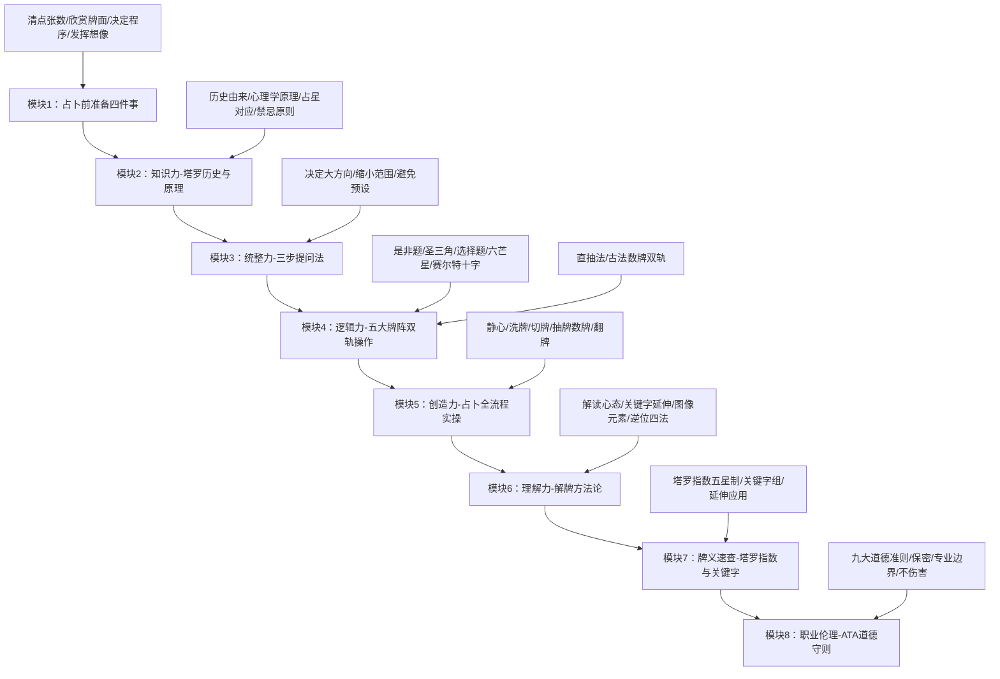
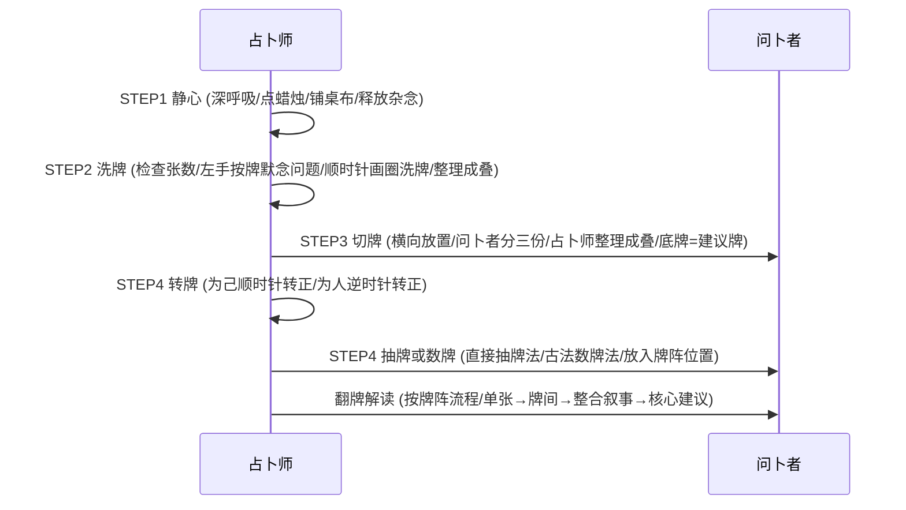
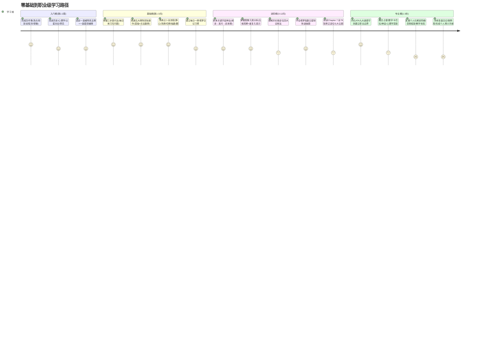

# 图解第一次塔罗占卜就上手：塔罗事典完整入门框架

> **本页面整合定位**：融合孟小靖《塔罗事典》（尖端出版）的「三大体系对比、三步提问法、五大牌阵双轨操作、占卜全流程、关键字延伸、图像元素分析、逆位四大诠释、ATA职业道德」八大核心模块，构建从认知塔罗、选牌准备、提问技巧、牌阵实操、解牌方法到职业伦理的完整零基础入门知识库。

---

## 书籍元信息

| 项目 | 内容 |
|------|------|
| **书名** | 《塔罗事典》 |
| **作者** | 孟小靖（真理智慧探索者、台大塔罗社创社老师、国际道家学术基金会理事暨讲师） |
| **出版** | 尖端出版 |
| **核心定位** | 塔罗牌使用说明书，让塔罗进入生活，人人轻松上手 |
| **作者资历** | 收藏九百副以上世界各国塔罗牌，解读超过上万问题经验 |
| **推荐序** | 子玄（中山身心灵课程规划师）、天空为限（星座塔罗畅销作家）、丹尼尔（塔罗教父）、安格斯（星星教授） |

---

## 八大核心模块学习地图



---

## 模块 1：占卜前一定要做的四件事

### 清点张数——验证塔罗架构

> **核心原则**：唯有符合 78 张标准架构的牌，才是真正的塔罗牌。

| 架构层级 | 张数 | 核心特征 | 验证要点 |
|----------|------|----------|----------|
| **大阿尔卡纳** | 22 张 | 希腊数字编号（0-21），人物角色身分鲜明 | 确认 22 张角色各异、编号完整 |
| **小阿尔卡纳** | 56 张 | 四组元素 × 14 张（数字 1-10 + 宫廷牌 4 张） | 确认四元素完整、各组 14 张 |

#### 张塔罗牌架构总览

**大阿尔卡纳（22 张，俗称大牌）**
- 精神性、抽象性、枢纽地位
- 可单独使用进行占卜
- 对应希伯来字母 22 字、生命之树 22 路径

**小阿尔卡纳（56 张，俗称小牌）**
| 元素 | 牌组 | 核心领域 | 象征意象 | 数字牌 | 宫廷牌 |
|------|------|----------|----------|--------|--------|
| **火** | 权杖 | 行动、职业、能量、意志 | 果实、火炬、棍棒、花树 | Ace-10 | 国王、王后、骑士、随从 |
| **水** | 圣杯 | 感情、关系、直觉、潜意识 | 爱心、瓶、壶、水盆、鱼 | Ace-10 | 国王、王后、骑士、随从 |
| **风** | 宝剑 | 思维、沟通、冲突、真相 | 叶子、矛、刀、鸟、蝴蝶 | Ace-10 | 国王、王后、骑士、随从 |
| **土** | 钱币 | 财务、健康、物质、显化 | 铃铛、五芒星、盘、石头 | Ace-10 | 国王、王后、骑士、随从 |

> **历史注记**：小阿尔卡纳四元素 × 14 张 = 56 张，后演变为扑克牌（骑士+随从合并为 J，共 52 张）。

### 欣赏牌面构图——建立直觉连结

- 每副塔罗都是艺术品，值得花时间欣赏
- 观察：人物表情、背景互动、特别吸引你的细节
- **同一张牌，不同人体悟的含意可能不同**——这是塔罗的开放性特质

### 决定占卜程序——一致性原则

> **金律**：无论用哪种程序，**自己要选定一种方式，千万不要看一种换一种**，否则只会扰乱自己。

- 洗牌/切牌/抽牌/数牌/翻牌顺序自定
- 由谁操作（占卜师/问卜者）皆可，关键在**一致性**

### 发挥无限想像力——先想后查

> **实操铁律**：抽出牌时，**先发挥想像力，再翻书查答案**。

思考路径：
1. 为什么会抽到这张牌？
2. 牌中人物有什么情绪？
3. 画面在发生什么故事？
4. 对应我的问题，是什么讯息？

> **作者语录**：「自己想过一遍之后再翻书，印象也会比较深刻。」

---

## 模块 2：知识力——搞懂塔罗牌是什麽

### 塔罗牌历史由来四大源流说

| 源流说 | 核心主张 | 关键证据/传说 |
|--------|----------|---------------|
| **古埃及说** | 来自《托特之书》，托特神掌管智慧与知识 | 「王道」象征、埃及壁画意象 |
| **卡巴拉说** | 希伯来 22 字母对应 22 大牌，对应生命之树 22 路径 | 犹太神秘主义核心架构 |
| **义大利说** | 源自塔罗河流域村落，14 世纪出现「Tarocci」圖卡紙牌 | 文艺复兴期米兰/费拉拉宫廷牌 |
| **中国/印度说** | 中国唐朝「叶子戏」→明朝四十张四门花色；印度卡利女神四手持权杖/杯/剑/环 | 跨文化平行演化 |

> **近代关键节点**：1888 年 **黄金黎明协会** 成立，推出三副经典牌组——黄金黎明塔罗、莱德威特塔罗、克劳利托特塔罗，将塔罗推向高峰。

### 心理学双核心原理

#### 冰山理论（佛洛依德）
```
意识 (Id)          ← 海面上可见冰山，自我存在处，可察觉
    ↓
前意识 (Ego)       ← 涨退潮间冰山，经验与记忆，不时时察觉
    ↓
潜意识 (Super-ego) ← 海底深处最大比例，本我/超我，内心深处想法天赋
```
**塔罗应用**：塔罗牌能将潜意识深处的想法、情绪（如不想赴约的抗拒）透过牌面投射出来。

#### 共时性原理（荣格）
- **定义**：「有意义的巧合」，非因果却有意义的联系
- **机制**：塔罗图像 = 集体潜意识中的**原型**
- **过程**：抽牌时受体验刺激 → 创造意象 → 释放潜意识声音 → 影响未来发展

> **跨页引用**：荣格塔罗理论深度见 [[塔罗荣格框架]]、[[内在疗愈塔罗]]、[[漫步灵魂森林]]。

### 占星学与塔罗对应系统

#### 星座对应大阿尔卡纳（12 对应）
| 星座 | 日期 | 对应大牌 | 核心关键字 |
|------|------|----------|------------|
| 牡羊座 | 3/21-4/19 | IV 皇帝 | 权威、主导、行动力 |
| 金牛座 | 4/20-5/20 | V 教皇 | 传统、教导、价值观 |
| 双子座 | 5/21-6/20 | VI 恋人 | 选择、沟通、二元性 |
| 巨蟹座 | 6/21-7/22 | VII 战车 | 保护、前进、情感驾驭 |
| 狮子座 | 7/23-8/22 | VIII 力量 | 内在力量、勇气、温柔驾驭 |
| 处女座 | 8/23-9/22 | IX 隐者 | 智慧、独处、内省指引 |
| 天秤座 | 9/23-10/22 | XI 正义 | 平衡、公正、因果法则 |
| 天蝎座 | 10/23-11/21 | XIII 死神 | 转化、结束重生、深度 |
| 射手座 | 11/22-12/21 | XIV 节制 | 融合、调和、耐心 |
| 魔羯座 | 12/22-1/19 | XV 恶魔 | 束缚、物质欲、阴影面 |
| 水瓶座 | 1/20-2/18 | XVII 星星 | 希望、灵感、未来愿景 |
| 双鱼座 | 2/19-3/20 | XVIII 月亮 | 直觉、幻象、潜意识 |

#### 行星对应大阿尔卡纳（10 对应）
| 行星 | 符号 | 对应大牌 | 核心意涵 |
|------|------|----------|----------|
| 太阳 | ☉ | XIX 太阳 | 生命力、成功、显化 |
| 水星 | ☿ | I 魔术师 | 沟通、技巧、显化起点 |
| 金星 | ♀ | III 女帝 | 爱、丰饶、创造力 |
| 月亮 | ☽ | II 女教皇 | 直觉、神秘、潜意识 |
| 火星 | ♂ | XVI 高塔 | 冲突、突变、破坏重建 |
| 木星 | ♃ | X 命运之轮 | 扩张、幸运、周期转动 |
| 土星 | ♄ | XXI 世界 | 完成、结构、考验成果 |
| 天王星 | ♅ | 0 愚者 | 突变、自由、新开始 |
| 海王星 | ♆ | XII 吊人 | 牺牲、灵性、换位思考 |
| 冥王星 | ♇ | XX 审判 | 重生、觉醒、最终审判 |

#### 四大元素对应大阿尔卡纳（黄金黎明体系）
| 元素 | 对应大牌 | 核心特质 |
|------|----------|----------|
| **风** | 0愚者、I魔术师、VI恋人、XI正义、XVII星星 | 智性、沟通、抉择、真理、希望 |
| **水** | II女教皇、VII战车、XII吊人、XIII死神、XVIII月亮 | 情感、直觉、顺流、转化、潜意识 |
| **火** | IV皇帝、VIII力量、X命运之轮、XIV节制、XVI高塔、XIX太阳、XX审判 | 行动、意志、周期、调和、突变、生命力、觉醒 |
| **土** | III女帝、V教皇、IX隐者、XV恶魔、XXI世界 | 物质、显化、智慧、束缚、完成 |

> **注**：愚者为风、吊人为水、审判为火，土元素设定为整体架构中心。

### 塔罗牌禁忌与原则（重新定义为「原则」）

| 原则 | 核心内容 | 实操指引 |
|------|----------|----------|
| **不人格化/神格化** | 无牌灵小鬼，是自我解析工具 | 抱持感谢尊重心，不迷信 |
| **收藏方式** | 避免潮湿，木盒/布袋/桌布皆可 | 可让别人碰，默契不因外人触碰而消失 |
| **一事不二问** | 同人同事三个月内不重复占卜 | 除非有不同做法规划，另当别论 |
| **晚间 11 点后不占** | 生理注意力下降 + 西方魔空时刻/中国子时磁场转换 | 建议白天/傍晚占卜 |
| **不断言、不恐吓** | 只给建议不决定，负面牌也正面引导 | 「塔罗是为大家带来幸福的」 |

> **时间跨度**：塔罗占卜有效期约 **三个月**（信念发酵稳定期）。

### 三大塔罗体系对比速查表

| 特征 | **莱德威特系**<br>(Rider-Waite) | **马赛系**<br>(Marseille) | **克劳利托特系**<br>(Thoth) |
|------|-------------------------------|--------------------------|----------------------------|
| **数字小牌** | 有明显元素符号与图案，人物背景鲜明 | 无图案，同扑克牌呈现，配合生命灵数 | 强调几何图形排列、重色彩，无人物 |
| **力量编号** | 8 | 11 | 11 |
| **正义编号** | 11 | 8 | 8 |
| **核心风格** | 图像直观、教学标准、全球销冠 | 古典传统、数字象征、欧陆流行 | 神秘学集大成、灵修进阶、色彩心理学 |
| **推荐人群** | **初学者首选**、专业咨商、教学 | 传统派、数字塔罗、历史研究 | 灵修者、深度神秘学、魔法实践 |

> **现代趋势**：融合系牌组（如圣甲虫塔罗）结合三系细节，**以威特为主轴融合三系**。
> **跨页引用**：牌组谱系详见 [[塔罗起源与韦特塔罗版本谱系]]、[[78度的智慧塔罗体系]]、[[动物塔罗]]。

---

## 模块 3：统整力——三步提问法

> **核心信念**：塔罗牌能算什麽不重要，**你想了解什麽才重要**。
> 问对问题 = 占卜成功 80%。

### STEP 1：决定大方向——感性面 vs 理性面

| 面向 | 象征 | 常见主题 | 核心关切 |
|------|------|----------|----------|
| **感性面** | 爱情、心情 | 爱情、友谊、人际、家庭、婚姻、心情 | 情感连结、内心感受、关系品质 |
| **理性面** | 工作、金钱 | 工作、学业、投资、财务、梦想、健康 | 目标达成、资源规划、现实执行 |

> **自问**：「我现在想处理哪方面的情绪？想突破什麽状况？」

### STEP 2：缩小问题范围——是非题层层剥洋葱

> **技巧**：运用「是非题」逐层深入，直到问题呼之欲出。

**实例：爱情方向**
```
有没有对象？ → 现在有没有在一起？ → 还想不想继续？ → 发生了什麽问题？
                    ↓ 没有对象
            现在想谈恋爱吗？ → 未来会出现对的人吗？
```

**常见延伸问题对照表**
| 感性面 | 理性面 |
|--------|--------|
| 我跟这个人的未来有发展吗？ | 这个工作适合我吗？有前景吗？ |
| 我能遇上好桃花吗？ | 现在是换工作好时机吗？ |
| 爱情中该选 A 还是 B？ | 我能自己创业当老板吗？ |
| 友情怎麽处理不愉快？ | 考试能顺利录取吗？ |
| 怎麽做才能找回快乐？ | 投资规划能获利吗？ |

### STEP 3：避免预设立场与个人情绪

| 禁忌心态 | 后果 | 正确心态 |
|----------|------|----------|
| 预设立场（如「他一定会回头」） | 无法突破盲点，误解牌讯 | 中立态度看待所有事物 |
| 执着习惯处事方式 | 听不进塔罗建议 | 敞开心扉，接纳新视角 |
| 抱持任性/抗拒等负面情绪 | 干扰解读准确度 | 屏除情绪干扰，平心静气 |

### 提问小叮咛（避坑指南）
- ❌ 范围太大：「算算我的爱情运」 → ✅ 「我和某人的关系未来三个月发展？」
- ❌ 无关人事：「我和某明星会交往吗？」/「某候选人会当选吗？」
- ❌ 时间太久远：变数过大，以**近三个月**准确度最高
- ❌ 执着前世今生：**活在当下，珍惜现在**
- ⚠️ 健康问题：**谨慎处理，必要时建议就医**
- ❌ 生活琐事：「剪头发吗？买饮料吗？」 → 过度依赖会失去自我思考力

---

## 模块 4：逻辑力——五大牌阵双轨操作

> **牌阵比喻**：牌阵 = 灯座，塔罗牌 = 不同色彩的灯。**找对灯座，灯才能发出对应光芒。**

### 五大牌阵功能速查表

| 牌阵 | 等级 | 适用问题 | 牌数 | 核心功能 |
|------|------|----------|------|----------|
| **是非题牌阵** | 入门 | 是/否、有/无、对/错 | 1 张 (+1 建议牌) | 直接给答案，极简高效 |
| **圣三角牌阵** | 入门 | 时间流向：过去/现在/未来 | 3 张 (+1 建议牌) | 快速掌握事件演变脉络 |
| **选择题牌阵** | 进阶 | 二选一、多方案比较 | 5 张 | 对比两路径过程与结果 |
| **六芒星牌阵** | 进阶 | 关系分析、多角度观察 | 7 张 | 过去/现在/未来 + 原因/环境/对策/建议 |
| **赛尔特十字牌阵** | 专家 | 复杂状况全面解析 | 10 张 (+1 指示牌) | 由内而外全方位观察，近乎万能 |

> **翻牌铁律**：**左右翻开**，而非上下翻开，避免搞错正逆位。

---

### 是非题牌阵（单张占卜法）

| 要素 | 说明 |
|------|------|
| **适用** | 「有没有」「是不是」「对不对」类二元问题 |
| **操作** | 切牌 → 扇形展开 → 直觉选一张 → 翻牌得答 |
| **延伸** | 想知「为什麽/怎麽做」 → 原扇形再抽一张（不重洗） |
| **学习用法** | **每日一牌预测日运**，建议兼用正逆位 |

---

### 圣三角牌阵（时间之流占卜法）

#### 位置含义
| 位置 | 标准含义 | 身心灵延伸含义 |
|------|----------|----------------|
| 1 | 过去：先前经历的情绪反应 | **身**：外在显现状态 |
| 2 | 现在：当下感受、行动、思考 | **心**：内心真正想法 |
| 3 | 未来：预测事件如何演变 | **灵**：深层潜意识讯息 |
| 4 | 建议牌：怎麽做比较好 | 整合 1-3 给出行动指引 |

#### 双轨操作法

| 方法 | 步骤 | 特色 |
|------|------|------|
| **直接抽牌法** | 切牌 → 扇形展开 → 直觉挑牌 → 依序放位置 1-3 | 直觉导向、初学者友善 |
| **古法数牌法** | 整叠牌面朝上，**数第 7 张→位置1** → 再数第 7 张(第14张)→位置2 → 再数第7张(第21张)→位置3 → 直觉/底牌→位置4 | 传统仪式感、固定算法、无主观挑选偏差 |

> **古法数牌口诀**：「七、十四、二十一」——每隔 7 张取一张。

---

### 选择题牌阵（二择一占卜法）

#### 前置条件
**必须先决定「前者 A」与「后者 B」**——可以是人/事/物、两目标、同一目标两做法。

#### 位置含义
| 位置 | 含义 |
|------|------|
| 1 | 你的现况 |
| 2 | 选择 A 的过程状态、互动关系 |
| 3 | 选择 A 的结果、未来发展 |
| 4 | 选择 B 的过程状态、互动关系 |
| 5 | 选择 B 的结果、未来发展 |

#### 双轨操作法
| 方法 | 古法数牌算法 |
|------|--------------|
| **直接抽牌** | 同圣三角，直觉挑 5 张 |
| **古法数牌** | 第 7 张→位置1 → 第 6 张(第13张)→位置2 → 下一张(第14张)→位置3 → 第 3 个第6张(第20张)→位置4 → 下一张(第21张)→位置5 |

#### 多选项延伸策略
> 面临 3+ 选项：**两两比较法**——先比 A/B 得结论，再拿结论比 C，依序抽丝剥茧，最后整合多次结果。

---

### 六芒星牌阵（关系占卜法）

#### 位置含义（7 位置）
| 位置 | 含义 | 核心功能 |
|------|------|----------|
| 1 | 过去：先前情绪反应 | 根源追溯 |
| 2 | 现在：当下感受行动思考 | 现状定位 |
| 3 | 未来：事件演变预测 | 趋势判断 |
| 4 | 原因：主因/决定历程 | 核心动因 |
| 5 | 环境：干扰/影响/助力 | 外部条件 |
| 6 | 对策：最佳做法/变化厘清 | 行动方案 |
| 7 | 建议：补充指引/正向导向 | 整合收尾 |

#### 轴线深度分析（进阶技巧）
| 轴线 | 组合 | 解读重点 |
|------|------|----------|
| **直线** | 1 + 4 | 过往经验遗留的声音 → **接受面对** |
| **左斜线** | 2 + 5 | 现在手边资源 → **该如何运用** |
| **右斜线** | 3 + 6 | 未来直接说明 → **预测可能影响** |

#### 古法数牌算法
```
第 7 张 → 位置1
第 8 张 → 位置2
第 9 张 → 位置3
第 16 张(第2个7) → 位置4
第 17 张(第2个8) → 位置5
第 18 张(第2个9) → 位置6
第 25 张(第3个7) → 位置7
```

---

### 赛尔特十字牌阵（全面解析占卜法）

> **定位**：代表性万能牌阵，难度较高、较复杂，**建议使用 78 张全牌**。

#### 标准 10 位置含义
| 位置 | 名称 | 核心含义 |
|------|------|----------|
| 1 | 现在概况 | 核心现状、核心议题 |
| 2 | 协助与障碍 | 跨在 1 上，横放——支持力 vs 阻力 |
| 3 | 先前基础 | 无意识基础、深层动因 |
| 4 | 过去影响 | 已离开的过去、背景因素 |
| 5 | 理想状态 | 问卜者潜意识渴望的最佳结果 |
| 6 | 未来预测 | 将至的近期发展 |
| 7 | 自己的态度 | 主观看法、心理姿态 |
| 8 | 环境干扰 | 外部客观条件、他人影响 |
| 9 | 希望与恐惧 | 交织的矛盾心理 |
| 10 | 综观结果 | 最终走向、核心建议 |

#### 第 11 位置：指示牌（可选）
- 代表问卜者**个人特质/个性风格**
- 古法：占卜师从 16 张宫廷牌中预抽
- 现代：多用**最后一张底牌**
- 作用：作为问卜者与各位置的**联结钥匙**

#### 古法数牌算法（22 张用完即止）
```
第 7 张  → 位置1
第 8 张  → 位置2 (横放，逆时针转 90°)
第 9 张  → 位置3
第 10 张 → 位置4
第 11 张 → 位置5
第 12 张 → 位置6
第 19 张(第2个7) → 位置7
第 20 张(第2个8) → 位置8
第 21 张(第2个9) → 位置9
第 22 张(第2个10)→ 位置10
```

---

### 占卜小原则（跨牌阵通用）

| 原则 | 说明 |
|------|------|
| **一事不二问** | 同一问题别换牌阵反复问 |
| **牌不在多** | 不是抽越多越准 |
| **适合最好** | 不是高难度牌阵就一定好，要选符合问题的 |
| **数错不重来** | 数牌出错请将错就错数下去，可能另有指引 |
| **意外掉牌** | 洗切过程中掉出/翻开的牌，**记录下来作参考** |

> **跨页引用**：牌阵详细操作见 [[塔罗牌阵基础与解牌流程]]、[[塔罗牌阵按牌数索引]]、[[经典塔罗牌阵详解]]、[[凯尔特十字牌阵大辞典]]、[[365天的塔罗魔法牌阵]]。

---

## 模块 5：创造力——占卜全流程实操 (STEP 1-4)

### 完整流程总览



---

### STEP 1：静心——专心的前提

| 实操要点 | 说明 |
|----------|------|
| **环境** | 放松、干扰少、铺塔罗桌布保护牌卡 |
| **蜡烛** | 烛火助专注；神秘学说：形成防护结界磁场 |
| **呼吸** | 深呼吸调顺气息，释放烦恼杂念，注意力集中在牌上 |
| **心态** | 唯有专心一意聆听潜意识，才能探知塔罗秘密 |

---

### STEP 2：洗牌——注入意图的混合

#### 标准流程
1. **取出验牌**：从盒/袋取出，确认张数（22/78），剔除封面卡/广告卡
2. **左手按牌默念**：整叠平放桌面，左手置于牌上，**心中默念 1-3 次问题**
3. **顺时针画圈洗牌**：
   - 摊开所有牌
   - 以**画圆弧方式**洗牌，**顺时针方向**（象征流动的时间/未来预测）
   - 重复画圈确保所有牌被打散
   - 收拢整理成一叠，**横放桌面**
4. **正逆位设定**：
   - **兼用正逆位** → 画圈洗牌（类似洗麻将）
   - **仅用正位** → 整叠抽洗（类似洗扑克牌）
5. **谁洗牌**：占卜师或问卜者皆可，**不影响结果**，双方协调即可

---

### STEP 3：切牌——互动与参与感

| 要点 | 说明 |
|------|------|
| **形式** | 洗牌后横向放置，问卜者分成三份（形式不拘） |
| **意义** | 增加牌与人互动、给问卜者参与感 |
| **整理** | 最后由占卜师协助整理成一叠 |
| **底牌** | 此时的底牌 = **建议牌/指示牌** |

> **抽牌三事**：
> - 碰牌无限制，建议先尊重占卜师询问
> - 谁洗牌双方协调好即可
> - 古法多由占卜师全程操作，问卜者不碰牌

---

### STEP 4：转牌、抽牌/数牌、翻牌

#### 转牌方向铁律
| 占卜对象 | 转牌方向 | 记忆锚点 |
|----------|----------|----------|
| **为自己** | **顺时针** 转直立 | 自己 = 顺着来 |
| **为他人** | **逆时针** 转直立 | 他人 = 逆着来 |

> **目的**：保持正逆位设定不被转牌动作破坏。

#### 两大取牌法对比

| 维度 | **直接抽牌法** | **古法数牌法** |
|------|----------------|----------------|
| **选择者** | 问卜者自行抽選 | 占卜师按算法计算 |
| **心理体验** | 高参与感、直觉主导 | 仪式感强、固定算法、无主观偏差 |
| **操作** | 占卜师展开扇形 → 问卜者左手挑牌 → 递给占卜师翻开 | 占卜师从牌顶开始数 → 按牌阵算法取牌 → 放入位置 |
| **适用场景** | 现代咨商、初学者、重直觉 | 传统占卜、教学演示、重程序 |

#### 翻牌解读序列
> **四步解读法**：单张牌义 → 牌间对应 → 整合叙事 → 核心信息/建议

---

## 模块 6：理解力——解牌方法论四大支柱

### 解读心态：敞开心扉，拒绝测试心

> **医病喻**：塔罗像看病，问卜者若隐匿不说/考验占卜师，「神仙也难救」。
> **正向循环**：越精确描述 → 越对症下药 → 越快好转。

| 错误心态 | 后果 | 正确心态 |
|----------|------|----------|
| 想考验塔罗/占卜师功力 | 对占卜者不信任 | 敞开心扉，善待对话 |
| 只想玩玩/姑且一试 | 拿人生开玩笑 | 正确互动，平心静气 |
| 防备/隐匿关键信息 | 解读失焦、偏离 | 观察牌面图案人物，了解关键牌义，对应自身问题反复推敲 |

---

### 关键字延伸法——塔罗的「字母拼词造句」

> **核心隐喻**：78 张牌 = 78 个字母。掌握关键字 = 学会字母 → 拼词 → 造句 → 成文 → 沟通工具。

#### 三阶段实操
1. **朗读所有关键字**：帮助专注、活化思路，**对应问题的关键字会呼之欲出**
2. **发挥想像力围绕关键字发问**：将关键字转化为针对问题的追问
3. **为牌说一个故事**：关键字 → 句子 → 段落 → 完整解读

#### 实战范例：I 魔术师
**关键字组**：创造、开端、起源、新事物开始 → 核心字「**新**」

| 想像发问 | 对应问题投射 |
|----------|--------------|
| 魔术师会在哪里展开新花样？ | 我身处什麽环境？ |
| 他会用什麽新方式？有什麽东西帮助他？ | 我该怎麽做？有人站我这边吗？ |
| 他会变出什麽？旧本事还是新技能？桌上的是道具吗？ | 我有什麽特质/优势/资源？ |
| 正在进行新表演吗？有观众看吗？ | 这事成形了吗？何时进行？ |

> **选关键字诀窍**：「回头再看一次题目」——将占卜题目静心顺一遍，对应的关键字自然浮现。

---

### 图像元素解读——隐藏在牌面的密码

> **原理**：牌面每个物件都有意涵，像红灯=停、三角形=警示，已成制约模式。塔罗透过图像符号**精准捕捉被忽略的蛛丝马迹**。

#### 五大观察维度
| 维度 | 观察重点 | 示例 |
|------|----------|------|
| **主角** | 样貌、服装、表情、肢体动作 | 皇帝的盔甲、愚者的悬崖边脚步 |
| **场景** | 背景、建筑、自然风景 | 塔的雷击高塔、星星的池水倒影 |
| **配角** | 互动关系、数量、人物/动物 | 恋人天使、力量狮子、月亮龙虾 |
| **物品** | 道具及其前后左右位置 | 魔术师桌上四元素工具、死神旗帜 |
| **符号** | 色彩、几何符号、数字、象征 | 权杖芽萌、圣杯水流、宝剑云雾 |

#### 重复元素示警系统（关键进阶技巧）

> **现象**：全牌占卜中，**同一元素高频出现** = 特别讯息，**必须特别注意**。

| 重复元素 | 核心示警领域 | 対应心理/行动层面 |
|----------|--------------|-------------------|
| **权杖 (火)** | 行动、能量、挑战、生命力 | 需主动出击/面对挑战/能量管理 |
| **圣杯 (水)** | 爱、需求、心灵满足、感受力 | 情感需求/关系疗愈/内心渴望 |
| **宝剑 (风)** | 沟通、思考、信念、意志力 | 思维卡关/沟通障碍/信念冲突 |
| **钱币 (土)** | 真实、钱财、物质、掌控力 | 财务现实/物质安全/执行落地 |

**实操**：先理解重复元素示警 → 再与所抽牌信息联想 → 解读更精准、建议更适切。

---

### 逆位牌四大诠释法

> **定义**：图像文字倒反 = 逆位（倒牌）。**是否使用由占卜师自行决定**，无硬性规定。

| 诠释法 | 核心逻辑 | 适用场景 | 示例 |
|--------|----------|----------|------|
| **1. 负面反义** | 正位关键字加「不」/相反义 | 简单直观，但**实际较少纯粹完全相反** | 正位「成功」→ 逆位「不成功/失败」 |
| **2. 能量减弱/受阻** | 正位能量**内化、延迟、强度降低** | 最常用、最符合能量流动观 | 力量正位「驾驭」→ 逆位「内在力量未显发/自我怀疑」 |
| **3. 能量过度/极端** | 正位特质**过犹不及、走极端** | 正位特质明显过强时 | 皇帝正位「掌控」→ 逆位「过度控制/独裁/僵化」 |
| **4. 内在化/潜意识层面** | 正位**外显** → 逆位**内在运作/潜意识/私密面** | 深度心理分析、咨商导向 | 恋人正位「外在关系选择」→ 逆位「内在价值冲突/自我整合」 |

#### 关键原则
- **逆位不等于「不好」**，不只是加「不」
- 正逆位**保有原本那张牌的核心涵义**
- 初学者**可先不使用逆位**，仅正位也完全可行
- 使用逆位优势：**多思考空间、见不同面向**（如桌上东西倒过来会掉、剑倒过来像被拔出）

> **跨页引用**：逆位深度见 [[塔罗牌阵基础与解牌流程]]、[[咨商塔罗框架]]（中性解读不置逆位）、[[无视论解牌法]]（跨牌阵解读不执着正逆）。

---

## 模块 7：塔罗指数与牌义速查系统

### 塔罗指数——五星制快速破题

> **功能**：如 open book 考试，翻到牌名 → 看塔罗指数 → **即时掌握好坏与重点**。

| 评分维度 | 表示方式 | 含义 |
|----------|----------|------|
| **感性面** (爱情/人际) | ★★★★★ ~ ★☆☆☆☆ | 五颗星标示好坏程度 |
| **理性面** (事业/财运) | ★★★★★ ~ ★☆☆☆☆ | 五颗星标示好坏程度 |
| **重点提示** | 文字标注 | 该牌在此问题的核心讯息/行动建议 |

**使用流程**：抽牌 → 翻 Chapter 7 对应牌名 → 看感性/理性星等 + 重点提示 → **迅速破题** → 再深入探究延伸枝节。

---

### 关键字组标准化结构（Chapter 7 每牌统一格式）

| 类别 | 子项目 | 说明 |
|------|--------|------|
| **心灵与精神层面提示** | 单一核心讯息 | 该牌最高层级指引 |
| **人物** | 当事人个性/工作观/感情观/金钱观/应对方法/人物代表 | 6 维度人物画像 |
| **工作** | 状况/困境解决/人际/上司相处/发展性/找工作换工作 | 6 维度职场解析 |
| **爱情** | 状况/新恋情可能性/看法/性吸引力/化解争吵/分手/复合 | 7 维度情感全景 |
| **友情** | 人际状况/化解误会 | 2 维度 |
| **亲情** | 家庭状况/长辈/平辈/晚辈关系 | 4 维度 |
| **学业** | 状况/学习方法/师生关系/同学关系 | 4 维度 |
| **财务** | 现状/投资/采购策略 | 3 维度 |
| **延伸应用** | **时间/地点/物品/身体部位** | 实操落地四大锚点 |

> **跨页引用**：完整牌义数据库见 [[塔罗关键词对照表]]、[[塔罗大阿尔卡纳咨商0-6]]、[[塔罗小阿尔卡纳数字与宫廷牌核心义]]、[[塔罗权杖牌组分析]]。

---

## 模块 8：ATA 塔罗占卜师职业道德守则

> **来源**：美国塔罗牌协会 (American Tarot Association, ATA) —— **所有塔罗占卜师应遵从的道德准则**。

| 编号 | 英文原文 | 中文核心 | 实操落地 |
|------|----------|----------|----------|
| **1** | Serve best interests, no harm | 以最大热忱服务，发挥专业，**不造成伤害或意图伤害** | 拒绝诅咒/降头/操纵类请求 |
| **2** | Equal respect regardless of origin/race/religion/gender/age/sexual preference | 对所有问卜者**同等尊敬**，不分背景身分 | 无歧视服务，平等对待 |
| **3** | Honest representation of qualifications | **诚实出示资格**，含教育认证/级别执照 | 不夸大学历/传承/准确率 |
| **4** | Confidentiality (names & info) unless client/court request | **绝对保密**：姓名、解牌过程谈话内容 | 建立保密协议/记录加密 |
| **5** | Refer to licensed professionals for legal/financial/medical/psychological advice | **超出专业范围必转介**：法律/财务/医疗/心理 | 准备专业人士推荐名单，明确区分塔罗建议与专业意见 |
| **6** | Respect right to refuse/terminate anytime | 尊重问卜者**随时拒绝/终止**权利，即使事先同意 | 过程随时可停，不强迫继续 |
| **7** | *(原文第7条合并于上述)* | — | — |
| **8** | *(原文第8条合并于上述)* | — | — |
| **9** | *(原文第9条合并于上述)* | — | — |

> **孟小靖注记**：「塔罗牌是为大家带来幸福的，只能给建议，不能帮你决定什麽事！」

---

## 经典牌组选购指南（书中收录 20+ 牌组精选）

| 牌组 | 系统 | 特色 | 适合度 |
|------|------|------|--------|
| **莱德威特塔罗** | 威特 | 历史悠久、最简单角度、去除外掛意涵、古人智慧 | **入门首选、教学标准** |
| **通用威特塔罗** | 威特 | 重新上色、柔和艺术品、更清晰通透 | 大众最常用 |
| **粉彩威特塔罗** | 威特 | 色彩饱和暖亮、白边框、修饰细节(恶魔/恋人无性别象征) | 视觉偏好者 |
| **新威特塔罗** | 威特 | 欧洲版、强烈线条与表情、精致写实、融入现代风格 | 进阶收藏 |
| **史密斯威特百年塔罗** | 威特 | 古典配色、优雅风格、帕梅拉原画、神秘主义情感 | 经典收藏 |
| **克劳利托特塔罗** | 托特 | 大胆用色、埃及荷鲁斯概念、西方神秘学集大成 | 灵修进阶 |
| **永恒之星塔罗** | 托特 | 欧洲托特、柔和感、加入神秘学故事符号 | 托特系入门 |
| **维斯康提塔罗** | 古典 | 15世纪原版拓印、米兰中世纪风貌、补齐缺牌 | 历史研究 |
| **马赛塔罗** | 马赛 | 1701里昂印制、小牌同扑克牌、巴黎国家图书馆藏 | 传统派/数字塔罗 |
| **经典塔罗** | 马赛 | 马赛精致版、钢笔绘制、亮橘/檸檬绿/桃红、复古和谐 | 马赛系偏好 |
| **新视觉塔罗** | 创新 | 180度翻转视角、打破方位思考、强化直觉联想 | 进阶突破 |
| **月亮塔罗** | 创新 | 水彩神话森林、占星学新里程碑、启发日常灵感 | 神话/占星爱好 |
| **领航者塔罗** | 托特基础 | 现代拼贴、心路历程、蓝色牌背=DNA截面、疗愈创伤 | 心理疗愈 |
| **摩根吉尔塔罗** | 威特 | 无边框满版放大、色彩丰富、浅显元素融入色彩 | 初学者友善 |
| **圣甲虫塔罗** | 融合 | 马赛/威特/托特三系融合、以威特为主轴 | 综合研究 |
| **罗宾伍德塔罗** | 威特 | 笔触保留、渐层梦幻浪漫、古典服饰中世纪感 | 美学收藏 |
| **可诺丽塔罗** | 威特 | 无负面影像、正向风格、基督教色彩/天使 | 正向导向 |
| **汉生罗伯塔塔罗** | 威特 | 小尺寸随身、彩铅笔触、漫画绘本感、专属标题框 | 随身携带 |
| **前传/后记塔罗** | 创新 | 时间维度延伸、牌前/牌后故事、打破固定解读 | 叙事进阶 |

> **选牌四大法则**：
> 1. **专业选牌法**：专业性/通用性/教学资源 → 职业占卜师/教师
> 2. **直觉选牌法**：内心喜好/画风共鸣/手感 → 直觉发展/个人修行
> 3. **娱乐选牌法**：便宜/轻松/好看 → 业余玩家/社交
> 4. **综合选牌法（最推荐）**：**主牌专业(威特系)+ 辅牌直觉(托特/神谕/奥拉克尔)**

---

## 完整学习路径建议（整合本书八大模块）



---

## 交叉引用知识网络总表

### 本站核心塔罗页面对应表
| 本书模块 | 对应本站知识页 | 互补说明 |
|----------|----------------|----------|
| **三大体系/牌组选购** | [[塔罗起源与韦特塔罗版本谱系]]、[[78度的智慧塔罗体系]]、[[动物塔罗]] | 牌组谱系演变、体系深度、特色牌组 |
| **占星/元素/星座对应** | [[塔罗与占星金色黎明对应]]、[[黄道十二宫体系]] | 黄金黎明对应体系完整版、占星基础 |
| **牌阵双轨操作** | [[塔罗牌阵基础与解牌流程]]、[[塔罗牌阵按牌数索引]]、[[经典塔罗牌阵详解]]、[[凯尔特十字牌阵大辞典]] | 牌阵分类索引、详细步骤、辞典级参考 |
| **占卜流程/日记** | [[塔罗日记每日抽牌]]、[[365天的塔罗魔法牌阵]]、[[五分钟塔罗]] | 日记实操、每日修炼、快速入门法 |
| **荣格/心理学原理** | [[塔罗荣格框架]]、[[内在疗愈塔罗]]、[[漫步灵魂森林]] | 共时性/原型/集体潜意识深度、疗愈导向 |
| **解牌方法论** | [[咨商塔罗框架]]、[[叙事塔罗]]、[[无视论解牌法]]、[[两小时学会塔罗]] | 中性解读/金三角/生命叙事/跨牌阵/快速自学 |
| **牌义数据库** | [[塔罗关键词对照表]]、[[塔罗大阿尔卡纳咨商0-6]]、[[塔罗小阿尔卡纳数字与宫廷牌核心义]]、[[塔罗权杖牌组分析]] | 关键词速查、咨商实录、小牌核心、单组深度 |
| **进阶融合** | [[河图塔罗体系]]、[[河图塔罗牌阵]]、[[塔罗占卜与自由意志]] | 河图系统、牌阵创新、自由意志哲学 |

### 丹尼尔《塔罗之书解牌字典》理论框架互补映射
| 本书概念 | 丹尼尔体系对应概念 | 互补价值 |
|----------|---------------------|----------|
| 三步提问法 | 占卜起点 =「有问题」 | 问题质量决定占卜质量 |
| 五大牌阵 | 牌阵 =「分析问题的框架」 | 依问题性质选牌阵事半功倍 |
| 关键字延伸 | 牌义三层级：图像→理论→体验 | 关键字=图像层入口，理论层深化，体验层内化 |
| 逆位四诠释 | 正逆位均保有核心涵义 | 逆位非单纯否定，是多维度观察 |
| 每日一牌/日记 | 四阶段学习法：读→练→记→整 | 日记=练习+记录+整理的融合工具 |
| ATA道德守则 | 咨商塔罗伦理：不伤害/保密/专业边界 | 职业化标准统一 |

---

## 来源与版权声明

> **编注**：本页面完整整合 **孟小靖《塔罗事典》**（尖端出版）八大核心模块内容，旨在构建**理论-实操-伦理**一体化的塔罗零基础入门知识库。所有引用均标注书中章节，尊重作者知识产权，**仅供个人学习研究使用**。建议配合实体书研读 Chapter 7 全 78 张牌正逆位七大主题分类详解，建立完整牌义数据库。

> **推荐配套研读**：
> - 丹尼尔《塔罗之书解牌字典》—— 牌义理论框架（占卜-牌阵-牌义三元关系、牌义三层级、四阶段学习法）、统一七主题分类结构
> - 《78度的智慧》—— 韦特塔罗愚者之旅、三组七牌结构、钻石牌阵
> - 蕾切尔·波拉克《漫步灵魂森林》—— 偶然性占卜哲学、托特神话、提问而非预测

---

> **更新日志**：
> - 2025-01-15：创建完整整合版，涵盖八大模块、双轨牌阵算法、四大逆位法、ATA道德守则、选牌指南、学习路径、交叉引用网络。
> - 2024-12-19：建立初版框架。
- [塔罗事典](../sources/塔罗事典.md)
