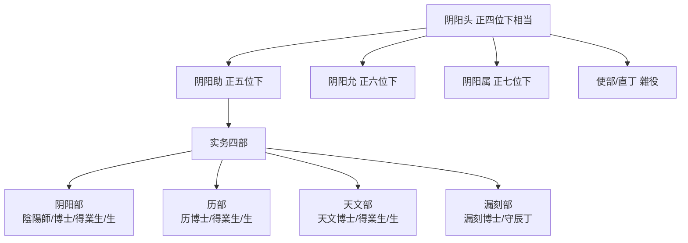
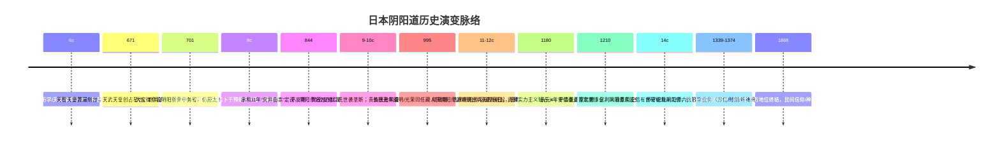

# 日本阴阳道

> **核心定位**：日本阴阳道是以中国阴阳五行说、道教方术为核心基础，融合日本本土神道、佛教密教，在律令制下由朝廷设立的官方咒术占卜体系，后演变为兼具国家祭祀、贵族厌胜、民间信仰多重功能的综合性宗教文化系统。

## 一、 理论渊源与本土化转化

### 核心思想基石：阴阳五行说的传入与重构

日本阴阳道的理论内核直接源自中国战国至汉代成型的**阴阳五行说**，约在6世纪随百济僧侣观勒等传入日本。该体系在日本经历了从“技术引进”到“本土化重构”的过程：

- **阴阳二元论**：万物由“气”构成，气分阴（消极、月、夜、女、植物、被动）与阳（积极、日、昼、男、动物、主动）两种，二气混合生成万物。此说为阴阳道判断吉凶、方位禁忌、时刻选择提供根本逻辑。
- **五行相生相克**：木→火→土→金→水（相生）；木克土、土克水、水克火、火克金、金克木（相克）。此模型被直接用于疾病诊断（如热病属火，用水克制）、方位布局、祭祀选时等实务。
- **天干地支与八卦纳入**：十干十二支不仅作计时用，更被解读为植物生长十二阶段（如甲=种子闭合、乙=萌芽弯曲）；八卦由太极两仪四象演化，成为占卜（如六壬式占）的符号系统。

> **跨文化映照**：中国“气”论与古希腊泰利斯“水本说”、赫拉克利特“火本说”、恩培多克勒“四大元素说”、德谟克利特“原子论”同属早期自然哲学探索，但中国独创阴阳五行双轨模型，后成为东亚文化圈共享认知框架。参见 [[chinese-star-divination#阴阳五行与天人感应]]。

### 道教方术的直接移植与改造

道教作为中国本土宗教，其**方术（方技）**——占术、风水、死灵操纵、成仙仪式——被整体吸收为阴阳道的咒术核心：

| 道教方术项目 | 阳阳道对应吸收形态 | 典型案例 |
|-------------|-------------------|---------|
| 禹步（咒术步法） | 反闭仪式的场地净化步法 | 施法前踏罡步斗，等同西方魔法“画魔法阵” |
| 纸偶操纵术 | 式神使役的原型 | 后演变为式神召唤、人偶诅咒（厌魅） |
| 泰山府君信仰 | 泰山府君祭（阴阳道最高秘祭） | 掌管生死簿册的冥界主宰，兼具道教冥司与本土死者信仰 |
| 符咒制作 | 灵符/御守 | 神社现行“御守”即源自道教灵符演变 |
| 占术（六壬、太乙、奇门） | 式占、六壬式占、宿曜道 | 《占事略决》即本《黄帝金匮经》《神枢灵辇经》编纂 |

> **关键节点**：大宝律令（701）设阴阳寮，仿效唐制“太卜署”“太史局”，确立**“技术官僚”**身份，使方术从民间巫术升格为国家机密技术。参见 [[qimen-dunjia-fundamentals#三式定位与决策学]]。

### 本土神道与佛教密教的双重融合

- **神道融合**：阴阳寮与神祇官并列（前者问天意/星象，后者问神意/祖先）。平安期贵族“双修”现象普遍：一方请阴阳师行祭祀，一方请僧侣行祈祷，核心逻辑“只要有效就好”。神道禊祓（祓除秽）与阴阳道“祓”仪式高度重合，形代（人偶）转移秽气手法直接源自神道大祓。
- **密教融合**：空海、圆仁、圆珍入唐带回《宿曜经》《符天历》，创**宿曜道（密教占星术）**。宿曜师多为高僧（如仁宗、仁统任西大寺别当），能行密教修法、制历、占星，与阴阳寮天文历部门深度合作（如长德元年贺茂光荣请宿曜师协助制历）。两者在“物忌/方位/吉凶日”咨询上形成**互补共存**关系。

## 二、 官方机构：阴阳寮的组织架构与职能演变

### 律令制下的标准编制（养老令·职员令，718）

- **阴阳部**：核心业务单位。陰陽師（官定员10名）专司**卜筮（占卜天灾/兵祸/政变）、相地（风水判断吉凶）**。博士负责传授思想技术，得业生/生为储备官僚。
- **历部**：依阴阳五行编纂具注历（附吉凶注解），当年11月1日行“御历奏”献天皇，再分发百官（约160份）。纸张短缺致使仪式早期形式化，贵族自备纸请陰陽師私撰历书，逐演变为非官方业务。
- **天文部**：观测天文气象，报告异象（彗星、日蚀、地震云等）供朝廷决策参考。
- **漏刻部**：水钟计时，守辰丁定时击鼓鸣钟报时，无学生编制，博士由守辰丁内部晋升。

> **身份转化**：平安初期“阴阳师”仅指阴阳部技术吏；后因贵族厌胜需求爆发，藏人所阴阳师（直属天皇、地位超阴阳头）、法师阴阳师（僧侣兼业）、隐阴阳师（民间非正规）纷至沓来，称谓泛化为“习得阴阳术者”。

### 职能转型：从“观天授时”到“厌胜除厄”

| 时代 | 核心职能 | 驱动因素 | 典型事件 |
|------|----------|----------|----------|
| 奈良期（8c） | 天文观测、制历、占星辅政 | 律令制建立，技术官僚属性强 | 大津连大浦占卜干预藤原仲麻吕之乱、和气王谋反 |
| 平安前期（9c中叶） | **查明祟因、包办祓禊** | 律令崩坏、政争频仍、天灾频发、人心恐慌 | 承和11年（844）藤原良房定议“灾异频传乃祟使然，不可不镇” |
| 平安中期（10c-11c） | **贵族个人厌胜咒术保镖** | 摄关政治成熟，藤原氏独权招诅咒，重用优秀阴阳师自保 | 安倍晴明、贺茂光荣任一条天皇藏人所阴阳师（长德元年995） |
| 镰仓/室町期 | 武家祈战/仪式主持、幕府授高位对抗朝廷 | 武家政权确立，利用阴阳道仪式彰显正统性 | 足利义满重用安倍有世破格升至从二位，行阴阳道+密教大规模祈祷 |

> **权力互动**：阴阳寮虽隶中务省（掌宫中事务/户籍/诏令），实则直接服务天皇与权贵。摄关政治下，贺茂氏（历道/天文道）、安倍氏（阴阳道/占卜）世袭垄断高阶职役，形成**“贺茂历、安倍占”**格局。

## 三、 核心咒术体系与实操技法

### 主要祭祀仪式谱系

| 仪式名称 | 核心目的 | 关键要素 | 来源/演变 |
|----------|----------|----------|-----------|
| **泰山府君祭** | 延寿、消灾、超度亡魂 | 祭祀泰山府君（掌生死簿冥司），七濑祓预净 | 道教泰山府君信仰+本土死者祭祀 |
| **四角四堺祭/四角四境祭** | 镇护宅地/领地四境 | 四方设坛，祭四方神祇，结界护身 | 道教方位神信仰+神道地主神祭祀 |
| **五部祭** | 国家规模大祓 | 五部（神祇/阴阳/内侍/兵卫/刑部）联合行祓 | 律令制部门协作仪式化 |
| **七濑祓** | 预备净化 | 七种瀬（急流）水祓身，或以盐/水/火净化 | 神道大祓禊祓简化 |
| **反闭** | 封闭空间/结界防护 | 禹步踏罡、符咒封门、禁入内 | 道教禹步+西方魔法“画魔法阵”同构 |
| **五龙祭/雷公祭** | 祈雨/止雨/治水旱 | 祭五方龙王/雷公，配合符咒水法 | 道教龙王雨师信仰 |
| **天文密奏** | 星象异象奏报天皇 | 观测彗星/客星/日蚀，判吉凶进献 | 唐制太史局“候天象”制度 |

### 占卜技法：六壬式占与宿曜道双轨并行

#### 六壬式占（阴阳寮正统占法）
- **源流**：汉代兴起，六朝（吴/东晋/宋/齐/梁/陈）大成，《黄帝金匮经》《神枢灵辇经》为核心典籍。
- **日本化**：滋岳川人《六甲》（贞观13年871献天皇）确立日本独自解法；《占事略决》（天元2年979安倍晴明撰）为教科书式摘要，含理论（占法/解读/道具）与实例（病卜生死/胎卜男女/天气邪祟）。
- **特色**：以**四神地图**（青龙/白虎/朱雀/玄武配四方）为断验依据，重“象数”轻“神煞”，异于中国后期六壬重神煞派。参见 [[liuren-shen-ke-daquan#六壬神课大全体系]]。

#### 宿曜道（密教占星术）
- **源流**：印度占星经由中国（唐曹士蒍《符天历》、日延僧入吴越带回）传入，空海等入唐僧推广。
- **技术核心**：以符天历计算出生时**九曜**（日月水火木土+罗睺/计都=月交点）落**十二宫位天地图**（相当西洋星盘），断吉凶、选修法吉时、祈祷消灾。
- **宿曜师群体**：皆为密教高僧（仁宗/仁统任西大寺别当，证照等），制历占星双全，社会地位极高，长德元年受阴阳寮邀协助制历即证。参见 [[nakshatra-27-lunar-mansions#印度占星核心要素]]。

### 咒术操作：式神、符咒、厌魅、形代

| 技法 | 操作流程 | 理论依据 | 典型应用 |
|------|----------|----------|----------|
| **式神使役** | 咒语召唤→契约/降伏→遣使执行（侦查/攻击/守护） | 道教纸偶操纵术+本土依代（神依附物）观念 | 晴明遣式神探听密谋、贺茂光荣式神护身 |
| **灵符制作** | 纸/木/布材→特定笔墨朱砂→道纹/晴纹（符文）→咒语加持→烧灰服用/贴佩/埋藏 | 道教符咒体系+本土言灵信仰 | 御守护身、治病符、镇宅符、反咒符 |
| **厌魅（诅咒）** | 制作人偶（草人/木偶/纸偶）→写对象名/生辰→钉钉/火烧/埋藏/投河 | 道教巫蛊术+同感魔法（模拟即影响） | 贵族政争互咒、隐阴阳师受雇杀人（小野茂助案） |
| **形代（身替）** | 纸人摩擦病人/贵族身上→转移秽气/厄运→祈祷焚弃/流水 | 神道大祓“形代流し”+阴阳道“物忌”规避 | 师守记载“撫物”日常业务、贵族疾病/产厄处理 |
| **反咒术** | 占卜识别咒源→制作反咒符/式神反制→返还咒害 | 咒术可逆/能量守恒观念 | 晴明vs道满对决中反制飞来咒球 |

> **物忌系统**：方位忌（八方/十二支方位吉凶）、时忌（衰日/吉日/庚申/土用）、行忌（出行/动土/嫁娶/葬礼禁忌）。《勘注忌文》《簠簋内传金乌玉兔集》为民间通用禁忌大全。参见 [[japanese-curse-arts#厌魅与符咒操作]]。

## 四、 阴阳师群体的三重形态与历史演变

### 官人阴阳师：国家技术官僚→贵族咒术保镖

- **核心谱系**：贺茂氏（历道/天文道正统，贺茂忠行→保宪→光荣→在经→道世→季国）、安倍氏（阴阳道/占卜正统，安倍吉平→泰亲→晴明→泰贞→有世）。
- **藏人所阴阳师**：直属天皇私人占卜/祈祷，地位超阴阳头。晴明、光荣同任一条天皇藏人所阴阳师（995），实为当世“阴阳道第一人”。
- **世袭垄断**：10c后贺茂/安倍二氏独占高阶职役，贺茂氏排除他族独占历道致日本历法停滞800年（宣明历用至江户貞享历），寛保元年（1004）贺茂光荣以天文博士任阴阳头打破惯例。

### 法师阴阳师：僧侣兼业的“山乐版”咒术师

- **起源**：平安贵族公开举行阴阳仪式激发民间需求，僧侣（密教/天台/真言）兼行“类阴阳术”满足庶民祓厄/占卜/祈祷。
- **特征**：非官方编制、非正统传承，紫式部日记讥讽“戴纸冠装博士态，鄙俗恰如耳后髻”。但贵族常“双管齐下”请官人阴阳师+法师僧侣并行。
- **演变**：相互影响下，官人阴阳师吸收密教咒法（护摩/真言/曼荼罗），法师阴阳师吸收阴阳占卜/符咒，形成**“密教阴阳道”**混合体。室町期声闻师（唱门师/唱文师）更融合猿乐/曲舞/白拍子艺能，成能乐/文乐/净瑠璃源流。

### 隐阴阳师：民间非正规的“龙蛇混杂”群体

- **构成**：半途废学官人阴阳师、犯罪被逐官人、法师/隐阴阳师弟子、职业骗子。宇治拾遗物语《小野茂助》案：算博士茂助被妒者雇隐阴阳师以“声咒”（听声即中）杀害，三日毙命。
- **制度化**：中世后期土御门家（安倍氏嫡流）统摄全国阴阳师，发许可执照，隐阴阳师纳入管辖。江户期低阶阴阳师售简易历书（吉凶日历）予庶民，风俗延续至今。

## 五、 关键典籍与知识传承网络

### 官方教科书体系（续日本记载阴阳生必读四书）

| 典籍 | 性质 | 核心内容 | 传承情况 |
|------|------|----------|----------|
| **周易** | 中国五经之一 | 易占/哲学，百济段扬尔513年传入 | 核心哲学基础，广传 |
| **新撰阴阳书** | 勅撰阴阳典籍 | 失传，推测含律令制阴阳寮规范 | 仅见书名 |
| **黄帝金匮经** | 六壬式占解说书 | 六壬核心奥义 | 晴明据此撰占事略决 |
| **五行大义** | 隋萧吉撰，阴阳五行集大成 | 先秦至隋五行说系统化，影响佛教/法制/神道 | 中国宋后散佚，日本高野山灵宝馆藏完本 |

### 实务秘传与民间流通典籍

| 典籍 | 作者/时代 | 性质 | 核心价值 |
|------|-----------|------|----------|
| **占事略决** | 安倍晴明/979年 | 阴阳寮教科书式摘要 | 唯一确证晴明真迹，含六壬精要+实占例+四神地图 |
| **簠簋内传金乌玉兔集** | 伪托晴明/镰仓期后 | 民间阴阳师“圣经” | 五卷：牛头天王/盘古王/太岁大将军/宅地吉凶/二十八宿，江户永代大杂书万历大成普及民间 |
| **六甲占抄** | 室町贺茂氏勘解由小路家 | 贺茂家内部讲义记录 | 世袭家学秘传外泄 |
| **宿曜要录/历例/宿曜经** | 密教系 | 宿曜道天文知识书 | 宿曜师制历占星核心参考 |

> **知识流向**：官方典籍（周易/五行大义）→ 寮内教科书（占事略决/六甲占抄）→ 民间秘传化（金乌玉兔集）→ 江户商业出版（万历大成/永代大杂书）→ 现代民俗（吉凶历/方位除厄）。

## 六、 历史演变总览：从国家机密到民间信仰

## 七、 现代遗存与文化影响

1. **神社御守/绘马/祓串**：直接源自道教灵符→阴阳道符咒→神道祭祀用品演变链条。
2. **方位/吉凶日俗信**：搬家/动土/旅行查“黄历”（万历大成传统）、避“土用/庚申/衰日”、请阴阳师/神职人员“地镇祭/宅地祓”。
3. **节庆仪式**：祇园祭（牛头天王/素戔鸣尊融合）、庚申待（道教三尸虫说+民间通宵不寐）、节分豆撒（追儺驱鬼仪式阴阳道残留）。
4. **大众文化**：安倍晴明IP化（小说/漫画/电影/游戏《阴阳师》《百鬼夜行绘卷》等），式神/式占/符咒成ACG标准奇幻素材。
5. **学术复兴**：战后日本史学/宗教学/民俗学重访阴阳寮档案、《师守记》《吾妻镜》等一手史料，还原“技术官僚→咒术师→文化符号”真实轨迹。

## 八、 交叉引用索引

| 主题 | 关联页面 | 核心关联点 |
|------|----------|------------|
| 中国阴阳五行/星命源流 | [[chinese-star-divination]] | 七政四余、二十八宿、十二宫、星格贵贱、太阴九道 |
| 奇门遁甲/六壬/太乙三式 | [[qimen-dunjia-fundamentals]]、[[liuren-shen-ke-daquan]]、[[taiyi-shenshu]] | 占卜技法共同源流、式盘符号系统、决策学应用 |
| 日本咒术/式神/厌魅实操 | [[japanese-curse-arts]] | 咒具/咒语/人偶诅咒/反咒/式神使役完整流程 |
| 日本神话/神道祭祀体系 | [[japanese-creation-myths-izanagi-izanami]]、[[japanese-major-kami-myths]] | 伊邪那岐/伊邪那美创世、三贵子、大国主神、禊祓源流 |
| 密教占星/宿曜道/九曜 | [[nakshatra-27-lunar-mansions]]、[[indian-astrology-jyotish-overview]] | 印度占星九曜/二十七宿/符天历/十二宫位图技术对应 |
| 道教符咒/泰山府君/禹步 | [[ceremonial-magic]]、[[zhu-you-shisan-ke]] | 所罗门系魔法/祝由十三科/六甲天书与阴阳道符咒同构对照 |
| 民间信仰/物忌/方位吉凶 | [[fengshui-shiyi-genyu]]、[[fengshui-bao-di-jiu-chong]] | 风水藏风聚气/生气论与阴阳道方位吉凶判断互文见义 |

---

> **编辑说明**：本页面依据《图解阴阳师》（高平鸣海著，野宫铭监修，王书铭译）全书101条目及前言/目录/章节结构，系统提炼阴阳道理论渊源、阴阳寮制度、咒术体系、师群形态、典籍传承、历史演变六大维度，建立与中国道术/密教/神道/占卜体系的交叉引用网络，旨在还原阴阳道从“国家机密技术”到“民间文化符号”的完整历史脉络。

## 来源

- [图解阴阳师](../sources/图解阴阳师.md)
