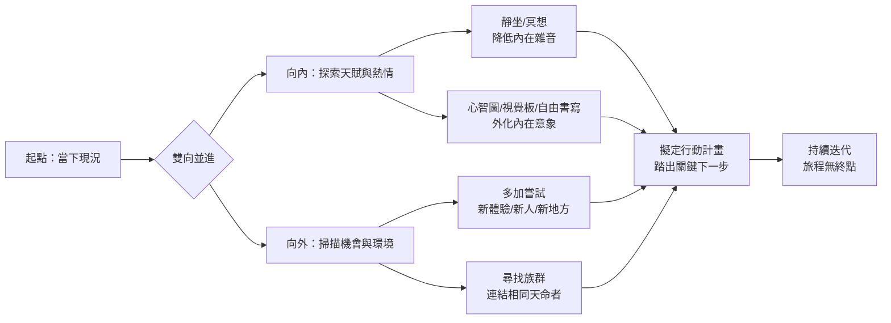

# 肯·羅賓森《發現天賦之旅》核心理論

> **書名**：《發現天賦之旅》（Finding Your Element）  
> **作者**：肯·羅賓森（Ken Robinson）、盧·亞若尼卡（Lou Aronica）  
> **譯者**：廖建容  
> **前作**：《讓天賦自由》（The Element: How Finding Your Passion Changes Everything）  
> **核心命題**：**天命 = 天賦 ∩ 熱情**；尋找天命是「向內探索天賦」與「向外尋找機會」的雙向旅程。

---

## 核心概念：天命

### 定義
> **天命** 是個人的**天賦**與**熱情**的交會點。  
> —— 當你正在做「自然而然愛做的事」，時間感會改變：「一小時感覺像五分鐘」。

### 三大特徵
| 維度 | 說明 |
|------|------|
| **天賦** | 與生俱來的潛能，須經應用與精進才能發揮（如語言、音樂、機械直覺）。 |
| **熱情** | 發自內心的喜愛與投入，不只是擅長，更要「樂在其中」。 |
| **交會** | 兩者缺一不可：只擅長不熱愛 → 疲憊；只熱愛不擅長 → 挫折。 |

### 孔子註腳
> 「知之者不如好之者，好之者不如樂之者。」  
> ——《論語·雍也》，與本書核心定義不謀而合。

---

## 三大基本原則

| 原則 | 核心論點 | 關鍵引言 |
|------|----------|----------|
| **一、人生獨特** | 生物遺傳（八百億分之一的奇蹟）+ 文化背景塑造獨一無二的你。 | 「透過你的身體所表現出來的動作……是獨一無二的。」——瑪莎·葛蘭姆 |
| **二、自我創造** | 想像力與創造力讓人類能重塑人生；出生證明不附履歷表。 | 「我不是境遇創造出來的成果，我是我自己選擇的結果。」——卡爾·榮格 |
| **三、有機變動** | 人生非線性發展，而是即興、動態、受興趣與機遇雙向牽引。 | 「人生並非線性發展，而是有機的、會變動的。」 |

> **教育批判**：主流教育假設「人生線性、可規劃」，壓抑創造力，導致畢業後多數人「學以致用」比例極低（文科就業輔導主任估計 < 1/3）。

---

## 雙向旅程架構

### 向內關鍵操作：降低雜音
- **外在雜音**：數位資訊洪流（每 5 分鐘產生一個「國會圖書館量級」的資訊風暴）。
- **內在雜音**：不斷湧現的思緒、自我批評、他人期待。
- **核心工具**：**靜坐** —— 讓思緒平息，體驗深層意識（非停止思考，而是不被思考綁架）。

### 向外關鍵操作：多加嘗試
- 嘗試新事物、造訪新地方、結識新朋友。
- **目的**：讓潛藏天賦獲得展現機會（如委內瑞拉 El Sistema 讓 40 萬貧困兒童發現音樂天賦）。

---

## 實作工具箱

| 工具 | 目的 | 關鍵步驟 |
|------|------|----------|
| **靜坐** | 連結真我、降低雜音 | 背部挺直放鬆 → 深呼吸 4-5 次 → 正常呼吸專注感覺 5-10 分鐘 → 思緒浮現不阻擋、持續回呼吸 |
| **心智圖** | 視覺化釐清思緒、自由發散 | 中心主題 → 向外分層分叉 → 關鍵詞/圖形/顏色/曲線 → 有機連結 |
| **視覺展示板** | 具象化夢想與憧憬 | 從雜誌/網路剪貼吸引的圖像 → 用圖釘/魔鬼氈可移動固定 → 置於可見私密處 → 定期調整 |
| **自由書寫** | 繞過線性邏輯、直通潛意識 | 設定主題/時間 → 不停筆、不修改、不評判 → 寫畢圈出關鍵字 → 作為下一次起點 |
| **晨間日記** | 清理腦雜、啟動一天 | 起床即寫 3 頁/20 分鐘 → 僅給自己看 → 可銷毀或封存 → 不回頭閱讀 |

> **練習範例**：  
> - **練習二「你都在做些什麼？」** → 列出週活動 → 分類 → 依時間比例畫圓 → 標記喜好程度 → 派狀圖檢視人生投入結構。  
> - **練習四「你擅長什麼？」** → 以名字為心智圖中心 → 列出活動仰賴的天賦 → 三欄分類（擅長/平平/不擅長） → 深挖第一欄共通性與可轉移性。

---

## 關鍵案例研究

### 肯·羅賓森親身歷程
- **童年**：小兒麻痺癱瘓、口齒不清、獨處習慣觀察/拼模型/玩想像遊戲。
- **轉折**：13 歲被哥哥推上台介紹表演 → 發現「面對群眾」天賦。
- **當下**：國際演說家/作家，**天命 = 人際溝通與合作**。

### 德瑞克（作者弟弟）：機械天賦的早期顯現
- 10 歲拆解摩托車 → 13 歲修汽車引擎 → 聽聲音診斷故障 → 精確繪製構造圖。
- **啟示**：天賦在極早期即以「易如反掌」的形式顯現。

### 委內瑞拉 **El Sistema** 音樂教育奇蹟
- **背景**：貧窮、犯罪率高、無古典音樂傳統。
- **干預**：荷西·艾伯魯創立免費管弦樂訓練體系。
- **成果**：30 年培育 40 萬兒童、活躍管弦樂團數不亞於發達國家。
- **理論意義**：**潛藏天賦需機會啟動**；環境不創造天賦，但決定天賦能否浮現。

### 大衛·奧格威：有機變動的教科書人生
| 階段 | 身分 | 關鍵轉折 |
|------|------|----------|
| 早年 | 巴黎飯店廚師 → 蘇格蘭爐具推銷員 | 寫出「史上最佳銷售手冊」 |
| 中年 | 廣告公司文案 → 蓋洛普助理董事 → 二戰英情報員 | 戰後轉型阿米殊農夫 10 年 |
| 晚年 | 紐約麥瑟廣告客戶經理 → 打造奧格威麥瑟全球巨擘 | 60 歲後成就廣告業傳奇 |

> **核心洞見**：人生非線性規劃，而是由興趣、個性、環境、機遇即興共舞。

---

## 常見阻礙與應對

| 阻礙類型 | 典型心聲 | 應對策略 |
|----------|----------|----------|
| **自我設限** | 「我沒天賦/熱情/太老/太輕」 | 質疑假設 → 多做測驗/嘗試 → 看證據而非感覺 |
| **巴納姆效應** | 相信通用人格描述精準描述自己 | 覺察「主觀確認」偏誤 → 具體化、個人化探索 |
| **外在期待** | 親友/文化/角色施壓 | 區分「他人眼中的我」與「真我」 → 靜坐/獨處重拾內在聲音 |
| **謀生焦慮** | 「天命養不活我」 | 階段性策略：業餘深耕 → 斜槠並行 → 評估商業化可行性 → 漸進轉型 |

---

## 與知識庫既有主題的交叉引用

| 本書概念 | 關聯頁面 | 連結說明 |
|----------|----------|----------|
| **天命/天賦藍圖** | [[量子天命與AI時代新天赋]]、[[天命辨識與天命木馬清理]] | 李欣頻以「頻率/維度」重述天命；木馬程式對應內在阻礙。 |
| **雙向旅程/向內探索** | [[ming-xiang-gai-lun]]、[[chu-xue-zhe-de-ming-xiang-shu]] | 靜坐/正念/內觀作為降低雜音、連結真我核心技術。 |
| **視覺化/心智圖** | [[shakti-gawain-chuang-zao-xing-xiang-ti-xi]]、[[san-fen-zhong-wei-lai-ri-ji]] | 創造性想像、未來日記作為外化意圖、重塑腦神經回路工具。 |
| **有機變動/非線性生涯** | [[AI時代全球未來趨勢與職業轉型]]、[[luck-creation-principles]] | 斜槠升維、弱連結、滑向冰球將到之處皆為有機變動下的策略。 |
| **潛藏天賦需機會** | [[han-lianglu-astrology-mom-handbook]]、[[twelve-zodiac-parenting-communication]] | 月亮/谷神星顯示先天需求；親子互動為提供機會的關鍵環境。 |
| **族群連結/共鳴** | [[renlei-tu-ai-guanxi-yu-xing]]、[[oh-cards-healing-cases]] | 人類圖類型/權威機制、OH 卡投射皆為尋找「同頻族群」路徑。 |

---

## 章節速覽與行動地圖

| 章節 | 核心任務 | 輸出成果 |
|------|----------|----------|
| **Ch.1 天命的歸屬** | 理解三原則、雙向旅程、降低雜音 | 人生現況派狀圖、靜坐習慣 |
| **Ch.2 你擅長什麼？** | 盤點天賦/能力、發掘潛藏天賦 | 三欄天賦表、心智圖 |
| **Ch.3 為何看不見天賦？** | 識別教育/文化/心理盲點 | 盲點清單、重構敘事 |
| **Ch.4 找出你的熱情** | 區分「喜歡」與「熱愛」、能量流向 | 熱情清單、能量日誌 |
| **Ch.5 快樂與天命** | 定義真實快樂、心流狀態 | 快樂定義、心流觸發器 |
| **Ch.6 態度決定高度** | 固定/成長心態、韌性、樂觀 | 慈悲自我對話、重構失敗 |
| **Ch.7 盤點現況創造契機** | 資源盤點、環境掃描、小步快跑 | SWOT、MVP 行動方案 |
| **Ch.8 連結你的族群** | 尋找導師/夥伴/社群、建立支援網 | 族群地圖、連結行動清單 |
| **Ch.9 擬定行動計畫** | 設定里程碑、風險預案、啟動儀式 | 90 天計畫、問責機制 |
| **Ch.10 旅程無終點** | 回顧整合、持續迭代、傳遞火種 | 個人宣言、導師承諾 |

---

## 金句彙編

> - 「人類的天賦才能就像天然資源一樣被埋在深處，你必須努力將它挖掘出來。」
> - 「當你開始對工作感到得心應手時，就要小心了，因為你已經陷入慣性模式，不再充分鍛鍊腦力與體力。」
> - 「尋找天命不代表忽略他人需求，也不意味放棄一切。它只代表你必須認真檢視自己，並自問：還能做什麼，以徹底發揮天賦與熱情？」
> - 「與其站在岸上告訴自己大海無法承載我們的重量，不如直接跳入海中——試了再說。」——德日進
> - 「這趟旅程絕對值得你費心探究。」

---

## 延伸閱讀與資源

| 類別 | 推薦資源 |
|------|----------|
| **原著姊妹作** | 《讓天賦自由》（The Element）、《讓創意自由》（Out of Our Minds） |
| **工具書** | 東尼·博讚《心智圖聖經》、茱莉亞·卡麥隆《藝術家創作之道》 |
| **科學佐證** | 契可森米哈賴《心流》、艾克哈特·托勒《當下的力量》 |
| **實作社群** | TED Talks (Ken Robinson)、The Element 官網線上測驗與練習表單 |

---

> **頁面維護提示**：本頁為知識庫結構化摘要，僅供快速檢索與交叉引用。完整練習步驟、案例細節與理論論證請參考原書正文。

## 来源

- [发现天赋之旅](../sources/发现天赋之旅.md)
