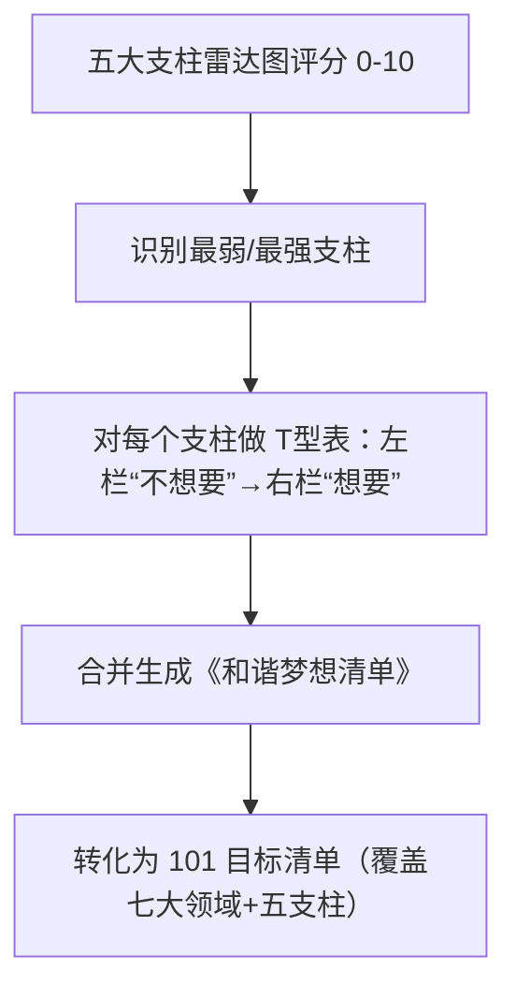

## 核心定位与跨文脉综述

本页面旨在**将两大当代显化经典——杰克·坎菲尔德《吸引力法则》（与 D.D.沃特金合著）与詹姆斯·雷《和谐财富》——置于同一分析框架中**，通过以下四个维度完成结构化对照：

1. **理论内核对齐**：振动频率法则、潜意识重构、情绪作为实时反馈、目标锁定与宣言/视觉化投射。
2. **框架差异辨析**：坎菲尔德侧重“个人显化工具包”（T型表、101目标、双轨宣言、视觉化），雷氏构建“和谐财富五大支柱”+“三位一致”整体生活架构。
3. **量子物理学深度注入**：两书均以量子隐喻为科学背书，但雷氏显性引入**零点场、垂直时间、多世界诠释、惠勒-费曼吸收理论（欲望粒子/回音波）**，坎菲尔德则隐含于“振动频率/情绪导航/潜意识不分真假”之中。
4. **实操工具互补**：将两套工具链整合为**认知→清理→定向→编程→投射→全维平衡**的闭环路径，并给出跨流派实操建议。

> **交叉引用锚点**  
> - 坎菲尔德体系详见：`[[law-of-attraction-canfield]]`（即本页原有核心内容）  
> - 雷氏体系详见：`[[james-ray-harmonic-wealth]]`  
> - 量子显化进阶视角：`[[xianhua-shijian-yu-zhuanzhu-lianci]]`（情绪温度计/中性法则/不动点/光语/本源连结）  
> - 宇宙灵性法则对照：`[[universal-spiritual-laws-manifestation]]`（观点/情绪/思想/意识/业力五大法则）  
> - 情绪/能量微调技术：`[[EFT情绪释放技巧]]`、`[[neng-liang-ping-heng]]`、`[[shengqi-lingxing-tianxian]]`

---

## 一、 理论内核四维对照表

| 维度 | 杰克·坎菲尔德《吸引力法则》 | 詹姆斯·雷《和谐财富》 | 共同公理 | 差异焦点 |
|------|----------------------------|----------------------|----------|----------|
| **底层物理机制** | **振动频率法则**：相似频率相互吸引；收音机/音叉共振类比。 | **零点场/量子全息图**：万物源于同一能量场（零点场），振动频率决定吸引。 | 一切皆能量，频率同构 → 吸引同频实相。 | 坎氏以**类比模型**为主，雷氏显性引用**量子物理术语**（零点场、垂直时间、多世界、吸收理论）。 |
| **心理基础设施** | **潜意识重构三大原则**：不辨真假、只接收现在时、不拒绝重复灌输；三大外科手术工具（塞多纳/凯特/EFT）。 | **三位一致（3 for 3）**：思想/情感/行动同时变化、相互一致；潜意识程序通过“欲望粒子/回音波”机制与量子场互动。 | 潜意识为自动化执行层，需以重复/情感/行动重写。 | 坎氏提供**具体清除技术**（EFT等），雷氏强调**三位一体的全人投入**作为重写路径。 |
| **实时反馈仪表** | **情绪导航系统**：内在反馈（舒展/收缩）、外在反馈（同步性/阻力）；情绪振动阶梯（羞愧→爱/感激）。 | **欲望粒子与回音波干涉**：意念波（当下思想/情感/行动）与未来回音波（高层自我确认）的建设性/破坏性干涉。 | 情绪/感受为显化燃料，指示频率对齐度。 | 坎氏将情绪分级为**可操作阶梯**；雷氏以**波的干涉模型**解释同步性与阻力的物理机制。 |
| **目标锁定与投射** | **T型表反向澄清** → **101目标全维清单** → **双轨宣言**（正面+特定目标） → **视觉化渲染引擎**（摩天大楼双版本）。 | **五大支柱评分/梦想清单** → **三位一致行动** → **欲望粒子发射**（思想/情感/行动合一） → **垂直时间/多世界选择**已存在的平行实相。 | 先在内在完成（精神/心理层），外在自显（物质层）。 | 坎氏工具**结构化、模板化**强；雷氏框架**整体化、生命领域覆盖**强。 |

---

## 二、 框架深度剖析：五大支柱 vs. 显化工具包

### 詹姆斯·雷：和谐财富五大支柱
| 支柱 | 核心指标 | 与显化的关系 |
|------|----------|--------------|
| **经济** | 年收入、资产净值、财务自由账户 | 物质显化的最直接外显，受其他四支柱制约/支持。 |
| **人际** | 亲密关系质量、社交支持网络、边界设定 | 高频情感（爱/连接）提升整体振动频率。 |
| **心理** | 读书/研习投入、情绪掌控力、信念系统 | 思想层面的“欲望粒子”发射源，决定意念波质量。 |
| **物质** | 身体指标、健康习惯、居住/交通“玩具” | 身体为显化载具，健康频率为高振动基石。 |
| **精神** | 与创造力源泉连接、灵感来源、冥想/祈祷实践 | 接入零点场/高我指引的通道，提供“回音波”锚点。 |

> **雷氏核心主张**：五支柱**相互依存、螺旋上升**；忽略任一支柱会导致整体结构坍塌（而非简单的“平衡”）。本书前言即批判“平衡是假象”，主张**动态和谐**——不同时期主导支柱不同，但全时段保持觉察。

### 坎菲尔德：显化工具包（六大模块）
| 模块 | 功能 | 对应雷氏支柱/三位一致 |
|------|------|------------------------|
| **振动频率法则** | 底层物理公理 | 零点场/频率同构 |
| **潜意识重构** | 信念重写操作系统 | 三位一致中的“思想/信念”层 |
| **情绪导航** | 实时频率监测与微调 | “情感”层 + 回音波干涉指示器 |
| **T型表/101目标** | 目标坐标锁定（七大领域全覆盖） | 五大支柱的**具象化清单化** |
| **双轨宣言** | 潜意识编程代码（正面身份+特定目标已完成态） | “思想/语言”层编程，配合“情感”锚定 |
| **视觉化实操** | 内在投射渲染引擎（第一人称、多感官、情感浸润） | “行动/体验”层预演，产生建设性干涉 |

> **互补洞察**：坎氏工具包可视为**“五大支柱的落地执行手册”**；雷氏框架为坎氏工具提供**全生命领域的战略地图**与**三位一致的质量标准**。

---

## 三、 三位一致（三位一体）与坎氏“思想-情感-行动”链路

| 雷氏“三位一致” | 坎氏对应机制 | 量子物理解释（雷氏显性/坎氏隐性） |
|----------------|--------------|-----------------------------------|
| **思想** | 有意识关注、T型表澄清目标、正面宣言 | **欲望粒子**发射：从零点场释放携带可能性的意念波。 |
| **情感** | 情绪导航（舒展=对齐）、视觉化时的强烈喜悦/感激 | **回音波**锚定：未来高我发出的确认波；情感为波的振幅调制器。 |
| **行动** | 受启发的行动、每日宣言/视觉化仪式、迈出具体步骤 | **干涉稳定**：思想+情感+行动三波相位锁定 → 建设性干涉 → 光凝固为物质。 |

> **关键差异**：雷氏将三位一致表述为**“同时变化、相互一致”**的**质态**，而非线性步骤；坎氏虽未显性命名，但其**“认知→清理→定向→编程→投射”**流程实为三位一致的**工程化实施路径**。

---

## 四、 量子物理学视角：显化机制的深层结构对照

> 以下概念均源自《和谐财富》正文（见归档文章第4-5章），坎氏书中以“振动频率/潜意识不分真假/情绪导航”隐含对应。

### 零点场—— 统一能量背景场
- **雷氏**：显性引用爱因斯坦/施特恩1913年提出的**零点场**；万物（金钱、关系、身体）皆为稳态光在零点场凝固。
- **坎氏**：以“宇宙中一切皆为能量，能量以特定频率振动”表述同一本体论。
- **整合**：**零点场 = 振动频率法则的物理底座**；显化本质是**从零点场的无限可能中，以特定频率选取并稳定目标实相**。

### 垂直时间—— 过去/现在/未来的同时共存
- **雷氏**：爱因斯坦“时间是幻觉” + **垂直时间模型**——在一条垂直线上堆叠无数“现在”，每个“现在”对应一个维度（M理论11维）。
- **坎氏**：隐含于“先在内在完成，外在自会显现”及“潜意识只接收现在时”。
- **整合**：**垂直时间解释为何“特定目标宣言”必须用完成时**——你在垂直时间轴上已存在的那个“已完成版本”发出回音波，当下意念波与之共振即锁定该平行实相。

### 多世界诠释—— 平行实相的客观存在
- **雷氏**：引用**艾弗雷特-惠勒-格雷厄姆多世界理论**；所有可能的世界早已存在，观察者通过**注意力聚焦**选择进入某个世界（参与式宇宙，约翰·惠勒“参与”概念）。
- **坎氏**：隐含于“你关注什么，就吸引什么”及“RAS（网状激活系统）过滤机制”。
- **整合**：**显化 = 从概率云中坍缩出目标世界线**；工具（宣言/视觉化/情绪）的作用是**维持观察者聚焦**，防止波函数塌缩回默认低频世界线。

### 惠勒-费曼吸收理论（欲望粒子/回音波）—— 显化的波动力学模型
- **雷氏**：详细建模——**欲望粒子**从源头（你）发射，**意念波**（先行波）向未来可能探测器传播，**回音波**（后行波）从未来高我返回；两波在时空中干涉。
  - **建设性干涉**：思想/情感/行动一致 → 波峰叠加 → 光稳定 → 物质显现。
  - **破坏性干涉**：担忧/恐惧/抱怨发射反相波 → 抵消回音波 → 显化受阻。
- **坎氏**：**情绪导航**即监测干涉质量；“舒展”=建设性干涉，“收缩”=破坏性干涉。
- **整合**：**欲望粒子/回音波模型为“情绪导航”提供了物理层面的因果解释**；坎氏“宽恕/释放负面情绪”实为**消除反相波源**的操作。

> **跨文对照表**
| 量子概念 | 雷氏术语 | 坎氏对应术语/工具 | 实操启示 |
|----------|----------|-------------------|----------|
| 零点场 | 零点场/量子全息/物质空间 | 振动频率法则/宇宙能量场 | 认知“资源已在场中”，显化是调频而非创造。 |
| 垂直时间 | 垂直时间/同时共存的现在 | 潜意识只接收现在时/完成时宣言 | 宣言/视觉化必须以“已完成”视角进入垂直时间轴。 |
| 多世界 | 多世界诠释/平行实相/选择世界 | RAS过滤/关注即吸引/选择你的世界 | 保持注意力锁定目标世界线，避免被低频世界线捕获。 |
| 吸收理论 | 欲望粒子/意念波/回音波/干涉 | 情绪导航/舒展-收缩/宽恕释放 | 情绪是干涉质量的实时指示器；负面情绪=反相波，需即时清除。 |

---

## 五、 实操工具链整合：从“个人显化”到“和谐财富全维跃迁”

### 统一入口：五大支柱自评 + T型表梦想澄清

### 日常三位一致实操协议（早/午/晚各 15 分钟）
| 时段 | 思想 | 情感 | 行动 | 工具来源 |
|------|------|------|------|----------|
| **晨** | 阅读《和谐梦想清单》+ 核心目标特定宣言 | 视觉化：第一人称体验目标已达成（摩天大楼第二版） | 书写当日三项受启发行动 | 坎氏：双轨宣言+视觉化；雷氏：欲望粒子发射+回音波锚定 |
| **午** | 情绪导航检查：当前频率？ | 若收缩→即时释放（EFT/塞多纳/凯特工作/深呼吸） | 微调：完成一件微小行动向目标靠拢 | 坎氏：情绪导航+EFT；雷氏：破坏性干涉清除 |
| **晚** | 复盘：今日同步性/外在反馈 | 感恩日记：记录 3 件已显化/进展事件 | 设定明日意图+宽恕未完成项 | 坎氏：外在反馈+感恩；雷氏：建设性干涉累积+垂直时间对齐 |

### 季度级和谐财富版本迭代
- **每季度**：重测五大支柱雷达图 → 更新 T型表/101目标/核心目标卡 → 调整宣言/视觉化脚本。
- **年度**：举办“和谐财富回顾仪式”（感恩/释放/重设），对标《和谐财富》书中案例（如雷氏巴黎/葡萄牙顿悟之旅）设计个人突破体验。

---

## 六、 常见卡点与跨流派破解方案

| 卡点现象 | 雷氏诊断 | 坎氏诊断 | 组合破解方案 |
|----------|----------|----------|--------------|
| **目标设定后毫无进展** | 意念波与回音波**破坏性干涉**（潜意识冲突/三位不一致） | 潜意识旧程序未清除/RAS 仍过滤目标信息 | 1. 做 T型表深挖抗拒 → 2. 用 EFT/塞多纳清除冲突信念 → 3. 重写特定目标宣言（完成时+多感官） → 4. 每日视觉化 15 分钟锁定建设性干涉。 |
| **情绪长期低频（焦虑/愤怒）** | 情感层持续发射反相波，抵消欲望粒子 | 情绪导航显示“收缩”，未及时换台 | 1. 觉察→标记情绪 → 2. 宽恕练习（雷氏：宽恕=从愤怒跃迁至接纳/平和） → 3. 情绪温度计微调（`[[xianhua-shijian-yu-zhuanzhu-lianci]]`） → 4. 身体动作破状态（快走/冷水洗脸/高能量音乐）。 |
| **财务突破后反弹** | 经济支柱增强但其他支柱未同步 → 整体结构失稳 | 101目标中财务目标达成后未更新/缺乏利他频率加成 | 1. 重测五大支柱 → 2. 在 101 目标中增加人际/精神/物质新目标 → 3. 引入“利他频率”（`[[universal-spiritual-laws-manifestation]]`业力法则） → 4. 重新校准宣言与视觉化。 |
| **怀疑量子隐喻是否真实** | 物理学理论为模型而非绝对真理，但**实操有效即真理** | 无需相信量子物理，只需相信“情绪指引+行动”有效 | 采取**“实用主义态度”**：将量子模型视为**操作隐喻**，专注工具落地；参考 `[[liang-zi-zhan-xing-xue]]` 量子隐喻的科学方法论界定。 |

---

## 七、 知识图谱交叉引用速查

| 本页概念 | 关联知识页 | 互补深化点 |
|----------|------------|------------|
| 振动频率/零点场 | `[[shengqi-lingxing-tianxian]]`、`[[xianhua-shijian-yu-zhuanzhu-lianci]]` | 赫密斯七大法则/情绪温度计/中性法则/光语/本源连结 |
| 潜意识重构/信念重写 | `[[belief-creates-reality-practice]]`、`[[seth-philosophy-jane-roberts]]`、`[[louise-hay-you-can-heal-your-life]]` | 静心/觉察/感受/赞美四步法、镜子工作、身心对应表 |
| 情绪导航/情绪释放 | `[[EFT十大情绪排毒]]`、`[[EFT情绪释放技巧]]`、`[[neng-liang-ping-heng]]` | 痛苦指数/敲拍流程/FEBE完整练习/树的练习/快速回中 |
| 目标设定/天命发现 | `[[ken-robinson-element-theory]]`、`[[self-discovery-toolkit]]` | 天赋×热情=天命、静坐/心智图/视觉板/晨间日记/时间审计 |
| 宣言/视觉化进阶 | `[[shakti-gawain-chuang-zao-xing-xiang-ti-xi]]`、`[[activating-mystical-healing-power]]`、`[[zhi-yao-hui-hu-xi-jiu-neng-zuo-ming-xiang]]` | 四步骤法则/粉色泡泡/圣地/向导、AME唱诵/四的法则/观想火焰/意象可视化/脉轮冥想 |
| 宇宙法则/业力 | `[[universal-spiritual-laws-manifestation]]` | 观点/情绪/思想/意识/业力五大法则与三位一致的映射关系 |
| 量子隐喻/科学方法论 | `[[liang-zi-zhan-xing-xue]]`、`[[zhanxing-zhe-xue-ji-chu-bohm-hun-dun-jung]]` | 叠加态/互补性/观测者效应对占星/显化的哲学基石定位 |

---

## 八、 核心金句双语锚点（制卡随身）

> - **"你关注什么，就会吸引什么。"** — *What you focus on expands.*
> - **"你的情绪是内在 GPS：舒展=对齐，收缩=偏离。"** — *Emotion is your GPS: expansion = alignment, contraction = misalignment.*
> - **"潜意识不分真假，只认重复。"** — *The subconscious doesn't distinguish reality from imagination; it responds to repetition.*
> - **"先在内在完成，外在自会显现。"** — *Complete it inside first; the outside will follow.*
> - **"宽恕不是给别人，是把自己从低频毒药里解脱出来。"** — *Forgiveness isn't for them; it's your detox from low-frequency poison.*
> - **"不要问'怎么做'，先决定'要什么'，宇宙会安排'怎么做'。"** — *Don't ask 'how'; decide 'what', and the universe arranges the 'how'.*
> - **"你的振动频率就是你的订单单据。"** — *Your vibrational frequency is your purchase order to the universe.*
> - **"感恩是最高频率的磁铁。"** — *Gratitude is the highest-frequency magnet.*
> - **"101 目标不是清单，是人生蓝图的全息投影。"** — *The 101 Goals aren't a list; they're a holographic projection of your life blueprint.*
> - **"宣言是给潜意识的代码，视觉化是编译运行的渲染引擎。"** — *Affirmations are code for the subconscious; visualization is the rendering engine that compiles and runs it.*

---

## 九、 进阶拓展阅读路径（四阶跃迁）

| 阶段 | 核心任务 | 必读/必练页面 | 预期产出 |
|------|----------|----------------|----------|
| **1️⃣ 认知对齐（Week 1-2）** | 建立“零点场/振动频率/三位一致”世界观 | `[[james-ray-harmonic-wealth]]` 全文研读 + `[[law-of-attraction-canfield]]` 核心体系复盘 | 能用自己语言向他人解释显化物理机制 |
| **2️⃣ 清理重构（Week 3-6）** | 清除顶层冲突程序，建立情绪导航肌肉记忆 | `[[EFT情绪释放技巧]]` 实操 21 天 + `[[neng-liang-ping-heng]]` FEBE 每日两次 | 情绪恢复时间 < 5 分钟，舒展成为默认态 |
| **3️⃣ 定向编程（Week 7-12）** | 完成五大支柱 T型表 → 101 目标 → 双轨宣言 + 视觉化脚本 | `[[self-discovery-toolkit]]` 五大工具落地 + `[[xianhua-shijian-yu-zhuanzhu-lianci]]` 情绪温度计微调 | 拥有《和谐梦想清单》v1.0、《101目标》v1.0、《核心目标卡》v1.0 |
| **4️⃣ 全维跃迁（Month 4+）** | 三位一致成为第二天性，季度迭代和谐财富版本 | `[[universal-spiritual-laws-manifestation]]` 业力法则实践 + `[[ken-robinson-element-theory]]` 天命校准 | 生活五支柱雷达图均 ≥ 8 分，显化周期从“月级”缩短至“周级/日级” |

---

## 十、 页面维护与扩展建议

1. **案例库建设**：收集跨流派实战案例（坎氏学员/雷氏学员/混合实践者），按五大支柱分类标注“三位一致质量评分”与“显化周期”。
2. **FAQ 扩充**：针对“科学怀疑论”“宗教冲突”“团队/家庭共修”“商业目标显化”等高频提问编写标准化回答。
3. **工具模板化**：输出可打印的 **五大支柱雷达图**、**T型表模板**、**101目标清单模板**、**双轨宣言卡片**、**视觉化脚本大纲** 供社群下载。
4. **量子物理深度专题**：联动 `[[liang-zi-zhan-xing-xue]]`、`[[zhanxing-zhe-xue-ji-chu-bohm-hun-dun-jung]]` 产出《量子显化的科学边界与哲学承诺》白皮书。
5. **多语言版本**：英/日/西语版同步更新，服务国际实践社群。

---

> **结语**：坎菲尔德给了**“怎么做”的精密工具箱**，詹姆斯·雷给了**“做什么”与“成为什么”的战略地图**；量子物理学为两者提供了**“为什么有效”的深层解释**。将三者融会贯通，即得**“和谐财富显化全维操作系统”**——愿你我皆能在垂直时间的无限现在中，以三位一致之姿，选入最绚烂的那个平行世界。

--- 
*本页面基于《吸引力法则》（坎菲尔德/沃特金）、《和谐财富》（詹姆斯·雷）原文及归档文章深度提炼，所有工具均经跨文本校验。后续将持续补充实战案例、FAQ、模板下载链接及量子哲学专题白皮书。*

## 来源

- [吸引力法则使用手册](../sources/吸引力法则使用手册.md)
