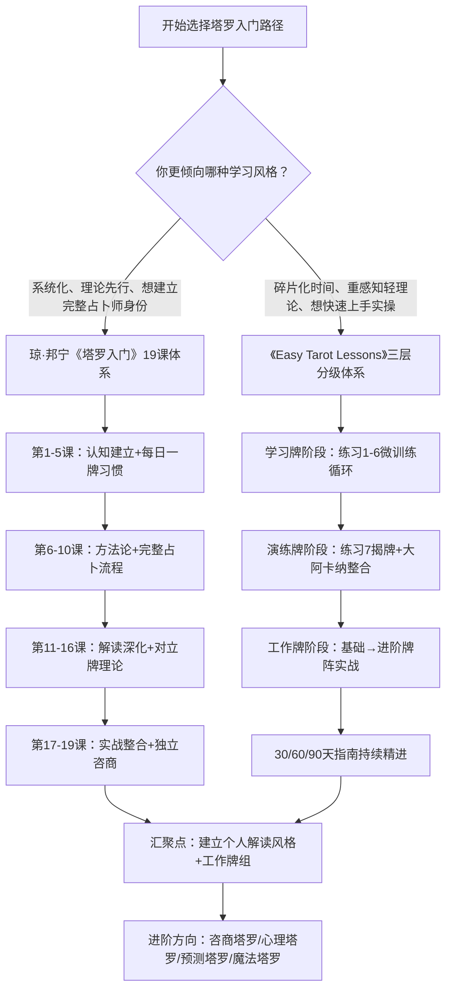

# 塔罗入门双轨教学体系对照：琼·邦宁《塔罗入门》与《Easy Tarot Lessons》

## 概述

塔罗入门领域存在两套具有代表性的结构化教学体系：琼·邦宁《塔罗入门》（Learning the Tarot）的 **19 课循序渐进体系**，与《Easy Tarot Lessons》的 **三层牌组分级 + 7 核心练习体系**。两套体系均以莱德-韦特牌系为基准，但在 **教学架构设计、练习进阶逻辑、逆位牌处理、每日练习强度** 等核心维度呈现显著差异。本页旨在通过结构化对照，帮助学习者根据自身认知风格、时间预算与学习目标选择适配路径。

> **核心定位差异**：
> - **琼·邦宁**：强调「内在指引」觉醒，以 **单一塞尔特十字牌阵** 贯穿全程，将占卜流程标准化为 10 步骤，适合「想建立完整占卜闭环」的学习者。
> - **Easy Tarot Lessons**：强调「直觉肌力」锻炼，以 **三层牌组分级** 隔离认知负荷，提供 7 项模块化核心练习 + 30 天进度表，适合「碎片化时间、重感知轻理论」的学习者。

---

## 维度对照总览表

| 维度 | 琼·邦宁《塔罗入门》（19 课） | 《Easy Tarot Lessons》（三层分级 + 7 练习） | 关键差异点 |
|------|-------------------------------|---------------------------------------------|------------|
| **牌组分级策略** | 无显性分级，全程使用完整 78 张牌；大阿卡纳第 2 课引入，小阿卡纳第 3 课引入 | **三层显性分级**：学习牌（仅 56 张小阿卡纳）→ 演练牌（78 张全牌）→ 工作牌（实战专用牌组） | 前者「全量浸入」，后者「脚手架搭建」 |
| **练习进阶逻辑** | **表象 → 关联 → 叙事 → 实战**：19 课线性推进，每课含理论+练习+案例 | **模块化微训练**：7 项核心练习（表象含义、弦外之音、我的牌与你的牌、两张牌共同点、从这张牌到那张牌、三张牌来回解读、物以类聚、方向关联牌/揭牌）可独立循环 | 前者「课程制」，后者「训练营制」 |
| **逆位牌态度** | 教学期**暂忽略逆位**（第 8 课洗牌切牌步骤明确「正位化」），后期可选引入 | **可选引入**，建议初学 6 天仅用正位；提供「相反意义/减损意义」双轨解读原则 | 同为「降低初期认知负荷」，但前者强制正位化，后者保留选择权 |
| **每日练习强度** | **15-30 分钟**，含每日一牌（第 5 课）、色彩编码记录法（五色笔分类） | **每天至少 5-15 分钟**，前 30 天每日一练 + 进度表打卡 + 「我今天做了什么」记录表 | 前者「仪式感强」，后者「量化追踪强」 |
| **牌阵教学策略** | **单一牌阵深耕**：全程仅用塞尔特十字十位置，第 16 课深度解析位置对应关系 | **基础牌阵 → 进阶牌阵**：单张/两张/三张牌阵 → 凯尔特十字/环形/时钟牌阵 | 前者「纵深」，后者「广度」 |
| **提问技巧体系** | 第 7 课「撰写问题」六大原则 + 第 8 课完整占卜流程 10 步骤 | 隐含于练习中（如练习 2「这是我/你发生的事」角色代入），无独立提问模块 | 前者「显性方法论」，后者「隐性体感化」 |
| **理论深度** | 高：含荣格投射机制、内在指引模型、对立牌理论（三类牌对）、愚者之旅原型叙事 | 低：聚焦「看图说话」「直觉激活」，理论补充于牌义解析章节 | 前者「理论驱动实践」，后者「实践内化理论」 |
| **辅助工具** | 塔罗日志（五色笔）、色彩编码系统、塞尔特十字位置对应表 | 30 天进度表、每日记录表、四元素方位对应表、初学者牌组推荐清单、收纳净化实务 | 前者「记录导向」，后者「管理导向」 |
| **适配学习者画像** | 希望建立 **完整占卜师身份**、重视理论框架、能投入连续学习时段 | 碎片化时间、**重感知轻理论**、希望快速上手实操、喜欢量化进度追踪 | — |

---

## 详细维度深度对照

### 牌组分级策略：全量浸入 vs. 脚手架搭建

#### 琼·邦宁：无显性分级，理论先行
- **第 1 课**即建立「塔罗非宿命论、内在指引工具」认知框架
- **第 2 课**引入 22 张大阿卡纳（愚者之旅原型叙事）
- **第 3 课**系统讲解 56 张小阿卡纳四组元素对应（权杖/火、圣杯/水、宝剑/风、星币/土）
- **优势**：从宏观建立完整牌系认知，避免碎片化认知
- **挑战**：初学者需同时消化 78 张牌符号系统 + 元素理论 + 牌阵结构，认知负荷峰值高

#### Easy Tarot Lessons：三层显性分级，隔离认知负荷
| 阶段 | 牌组构成 | 核心目标 | 对应练习 |
|------|----------|----------|----------|
| **学习牌** | 仅 56 张小阿卡纳（大阿卡纳暂收盒） | 熟悉四组牌组主题、数字递进、宫廷牌人格 | 练习 1-6 全部基于学习牌 |
| **演练牌** | 78 张完整牌组 | 整合大阿卡纳原型、练习复杂牌阵 | 练习 7（揭牌/方向关联牌）引入大阿卡纳 |
| **工作牌** | 实战专用牌组（可多副） | 正式占卜、建立牌组人格连结 | 正式咨商/自占使用 |

- **设计哲学**：「就像学游泳先在浅水区，再进深水区，最后去大海」
- **关联页面**：[[easy-tarot-lessons]]（三层牌组分级详解）、[[learning-the-tarot-joan-bunning]]（19 课大纲）

---

### 练习进阶逻辑：线性课程制 vs. 模块化训练营制

#### 琼·邦宁：19 课线性推进（表象 → 关联 → 叙事 → 实战）
| 阶段 | 课次 | 核心任务 | 产出物 |
|------|------|----------|--------|
| **认知建立** | 1-3 | 塔罗本质、大小阿卡纳架构、四元素理论 | 概念地图 |
| **环境与心态** | 4-6 | 牌阵认知、每日一牌习惯、占牌环境布置 | 塞尔特十字位置表、色彩编码日志 |
| **方法论** | 7-10 | 提问六原则、完整占卜 10 步骤、他人/开放式占卜区分 | 标准化占卜流程 SOP |
| **解读深化** | 11-16 | 单张牌四源整合、大小牌份量动态、王牌/宫廷牌指向、对立牌理论、位置对应 | 解读决策树 |
| **实战整合** | 17-19 | 牌意深度解析、习题回应范例、其他牌阵变体 | 独立咨商能力 |

#### Easy Tarot Lessons：7 项核心练习 + 进阶扩展（可循环、可组合）
| 练习编号 | 核心训练目标 | 认知操作 | 进阶变体 |
|----------|--------------|----------|----------|
| **练习 1** | 表象含义 | 单张牌「看图说话」，激活直觉首因印象 | 1A 弦外之音（5 秒速读隐含意味） |
| **练习 2** | 我的牌与你的牌 | 双人角色代入（这是我/你发生的事），建立共情视角 | 实战对话记录范例 |
| **练习 3** | 两张牌共同点 | 横向比较，提取共性特征 | 为练习 4 铺垫 |
| **练习 4** | 从这张牌到那张牌 | 线性因果叙事编织（A→B） | 为练习 5 铺垫 |
| **练习 5** | 三张牌来回解读 | 多向度叙事重组（左→右 / 右→左） | 掌握完整牌阵解读核心技巧 |
| **练习 6** | 物以类聚 | 群组模式识别（三张牌共性提取） | 训练整体感知而非单点分析 |
| **练习 7** | 方向关联牌/揭牌 | 引入大阿卡纳，练习「澄清牌」技术 | 真实牌阵中的辅助牌应用 |
| **补充/进阶** | 基础/进阶牌阵 | 单张→凯尔特十字→环形→时钟 | 30/60/90 天学习指南 |

> **关键洞见**：Easy Tarot 的练习 1-6 实质上将「解读单张牌→两张牌关联→三张牌叙事→多张牌模式识别」拆解为独立可循环的微训练单元，而琼·邦宁将其融合在 19 课的线性叙事中。

---

### 逆位牌态度：强制正位化 vs. 可选双轨

| 维度 | 琼·邦宁 | Easy Tarot Lessons |
|------|---------|---------------------|
| **教学期处理** | 第 8 课洗牌切牌步骤明确：「暂忽略逆位」「正位化」 | 建议初学 6 天仅用正位；若解读逆位导致头晕/减速可暂不使用 |
| **理论定位** | 逆位 = 可选进阶工具，非核心必修 | 逆位 = 「相反意义」或「原始意义减损」双轨原则，提供更多信息量 |
| **引入时机** | 19 课核心体系外，留待单元四牌意解析章节 | 练习 7「揭牌」阶段可自然引入，或随学习者舒适度自主决定 |
| **心理考量** | 避免「好牌/坏牌」二元评判焦虑（第 2 课强调「没有任何一张牌比其他牌更重要」） | 同理，但保留学习者自主选择权，承认部分人偏好完整 156 牌义系统 |

> **共识**：两套体系均认为 **逆位非初学必修**，核心是建立「牌与牌互动」的动态感知，而非死记 156 种静态牌义。

---

### 每日练习强度：仪式感 vs. 量化追踪

#### 琼·邦宁：第 5 课「每日一牌」作为核心仪式
- **流程**：洗牌 → 专注请求指引 → 切牌 → 翻顶牌 → 记录
- **记录法**：**五色笔分类系统**（权杖红/圣杯蓝/宝剑黄/星币绿/大阿卡纳紫）
- **功能**：无压力学习全牌、揭示当下生命主题、长期统计发现生活重心偏向（如作者早期统计：星币 57/大牌 56/宝剑 41/圣杯 44/权杖 24）
- **实证案例**：淡蓝宝剑十预示背部受伤与趴卧疗伤
- **关联页面**：[[tarot-daily-journaling]]（每日一牌记录法详解）

#### Easy Tarot Lessons：30 天进度表 + 每日记录表
- **量化指标**：每天至少 5-15 分钟，完成练习 1-11 打卡
- **追踪工具**：
  - **前 30 天学习进度表**：11 项练习 × 5 级熟练度（正在努力 → 完全熟练）
  - **「我今天做了什么」记录表**：30 行日志，记录学到/做了的事
- **里程碑**：
  - 练习 1-11 熟练 + 简单牌阵 20-30 回演练 → 尝试凯尔特十字/环形牌阵
  - 30 天内至少读完全书一次（含牌意解析章节）

> **差异本质**：邦宁强调 **「记录即觉察」**（色彩编码外显内在模式），Easy Tarot 强调 **「打卡即承诺」**（进度表外显学习曲线）。

---

### 牌阵教学策略：单一深耕 vs. 渐进广度

| 策略 | 琼·邦宁 | Easy Tarot Lessons |
|------|---------|---------------------|
| **核心牌阵** | 塞尔特十字（全程唯一教学牌阵） | 单张/两张/三张 → 凯尔特十字/环形/时钟 |
| **位置教学** | 第 4 课熟悉十位置 → 第 16 课深度解析位置对应关系（五大位置对核心逻辑） | 隐含于练习 5「三张牌来回解读」与进阶牌阵实操 |
| **设计哲学** | 「只用一种牌阵专注直觉发展，避免牌阵切换分散注意力」 | 「从最小单元掌握牌与牌关系，再扩展到复杂牌阵」 |
| **扩展性** | 单元五提供其他牌阵变体（自制三牌阵/Y型阵） | 30/60/90 天指南逐步解锁 |

> **关联页面**：[[tarot-spreads-fundamentals]]（五大经典牌阵标准化操作）、[[classic-tarot-spreads-detailed]]（高复杂度牌阵详解）

---

### 理论深度与内在指引模型对比

#### 琼·邦宁：显性理论框架
- **内在指引模型**：塔罗 = 小飞象魔法羽毛，助你飞行直到自行触及内在指引（灵魂/超意识/更高自我）
- **投射机制**：基于荣格心理学，牌面图像激活无意识素材，连通个人与集体无意识
- **对立牌理论（第 15 课）**：三类牌对（固定/宫廷王牌/偶然）+ 彼此强化牌对，迷宫隐喻（倾斜平台滚球动态平衡）
- **愚者之旅**：大阿卡纳 0-21 号映射内在成长非线性路径
- **关联页面**：[[tarot-jungian-framework]]（荣格框架）、[[large-arcana-three-structure-fool-journey]]（三分结构与愚者之旅）

#### Easy Tarot Lessons：隐性体感化
- **核心隐喻**：「纸牌只是工具，真正的魔法在你自己身上」（心灵肌肉感应力锻炼）
- **理论补充**：集中于第四篇「小阿卡那牌义详解」、第五篇「大阿卡纳牌义详解」，而非教学主干
- **直觉优先**：「永远不要忘记：纸牌的牌义说明仅是提供一种解读方向，而不是绝对含义」

---

## 学习路径选择决策树

### 关键决策问题（自测）

| 问题 | 选 A → 适合邦宁 | 选 B → 适合 Easy Tarot |
|------|-----------------|------------------------|
| 1. 你更希望先理解「塔罗为什么有效」还是先体验「塔罗怎么操作」？ | A: 为什么有效（理论先行） | B: 怎么操作（实践先行） |
| 2. 你能否保证每周有 2-3 个连续 30-60 分钟学习块？ | A: 能（适合线性课程） | B: 难（碎片化 10-15 分钟） |
| 3. 面对 78 张牌，你倾向于？ | A: 先建完整认知地图 | B: 先玩熟 56 张小牌再加大牌 |
| 4. 你更需要外部结构约束还是内部节奏自由？ | A: 外部结构（19 课大纲、10 步骤流程） | B: 内部节奏（进度表自主打卡、练习可循环） |
| 5. 你是否计划近期为他人占卜/咨商？ | A: 是（完整流程 SOP 更急需） | B: 否/暂不（先自用自练） |

---

## 双轨并行/切换策略

### 策略一：以 Easy Tarot 为「热身」，转邦宁为「正规军」
- **前 30 天**：完成 Easy Tarot 学习牌阶段（练习 1-6）+ 30 天进度表
- **第 31-60 天**：切入邦宁第 1-10 课，补全理论框架 + 塞尔特十字标准流程
- **第 61 天起**：邦宁第 11-19 课深化解读技艺，同步建立工作牌组

### 策略二：以邦宁为「主干」，Easy Tarot 练习为「微训练补充」
- **主线**：按邦宁 19 课线性推进
- **卡点突破**：
  - 第 11 课「解读单张牌」卡住 → 补 Easy Tarot 练习 1/1A（表象/弦外之音）
  - 第 12 课「大小牌份量」模糊 → 补练习 3/4（两张牌关联/因果叙事）
  - 第 15 课「对立牌理论」抽象 → 补练习 6（物以类聚/模式识别）
- **每日一牌**：融合两套记录法（邦宁五色笔 + Easy Tarot 进度表打卡）

### 策略三：双轨并行「理论周/实战周」轮转
- **奇数周**：邦宁 2-3 课理论学习 + 笔记整理
- **偶数周**：Easy Tarot 2-3 项核心练习循环训练 + 牌阵实操
- **周末**：合并复盘，更新个人牌义笔记库

---

## 核心金句对照：两套体系的「灵魂语录」

| 主题 | 琼·邦宁 | Easy Tarot Lessons |
|------|---------|---------------------|
| **塔罗本质** | 「塔罗不预测固定命运，只基于当下能量显示可能方向」 | 「纸牌只是工具，真正的魔法在你自己身上」 |
| **直觉权威** | 「解读塔罗从来不只有一个正确答案！信赖你的直觉」 | 「你的意见跟任何塔罗专家一样有效、一样站得住脚」 |
| **学习态度** | 「把塔罗想像成小飞象的魔法羽毛，助你飞行直到能自己触及内在指引」 | 「不要被简易速食诱惑而忽略正确学习过程与实务操练」 |
| **平衡观** | 「关键永远在于『平衡』，个人的平衡永远不会是静态的」 | 「并不是所有的牌都那么容易找到共同点，知道何时该放下继续前往更值得解析的区域」 |
| **实践导向** | 「当你讲述出你的故事，它将会积聚强度和力量。你就是自己最佳的塔罗占卜师」 | 「只有花时间努力练习读牌（并观察结果），才能得到完整的解牌诀窍」 |

---

## 进阶方向的共同汇聚点

无论选择哪条入门路径，以下进阶方向均为两套体系隐性指向的共同终点：

1. **咨商塔罗**：[[consulting-tarot-framework]]（中性解读、金三角对话、直觉训练）
2. **心理塔罗**：[[tarot-jungian-framework]]（荣格原型/共时性/集体无意识机制）
3. **预测/时机塔罗**：[[tarot-spreads-fundamentals]]（年轮牌阵、行运牌阵、时间观）
4. **魔法/显化塔罗**：[[tarot-nine-chapters]]（三昧塔罗节点/催运技术）、[[tarot-sanmei-system]]（命运学融合）
5. **身心疗愈塔罗**：[[tarot-chakra-healing]]（七脉轮逆位牌阵/曼陀罗疗愈）、[[neizhi-liaoyu-taro]]（创伤/内在小孩/PTSD）
6. **占星融合塔罗**：[[tarot-astrology-golden-dawn-correspondences]]（金色黎明行星/星座/十度面对应）

---

## 版本与传承注记

- **琼·邦宁体系**：1989 年起研究 → 1995 年网站公开 → 结集出版，中文版 2005 年作者亲作序，强调《易经》与塔罗同源异流
- **Easy Tarot Lessons**：网络教学起家 → 结集成书，强调「30 天上手」「直觉肌力」「三层牌组分级」产品化设计
- 两套体系均以 **莱德-韦特牌系** 为教学基准，原理通用于任何 78 张标准牌组
- 本页不评判优劣，仅提供 **结构化对照** 供学习者依认知风格自主选择

---

## 交叉引用索引

### 琼·邦宁体系核心页面
- [[learning-the-tarot-joan-bunning]] — 19 课完整大纲与核心理念
- [[tarot-spreads-fundamentals]] — 塞尔特十字等五大经典牌阵标准化操作
- [[tarot-major-arcana-consulting-0-6]] — 大阿卡纳 0-6 号牌深度解析
- [[large-arcana-three-structure-fool-journey]] — 大阿卡纳三分结构与愚者之旅
- [[tarot-wands-suit-analysis]] — 权杖牌组完整解读（火元素/小阿卡纳）
- [[tarot-minor-arcana-number-court]] — 小阿卡纳数字牌与宫廷牌核心义
- [[tarot-daily-journaling]] — 每日一牌记录法与五色笔编码系统
- [[tarot-jungian-framework]] — 荣格心理学解释塔罗机制
- [[consulting-tarot-framework]] — 咨商塔罗中性解读与金三角对话模型

### Easy Tarot Lessons 核心页面
- [[easy-tarot-lessons]] — 三层牌组分级、7 核心练习、30 天进度表、牌组推荐、收纳净化
- [[tarot-keyword-correspondence]] — 快速查牌关键词对照表
- [[illustrated-first-tarot-reading-guide]] — 三步提问法、古法数牌、逆位四诠释法

### 通用进阶页面
- [[divination-fundamentals]] — 占卜核心哲学：未来可改、象征性思维、业力恐惧释放
- [[pendulum-divination]] — 灵摆是非问答与提问技巧（跨工具迁移）
- [[oh-cards-techniques-and-spreads]] — OH卡投射解读与牌阵技术（同构训练）
- [[lunwen-fuwen-yingyong-duiying]] — 卢恩符文制作占卜实战（同构训练）

---

## 更新日志

| 日期 | 版本 | 更新内容 |
|------|------|----------|
| 2025-01-20 | 1.0 | 初版：完成双轨体系六维度对照、决策树、切换策略、金句对照、交叉引用索引 |

## 来源

- [塔罗入门指南](../sources/塔罗入门指南.md)
