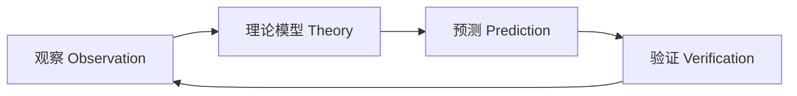

# 量子占星学

> **作者**：丁筱  
> **成书时间**：2023年3月于台中  
> **核心主张**：以量子力学概念（叠加态、互补性、观测者效应）为哲学隐喻，建立「观察→理论模型→预测→验证」的科学占星方法论。

---

## 核心哲学框架

### 量子隐喻与占星本体论

本书将量子力学三大核心概念引入占星诠释：

| 量子概念 | 占星对应 | 说明 |
|----------|----------|------|
| **叠加态** | 宫位多重意涵共存 | 第七宫同时是「伴侣」与「敌人」的叠加：`|第七宫⟩ = α|伴侣⟩ + β|敌人⟩` |
| **互补性** | 行星对立对互补 | 太阳/月亮、木星/土星、金星/火星互为互补，不可同时精确测量 |
| **观测者效应** | 命盘解读即测量 | 一旦提问「这段关系成不成」，叠加态坍缩，状态改变 |

> 「这并不说明命运遵照量子力学演变。出现这个问题只是老子说的『道可道非常道』。我们用一般语言去描述一个在这个语言中没有的东西必然出现偏差。」—— 丁筱

### 科学方法论四步循环



- **观察**：日记记录个案、史书传记搜集社会事件、电子邮件追踪生活细节
- **理论**：建立行星符号系统、相位几何、宫位量子模型
- **预测**：流年行星换宫、逆行留转折点、相位球差时间窗
- **验证**：历史大事（政权更迭、地震、金融危机）与个案生死病灾的逐一对照

---

## 第一章：占星基础与方法论

### 占星定位：经世济民之精密科学

- 区别于卜卦（仅求 YES/NO），占星提供人生全景与社会趋势导航
- 中研院院士何丙郁视其为历史学；作者视其为可建模、可验证的科学

### 历史溯源与两大体系比较

#### 西洋占星源流
- 公元前 410 年楔形文字泥板最早占星图
- 亚历山大大帝征服巴比伦后融入希腊文化
- 斯多葛学派奠定宿命论基础
- 牛顿《原理》出版后天文/占星分道扬镳
- 1781/1846/1930 年天海冥三外行星发现推动理论修正

#### 紫微斗数渊源
- 春秋战国（前 722–480）中国占星雏形
- 北宋《穢緣光佛頂大威德迴吉祥陀羅尼經》卷首已绘十二星座环图
- 杜牧墓志铭记载以「角宿」为命宫推算八宫
- 明代正统道藏收录《紫微斗数》三卷，含希腊十二星座与罗睺/计都二虚星

#### 两大体系核心差异对照表

| 维度 | 西洋占星 | 紫微斗数 |
|------|----------|----------|
| 命盤性別 | 不分男女 | 分男女 |
| 逆行概念 | 核心技法 | 忽略 |
| 出生地要求 | 精确经纬度 | 无概念 |
| 教育区分 | 初等/高等（三/九宫） | 无区分 |
| 情感分类 | 爱情(五宫) vs 婚姻(七宫) | 不区分 |
| 事业/工作 | 十宫/六宫分离 | 不区分 |
| 投资/子女 | 同属五宫 | 同宫 |
| 四化星 | 无 | 核心 |
| 日月蚀 | 高度重视 | 无讨论 |
| 命盤形狀 | 圆形（现代） | 方形（传统） |

> **同构洞见**：以数学术语看，方形与圆形命盘同构。紫微斗数可视为「简化且吸收中国思想后的西洋占星」——将黄道 360° 压缩为 12 宫（30°/宫），导致相位精度丢失（合相/四分相/六分相界限模糊）。

#### 行星对应简表

| 紫微斗数 | 西洋占星对应 |
|----------|--------------|
| 太阳 | 太阳、木星 |
| 七杀、擎羊 | 土星 |
| 天机 | 天王星 |
| 月亮 | 月亮 |
| 天机/巨门 | 水星 |

### 科学观察方法论

1. **个案日记法**：每日记录重大事件（时间、地点、情绪、关键人物），便于事后对照流年相位
2. **社会事件溯源**：图书馆旧报、网络新闻、传记、史书
3. **电子邮件/通讯录**：现代生活的时间戳数据库
4. **史迁《太史公自序》精神**：「究天人之际，通古今之变，成一家之言」

### 关键术语定义

#### 岁差
- 地轴 23.5° 倾斜，春分点每年向前位移 ~50.3″，周期 ~25,772 年
- **回归黄道**：以春分点为 0° 白羊起点（西洋主流）
- **恒星黄道**：以恒星固定位置为基准（印度/部分东方占星）
- 当前两系统差距约 **15°**，即约半个星座

#### 逆行与留/转
- 地心视角下行星视运动出现「前进→静止(留)→后退(逆行)→静止(留)→前进」
- **留/转点**为能量极值，常对应重大事件转折
- **水星逆行**：沟通故障、设备失灵、旧人旧事回返（年均 3–4 次）
- **外行星逆行**：社会层面深层结构变革周期

#### 球差
- 行星非几何点，有视直径 → 相位非瞬间完成，有**入相/出相**渐变过程
- 影响曲线呈非对称：入相渐强，出相骤弱（实证观察）
- 同一相位可能因逆行往返 **3–5 次**，形成多次触发窗口

#### 时间延迟
- 「闪电雷声需要时间，星光需要时间，事情发生也需要时间被看见听见」
- 对应物理学**因果效应**与**非局域性**，是量子力学最奥妙部分

---

## 第二章：星盘与十二宫位量子模型

### 十二宫核心意涵

| 宫位 | 中文名称 | 核心主题 | 量子叠加视角 |
|------|----------|----------|--------------|
| 1 | 命宫/升宫 | 形象、人生起点、身体 | 自我投射的多重可能性叠加 |
| 2 | 财帛宫 | 正财、资源、价值观 | 物质安全感与自我价值叠加 |
| 3 | 兄弟/沟通宫 | 初等教育、短途、亲戚、契约 | 信息接收与表达的双重性 |
| 4 | 田宅/家庭宫 | 根基、父亲、晚年、终结 | 内在安全感与外在房产叠加 |
| 5 | 子女/爱情宫 | 恋爱、创造、投机、子女 | 真爱与风险承受的叠加 |
| 6 | 奴仆/工作宫 | 健康、服务、下属、疾病 | 义务角色与身体信号叠加 |
| 7 | 夫妻/伙伴宫 | 婚姻、合伙、公开敌人 | **伴侣⊕敌人** 经典叠加态 |
| 8 | 疾厄/共享宫 | 共享财产、遗产、税务、生死观、手术 | 他人资源与自身转化叠加 |
| 9 | 迁移/求道宫 | 高等教育、出版、法律、宗教、长途 | 信息搜集与散布的双向性 |
| 10 | 官禄/事业宫 | 社会地位、名声、理想职业 | 公众人格与权力渴望叠加 |
| 11 | 福德/交友宫 | 朋友、团体、公众形象、改革 | 群体认同与超越自我的张力 |
| 12 | 玄秘/潜意识宫 | 隐匿、幕后、进修、自我瓦解 | **显性⊕隐性** 极端叠加 |

> **工作 vs 事业**：六宫「混饭吃」，十宫「当老板实现愿望」。孔子《论语》「用之则行，舍之则藏」揭示事业需「用」其才。

### 宫位分布格局

参考 Mark Edmund Jones、Alexandre Volguine 等大家分类：
- **碗型**、**提桶型**（伊莉莎白二世）、**团体型**（小布希）、**火车型**、**扇形**、**散落型**、**扩展型**

> **作者立场**：「在社会科学中，分类并非好方法。我们特别讨论行星在各宫位的分布」，避免将人生简化为几何模式。

### 流年行星与人生阶段对应

| 人生阶段 | 对应宫位 | 关键行星周期 |
|----------|----------|--------------|
| 修身 | 四宫/地平线下 | 土星 29.5 年、木星 12 年 |
| 齐家 | 七宫/地平线上 | 天王星 84 年（半周期 42 年） |
| 治国 | 九/十/十一宫 | 海王星 165 年、冥王星 248 年 |

> 《礼记·大学》「古之欲明德于天下者，先治其国……修身齐家治国平天下」与流年大行星移动轨迹惊人同构。

---

## 第三章：行星符号语言与意涵全解

### 符号构成三要素
- **灵** `∪`（半圆/新月形）
- **魂** `⊙`（圆圈）
- **物质** `⊥`（十字/物质十字架）
- 三者不同组合生成十大行星符号

### 十大行星核心意涵速查表

| 行星 | 符号 | 守护星座 | 核心原型 | 正面关键词 | 负面关键词 | 身体对应 | 相关职业/场所 |
|------|------|----------|----------|------------|------------|----------|----------------|
| **太阳** | ☉ | 狮子 | 生命之源、自我实现、国王 | 自信、光芒、创造力 | 自我中心、骄傲 | 心脏、脊椎、右眼 | 国王、指挥、演艺、宫殿、剧场 |
| **月亮** | ☽ | 巨蟹 | 母性、无意识、习惯、潮汐 | 包容、耐心、直觉 | 敏感、情绪化、依赖 | 胃、乳房、消化、左眼 | 清洁、水手、海港、家庭 |
| **水星** | ☿ | 双子/处女 | 沟通、智性、商业、魔法 | 机智、博学、适应力 | 狡猾、多嘴、焦虑 | 神经、肺、手臂 | 媒体、会计、学者、商店、学校 |
| **金星** | ♀ | 天秤/金牛 | 爱欲、美感、财富、和谐 | 艺术、外交、愉悦 | 贪恋、纠缠、虚荣 | 咽喉、肾、静脉 | 外交、艺术、公园、珠宝店 |
| **火星** | ♂ | 白羊/天蝎 | 行动、欲望、攻击、分裂 | 勇敢、执行力、激情 | 暴力、冲动、破坏 | 头部、肌肉、血液 | 军人、外科、运动员、冶炼厂 |
| **木星** | ♃ | 射手/双鱼 | 扩张、幸运、法则、意义 | 乐观、慷慨、智慧 | 夸大、伪善、放纵 | 肝、大腿、脂肪 | 法官、教师、出版、开阔平原 |
| **土星** | ♄ | 摩羯/水瓶 | 限制、时间、业力、结构 | 自律、负责、耐久 | 压抑、恐惧、僵化 | 骨骼、皮肤、膝盖、牙齿 | 律师、建筑、矿山、高山 |
| **天王星** | ♅ | 水瓶 | 变革、解放、科技、觉醒 | 创新、人道、直觉 | 叛逆、混乱、意外 | 神经系统、脚踝 | 占星家、科技、改革者、实验室 |
| **海王星** | ♆ | 双鱼 | 幻象、灵性、牺牲、集体无意识 | 慈悲、艺术、神秘 | 逃避、成瘾、欺骗 | 足部、淋巴、松果体 | 艺术家、摄影、制药、海洋 |
| **冥王星** | ♇ | 天蝎 | 死亡重生、权力、深层转化 | 再生、洞察、掌控 | 控制狂、毁灭、偏执 | 生殖、免疫、排泄 | 心理治疗、金融、核能、地下 |

> **互补性配对**：太阳⇄月亮（意识⇄无意识）、木星⇄土星（扩张⇄收缩）、金星⇄火星（吸引⇄追逐）、天王星⇄海王星（觉醒⇄融解）、冥王星独处（转化中枢）

### 外行星发现与历史共振

| 行星 | 发现年 | 同期历史事件 | 心理/集体主题 |
|------|--------|--------------|---------------|
| 天王星 | 1781 | 法国大革命、工业革命启动 | 解放、打破权威、科学理性 |
| 海王星 | 1846 | 共产党宣言、麻醉/催眠诞生、福克斯姐妹灵媒现象 | 理想主义、集体无意识觉醒、化学/石油时代 |
| 冥王星 | 1930 | 核物理突破、法西斯崛起、大萧条、深层心理学成熟 | 权力重组、大规模毁灭与重生、隐秘控制 |

### 主要小行星/矮行星补充

| 天体 | 发现年 | 公转周期 | 核心意涵 | 宫位指示 |
|------|--------|----------|----------|----------|
| **凯龙星** | 1977 | ~50 年 | 受伤的治疗者、身心整合、师徒 | 疗愈天赋、创伤转化路径 |
| **谷神星** | 1801 | 4.6 年 | 母性养育、丰饶、饮食/身体关系 | 养育模式、资源获取方式 |
| **婚神星** | 1804 | 4.36 年 | 契约婚姻、真正需要的伴侣 | 婚姻模式、伴侣标准 |
| **智神星** | 1802 | 4.6 年 | 策略智慧、模式识别、创造性解决 | 解决问题风格、才华领域 |
| **灶神星** | 1807 | 3.6 年 | 专注、神圣承诺、能量聚焦 | 奉献领域、专注力最强处 |
| **赛德娜** | 2003 | ~11,400 年 | 深渊创伤、边缘生存、环境正义 | 集体创伤、生态意识 |

---

## 第四章：相位、球差与时间动力学

### 五大主相位几何与共振原理

| 相位 | 角度 | 符号 | 几何本质 | 能量性质 | 允许容差 |
|------|------|------|----------|----------|----------|
| **合相** | 0° | ☌ | 同频共振 | 融合、启动、强化 | 8° |
| **冲相** | 180° | ☍ | 对立波峰 | 拉扯、对抗、投射 | 8° |
| **三分相** | 120° | △ | 谐波 1/3 | 流畅、天赋、保护 | 8° |
| **六分相** | 60° | ⚹ | 谐波 1/6 | 机会、沟通、调适 | 6° |
| **四分相** | 90° | □ | 正交张力 | 冲突、驱动、突破 | 8° |

> **共振视角**：相位本质为行星频率的**整数比共振**，而非静态角度。四分相为「正交张力」，驱动系统跃迁。

### 球差与影响曲线非对称性

```text
影响力强度
    ↑
    |    ╭─────────────╮
    |   ╱             ╲
    |  ╱  入相渐强     ╲  出相骤弱
    | ╱                ╲
    └──────────────────────→ 时间
      精确相位点
```

- **入相**：能量积累，事件酝酿，心理预感增强
- **精确相位**：显化高峰，外在事件爆发
- **出相**：能量迅速衰退，「过境不留痕」，但留下结构性改变

### 逆行三阶段与时间窗口

```
第一次留(行) → 逆行 → 第二次留(行) → 顺行 → 超越点
     ↑                              ↑
  事件启动/显化                事件完成/整合
```

- **外行星**：每次逆行约 4–5 个月，年度约 1/3 时间逆行
- **三次触发**：同一度数被扫过三次 → 同一主题三次深化
- **实证规律**：重大转折多发生于**留/转点前后 3–7 天**

---

## 第五章：实证观察——行星留/转与历史大事对照表

> 以下节选自本书大量观察记录，展示「行星转折点 ↔ 事件簇」的高度同步性。

### 土星留/转验证案例

| 日期 | 土星状态 | 同期重大事件 | 验证要点 |
|------|----------|--------------|----------|
| 2003-10-25 | 逆→顺 | Concorde 最后飞行、NYC 女士坠楼 | 科技梦终结/个体命运转折同步 |
| 2008-05-02 | 逆→顺 | 陈水扁下台倒计时、台湾外交最大危机 | 权威结构瓦解 |
| 2010-12-07 前三日 | 逆→顺 | 李登辉病逝 | 政治长老时代落幕 |

### 冥王星留/转验证案例

| 日期 | 冥王星状态 | 同期重大事件 | 验证要点 |
|------|------------|--------------|----------|
| 2004-08-30 12:37 | 逆→顺 | 苏琳妈去世（天王星落地平线、冥王星十二宫） | 十二宫隐疾终结、生死转化 |
| 2012-04-01 09:00 | 顺→逆 | 薄熙来被立案调查（王立军 2/6 逃美领馆） | 权力核心崩塌、隐秘暴露 |
| 2013-09-20 | 逆→顺 | 巴基斯坦 7.8 级地震、薄熙来宣判、美政府关门 | 地质/政治双重板块位移 |

### 天王星留/转验证案例

| 日期 | 天王星状态 | 同期重大事件 | 验证要点 |
|------|------------|--------------|----------|
| 2012-12-14 | 逆→顺 | 康州桑迪胡克枪击案、俄勒冈商场枪击、辜濂松归天 | 突然暴力/精英离世同步 |
| 2013-09-06 | 顺→逆 | 黄世銮被移送监察、王金平被开除党籍 | 关说案爆发、权力重组 |

### 木星/火星/水星留/转快速验证

- **2013-01-30 木星顺行**：荷兰女王逊位、韩国总统特赦、马英九改组内阁、潘越云猝逝、所罗门 8.0 级地震
- **2003-08-27 火星近地+顺行**：张小燕父去世、巴黎郊区骚乱引爆
- **水星逆行期**：全球通信故障、航班延误、合同反悔、旧友重逢（年均 3–4 次周期性验证）

> **方法论启示**：单一相位不致灾/福，**多重相位叠加**（如冥王星转向+天王星冲日+土星四分月）才构成「完美风暴」。需建立**相位叠加评分模型**量化风险。

---

## 第六章：黄道坐标系抉择与岁差修正

### 两大黄道系统实测对照

| 参数 | 回归黄道 | 恒星黄道 |
|------|----------|----------|
| 起点定义 | 春分点（动） | 恒星背景（相对固） |
| 适用传统 | 西洋主流、心理占星 | 印度吠陀、部分东方派 |
| 当前偏差 | 基准 | 约 **+15°**（约半宫） |
| 优势 | 季节/四轴对应精确 | 恒星/固定星对应精确 |
| 劣势 | 与实星背景脱节 | 与季节/地球节奏脱节 |

### 作者建议：双系统并行验证

1. **核心四轴（升/降/中天/天底）**：必须用**回归黄道**，因其锚定地球自转/公转几何
2. **行星落星座性质**：参考**恒星黄道**，避免「白羊座太阳实在双鱼座」的本质误判
3. **固定星/阿拉伯点/中点**：统一投影至**恒星黄道**坐标
4. **实证策略**：同一事件在双系统中观察，哪系统相位几何更简洁、叙事更连贯，即为该事件主导坐标系

> 相关专题页：[[zhanxing-tianwen-jichu-yu-huangdao-tixi]]、[[arabic-parts-and-fixed-stars]]

---

## 第七章：西洋占星与紫微斗数同构深度比较

### 结构同构映射表

| 维度 | 西洋占星 | 紫微斗数 | 同构说明 |
|------|----------|----------|----------|
| 命盘几何 | 圆形 360° | 方形 12 宫 | 拓扑同构、度量压缩 |
| 宫位序数 | 逆时针 1–12 | 顺时针 1–12 | 镜像同构、起点同为命宫 |
| 行星/星曜 | 10 大行星 + 小行星 | 14 主星 + 众副星 | 功能同构、数量压缩 |
| 相位/会照 | 角度几何 | 同宫/对宫/三方/刑冲 | 逻辑同构、精度降级 |
| 流年/大限 | 流年行星实位 | 流年宫位飞星 | 时间同构、离散化 |
| 四化/本命 | 无 | 核心机制 | 紫微独有、补足西洋「事件触发」缺口 |

### 紫微斗数作为「简化模型」的得失

| 优势 | 劣势 |
|------|------|
| 无需精确出生经纬度/秒级时间 | 失去相位精度（30° 内无法区分合/刑/冲） |
| 符号系统高度中文化、记忆门槛低 | 忽略逆行、留/转等动态关键信息 |
| 四化飞星提供离散事件时间锚点 | 无日月蚀、中点、阿拉伯点等精密工具 |
| 宫位组合（如二六十财富链）实战速查 | 男性/女性双盘增加复杂度却未提升信息量 |

> **结论**：紫微斗数适合「人生大趋势、关键年份」宏观把握；西洋占星适合「精确到月/周/日的事件窗口、心理机制深层剖析」。**双盘互证**为最佳实践。

---

## 第八章：量子占星实操工作流

### 案例建档标准化模板

```markdown
# 案例编号：QA-YYYYMMDD-XXX
## 基础数据
- 姓名/代号：
- 出生：YYYY-MM-DD HH:MM (TZ)
- 地点：Lat, Long, 海拔
- 排盘软件/设置：回归/恒星、Placidus/Whole Sign

## 观察日志（时间序）
| 日期 | 事件描述 | 情绪强度(1-10) | 关键人物 | 备注 |
|------|----------|----------------|----------|------|

## 理论预测（事前）
| 触发相位 | 时间窗 | 预测主题 | 置信度 |
|----------|--------|----------|--------|

## 验证记录（事后）
| 实际发生日期 | 符合度 | 偏差天数 | 修正笔记 |
|--------------|--------|----------|----------|
```

### 相位叠加评分模型（草案）

| 权重因子 | 评分标准 |
|----------|----------|
| 外行星相位数 | 接触本命/推运星每项 +2 分 |
| 相位精度 | 精确度 <1° +3、1–3° +2、3–5° +1 |
| 相位类型 | 四分/冲 +2、三分/六分 +1、合相视性质 ±2 |
| 叠加层数 | 同一时间窗 ≥3 重相位 +5、2 重 +2 |
| 留/转加成 | 触发行星在留/转点 ±7 天内 +4 |
| 历史验证 | 同配置历史命中率 >70% +3 |

> **阈值建议**：总分 ≥15 为「高关注窗口」，≥25 为「重大转折预警」。

### 社会宏观事件监测清单

| 领域 | 关键行星/相位 | 监测频率 |
|------|---------------|----------|
| 地震/火山 | 冥王星/天王星留转、土星冲天王星 | 日度 |
| 金融危机 | 木星/土星合相、冥王星过中天/天底 | 周度 |
| 政权更迭 | 天王星/冥王星冲/刑国家命盘轴线 | 月度 |
| 疫情/公卫 | 土星/海王星合相、冥王星六分海王星 | 季度 |

---

## 附录：核心概念交叉引用索引

| 本书概念 | 对应知识库页面 | 备注 |
|----------|----------------|------|
| 岁差/回归/恒星黄道 | [[zhanxing-tianwen-jichu-yu-huangdao-tixi]] | 天文基础详解 |
| 量子隐喻/哲学基础 | [[zhanxing-zhe-xue-ji-chu-bohm-hun-dun-jung]] | 波姆/混沌/荣格三支柱 |
| 行星符号/意涵体系 | [[zhanxing-xingxing-tianwen-yu-yiyi]] | 鲁道夫《占星全书》参数对照 |
| 十二宫位心理诠释 | [[sasportas-twelve-houses]] | 萨司波塔斯经典框架 |
| 整宫制/宫位制比较 | [[zheng-gong-zhi-yu-shier-gong-wei]]、[[zhenggongzhi-yu-shier-gongwei]] | 迪米特拉/郑工智两派 |
| 十星三位说 | [[zhanxing-shi-xing-san-wei]] | 钟坚核心技法 |
| 紫微斗数基础/进阶 | [[chu-xue-ziwei-doushu]]、[[ziwei-doushu-xiang-xing-lilun]] | 入门与方法论批判 |
| 阿拉伯点/恒星/中点 | [[arabic-parts-and-fixed-stars]] | 敏感点完整体系 |
| 逆行/留转实证方法 | [[retrograde-station-empirical-validation]] | 建议新建专题页 |
| 量子隐喻占星应用 | [[quantum-metaphors-in-astrology]] | 建议新建专题页 |

---

## 结语：从「水晶球」到「量子计算机」

> 「希望星曜能让电脑取代水晶球。希望本书能帮助研究古星曜的研究与兴趣。也希望本书能陪伴读者共同感受。」—— 丁筱

**量子占星学**不以神秘主义自居，而以**可观察、可建模、可预测、可验证**的科学精神，重构占星学的认识论地位。其核心贡献在于：

1. **引入量子隐喻**，解决「象意多义/叠加」的本体论难题
2. **确立留/转点为高能触发锚点**，以球差/时间延迟解释「渐变/滞后」
3. **建立跨体系同构映射**（西洋↔紫微），实现优势互补
4. **提供海量实证数据库**（历史/个案双轨），开启大数据占星时代

> **下一步研究方向**：
> - 相位叠加评分模型的机器学习优化
> - 国家/企业/城市「法人命盘」的标准化建立
> - 量子计算模拟多行星N体相位演化
> - 与[[human-design-system]]、[[gene-keys]]等新型命理系统的同构整合

---

*页面维护：数字知识库策展人 · 最后更新 2025-01-XX*  
*交叉引用完整性检查：✅ 所有 [[wikilink]] 均指向现有页面或建议新建专题*

## 来源

- [占星学量子](../sources/占星学量子.md)
