## 概述

《六壬大全》卷十一、十二收录「十二宫分野」，是六壬术中将天文星象与地理区划相对应的核心体系。其理论基础为「分野」说，即「天则有列宿，地则有州域」，以二十八宿度数划分天区，对应地上州国郡县。

> **四库全书提要云**：「所载十二宫分野，亦多拘牵旧说，未能订正，今以原本所有，姑仍其旧录之。」

本页依《图解六壬大全》第三部《毕法赋》卷十一、十二原文，结合《晋书·天文志》、明代《三才图会》舆图，系统整理十二宫（子宫至亥宫）的星宿度数、星次、古分野州国、明代布政司属地及现代行政区划对照，建立可交叉引用的结构化知识库。

## 核心理论体系

### 宿度分野：天文与地理的对应
- **二十八宿度数**：周天三百六十五度四分度之一，自立春日始于虚宿初度。
- **十二次（十二辰）**：以岁星纪年，将黄道分为十二段，对应十二地支，即十二宫。
- **三垣二十八宿**：东方青龙七宿、北方玄武七宿、西方白虎七宿、南方朱雀七宿。
- **分野原则**：「上观天象，下察地理」，以星宿定位州国，上下观照，垂天象以示吉凶。

### 太阳过宫：节气、星宿与日躔
太阳运行黄道，每月躔次一宫，对应节气与星宿：
| 节气 | 日躔宫位 | 星宿范围 |
|------|----------|----------|
| 立春前九日 | 子分（女初度） | 女、虚、危 |
| 惊蛰前十日 | 亥分（危十二度） | 危、室、壁 |
| 清明前八日 | 戌分（奎初度） | 奎、娄、胃 |
| 立夏前六日 | 酉分（胃三度） | 胃、昴、毕 |
| 芒种前五日 | 申分（毕六度） | 毕、觜、参 |
| 小暑前五日 | 未分（井八度） | 井、鬼、柳 |
| 立秋前六日 | 午分（柳三度） | 柳、星、张 |
| 白露前五日 | 巳分（张十四度） | 张、翼、轸 |
| 寒露前三日 | 辰分（轸九度） | 轸、角、亢 |
| 立冬前一日 | 卯分（氐初度） | 氐、房、心 |
| 大雪前三日 | 寅分（尾二度） | 尾、箕、斗 |
| 小寒前六日 | 丑分（斗三度） | 斗、牛、女 |

### 诸历黄道宿度表（明代《三才图会》版）
二十八宿度数因历法不同略有差异，主流以《授时历》为准：
| 宿名 | 度数 | 宿名 | 度数 | 宿名 | 度数 |
|------|------|------|------|------|------|
| 角 | 12 | 亢 | 9 | 氐 | 15 |
| 房 | 5 | 心 | 6 | 尾 | 17 |
| 箕 | 9 | 斗 | 22 | 牛 | 6 |
| 女 | 10 | 虚 | 10 | 危 | 16 |
| 室 | 17 | 壁 | 9 | 奎 | 17 |
| 娄 | 12 | 胃 | 14 | 昴 | 11 |
| 毕 | 16 | 觜 | 1 | 参 | 10 |
| 井 | 30 | 鬼 | 2 | 柳 | 12 |
| 星 | 7 | 张 | 18 | 翼 | 18 |
| 轸 | 17 | **合计** | **365.25** | | |

---

## 十二宫分野详表

### 第一分野：子宫 女虚危 —— 齐分野（青州）
- **星次**：玄枵
- **星宫**：宝瓶宫
- **星宿**：女（二度）、虚（全）、危（十一度）
- **宿度**：女二度至危十一度
- **古分野**：齐分，青州
- **明代布政**：山东布政司（济南、东昌、青州、登州、莱州府等）、北直隶沧州
- **现代对应**：山东省大部（济南、聊城、青岛、烟台、潍坊等）、河北省沧州市

> **星宿意象**：女宿四星如箕；虚宿两星主天节；危宿三星位龟蛇尾部。

### 第二分野：丑宫 斗牛 —— 吴越分野（扬州）
- **星次**：星纪
- **星宫**：摩羯宫
- **星宿**：斗（三度）、牛（全）、女（一度）
- **宿度**：斗三度至女一度
- **古分野**：吴越分，扬州
- **明代布政**：南直隶（应天、苏州、松江、常州、镇江、徽州、宁国、池州、太平、安庆等府）、浙江布政司、江西布政司、福建布政司、广东布政司（大部）、广西布政司（梧州府）
- **现代对应**：江苏、上海、浙江、江西、福建、广东大部、广西东部

> **星宿意象**：斗宿六星为天庙，主生死；牛宿六星状牛角，即牵牛星。

### 第三分野：寅宫 尾箕 —— 燕分野（幽州）
- **星次**：析木
- **星宫**：人马宫
- **星宿**：尾（三度）、箕（全）、斗（二度）
- **宿度**：尾三度至斗二度
- **古分野**：燕分，幽州
- **明代布政**：北直隶（顺天、永平、保定、河间、延庆等府及辽东都司）
- **现代对应**：北京、天津、河北北部、辽宁南部

> **星宿意象**：尾宿九星为苍龙尾；箕宿四星如簸箕，主风。

### 第四分野：卯宫 氐房心 —— 宋分野（徐州）
- **星次**：大火
- **星宫**：天蝎宫
- **星宿**：氐（初度）、房（全）、心（全）、尾（二度）
- **宿度**：氐一度至尾二度
- **古分野**：宋分，徐州
- **明代布政**：河南归德府、山东曹州/济宁州、南直隶徐州/宿州
- **现代对应**：河南商丘、山东菏泽/济宁、江苏徐州/宿迁

> **星宿意象**：氐宿四星为天根（龙胸）；房宿四星为龙腋（天驷）；心宿三星为天王（大火）。

### 第五分野：辰宫 角亢 —— 郑分野（豫州）
- **星次**：寿星
- **星宫**：天秤宫
- **星宿**：角（全）、亢（全）、氐（初度）
- **宿度**：轸十度至氐初度
- **古分野**：郑分，豫州
- **明代布政**：河南开封府、汝宁府、南直隶颍州
- **现代对应**：河南开封、郑州、驻马店、安徽阜阳部分

> **星宿意象**：角宿两星为天关；亢宿四星为疏庙。

### 第六分野：巳宫 翼轸 —— 楚分野（荆州）
- **星次**：鹑尾
- **星宫**：室女宫
- **星宿**：翼（十五度）、轸（九度）
- **宿度**：张十五度至轸九度
- **古分野**：楚分，荆州
- **明代布政**：湖广布政司（武昌、汉阳、黄州、郧阳、襄阳、承天、德安、荆州、岳州、宝庆、辰州、常德、衡州、永州、靖州、郴州、施州等府）、四川布政司（小部）、广东连州/韶州/廉州、广西桂林/平乐/浔州/南宁/太平/镇安/庆远等府、贵州安顺/都匀/镇远/黎平/平越/思州/石阡等府
- **现代对应**：湖北、湖南大部、广西大部、贵州大部、广东北部、四川东南部

> **星宿意象**：翼宿二十二星为朱雀羽翼，星数最多；轸宿四星为天车，旁有左右辖。

### 第七分野：午宫 柳星张 —— 周分野（三河）
- **星次**：鹑火
- **星宫**：狮子宫
- **星宿**：柳（三度）、星（全）、张（十四度）
- **宿度**：柳三度至张十四度
- **古分野**：周分，三河
- **明代布政**：河南禹州/河南府/信阳州/南阳府、湖广均州/随州、陕西商州、贵州铜仁府
- **现代对应**：河南洛阳/郑州/南阳/信阳、湖北十堰、陕西商洛、贵州铜仁

> **星宿意象**：柳宿八星为朱雀口；星宿七星为朱雀颈；张宿六星为朱雀嗉。

### 第八分野：未宫 井鬼 —— 秦分野（雍州）
- **星次**：鹑首
- **星宫**：巨蟹宫
- **星宿**：井（八度）、鬼（全）、柳（二度）
- **宿度**：井八度至柳二度
- **古分野**：秦分，雍州
- **明代布政**：陕西布政司（西安、凤翔、汉中、平凉、巩昌、阶州、秦州、临洮、庆阳、延安、绥德等府及宁夏/甘肃/青海诸卫所）、四川布政司（成都、重庆、顺庆、保宁、巴州、剑州、潼川、泸州、邛州、嘉定、眉州、雅州等府及四川行都司）、云南布政司、贵州贵阳/安顺/都匀/镇远/黎平/平越等府
- **现代对应**：陕西、甘肃、宁夏、青海、四川、重庆、云南、贵州大部

> **星宿意象**：井宿八星形如井，附有北河/南河；鬼宿四星为朱雀目。

### 第九分野：申宫 觜参 —— 晋分野（并州）
- **星次**：实沉
- **星宫**：双子宫
- **星宿**：觜（全）、参（全）、井（七度）
- **宿度**：毕六度至井七度
- **古分野**：晋分，并州
- **明代布政**：山西布政司（太原、平定、忻州、代州、保德、岢岚、平阳、蒲州、解州、绛州、霍州、隰州、潞安、汾州、永宁、沁州、泽州、辽州等府）
- **现代对应**：山西省大部

> **星宿意象**：觜宿一星（半度）为三星旁；参宿十星为白虎身，主兵。

### 第十分野：酉宫 胃昴毕 —— 赵分野（冀州）
- **星次**：大梁
- **星宫**：金牛宫
- **星宿**：胃（三度）、昴（全）、毕（六度）
- **宿度**：胃三度至毕六度
- **古分野**：赵分，冀州
- **明代布政**：北直隶真定/定州/冀州/晋州/赵州/深州/顺德/广平/祁州、山西大同/应州/朔州/蔚州、河南磁州、山东恩县
- **现代对应**：河北石家庄/邢台/邯郸/衡水/张家口北部、山西大同/朔州、河南安阳、山东聊城西部

> **星宿意象**：胃宿三星为天仓；昴宿七星即昴星团；毕宿八星状叉爪，主边兵。

### 第十一分野：戌宫 奎娄 —— 鲁分野（兖州）
- **星次**：降娄
- **星宫**：白羊宫
- **星宿**：奎（初度）、娄（全）、胃（二度）
- **宿度**：奎一度至胃二度
- **古分野**：鲁分，兖州
- **明代布政**：山东兖州/沂州/莒州、南直隶怀远/泗州/海州/邳州
- **现代对应**：山东济宁/临沂/日照、江苏宿迁/淮安/徐州北部

> **星宿意象**：奎宿十六星状鞋底；娄宿三星附左/右更。

### 第十二分野：亥宫 室壁 —— 卫分野（河北/并州）
- **星次**：媯訾
- **星宫**：双鱼宫
- **星宿**：室（全）、壁（全）、奎（初度）
- **宿度**：危十二度至奎初度
- **古分野**：卫分，河北（晋书作并州）
- **明代布政**：河南卫辉/彰德/怀庆府、北直隶大名府、山东东平/濮州/临清州
- **现代对应**：河南新乡/安阳/焦作、河北邯郸/邢台南部、山东聊城/菏泽北部

> **星宿意象**：室宿两星为玄宫（清庙）；壁宿两星似室，主修葺墙壁。

---

## 附录：兵占赋辞与卷要略

《六壬大全》卷十一、十二后附《兵占赋辞》、《金凤歌》、《金凤战干歌》及《兵占卷》五十则，将分野理论应用于军事预测。

### 核心兵占法门
1. **卦体定主客**：元首利客、重审利主、知一和允、涉害察微、蒿矢/弹射利主客、昴星刚柔殊、伏吟静守、返吟反复、八专必战、别责借援。
2. **发用吉凶**：天乙/青龙/六合/太常吉；螣蛇/朱雀/勾陈/白虎/玄武/天后/天空凶。
3. **分野察敌**：以游都/鲁都/天罡/天目/大吉/神后等神将临分野方位，判断贼兵来去、多寡、强弱、方向。
4. **行军择道**：玄武受克方忌往；天罡指处吉。阳年大吉加干，阴年小吉加支；丙壬下为人道，甲庚下为天居。
5. **攻城拔邑**：莫犯龙头（阳城亥、阴城巳），宜击背腹；支干旺相、初中克末传者胜。
6. **遣使间谍**：忌魁罡/伏吟/反吟；宜传送(申)入传乘吉将；年门相生吉，太岁克行年凶。
7. **决胜负**：干克支利客，支克干利主；勾陈克贼方神主胜；贵人遥制勾陈贼神主敌降。

### 交叉引用索引
- [[liuren-shen-ke-daquan]] - 六壬神课大全总纲，含十二天将、十二支神、毕法赋、十二宫分野完整结构
- [[liuren-bifa-fu]] - 毕法赋百法详解，含引从、帘幕、催官、交车、合禄、避难、胎孕、交车、人宅、盗贼、病症、丧吊、空亡、刑害、绝神、死气、贵人、鬼克等格局
- [[liuren-fazhan-shi]] - 六壬发展史，含历代壬书著录、占验案例、现代股市实战
- [[qin-dun-ershiba-xiu-fenye]] - 参谋秘书禽遁二十八宿分野，含陈卓本/郡国本双表、禽星起例
- [[twenty-eight-lunar-mansions]] - 二十八宿与二十七星宿对照，含宿度、主星、固定星、择日应用
- [[liuren-shen-ke-jin-kou-jue-qi-ke-qi-bu]] - 六壬金口诀起课七步法，含地分、将神、贵神、人元、用爻、旺爻
- [[bazi-mingli-xue-jin-jie-jiaocheng]] - 八字命理进阶教程，强弱/调候/格局/形象四视角，与六壬干支生克同源
- [[zhanxing-tianwen-jichu-yu-huangdao-tixi]] - 占星天文基础与黄道体系，含回归/恒星黄道、岁差、蛇夫座、二十八宿对照
- [[nakshatra-27-lunar-mansions]] - 印度二十七星宿纳沙特拉，含梵文名、黄道范围、主星、固定星、维姆绍大运

---

## 知识图谱导航

```mermaid
graph TD
    A[六壬十二宫分野] --> B[子宫 齐分 青州]
    A --> C[丑宫 吴越分 扬州]
    A --> D[寅宫 燕分 幽州]
    A --> E[卯宫 宋分 徐州]
    A --> F[辰宫 郑分 豫州]
    A --> G[巳宫 楚分 荆州]
    A --> H[午宫 周分 三河]
    A --> I[未宫 秦分 雍州]
    A --> J[申宫 晋分 并州]
    A --> K[酉宫 赵分 冀州]
    A --> L[戌宫 鲁分 兖州]
    A --> M[亥宫 卫分 河北]
    
    B --> B1[山东/河北沧州]
    C --> C1[江浙沪/闽/粤/赣/桂东]
    D --> D1[京津冀北/辽南]
    E --> E1[豫东/鲁西南/苏北]
    F --> F1[河南中东/皖北]
    G --> G1[鄂湘/桂/黔/川东南/粤北]
    H --> H1[豫西/鄂西/陕南/黔东]
    I --> I1[陕甘宁青/川渝/滇/黔]
    J --> J1[晋中]
    K --> K1[冀南/晋北/豫北/鲁西]
    L --> L1[鲁中南/苏北]
    M --> M1[豫北/冀南/鲁西北]
    
    A -.-> N[二十八宿度数表]
    A -.-> O[太阳过宫节气表]
    A -.-> P[兵占赋辞/金凤歌/兵占卷]
    N -.-> Q[参谋秘书禽遁分野]
    N -.-> R[印度纳沙特拉星宿]
    O -.-> S[黄道十二宫体系]
    P -.-> T[奇门遁甲军事预测]
```

> **编辑说明**：本页依《四库全书白话图解·图解六壬大全》第三部卷十一、十二整理。明代布政司区划据《大明一统志》及《三才图会》舆图，现代行政区划为大致对应参考。古分野州国名称依《晋书·天文志》李淳风制度，部分与虞舜十二州、汉十三州、唐道制有别，详见正文白话评注。

## 来源

- [图解六壬大全三](../sources/图解六壬大全三.md)
