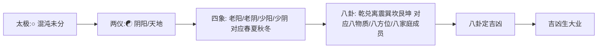
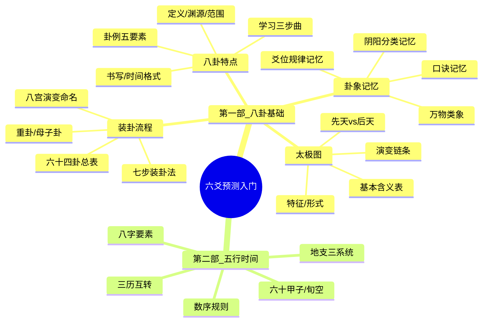

# 李汶钊《六爻预测入门》知识页面

> 本页面依据李汶钊《六爻预测入门》全书内容编撰，涵盖序言、八卦基础、太极图、装卦流程、五行时间体系、六十四卦详表等核心板块，旨在为零基础学习者提供结构化、可交叉引用的知识地图。

---

## 一、 书籍概况与定位

| 项目 | 说明 |
|------|------|
| **书名** | 《六爻预测入门》 |
| **作者** | 李汶钊（李顺祥入室弟子） |
| **性质** | 零基础自学教材，图文并茂、逻辑严密 |
| **核心宗旨** | “人人都能读懂、学会”，缩短自学周期，面授 30 小时达专业水平，自学约 2–3 倍时间同效 |
| **师承脉络** | 师从“预测活电脑”李顺祥教授，得恩师指导点阅 |
| **适用对象** | 无命理基础者、自学者、易学入门者 |

> **交叉引用**：同类入门教材可参考 [[liuyao-jichu-rumen-qinglan]]、[[liuyao-qimeng-jieyao]]、[[liuyao-shizhan-dianqiao]]；进阶体系见 [[huangji-liuyao-tixi]]、[[liuyao-bagua-quanxi-lun]]、[[liuyao-xizhen-quwei]]。

---

## 二、 第一部：八卦基础知识

### 第一章 八卦的特点

#### 什么是八卦（文王卦/六爻预测）
- **渊源**：周文王在梅花易数基础上加入天干、地支、六亲、世应而成，已逾五千年。
- **原理**：运用数、理、象一体，通过阴阳、五行、八卦、干支组合运算，快速推断古今未来。
- **特点**：简单、快捷、准确；起卦法灵活（铜钱、时间、数字、颜色、首饰、方向等），不需文房四宝。

#### 预测范围
婚姻感情、投资财运、事业股票、学业疾病、风水天气、流年运程等日常事务均可预测。

#### 八卦卦例的五大组成要素
| 代码 | 要素 | 示例 |
|------|------|------|
| A | 拟定预测问题 | “投资房地产前景如何？” |
| B | 起卦时间 | 丁亥年 壬寅月 己丑日 己巳时 (午未空) |
| C | 主卦/变卦卦名 | 主卦“火雷噬嗑”，变卦“震为雷” |
| D | 主卦/变卦卦象 | 含干支、六亲、世应、爻位 |
| E | 六兽（六神） | 螣蛇、白虎、玄武、青龙、朱雀、勾陈 |

#### 卦象书写方式差异
- **横式（现代/大陆）**：主卦左、变卦右
- **直式（古代/港澳台）**：主卦右、变卦左
- **世应位置**：爻位间、卦象左侧均可
- **六兽位置**：两卦之间、卦象左侧均可

#### 时间书写方式
- **横式**：丁亥年 壬寅月 己丑日 己巳时（或竖排年月日时）
- **直式**：年月日时自右向左、自上而下排列

#### 学习三步曲与时长
1. **五行基础**（金木水火土、十天干、十二地支、生克关系）——较八字简单
2. **装卦**（可查表抄写，极短时间掌握）
3. **解卦象**（核心目的，耗时最长）  
> 作者面授：无基础学员 30 小时达专业水平；自学约 2–3 倍时间同效。

---

### 第二章 太极图

#### 太极特征
- **含义**：一圆点代表一物一事，大无外、小无内；黑白二色表达对立统一（此消彼长、阴阳消长），且“白中藏黑、黑中藏白”，对立中发展、合为整体。
- **形式**：顺/逆时针、左白右黑、左黑右白、上黑下白等均可，无绝对顺逆终始。

#### 太极时空演变链条

- **天人合一**：人与宇宙感应，预测师第六感在卦中浮现讯息并吻合事实。
- **全息思维**：易经采用整体、全息、系统思维，故可据时据讯推演古今。

#### 先天八卦 vs 后天八卦
| 维度 | 先天八卦（伏羲/河图洛书） | 后天八卦（文王/四时生长收藏） |
|------|---------------------------|-------------------------------|
| **核心依据** | 太阳投影 S 状轨迹 | 春生夏长秋收冬藏 |
| **排序连线** | 乾兑离震巽坎艮坤成“S”形 | 洛书九宫布局 |
| **数值/方位** | 乾1南、兑2东南、离3东、震4东北、巽5西南、坎6西、艮7西北、坤8北 | 乾6西北、兑7西、离9南、震3东、巽4东南、坎1北、艮8东北、坤2西南 |
| **预测应用** | **用先天数** | **用后天方位** |

> **记忆简表**（本书建议仅记此表）：
| 卦名 | 卦象 | 先天数 | 后天方位 |
|------|------|--------|----------|
| 乾 | ☰ | 1 | 西北 |
| 兑 | ☱ | 2 | 西 |
| 离 | ☲ | 3 | 南 |
| 震 | ☳ | 4 | 东 |
| 巽 | ☴ | 5 | 东南 |
| 坎 | ☵ | 6 | 北 |
| 艮 | ☶ | 7 | 东北 |
| 坤 | ☷ | 8 | 西南 |

#### 八卦基本含义表（万物类象核心）
| 卦名 | 卦象 | 卦数 | 自然 | 家族 | 方位 | 五行 | 颜色 |
|------|------|------|------|------|------|------|------|
| 乾 | ☰ | 1 | 天 | 父 | 西北 | 金 | 白 |
| 兑 | ☱ | 2 | 泽 | 少女 | 西 | 金 | 白 |
| 离 | ☲ | 3 | 火 | 中女 | 南 | 火 | 红 |
| 震 | ☳ | 4 | 雷 | 长男 | 东 | 木 | 绿 |
| 巽 | ☴ | 5 | 风 | 长女 | 东南 | 木 | 绿 |
| 坎 | ☵ | 6 | 水 | 中男 | 北 | 水 | 黑 |
| 艮 | ☶ | 7 | 山 | 少男 | 东北 | 土 | 黄 |
| 坤 | ☷ | 8 | 地 | 母 | 西南 | 土 | 黄 |

---

### 第三章 卦象含义与记忆

#### 八卦万物类象
- 由宋代邵康节创立，内容浩繁，初学者可暂略过，详见书中“附录一”。

#### 卦象符号记忆三法
1. **按性别/阴阳分类**
   - **阳卦（父/长男/中男/少男）**：笔划皆为奇数（乾3划，其余5划）
   - **阴卦（母/少女/中女/长女）**：笔划皆为偶数（坤6划，其余4划）
2. **按阴阳爻位置记忆**
   - 乾☰三阳（纯阳）、坤☷三阴（纯阴）
   - 震☳初爻阳→长男；坎☵中爻阳→中男；艮☶上爻阳→少男
   - 巽☴初爻阴→长女；离☲中爻阴→中女；兑☱上爻阴→少女
   - **四对互补**：乾↔坤、震↔巽、坎↔离、艮↔兑
3. **八卦口诀**
   > 乾三连，坤六断。  
   > 震仰盂，艮覆碗。  
   > 离中虚，坎中满。  
   > 兑上缺，巽下断。

---

### 第四章 装卦—— 核心实操流程

#### 重卦基础
- **经卦/单卦**：三爻组成，共 8 个。
- **重卦/别卦**：经卦重迭，共 64 个。
- **八纯卦/母卦/第一卦**：上下卦相同（如乾为天），每宫 1 个，共 8 个。
- **子卦**：母卦从初爻至五爻依次变爻（阴变阳、阳变阴），第七卦回落四爻，第八卦初二三同时变。

#### 八宫演变与命名规则
- **母卦**：本宫名+自然现象（乾为天、兑为泽…）
- **子卦**：上卦自然现象+下卦自然现象+卦名（读法：上→下），如“天泽履”。
- **八宫演变表**：书中列出乾、兑、离、震、巽、坎、艮、坤八宫各 8 卦演变路径及卦名。

#### 变爻符号
- **阳动变阴**：“—动” → “--” 记作 “○”
- **阴动变阳**：“--动” → “—” 记作 “×”

#### 装卦七步标准流程

| 步骤 | 名称 | 核心规则/口诀 | 关键点 |
|------|------|---------------|--------|
| 1 | **纳地支** | 阳卦顺排阳支，阴卦逆排阴支；八母卦定初爻，其余隔位取 | 乾子震子坎寅艮辰，坤未兑巳离卯巽丑 |
| 2 | **寻母宫、装世应** | 子卦反推至上下卦同即母卦；世位按卦序：母六、二初、三二、四三/七、五五、六四、七四、八三；应与世隔两位（上下对应、天地人位对应） | 口诀：天同二世天异五，地同四世地异初，人同四位人异三，纯六三异下天处 |
| 3 | **装伏爻** | 主卦缺五行/六亲（最多两个）时，从母卦同位移入，六亲不变 | 如《山风蛊》缺火，补自《巽为风》 |
| 4 | **纳天干** | 十干配八宫：阴卦乙丁己辛癸（顺配母→逆少女/中女/长女→母），阳卦甲丙戊庚壬（顺配父→逆少男/中男/长男→父） | 口诀：父少与中长，甲丙戊庚壬；母少与中长，乙丁己辛癸 |
| 5 | **装六亲** | 以宫五行为“我”，按生克定六亲：同我=兄弟、我生=子孙、我克=妻财、克我=官鬼、生我=父母 | 八宫六亲对照表见书 P.49-51 |
| 6 | **取六神(六兽)** | 日干定初爻六神，其余顺时针上排：甲乙→青龙，丙丁→朱雀，戊→勾陈，己→螣蛇，庚辛→白虎，壬癸→玄武 | 六神相生循环：青龙(木)→朱雀(火)→勾陈/螣蛇(土)→白虎(金)→玄武(水)→青龙 |
| 7 | **六十四卦总表** | 书中附全表，含八宫各卦完整六亲、干支、世应、六神、爻辞 | 可直接查表抄写，免记忆 |

> **实战装卦示例**：书中以“测投资房地产”卦例（火雷噬嗑之震为雷）演示全流程，含时间排布、主变卦对照、六亲六神世应齐备。

---

## 三、 第二部：五行基础知识

### 第一章 时间体系

#### 三大历法记录法
| 历法 | 别称 | 示例（同一时刻） |
|------|------|------------------|
| 公历 | 新历 | 2009年2月27日 12:45 |
| 农历 | 旧历 | 二零零九年二月初三午时 |
| 八字 | 四柱 | 己丑年 丙寅月 癸卯日 戊午时 |

> **转换工具**：万年历可三历互转。

#### 八字记录核心元素
- **十天干**：甲乙丙丁戊己庚辛壬癸
- **十二地支**：子丑寅卯辰巳午未申酉戌亥
- **组合规则**：干支配合成柱（年柱、月柱、日柱、时柱），共八字，古书上下排列如柱状，故称“四柱”。
- **六十甲子**：十干×十二支按序配合，得 60 组不重复干支（甲子、乙丑…癸亥），分六旬（甲子旬、甲戌旬…甲寅旬）。

#### 旬与旬空（空亡）
- **旬**：十天干一周期 = 十天 = 一旬；六旬 = 六十天 = 六十甲子一周。
- **旬空**：一旬十天用完十干，余两支无干配 → 空亡。
  - 规律：癸后两支、或甲前两支。
- **六旬空亡对照表**：

| 旬名 | 空亡地支 |
|------|----------|
| 甲子旬 | 戌、亥 |
| 甲戌旬 | 申、酉 |
| 甲申旬 | 午、未 |
| 甲午旬 | 辰、巳 |
| 甲辰旬 | 寅、卯 |
| 甲寅旬 | 子、丑 |

#### 地支三大代表系统

| 系统 | 起始/规则 | 对照表 |
|------|-----------|--------|
| **时辰（十二时辰）** | 子时 23:00-01:00 为首，顺推，亥时 21:00-23:00 为尾；八字日界在 23:00 | 子丑寅卯辰巳午未申酉戌亥 |
| **月建（十二月建）** | 正月建寅，顺推至十二月建丑；以二十四节气“节”为月界（立春、惊蛰、清明…） | 寅卯辰巳午未申酉戌亥子丑 |
| **生肖（十二属相）** | 子鼠、丑牛、寅虎、卯兔、辰龙、巳蛇、午马、未羊、申猴、酉鸡、戌狗、亥猪 | 固定对应 |

#### 地支数序（年/月/时）
| 序类 | 起始 | 终止 | 编号规则 |
|------|------|------|----------|
| 年序 | 子年=1 | 亥年=12 | 子丑寅卯辰巳午未申酉戌亥 → 1-12 |
| 月序 | 寅月=1 | 丑月=12 | 寅卯辰巳午未申酉戌亥子丑 → 1-12 |
| 时序 | 子时=1 | 亥时=12 | 子丑寅卯辰巳午未申酉戌亥 → 1-12 |
| 日序 | 不固定编号 | — | 以六十甲子循环，习惯不编序数 |

---

## 四、 核心知识图谱速查

---

## 五、 交叉引用导航

| 专题 | 相关页面 | 说明 |
|------|----------|------|
| **六爻入门体系** | [[liuyao-jichu-rumen-qinglan]]、[[liuyao-qimeng-jieyao]]、[[liuyao-shizhan-dianqiao]] | 同类零基础教材对照 |
| **皇极六爻体系** | [[huangji-liuyao-tixi]]、[[liuyao-caiyun-mifa]]、[[liuyao-hunyun-mifa]] | 贾秉然体系进阶 |
| **六爻实战/象法/理法** | [[liuyao-bagua-quanxi-lun]]、[[liuyao-xiangfa-jinjiie]]、[[liuyao-lifa-jinjiie-qinglan]] | 青岚/马凤魁等实战体系 |
| **六爻疑难/案例** | [[liuyao-yihui-zhimi]]、[[liuyao-xizhen-quwei]]、[[liuyao-zhenjian]] | 曲炜/王虎应疑难解析 |
| **八字/五行基础** | [[bazi-mingli-xue-jichu-jiaocheng]]、[[bazi-mingli-xue-jin-jie-jiaocheng]] | 陆致极八字教程，补强干支生克 |
| **梅花易数/外应** | [[qiao-mei-hua-wai-ying-yu-ce-shu]] | 邓海一俏梅花外应预测 |
| **奇门遁甲/大六壬** | [[bu-chui-niu-qimen-jiangyi-yi]]、[[liuren-shen-ke-chu-xue-xiang-jie]] | 古三式姊妹术数体系 |

---

## 六、 学习路径建议

1. **首读**：通读“序言→八卦特点→太极图→先后天八卦→基本含义”，建立整体认知框架。
2. **记忆**：攻克“八卦符号口诀、先天数/后天方位简表、六亲生克表、六神日干对应表”。
3. **实操**：按“装卦七步流程”手工装 3–5 卦，对照书中“六十四卦总表”核对。
4. **时间体系**：熟练“三历互转、旬空查找、月建节气界、时辰/生肖/数序”速查。
5. **进阶**：研习“六亲取用、世应吉凶、动爻变化、六神象意、应期断验”，并结合 [[liuyao-shizhan-dianqiao]] 第 7–9 章实战断卦方法论。

---

> **提示**：本书最大特色在于“装卦标准化、表格化、口诀化”，初学者可直接依照“七步流程+总表”快速上手；后续解卦象部分需结合大量实战卦例（可参考 [[liuyao-shizhan-da-quan]]、[[liuyao-shen-gua-shi-zheng-ji-lu]]）深化体会。

## 来源

- [六爻预测入门](../sources/六爻预测入门.md)
