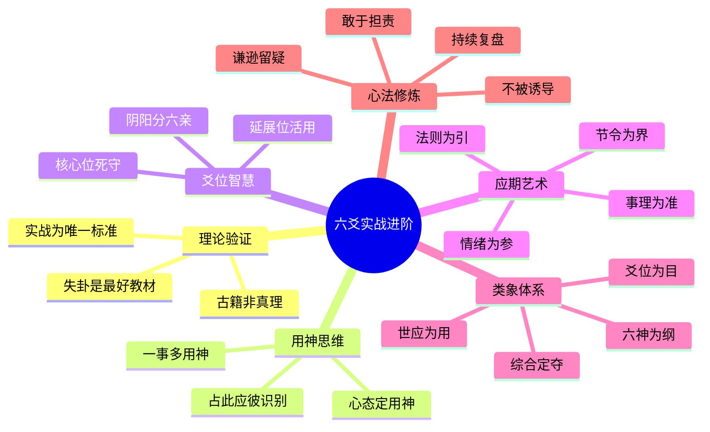

# 六爻预测误中悟

> **书籍信息**  
> - **作者**：王虎应  
> - **核心定位**：六爻预测实战失卦复盘与方法论提炼  
> - **章节结构**：十六章，每章聚焦一类核心误区  
> - **相关著作**：[[liuyao-yinyuan-yuce]]、[[liuyao-yihui-zhimi]]、[[liuyao-jingji-yuce-xue]]、[[wang-hu-ying]]

---

## 核心思想：从失误中提炼规律

> “任何人都是从失误中走过来的……怕测错就永远学不会预测。”  
> — 王虎应《序言》

本书以作者三十余年、上万卦实战中典型失误为素材，遵循 **“失卦 → 复盘 → 古籍佐证 → 规律提炼 → 再验证”** 的闭环，构建了六爻预测从错误中进化的实战方法论。其核心主张包括：
- **理论活用**：古籍非真理，需实战验证（《增删卜易》《卜筮正宗》等常被引用并校勘）
- **用神灵活**：同一事项可因卦象结构、求测心态而异（如签证看父母、疾病看元神、心态定吉凶）
- **爻位延展**：爻位非死板对应，二爻可为“家/附近/单位/故乡”等生活密切场所
- **应期弹性**：结合节令、社俗、事体轻重、卦象微妙变化综合断验
- **心态解卦**：求测者强烈心态可投射入卦（忧虑测鬼旺为凶、子孙旺为吉）

---

## 十六章误区与修正法则速览

| 章节 | 核心误区 | 修正法则/关键洞见 | 典型案例 |
|------|----------|---------------------|----------|
| **一** | 婚期仅盯用神（官鬼） | **父母临日/合日定婚期**；父母为证书盟约，临日主事成在即 | 未月丙寅日离为火，酉月成婚、丁丑年寅月流产、后离婚全验于爻象 |
| **二** | 出国签证看驿马 | **签证属文书，看父母爻**；世爻兼看出行能否动 | 亥月辛亥日震之履、子月丁丑日大有之损、甲月乙未日益之观、戊月乙未日贲之渐 |
| **三** | 用神旺相必吉 | **用神值月当月死**；用神临月建且化鬼/逢冲克，主本月凶亡 | 巳月甲寅日丰之复、巳月己酉日坤之蛊、寅月乙丑日讼之姤、酉月庚辰日师之升 |
| **四** | 所测即所应 | **占此应彼**；一爻独发、独发爻与用神关系不紧、招聘类需兼看应爻 | 巳月辛未日恒之大过（应申月工作变动）、酉月戊戌日随之涣（公司倒闭）、亥月庚辰日恒之鼎（朋友公司倒闭） |
| **五** | 爻位死板（二爻=家） | **爻位活用**；二爻为“身心归宿的生活密切场所”，可延展为家/院/林/单位/故乡等 | 巽为风二爻亥水克应“树林上吊”、午月庚午日归妹判断日本男子住宅风水全验 |
| **六** | 僧道/九流统用子孙 | **分自占/他占、子孙/应爻双参**；验证《易隐》《增删卜易》《易林补遗》三说优劣 | 戊月丁未日屯之临（喇嘛未至）、丁丑年午月甲申日家人之观、辰月癸未日贲之渐、戌月壬申日小畜之需 |
| **七** | 应期死扣冲合日 | **应期灵活把握**；结合邮政速度、节令交接、十月怀胎常识、求测情绪 | 午月丁酉日无妄→辛丑日革之夬（书到癸丑日）、酉月己巳日蒙之师（乙亥日亡）、寅月辛酉日鼎之升（戊子日子时亡）、卯月丁未日节之屯（戌时寻回护照）、亥月丁酉日艮之巽（未月丑日生产） |
| **八** | 被求测者语言诱导 | **坚守卦象，不受心态左右**；预测师自信判断产生震撼力 | 寅月癸未日井之蹇（申月成婚非巳月）、卯月癸亥日艮为山（纪检委非政协）、寅月壬寅日蛊之颐（肝硬化亡）、未月戊辰日姤之夬/同人（考不上大学） |
| **九** | 生男女死套古诀 | **古籍理论需实战验证，子孙单/双现分治、阴阳旺衰定变化** | 丑月辛酉日同人之离（断女实男）、辰月戊辰日小过之豫（男占独发阳动生女）、辰月戊子日艮之剥（女占独发阴动生男）、戌月辛卯日蒙之涣/泰之临、巳月癸卯日丰之离 |
| **十** | 合处逢冲机械用 | **病重者逢克即亡，节令交接为关键节点** | 卯月庚辰日小畜之姤（辰月亡非未月）、申月庚子日随之噬嗑（丑日午时亡）、卯月辛亥日小畜变姤（子日子时亡） |
| **十一** | 忽略求测心态投射 | **把握心态：忧虑测鬼旺为凶、子孙旺为吉**；财/官/子孙可代表“心态”而非事物本身 | 未月戊子日复（临时工忧虑失业）、卯月壬申日复（忧虑鬼破克去恢复工作）、丑月丙寅日噬嗑之无妄（财爻=本人忧虑钱在）、戌月乙酉日井之屯（担心怀孕官旺验孕）、子月戊寅日大畜（担心怀孕官持世验孕）、戌月丁卯日萃之比（担心分手子孙克鬼验分手） |
| **十二** | 元神过弱应期难解 | **元神极弱入墓日应验**？尚存疑窦，需集思广益 | 巳月庚辰日师之恒（壬辰日亥时产，非预测甲申日） |
| **十三** | 搬家产期日冲突 | **子孙入墓冲开日应产，养地空亡旬避之**；戊申日生非丁未日，迷团未解 | 申月辛卯日复之震（丙申搬家、戊申难产生男） |
| **十四** | 类象单一（未土=书柜） | **类象需结合六神、爻位、世爻沐浴等综合定夺**；父母临世沐浴=脱衣=衣柜 | 巳月壬申日涣之师（钥匙在衣柜非书柜）、未月丙申日履之归妹（证书在西北包内亥时寻获） |
| **十五** | 父母爻不分阴阳 | **阴阳分父母**：阳爻/天位=父，阴爻/地位=母；双现父母以动爻定用神 | 酉月乙巳日涣之乾（问父病应母亡）、未月庚戌日姤之大过（癸未年死母离婚丢工作） |
| **十六** | 双子孙=双胞胎 | **双子孙不必然双胎**；需结合胎爻、日辰、卦象综合判断 | 申月丙午日蒙之大畜（断双胎龙凤胎，实为单胎） |

---

## 章节深度解析

### 第一章 父母临日定婚期
- **失误卦**：未月丙寅日离为火（六冲）、离之旅（六冲变六合）  
- **误判**：官鬼亥水休囚合日、子孙月破日克 → 断不成婚、无生育力  
- **实况**：酉月成婚、丁丑年寅月怀孕、后因洗澡流产离婚  
- **悟解**：见《卜筮正宗》**“日逢父合，已期合成于三星”**；父母为结婚证书，临日/合日主婚期不远。初爻父母卯木同类寅木、应爻官鬼合父母，酉月冲动酉金生官鬼应验。  
- **验证卦**：乙亥年丁亥月戊申日履之小畜，父母巳火合日、午火变爻合冲 → 断巳月成婚，果因父母反对另嫁他人巳月婚。

> **关联页面**：[[liuyao-yinyuan-yuce]]（王虎应姻缘预测专著）、[[liuyao-yihui-zhimi]]（疑惑指迷问答集）

---

### 第二章 预测出国办签证的思考
- **核心转折**：从“看驿马” → **“签证属文书看父母，世爻兼看出行能否动”**  
- **四卦验证**：
  1. 亥月辛亥日震之履：父母子水旺但六冲伏吟、兄弟化进克世 → 断出不去，果拒签
  2. 子月丁丑日大有之损：父母辰土持世化退、兄弟酉金动合 → 断当年无份、卯年冲开应验赴美进修
  3. 甲月乙未日益之观：父母子水伏藏动化回头克 → 断长期看壬午年成，果2002年获加拿大定居签
  4. 戊月乙未日贲之渐：父母午火伏藏、财爻子水动克又化父母、世动引财 → 断初拒后成，果二签过

> **关联思维**：同类“文书类事务”均可引申父母爻为主用神，参考[[liuyao-jingji-yuce-xue]]经济预测中合同、文书取象。

---

### 第三章 用神值月当月死
- **法则**：**用神临月建且卦现凶象（化鬼、逢冲、入墓），主本月凶亡**  
- **四卦铁证**：
  1. 巳月甲寅日丰之复：妻财午火值月化官鬼丑土（太岁）、忌神亥水实破克用 → 癸亥日酉时亡
  2. 贾达卿巳月己酉日坤之蛊：父母巳火值月、内卦反吟、酉日冲实动变回头克 → 当日亥时亡
  3. 刘大钧寅月乙丑日讼之姤：父母寅木值月应爻、一爻独发入死地 → 当月亡
  4. 《卜筮正宗》酉月庚辰日师之升：父母酉金值月空亡合日、忌神持世化空 → 当月乙酉日卯时亡

> **提示**：非凡值月必死，须**“参考其他爻变化综合判断”**；见[[liuyao-sanda-jifa]]应期占技法中“用神临月”规则。

---

### 第四章 占此应彼的失误
- **典型特征**：**一爻独发、独发爻与用神关系不紧、招聘/应聘类需兼看应爻（招聘单位）**  
- **案例三则**：
  1. 恒之大过：官鬼独发化进神应申月，实为工作变动非录用
  2. 随之涣：应爻妻财动化破（六爻尽头） → 公司甲辰日倒闭，戌月另就业
  3. 恒之鼎：应爻妻财动化破 → 朋友公司月内倒闭，避免跳槽失业

> **方法论**：**“有了这个思路后，我还真应验过不少卦例”** —— 建立“占此应彼”识别清单，纳入[[liuyao-q-and-a-quwei]]答疑体系。

---

### 第五章 死亡地点的失误 → 爻位活用
- **失误**：二爻父母亥水被克、日冲入五爻（脖子） → 断“家中上吊”，实为“离家不远树林”  
- **悟解**：**二爻为“与自己生活关系密切的活动场所，身心归宿”，可无限扩展**  
- **实战验证**：
  - 日本男子午月庚午日归妹：二爻卯木→东面树林、应爻父母空→空闲车库、财爻呈蛇→乱放油桶、父母青龙→环境优美、官鬼生世→事业中心地带、财弱应空→婚姻晚 —— 全验
  - 县干部午月戊子日咸之革：二爻父母辰土动→单位宿舍有地下室、应爻父母未土→新单位房子

> **爻位延展表**：二爻＝家/房子/院子/店铺/办公室/娘家/故乡/公司/祖国……视预测对象而定。

---

### 第六章 三教九流和子孙爻
- **争议**：僧道/盲师/命理师等“三教九流”预测，**用子孙爻还是应爻？**  
- **古籍三说**：
  - 《易隐》：他占僧道用应爻
  - 《增删卜易》：子孙为用
  - 《易林补遗》：应爻为主、福德为凭
- **实战验证**：
  1. 屯之临：子孙持世化进、应爻官鬼动化兄弟 → 以应爻为用“世克应人不来”验；子孙说勉强
  2. 家人之观：子孙巳火临应、日合（盲目信息）、亥水冲合 → 子孙/应爻重合难辨
  3. 贲之渐：**应爻兄弟戌土月破、世克应、世动化兄弟（车胎放炮）、五爻妻财子水动合二爻生世（搭车女子）、应爻月破世克应（郝先生病未至）** → **应爻为用全验**
  4. 小畜之需：应爻妻财未土得月扶、六爻卯木独发克应克父母（水平）、应爻元神火临勾陈合日（盲人） → 应爻验

> **结论**：**“到底是用子孙爻呢，还是用应爻呢……还需要自己验证才是”** —— 纳入[[liuyao-qimeng-jieyao]]神煞/用神专题。

---

### 第七章 为什么不应第一个丑日 → 应期弹性
- **两卦追问**：
  1. 午月丁酉日无妄：父母子水月破日生 → 断辛丑日收书，未收
  2. 午月辛丑日革之夬：父母酉金月克日生、丑土动生、未土暗动 → 仍应丑日
- **悟解**：**结合实际（邮政速度）、节令（出月不破）、元神空亡（寅木空）综合判断** → 癸丑日（未月）收到
- **延展案例**：
  - 蒙之师：独发卦、用神动值/合、亥日先于寅日、用神休囚怕长生 → 乙亥日巳时亡
  - 鼎之升：用神伏藏、日冲伏神当天不应、应用神出现（卯月节令交接） → 戊子日子时亡
  - 节之屯：子孙独发化退（解忧神退=暂找不到）、日生父母 → 当日戌时寻回
  - 艮之巽：子孙旺相、父母动克被月制、结合**十月怀胎常识** → 未月合住父母生子

> **金句**：“应期虽然有各种法则，但不是死的，需要根据事情的内容、轻重缓急、大小等灵活把握。”

---

### 第八章 不能让求测人左右你的思维
- **两大反面教材**：
  1. 井之蹇：求测者言“五一后婚” → 迎合改巳月，实申月婚、后因阳痿离
  2. 艮为山：求测者言“定去政协” → 坚断公检法，八年后验纪检委
- **正面坚守**：
  - 蛊之颐：世爻动化空、久病逢空死 → 坚断次年辰年亡，果肝病亡
  - 姤之夬/同人：母女争辩考得好 → 坚断两卦官鬼空克、子孙暗动、朱雀父母退（外语退）、勾陈父母破（地理差） → 果落榜
- **原则**：“预测要坚持原则，对错依据卦而判断，不能把想当然带到卦里。”

---

### 第九章 书上的理论不一定就是真理 → 生男女验证
- **失误卦**：同人之离，申金独发阳动 → 按《增删卜易》**“一爻动者，阳动为女”** 断女，实生男
- **古籍卦例复盘**：
  1. 小过之豫：男占、兄爻动变阴 → 断女验
  2. 艮之剥：女占、子孙独发 → 不报男女（神随人念，占此应此）
  3. 蒙之涣：男占、子孙两现、用辰土应期、戌土独发阴动 → 断男验
  4. 泰之临：男占、子孙单酉金旺相阴动 → 旺则变 → 断男验（剖腹产）
  5. 丰之离：男占、子孙卯木旺相阴动 → 断男验（剖腹产）
- **假设修正**：
  - 子孙**两现**时：一爻定应期、一爻定男女（阴阳旺衰定变化）
  - 子孙**单现**时：按《增删卜易》阴阳动静、旺衰变化判断
  - **“任何理论没有100%的规律，规律只是概率高些而已，这也许就是三易中的变易吧。”**

> **关联**：[[liuyao-xizhen-quwei]]信息象提取中“子孙爻性别断验”专题。

---

### 第十章 难道是死期提前了吗 → 病重逢克即亡、节令为界
- **失误卦**：小畜之姤，父母子水入墓动化回头克、未土动克 → 断未月冲开合凶，实辰月亡
- **悟解**：**用神极休囚，不能机械用“合处逢冲”，病重者逢克即亡；且距辰月仅一周，节令交接为关键**
- **验证卦**：
  - 随之噬嗑：父母子水值日临白虎、忌神六爻动克、世空鬼旺忧虑 → 断次日丑日午时亡，验
  - 小畜变姤：父母子水独发化回头克临白虎 → 断子日子时亡，验（次日凌晨12:30）

---

### 第十一章 把握来人心态关系到预测的成效
- **核心法则**：**“忧虑而测，鬼旺为凶，鬼弱为吉；子孙旺动为吉，子孙休囚为凶”**  
- **五大心态投射案例**：
  1. 复卦：临时工怕失业、官鬼旺相 → 官鬼代表“忧虑”非工作 → 失业
  2. 复卦：被停职装上班、官鬼月破化回头克 → 官鬼代表“忧虑”被克去 → 恢复工作
  3. 噬嗑之无妄：银行卡丢失怕钱被取、财爻世爻月冲化官鬼 → 财爻代表“本人忧虑”、日冲官鬼解忧 → 钱在
  4. 井之屯：同居女怕怀孕、官鬼旺动化回头生 → 官鬼代表“忧虑”旺=怀孕、子孙空伏=流产 → 子日流产
  5. 大畜：男怕婚外女怀孕逼婚、官鬼持世旺相 → 官鬼=忧虑旺=真怀孕、后验孕
  6. 萃之比：男怕情人威胁分手、子孙独发克鬼 → 子孙=“顾虑”克去忧虑鬼 → 翌年酉年分手

> **方法论**：**“看卦一定要把握好求测人的心态”** —— 纳入[[liuyao-foundation-basics]]“三大潜规则”心态篇。

---

### 第十二章 难道是应了元神过弱
- **卦例**：师之恒，子孙寅木初爻休囚、元神午火月破日克丑土动克、午火动生 → 断午月申日亥时产
- **实况**：壬辰日（辰日）亥时产，提前四天
- **疑窦**：辰土为世爻所生（=孩子）、临二爻胎位？元神弱极入墓日应？**“目前没有好的解释，希望大家也来思考”** —— 留待后学破解。

---

### 第十三章 直到现在也解不开的迷团
- **搬家卦**：复之震，子孙酉金入墓冲开应未日、甲午旬元神辰土空避丁未日
- **实况**：丙申日搬家、戊申日生男难产，**差一天（戊申非丁未），酉日未应、申日应** —— **“直到现在我还悟不出其中的原由来”**

---

### 第十四章 书柜和衣柜之误 → 类象综合定夺
- **失误**：涣之师，妻财伏未土（西南墓库）、父母卯木临朱雀（文书） → 断书柜，实为衣柜
- **悟解**：**父母卯木为世爻沐浴地（脱衣）、父母主衣服、未土为放脱衣容器=衣柜**；若父母临朱雀则宜书柜
- **验证卦**：履之归妹，父母巳火空合为用、世动合父母、用神空合日入墓戌土（西北）、外卦伏吟（多次找） → 亥时西北包内寻获证书

---

### 第十五章 难道是鬼差抓错人了吗 → 阳父阴母
- **失误卦**：涣之乾，父母两现：六爻卯木（阳/天位）、初爻寅木（阴/地位/动化鬼） → 以动爻寅木为用断父亡，实母亡
- **法则**：**“阳为父，阴为母，此说也有一定的道理”** —— 阳爻/上卦/天位=父，阴爻/下卦/地位=母
- **验证卦**：姤之大过，父母两现：初爻丑土（阴/月破/白虎/世爻）=母、六爻戌土（阳）=父 → 癸未年财入墓冲破父母（婚书）→ 死母又离婚、丢工作、辰月新工作

---

### 第十六章 错看双胞胎
- **卦例**：蒙之大畜，子孙两现（戌土阳/辰土阴）、午火动化子孙、日上见胎地 → 断巳年怀孕午年生双胞胎龙凤胎
- **实况**：单胎，**“双子孙不必然双胎，需结合胎爻、日辰、卦象综合判断”** —— 文中未给出最终验证，留作读者思考。

---

## 方法论总结：从《误中悟》看六爻实战进阶路径

---

## 关键术语对照表

| 术语 | 定义/用法 | 本书典型案例 |
|------|-----------|--------------|
| **父母临日** | 父母爻与日辰同五行或相合，主文书/证书/婚约事成在即 | Ch1、Ch15 |
| **用神值月** | 用神五行与月建相同，卦现凶象主本月应验（多为凶亡） | Ch3、Ch10 |
| **占此应彼** | 所问之事未应，卦反映他事；多见一爻独发、独发爻与用神关系疏 | Ch4 |
| **爻位活用** | 爻位非固定对应，依预测对象、卦宫、六神综合延展 | Ch5、Ch14 |
| **心态投射** | 求测者强烈情绪（忧/恐/盼）投射入卦，使特定六亲代表“心态”而非事物 | Ch11 |
| **元神过弱** | 原神休囚入墓/绝，应期可能落于元神入墓/绝之日 | Ch12 |
| **阴阳分父母** | 父母双现时，阳爻/上卦/天位=父，阴爻/下卦/地位=母 | Ch15 |
| **合处逢冲** | 动爻合住用神，冲开合神之日应验；病重者不可机械套用 | Ch10 |
| **出月不破** | 爻值月破，出月建不破之月应验 | Ch7、Ch9 |
| **久病逢空/合/冲** | 久病逢空多死、逢合多愈、逢冲多死；需结合用神衰旺 | Ch1、Ch10 |

---

## 交叉引用导航

- **作者体系**：[[wang-hu-ying]] → [[liuyao-yinyuan-yuce]]、[[liuyao-yihui-zhimi]]、[[liuyao-jingji-yuce-xue]]
- **同派实战**：[[liuyao-caiyun-mifa]]、[[liuyao-hunyun-mifa]]、[[liuyao-zaihuo-yuce]]（贾秉然皇极六爻实例汇解）
- **基础理论**：[[liuyao-foundation-basics]]、[[liuyao-sanda-jifa]]、[[liuyao-xizhen-quwei]]、[[liuyao-q-and-a-quwei]]
- **其他预测体系对照**：[[liuren-shen-ke-chu-xue-xiang-jie]]（六壬）、[[qiao-mei-hua-wai-ying-yu-ce-shu]]（梅花易数）、[[bu-chui-niu-qimen-jiangyi-er-gongzuo-shiye-yuce]]（奇门遁甲）
- **入门进阶**：[[liuyao-qimeng-jieyao]]、[[liuyao-jichu-rumen-qinglan]]、[[liuyao-lifa-jinjiie-qinglan]]、[[liuyao-xiangfa-jinjiie]]

---

## 结语

> “善于发现和总结失误是提高水平很好的途径。”  
> — 王虎应《第十章》

《六爻预测误中悟》以**“失卦为师、古籍为证、实战为本、心法为先”**的治学态度，将十六类高频误区转化为可操作、可验证、可传承的实战法则。其核心价值不在于提供标准答案，而在于展示**“从错误中提炼规律”**的思维范式——这正是六爻预测从术走向道的关键一跃。

---

> **页面维护提示**：本页面为知识库结构化沉淀，后续可补充：
> 1. 各章卦例的完整排盘数据（纳甲、六神、六亲、世应、变爻）  
> 2. 与《增删卜易》《卜筮正宗》《火珠林》等古籍原文的逐条对照  
> 3. 读者实战验证反馈与新增案例  
> 4. 与[[liuyao-q-and-a-quwei]]、[[liuyao-xizhen-quwei]]等答疑/详真体系的交叉索引

## 来源

- [六爻预测误中悟](../sources/六爻预测误中悟.md)
