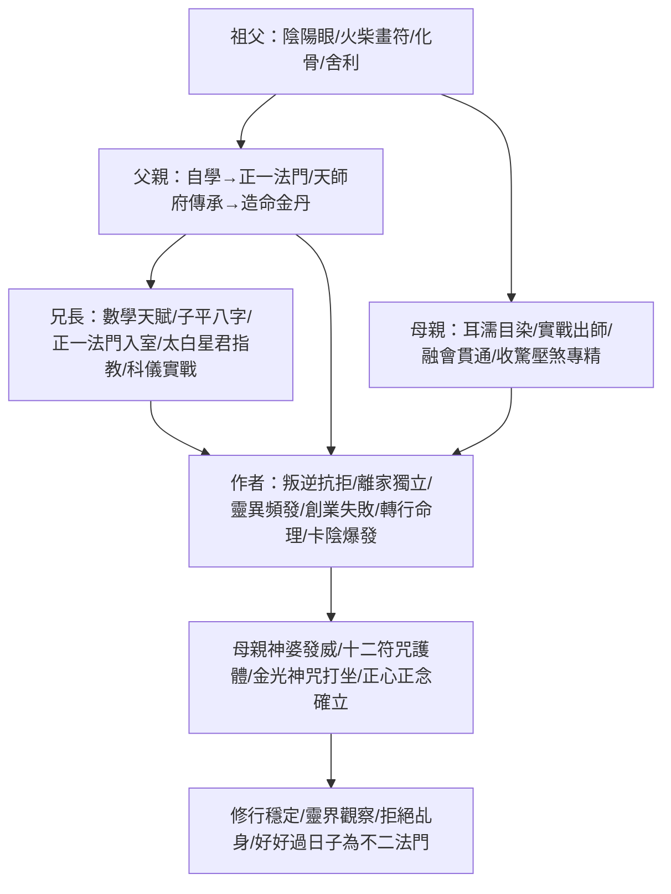

## 家族傳承脈絡總覽

本頁梳理某命理師家族三代傳承的完整脈絡，從祖父的民間巫術療癒、父親的正統道教科儀傳承與學術創新、母親的實戰驗證與法門融合、兄長的正一法門入室與星君指教，至作者從抗拒宿命到卡陰被迫修行的覺醒軌跡。這是一個關於「命運能否被改寫」的家族實證史，亦是正一道符咒體系在現代家庭傳承中的活體案例。

---

## 第一代：祖父——陰陽眼、火柴畫符、化骨舍利

### 核心特徵與能力
- **陰陽眼**：能看見「好兄弟」（靈體），國中時期即常幫人「處理」疑難雜症。
- **火柴畫符**：拿一根火柴棒，在盛了陰陽水的碗裡直接畫符，無需筆墨朱砂。
- **化骨符**：專治魚刺卡喉、小兒受驚、失眠等症，客人喝下符水休息片刻即見效。
- **舍利花驗證**：過世火化後，骨灰中燒出數朵彩色舍利花；曾託夢告知女兒（作者母親）靈體在廟宇協助，已得小神仙果位。

### 傳承影響
- 未直接傳授道法予女兒（作者母親），但母親因耳濡目染、體質敏感，仍踏入此道。
- 祖父的「化骨符」與「火柴畫符」成為家族符咒體系的源頭印記，後由母親整理融入《宅元大法》等正統符籙體系中。

> 相關交叉引用：[[ka-yin-xian-xiang-yu-hua-jie#符咒化解體系|卡陰現象與化解─符咒體系]]、[[zheng-yi-dao-fu-zhou-xiu-xing-shi-wu#符咒傳承與實務|正一道符咒修行實務─傳承脈絡]]

---

## 第二代：父親——從自學到正一法門，頓悟《造命金丹》

### 學術與修行歷程
1. **自學起步**：17 歲在華西街古書攤遇白髮老先生，獲推薦《三命通會》《窮通寶鑑》《水鏡神相》《奇門遁甲》等經典，開啟命理自學之路。
2. **拜師郭海龍**：數年後與好友共拜「中華民國星相學會」理事長**郭海龍**為師，習道教科儀。
3. **嗣漢天師府傳承**：郭海龍所供養的**第六十三代天師張恩溥**親授道法，使父親及同門功力大增。
4. **三十年聲譽**：命理學術達爐火純青，享譽海內外。
5. **民國八十二年頓悟**：突破「命運天生而定」的規則，研究出「創造人類命運」的學術體系。
6. **著《造命金丹》**：將理論與驗證心得成書，數十年投入巨資推廣，並傳授予子女與徒眾。

### 核心貢獻
- **《造命金丹》**：幾千年命理師中，對「突破人類命運定數」最具貢獻之著作。
- **家族教學體系**：將學術傳承給作者、兄長及徒弟，形成「造命」實戰傳承鏈。

> 相關交叉引用：[[zheng-yi-dao-fu-zhou-xiu-xing-shi-wu#師承嗣漢天師府|正一道符咒修行實務─師承嗣漢天師府]]、[[bazi-mingli-xue-jin-jie-jiaocheng#動態分析與造命|八字命理進階教程─動態分析與造命觀]]

---

## 第二代：母親——耳濡目染、實戰出師、融會貫通

### 學習與成就路徑
| 階段 | 關鍵事件 | 能力習得 |
|------|----------|----------|
| 嫁給父親前 | 無陰陽眼，未學道法 | — |
| 婚後半年 | 形影不離聽父親論命 | 八字理論、應用原理、元神強弱、五行生剋制化 |
| 婚後四年 | 學滿出師，加入論命行列 | 實戰膽識、命名、卜卦、擇日 |
| 進階階段 | 向父親學符法、收驚壓煞 | 符咒畫法、咒語持誦、收驚儀式、壓煞法門 |
| 長期精進 | 每日誠心供奉、自驗各法門 | 唸經咒、畫符、打坐、收驚壓煞融會貫通，獲神明感應衍生新法 |

### 獨特風格
- **不拘一格**：不論何派法門，以親身經驗驗證得道，因時因地制宜運用於案例。
- **善心持續**：數十年助人為樂，務實經驗換來高強法力，即便無正式拜師亦獲神明感應。
- **專精收驚壓煞**：為家族主要「急診」處理者，作者卡陰時即由母親主導化解。

> 相關交叉引用：[[ka-yin-xian-xiang-yu-hua-jie#母親化解實錄|卡陰現象與化解─母親化解實錄]]、[[zheng-yi-dao-fu-zhou-xiu-xing-shi-wu#收驚壓煞實務|正一道符咒修行實務─收驚壓煞實務]]

---

## 第三代：兄長——正一法門入室、太白星君指教

### 修行關鍵節點
1. **早期培養**：父親視為接班人，嚴格要求讀古籍、測試命理能力，「老師押學生用功」畫面常態化。
2. **學術天賦**：數學極強，大學主修數學系，「預測未來」吸引其鑽研子平八字，高中即從玩票轉為堅信入行。
3. **拜師劉正宗**：為增長技能拜師叔**劉正宗**為師，入**正一法門**。
4. **請神收徒**：依道教傳統請神明收徒，歸神明門下始能真正交流。
5. **太白星君導師**：**太白星君**（西方金德太白天皓星君）成為靈界導師。
6. **實戰科儀**：跟隨師叔上山下海主持法會，悉心學習正統科儀、催符、唸咒、指印等道法。

### 角色定位
- 家族**正統道法傳承人**，兼具學術分析與儀式實操雙重能力。
- 作者卡陰期間，提供令旗鎮宅、收驚協助，並引介陰陽眼友人（林姓女士）確診附身狀況。

> 相關交叉引用：[[zheng-yi-dao-fu-zhou-xiu-xing-shi-wu#正一法門入室與請神|正一道符咒修行實務─正一法門入室與請神]]、[[liu-jia-fa-shu-qi-men-ji-chu-pian#請神诀與捏訣|六甲法術奇門─請神诀與捏訣]]

---

## 第三代：作者——從叛逆抗拒到卡陰覺醒的完整軌跡

### 階段一：童年叛逆與宿命抗拒（幼兒園～國中）
- **家庭環境**：父母論命收驚，同學嘲笑「算命不準免錢」，大人輕蔑質疑。
- **父女關係**：父親嚴厲管教，挨揍慣犯（跪算盤、衣架抽打、巴掌），見父親即想逃。
- **星座迷信**：迷星座、玩碟仙筆仙，**唯獨對算命無感**。
- **神壇調皮**：偷吃供果、挖觀音水鑽、拿神明手中無字書與拂塵把玩，頻夢神明罵人或盯著看。

### 階段二：離家獨立與靈異初體驗（高中～婚前）
| 時間 | 事件 | 意義 |
|------|------|------|
| 3 歲 | 首次鬼壓床，三靈體壓身、竊笑、動彈不得、發不出聲 | 首次靈體接觸，未告知父母 |
| 高三 | 二度鬼壓床，感覺有東西順小腿摸至胸口臉頰 | 體質敏感，元氣大傷時易被干擾 |
| 19 歲 | 經辛亥隧道（墳墓上）烤肉後發燒噁心，關帝廟上香一小時痊癒 | 認識「被煞」、關帝正氣有效 |
| 租屋期間 | 半夜見黑影竄入校門樹下、貓不救主、女鬼現身床腳、六字大明咒有效一次 | 獨居無神罩，靈擾頻率升高，嘗試咒語自救 |
| 婚前 | 母親預警感情分手、車禍皆驗，始認同命理參考價值 | 宿命論鬆動，開始諮詢家中「老師」流年運勢 |

### 階段三：婚後創業失敗、全職命理、卡陰爆發（婚後～卡陰前）
- **生活型態**：日夜顛倒設計案、體質轉寒、低血壓、不出汗。
- **創業**：開童裝店、孕婦裝，母親勸勿擴張不聽，兩年傷財勞碌，金融海嘯下斷尾收攤。
- **轉行命理**：投入父母菁華，發現子平八字精準，心態大調整，順利成命理師。
- **卡陰前兆**：
  - 倉庫打單感背後發麻，店員見男靈觀望。
  - 開車頻覺眼皮重、偏頭、魂飛（極度危險）。
  - 思路遲鈍、反應鈍化、血壓極低（低壓 40、高壓 85~95）。
  - 論命攤遇黑氣女士直覺拒絕，後靈擾頻繁、精神萎靡。
  - 兄長借令旗鎮宅、母親給《北斗本命延生妙經》每日持誦金光神咒。
  - 野狗聽經定住、行天宮香灰撒床有效但需定期補充。

### 階段四：惡靈附身、神明似束手、母親神婆發威（核心卡陰實戰）

#### 夢境啟示與附身確認
- **跨海大橋夢**：反覆夢見高聳入雲大橋、幽暗死海、無聲人潮、古宅蓋章寫名、荒地市集黑眼老闆娘。
- **惡夢對決**：夢見髮髻老婆婆與護士帽老婆婆，五雷符被碰黑消失、被撲壓、醒來五感蒙霧、疑似附身。
- **林姓陰陽眼女士確診**：被女性邪靈附身、來要命、已纏繞很久。

#### 自救嘗試與神明求助
- **行天宮三收驚、護身符過爐**：暫時改善。
- **玉皇上帝（指南宮）稟告**：香入爐瞬間邪靈離開，2~3 小時後全回來。
- **關公爺爺（行天宮）擲筊**：問能否幫助→陰筊；問惡靈是否來要命→三聖筊；問是否會死→三聖筊。信心潰堤，神明似放棄。

#### 母親儀式化解（神婆發威）
| 步驟 | 操作 | 現象 |
|------|------|------|
| 拈香訴說 | 對神明陳述原委 | 作者偷拭淚、無信心 |
| 畫符淨化 | 香畫「九天玄女娘娘壓煞符」正反面來回揮動 | 邪魔騷動未完全離開 |
| 五雷符背後 | 背部畫五雷符 | 感覺壓力仍在、五感模糊 |
| 燒金紙蓮花交涉 | 門口燒金紙蓮花、請神明協調 | 眩暈噁心、體內氛圍抽離、虛脫冒冷汗 |
| 拜送邪靈 | 對門口拜請離開 | 邪靈吸收供品、不再靠近 |
| 打坐持咒護符 | 神壇前盤腿唸金光神咒、額頭朱砂畫符、飲符水 | 30 分鐘後平靜、儀式完成 |

#### 後續追蹤
- **林姓女士複查**：驚訝作者擺脫惡靈，恭喜鼓勵，**嚴誡「每天功課、千萬別偷懶」**。
- **氣色恢復**：臉色仍稍白、額頭發青黑（如烤壞麵包），靈魂進出身體頻繁。
- **路段靈體重疊**：特定路段眩暈、感覺被穿透、歪斜飄浮，疑靈魂受傷成標靶。
- **偷懶即報應**：停畫符唸咒幾天→靈壓難眠、被壓、夢惡靈；續偷懶→恍神打嗝麻重、肩頸沉重。

### 階段五：修行確立與靈界探索（卡陰後～現狀）

#### 核心認知轉折
1. **正心正念為根本**：人氣屬陽、鬼氣屬陰、邪靈極陰，唯旺盛極陽之正氣可抗衡。正心正念→散發正氣→鬼不敢近。
2. **修行非為神通**：好好過日子才是不二法門，不急尋主神、不刻意求神通，時候到自然來。
3. **拒絕乩身**：打坐現千手觀音/令牌顯像，堅決拒絕「身體給神鬼用」，堅持做正常人。
4. **母親為標竿**：敬天地不盲從、國中坐墓碑唱歌無事、境界遠超作者，成精神指標。

#### 實修體系（母親傳授《宅元大法》十二道符咒護體）
| 符咒 | 數量/頻率 | 作用 |
|------|-----------|------|
| 聖符（《宅元大法》） | 每日 10 道 | 壓枕頭、安穩睡眠、腦中雜念消 |
| 五雷符 | 每日 1 道 | 壓枕頭、防身 |
| 九天玄女娘娘祛煞靈符 | 每日 1 道 | 壓枕頭、祛煞 |
| 金光神咒 | 每日持誦 30+ 分鐘 | 核心護身、提振正氣 |
| 打坐指印 | 每次 30+ 分鐘 | 沉澱雜念、咒語迴盪、身暖心平 |

#### 修驗與觀察
- **氣色漸復**：五感恢復、悲觀念頭消失、林姓女士陰陽眼確認擺脫糾纏。
- **靈體重疊現象**：特定路段眩暈、被穿透，判斷為靈魂頻繁進出身體、成孤魂野鬼標靶。
- **偷懶即失效**：修行如拔河賽、只能贏不能輸、對手多己弱、唯有勤修恢復正常體質。
- **靈界觀察**：干擾減少後，開始有閒情觀察靈界種種，轉入「探索靈界」階段。

> 相關交叉引用：[[ka-yin-xian-xiang-yu-hua-jie#完整實戰過程|卡陰現象與化解─完整實戰過程]]、[[zheng-yi-dao-fu-zhou-xiu-xing-shi-wu#金光神咒五雷符九天玄女壓煞符|正一道符咒修行實務─核心符咒詳解]]、[[beijing-dou-ben-ming-yan-sheng-miao-jing|北斗本命延生妙經]]、[[ling-qi-ji-chu-yu-diao-pin#三階段練習|靈氣基礎與調頻─三階段練習]]

---

## 核心法門與符咒體系對照表

| 法門/符咒 | 傳承來源 | 主要功用 | 家族實驗驗證 |
|-----------|----------|----------|--------------|
| **火柴畫符/化骨符** | 祖父（民間巫術） | 魚刺卡喉、小兒受驚、失眠 | 母親印象中極效、喝下休息即愈 |
| **正一道科儀** | 郭海龍→張恩溥（嗣漢天師府） | 齋醮、請神、催符、唸咒、指印 | 父親功力大增、兄長入室主持法會 |
| **《造命金丹》** | 父親民國 82 年頓悟 | 突破命運定數、創造命運 | 父親投入鉅資推廣、傳授子女徒眾 |
| **八字命理（子平法）** | 父親自學→母親耳濡目染→作者實戰 | 論命、流年運勢、姻緣事業健康 | 母親預警感情車禍皆驗、作者創業運驗 |
| **收驚壓煞** | 父親傳授→母親融會貫通 | 受驚、壓煞、消災解難 | 母親數十年實戰、作者卡陰前收驚有效 |
| **金光神咒** | 道教傳統→母親交代每日持誦 | 核心護身、提振正氣、彈開靈體 | 作者夢中持咒 100% 解夢境/被壓、行天宮香灰輔助 |
| **五雷符** | 《宅元大法》→母親傳授每日畫壓枕 | 防身、鎮煞、夢中曾被惡靈碰黑消失 | 作者卡陰期每日畫、枕下壓、有安穩效果 |
| **九天玄女娘娘壓煞符** | 《宅元大法》→母親香畫淨化作者 | 壓煞、祛邪、淨化磁場 | 母親化解儀式中正反面揮動、邪魔騷動 |
| **北斗本命延生妙經** | 母親給作者每日持誦（香讚→淨壇讚→淨口/心咒→金光神咒） | 延生、護身、連結北斗星君 | 作者夢中夾經書跪坐、被告知「這裡不能帶這個」、醒來獲救 |
| **宅元大法聖符** | 母親規定每日畫 10 道壓枕 | 綜合護宅、護身、安眠 | 作者畫後睡眠安穩、腦中雜念消、神清氣爽 |
| **令旗鎮宅** | 兄長借予作者放家中 | 鎮壓凶神惡煞 | 作者感靈體靠近發麻、拿令旗護身對方作罷 |
| **打坐指印** | 母親傳授（合十靜心→持咒 30 分→打指印防飛） | 凝神、聚氣、防能量外洩 | 作者打坐現顯像（令牌/千手觀音）、拒絕後平和身暖 |

---

## 關鍵概念釐清

### 卡陰（Ka Yin）
- **定義**：靈體附身、纏繞，導致當事人五感遲鈍、身體沉重、意識恍惚、情緒異常、甚至生命受威脅。
- **成因**：特殊體質（易與靈界通訊）、氣場低弱（睡眠、生病、熬夜、情緒低落）、冤親債主、無冤無仇惡靈作祟。
- **徵兆**：鬼壓床（睡眠麻痺）、夢境干擾（跨海大橋等反覆夢境）、身體發麻/發冷/沉重、五感蒙霧、突發睡意、情緒暴躁、自語「去死」、走特定路段眩暈。
- **化解**：正心正念（根本）、持誦金光神咒、畫符壓枕（五雷符、九天玄女壓煞符、聖符）、燒金紙交涉、請專業人士收驚/收驚、稟告神明、打坐指印聚氣。

> 詳細條目：[[ka-yin-xian-xiang-yu-hua-jie]]

### 正一法門
- **源流**：宋元形成道教宗派，奉張天師為首領，以《正一經》為主要經典，道術以畫符唸咒為主，道士娶妻生子不必出家。
- **家族傳承鏈**：張恩溥（63 代天師）→郭海龍→父親→兄長（拜劉正宗入門）→作者（母親傳授符咒實務）。
- **核心實務**：請神收徒（歸神明門下）、太白星君指教、科儀法會、催符唸咒指印、符咒體系（《宅元大法》《瑩元大法》《和合大法》）。

> 詳細條目：[[zheng-yi-dao-fu-zhou-xiu-xing-shi-wu]]

### 造命金丹
- **緣起**：父親不滿「命運天生而定」，三十年研究後民國 82 年頓悟。
- **核心主張**：命運可被改寫、創造，非宿命論不可變。
- **實踐**：著書《造命金丹》，投入鉅資推廣，傳授子女徒眾，以實際驗證為準則。

---

## 家族傳承與個體覺醒的互動模式

---

## 給後學與同路人的啟示

1. **體質敏感非厄運**：特殊體質易感靈界，若無正統防護體系極易陷入卡陰迴圈；**建立每日功課（咒、符、坐）是唯一出路**。
2. **神明非萬能提款機**：稟告玉皇上帝、關公擲筊得陰筊，顯示「神助自助者」；**自修正氣才是根本護身符**。
3. **母親/女性力量在靈界處理的關鍵角色**：母親以「專業協商者」身份，佐以符咒、金紙交涉、多方協調化解惡靈，展現**柔性剛度並濟**的實戰智慧。
4. **拒絕乩身、堅持做人**：打坐現顯像時果斷拒絕，「身體是自己的，神鬼都不能用」，守住**人身寶貴、自主修行**的底線。
5. **好好過日子即修行**：不急求神通、不執著主神、不迷信天命，**正心正念散發極陽正氣，邪自遠離**，這才是最高明的「造命」與「修行」。

---

## 參考交叉頁面索引

- [[ka-yin-xian-xiang-yu-hua-jie]] —— 卡陰現象成因徵兆與完整化解實戰總覽
- [[zheng-yi-dao-fu-zhou-xiu-xing-shi-wu]] —— 正一道符咒修行實務：師承、科儀、核心符咒、收驚壓煞、卡陰實戰
- [[zheng-yi-dao-fu-zhou-xiu-xing-shi-wu#金光神咒五雷符九天玄女壓煞符|核心符咒詳解]]
- [[beijing-dou-ben-ming-yan-sheng-miao-jing]] —— 北斗本命延生妙經持誦儀軌與功德
- [[liu-jia-fa-shu-qi-men-ji-chu-pian#請神诀與捏訣]] —— 六甲法術奇門：請神收徒儀軌
- [[bazi-mingli-xue-jin-jie-jiaocheng#動態分析與造命]] —— 八字動態分析與造命觀比較
- [[ling-qi-ji-chu-yu-diao-pin#三階段練習]] —— 能量修行三階段練習法對照
- [[ziwei-doushu-xiang-xing-lilun#命運分離]] —— 紫微斗數相性理論：先天命格與後天行運分離原則
- [[xianhua-shijian-yu-zhuanzhu-lianci#中性法則]] —— 顯化實操：中性法則凌駕二元法則、情緒溫度計微調頻率
- [[huanxiangxr-21-cosmology#意識凝聚]] —— 純無/玄無本體論與意識凝聚機制
- [[yi-liao-ling-mei#四大病根]] —— 醫療靈媒：四大病根（輻射/重金屬/病毒/DDT）與疗愈食物體系
- [[ren-zhi-yi-xue#四重人性]] —— 人智醫學：四重人性結構與乙太身觀
- [[shengqi-lingxing-tianxian#赫密斯七大法則]] —— 升起靈性天線：赫密斯七大宇宙法則與顯化原理
- [[aqal整合圖譜#IOS整合操作系統]] —— AQAL 整合圖譜：五大要素與 IOS 應用框架
- [[buddhas-brain-rick-hanson#HEAL內化法]] —— 佛腦：HEAL 內化法與神經可塑性實操

---

## 版本記錄

| 版本 | 日期 | 編輯重點 |
|------|------|----------|
| 1.0 | 2025-01-20 | 初版建立：整合歸檔文章全文，結構化三代傳承脈絡、核心法門對照、作者覺醒軌跡、關鍵概念釐清、啟示總結與交叉索引 |

---

> **說明**：本頁面依據歸檔文章《卡到陰》（作者未署名，屬命理師家族第三代女性當事人自述）整理而成。所有觀點、經驗、符咒名稱、儀式流程均忠實還原原文，不加虛構。交叉引用目標頁面需已存在於知識庫中；若目標頁面尚未建立，請先建立對應頁面後再啟用連結。

## 来源

- [卡到阴](../sources/卡到阴.md)
