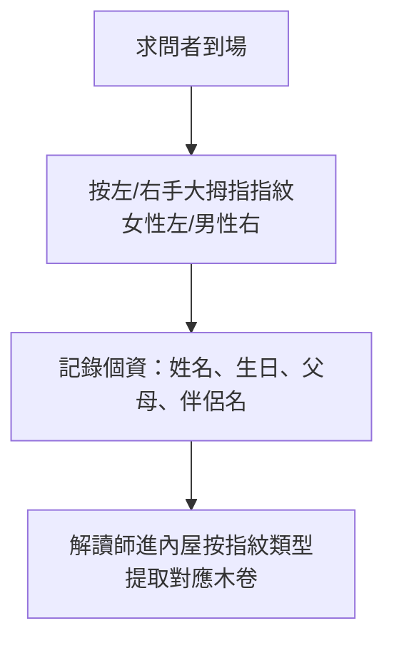
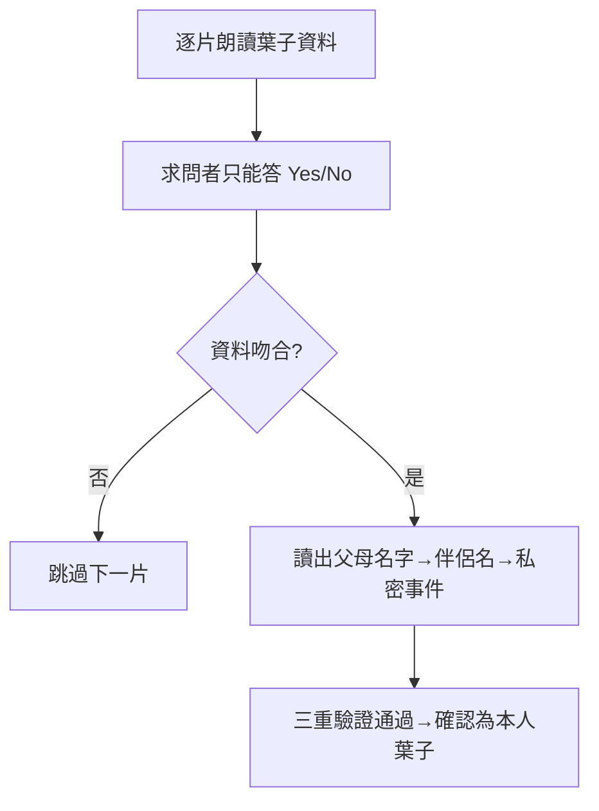

## 概述

**印度納迪葉**（Nadi Leaf）是由南印度泰米爾納德邦的**聖哲阿伽西亞**（Sage Agathiyar）率領十八位聖哲（Siddhas），於數千萬年前以古泰米爾詩文刻寫於棕櫚葉上的**個體靈魂藍圖系統**。每片葉子記錄特定靈魂的前世今生來世、天文科學、醫療知識與哲學智慧，被譽為「靈魂維基百科」與「宇宙雲端阿卡西記錄」的實體載體。

> 「納迪葉上刻寫的不是一個幾乎神準到 99.9% 的預言，而是一個 100% 記載著獨一無二的你的事實。」

## 歷史傳承脈絡

| 時期 | 關鍵事件 | 狀態 |
|------|----------|------|
| **朱羅王朝中期** (西元 10–13 世紀) | 皇室陸續整理、複製、保存於坦賈武爾市 | ✅ 系統性保存 |
| **馬拉塔帝國** (1674–1818) | 繼續維護傳承 | ✅ 持續傳承 |
| **英國殖民時期** | 大量葉子遭損毀；科學、草藥類葉子被帶回歐洲；個人命運類葉子拍賣給天文占星家族 | ⚠️ 部分流失/分流 |
| **現代** | 占星家族訓練解讀師，代代相傳，將古文轉譯為現代泰米爾語 | ✅ 活態傳承 |

## 核心架構

### 十八聖哲體系

聖哲（Siddha）意指「成就者」，擁有八大神通（Ashta Siddhi），超越時空限制。十八聖哲為納迪葉核心撰寫群體：

| 聖哲 | 核心貢獻/專長 | 相關頁面 |
|------|----------------|----------|
| **阿伽西亞** (Agathiyar) | 納迪葉總撰者、首席聖哲、泰米爾語文法奠基者 | [[nadi-leaf#聖哲阿伽西亞]] |
| **錫如穆拉** (Thirumoolar) | 《Thirumandiram》作者、瑜伽密傳、靈性哲學 | — |
| **柏哈爾** (Bhogar) | 鍊金術、醫藥、帕拉尼山穆魯迦神廟創建者 | — |
| **拉摩霖迦** (Ramalinga) | 19 世紀聖哲、慈悲之光（Jyoti）教導、肉身轉化 | — |
| 其他 14 位 | 涵蓋醫學、天文、曼陀羅、瑜伽等領域 | — |

> 詳細對照表請見書中「★十八位聖哲總覽表 The 18-Siddha Chart」。

### 印度諸神與能量原型

納迪葉儀式與解讀過程中頻繁呼喚的神祇，實為**意識頻率錨點**：

| 神祇 | 梵文名 | 代表能量/功能 | 交叉引用 |
|------|--------|----------------|----------|
| **濕婆神** | Shiva | 消滅/轉化、靈性解脫、阿伽西亞上師 | — |
| **杜爾嘉女神** | Durga Devi | 保護、克服障礙、母性力量 | — |
| **維濕奴** | Vishnu | 維持/守護、化身降世 | — |
| **拉克希米女神** | Lakshmi Devi | 豐盛、繁榮、優雅 | — |
| **象神迦內薩** | Ganesha | 移除障礙、智慧、起始 | — |
| **孩神慕儒哈** | Muruga | 戰勝內在惡魔、克魯陀星主神 | — |

## 解讀流程標準作業程序 (SOP)

### 身份鎖定階段


- **指紋分類**：泰米爾文稱「Mani Mantra Mahudaregei」（珍珠-咒語-皇冠），對應靈魂特質藍圖
- **木卷結構**：每捆 30–50 片葉，按指紋類型分類

### 比對驗證階段


- **驗證鐵律**：父母姓名 → 伴侶姓名 → 極私密個人事件（如過敏史、手術紀錄）
- **時間鎖定**：葉子會預告「在 X 歲生日後看到葉子」，精確到西曆日期

### 篇章解讀階段

| 篇章代碼 | 中文名稱 | 核心內容 | 費用模式 |
|----------|----------|----------|----------|
| **1st Sukshama Canto** | 藍圖概略篇 | 本生完整流年運勢、前世因果、行星影響、離世時間/方式、延壽建議 | 基礎套餐 |
| **9th Canto** | 父親篇/祖先財產篇 | 父母關係、祖先業力、財富來源、指導上師 | 單篇加購 |
| **13th Canto** | 因果篇 | 詳細業力清單、化解儀式 | 單篇加購 |
| **14th Canto** | 個人圖騰與吉祥物篇 | 專屬圖騰、吉祥金屬/顏色/方向/植物 | 單篇加購 |
| **Asi Blessing Canto** | 祝福篇 | 聖哲即時賜福、人生轉折指引 | 特定條件觸發 |
| **Spiritual Canto** | 靈性篇 | 靈性成長路徑、未來受訊預告 | 特定條件觸發 |
| **World Canto** | 世界篇 | 集體業力、時代轉型訊息 | 解讀師每半年開放一次 |

> 完整 20 篇章清單見書中 p.147〈納迪葉篇章〉。

### 療癒執行階段
聖哲在葉中開立的**個體化處方**通常包含：
1. **Puja 儀式**：特定神祇、特定日期（主星日/月圓日）、供品清單
2. **飲食調整**：如「早餐生吃泡芽綠豆小麥+生薑」「睡前兩顆青蘋果」「每月清腸/星期六禁食」
3. **呼吸瑜伽/克利雅瑜伽**：日常修練
4. **曼陀羅誦持**：針對個人業力的專屬咒語
5. **環境風水**：方位、顏色、金屬、寶石、圖騰佈置

## 印度曆法與星宿系統

納迪葉解讀全程使用**印度曆法**，關鍵對照表：

### 十二月份對照
| 序 | 梵文月名 | 近似公曆 | 主要節慶/能量 |
|----|----------|----------|---------------|
| 1 | Chittirai | 4/14–5/14 | 泰米爾新年 |
| 2 | Vaikasi | 5/15–6/14 | 滿月節 |
| 3 | Aani | 6/15–7/14 | 阿尼·蒂魯馬納詹 |
| 4 | Aadi | 7/15–8/14 | 阿迪·佩魯庫 |
| 5 | Avani | 8/15–9/14 | 阿瓦尼·阿維塔姆 |
| 6 | Purattasi | 9/15–10/14 | 九夜節 |
| 7 | Aippasi | 10/15–11/14 | 迪帕瓦利 |
| 8 | Karthikai | 11/15–12/14 | 卡提凱燈節 |
| 9 | Margazhi | 12/15–1/14 | 瑪爾加茲祭祀 |
| 10 | Thai | 1/15–2/14 | 泰米爾豐收節 |
| 11 | Masi | 2/15–3/14 | 馬西·馬哈姆 |
| 12 | Panguni | 3/15–4/13 | 潘古尼·烏特拉姆 |

### 二十七星宿與九大行星
| 星宿 | 梵文 | 主星 | 對應行星 | 中文二十八宿對應 |
|------|------|------|----------|-------------------|
| 1 | Ashwini | β/γ Arietis | Ketu | 昴宿 |
| 2 | Bharani | 35/39/41 Arietis | Venus | 畢宿 |
| 3 | Krittika | Pleiades | Sun | 觜宿 |
| … | … | … | … | … |
| 27 | Revati | ζ Piscium | Mercury | 壁宿 |

> 完整對照表見書中「★中印二十七與二十八星宿對照表」與「★九大行星、中印星宿與十二星座圖」。
> 相關技術細節可參考 [[nakshatra-27-lunar-mansions]]、[[indian-astrology-jyotish-overview]]、[[vargas-divisional-charts]]。

### 月亮日與主星日
- **Tithi (月亮日)**：月球相對太陽每移動 12° 為一天，分上半月/下半月各 15 日
- **Star Day (主星日)**：出生當月 Moon 所在星宿再次回歸之日，為個人能量最高峰，適合執行 Puja、重大決策

## 業力療癒體系

### 核心邏輯
```
前世因果 (Karma) 
    → 今生障礙/模式 (阻礙顯化、關係糾纏、健康議題)
    → 葉子揭示具體前世劇本 + 行星能量加持
    → 聖哲開立個體化療癒處方 (Puja/飲食/瑜伽/咒語/環境)
    → 執行 → 能場轉化 → 業力平衡 → 顯化順遂
```

### 典型案例結構（摘自書中作者親身經驗）

| 維度 | 前世劇本 | 今生投射 | 化解處方 |
|------|----------|----------|----------|
| **核心業力** | 中國傳統富商家獨生女，販酒賣婢女獲暴利，摧毀眾女命運，招致怨氣 | 事業受阻、感情空窗 7 年、顯化失效、四處求仙問卜 | 1. 濕婆神前點三盞燈<br>2. 每月主星日/月圓日靜心禱告<br>3. 特定日期食用特定食材<br>4. 日常呼吸瑜伽+專屬咒語 |
| **身體業力** | 父親前世為求問者上師，今生承擔皮膚業力病 | 父親皮膚瘀青狀態、醫治無效 | 拿父親指紋找葉子→執行父親葉子處方→父親安然度過 |
| **關係業力** | 加害者/被害者跨世互換角色 | 與親人頻繁衝突、對立 | 透過葉子「看見」角色互換→臣服接納→內心平靜 |

> 此機制與 [[arroyo-astrology-karma-transformation]] 的三種業力（定業/今生業/藏業）、[[brian-weiss-many-lives-many-masters]] 的前世回溯療法、[[inka-soul-retrieval]] 的靈魂復元有異曲同工之妙。

### 療癒驗證指標
1. **內在平靜感**：從「攻擊問題道德瑕疵」轉為「允許發生、體會對方痛苦」
2. **顯化加速**：夢想開始成真、語言變實相、奇蹟頻率提升
3. **身體指標改善**：慢性症狀緩解、睡眠深度、能量穩定
4. **關係質變**：衝突頻率降低、邊界清晰、慈悲自然流露

## 關鍵概念辨析

| 概念 | 納迪葉定義 | 與通俗認知差異 |
|------|------------|----------------|
| **預言 vs 記錄** | 100% 事實記錄（靈魂藍圖），非機率預測 | 多數占卜為機率預測 |
| **命運 vs 自由意志** | 藍圖固定，但**療癒處方可改寫時間線**（延壽數年、轉化業力） | 命運論或完全自由意志二元對立 |
| **阿卡西記錄** | 非物理層次的資訊場，納迪葉為「實體接取介面」 | 多為隱喻，無具體存取工具 |
| **最後一世** | 靈魂完成地球課程，回歸濕婆神腳下，不再投胎 | 輪迴無盡或單次人生論 |
| **聖哲 vs 神祇** | 聖哲為「已悟人類」，神祇為「意識頻率原型」 | 易混淆為宗教崇拜對象 |

## 實操入門指南

### 尋找正統解讀管道
1. **地點**：南印泰米爾納德邦坦賈武爾、韋泰斯瓦蘭柯維爾；馬來西亞吉隆坡、新加坡等海外巡迴點
2. **師資驗證**：
   - 世系傳承可追溯至占星家族
   - 使用實體棕櫚葉而非影印/數位版
   - 解讀過程嚴守「只答 Yes/No」驗證協定
   - 提供錄音/筆記備份
3. **費用參考**：藍圖概略篇約 15,000–25,000 台幣（含翻譯），單篇另計

### 準備事項
- 出生日期/時間/地點（精確至分鐘）
- 父母全名、配偶/伴侶全名
- 左/右手大拇指清晰指紋（現場採集）
- 開放心態、錄音設備、筆記本

### 後續整合建議
1. **逐字抄寫錄音**：將泰米爾語譯文轉為母語筆記，深化滲透
2. **建立執行日曆**：依印度曆法標記 Puja 日期、禁食日、主星日
3. **身體覺察日誌**：記錄飲食/瑜伽/咒語執行後的身心變化
4. **定期複盤**：每 6–12 個月重讀葉子筆記，觀察時間線變化

## 交叉引用知識網絡

| 領域 | 相關頁面 | 連結說明 |
|------|----------|----------|
| **印度占星核心技術** | [[indian-astrology-jyotish-overview]] | 整宮制、恆星黃道、維姆紹大運、分宮圖 |
| **星宿系統** | [[nakshatra-27-lunar-mansions]] | 27 星宿完整屬性、固定星、擇日應用 |
| **分宮圖** | [[vargas-divisional-charts]] | D1–D60 分圖操作邏輯與優先序 |
| **業力轉化** | [[arroyo-astrology-karma-transformation]] | 三種業力、土星業力王、水象宮位業債 |
| **前世療癒** | [[brian-weiss-many-lives-many-masters]] | 催眠前世回溯、靈性大師教導、靈魂小組 |
| **靈魂復元** | [[inka-soul-retrieval]] | 三界架構、下部世界四區室、九脈輪對應 |
| **薩滿時空觀** | [[shamanic-journeying-time]] | 非局域性、量子物理、命運與宿命辨析 |
| **阿卡西記錄** | [[akashic-records-system]] | 宇宙記錄庫、意念/意識/能量機制、疗愈三步驟 |
| **人類圖系統** | [[human-design-system]] | 九大能量中心、五型人格、內在權威、策略 |

## 經典語錄精選

> 「納迪葉刻寫的不是一個幾乎神準到 99.9% 的預言，而是一個 100% 記載著獨一無二的我的事實。」

> 「在積極面對並解決之餘，開始慢慢接受並允許它發生的過程，不再聚焦專注在現今問題點上，攻擊它的道德瑕疵。葉子上的揭示使我了解到，加害者與被害者角色在時空裡的循環互換，進而比較可以體會到對方內心的痛苦，這個領悟無形當中讓我內心平靜不少。」

> 「心轉、境轉、命運就轉。接觸佛理後發現，能量不滅，凡走過必留下痕跡。起心動念都有影響，更何況累世的作為及人與人間的糾纏。」

> 「人生絕對沒有白走的路，沒有白經驗的事，更沒有白進入的關係。所有發生在我們身上的種種事件，都是讓我們往內走的更深、更深、更深的資糧。」

## 參考資料與延伸閱讀

1. **本書主要來源**：Keshin 著、Guru A.G. Natrajh 顧問，《印度納迪葉》（天使神秘學院電子書版）
2. **傳統文獻**：
   - 《Thirumandiram》（錫如穆拉）
   - 《Bogar 7000》（柏哈爾）
   - 《Agathiyar Nadi》（阿伽西亞納迪葉原典）
3. **現代研究**：
   - David Godman, *Be As You Are: The Teachings of Sri Ramana Maharshi*
   - T.N. Ganapathy, *The Philosophy of the Tamil Siddhas*
   - Marion Zimmermann, *The Nadi Leaves: A Journey into Destiny*
4. **交叉學科對照**：
   - 印度占星 [[indian-astrology-jyotish-overview]]
   - 業力心理學 [[arroyo-astrology-karma-transformation]]
   - 前世療法 [[brian-weiss-many-lives-many-masters]]
   - 靈魂藍圖 [[birth-planning-and-karmic-healing]]

---

> **頁面維護說明**：本頁面結構化沉澱自《印度納迪葉》全書核心體系，所有觀點均忠實原文，不虛構擴展。交叉引用指向現有知識庫真實頁面，歡迎補充實測案例與最新傳承資訊。

## 来源

- [印度纳迪叶](../sources/印度纳迪叶.md)
