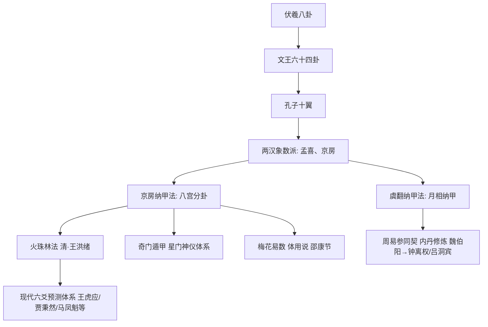
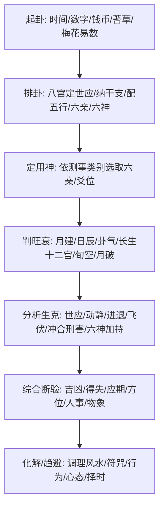

## 概述

**纳甲法**（Nà Jiǎ Fǎ），又称**六爻法**（Liù Yáo Fǎ），是西汉易学家**京房**（Jīng Fáng）依据《易经》原理创立的卜筮体系。其核心创见在于将**八卦、六十四卦**与**五行、天干地支**系统性结合，使每卦每爻均具备干支、五行、方位属性，从而依五行生克、冲合刑害等关系进行精密断验。纳甲法不仅成为汉以来象数派占卜主流，更为后世**火珠林法**、**《周易参同契》内丹修炼**、**奇门遁甲**、**梅花易数体用说**等奠定理论基石。

> **核心定位**：纳甲法 = 八卦/六十四卦（象） + 五行/天干地支（数） + 生克制化（理） + 六亲六神（应用框架）

## 历史渊源与传承脉络

### 创立者：西汉·京房
- **京房**（约前1世纪），字君明，魏郡元城人。师事焦赣，受《易》于孟喜之学，创**京氏易**，以灾异占验著称。
- 主要著作：《京氏易传》（已佚）、《易候气》、《京氏杂占》等。其纳甲法以**八宫分卦**为架构，开创「卦爻配干支、纳五行、定六亲、配六神」完整体系。

### 重要发展者
| 人物 | 朝代 | 贡献 | 代表作/流派 |
|------|------|------|-------------|
| **虞翻** | 东汉 | 依**月相圆缺**重构纳甲规则，形成「虞翻纳甲法」 | 《周易注》、《周易参同契注》 |
| **魏伯阳** | 东汉 | 引纳甲法入《周易参同契》，阐述**内丹修炼**理论 | 《周易参同契》 |
| **王洪绪** | 清 | 系统总结**火珠林法**，使纳甲法成近代应用最广占卦法 | 《卜筮正宗》 |
| **扬雄、葛洪** | 汉/晋 | 对纳甲法作重要改进与传播 | 《太玄经》、《抱朴子》 |

### 传承谱系图

## 两大核心流派：京房法与虞翻法

### 京房纳甲法——八宫分卦体系

#### 八宫排布规则
依《易传·说卦》「乾三连，坤六断……」，以**乾、震、坎、艮、坤、巽、离、兑**八卦为**八纯卦**（上世），各统领六十四卦中八卦：
- **阳宫**（乾、震、坎、艮）：乾宫、震宫、坎宫、艮宫
- **阴宫**（坤、巽、离、兑）：坤宫、巽宫、离宫、兑宫

#### 世爻层级（八卦九世制）
| 世次 | 名称 | 变动爻位 | 象意 |
|------|------|----------|------|
| 上世 | 本卦/八纯 | — | 卦宫根基 |
| 一世 | 初爻变 | 初爻 | 事端萌动 |
| 二世 | 二爻变 | 二爻 | 事态发展 |
| 三世 | 三爻变 | 三爻 | 转折关头 |
| 四世 | 四爻变 | 四爻 | 外部介入 |
| 五世 | 五爻变 | 五爻 | 高潮/决策 |
| 游魂 | 上爻变 | 上爻 | 漂泊不定 |
| 归魂 | 初上同变 | 初、上 | 回归本源 |

> **关键点**：每宫八卦（本卦+一至五世+游魂+归魂）共64卦，无重无漏。

#### 纳甲配五行/干支/方位表
| 卦宫 | 纳干 | 五行 | 方位 | 八卦属性 |
|------|------|------|------|----------|
| 乾宫 | 甲、壬 | 金/水 | 西北/北 | 天 |
| 坤宫 | 乙、癸 | 土/水 | 西南/北 | 地 |
| 震宫 | 庚 | 金 | 东 | 雷 |
| 巽宫 | 辛 | 金 | 东南 | 风 |
| 坎宫 | 戊 | 土 | 北 | 水 |
| 离宫 | 己 | 土 | 南 | 火 |
| 艮宫 | 丙 | 火 | 东北 | 山 |
| 兑宫 | 丁 | 火 | 西 | 泽 |

> **口诀**：「乾纳甲壬金水，坤纳乙癸土水；震庚巽辛金，坎戊离己土，艮丙兑丁火。」

#### 六亲六神配置（断验核心编码）
以**日干为主体（世爻/卦身）**，依五行生克定六亲：
| 六亲 | 五行关系 | 象意范围 |
|------|----------|----------|
| **官鬼** | 克我 | 灾厄、官司、职位、病痛、男方（女占婚） |
| **妻财** | 我克 | 金钱、财物、妻子（男占婚）、才华 |
| **子孙** | 我生 | 子女、后代、医药、僧道、解厄神 |
| **父母** | 生我 | 长辈、文书、证照、房屋、车船、知识 |
| **兄弟** | 比和我 | 同辈、朋友、竞争者、劫财、帮扶 |

**六神**（值日干支起排）加持六亲，增删吉凶：
| 六神 | 主事 | 吉凶倾向 |
|------|------|----------|
| **青龙**（木） | 喜庆、文书、酒食、青绿色 | 吉 |
| **朱雀**（火） | 口舌、文书、红色、仪式 | 平/凶 |
| **勾陈**（土） | 田宅、缠绕、慢性病、黄色 | 平 |
| **腾蛇**（火/土） | 惊恐、怪异、虚幻、曲折 | 凶 |
| **白虎**（金） | 丧孝、伤害、白色、西方 | 凶 |
| **玄武**（水） | 盗贼、私密、黑色、北方 | 凶 |

> **交叉引用**：六亲六神配置与[[liuyao-foundation-basics]]、[[liuyao-qimeng-jieyao]]、[[liuyao-xizhen-quwei]]、[[qu-wei-liuyao-tezhunban-jiangyi]]等六爻实战页面高度耦合。

---

### 虞翻纳甲法——月相纳甲体系

#### 理论依据
> 《系辞》：「法象莫大乎天地；变通莫大乎四时；县象著明莫大乎日月。日月相推而明生焉，寒暑相推而岁成焉。」

虞翻在注《周易参同契》时，依**月亮圆缺（阴阳消长）**推导纳甲时空规则：

#### 月相-八卦-纳干对照表
| 农历日期 | 月相 | 八卦 | 纳干 | 五行 | 象意 |
|----------|------|------|------|------|------|
| 初三 | 新月（眉月） | **震** | 庚 | 金 | 阳气始动，万物震萌 |
| 初八 | 上弦月 | **兑** | 丁 | 火 | 阳渐盛，金生水、水生木、木生火 |
| 十五 | 望月（满月） | **乾** | 甲 | 木 | 阳极、纯阳、君父之象 |
| 十七 | 既望月 | **巽** | 辛 | 金 | 阳退阴进，风行地上 |
| 廿三 | 下弦月 | **艮** | 丙 | 火 | 阴盛、山止、阻节 |
| 三十 | 晦日（朔） | **坤** | 乙 | 木 | 阳极、纯阴、母地之象 |
| （坎、离） | — | **坎/离** | 戊/己 | 土 | 中宫、日月交媾、既济未济 |

> **特点**：虞翻法以**月相为时空锚点**，强调「日月相推、寒暑相推」的动态时空观，与[[qimen-dunjia-fundamentals]]中「阴阳遁、节气置闰」、[[liuren-shen-ke-daquan]]中「月将、贵神、十二天将」同构。

---

## 核心断验逻辑：五行生克与爻位动静

### 生克制化基本原则
| 关系 | 卦爻表现 | 断验指向 |
|------|----------|----------|
| **生我（父母）** | 旺相则护佑，休囚则无力 | 有靠山、有证照、长辈助 |
| **我生（子孙）** | 旺相则泄气，休囚则不泄 | 有出路、有后代、医药灵 |
| **克我（官鬼）** | 旺相则压制，休囚则不畏 | 有灾厄、有官司、病重 |
| **我克（妻财）** | 旺相则得财，休囚则难求 | 财物可得、妻贤/女占夫 |
| **比和（兄弟）** | 旺相则分夺，休囚则助弱 | 竞争/助力、劫财/同辈 |

### 爻位动静与进退神
| 爻态 | 定义 | 吉凶倾向 | 应期特征 |
|------|------|----------|----------|
| **静爻** | 不变之爻 | 主定局、根基 | 迟缓、需冲动 |
| **动爻** | 变爻（老阴/老阳） | 主变数、发动 | 速应、主事 |
| **进神** | 动爻化生/比 | 事态推进、增益 | 顺利、加速 |
| **退神** | 动爻化克/泄 | 事态退缩、耗损 | 延迟、受阻 |
| **伏神** | 卦中隐伏之爻 | 暗中作用、潜在 | 隐发、突然 |
| **飞神** | 显见之爻 | 表面现象 | 明察、直接 |

> **交叉引用**：动静进退、飞伏神理论详见[[liuyao-foundation-basics]]、[[liuyao-lifa-jinjiie-qinglan]]、[[liuyao-xizhen-quwei]]、[[liuyao-sanda-jifa]]。

### 应期断验（时间锚定）
- **值日/值月/值年**：用神临日辰/月建/年干支 → 应期至
- **冲开/合住**：墓库逢冲开、空亡逢冲实/合住
- **旬空/月破/日破**：用神落空亡/月破/日破 → 虚耗、延迟
- **六合/三合/半合/三会**：用神入局成象 → 信息聚合、应期成簇

---

## 纳甲法对后世体系的理论奠基影响

### 火珠林法（清·王洪绪《卜筮正宗》）
- **直接继承**：全盘接纳京房八宫纳甲、六亲六神、世应生克框架
- **创新点**：引入「卦气旺衰、动静进退、飞伏神、日月冲合」精细化规则
- **地位**：近代**应用最广、流派最正**的六爻预测法，王虎应、贾秉然、马凤魁、曲炜等现代大家皆本此发挥
- **交叉引用**：[[liuyao-foundation-basics]]、[[liuyao-caiyun-mifa]]、[[liuyao-hunyun-mifa]]、[[liuyao-zaihuo-yuce]]、[[huangji-liuyao-tixi]]

### 《周易参同契》内丹修炼（东汉·魏伯阳→唐·钟离权/吕洞宾）
- **核心映照**：
  - **乾坤坎离**四卦 ↔ **丹鼎炉鼎、铅汞水火、龙虎交媾**
  - **纳甲干支** ↔ **周天火候、子午卯酉、抽添进退**
  - **六十四卦** ↔ **一年十二月、三百八十四爻、周天数**
- **理论贡献**：将「占卜用卦」转化为「修炼用象」，建立**身心性命双修**的易学丹道体系
- **交叉引用**：[[liu-jia-tian-shu]]、[[hua-jie-da-fa-quan-shu-xia]]、[[zhu-you-shisan-ke]]、[[zheng-yi-dao-fu-zhou-xiu-xing-shi-wu]]、[[ming-li-shi-jia-chuan-cheng-yu-zao-ming-jin-dan]]

### 奇门遁甲（星门神仪/九宫八卦体系）
- **符号同构**：奇门「九星、八门、八神、九宫、八卦、十干、十二支」与纳甲法「八卦、六亲、六神、干支、五行」高度同构
- **核心移植**：
  - **值符/值使** ↔ **日干/月将/贵神**
  - **三奇六仪** ↔ **纳甲干支配卦**
  - **格局（伏吟/反吟/击刑/入墓/三奇得使等）** ↔ **六爻动静/冲合/空墓/进退**
  - **阴阳遁/置闰/超神接气** ↔ **纳甲月相/节气/卦气旺衰**
- **代表体系**：[[qimen-dunjia-fundamentals]]、[[qimen-dunjia-yang-dun-540-ju-xiang-jie]]、[[qimen-dunjia-yin-dun-540-ju-xiang-jie]]、[[bu-chui-niu-qimen-jiangyi-yi]]、[[fenglin-qimen-xiangyi-zheng-shu]]、[[ye-hongsheng-qi-men-ji-chu-yu-qi-ju]]、[[zhou-nayu-yinpan-qimen]]、[[dong-bo-ju-shi-qi-men-miao-jue]]

### 梅花易数·体用说（北宋·邵康节）
- **理论溯源**：邵康节承陈抟先天图、周敦颐太极图，融纳甲「卦爻干支、五行生克」为**体用生克理论**
- **核心转化**：
  - **体卦（主事者）** ↔ **纳甲世爻/日干**
  - **用卦（客事者）** ↔ **纳甲应爻/用神**
  - **体用生克（生体/克体/比和/体克用/用克体）** ↔ **纳甲六亲生克/世应关系**
  - **卦气旺衰/互卦/变卦/错卦/综卦** ↔ **纳甲卦气/飞伏/进退/六合/三合**
- **交叉引用**：[[meihua-yishu]]、[[qiao-mei-hua-wai-ying-yu-ce-shu]]、[[liuyao-bagua-quanxi-lun]]、[[liuyao-yinguo]]

### 大六壬/太乙神数/紫微斗数（古三式/命理体系）
- **共同底层**：均建立于**天干地支、五行生克、八卦九宫、河图洛书**之上
- **纳甲元素移植**：
  - **六壬**：天干地支、十二长生、十二神将、三传、四课、神煞体系
  - **太乙**：星神、式盘、阴阳遁、命法/事法、宫位生克
  - **紫微**：十二宫、十四主星、四化飞星、河图洛书定位
- **交叉引用**：[[liuren-shen-ke-daquan]]、[[liuren-bifa-fu]]、[[liuren-64-ke-jing]]、[[taiyi-shenshu]]、[[ziwei-doushu-an-xing-fa]]、[[ziwei-jie-ti-chu-jie]]、[[ziwei-gao-jie-zhi-yi]]

---

## 实战操作流程标准化（六爻/纳甲法通用）

### 关键节点口诀（纳甲断验精髓）
> **「用神旺相生世吉，动爻进神应期速；  
> 忌神休囚克用凶，退神空破事难成。  
> 青龙临财主富贵，白虎持鬼见官非。  
> 朱雀动兮文书至，勾陈发处田宅忧。  
> 腾蛇幻怪多惊恐，玄武私贼失财物。  
> 父母持世文书显，子孙发动解厄灾。  
> 兄弟临财财散败，官鬼持世病灾缠。  
> 世应相生和合美，世应相克离散分。  
> 冲开合住看真假，进退伏飞辨虚实。  
> 日月冲合定应期，旬空月破待填实。」**

---

## 现代传承与学习路径建议

### 核心典籍研读序列
| 阶段 | 推荐典籍 | 重点掌握 |
|------|----------|----------|
| **入门** | 《增删卜易》（民间刻本）、[[liuyao-qimeng-jieyao]]、[[liuyao-foundation-basics]] | 八卦纳甲、起卦法、六亲六神、世应、基础生克 |
| **进阶** | 《卜筮正宗》（火珠林）、[[liuyao-sanda-jifa]]、[[liuyao-xizhen-quwei]]、[[qu-wei-liuyao-tezhunban-jiangyi]] | 旺衰细论、动静进退、飞伏神、应期、专项断法 |
| **精深** | 《皇极六爻》（贾秉然）、[[liuyao-caiyun-mifa]]、[[liuyao-hunyun-mifa]]、[[huangji-liuyao-tixi]]、[[liuyao-zhengdao-zhangde]] | 二元定位、兼象定论、体用说、实战案例库 |
| **拓展** | 《奇门遁甲大全》、[[qimen-dunjia-fundamentals]]、[[fenglin-qimen-xiangyi-zheng-shu]]、[[zhou-nayu-yinpan-qimen]]、[[meihua-yishu]] | 纳甲法在奇门/梅花/六壬/太乙/紫微中的映照与转化 |

### 实战训练建议
1. **日课练习**：每日一卦，记录起卦时间、测事、用神、旺衰、断语、后验反馈
2. **案例复盘**：系统研习[[liuyao-shizhan-da-quan]]、[[liuyao-shizhan-dianqiao]]、[[liuyao-q-and-a-quwei]]、[[liuyao-yuce-wu-zhong-wu]]等实战案例集
3. **交叉验证**：同一测事并用六爻、奇门、梅花、六壬、四柱多法断验，比对准确率与信息互补性
4. **理论内化**：将「五行生克、阴阳消长、动静进退、象数映照」内化为直觉思维模式，而非死记硬背口诀

---

## 知识图谱交叉引用索引

### 直接衍生体系
- [[liuyao-foundation-basics]] 六爻基础入门（王虎应体系）
- [[liuyao-qimeng-jieyao]] 六爻启蒙诀要（马志川体系）
- [[liuyao-xizhen-quwei]] 六爻详真（曲炜体系）
- [[liuyao-sanda-jifa]] 六爻三大技法（黎光体系）
- [[huangji-liuyao-tixi]] 皇极六爻（贾秉然体系）
- [[liuyao-caiyun-mifa]] 六爻财运秘法
- [[liuyao-hunyun-mifa]] 六爻婚姻秘法
- [[liuyao-zaihuo-yuce]] 六爻灾祸预测
- [[liuyao-bagua-quanxi-lun]] 六爻八卦全息论（马凤魁）
- [[liuyao-yinguo]] 六爻因果世界（王虎应）
- [[liuyao-zhengdao-zhangde]] 六爻正道（张德）

### 同源/映照体系
- [[qimen-dunjia-fundamentals]] 奇门遁甲基础
- [[qimen-dunjia-yang-dun-540-ju-xiang-jie]] 奇门阳遁540局
- [[qimen-dunjia-yin-dun-540-ju-xiang-jie]] 奇门阴遁540局
- [[bu-chui-niu-qimen-jiangyi-yi]] 不吹牛奇门基础
- [[fenglin-qimen-xiangyi-zheng-shu]] 凤麟奇门象意
- [[fenglin-yinpan-qimen-lilun]] 凤麟阴盘奇门理论
- [[ye-hongsheng-qi-men-ji-chu-yu-qi-ju]] 叶鸿生奇门基础
- [[zhou-nayu-yinpan-qimen]] 周纳羽阴盘奇门
- [[dong-bo-ju-shi-qi-men-miao-jue]] 东伯居士奇门秒诀
- [[liuren-shen-ke-daquan]] 六壬神课大全
- [[liuren-bifa-fu]] 六壬毕法赋
- [[taiyi-shenshu]] 太乙神数
- [[ziwei-doushu-an-xing-fa]] 紫微斗数安星法
- [[meihua-yishu]] 梅花易数
- [[qiao-mei-hua-wai-ying-yu-ce-shu]] 俏梅花外应预测

### 符咒/道法/内丹关联
- [[liu-jia-tian-shu]] 六甲天书
- [[liu-jia-yin-fu-yu-tian-dun-shen-shu]] 六甲阴符余天遁神书
- [[liu-jia-fa-shu-qi-men-ji-chu-pian]] 六甲法术奇门基础
- [[hua-jie-da-fa-quan-shu-xia]] 化解大法全书下（祝由十三科/六甲天书）
- [[zhu-you-shisan-ke]] 祝由十三科
- [[zheng-yi-dao-fu-zhou-xiu-xing-shi-wu]] 正一道符咒修行实务
- [[ming-li-shi-jia-chuan-cheng-yu-zao-ming-jin-dan]] 命理师家族传承与造命金丹
- [[ka-yin-xian-xiang-yu-hua-jie]] 卡阴现象与化解

---

## 结语

纳甲法作为**西汉京房**集大成之作，完成了**「象（八卦/六十四卦）+ 数（天干地支/五行）+ 理（生克制化）+ 用（六亲六神/世应动静）」**的系统性封装。其**八宫分卦（京房法）**与**月相纳甲（虞翻法）**双轨并行，构建了中国传统术数预测的**通用底层协议**：

1. **向下兼容**：为火珠林法、现代六爻提供标准化操作规范
2. **向上延展**：为《周易参同契》内丹、奇门遁甲、梅花易数、大六壬、太乙、紫微斗数提供核心符号与逻辑组件
3. **向外辐射**：影响道教符咒（六甲天书/祝由十三科）、风水堪舆（八宅/玄空/奇门风水）、命理实务（四柱/六壬/紫微）等全谱系

掌握纳甲法，即掌握了**中国传统术数预测的「汇编语言」与「操作系统内核」**，是通往易学诸门深处的必经之路。

## 来源

- [图解易经中的数学梅花易数](../sources/图解易经中的数学梅花易数.md)
