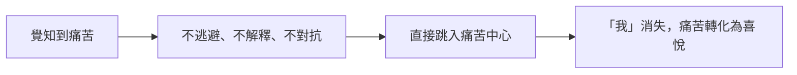

## 核心框架：覺知即解脫，看見即療癒

巴觀（Sri Bhagavan）在《喜悅，就是去擁抱生活》中確立合一大學實修的核心公理：**「看見就是解脫」**。對於內在世界的問題，唯一能做也唯一需要做的，就是去覺知與接納內在真實的狀態。覺知是一股能量，當專注於內在狀態時，內在便會產生轉化。

> **關鍵區別**：合一教導對內在世界是「消極性」的（不干預、只看見），對外在世界是「積極性」的（主動解決問題）。水龍頭漏水要修理（外在），漏水引發的沮喪要擁抱（內在）[[universal-spiritual-laws-manifestation#宇宙法則與顯化機制|宇宙法則顯化機制]]。

---

## 一、49分鐘覺知練習：打破無覺知習慣的神經重塑

### 練習規範
- **時長**：每天 49 分鐘（或 7 分鐘倍數：7、14、21、28、35、42、49）
- **週期**：持續 21 天
- **原理**：大腦以 7 分鐘為週期運作，21 天可打破「無覺知」的神經迴路，建立新的覺知習慣

### 三階段推進法
| 階段 | 焦點 | 操作重點 |
|------|------|----------|
| **身體覺知** | 慣常身體活動 | 刷牙感受刷毛觸感、沐浴覺知水流溫度、進食專注味覺質地、走路觀察肌肉協調 |
| **打破習慣** | 打破自動化模式 | 改變散步時間/路線、去從未去過的地方、雙腿間倒著看世界 |
| **向內覺知** | 內在思想情緒 | 將外在覺知品質逐漸轉向內在，看見念頭、情緒、人格面具的流動 |

> **神經科學對應**：此練習實質上在重塑「預設模式網絡」（DMN），降低其過度活躍，增強「突顯網絡」對當下體驗的捕捉能力[[buddhas-brain-rick-hanson#神經可塑性與三大支柱|佛脑神經機制]]。

---

## 二、貼標籤 vs. 看見：兩種根本不同的內在操作

### 核心差異對照表

| 維度 | **貼標籤** | **看見** |
|------|------------|----------|
| **本質** | 思想操作、屈從、認同 | 覺知操作、接納、超離 |
| **能量** | 消耗能量、強化模式 | 聚集能量、轉化模式 |
| **結果** | 思想持續存在、製造衝突 | 思想讓位經驗、衝突消失 |
| **語言** | 「我是衝動的」、「我脾氣不好」 | 直接看見衝動升起、看見怒氣流動 |
| **關係** | 頭腦製造「我」與「問題」的分離 | 觀照意識與現象合一 |

### 猴子禁食寓言：三大逃避系統
故事揭示頭腦如何透過三種機制逃避面對真實：
1. **延緩**：「從今以後我要仁慈」——投射未來，隱藏當下
2. **解釋**：「我冷漠是因為……」——用理由粉飾謊言
3. **貼標籤**：「我是卑鄙的」——用概念取代體驗

> **實修提示**：當發現自己在貼標籤時，立即轉為「看見貼標籤的過程」，標籤的力量便會消退。

---

## 三、痛苦轉化機制：跳入老虎口中的科學

### 痛苦的真相
- 所謂痛苦 = **逃避痛苦** 的過程
- 逃避策略：看電視、看電影、儀式、悲傷管理等
- 逃避後果：痛苦藏在地毯下發酵，遲早反撲

### 轉化三步驟


### 生理機制對應
- **胸痛/身體抽搐** = 情緒能量釋放的體感表徵
- **全然經驗** = 讓杏仁核完成情緒處理迴路，避免被前額葉壓抑存入隱性記憶
- **喜悅生成** = 多巴胺/血清素系統在衝突消解後的自然回饋

> **交叉驗證**：EFT 情緒釋放技巧亦強調「全然經驗感受」而非認知重構[[EFT情緒釋放技巧#核心機制|EFT核心機制]]；Ho'oponopono 的「我原諒自己」同屬接納轉化範疇[[fifth-phrase-i-forgive-myself#第五真言機制|第五真言機制]]。

---

## 四、情緒觀照標準流程（SOP）

### 入門檢核
- [ ] 確認安全環境（不會被打擾 20+ 分鐘）
- [ ] 身體舒適坐姿，眼簾自然下垂
- [ ] 設定意圖：「我願意看見當下真實發生的一切」

### 四步驟操作
| 步驟 | 指令語 | 關鍵態度 | 典型體感 |
|------|--------|----------|----------|
| **1. 定位** | 「現在內在有什麼？」 | 好奇、不預設 | 情緒標籤浮現（嫉妒、恐懼…） |
| **2. 去標籤** | 「放下名稱，直接感受它」 | 純觀察、不評判 | 胸口悶熱、喉嚨哽咽、腹部緊繃 |
| **3. 深入** | 「允許它完全存在，甚至放大它」 | 擁抱、不抗拒 | 能量波浪感、顫抖、熱流、淚水 |
| **4. 轉化** | 「看見它轉化，或繼續看見」 | 見證、不執著 | 輕盈感、空曠感、微笑自然浮現 |

### 進階技巧：身體感受對話法
> 「如果這個胸口的緊繃有聲音，它會說什麼？」  
> 「它想要我做什麼？」  
> ——引導情緒從無意識躁動轉為可整合的訊息[[EFT情傷疗愈实作#身體感受對話|EFT身體感受對話]]。

---

## 五、打破習慣法：從神經迴路層面重寫自動化程式

### 習慣的神經本質
- 習慣 = 基底核編碼的「塊狀化」動作序列
- 頭腦偏好走「最省能量」的舊迴路
- 覺知 = 前額葉皮質介入，打破自動駕駛

### 實戰工具箱
| 類別 | 具體做法 | 適用情境 |
|------|----------|----------|
| **時間置換** | 晨間散步 → 晚間散步 | 固定時間的儀式性行為 |
| **空間置換** | 固定咖啡廳 → 新餐廳/公園 | 環境觸發的條件反射 |
| **感官置換** | 雙腿間倒著看房間 | 視覺慣性過強時 |
| **動作置換** | 左手刷牙、倒著穿襪子 | 精細動作自動化深度高 |
| **新奇體驗** | 去從未去過的菜市場/廟宇 | 大腦無現成模板可套用 |

### 21 天習慣重塑日誌範本
```
Day 1-7  ：覺知「自動駕駛」瞬間（記錄時間、觸發點、情緒）
Day 8-14 ：刻意植入 1 個新微習慣（如：喝水前深呼吸 3 次）
Day 15-21：觀察新舊迴路競爭，記錄「選擇覺知」的體驗質感
```

---

## 六、頭腦觀照與分離技術：從「被騎」到「騎驢子」

### 頭腦的三層結構
1. **制約層**：生存本能（恐懼、攻擊/逃跑）
2. **信念層**：集體/家族/文化下載的程式
3. **思想層**：持續運作的衡量、比較、貼標籤機器

> **核心洞見**：「你的頭腦不是你的頭腦，它是『一個頭腦』——古老的、集體的、跨越百萬年演化而來。」認同它 = 困在監獄；分離它 = 成為觀照者。

### 分離四階梯
| 階段 | 體驗描述 | 操作提示 |
|------|----------|----------|
| **1. 看見內容** | 看見念頭像河流/波浪流動 | 「現在有『賺錢』的念頭」「現在有『批評伴侶』的畫面」 |
| **2. 看見運作** | 看見「貼標籤→評判→情緒→行動」全自動鏈 | 繪製個人「觸發-反應」流程圖 |
| **3. 看見機制** | 看見頭腦為生存而「必須成為什麼」 | 問：「這個念頭想讓我變成誰？」 |
| **4. 身分轉移** | 從「我是念頭」→「我是看見念頭的覺知」 | 練習：「覺知在看著頭腦運作」 |

### 覺醒後的頭腦管理：冷藏庫隱喻
- **覺醒狀態**：頭腦在冷藏庫（靜止、不渲染感知）
- **功能需求**：取用頭腦（開車、寫代碼、試算表）→ 用完即還
- **關鍵**：**你是主人，頭腦是工具**；角色顛倒 = 痛苦根源

> **對應模型**：突破三角形中的「焦點」管理[[breakthrough-triangle-success-psychology#突破三角形三要素|突破三角形焦點管理]]；Abraham-Hicks 的「振動頻率一致性」[[abraham-hicks-law-of-attraction#振動頻率與情緒引導系統|振動頻率機制]]。

---

## 七、整合實修地圖：從生存到生活的 4 週進階

| 週次 | 主題 | 每日核心練習 | 里程碑指標 |
|------|------|--------------|------------|
| **第 1 週** | **身體著陸** | 49 分鐘身體覺知 + 1 次習慣打破 | 能連續 7 分鐘不被念頭帶走 |
| **第 2 週** | **情緒接駁** | 20 分鐘情緒觀照 SOP + 身體覺知維持 | 面對強烈情緒不逃避、不貼標籤 |
| **第 3 週** | **頭腦解剖** | 30 分鐘頭腦觀照四階梯 + 情緒觀照 | 能說出「覺知在看著頭腦運作」並感受到距離感 |
| **第 4 週** | **生活整合** | 全天候微覺知（喝水、開門、聽聲音）+ 晚間複盤 | 「生存」感降低，「生活」感顯著提升；關係摩擦減少 |

---

## 八、常見卡關與破解鑰匙

| 卡關現象 | 根本原因 | 破解鑰匙 |
|----------|----------|----------|
| **越看見越痛苦** | 混淆「看見」與「分析/評判」 | 回到身體感受，放下語言標籤 |
| **練習後更焦慮** | 潛意識恐懼「失控」，抗拒覺知擴展 | 縮短單次時長（7 分鐘），增加頻次 |
| **覺得在演戲/假裝** | 內在小孩/尤尼希皮里未被納入[[unihilipi-inner-child#三位一體架構|尤尼希皮里整合]] | 先做「我原諒自己」清理，再進入觀照 |
| **人際衝突未減** | 仍在外在改變對方，未做內在關係療癒 | 套用「關係是能量交流」原則，做內在傷痛轉化[[oneness-university-bhagavan-teachings#關係療癒|合一關係療癒]] |
| **頭腦反撲更猛** | 習慣迴路臨死前掙扎（消退爆發） | 慶祝反撲＝練習有效，繼續看見反撲本身 |

---

## 九、交叉引用速查索引

| 主題 | 本頁錨點 | 相關知識頁面 | 核心互補點 |
|------|----------|--------------|------------|
| **覺知/正念基礎** | §1, §6 | [[ming-xiang-gai-lun#實操框架|冥想正念手冊]]、[[zhi-yao-hui-hu-xi-jiu-neng-zuo-ming-xiang|只要會呼吸就能冥想]] | 入門動作標準化 |
| **痛苦/情緒轉化** | §3, §4 | [[EFT情緒釋放技巧#神經生理機制|EFT機制]]、[[zero-limits-hooponopono-system#四句話清理法|Ho'oponopono]]、[[fifth-phrase-i-forgive-myself|第五真言]] | 多工具箱互驗 |
| **頭腦/自我結構** | §6 | [[breakthrough-triangle-success-psychology#無意識程式|突破三角形]]、[[belief-creates-reality-practice#四步實修法門|信念創造實相]] | 程式重寫路徑 |
| **習慣/神經重塑** | §5 | [[buddhas-brain-rick-hanson#HEAL內化法|佛腦HEAL法]]、[[atomic-habits|原子習慣]]（外部參考） | 行為改變科學 |
| **關係/親密療癒** | §2, §3 | [[guan-xi-liao-yu-gottman-qing-xu-yao-qing|高特曼情緒邀請]]、[[han-lianglu-synastry-law-of-attraction|合盘吸引力法則]] | 內外雙軌療癒 |
| **顯化/豐盛** | §1, §7 | [[abraham-hicks-law-of-attraction#情緒引導系統|情緒引導系統]]、[[sanaya-roman-orin-path-of-joy#喜悅顯化|歐林喜悅之道]] | 高頻狀態養成 |

---

## 十、核心金句摘錄卡（可列印隨身）

> 1. **「看見就是解脫。」** — 無需理解、分析、改變，唯一動作是看見。  
> 2. **「痛苦是逃避痛苦的過程；跳入老虎口中，『你』消失，痛苦轉化為喜悅。」**  
> 3. **「貼標籤是屈從；看見是接納。貼標籤製造思想負擔；看見帶來寧靜。」**  
> 4. **「你的頭腦不是你的頭腦，它是『一個頭腦』——古老的、集體的。去除認同，頭腦自動安靜。」**  
> 5. **「覺知是第一步，也是最後一步。覺知不是達到目的的手段，覺知本身就是目的。」**  
> 6. **「全然經驗當下，每一份感官體驗都會變成喜悅。靈性不是另一種存在，靈性就是生活本身。」**  
> 7. **「當你覺醒，頭腦進入冷藏庫；需要時取用，用完歸位。你是主人，頭腦是工具。」**  
> 8. **「生命不是要被解開的謎題，而是要被經驗的奧祕。」**

---

> **編譯者提醒**：本頁系統化整理自巴觀《喜悅，就是去擁抱生活》中文版（國倫編譯）。實修請以「輕鬆、愉快、不勉強」為原則；若遇強烈創傷浮現，建議尋求專業心理師或合一大學導師協助。願每位讀者都能從「生存」跨越到「生活」，經驗生命的無限奧祕。

## 来源

- [喜悦就是去拥抱生活](../sources/喜悦就是去拥抱生活.md)
