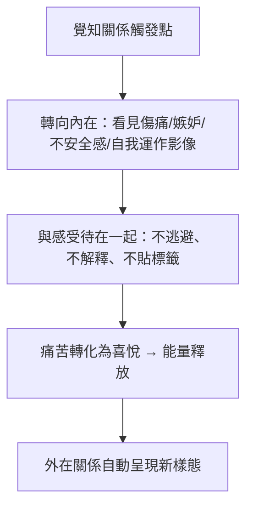

# 合一教導：關係即能量交換與內在療癒

> 來源：《喜悅，就是去擁抱生活》—— 斯利·巴觀（Sri Bhagavan）合一大學核心教導編譯

## 核心框架總覽

合一大學創始人巴觀指出：**「生命就是關係，所有的關係都是能量交流。」** 這一定義將人際互動從道德評價框架轉移至能量動力學層面。關係不再是「好/壞」的二元判斷，而是**能量給予與消耗的即時回饋系統**。以下五大支柱構成完整知識體系：

| 支柱 | 核心命題 | 實操錨點 |
|------|----------|----------|
| 1. 關係即能量交換 | 一切關係（人、動物、植物、無生命物體）皆為雙向能量流動 | 觀察「此關係是給予我能量，還是消耗我能量？」 |
| 2. 療癒為內在工作 | 外在關係問題皆是內在傷痛/程式的投射 | 不試圖改變對方，轉向看見自己內在的傷痛、嫉妒、不安全感 |
| 3. 虛假自我運作 | 多數互動中運作的是「不真實的自我」（社交面具） | 覺知內在對話：真實自我 vs. 虛假自我之戰爭 |
| 4. 傷痛轉化流程 | 全然經驗痛苦 → 痛苦轉化為喜悅 → 能量釋放 | 「跳入老虎口中」：接納而非逃避/解釋/貼標籤 |
| 5. 放下的真實含義 | 放下 ≠ 斷絕，而是改變連結方式；關係能量場永存 | 心全然綻放時，所有關係自動給予能量 |

---

## 一、關係即雙向能量交換法則

### 定義擴展：超越人際範疇
> 「當我們使用『關係』一詞時，你通常想像的只是人與人之間的關係，但你與動物、與樹木，甚至與無生命的物體，也有關係。」（第二章）

- **能量視角**：任何互動皆屬能場共振。**給予能量** → 身心輕盈、創意湧現；**消耗能量** → 沉重、反應性提升。
- **雙向性鐵律**：「關係始終是雙向的能量交流。即使你放掉它，你們的關係仍然存在著，只是你們與彼此連結的方式改變了。」（第二章）

### 影響關係能量的四大隱性因子
| 因子 | 說明 | 交叉引用 |
|------|------|----------|
| 前世印記 | 跨世業力循環形成特定吸引/排斥模式 | [[brian-weiss-many-lives-many-masters]] |
| 行星位置 | 本命盤/合盤相位顯化能量交換樣態 | [[han-lianglu-synastry-law-of-attraction]]、[[synastry-planets-in-houses]] |
| 業力循環 | 無意識程式重複上演 | [[breakthrough-triangle-success-psychology]]、[[universal-spiritual-laws-manifestation]] |
| 集體無意識 | 超個人原型投射 | [[aqal整合图谱]]、[[seth-philosophy-jane-roberts]] |

### 驗證工具：能量盈虧自測
> 「驗證這一點最好的辦法，就是看見你內在的狀態，並沉思哪份關係給予你能量，而哪份關係則沒有。」（第二章）

**實操步驟**：
1. 列出主要關係對象（伴侶、父母、子女、夥伴、寵物、居住空間…）
2. 閉目回憶近期互動場景，觀察身體感受：展開/收縮、輕盈/沉重、呼吸深淺
3. 標記「能量流入 +」或「能量流出 -」
4. **不評判對方**，只記錄自身能場反應 → 此為「內在工作」起點

---

## 二、關係療癒即內在工作

### 核心原則：外在無需改變，內在全然看見
> 「在合一教導中，我們總是要求你改善關係，這是內在的工作。你如何在外在處理，是取決於你的情況；而改善關係是內在的工作。」（第二章）

| 傳統認知 | 合一教導視角 |
|----------|--------------|
| 對方改變 → 關係好轉 | 我看見內在傷痛 → 能量轉化 → 關係自動變化 |
| 溝通技巧解決衝突 | 覺知「我正在投射」衝突即消融 |
| 原諒對方 | 接納自己當下的憤怒/傷痛 |
| 設定邊界保護自己 | 看見「設定邊界」背後的恐懼/控制慾 |

### 內在工作三步驟流程


### 關鍵區分：沉思 ≠ 分析/評判
> 「請瞭解，在沉思的過程中，並不意味著你評判、譴責或分析其他人的行為或那份關係。這不是關於其他人，而一直都是關於你。」（第二章）

- **分析/評判**：頭腦活動，強化「虛假自我」，消耗能量
- **沉思/看見**：覺知能量聚焦於內在實相，催化轉化

### 當內在工作完成，外在仍無喜悅 → 放下
> 「如果這份關係仍然無法給予你喜悅，那麼你可能就要放掉它。」（第二章）
- 此時放下非逃避，而是**能量誠實**：承認當下頻率不共振
- 參考：[[fifth-phrase-i-forgive-myself]] 第五真言「我原諒自己」之放下機制

---

## 三、虛假自我在關係中的運作機制

### 兩個自我的戰爭
> 「這男孩就像是你的真實自我，他說出你知道的真相……他們有個不真實的自我在說話，試圖掩飾整件事情。這就是我們一直對生命所做的。」（第三章）

| 維度 | 真實自我 | 虛假自我（不真實的自我） |
|------|----------|--------------------------|
| 運作源頭 | 心（感受層面） | 頭腦（思想/條件化） |
| 表達方式 | 直接、無防禦 | 禮貌面具、壓抑、投射 |
| 能量特質 | 敞開、流動 | 凝滯、消耗 |
| 關係模式 | 連結、合一 | 交易、給予-拿取循環 |

### 虛假自我的三大逃避系統（第三章）
| 系統 | 關鍵詞 | 運作邏輯 | 能量後果 |
|------|--------|----------|----------|
| **延緩** | 「從今以後」 | 將面對當下推向虛構未來 | 事實藏地毯底，發酵成業力債 |
| **解釋** | 「因為……」 | 合理化行為，掩飾貪/懼/無愛 | 謊言重複至自我信以為真 |
| **貼標籤** | 「我是…的人」 | 以概念取代經驗（如「我脾氣不好」） | 思想負擔取代寧靜，傷痛得力持續 |

> **關鍵洞見**：「貼標籤」與「看見」有天壤之別。「貼標籤」是屈從；而「看見」則是接納。」（第三章）

### 關係中常見的虛假自我劇本
| 場景 | 虛假自我台詞 | 真實自我未語 |
|------|--------------|--------------|
| 不喜歡的人來訪 | 「好久不見，真高興見到你！」 | 「我不舒服，我不想見你」 |
| 伴侶觸發不安 | 「你總是這樣！」（指責） | 「我好怕失去你，我好痛」 |
| 親友成功 | 「恭喜恭喜！」（社交禮儀） | 「我好嫉妒，我覺得不夠好」 |
| 衝突升級 | 「都是你的錯」（投射） | 「我看見我內在的憤怒/無力感」 |

**練習**：每日睡前回顧一段互動，書寫「虛假自我說了什麼」vs.「真實自我感受什麼」 → 建立覺知肌肉

---

## 四、傷痛轉化流程：從逃避到全然經驗

### 痛苦的本質：逃避本身
> 「當我們使用『痛苦』一詞時，我們指的是你一直在『逃避痛苦』。這就是你所謂的痛苦，可是你沒有覺知到這點。」（第二章）

**痛苦方程式**：
```
痛苦 = 事件 × 抗拒/逃避強度
```
- 事件本身中性；抗拒製造痛苦
- 逃避策略：轉移注意力（刷手機、看劇、過度工作、靈性旁路 Spiritual Bypass）

### 「跳入老虎口中」—— 接納儀式
> 「當你不再逃離痛苦，也不再試著去瞭解它、解釋它，就只是跳入痛苦中，這就是我們所說的『跳入老虎的口中』。」（第二章）

**四階段操作圖譜**：

| 階段 | 內在動作 | 身體/能量現象 | 關鍵提醒 |
|------|----------|---------------|----------|
| 1. 停止逃跑 | 覺知「我在逃避」，身體原地駐足 | 心跳加速、呼吸淺短、想跑 | 不需強迫，只需「看見我在逃」 |
| 2. 轉身面對 | 將注意力 100% 給予當下感受 | 胸悶、發抖、淚水、怒火湧現 | **不貼標籤**（不是「我好悲傷」，是「這裡有收縮/熱/動」） |
| 3. 全然經驗 | 像喝冰淇淋一樣品嚐感受 | 強烈情緒波峰 → 自然平息 | 「看見就是解脫」；頭腦安靜，能量釋放 |
| 4. 轉化完成 | 感受轉為寧靈/喜悅/輕盈 | 身體鬆弛、呼吸深長、空間感擴大 | 若未轉化，表示仍有微細抗拒 → 回階段 1 |

### 覺醒後的情緒新關係
> 「在你覺醒之後，你的情緒依然存在，但它們不再是你的情緒。你不會說：『這是我的恐懼或我的憤怒。』你只是說：『有恐懼存在；有憤怒存在。』」（第五章）

- **所有權轉移**：從「我擁有痛苦」 → 「痛苦在此流動」
- **能量中繼站**：覺醒者成為情緒能量的**轉化器**而非儲存槽
- 參考：[[EFT情伤疗愈]]、[[EFT情绪释放技巧]] 之敲擊釋放流程可作輔助工具

### 傷痛即「內在驅力」—— 觀照貼標籤過程釋放
> 「這些驅力就是傷痛，它們占有你，利用你的生命來使自己生存。……我們必須密切觀察大腦中的貼標籤過程。」（第二章）

**實操：貼標籤觀照法**
1. 當情緒湧現，內在聲音說：「這是我的__傷痛__/ __嫉妒__/ __被拒絕感__」
2. **不認同標籤**，轉而看見：「喔，大腦正在貼『嫉妒』標籤」
3. 觀察標籤如何賦予傷痛力量、使其活躍
4. 停止貼標籤 → 傷痛失去燃料 → 力量自然消退
5. 此時傷痛仍可能存在，但**不再占有你** → 你成為主人（觀照意識）

---

## 五、放下關係的真實含義

### 放下 ≠ 斷絕，而是改變連結頻率
> 「放掉關係，你只是改變你與那份關係連結的方式，關係仍然存在。」（第二章）

| 誤區 | 真相 |
|------|------|
| 放下 = 不再聯絡/刪除好友/物理隔離 | 放下 = 內在不再投射需求/期待/控制 |
| 放下 = 壞人/失敗/不負責任 | 放下 = 能量誠實，承認當下無共振 |
| 放下 = 壓抑愛/假裝無感 | 放下 = 允許愛以新形式流動（祝福/靜默/遠距守護） |

### 關係能量場的永存性
> 「過去有愛的關係，現在有憎恨和傷痛……他們與彼此連結的方式改變了，但關係仍然存在。」（第二章）

- **能量不滅定律**：曾發生的能量交換在量子場永存（參考 [[kryon-dna-12-layers-hebrew]] 多維 DNA 記憶）
- **業力完結**：當雙方內在傷痛轉化完成，關係自動進化為「合一狀態」—— 無條件給予能量

### 合一狀態下的關係新範式
> 「一旦你強烈的意識到你的『自我遊戲』，一旦你的心全然綻放了，所有的關係都會自動給予你能量。」（第二章）

| 階段 | 關係體驗 | 能量流向 |
|------|----------|----------|
| **生存/虛假自我** | 交易、索取、受害者/加害者輪舞 | 消耗/不穩定 |
| **覺知/內在工作** | 看見投射、接納傷痛、邊界清晰 | 逐漸平衡/自給自足 |
| **合一/心綻放** | 無因喜悅、自然流動、祝福對方成長 | **持續流入/輻射式給予** |

### 實操：放下儀式（能量層面）
1. **靜坐覺知**：帶著對方影像，看見內在殘留的期待/怨恨/依戀
2. **全然經驗**：讓每種感受在身體完整流動（參考 4.2 四階段）
3. **聲音釋放**：對著對方影像說：「我釋放我對你的所有期待與控制；我允許你做你自己；我允許我做我自己」
4. **祝福封印**：雙手置心前，誠摯說：「願你安好、願你自由、願你覺醒」
5. **行動對齊**：外在聯絡頻率/方式自然調整（或多或少、或深或淺），**不再為結果執著**

---

## 六、整合實修路徑：從關係煉心到覺醒

### 每日 49 分鐘覺知練習（第二章）
> 「如果你可以每天練習四十九分鐘左右，也可以是七分鐘的倍數……以七分鐘的倍數練習二十一天，奇妙的，大腦就會打破沒有覺知的習慣。」（第二章）

**結構化方案**：
| 週期 | 重點 | 時長 | 方法 |
|------|------|------|------|
| 第 1 週 | 身體覺知 | 7×7=49 分鐘 | 刷牙、沐浴、飲食、走路——全感官投入 |
| 第 2 週 | 打破習慣 | 7×7=49 分鐘 | 改變路徑、用非慣用手、去新地方 |
| 第 3 週 | 內在覺知 | 7×7=49 分鐘 | 觀照思想/情緒/人格湧現與消失 |
| 第 4 週+ | 關係專項 | 視情況 | 針對特定關係觸發點做「傷痛轉化流程」 |

### 關係覺察日誌模板
| 日期 | 觸發對象/事件 | 虛假自我台詞 | 真實感受（身體定位） | 是否貼標籤？ | 是否全然經驗？ | 轉化結果 | 關係後續變化 |
|------|---------------|--------------|----------------------|--------------|----------------|----------|--------------|
|      |               |              |                      |              |                |          |              |

### 進階整合：合一祝福與內在神連結
- **合一祝福**：[[oneness-university-bhagavan-teachings]] 之 Deeksha 傳遞覺醒能量，加速腦區轉化
- **內在神**：邀請 Antaryamin 參與每段關係療癒，轉化為恩典場域
- **突破三角形**：[[breakthrough-triangle-success-psychology]] 身體姿態-感受-焦點三合一，鞏固覺知狀態

---

## 七、交叉引用知識網絡

| 主題 | 相關頁面 | 連結點 |
|------|----------|--------|
| **合一大學核心體系** | [[oneness-university-bhagavan-teachings]] | 黃金紀元、合一祝福、意識層次、解脫 |
| **覺知與看見實修** | [[oneness-awareness-seeing-practice]] | 49 分鐘練習、貼標籤vs看見、頭腦分離 |
| **宇宙靈性法則** | [[universal-spiritual-laws-manifestation]] | 觀點/情緒/思想/意識/業力五大法則 |
| **無意識程式重構** | [[breakthrough-triangle-success-psychology]] | 七檢查點、三級無意識程式、出生創傷療癒 |
| **前世業力與關係** | [[brian-weiss-many-lives-many-masters]]、[[brian-weiss-only-love-is-real]] | 靈魂伴侶、跨世業力清償、出生前計畫 |
| **吸引力法則與關係** | [[abraham-hicks-law-of-attraction]]、[[abraham-hicks-the-vortex]] | 振動一致性、情緒引導系統、有形/無形自我 |
| **荷歐波諾波諾清理** | [[zero-limits-hooponopono-system]]、[[fifth-phrase-i-forgive-myself]] | 四句話/第五真言清理關係記憶、尤尼希皮里內在小孩 |
| **EFT 情緒釋放** | [[EFT情伤疗愈]]、[[EFT情绪释放技巧]] | 敲擊穴位釋放關係觸發點情緒強度 |
| **靈魂契約與出生前計畫** | [[出生前计划与因果疗愈]]、[[从未知中解脱]] | 關係作為靈魂課劇本、反面學習 |
| **人類圖關係機制** | [[renlei-tu-ai-guanxi-yu-xing]]、[[renlei-tu-wu-zhong-ren-ge-lei-xing]] | 四型人/九中心/內在權威/策略在親密關係中的運作 |
| **心理占星合盘** | [[han-lianglu-synastry-law-of-attraction]]、[[synastry-planets-in-houses]] | 行星落宮顯化關係能量交換藍圖 |
| **凱龍星傷痛療癒** | [[凯龙星灵魂的创伤与疗愈]]、[[凯龙星疗愈力量]] | 受傷療癒者原型在關係中的投射與轉化 |

---

## 八、關鍵金句彙編（可作每日覺知提醒）

1. 「生命不是個要被解開的謎題，而是個要被經驗的奧祕。」
2. 「看見就是解脫。」
3. 「你不應該將世俗與靈性分離。實際上，分離是不存在的，世俗和靈性是一體且相同的。」
4. 「所有的關係都是能量交流。關係要不是給予你能量，就是消耗你的能量。」
5. 「改善關係是內在的工作。你需要開始看到你內在的傷痛、負荷、嫉妒、不安全感，並與它們待在一起，經驗它們。」
6. 「當你全然經驗痛苦，痛苦就會成為喜悅。」
7. 「放掉關係，你只是改變你與那份關係連結的方式，關係仍然存在。」
8. 「覺知是第一步也是最後一步，覺知不會將你帶到任何地方。覺知本身就是目的。」
9. 「你的思想，不是你的思想。」
10. 「當你的心全然綻放了，所有的關係都會自動給予你能量。」

---

## 九、常見誤區釐清（FAQ）

| 誤區 | 正確理解 |
|------|----------|
| 「覺知後情緒會消失」 | 情緒仍來，但**不再被佔有**；來去自如如天空雲 |
| 「放下就是不愛了」 | 放下是**愛的升級**：從占有/需求轉為祝福/自由 |
| 「內在工作就不用溝通了」 | 內在轉化後，外在溝通自然清晰、非暴力、無攻擊性 |
| 「覺醒者不會生氣/嫉妒」 | 覺醒者**看見**憤怒/嫉妒湧現，不認同、不壓抑、不表演 |
| 「關係療癒雙方都要做」 | **單方面內在轉化**即改變能量場；雙方同步則加速 |

---

> **編譯者提示**：本頁知識結構源自巴觀《喜悅，就是去擁抱生活》書中對話錄，經主題化重組。建議搭配 **每日 49 分鐘覺知練習** 並配合 **關係覺察日誌** 實修 21 天，觀察關係能量場質變。若遇強烈創傷觸發，請結合專業創傷療癒師（EFT、身體體驗 SE、EMDR 等）同步支持。

## 来源

- [喜悦就是去拥抱生活](../sources/喜悦就是去拥抱生活.md)
