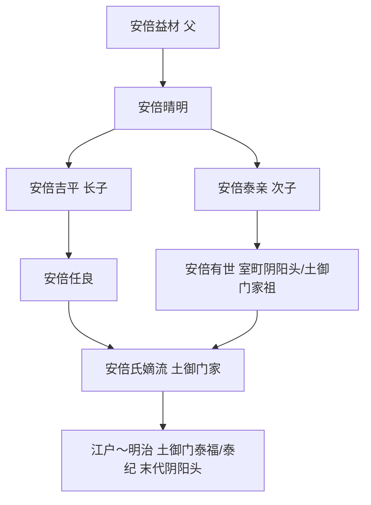
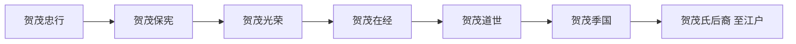

# 阴阳师核心人物谱系与典籍：安倍晴明、贺茂氏、芦屋道满

> **核心定位**：平安时代阴阳道的集大成者与传承中枢。安倍晴明确立了「陰陽師」作为咒术专家的原型形象；贺茂氏垄断历道·天文道成就学术正统；芦屋道满则作为「宿敌/对照组」构建了阴阳道内部的戏剧性张力。两大典籍《占事略决》与《簠簋内传金乌玉兔集》分别代表了官方学术传承与民间秘传体系。

---

## 一、 核心人物志

### 安倍晴明 —— 阴阳道的「第一人」与文化符号

#### 基本履历与官职
- **生卒**：921年（延喜21）〜1005年（寛弘2），享年84岁。
- **出身**：安倍氏（贺茂氏之外的另一大阴阳世家），父安倍益材。
- **核心官职**：
  - **藏人所阴阳师**（995年，一条天皇朝）：直属天皇侧近，掌握御前占卜·祈祷大权，地位超越阴阳头。
  - **阴阳头**（正暦元年/990 任）：阴阳寮名义长官，但实务权常由前任头或藏人所阴阳师把持。
  - 官位最高至**正四位下**（平安贵族中极高）。

#### 技艺特色与传承定位
| 领域 | 成就/特征 |
| :--- | :--- |
| **占卜（式占·六壬）** | 擅长《黄帝金匮经》《神枢灵辇经》系六壬式占，撰《占事略决》为教科书化总结。 |
| **咒术·式神** | 驱使**十二神将**（青龙、白虎、朱雀、玄武等）与杂式神，擅「反闭」「泰山府君祭」等护身厌胜法。 |
| **天文·历法** | 曾协助贺茂光荣修历，但历道正统长期为贺茂氏垄断。 |
| **晴明桔梗印（五芒星）** | 以五行相生相克为义的护身符咒，后世误传为「所罗门王印」。 |

#### 传奇轶事与形象建构
- **生母之谜**：传为狐狸化身（葛之叶/白狐），赋予其「非人/异类」血统，强化通灵资质叙事。
- **童年慧眼**：幼时即能見鬼神，拜贺茂忠行为师，习得「占事」秘诀。
- **死后传说**：葬于一条戻桥北；死后七日其子安倍吉平于东山见其乘云而归，佐证「尸解仙去」道教色彩。

> **交叉引用**：晴明的式神体系与 [[qimen-dunjia-fundamentals]] 中「八神・式神」概念同源；六壬式占渊源详见 [[liuren-shen-ke-chu-xue-xiang-jie]]、[[liuren-jin-kou-jue-qi-ke-qi-bu]]。

---

### 贺茂氏三代 —— 正统学术的垄断者

贺茂氏为阴阳寮「历道·天文道」世家，父子相传垄断博士职，形成「贺茂历」权威。

| 人物 | 生卒/活跃期 | 核心职掌 | 关键事迹 |
| :--- | :--- | :--- | :--- |
| **贺茂忠行** | ?〜977 | **阴阳博士** / 陰陽助 | 晴明、道满二人的**共同师父**。精通占事·历道·天文，将「占事」相传晴明、「历道」相传保宪。 |
| **贺茂保宪** | 921〜1005 | **历博士** / 天文博士 | 忠行嫡子，垄断**历道·天文道**。与晴明同岁、同门、同寿，被视为「正统嫡传」对照晴明之「庶流/咒术特化」。 |
| **贺茂光荣** | 975〜? | **阴阳头** / 藏人所阴阳师 | 保宪子，995年与晴明同任藏人所阴阳师。主导貞享历改修（虽未完成），代表贺茂氏政治权力巅峰。 |

#### 贺茂氏 vs 安倍氏：分工与张力
- **贺茂氏**：掌「历·天文」→ 国家级基础设施（暦书、天文密奏），学术正统，世袭博士职。
- **安倍氏**：掌「占事·咒术」→ 贵族私人祈祷、厌胜、医疗咒术，实务应用，政治依附性强（藏人所）。
- **历史转折**：11世纪贺茂氏排除安倍氏独占历道 → 日本历法技术停滞800年（沿用宣明历至江户貞享历）。

> **交叉引用**：历法技术停滞与中国宣明历传承见 [[zhanxing-tianwen-jichu-yu-huangdao-tixi]]「回归黄道与恒星黄道」节；阴阳寮官制详见 [[japanese-onmyodo]]。

---

### 芦屋道满 —— 「宿敌」与「反面教员」的叙事功能

#### 史实与虚构的分层
| 层面 | 内容 |
| :--- | :--- |
| **史实原型** | 可能存在于10世纪中叶的**民间/隐阴阳师**（非阴阳寮官人），擅长厌胜咒术，曾因诅咒小野茂助（算博士）致死而闻名（《今昔物语集》卷11）。 |
| **传说形象** | 晴明**最大宿敌**，同师贺茂忠行门下，**师兄**身份。性格狡诈、嫉妒，屡次设计陷害晴明（如「唐土占事对决」「桔梗印夺取」）。 |
| **结局** | 被晴明识破反咒，或自食其果身亡；死后化为恶鬼/怨灵，仍持续缠绕晴明血脉（道满川人、山际忠范等后继者）。 |

#### 道满系谱的衍生角色（军记物·绘卷扩充）
- **道满川人**（どうまん かわひと）：道满子/弟子，继承怨念挑战晴明子吉平。
- **山际忠范**（やまぎわ ただのり）：道满党羽，精通「式占」，曾以「咒术球」对抗。
- **安倍山吹**（あべ やまぶき）：晴明妻/妾？在道满篇中常作为人质/诱饵登场。

> **文化意涵**：道满不是单纯反派，而是**「非官方咒术力量」对「官方制度化阴阳道」的挑战者**，也是晴明确立「第一人」地位所必需的试金石。

---

## 二、 家族谱系与传承网络

### 安倍氏系谱（以晴明为核心）

- **土御门家**：晴明→吉平→任良/有世合流，室町期定姓「土御门」，垄断阴阳头至明治废阴阳寮。
- **庶流**：安倍泰亲支系多流寓关东（镰仓），为镰仓幕府服务（如安倍泰贞）。

### 贺茂氏系谱（历道正统）

- **特征**：严格父子相传，不分嫡庶，博士职（历/天文）独占。明治维新后因历法西化而失势。

### 伴氏（伴氏/伴家）—— 古代阴阳师祖与民间声闻师源流

- **远祖**：伴善男/伴健兒（飞鸟〜奈良期，阴阳寮前身「陰陽博士」前身）。
- **中世转型**：伴氏庶流 → **声闻师（唱门师/唱文师）**，隶属兴福寺等寺院，从事民间占卜·芸能·历书贩卖，为民间阴阳师/修验者源头之一。
- **代表人物**：伴海文部、伴海川人、伴海国成等（书中No.085〜092列传）。

> **交叉引用**：声闻师与修验道、民间艺能（能、狂言、文乐）渊源见 [[japanese-onmyodo]]「法师阴阳师·声闻师」节；修验道咒术体系见 [[hua-jie-da-fa-quan-shu-xia]]「茅山术·六甲天书」。

---

## 三、 经典对决：晴明 vs 道满 —— 文本与仪式的较量

### 核心对决场次（源自《芦屋道满大内鉴》《今昔物语集》等）

| 回合 | 对决主题 | 道满策略 | 晴明破解 | 象征意义 |
| :--- | :--- | :--- | :--- | :--- |
| **第一回** | **唐土占事**（天子前） | 以高难度中国占法（六壬/太乙）压制 | 师承忠行真传，反客为主，精准断验 | **学术正统性**：晴明继承「占事」正统，道满虽博学终属旁门 |
| **第二回** | **桔梗印夺取** | 设计陷害晴明失印，或伪造印信 | 以「十二神将」/反闭护身，识破伪印 | **咒术权威**：桔梗印=五行掌控权，晴明守护成功确立「第一人」 |
| **第三回** | **咒杀/反咒** (小野茂助案等) | 以「咒术球」「声音咒」远程杀人 | 物忌避凶、形代替身、反闭护身 | **生存智慧**：官人阴阳师依靠制度化「物忌·方位」防御隐阴阳师突袭 |
| **终局** | **道满死/化怨** | 死后怨念化恶鬼缠绕晴明后裔 | 晴明死前布阵/子孙持咒镇压 | **秩序胜混乱**：制度化阴阳道纳入怨灵于体系内（泰山府君祭等） |

### 对决的深层结构
- **知识垄断权之争**：谁掌握「占事」真传（忠行口诀）？
- **身份认同之争**：官人阴阳师（制度内） vs 隐/法师阴阳师（制度外）。
- **性别/血统隐喻**：晴明「狐母」非人血统 vs 道满「人类极致恶意」，模糊了人/神/鬼界限。

---

## 四、 核心典籍：两大传承体系的文本锚点

### 《占事略决》（せんじ りゃっけつ） —— 官方教科书/学术摘要

| 维度 | 详情 |
| :--- | :--- |
| **作者/成书** | 安倍晴明撰，天元2年（979）初笔，现存为室町期抄本（宫内厅书陵本、京都大河家本）。 |
| **性质** | **阴阳寮学生教科书**，非秘传。汇整中国六朝《黄帝金匮经》《神枢灵辇经》六壬精要，**未收录日本独自占法**。 |
| **结构** | 全36章：前半理论（占法、道具、四神图），后半实例（病卦、胎卦、天气邪祟）。补「第十 帝相败决」一章。 |
| **价值** | 1. 确证晴明真迹唯一存世著。 2. 保存平安期六壬式占日本化面貌（四神图等）。 3. 反映「占事」教学标准化尝试。 |
| **关联** | 六壬渊源见 [[liuren-shen-ke-daquan]]、[[liuren-jin-kou-jue-zhi-xuan]]；式占实务见 [[qimen-dunjia-yang-dun-540-ju-xiang-jie]]「式盘符使」节。 |

### 《簠簋内传金乌玉兔集》（ふき ないでん きんう ぎょくと しゅう） —— 民间阴阳师「圣经」

| 维度 | 详情 |
| :--- | :--- |
| **正式名** | 《三国相传阴阳辖簠簋内传金乌玉兔集》（五卷）。 |
| **传说作者** | 伯道上人（中国仙人）授《文殊集佛历经》→ 晴明据著。 |
| **学界定论** | **镰仓时代以后伪托作**（晴明卒1005，书中反映中世牛头天王信仰、宿曜道普及等晚出要素）。署名「安倍**清**明」暗示非「晴」明真迹。 |
| **五卷内容** | 1. 牛头天王求婚传说·吉凶判 2. 盘古王开辟·五帝神·干支解 3. 太岁神/大将军吉凶·四季禁忌神事佛事吉凶日 4. 宅地屋相吉凶诊断（风水） 5. **宿曜道二十八宿详解** |
| **衍生/影响** | 江户《永代大杂书万历大成》依此普及民间择日·宅相·宿曜；天保13年（1842）版为代表。 |
| **关键词** | **簠簋**（祭器，方圆象天地）、**金乌**（日/三足乌）、**玉兔**（月）、**牛头天王**（祇园祭主神、疫病除灭）。 |
| **关联** | 宿曜道体系见 [[japanese-onmyodo]]「宿曜道」节；宅相/风水见 [[fengshui-bao-di-mo-shi]]、[[yin-pan-qimen-paipan-shi-yi-bu]]；牛头天王/祇园祭见 [[japanese-onmyodo]]「牛头天王与祇园祭」。 |

> **双典籍互补**：
> - 《占事略决》 = **制度内·学术化·六壬式占** → 传承给安倍/贺茂官人阴阳师。
> - 《金乌玉兔集》 = **制度外·咒术宗教化·宿曜·牛头天王·宅相** → 传承给声闻师、隐阴阳师、修验者、江户庶民历书。

---

## 五、 历史定位与演变脉络

### 平安期：阴阳寮制度内的「二元共治」
- **贺茂氏** = 历道·天文道（国家基建）。
- **安倍氏** = 占事·咒术（贵族私人/天皇侧近）。
- **宿曜师**（仁寿、仁统等密教僧） = 补完历法技术、提供密教咒术，**与阴阳师并立互补**。

### 中世（镰仓・室町）：武家政权下的重组
| 阶段 | 关键变化 |
| :--- | :--- |
| **镰仓初期** | 武士轻视咒术（源赖朝无视衰日出兵），阴阳师地位下降；安倍泰贞首入镰仓。 |
| **镰仓中期** | 幕府需「御家人」身份阴阳师，安倍氏庶流定居关东；京都贺茂/安倍嫡流不动。 |
| **室町期** | 足利义满重用安倍有世破格升官（从二位），**土御门家**确立阴阳头世袭；贺茂氏历道停滞。 |
| **民间** | 声闻师（伴氏系）获土御门许可证，贩卖历书、行占卜·芸能，成民间阴阳师主力。 |

### 近世（江户）：土御门家垄断与「阴阳道」民俗化
- **土御门家**（安倍嫡流）：获幕府「阴阳独职」，全国阴阳师许可证发放权，管理声闻师组织。
- **贺茂氏**：仅存历道名目，技术冻结（仍用宣明历）。
- **民间阴阳道**：《金乌玉兔集》→《万历大成》普及择日·方位·宅相·宿曜，融入庶民生活（土用丑日食鳗鱼等）。

### 明治维新：废阴阳寮·近代化断裂
- **明治3年（1870）**：废阴阳寮，改立「天文台」「历法局」（西洋天文历法）。
- **明治5年（1872）**：禁阴阳师咒术·式神·占卜为「迷信」。
- **土御门泰福**（末代阴阳头）转任神祇官，后隐退；阴阳道制度化终结，仅存民俗/宗教/流行文化符号。

---

## 六、 知识图谱交叉引用索引

| 主题 | 本库相关页面 | 备注 |
| :--- | :--- | :--- |
| **阴阳道制度·官职·仪式** | [[japanese-onmyodo]] | 核心总览页，含阴阳寮组织、式神、宿曜道、牛头天王等。 |
| **式占·奇门遁甲·六壬渊源** | [[qimen-dunjia-fundamentals]]、[[liuren-shen-ke-chu-xue-xiang-jie]] | 中国术数三式传日演变。 |
| **宿曜道·九曜·二十八宿** | [[japanese-onmyodo]]「宿曜道」节、[[nakshatra-27-lunar-mansions]] | 印度经中过中国入日，晴明/道满均涉。 |
| **风水·宅相·方位吉凶** | [[fengshui-bao-di-mo-shi]]、[[yin-pan-qimen-paipan-shi-yi-bu]] | 《金乌玉兔集》卷四核心内容。 |
| **咒术·符咒·式神·反闭** | [[hua-jie-da-fa-quan-shu-xia]]、[[zheng-yi-dao-fu-zhou-xiu-xing-shi-wu]] | 道教方术→阴阳道→正一道/民间符咒传承链。 |
| **安倍晴明文化符号化** | [[tujie-huo-shen-yu-huo-jing-ling]]（比较神话视角） | 晴明作为「文化英雄/骗子神」原型的跨文化对照。 |
| **明治废阴阳寮·近代天文历法** | [[zhanxing-tianwen-jichu-yu-huangdao-tixi]]、[[westman-copernican-question]] | 东亚传统天文历法遭西学替代的通史脉络。 |

---

## 七、 关键时间轴速查

| 年份 | 事件 | 关键人物 |
| :--- | :--- | :--- |
| 701 (大宝元年) | **阴阳寮设立**（大宝律令） | — |
| 844 (承和11) | 藤原良房定「灾异由邪祟，阴阳师主祓禊」→ 咒术化转折 | — |
| 921 | 晴明/保宪出生 | 安倍晴明、贺茂保宪 |
| 970s | 晴明拜忠行师；道满同门 | 贺茂忠行、芦屋道满 |
| 979 (天元2) | 《占事略决》成书 | 安倍晴明 |
| 995 (长德元) | 晴明&光荣同任**藏人所阴阳师** | 安倍晴明、贺茂光荣 |
| 1005 | 晴明/保宪同年卒 | 安倍晴明、贺茂保宪 |
| 1180s | 镰仓幕府开，安倍泰贞入镰仓 | 安倍泰贞 |
| 1330s | 《师守记》记录陰陽師日常 | 中原师守 |
| 1400s | 足利义满擢安倍有世为阴阳头从三位 | 安倍有世 |
| 1600s | 土御门家获幕府「阴阳独职」 | 土御门家 |
| 1700s | 《万历大成》普及民间择日 | — |
| 1842 (天保13) | 《万历大成》单行本多版重印 | — |
| 1870 (明治3) | **废阴阳寮** | 土御门泰福 |

---

> **编辑说明**：本页面依据《图解阴阳师》（高平鸣海著）归档内容，结合既有知识库《日本阴阳道》《六壬大全》《奇门遁甲基础》等交叉校订整理。旨在还原平安〜明治阴阳道核心人物、典籍、制度的**史实层**与**传说层**双重面向，为后续「阴阳道咒术实务」「式神体系」「宿曜道占星」等专题页提供枢纽索引。

## 来源

- [图解阴阳师](../sources/图解阴阳师.md)
