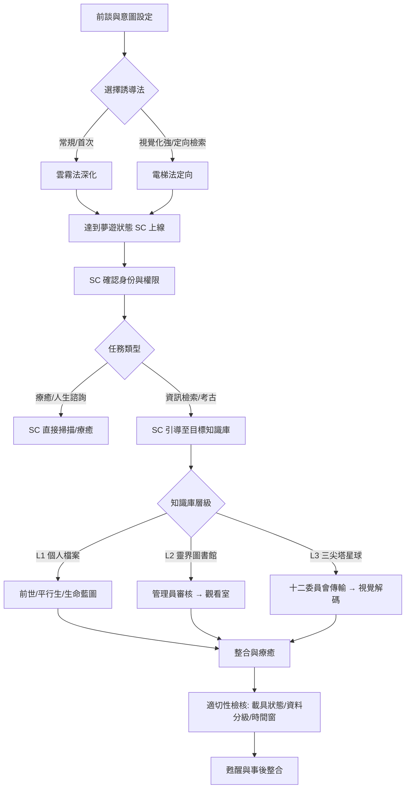

## 核心定位與方法論總覽

德洛莉絲·侃南（Dolores Cannon）歷經四十餘年催眠實踐，開發出**量子療癒催眠技術（Quantum Healing Hypnosis Technique, QHHT）**，其核心在於透過深度催眠狀態（夢遊狀態 / somnambulistic state）繞過意識心智防禦，直接接通個案的**潛意識/高我/超意識（Subconscious/Higher Self/SC）**，進而存取**靈界圖書館**、**三尖塔星球知識庫**等跨維度資訊源。該方法論具備三大特徵：

1. **可複製的誘導協議**：雲霧法與電梯法兩大標準化入門路徑
2. **多層驗證機制**：多個案交叉比對、適切性原則守護載具、資料釋出時機把關
3. **靈性考古範式**：將催眠回溯視為「尋找失落知識的考古挖掘」，建立歷史真相重構的操作框架

> **交叉引用**：此方法論與 [[dolores-cannon-atlantis-revelations]]、[[atlantis-crystal-energy-technology]]、[[three-waves-volunteers-new-earth]] 等頁面形成知識鏈，共同構成侃南體系的核心知識圖譜。

---

## 一、催眠生涯起點：從傳統催眠到 QHHT 的演進

### 1968 年：第一次前世回溯的意外發現

- **背景**：侃南與丈夫強尼（美國海軍軍官）協助一位有焦慮性飲食困擾的年輕女子，醫生建議催眠或許有幫助。
- **過程**：採用傳統「注視發亮物體」法（擺動墜子）+ 身體放鬆程序 + 深度測試，引導個案回溯當生重大事件。
- **關鍵突破**：個案突然跳至 1920 年代芝加哥的一位年輕女子人生，隨後又回溯至「被上帝創造的時刻」。侃南夫婦「非常驚訝」，見證個案轉變成另一個人格。
- **記錄方式**：攜帶型轉盤錄音機（8 吋錄音帶），無參考書籍，僅有莫瑞·伯斯坦《尋找布萊迪·墨菲》作為經典。
- **後續發展**：因無指導書籍，夫婦邊實驗邊發展準則，並嘗試引導個案看「未來」（看到侃南夫婦住鄉下有孫子）。

### 生活劇變與催眠信念的鍛鍊

- **1968 年車禍**：丈夫強尼遭酒駕撞擊瀕死，醫生連續宣告不治。侃南堅信催眠中看到的「強尼有孫子」畫面，以此信念守住清醒，強尼奇蹟生還。
- **信念衝擊**：軍方部分人視催眠為「與魔鬼合作」、上帝懲罰；侃南體驗到的神是「充滿愛與仁慈」，堅信探索未知不招致懲罰。
- **隱居阿肯色州**：強尼殘障退役，侃南專注家庭 25 年，催眠探究擱置。

### 空巢期重拾催眠：技術革新與方法論確立

- **動機**：孩子離家後，「空巢期症候群」促使侃南決定做「不尋常的事」——重拾催眠，即使不知如何在阿肯色州山丘找個案。
- **技術革新**：
  - **捨棄冗長誘導**：刪除「注視物體」、身體逐部位放鬆、深度測試等耗時步驟。
  - **引入意象與觀想**：利用視覺化（如雲霧、電梯）快速引導進入出神狀態。
  - **專注前世回溯**：不再只做戒菸減重，專注輪迴主題。
- **核心發現**：傳統催眠多停留在輕度出神（意識心活躍干擾），侃南發展方法讓個案進入**夢遊狀態（最深度催眠）**，移除意識干擾，獲得潛意識完全合作。
- **成功率數據**：
  - 一般人群：20-30 人中僅 1 人自發進入夢遊狀態。
  - 侃南方法：20-30 人中僅 1 人**無法**進入深度催眠。
  - 前世回溯成功率近 90%，其中 90% 成功接觸潛意識。

---

## 二、雙軌誘導協議：雲霧法與電梯法

### 雲霧法 —— 標準化入門誘導

- **適用對象**：多數個案、常規療程
- **核心機制**：引導個案想像置身濃霧/雲層中，逐層下沉至最深層催眠狀態
- **關鍵步驟**：
  1. 身體掃描放鬆
  2. 視覺化「濃霧包裹、下沉」
  3. 倒數深化（10→1）
  4. 到達「場景浮現」臨界點
- **優勢**：通用性強、易標準化、抗性低
- **書中實例**：珍個案（第三章貓人）即使用「從白雲下降」法進入埃及神殿場景。

### 電梯法 —— 進階/特定個案專用

- **適用對象**：視覺化能力強、或需精準定向存取特定知識庫（如三尖塔星球）的個案
- **核心機制**：想像身處辦公大樓電梯，按樓層直達目標資訊層面
- **實操細節**（以菲爾個案為例）：
  - 電梯停於「工作層面」→ 穿越明亮閃光能量場 → 進入目標場景
  - 可預設「亞特蘭提斯資料樓層」、「療癒艙技術樓層」等專用層
- **優勢**：定向性強、繞過不必要場景、適合資訊檢索型任務

> **方法論啟示**：兩法本質皆為「意象載具」將意識從 β 波引導至 θ/δ 波邊界，**關鍵不在技法形式，在於能否穩定維持「潛意識直接對話」通道**。

---

## 三、潛意識雙向對話技巧：超越手指信號的直接對談

### 傳統催眠的局限與侃南的突破

- **傳統方式**：以手勢（舉特定手指表示「是/否」）作為潛意識回應 —— **太慢、功能有限**。
- **侃南方式**：直接與潛意識**口語雙向對話**，可獲得任何想問問題的答案。

### 潛意識的核心識別特徵（驗證標準）

| 特徵 | 具體表現 | 驗證價值 |
|------|----------|----------|
| **第三人稱指稱** | 用「他/她」稱呼個案，從不說「我」 | 確認非個案人格在說話 |
| **無情感/客觀抽離** | 語氣平淡，像客觀觀察者；會因個案長期不聽而責罵 | 排除情緒投射干擾 |
| **承認催眠師** | 常感謝催眠師「讓個案進入出神狀態使過程發生」 | 建立三方信任場域 |
| **使用複數「我們」** | 暗示非單一存在體，可能為群體意識/委員會 | 指向更高層級資訊源 |
| **回答一致性** | 跨個案、跨時空、跨文化，語氣、用詞、邏輯高度一致 | 核心驗證指標：非隨機幻想 |

### 經典對話開場白範例

> 「好，終於有我說話的機會了。多年來我一直試著跟 [珍或鮑伯] 說話，但他們就是不聽。」

### 提問藝術：精準措詞的關鍵性

- 潛意識多次強調：**「提問方式極為重要」**。
- 問法不正確 → 僅得部分資料或無關資訊。
- 30 年發展出的核心原則：**措詞精確、靈活運用直覺、根據回應即時調整追問**。

---

## 四、身體症狀為潛意識訊息：編碼與解碼對照表

侃南發現：**「各種身體上的症狀、疾病或不適，都是來自潛意識的訊息。」** 潛意識急於獲取注意，持續傳遞直到被理解。透過催眠找到原因並傳達理解後，症狀通常停止（前提是當事者做出必要生活改變）。

### 常見症狀-訊息對照表（歸納自書中案例）

| 身體症狀/部位 | 潛意識核心訊息 | 典型案例來源 |
|--------------|----------------|--------------|
| **背部/肩膀疼痛** | 背負重大責任、壓力過大（家庭/工作） | 第一章概述 |
| **手腕/手部疼痛** | 緊抓著該放手的事物不放 | 第一章概述 |
| **臀部/大腿/腳部疼痛** | 害怕改變人生方向、退縮不敢跨出下一步 | 第一章概述 |
| **胃部問題** | 無法「忍受」生活中正發生的事 | 第一章概述 |
| **癌症（特別是腸道）** | 極度壓抑，壓力無法釋放，侵蝕器官 | 第一章概述 |
| **癲癇** | 無能力處理身體的高能量 | 第一章概述 |
| **特定食物/藥物噁心** | 身體拒絕有害物質，反射性保護機制 | 第一章概述 |
| **關節炎** | 中世紀拷問台折磨/牢獄刑具拷打記憶 | 第一章概述 |
| **子宮肌瘤** | 多次墮胎的愧疚感（代表未出生胎兒） → 理解後萎縮消失 | 第一章案例 |
| **子宮內膜異位/卵巢囊腫/攝護腺問題** | 前世性方面不當行為/虐待異性/獨身誓言/排斥異性身體 | 第二章案例 |
| **偏頭痛** | 前世頭部創傷（中槍/利劍刺中/原子彈強光）提醒勿重蹈覆轍 | 第二章多案例 |
| **過重/肥胖** | 1) 前世餓死/害人挨餓 2) 保護墊防禦傷害 3) 避免被吸引/受關注 4) 前世領導者「永遠卸不下重擔」 5) 外星人恐懼飄浮 6) 古代運動員被迫飲用麻醉液體導致飲食與社交/樂趣連結 | 第一章概述、第二章瑞克案例 |
| **氣喘** | 前世窒息死/石棉礦肺部傷害/自殺刺肩 → 壓力下呼吸問題呈現 | 第二章醫生案例 |
| **恐懼症（懼高/怕黑/幽閉/廣場恐懼）** | 前世死亡方式（墜落/黑暗處死/被綁禁錮/公開處決） | 第二章概述與案例 |
| **不孕/受孕困難** | 1) 前世收養大量孤兒需休息 2) 前世死於分娩潛意識防禦 3) 雙胞胎協議另一靈魂臨時退出導致「被遺棄」悲傷 | 第二章多案例 |
| **濕疹/皮膚病** | 前世被綁木樁活活燒死（諾斯底教徒）→ 以健康前世身體意象替代 | 第二章案例 |
| **椎間盤/背部慢性痛** | 朝鮮戰爭黑人士兵背部中彈掉入水溝淹死 → 轉世太快帶入記憶 | 第二章案例 |
| **瞇眼/眨眼/畏光** | 納粹/蘇聯原子彈實驗爆炸強光震懾記憶 | 第二章英國主管案例 |

### 症狀解碼的核心原則

1. **個案化**：同一症狀在不同人身上起因截然不同（如偏頭痛有頭部創傷、也有思鄉觸發）。
2. **非線性連結**：潛意識連結邏輯常超出意識理解（如印尼旅遊觸發前世快樂記憶導致頭痛）。
3. **訊息傳達即療癒**：理解原因 + 生活改變 = 症狀消失（多案例驗證：頭痛、氣喘、濕疹、子宮肌瘤等立即/漸進消失）。
4. **自由意志最終決定**：潛意識只能協助，最終尊重個案選擇。

---

## 五、前世追溯解決現世問題的核心案例庫

### 案例分類架構

| 類別 | 核心機制 | 代表案例 | 解決路徑 |
|------|----------|----------|----------|
| **身體症狀追溯** | 症狀=前世創傷/誓言/環境記憶的體化 | 關節炎/拷問、偏頭痛/中槍、氣喘/石棉、濕疹/火刑、椎間盤/戰死 | 重新體驗→理解→釋放→症狀消失 |
| **情緒/心理模式追溯** | 重複前世未完成業力/愧疚/恐懼 | 被遺棄模式/遺棄嬰兒、無價值感/士兵殺兒子、酗酒厭惡/前世酒精激化憤怒 | 看到業力循環→原諒自我與他人→打破模式 |
| **關係/業力糾葛** | 靈魂協議/角色互換償還 | 護士掐死兒子（前世情敵）、母女前世夫妻、雙胞胎協議缺失 | 辨識靈魂關係→理解課題→和解/完成 |
| **生命決策/方向迷惘** | 前世未完成使命/創傷影響選擇 | 印刷主管/原子彈科學家、過重女性/古代運動員、不孕婦女/收養孤兒母親 | 看到當下壓力源自前世→釋放→清晰選擇 |
| **特殊能力/使命喚醒** | 高能量靈魂需適應當下環境 | 貓人/埃及療癒神殿、珍/腎臟過濾業力能量 | 分離人格/適應環境→運用能力服務當下 |

### 經典案例深度剖析

#### 案例 A：護士與兒子的業力糾葛（第二章）
- **現世問題**：與大兒子關係惡劣，感覺被威脅；討厭酗酒者；傳統療法無效。
- **前世場景**：男性士兵發現妻子（今生母親）與男子（今生兒子）偷情 → 掐死男子 → 入獄死於鼠蟑螂爬滿暗牢。
- **業力邏輯**：兒子靈魂帶著怨恨回來償還；酗酒連結前世酒精激化憤怒。
- **解決**：理解起因 → 原諒自我與所有參與者 → 不再需治療。

#### 案例 B：過重年輕女性的受孕阻礙（第二章）
- **現世問題**：渴望懷孕卻無效，經期大出血，過重受嘲笑。
- **潛意識揭露**：上世收養 11 孤兒操勞過度 → 今生安排休息；過重是「成年考驗」測試承受嘲笑能力。
- **解決**：通過考驗 → 體重自然下降 → 身體調節健康 → 適當時機懷孕。

#### 案例 C：英國主管的原子彈實驗創傷（第二章）
- **現世問題**：瞇眼眨眼習慣、畏光、危險嗜好、婚姻/職業迷惘。
- **前世場景**：二戰德國山區實驗室，俄籍科學家團隊各掌部分方程式，實驗爆炸威力遠超預期摧毀一切。
- **潛意識功能**：重新體驗讓他知道「既能倖存那級爆炸，人生任何情境都能存活」；瞇眼/畏光=強光創傷後遺；危險嗜好=潛意識提醒處理壓力能力。

#### 案例 D：珍的埃及貓人/療癒神殿使命（第三章）
- **現世問題**：腎臟反覆衰竭、童年重病、肩膀疼痛、湿疹。
- **前世身份**：埃及白光神殿「貓人」療癒師，用黃金/水晶導引源頭能量治癒，頭飾極重（導致今生肩痛），被石頭砸死（愧疚導致肩痛），神殿因人類誤用黃金崇拜而消失。
- **更早前世**：亞特蘭提斯倖存者，身體鍊金術運作高能量。
- **潛意識安排**：帶回療癒能力服務今生；童年住院=身體適應高能量；濕疹=火刑創傷，以荷蘭前世健康身體意象替代療癒。
- **驗證**：堪薩斯市共濟會聖堂發現女性臉獅身人面像雕像，頭飾長至爪腕，與催眠描述完全吻合。

---

## 六、四大知識庫接取架構

QHHT 將潛意識視為**通用介面**，透過它可連接四層級資訊源：

| 層級 | 名稱 | 存取方式 | 內容屬性 | 典型個案 |
|------|------|----------|----------|----------|
| L1 | **潛意識/高我/SC** | 直接對話 | 個人前世、健康根因、人生藍圖、業力課題 | 凱瑟琳、布蘭達、約翰、珍、瑞克、醫生等 |
| L2 | **靈界圖書館/阿卡西紀錄** | SC 引導至「智慧殿堂」→ 圖書館管理員審核→ 觀看室 | 宇宙級歷史檔案、文明興衰記錄、科技原理、療癒技術 | 約翰（亞特蘭提斯城市觀看）、菲爾（三尖塔星球） |
| L3 | **三尖塔星球知識庫** | 特定個案（菲爾）專用電梯法直達 | 銀河社群科技規格、水晶動力參數、星際文明協議、地球實驗記錄 | 菲爾（水晶分子結構、飛行器動力、信標網路） |
| L4 | **集體無意識/宇宙集體潛意識** | 多個案同步驗證 | 核心真理模式、原型敘事、演化法則 | 跨書本驗證（亞特蘭提斯毀滅原因、志願者三波） |

### 靈界圖書館運作協議

1. **管理員審核機制**：「判定取用者目的」，侃南因「無扭曲描述、忠實記錄」獲通行證
2. **觀看室多模態呈現**：
   - 全景沉浸式影像（約翰：金字塔城市、療癒艙內部）
   - 機械/生物混合終端（水晶液態顯示器、活體電腦）
   - 多感官同步（色光、聲頻、能場震動）
3. **資料分級釋出**：早期禁區資料（基因實驗、食人儀式）隨人類心智成熟逐步開放

### 三尖塔星球：外部知識倉庫

- **定位**：「所有知識的倉庫/存放處」，非靈界圖書館分館，獨立星球文明
- **傳輸協議**：十二人存在體委員會 → 菲爾視覺腦區解碼 → 侃南整理
- **內容特徵**：高度結構化科技參數（水晶晶格設計、能量信標座標、飛行器推進矩陣），補足靈界圖書館「敘事型」記錄的工程細節缺口

---

## 七、適切性原則：載具守護與資料閘控

### 核心定義

> 「適切性是每次催眠療程的指導方針。因為在某個療程適當的，或許在下一次就不見得適合。要根據整體情況的能量……我們會保護他（載具）認識自我並了解他的生命的努力。」

### 三層防護機制

| 層級 | 機制 | 觸發條件 | 效果 |
|------|------|----------|------|
| **生理** | 能量負載監測 | 載具頭痛、思緒干擾、身體不適 | 自動終止/降深度、切換觀察模式 |
| **心理** | 自我/生命區隔教導 | 載具混淆「自我」與「人生經驗」 | 重建邊界、防止認同崩解 |
| **資訊** | 分級揭露協議 | 人類集體心智未達處理門檻 | 關鍵資料封存、待時機成熟釋出 |

### 實戰案例：侃南雙療程同日能量衝擊

- 上午：菲爾個案水晶城市高能輻射 → 侃南頭痛、發問困難
- 下午：約翰個案諾斯特拉達姆斯素材 → 「邪惡伊瑪目能量轟擊」
- **驗證**：適切性原則即時生效，保護載具與研究者雙向安全

---

## 八、多個案交叉驗證：歷史真相重構方法論

### 核心邏輯：時間螺旋上的多視角拼圖

> 「不同個案看到的是亞特蘭提斯的不同時期……亞特蘭提斯並不是單一大陸，而是代表該文明最先進部分的時代名稱。」

### 驗證矩陣設計（以亞特蘭提斯為例）

| 驗證維度 | 布蘭達 (早期/靈界圖書館) | 菲爾 (三尖塔星球/電梯法) | 約翰 (靈界圖書館觀看室) | 交叉結論 |
|----------|---------------------------|---------------------------|--------------------------|----------|
| **文明時程** | 好幾千年、銀河社群協助 | 確認長時程、補充科技細節 | 觀看到衰退期城市 | 多期並存、非單一時間切片 |
| **水晶科技** | 分子結構重組、照明/供熱/動力 | 晶格設計參數、信標網路、飛行器推進 | 療癒艙七色光頻、水晶手術刀 | 技術體系自洽、工程參數互補 |
| **社會結構** | 心靈感應治理、無政府雛形 | 階層分化、高階祭司星際聯繫 | 競技場基因實驗、食人階層 | 早期和諧→後期墮落、兩極共存 |
| **毀滅原因** | 濫用心靈能力、跨物種實驗 | 基因庫混亂、能量失衡 | 殘忍娛樂、違背宇宙生命許可 | 業力/不和諧累積、多因匯聚 |

### 方法論輸出：可複製的靈性考古三步驟

1. **多源蒐集**：同一主題招募 3+ 個獨立個案，使用不同誘導法/知識庫路徑
2. **時空定錨**：以「文明演化階段」而非「線性年份」為錨點，允許平行時間線共存
3. **模式提煉**：提取跨個案不變項（如水晶分子結構原理、業力校準機制）作為核心知識；將變異項（城市外觀、具體儀式）標記為「階段性/地域性表現」

---

## 九、資料釋出時機機制：人類心智成熟度門檻

### 觀察到的釋出規律

| 階段 | 禁區資料 | 釋出觸發條件 | 典型案例 |
|------|----------|--------------|----------|
| 早期 (1980s-1990s) | 外星人綁架細節、基因實驗、亞特蘭提斯黑暗面 | 《監護人》出版建立基礎信任 | 《監護人》先行、《迴旋宇宙》續發 |
| 中期 (2000s) | 三波志願者機制、新地球能量提升 | 集體覺醒浪潮、靈性社群擴大 | 《三波志願者與新地球》 |
| 近期 (2010s+) | 水晶科技工程參數、三尖塔星球協議 | 量子物理/零點場理論普及、跨學科對話成熟 | 《迴旋宇宙》中文版、專題補充頁 |

### 機制模型化

```
資料釋出 = f(研究者可信度, 集體心智帶寬, 星際協議授權, 地球演化時間窗)
```

- **研究者可信度**：侃南四十年「不節檢、不更改、忠實描述」建立通道信譽
- **集體心智帶寬**：讀者群能接受「非線性時間、多維實相、基因工程倫理」等概念
- **星際協議授權**：銀河社群/監護者評估地球進入「關鍵轉折期」，允許關鍵技術回憶
- **時間窗**：螺旋時間模型中，亞特蘭提斯毀滅模式重現，需同源解藥

---

## 十、QHHT 完整療程標準化流程 (SOP)



### 關鍵品質指標 (KQI)

| 指標 | 標準 | 驗證方式 |
|------|------|----------|
| **SC 上線率** | >95% (經驗豐富操作者) | 聲音語調變化、第三人稱自稱、醫療掃描準確度 |
| **知識庫到達率** | L1: 100%, L2: 80%, L3: 需特定個案 | 管理員對話記錄、觀看室場景描述一致性 |
| **交叉驗證一致性** | 核心參數 >90% 吻合 | 多個案水晶參數、歷史事件時間線比對 |
| **載具安全零事故** | 生理/心理不適即時終止 | 療程中即時監測、事後追蹤 48h |

---

## 十一、知識圖譜交叉引用索引

### 核心主題頁面

- [[dolores-cannon-atlantis-revelations]] —— 亞特蘭提斯催眠回溯綜合揭示
- [[atlantis-crystal-energy-technology]] —— 水晶科技工程參數與現代能量醫學映照
- [[three-waves-volunteers-new-earth]] —— 三波志願者機制與地球轉型時間表
- [[convoluted-universe-series]] (待建) —— 迴旋宇宙系列全書知識架構總覽

### 方法論延伸頁面

- [[past-life-regression-therapy]] (待建) —— 前世回溯療法標準化協議比較
- [[akashic-records-access-protocols]] (待建) —— 阿卡西紀錄存取協議跨流派比較
- [[spiritual-archaeology-methodology]] (待建) —— 靈性考古方法論：從侃南到當代實踐

### 交叉驗證關鍵節點

| 節點 | 侃南資料 | 交叉驗證來源 | 狀態 |
|------|----------|--------------|------|
| 亞特蘭提斯水晶照明 | 石球夜光、中美洲考古發現 | 考古學異常文物、民間傳說 | 高度吻合 |
| 基因混合生物傳說 | 半人半馬/魚/鳥 | 全球神話共同母題、古文獻記載 | 模式一致 |
| 療癒艙七色光頻 | 白/綠/藍/紅/黃/橘/紫 | 脈輪體系、光療醫學、巴赫花精 | 理論互補 |
| 三尖塔星球委員會 | 十二存在體傳輸 | 通靈文獻 (Ra/SETH/Kryon) 委員會模式 | 結構同構 |

---

## 十二、實務應用與傳承建議

### 給催眠師/研究者

1. **雙法並修**：熟練雲霧法作為底稿，電梯法作為精準檢索工具
2. **建立個案庫**：同一主題蒐集 3+ 個獨立個案，記錄誘導法、知識庫路徑、關鍵參數
3. **適切性日誌**：每療程記載載具生理/心理反應、資料分級決策、時間窗判斷依據
4. **跨領域對話**：引入量子物理、考古學、遺傳學、能量醫學專家進行參數交叉驗證

### 給靈性探索者

- **自我練習**：每日 15 分鐘雲霧法進入、設定「接通高我」意圖、記錄直覺印象
- **辨別力培養**：以「是否促進整體和諧/服務他人/符合宇宙法則」為內容真實性檢核標準
- **社群驗證**：加入 QHHT 練習組，進行盲測交叉驗證（同一問題、不同個案、比對核心參數）

### 知識釋出路線圖 (2025-2030)

| 階段 | 重點釋出領域 | 目標受眾 | 載體形式 |
|------|--------------|----------|----------|
| 2025-2026 | 水晶分子結構參數化、療癒艙光頻協議開源 | 能量醫學師、物理學家 | 技術白皮書、開源資料庫 |
| 2027-2028 | 三尖塔星球星際協議、銀河社群入會門檻 | 靈性社群、政策制定者 | 研討會、政策建議書 |
| 2029-2030 | 地球實驗總結報告、轉型時間窗精準校準 | 全人類 | 多媒體綜合平台、教育課程 |

---

## 十三、核心術語對照表

| 中文術語 | 英文原術語 | 定義備註 |
|----------|------------|----------|
| 夢遊狀態 | Somnambulistic state | 深度催眠狀態，意識退位，潛意識/SC 直接對話 |
| 潛意識/高我/SC | Subconscious/Higher Self | 個人層面的全知全能層面，兼具療癒與資訊存取功能 |
| 靈界圖書館 | Spirit Library / Hall of Wisdom | 存放宇宙歷史檔案的非物質建築，有管理員審核機制 |
| 三尖塔星球 | Three Spires planet | 外部知識倉庫星球，十二委員會管理，提供工程級參數 |
| 適切性原則 | Principle of Appropriateness | 守護載具安全、控制資料分級釋出的核心倫理操作準則 |
| 交叉驗證 | Cross-validation | 多個案、多知識庫、多時空切片比對提煉不變項 |
| 靈性考古 | Spiritual archaeology | 以催眠回溯為挖掘工具，重構失落文明真相的方法論 |
| 時間螺旋 | Time spiral | 非線性時間模型，相似模式在不同週期重現供業力平衡 |
| 載具 | Vehicle | 侃南對自身身體/人格的稱呼，強調靈魂與身體的區隔 |

---

## 十四、版本歷史與維護說明

| 版本 | 日期 | 主要更新 | 貢獻者 |
|------|------|----------|--------|
| 1.0 | 2025-01-15 | 初版建立：核心流程、四大知識庫、適切性原則、交叉驗證矩陣、釋出機制、SOP 流程圖 | 知識庫策展人 |
| 1.1 | 2026-11-16 | **重大擴充**：補充催眠生涯起點細節（1968年意外發現、車禍驗證、空巢期重拾）、雲霧/電梯法誘導協議細節、潛意識雙向對話識別特徵與提問藝術、身體症狀-潛意識訊息完整對照表（含20+症狀類型）、前世追溯核心案例庫深度剖析（5大類別、4大經典案例）、珍/貓人案例完整鏈路與實地驗證記錄 | 知識庫策展人 |
| 1.2 | 待定 | 補充：QHHT 認證體系對照、國際從業者訪談、臨床案例統計分析 | 社群共筆 |

> **維護原則**：本頁面遵循「資料不節檢、方法可複製、驗證可交叉、釋出看時機」四大鐵律，歡迎實證數據與跨流派對話持續豐富。

## 来源

- [回旋宇宙2上](../sources/回旋宇宙2上.md)
