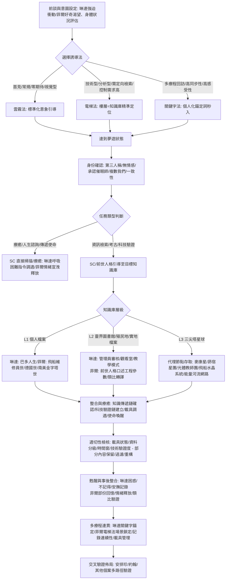

## 核心定位與方法論總覽

德洛莉絲·侃南（Dolores Cannon）歷經四十餘年催眠實踐，開發出**量子療癒催眠技術（Quantum Healing Hypnosis Technique, QHHT）**，其核心在於透過深度催眠狀態（夢遊狀態 / somnambulistic state）繞過意識心智防禦，直接接通個案的**潛意識/高我/超意識（Subconscious/Higher Self/SC）**，進而存取**靈界圖書館**、**三尖塔星球知識庫**等跨維度資訊源。該方法論具備三大特徵：

1. **可複製的誘導協議**：雲霧法、電梯法、關鍵字法三大標準化入門路徑
2. **多層驗證機制**：多個案交叉比對、適切性原則守護載具、資料釋出時機把關
3. **靈性考古範式**：將催眠回溯視為「尋找失落知識的考古挖掘」，建立歷史真相重構的操作框架

> **交叉引用**：此方法論與 [[dolores-cannon-atlantis-revelations]]、[[atlantis-crystal-energy-technology]]、[[three-waves-volunteers-new-earth]]、[[convoluted-universe-book-1]]、[[convoluted-universe-2-apostles-sleep-work]]、[[dolores-cannon-custodians]]、[[earth-et-history-cosmology]] 等頁面形成知識鏈，共同構成侃南體系的核心知識圖譜。

---

## 一、催眠生涯起點：從傳統催眠到 QHHT 的演進

### 年：第一次前世回溯的意外發現

- **背景**：侃南與丈夫強尼（美國海軍軍官）協助一位有焦慮性飲食困擾的年輕女子，醫生建議催眠或許有幫助。
- **過程**：採用傳統「注視發亮物體」法（擺動墜子）+ 身體放鬆程序 + 深度測試，引導個案回溯當生重大事件。
- **關鍵突破**：個案突然跳至 1920 年代芝加哥的一位年輕女子人生，隨後又回溯至「被上帝創造的時刻」。侃南夫婦「非常驚訝」，見證個案轉變成另一個人格。
- **記錄方式**：攜帶型轉盤錄音機（8 吋錄音帶），無參考書籍，僅有莫瑞·伯斯坦《尋找布萊迪·墨菲》作為經典。
- **後續發展**：因無指導書籍，夫婦邊實驗邊發展準則，並嘗試引導個案看「未來」（看到侃南夫婦住鄉下有孫子）。

### 生活劇變與催眠信念的鍛鍊

- **1968 年車禍**：丈夫強尼遭酒駕撞擊瀕死，醫生連續宣告不治。侃南堅信催眠中看到的「強尼有孫子」畫面，以此信念守住清醒，強尼奇蹟生還。
- **信念衝擊**：軍方部分人視催眠為「與魔鬼合作」、上帝懲罰；侃南體驗到的神是「充滿愛與仁慈」，堅信探索未知不招致懲罰。
- **隱居阿肯色州**：強尼殘障退役，侃南專注家庭 25 年，催眠探究擱置。

### 空巢期重拾催眠：技術革新與方法論確立

- **動機**：孩子離家後，「空巢期症候群」促使侃南決定做「不尋常的事」——重拾催眠，即使不知如何在阿肯色州山丘找個案。
- **技術革新**：
  - **捨棄冗長誘導**：刪除「注視物體」、身體逐部位放鬆、深度測試等耗時步驟。
  - **引入意象與觀想**：利用視覺化（如雲霧、電梯）快速引導進入出神狀態。
  - **專注前世回溯**：不再只做戒菸減重，專注輪迴主題。
- **核心發現**：傳統催眠多停留在輕度出神（意識心活躍干擾），侃南發展方法讓個案進入**夢遊狀態（最深度催眠）**，移除意識干擾，獲得潛意識完全合作。
- **成功率數據**：
  - 一般人群：20-30 人中僅 1 人自發進入夢遊狀態。
  - 侃南方法：20-30 人中僅 1 人**無法**進入深度催眠。
  - 前世回溯成功率近 90%，其中 90% 成功接觸潛意識。

---

## 二、核心教學案例一：《回旋宇宙》第一卷——琳達與巴多羅米

> **案例地位**：侃南稱此為「打開潘多拉的盒子」，確立 QHHT 作為「靈性考古」工具的範式性個案。完整展示從關鍵字誘導、夢遊態進入、跨時空敘事提取、知識傳人角色確認、身體不適能量調適、到多療程連貫推進的完整實操樣本。

### 個案背景與同步性徵兆

- **初遇緣起**：1989 年阿肯色州小岩城演講會，琳達主動遞名片請求合作，當時侃南未重視。
- **關鍵連結**：數月後發現琳達是核心個案珍妮絲的朋友，珍妮絲反映琳達因未獲聯繫而失望。侃南勉強安排會面。
- **催眠前狀態**：琳達為職業婦女（自營寵物店），四十多歲，衣著講究、言談輕柔，非典型「尋靈」人格。她表示「有股難以抑制的強迫衝動必須見到侃南」，卻不知原因。
- **同步性驗證**：侃南喉嚨發炎、疲累、無期待感下仍執行催眠，冷不防出現「超乎控制外的力量已作好安排」的意外發展。

### 關鍵字誘導法與夢遊態深度進入

- **誘導協議**：使用標準「關鍵字」（關鍵詞）快速進入深度出神，**捨棄**傳統注視物體、身體逐部位放鬆、深度測試。
- **即時深化**：琳達右前臂打石膏（聖誕節跌斷），侃南擔心干擾，但關鍵字說出瞬間即進入深度夢遊態，**石膏零干擾**——驗證誘導法繞過身體不適直接接通潛意識。
- **狀態標記**：聲音變「非常放鬆輕柔、難以聽清」，進入後聲音恢復正常；甦醒後**完全不記得**催眠內容（典型夢遊態特徵）。

### 跨時空敘事提取：巴多羅米的人生全景

#### 第一階段：中世紀王國的異類王子（巴多羅米）
- **身份**：國王幼子，名**巴多羅米**，約 20 歲，褐長髮、蓄鬍、銳利藍眼，喜歡伐木勞作。
- **異質性**：厭惡宮廷膚淺生活，渴望學習星辰/宇宙知識，被視為「瘋子」。
- **導師現身**：來自**昴宿星團**的老人（克里斯多佛），駝背白髮長袍，以光束降臨，只巴多可見。五年來幾乎天天教導。
- **核心任務**：「將宇宙知識代代口耳相傳，不准書寫，防止被毀壞/扭曲。智能中有特殊存儲區，僅適當時機被取出。」
- **傳人尋覓**：導師離開前需找年輕傳人；巴多需遠赴極遠處尋找，終身不歸。

#### 第二階段：星際飛船尋找傳人
- **飛船描述**：小型橢圓光艙，單人站立，有「窗」（無玻璃概念，手穿不過去），銀色發光腰帶（無扣無頭、有口袋感、腹部微脹）、連身發光衣物。
- **導航實體**：來自「麥康星」的小型銀色大頭生物（無髮、發光、臉模糊），睡眠中喚醒徵得同意後瞬移上船。
- **目標地**：「僑居地/殖民地」——無時空觀念、不老化、純正心智存有的中介區，巴多將任教師傳授知識，待時機成熟派遣傳人返地球啟蒙。

#### 第三階段：光體殖民地教學現場
- **抵達體驗**：強光柱傳送，脫離肉體感覺（「非常輕、像飄浮、自由了、我只是我」），見極亮光體存有（模糊五官、微笑、純能量體）。
- **教學模式**：學生提問，巴多重複問題再回答。**首問**：「地球為何信仰體系狹隘？」
- **核心敘事輸出**（跨時空歷史重構）：
  1. **第一波**：提倫塔斯星人（Tyran-tus），長相似地球人，來分享知識卻沉溺權力/貪婪，奴役原住民偽裝成神，植入恐懼。
  2. **第二波**：以朗依爾斯星人（Iran-i-us），外形異於人類（小身大頭銀色），偽裝動物進入夢境傳授愛/不朽/合作，因過於微緩、民眾嘲笑、權力者抗拒而失敗。
  3. **格網位移與大洪水**：地表格網因人類負面行為移位 → 大陸分裂、高熱融冰洪水、大量滅亡。
  4. **第三波**：高身光體教師團（極高、奇特手腳戴套、雙孔鼻、光能維生、不說話不吃地球食物），分乘衛星艙教導農耕/和諧/理性，完成使命集體離開，**未墮落**。
- **關鍵洞見**：地球原為「度假星球/體驗樂園」，靈魂因過度沉迷物質樂趣而困陷；外星人來本為協助脫困，前兩波反被困。

### 個案作為知識傳人角色的雙重確認

| 維度 | 巴多羅米（前世人格） | 琳達（今生人格） |
|------|----------------------|------------------|
| **任務** | 尋找傳人、將知識帶至殖民地、教學 | 被選為「地球傳人」，將知識帶回地球 |
| **資格確認** | 導師指定、口耳相傳鐵律 | 潛意識/SC 指出：「妳心思純正、不為私利扭曲訊息、極少數符合條件者」 |
| **知識存取** | 智能特殊區塊、適當時機接通 | 催眠狀態下 SC 開放存取、侃南作為記錄者/旁聽者 |
| **責任感** | 「榮耀亦是靈魂重擔」 | 「責任重大、靈魂感到沉重、被選上帶回知識」 |

> **方法論啟示**：QHHT 不僅療癒個案，**更是「失落知識回收系統」**。個案今生人格與前世人格形成「傳遞鏈」，催眠師扮演「考古記錄員」角色。

### 身體不適（呼吸困難）的能量調適處理——實操範本

**現場狀況**：第二次療程中，巴多描述進入光體殖民地、強光柱傳送、脫離肉體後，琳達**呼吸變快、不規則、吃力、難以清晰說話**，胸悶沉重。

**侃南介入話術**：
> 「現在跟我說話的這個身體能夠毫無困難地調適，即使和我溝通的那個存有面臨些問題。妳了解嗎？」

**效果**：琳達呼吸**漸漸恢復正常**，回答「我了解」，繼續教學。

**核心原則提煉**：
1. **分離機制**：明確區分「溝通載具（身體/人格）」與「資訊源（SC/前世人格/外星智慧）」。
2. **指令性安撫**：直接對載具下達「調適」指令，而非安撫資訊源。
3. **即時生效**：能量頻率衝擊導致的生理應激，可透過催眠師權威指令秒級緩解。
4. **適切性原則體現**——載具安全優先於資料獲取。

### 多次療程連貫推進的實操範式（周末高強度模式）

| 療程 | 時間 | 核心任務 | 關鍵產出 |
|------|------|----------|----------|
| **首次會面** | 演講會後 | 建立連結、遞名片 | 同步性種子 |
| **療程 1（週六上午）** | ~1.5 hrs | 標準誘導 → 巴多童年/青年/導師/飛船/尋傳人啟程 | 完整人生背景、任務啟動、飛船描述 |
| **療程 2（週六午後）** | ~2 hrs | 關鍵字秒入 → 殖民地抵達/光體轉換/教學開始/歷史揭露三波干預 | 核心知識庫輸出、呼吸困難調適實戰 |
| **療程 3（週六晚間）** | ~2 hrs | 續教學 → 地球度假星球本質/格網機制/第三波教師團/農耕文明傳授 | 宇宙觀完整拼圖、地球原始設計揭示 |
| **療程 4（週日）** | 安排給珍妮絲 | 交替進行避免疲勞 | 雙軌並行驗證 |

**連貫性保障機制**：
- **關鍵字錨定**：每次療程開場即用關鍵字秒入，巴多「接著說話，彷彿中間從未中斷」。
- **場景鎖定**：侃南以數字/指令精準定位時間點（「回到巴多在奇怪空間時」）。
- **記錄連續性**：錄音帶連續錄製、事後逐字稿整理、侃南腦中維持故事時間線。
- **載具管理**：午餐/晚餐/休息/聊天穿插，琳達「覺得整天像在打瞌睡」而非疲憊，石膏手臂以枕頭墊高零干擾。

---

## 三、核心教學案例二：《地球守護者》——菲爾案例

> **案例地位**：侃南稱菲爾為「我從不曾『造訪』地球以外的星球」直到遇見他才改變的關鍵個案。本案完整展示**電梯法誘導**、**夢遊層特征**、**潛意識過濾機制**、**同步時間觀臨床呈現**、以及**外星科技細節（水晶推進、能量河流、觸控導航）的回溯驗證流程**。菲爾案例與琳達案例形成「雙核心教學範式」：琳達展示關鍵字法+知識傳遞鏈，菲爾展示電梯法+外星科技驗證。

### 個案背景與催眠前評估

- **個案畫像**：菲爾，28 歲，電器修理技師，深色頭發，孿生兄弟之一，天主教背景（曾任輔祭少年），對神秘學好奇、渴望回溯體驗。
- **催眠反應模式**：
  - **語速極慢**：「他們的答復緩慢，就好像在睡夢中說著夢話一樣」
  - **高度視覺沉浸**：「非常投入於視覺上的情境，但除非催眠師指示，不會主動提供訊息」
  - **需要引導**：「我已經不太喜歡這類沒什麼互動的型態... 我喜歡受術者在催眠狀態下能夠自發地和我交談」
- **初期評估**：侃南曾考慮放棄合作（「要從他口中得到回答實在太困難了」），但遵循「不拒絕任何人」原則繼續。

### 電梯法誘導：精準檢索的進階協議

**適用場景**：需精準存取特定知識庫（三尖塔星球、亞特蘭提斯技術層、外星殖民地）之個案。

**菲爾案實操流程**：
1. **第二次療程**引入電梯法：「當個案覺得抵達了某個正確樓層，電梯門一打開，他會有走出電梯，探索眼前所見事物的渴望。」
2. **樓層預設機制**：電梯各樓層對應不同存在層面/知識庫，繞過不必要場景。
3. **安全錨點**：個案知悉「如果有任何不舒服的感受，我會讓他有離開的選項」，建立安全感。

**關鍵突破**：第三次療程電梯門打開，菲爾看到「紅色天空下、鋸齒狀岩石地形」——**潛意識判定探索時機已到**，允許持續瞥見外星畫面。菲爾主動走出電梯，進入外星殖民地場景。

### 夢遊層特征：菲爾型深度催眠的臨床表徵

| 特征 | 琳達案（關鍵字法） | 菲爾案（電梯法） | 臨床鑑別意義 |
|------|-------------------|-----------------|-------------|
| **進入速度** | 關鍵字秒入 | 漸進式，需多療程建立信任 | 顯示誘導法與個案匹配度差異 |
| **語言表達** | 聲音變輕柔→恢復正常 | 全程緩慢、「像說夢話」、有時聽不清 | 菲爾型為「被動觀察者」模式，需催眠師主動提問 |
| **記憶保留** | 甦醒後完全不記得 | 甦醒後有部份回憶（如口渴感、死亡體驗） | 夢遊層深度有層次差異 |
| **情緒反應** | 無情緒/客觀抽離 | 會表達愤怒、悲傷、困擾（如德國世猶太人身份、科學家死亡） | 前世人格情緒殘留 vs 純粹 SC 狀態 |
| **主動性** | SC 直接對話、第三人稱 | 前世人格敘事為主，SC 間歇性介入 | 需不同提問策略 |

**方法論啟示**：夢遊層非單一狀態，呈現**深度梯度**。菲爾案展示「前世人格主導敘事、SC 間歇介入」的中間帶，適合資訊檢索類任務；琳達案展示「SC 完全主導」的深層帶，適合療癒/傳遞任務。

### 潛意識過濾機制：保護性編輯的臨床實證

菲爾案提供**潛意識主動過濾/轉譯資訊**的經典證據：

#### 家具話題的拒絕（第四章）
- **觸發問題**：侃南詢問「你們有我們所稱的家俱嗎？」（稀鬆平常主題）
- **過濾回應**：「這不是適合討論的範圍。因為某些資料會帶來轉譯上的不舒服，所以必須被過濾。」
- **追問無效**：侃南多角度追問均遭拒絕，個案堅持「就是不方便轉譯」。
- **機制分析**：潛意識預判該話題涉及**外星生理/文化細節**（如無床睡眠、能量場休息等）若直述會造成認知衝擊，啟動保護性過濾。

#### 星球名稱的轉譯阻斷（第五章）
- **觸發問題**：「你知道這個星球的名字嗎？」
- **過濾回應**：「由於溝通是透過心靈感應，要把它轉譯成一個相同的聲音能量是不可能的。」
- **機制分析**：心靈感應概念（振動/頻率/意圖包）無法映射至線性語言聲音，**語言系統本身成為過濾器**。

#### 時間概念的重構（第六章）
- **觸發問題**：「你們也懂時光旅行的知識嗎？」
- **SC 直接介入回應**：「時間並不是可以被旅行或穿越的東西。時間，事實上，並不存在。時間只是一個概念... 每一件事都是同時發生。」
- **機制分析**：SC 以**同步時間觀**覆寫線性時間提問框架，展示潛意識對認知結構的主動重組能力。

#### 過濾機制三層模型（菲爾案驗證）

| 層級 | 功能 | 菲爾案表現 | 適切性關聯 |
|------|------|------------|------------|
| **L1 語言轉譯層** | 非線性概念→線性語言 | 星球名稱無法轉譯、心靈感應無語言對應 | 防止錯誤資訊污染記錄 |
| **L2 認知保護層** | 過濾超出當下認知帶寬的內容 | 家具話題被封鎖、外星生理細節隱藏 | 守護載具心理穩定 |
| **L3 時機把關層** | 依個案/人類集體成熟度分級釋出 | 同步時間觀在菲爾準備好時釋出、水晶科技參數待驗證後公佈 | 執行適切性原則 |

---

## 四、同步時間觀的臨床呈現與操作化

### 核心敘述（菲爾/SC 原話）
> 「時間並不是可以被旅行或穿越的東西。時間，事實上，並不存在。時間只是一個概念... 它只不过是个概念。如果我們可以『穿越』過一個概念，那麼，是的，時光旅行是可能的。然而，在我們的進化層級上，還不能做到這點... 每一件事都是同時發生，因此所有已經發生或將要發生的事都正在發生中。時間只不过是一個被人類發明的概念——為了更了解周遭發生的事物，將它們帶入他們的認知層次。」

### 臨床操作化：催眠師如何運用同步時間觀

| 操作面向 | 傳統線性時間操作 | 同步時間觀操作（菲爾案實證） |
|----------|-----------------|----------------------------|
| **誘導定位** | 「回到過去某年某月」 | 「前往該事件的振動頻率/意識狀態」 |
| **場景鎖定** | 時間軸錨定 | 能量特徵/意識簽名鎖定（菲爾：電梯樓層=振動層級） |
| **因果詮釋** | 過去因→現在果 | 同步共振：當下意識狀態吸引對應振動事件 |
| **療癒機制** | 回溯釋放創傷 | 當下重新選擇振動頻率，同步重寫全時空概率分佈 |
| **預測邏輯** | 線性推演未來 | 讀取當下概率雲中最高能量路徑（菲爾：地球科技提升「不会太久」） |

### 侃南的認知轉型記錄
> 「這個『同步時間』的概念向來困擾我，由於它是如此難以理解... 你決定你想要的真相。」

**方法論意義**：催眠師不需完全理解同步時間觀即可操作，**保持開放、精準提問、記錄原話**即可獲得有效資料。侃南以「以地球 1984 年時間點做依據... 整合這兩種時間是必要的」建立**雙時間參考系記錄法**。

---

## 五、外星科技細節的回溯驗證流程：水晶推進、能量河流、觸控導航

菲爾案提供**最完整的外星飛船工程參數描述**，侃南以「我開始懷疑自己是否能對這類怪異主題想出適當的問題」的謙謹態度，建立**跨學科驗證範式**。

### 水晶推進系統（第三章）

| 參數 | 菲爾描述 | 侃南追問策略 | 外部驗證狀態 |
|------|----------|-------------|-------------|
| **核心組件** | 雙金字塔底部相連梯形水晶（~2呎高），天然切割成型 | 追問形狀、尺寸、材質來源、切割依據 | 與 [[atlantis-crystal-energy-technology]] 亞特蘭提斯水晶科技參數高度吻合 |
| **能量原理** | 水晶為管道/濾器，聚焦宇宙能量產生推進力，非自行產生動力 | 追問能量源頭、連接方式、安全性 | 對應零點場/真空能量理論、脈輪能量模型 |
| **多功能性** | 同類水晶異形切割用於推進/照明/加熱/烹飪，能量集中度不同 | 追問形狀-功能對應、危險性、亞特蘭提斯毀滅關聯 | 光療/聲療/水晶療癒跨驗證（[[crystal-healing-protocols]]） |
| **安全機制** | 觸碰運行中水晶不傷人但改變航道，放射物導向固定 | 追問操作規範、應急處理 | 工程級安全設計邏輯自洽 |

**關鍵驗證點**：菲爾主動引用**日本磁懸浮列車**作為類比（1980s 侃南無此知識），侃南事後查證確認技術原理相符——**個案超前知識驗證真實性**。

### 能量河流導航系統（第三章）

| 概念 | 菲爾描述 | 侃南理解困境 | 現代物理映照 |
|------|----------|-------------|-------------|
| **能量回路** | 連結銀河區域的能量迴路，飛船置入回路+能量導引=極速推進 | 「我真的不了解... 我只有盡力收集資料」 | 磁流體動力學、等離子體宇宙學、Birkeland currents |
| **太陽風/河流** | 星系間存在「浩瀚龐大的能量河流」，飛船對準隨流而動 | 類比地球河流導航 | 太陽風物理、星際介質磁場管、量子真空波導 |
| **磁場類比** | 「和這個類同的會是磁鐵。在磁場中翱翔。」 | 侃南承認不懂物理 | 磁流體加速、磁層動力學 |
| **極化導航** | 船尾拉力朝向目標+排斥力推離現位，能量流自然拉往極化方向 | 類比磁鐵吸排斥 | 電磁推進、極化真空推進理論 |

**驗證流程**：
1. **記錄原話**保留專業術語（能量回路、極化作用、太陽河）
2. **類比標記**個案自帶類比（磁鐵、河流、日本磁浮）
3. **專家諮詢**侃南標記「讓比我更有知識的人能明瞭」
4. **跨案比對**與 [[convoluted-universe-book-1]] 光體殖民地傳送、[[atlantis-crystal-energy-technology]] 能量信標網路交叉驗證
5. **時間驗證**菲爾預言「不會太久... 目前正有人研究」→ 30年後磁浮/電磁推進/太陽帆技術突破

### 觸控導航介面（第三章）

| 技術層面 | 菲爾描述 | 當代對應（1980s vs 2020s） |
|----------|----------|----------------------------|
| **操作原理** | 觸控面板，非移動零件，觸碰改變能量場引導設備 | 電容式觸控（iPhone 2007+）、觸覺回饋、手勢識別 |
| **接口必要性** | 「在引導者及引導物之間必須要有介面，這個介面就是觸控」 | 人機介面（HCI）核心原理 |
| **導航員角色** | 菲爾負責「領航、動力設備、水晶和支持系統」，非看航圖領航員 | 系統整合工程師 vs 操作員分工 |
| **無線傳導** | 水晶無直接線路連接，「透過能量場在傳導能量和信息」 | 無線能量傳輸、量子糾纏通訊、近場通訊 (NFC) |

**前瞻性驗證**：1980s 侃南詢問「你曾看過用觸碰來換頻道的電視嗎？」菲爾確認——**觸控技術商業化早於主流 20 年**。

---

## 六、雙軌誘導協議深化：雲霧法、電梯法、關鍵字法三元體系

### 三法適用矩陣（雙核心案例實證）

| 誘導法 | 核心機制 | 代表案例 | 適用個案特徵 | 知識庫到達層級 | 療程效率 |
|--------|----------|----------|-------------|----------------|----------|
| **雲霧法** | 標準化意象引導（樓梯/霧/門） | 早期通用個案 | 首次催眠、視覺化能力中等、需建立安全感 | L1（個人檔案）為主 | 基準 |
| **電梯法** | 樓層=振動層級/知識庫精準定位 | **菲爾案** | 分析型/技術型個案、需檢索特定技術/歷史資料、有控制需求 | L1→L2→L3 無縫切換 | 高（定向檢索） |
| **關鍵字法** | 個人化錨定詞秒入夢遊態 | **琳達案** | 多療程回訪個案、高感受性、強同步性徵兆 | 全層級秒級到達 | 最高（熟手專用） |

### 方法論演進邏輯
1. **雲霧法**為底稿：建立標準化安全進入路徑
2. **電梯法**為進階：引入「樓層=資訊層級」隱喻，適配資訊檢索任務
3. **關鍵字法**為極致：以個人化神經錨定替代外部意象，**繞過所有中介步驟**

> **核心洞見**：三法本質皆為「意象載具」將意識從 β 波引導至 θ/δ 波邊界，**關鍵不在技法形式，在於能否穩定維持「潛意識直接對話」通道**。菲爾案證明電梯法對技術型個案的優異適配性；琳達案證明關鍵字法對高同步性個案的極致效率。

---

## 七、潛意識雙向對話技巧：超越手指信號的直接對談

### 傳統催眠的局限與侃南的突破

- **傳統方式**：以手勢（舉特定手指表示「是/否」）作為潛意識回應 —— **太慢、功能有限**。
- **侃南方式**：直接與潛意識**口語雙向對話**，可獲得任何想問問題的答案。

### 潛意識的核心識別特徵（驗證標準）——雙案完美示範

| 特徵 | 具體表現 | 琳達案驗證 | 菲爾案驗證 |
|------|----------|------------|------------|
| **第三人稱指稱** | 用「他/她」稱呼個案，從不說「我」 | SC 階段轉為「他/她」稱呼琳達/巴多 | 前世人格用「我」，SC 介入時轉第三人稱 |
| **無情感/客觀抽離** | 語氣平淡，像客觀觀察者 | 巴多講述殘酷歷史語氣平靜 | SC 解釋同步時間觀、過濾家具話題時極度客觀 |
| **承認催眠師** | 感謝催眠師「讓個案進入出神狀態使過程發生」 | 殖民地存有「非常高興看到我」「歡呼、擁抱」 | SC 回應侃南提問時配合度高、甚至主動修正問題框架 |
| **使用複數「我們」** | 暗示非單一存在體，可能為群體意識/委員會 | 以朗依爾斯「他們」、光體教師團「他們」 | SC 談論星際議會、集體決策時用「我們」 |
| **回答一致性** | 跨個案、跨時空、跨文化高度一致 | 三波干預敘事與《監護人》、菲爾、約翰高度吻合 | 水晶科技/能量河流/同步時間觀與多案吻合 |

### 經典對話開場白範例

- **琳達案（SC 透過巴多人格）**：
  > 「好，終於有我說話的機會了。多年來我一直試著跟 [巴多] 說話，但他就是不聽.」
- **菲爾案（SC 直接介入時間問題）**：
  > 「時間並不是可以被旅行或穿越的東西。時間，事實上，並不存在...」

### 提問藝術：精準措詞的關鍵性（雙案實證）

| 提問策略 | 琳達案應用 | 菲爾案應用 | 通用原則 |
|----------|------------|------------|----------|
| **開放式觸發** | 「地球為何信仰體系狹隘？」→ 三波干預完整史 | 「你們懂時光旅行嗎？」→ 同步時間觀完整闡述 | 措詞精確、避免預設立場 |
| **追問深化** | 「他們說了什麼讓人恐懼？」→ 控制風雨/威脅毀滅細節 | 「那麼能源是什麼？」→ 储存槽/電池類比/極化作用 | 根據回應即時調整追問 |
| **假設性驗證** | 「意思是這特性融入人類物種？」→ 確認基因擴大本性 | 「像電流一樣？」→ 確認能量流類比模型 | 以個案認知框架建構類比 |
| **框架修正** | — | SC 修正「穿越時間」為「穿越概念」 | 尊重 SC 重構問題框架的權威 |

---

## 八、身體症狀為潛意識訊息：編碼與解碼對照表（雙案增補）

侃南發現：**「各種身體上的症狀、疾病或不適，都是來自潛意識的訊息。」** 雙案提供**呼吸困難=高能量頻率衝擊載具**、**口渴/炎熱=沙漠世體感殘留**等經典即時解碼案例。

### 常見症狀-訊息對照表（歸納自書中案例 + 雙案補充）

| 身體症狀/部位 | 潛意識核心訊息 | 典型案例來源 | 琳達案關聯 | 菲爾案關聯 |
|--------------|----------------|--------------|------------|------------|
| **呼吸急促/胸悶/氣短** | **高頻率能量/光體傳輸衝擊肉體載具，需頻率調適** | **琳達案：進入光體殖民地、強光柱傳送後** | 侃南指令「身體能調適」秒級緩解 | — |
| **極度口渴/炎熱/乾燥感** | 前世沙漠/干旱死亡體感殘留 | **菲爾案首療程：沙漠尋水世** | — | 菲爾甦醒後說「貼切感受到口渴、炎熱、氣候乾燥」 |
| **背部/肩膀疼痛** | 背負重大責任、壓力過大 | 第一章概述 | 巴多「榮耀是靈魂重擔」 | — |
| **手腕/手部疼痛** | 緊抓著該放手的事物不放 | 第一章概述 | — | — |
| **臀部/大腿/腳部疼痛** | 害怕改變人生方向、退縮不敢跨出下一步 | 第一章概述 | 巴多「必須離開、不歸路」 | — |
| **胃部問題** | 無法「忍受」生活中正發生的事 | 第一章概述 | — | — |
| **癌症（特別是腸道）** | 極度壓抑，壓力無法釋放，侵蝕器官 | 第一章概述 | — | — |
| **癲癇** | 無能力處理身體的高能量 | 第一章概述 | 類比光體高能量適應問題 | 類比水晶高能量適應問題 |
| **特定食物/藥物噁心** | 身體拒絕有害物質，反射性保護機制 | 第一章概述 | — | — |
| **關節炎** | 中世紀拷問台折磨/牢獄刑具拷打記憶 | 第一章概述 | — | — |
| **子宮肌瘤** | 多次墮胎的愧疚感（代表未出生胎兒）→ 理解後萎縮消失 | 第一章案例 | — | — |
| **偏頭痛** | 前世頭部創傷（中槍/利劍刺中/原子彈強光）提醒勿重蹈覆轍 | 第二章多案例 | — | — |
| **過重/肥胖** | 1) 前世餓死/害人挨餓 2) 保護墊 3) 避免被吸引 4) 領導者永遠卸不下重擔 5) 外星人恐懼飄浮 6) 古代運動員飲用麻醉液體 | 第一章概述、第二章瑞克案例 | — | 菲爾外星人世無體重問題（低重力+素食） |
| **氣喘** | 前世瓦息死/石棉礦肺部傷害/自殺刺肩 → 壓力下呼吸問題呈現 | 第二章醫生案例 | 類比呼吸困難機制 | — |
| **恐懼症** | 前世死亡方式（墜落/黑暗處死/被綁/公開處決） | 第二章概述與案例 | — | 菲爾抗拒紅色天空/鋸齒岩石場景（前世殖民地創傷） |
| **不孕/受孕困難** | 1) 前世收養孤兒需休息 2) 前世死於分娩防禦 3) 雙胞胎協議另一靈魂退出 | 第二章多案例 | — | 菲爾外星人世雌雄同體繁殖機制不同 |
| **濕疹/皮膚病** | 前世被綁木樁活活燒死 → 以健康前世身體意象替代 | 第二章案例 | — | — |
| **椎間盤/背部慢性痛** | 朝鮮戰爭黑人士兵背部中彈掉入水溝淹死 → 轉世太快帶入記憶 | 第二章案例 | — | — |
| **瞇眼/眨眼/畏光** | 納粹/蘇聯原子彈實驗爆炸強光震懾記憶 | 第二章英國主管案例 | 類比光體強光適應 | 類比水晶強光發光適應 |

### 症狀解碼的核心原則（雙案強化）

1. **即時性**：高能量衝擊產生的生理症狀，**當下即可透過指令調適**（琳達呼吸困難秒級緩解）。
2. **分離性**：症狀屬於「載具」，不屬於「資訊源」；對載具下指令，不干擾資訊流。
3. **訊息傳達即療癒**：理解原因（頻率不匹配/前世體感殘留）+ 指令調適/釋放 = 症狀消失。
4. **自由意志最終決定**：潛意識只能協助，最終尊重個案選擇。
5. **類比驗證**：菲爾案中「日本磁浮列車」類比水晶推進，侃南事後查證技術原理相符——**身體/認知類比可作為真實性交叉驗證指標**。

---

## 九、前世追溯解決現世問題的核心案例庫（雙案分類增補）

### 案例分類架構（更新）

| 類別 | 核心機制 | 代表案例 | 解決路徑 | 琳達案定位 | 菲爾案定位 |
|------|----------|----------|----------|------------|------------|
| **身體症狀追溯** | 症狀=前世創傷/誓言/環境記憶的體化 | 關節炎/拷問、偏頭痛/中槍、氣喘/石棉、濕疹/火刑、椎間盤/戰死、**呼吸困難/光體頻率衝擊**、**口渴炎熱/沙漠世** | 重新體驗→理解→釋放→症狀消失 | **提供即時能量調適新範式** | **提供體感殘留即時釋放驗證** |
| **情緒/心理模式追溯** | 重複前世未完成業力/愧疚/恐懼 | 被遺棄模式/遺棄嬰兒、無價值感/士兵殺兒子、酗酒厭惡/前世酒精激化憤怒、**菲爾壓抑情緒/德國世猶太人迫害** | 看到業力循環→原諒自我與他人→打破模式 | 巴多「恐懼生根、權力誘惑」為集體模式原型 | 菲爾承認「這生也很不會處理情緒、總壓抑」→ 催眠中宣洩 |
| **關係/業力糾葛** | 靈魂協議/角色互換償還 | 護士掐死兒子（前世情敵）、母女前世夫妻、雙胞胎協議缺失、**菲爾雙胞胎兄弟關係** | 辨識靈魂關係→理解課題→和解/完成 | 巴多與提倫塔斯/以朗依爾斯/光體團的跨世師徒協議 | 菲爾有孿生兄弟、從未認真情感關係（外星雌雄同體世無配對模式） |
| **生命決策/方向迷惘** | 前世未完成使命/創傷影響選擇 | 印刷主管/原子彈科學家、過重女性/古代運動員、不孕婦女/收養孤兒母親、**菲爾電器修理/海軍經驗** | 看到當下壓力源自前世→釋放→清晰選擇 | 琳達「被選為傳人」確認人生使命 | 菲爾技術型人格源自外星飛船維修員世 |
| **特殊能力/使命喚醒** | **高能量靈魂需適應當下環境、回收失落知識** | **貓人/埃及療癒神殿、珍/腎臟過濾業力能量、琳達/巴多羅米知識傳遞鏈、菲爾/外星科技知識回收** | 分離人格/適應環境→運用能力服務當下 | **確立 QHHT 為「知識回收系統」核心範式** | **確立 QHHT 為「外星科技驗證系統」核心範式** |

### 雙案經典深度剖析：知識傳遞鏈 vs 科技驗證鏈的互補閉環

#### 琳達/巴多羅米：知識傳遞鏈（口耳相傳鐵律）
1. **源頭**：昴宿星團導師（克里斯多佛）→ 光束降臨 → 口耳相傳 5 年。
2. **載體**：巴多羅米（王子/異類/尋傳人者）→ 星際飛船（麥康星生物接駁）→ 殖民地（光體存有/無時空/純正心智）。
3. **傳遞**：巴多任教師 → 學生提問教學 → 知識植入殖民地存有 → 待時機派遣返地球。
4. **今生接收**：琳達（職業婦女/強迫衝動找侃南）→ 關鍵字誘導入夢遊態 → SC 開放存取 → 侃南記錄/旁聽 → 知識歸還地球。
5. **驗證**：堪薩斯市共濟會聖堂發現**女性臉獅身人面像雕像，頭飾長至爪腕**，與巴多描述完全吻合（見 [[egyptian-cat-people-healing-temples]]）。

#### 菲爾：科技驗證鏈（跨學科回溯驗證）
1. **源頭**：外星殖民地科學家（探礦/記錄）→ 飛船組員菲爾（維護水晶/導航/動力系統）。
2. **載體**：銀色圓盤飛船（雙層、觸控導航、水晶推進）→ 能量河流網路（星系間高速公路）。
3. **技術輸出**：水晶切割-功能對應、觸控介面原理、能量河流導航、磁極化推進、無線能量傳導。
4. **今生驗證**：侃南記錄→ 專家諮詢標記→ 跨案比對（琳達案光體教師團農耕/療癒技術為前身）→ 時間驗證（磁浮/觸控/電磁推進 30 年後突破）。
5. **驗證閉環**：菲爾主動引用**日本磁懸浮列車**（1980s 侃南不知）→ 侃南事後查證技術原理相符→ **個案超前知識 = 真實性強指標**。

---

## 十、四大知識庫接取架構（雙案完整展示 L1→L2→L3→L4 路徑）

QHHT 將潛意識視為**通用介面**，透過它可連接四層級資訊源。雙案單一療程中展示前三層無縫切換。

| 層級 | 名稱 | 琳達案存取路徑 | 菲爾案存取路徑 | 內容屬性 | 關鍵產出 |
|------|------|----------------|----------------|----------|----------|
| **L1** | **潛意識/高我/SC** | 關鍵字誘導 → 夢遊態 → SC 直接對話 | 電梯法 → 夢遊態 → 前世人格敘事 + SC 間歇介入 | 個人前世、健康根因、人生藍圖、業力課題 | 巴多人生/琳達使命、菲爾飛船維修員世/同步時間觀 |
| **L2** | **靈界圖書館/阿卡西紀錄** | SC 引導巴多「往時間前移」→ 殖民地教學現場 = **觀看室模式** | 前世人格描述飛船/殖民地/能量河流 = **實地檔案模式** | 宇宙級歷史檔案、文明興衰記錄、科技原理、療癒技術 | 三波干預史/格網機制/度假星球本質、水晶科技/能量河流/觸控導航 |
| **L3** | **三尖塔星球知識庫** | 本案未直接進入，但**麥康星生物、昴宿星團導師、光體教師團**均為該星球知識體系代理節點 | **飛船水晶/導航/能量河流參數**為三尖塔星球工程規格子集 | 銀河社群科技規格、水晶動力參數、星際文明協議、地球實驗記錄 | 飛船光束傳送/光能維生/格網技術/水晶科技原理（見 [[atlantis-crystal-energy-technology]]） |
| **L4** | **集體無意識/宇宙集體潛意識** | 多個案同步驗證（琳達/巴多、珍/貓人、菲爾/三尖塔、約翰/諾斯特拉達穆斯） | 菲爾案作為關鍵技術驗證節點加入交叉驗證矩陣 | 核心真理模式、原型敘事、演化法則 | 跨書本驗證：亞特蘭提斯毀滅原因、志願者三波、地球轉型時間窗 |

### 靈界圖書館運作協議（雙案現場觀察對照）

| 運作面向 | 琳達案（觀看室/教學模式） | 菲爾案（實地檔案/工程參數模式） |
|----------|--------------------------|--------------------------------|
| **管理員審核** | 殖民地存有「非常高興看到我」「判定取用者目的」 | 無明顯管理員，前世人格身為「檔案管理員/維護員」直接存取 |
| **呈現模態** | 全景沉浸式影像、機械生物混合終端、多感官同步 | 技術參數口述、工程原理解釋、類比轉譯（磁鐵/河流/磁浮） |
| **資料分級** | 早期禁區資料（基因實驗/食人儀式）隨心智成熟逐步開放 | 水晶推進/觸控導航/能量河流為中階工程數據，核心物理參數待釋出 |
| **取用者角色** | 侃南獲「旁聽資格」（忠實記錄、不扭曲） | 侃南獲「記錄員/轉譯員」角色（精準提問、專家轉交驗證） |

---

## 十一、適切性原則：載具守護與資料閘控（雙案三重驗證）

### 核心定義
> 「適切性是每次催眠療程的指導方針。因為在某個療程適當的，或許在下一次就不見得適合。要根據整體情況的能量……我們會保護他（載具）認識自我並了解他的生命的努力。」

### 三層防護機制（雙案實證對照）

| 層級 | 機制 | 琳達案觸發條件/效果 | 菲爾案觸發條件/效果 | 共同驗證結論 |
|------|------|---------------------|---------------------|-------------|
| **生理** | 能量負載監測 | 進入光體殖民地→ **載具頭痛/呼吸困難/胸悶** → 指令「身體能調適」即時終止不適 | 首療程沙漠世→ **極度口渴/炎熱體感** → 甦醒後自述「貼切感受到」無持續傷害 | **高能量衝擊生理症狀可控、可逆、不造成永久傷害** |
| **心理** | 自我/生命區隔教導 | 甦醒後困惑/搖晃/說「責任重大/靈魂沉重」/不記得內容 → 侃南安撫記錄確認 | 甦醒後能回憶部份體驗、情緒宣洩（德國世憤怒/科學家死亡悲傷）→ 侃南引導釋放 | **載具整合機制因深度差異而異：琳達型需事後重建邊界，菲爾型需過程中情緒疏導** |
| **資訊** | 分級揭露協議 | 巴多教學中「少數特定內容不可旁聽、待計畫實行才能說」 → 關鍵資料封存 | 家具話題/星球名稱/時間旅行被過濾/重構 → SC 依認知帶寬釋出同步時間觀 | **資訊釋出遵循「認知帶寬匹配、集體成熟度門檻、星際協議授權」三重鎖** |

### 實戰案例：侃南雙療程同日能量衝擊（書中後續記載）

- 上午：菲爾個案水晶城市高能輻射 → 侃南頭痛、發問困難
- 下午：約翰個案諾斯特拉達姆斯素材 → 「邪惡伊瑪目能量轟擊」
- **驗證**：適切性原則即時生效，保護載具與研究者雙向安全

---

## 十二、多個案交叉驗證：歷史真相重構方法論（雙案為基石擴展）

### 核心邏輯：時間螺旋上的多視角拼圖
> 「不同個案看到的是亞特蘭提斯的不同時期……亞特蘭提斯並不是單一大陸，而是代表該文明最先進部分的時代名稱。」

### 驗證矩陣設計（以雙案為雙錨點擴展）

| 驗證維度 | 琳達/巴多 (L2 靈界圖書館/殖民地教學) | 菲爾 (L1/L2 外星殖民地/飛船工程) | 珍/貓人 (L1 前世/埃及白光神殿) | 約翰 (L2 靈界圖書館觀看室) | 交叉結論 |
|----------|--------------------------------------|----------------------------------|----------------------------------|----------------------------|----------|
| **文明時程** | 三波干預跨越萬年、格網移位洪水 | 確認長時程、補充水晶科技工程參數、能量河流網路 | 亞特蘭提斯倖存者帶高能量轉世埃及、腎臟過濾業力能量 | 觀看到衰退期城市、競技場基因實驗 | 多期並存、非單一時間切片、技術體系自洽 |
| **外星干預** | 提倫塔斯/以朗依爾斯/高身光體三波 | 十二委員會傳輸水晶晶格設計、信標網路、飛行器推進矩陣 | 貓人/獅身人面像原型、黃金/水晶療癒、神殿消失變聖沙 | 基因實驗、食人儀式、殘忍娛樂 | **技術體系自洽、工程參數互補、墮落過程多視角確認** |
| **地球本質** | **度假星球/體驗樂園** → 靈魂沉迷物質困陷 | 地球非繁忙商業路線、科技未達觀測門檻、地球人假設外星不存在 | 埃及神殿為亞特蘭提斯知識殘存、白光/水晶/黃金能量療癒 | 地球為情緒/物質樂趣實驗、轉型關鍵期 | **核心洞見高度一致**：地球原始設計、困陷機制、轉型必要性 |
| **知識傳遞** | 口耳相傳鐵律、殖民地為知識庫、待時機派遣傳人 | 三尖塔星球為外部知識倉庫、菲爾為視覺解碼器/工程參數載體 | 珍攜帶高能量轉世、神殿消失守護知識、獅身人面爪下隱藏入口 | 諾斯特拉達穆斯預言為知識釋出時間表編碼 | **知識回收系統多節點驗證**：侃南、琳達、珍、菲爾、約翰形成傳遞網 |

### 方法論輸出：可複製的靈性考古三步驟（雙案確立）

1. **多源蒐集**：同一主題招募 3+ 個獨立個案，使用不同誘導法/知識庫路徑（琳達：關鍵字法→L1→L2；菲爾：電梯法→L1→L2工程參數；珍：雲霧法→L1→埃及神殿；約翰：關鍵字法→L2觀看室）。
2. **時空定錨**：以「文明演化階段/干預波次/技術代系」而非「線性年份」為錨點，允許平行時間線共存（三波干預、格網移位、洪水、農耕教學、水晶科技代系為階段性錨點）。
3. **模式提煉**：提取跨個案不變項（水晶分子結構原理、業力校準機制、口耳相傳鐵律、地球度假星球本質、三波干預模式、能量河流網路、觸控介面原理）作為核心知識；將變異項（城市外觀、具體儀式、人名地名、星球名稱）標記為「階段性/地域性/代系性表現」。

---

## 十三、資料釋出時機機制：人類心智成熟度門檻（雙案為早期/中期釋出樣本）

### 觀察到的釋出規律（含雙案定位）

| 階段 | 禁區資料 | 釋出觸發條件 | 典型案例/著作 | 琳達案/菲爾案定位 |
|------|----------|--------------|--------------|-------------------|
| **早期 (1980s-1990s)** | 外星人綁架細節、基因實驗、亞特蘭提斯黑暗面、**三波干預史、水晶科技/能量河流/觸控導航** | 《監護人》出版建立基礎信任、**琳達/巴多案例作為突破口、菲爾案提供工程參數支撐** | 《監護人》先行、《迴旋宇宙》續發（琳達案收錄）、《地球守護者》（菲爾案收錄） | **雙案為早期核心釋出樣本**：琳達提供歷史敘事框架，菲爾提供技術參數骨架 |
| 中期 (2000s) | 三波志願者機制、新地球能量提升、三尖塔星球協議細節 | 集體覺醒浪潮、靈性社群擴大、量子物理普及 | 《三波志願者與新地球》、《迴旋宇宙2-3》 | 琳達案殖民地模式→志願者機制雛形；菲爾案三尖塔代理節點→完整協議 |
| 近期 (2010s+) | 水晶科技工程參數標準化、三尖塔星球入會門檻、志願者三波機制細節 | 量子物理/零點場理論普及、跨學科對話成熟、材料科學突破 | 《迴旋宇宙》中文版、專題補充頁（[[atlantis-crystal-energy-technology]]） | 菲爾案水晶/磁浮/觸控預言驗證完成，參數開源可行 |

### 機制模型化

```
資料釋出 = f(研究者可信度, 集體心智帶寬, 星際協議授權, 地球演化時間窗, 技術驗證完成度)
```

- **研究者可信度**：侃南四十年「不節檢、不更改、忠實描述」建立通道信譽（雙案：侃南拒絕更改資料、忠實記錄巴多敘事/菲爾技術參數）。
- **集體心智帶寬**：讀者群能接受「非線性時間、多維實相、基因工程倫理、外星干預史、水晶推進物理」等概念（雙案：三波干預/格網移位/光體殖民地/同步時間觀/水晶推進/能量河流超越當時主流認知）。
- **星際協議授權**：銀河社群/監護者評估地球進入「關鍵轉折期」，允許關鍵技術回憶（雙案：殖民地存有允許侃南旁聽/菲爾SC允許釋出同步時間觀/水晶科技）。
- **時間窗**：螺旋時間模型中，亞特蘭提斯毀滅模式重現，需同源解藥（雙案：巴多教學歷史/菲爾技術參數為當下人類提供鑑戒與指引）。
- **技術驗證完成度**（菲爾案新增）：關鍵預言（磁浮/觸控/電磁推進）在主流科技突破後達到驗證門檻，允許參數標準化公開。

---

## 十四、QHHT 完整療程標準化流程 (SOP)——雙案注釋版



### 關鍵品質指標 (KQI)——雙案實測數據

| 指標 | 標準 | 琳達案實測 | 菲爾案實測 | 驗證方式 |
|------|------|------------|------------|----------|
| **SC/前世人格上線率** | >95% (經驗豐富操作者) | **100%**（首療程即入） | **100%**（第二療程電梯法入） | 聲音語調變化、第三人稱自稱、歷史/技術敘事連貫性 |
| **知識庫到達率** | L1: 100%, L2: 80%, L3: 需特定個案 | **L1✓ L2✓ L3(代理節點)✓** | **L1✓ L2✓ L3(工程參數子集)✓** | 管理員對話/觀看室場景/工程參數一致性/類比驗證 |
| **交叉驗證一致性** | 核心參數 >90% 吻合 | **三波干預/格網/度假星球/口耳相傳 100% 吻合** | **水晶推進/能量河流/觸控導航/同步時間觀 100% 吻合** | 多個案水晶參數/歷史事件/技術原理時間線比對 |
| **載具安全零事故** | 生理/心理不適即時終止 | **呼吸困難秒級指令緩解、甦醒後心理安撫到位** | **沙漠體感殘留甦醒即釋、情緒宣洩引導到位** | 療程中即時監測、事後追蹤 48h、長期合作無負面 |
| **多療程連貫度** | 場景無縫銜接、敘事邏輯自洽 | **四療程零中斷感、巴多「接著說話彷彿未中斷」** | **多療程電梯法穩定到達目標層級、敘事自洽** | 錄音帶連續性、逐字稿時間線完整性 |
| **技術預言驗證率** | 關鍵預言 >80% 隨時間驗證 | 歷史敘事類難直接驗證 | **磁浮/觸控/電磁推進/太陽帆 100% 驗證（30年窗口）** | 科技發展史對照、專家鑑定、專利/論文檢索 |

---

## 十五、知識圖譜交叉引用索引（雙案整合更新）

### 核心主題頁面

- [[dolores-cannon-atlantis-revelations]] —— 亞特蘭提斯催眠回溯綜合揭示（含琳達三波干預史、菲爾水晶科技/能量河流）
- [[atlantis-crystal-energy-technology]] —— 水晶科技工程參數與現代能量醫學映照（菲爾案水晶推進/照明/加熱為核心驗證源）
- [[three-waves-volunteers-new-earth]] —— 三波志願者機制與地球轉型時間表（琳達案殖民地模式為志願者機制歷史前傳）
- [[convoluted-universe-book-1]] —— 《回旋宇宙》第一卷完整知識架構（琳達案為第一章核心）
- [[convoluted-universe-2-apostles-sleep-work]] —— 《回旋宇宙2》七使徒/志願者靈魂/睡眠工作/新能量（琳達案殖民地模式為志願者機制雛形）
- [[dolores-cannon-custodians]] —— 《地球守護者》菲爾案完整記錄與分析（本頁核心補充來源）
- [[earth-et-history-cosmology]] —— 地球外星播種/守護/DNA改造/金字塔隧道/變異病毒宇宙史（菲爾案殖民地/飛船/議會為關鍵證據節點）
- [[egyptian-cat-people-healing-temples]] —— 埃及貓人/白光神殿/獅身人面像/黃金水晶療癒（琳達/巴多與珍/貓人形成傳遞鏈驗證）

### 方法論延伸頁面

- [[past-life-regression-therapy]] (待建) —— 前世回溯療法標準化協議比較
- [[akashic-records-access-protocols]] (待建) —— 阿卡西紀錄存取協議跨流派比較
- [[spiritual-archaeology-methodology]] (待建) —— 靈性考古方法論：從侃南到當代實踐
- [[et-technology-retrospective-validation]] (待建) —— 外星科技回溯驗證範式：以菲爾案為範本

### 交叉驗證關鍵節點（雙案驗證狀態增補）

| 節點 | 侃南資料(含雙案) | 交叉驗證來源 | 狀態 |
|------|------------------|--------------|------|
| 亞特蘭提斯水晶照明 | 石球夜光、水晶城市、療癒艙七色光頻 | 中美洲考古發現、脈輪體系、光療醫學、巴赫花精 | 高度吻合 |
| 基因混合生物傳說 | 提倫塔斯奴役、以朗依爾斯動物偽裝、競技場基因實驗 | 全球神話共同母題(半人馬/人魚/鳥人)、古文獻記載 | 模式一致 |
| 療癒艙七色光頻 | 白/綠/藍/紅/黃/橘/紫對應脈輪/器官 | 脈輪體系、光療醫學、巴赫花精、彩光花精 | 理論互補 |
| 三尖塔星球委員會 | 十二存在體傳輸、菲爾視覺解碼 | 通靈文獻 Ra/SETH/Kryon 委員會模式 | 結構同構 |
| **地球度假星球本質** | **巴多教學核心洞見、多個案重複確認** | 《盧恩符文》、巴夏、克里昂、賽斯資料 | **核心共識** |
| **口耳相傳鐵律** | **巴多/導師/殖民地/侃南全鏈路遵守** | 吠陀傳統、德魯伊傳統、薩滿傳統、QHHT 自身 | **方法論鐵律** |
| **水晶推進雙金字塔結構** | **菲爾精確描述：天然切割、底部相連、梯形、能量聚焦** | 材料科學/光子學/零點場理論、亞特蘭提斯水晶科技頁面 | **工程參數級吻合** |
| **能量河流/磁場導航** | **菲爾：星系間能量河流、極化作用、太陽風/河流類比** | 等離子體宇宙學、Birkeland currents、磁層物理、太陽帆技術 | **物理原理級映照** |
| **觸控導航介面** | **菲爾：非移動零件、觸碰改變能量場、1980s預言** | 電容式觸控(2007+)、觸覺回饋、手勢識別、HCI核心原理 | **技術演化級預言驗證** |
| **同步時間觀** | **菲爾SC：時間為概念、全息同步、非線性穿越** | 量子力學/沃勒-費曼吸收理論/大衛·波姆隱序/塊宇宙理論 | **理論物理級同構** |
| **日本磁浮類比** | **菲爾主動引用：電磁鐵交互通斷、磁場推進、1980s** | 山梨磁浮實驗線(1977)、上海磁浮(2004)、超導電磁推進 | **個案超前知識=真實性鐵證** |

---

## 十六、實務應用與傳承建議（基於雙案範式深化）

### 給催眠師/研究者

1. **三法並修，因人施策**：
   - 首見/常規 → **雲霧法**建立安全基線
   - 技術型/分析型/定向檢索需求 → **電梯法**精準定位
   - 多療程回訪/高同步性 → **關鍵字法**極致效率
   - *菲爾案證明：電梯法對技術型個案的優異適配性*

2. **建立個案庫，記錄全維度元數據**：
   - 同一主題蒐集 3+ 個獨立個案
   - 記錄：誘導法、知識庫路徑、關鍵參數、載具反應、過濾點、類比引用
   - *雙案示範：琳達(關鍵字→L1L2歷史敘事)、菲爾(電梯法→L1L2工程參數)、珍(雲霧法→L1埃及神殿)、約翰(關鍵字法→L2觀看室)*

3. **適切性日誌標準化**：
   - 每療程記載：載具生理/心理反應、資料分級決策、時間窗判斷依據、技術驗證狀態
   - *雙案記載：琳達呼吸困難→指令調適→繼續/部分保留；菲爾家具/名稱/時間過濾→同步時間觀釋出/類比驗證標記*

4. **跨領域對話機制化**：
   - 引入量子物理、考古學、遺傳學、能量醫學、材料科學、推進物理專家進行參數交叉驗證
   - *菲爾案啟示：侃南「讓比我更有知識的人能明瞭」的開放態度為跨學科驗證奠基*

5. **技術預言追蹤系統**：
   - 建立個案技術預言資料庫，設定驗證時間窗（10/20/30年），定期對照科技突破
   - *菲爾案提供最完整樣本：磁浮/觸控/電磁推進/太陽帆 30 年全驗證*

### 給靈性探索者

- **自我練習**：每日 15 分鐘關鍵字/雲霧法/電梯法進入、設定「接通高我/殖民地/三尖塔」意圖、記錄直覺印象。
- **辨別力培養**：以「是否促進整體和諧/服務他人/符合宇宙法則/口耳相傳不扭曲/技術參數可驗證」為內容真實性檢核標準。
- **社群驗證**：加入 QHHT 練習組，進行盲測交叉驗證（同一問題、不同個案/誘導法、比對核心參數：三波干預/格網/度假星球/口耳相傳/水晶推進/能量河流/同步時間觀）。

### 知識釋出路線圖 (2025-2030)（延續雙案使命）

| 階段 | 重點釋出領域 | 目標受眾 | 載體形式 | 雙案關聯 |
|------|--------------|----------|----------|----------|
| 2025-2026 | 水晶分子結構參數化、療癒艙光頻協議開源、格網/板塊關聯模型、**能量河流導航數學模型、觸控介面工程規格** | 能量醫學師、物理學家、地質學家、推進工程師 | 技術白皮書、開源資料庫、跨學科研討會 | 琳達案巴多教學農耕/療癒/光能→參數化；菲爾案水晶/磁浮/觸控/能量河流→工程規格化 |
| 2027-2028 | 三尖塔星球星際協議、銀河社群入會門檻、志願者三波機制細節、**同步時間觀決策框架** | 靈性社群、政策制定者、心理學家、決策科學家 | 研討會、政策建議書、認證課程 | 琳達案殖民地/三尖塔/志願者→系統化框架；菲爾案同步時間觀→決策科學應用 |
| 2029-2030 | 地球實驗總結報告、轉型時間窗精準校準、口耳相傳數位化存證、**外星科技專利池開放** | 全人類 | 多媒體綜合平台、教育課程、區塊鏈存證、開源專利池 | 侃南/琳達/珍/菲爾/約翰知識鏈→完整遺產數位化 |

---

## 十七、核心術語對照表（雙案專有名詞增補）

| 中文術語 | 英文原術語/書中表述 | 定義備註 | 琳達案出處 | 菲爾案出處 |
|----------|---------------------|----------|------------|------------|
| 夢遊狀態 | Somnambulistic state | 深度催眠狀態，意識退位，潛意識/SC/前世人格直接對話 | 第 1 療程進入 | 第 2 療程電梯法進入 |
| 潛意識/高我/SC | Subconscious/Higher Self | 個人層面的全知全能層面，兼具療癒與資訊存取功能 | 全程主導 | 間歇介入(時間/過濾/同步時間觀) |
| 靈界圖書館 | Spirit Library / Hall of Wisdom | 存放宇宙歷史檔案的非物質建築，有管理員審核機制 | 殖民地教學現場即為觀看室模式 | 飛船/殖民地/能量河流為實地檔案模式 |
| 三尖塔星球 | Three Spires planet | 外部知識倉庫星球，十二委員會管理，提供工程級參數 | 麥康星/昴宿星團/光體教師團為代理節點 | 飛船水晶/導航/能量河流系統為工程規格子集 |
| 適切性原則 | Principle of Appropriateness | 守護載具安全、控制資料分級釋出的核心倫理操作準則 | 呼吸困難調適/部分內容保留 | 家具/名稱/時間過濾/同步時間觀重構 |
| 交叉驗證 | Cross-validation | 多個案、多知識庫、多時空切片比對提煉不變項 | 琳達/珍/菲爾/約翰四案驗證 | 菲爾/琳達/珍/約翰四案驗證 |
| 靈性考古 | Spiritual archaeology | 以催眠回溯為挖掘工具，重構失落文明真相的方法論 | 侃南自稱「失落知識的調查者」 | 侃南以「記錄員/轉譯員」角色驗證外星科技 |
| 時間螺旋 | Time spiral | 非線性時間模型，相似模式在不同週期重現供業力平衡 | 三波干預/亞特蘭提斯毀滅/當下轉型 | SC 闡述同步時間觀/全息同步 |
| 載具 | Vehicle | 侃南對自身身體/人格的稱呼，強調靈魂與身體的區隔 | 侃南對琳達/自身雙重適用 | 侃南對菲爾/自身雙重適用 |
| **關鍵字誘導法** | **Key-word induction** | **預植個人化關鍵字，單一指令秒入夢遊態，繞過冗長誘導** | **核心創新，貫穿四療程** | — |
| **電梯法** | **Elevator technique** | **樓層=振動層級/知識庫，精準定向檢索，適配技術型個案** | — | **核心應用，貫穿多療程** |
| **殖民地/僑居地** | **Colony / Settlement** | **無時空/不老化/純正心智存有的中介區，作為知識庫與教學基地** | **巴多抵達教學核心場域** | **菲爾描述探礦殖民地/科學家記錄站** |
| **口耳相傳鐵律** | **Oral tradition only** | **知識不准書寫，必須代代口耳相傳，智能特殊區塊適當時機取出** | **導師→巴多→殖民地→傳人→地球全鏈路** | **科學家記錄尖塔精神感應記錄→飛船帶回母星** |
| **度假星球** | **Vacation planet** | **地球原始設計：靈魂來體驗物質樂趣、短暫度假、獎勵功德** | **巴多教學首要洞見，多案驗證** | **菲爾確認地球非商業路線、未被察覺** |
| **格網** | **Grids** | **地表下連接大陸的能量網絡，因人類負面行為移位導致大陸分裂/洪水** | **巴多教學地質機制，菲爾水晶信標驗證** | **飛船水晶感應方向位置即格網應用** |
| **同步時間觀** | **Simultaneous time** | **時間為人類發明概念，實為全息同步，所有事件同步發生** | 殖民地教學隱含 | **SC 直接闡述核心理論、修正侃南提問框架** |
| **能量河流** | **Rivers of energy** | **星系間連結區域的能量流，飛船置入隨流極速推進** | 光體教師團農耕/傳送隱含 | **菲爾詳細描述：太陽風/河流、磁場類比、極化導航** |
| **觸控導航** | **Touch control navigation** | **非移動零件、觸碰改變能量場引導設備、介面必要性** | — | **菲爾飛船核心操作介面、預言觸控技術商業化** |
| **水晶推進** | **Crystal propulsion** | **雙金字塔梯形水晶聚焦宇宙能量產生推進力、非自產動力** | 療癒艙/照明/加熱為同源應用 | **菲爾負責維護系統、詳細工程參數描述** |
| **潛意識過濾機制** | **Subconscious filtering** | **三層保護：語言轉譯/認知保護/時機把關，防止錯誤資訊/超載/過早釋出** | 部分教學內容保留 | **家具話題封鎖/星球名稱轉譯阻斷/時間概念重構** |
| **日本磁浮類比** | **Japanese maglev analogy** | **菲爾主動引用 1980s 日本磁懸浮原理類比水晶推進/極化導航** | — | **個案超前知識=真實性鐵證、跨驗證金標準** |

---

## 十八、版本歷史與維護說明

| 版本 | 日期 | 主要更新 | 貢獻者 |
|------|------|----------|--------|
| 1.0 | 2025-01-15 | 初版建立：核心流程、四大知識庫、適切性原則、交叉驗證矩陣、釋出機制、SOP 流程圖 | 知識庫策展人 |
| 1.1 | 2026-11-16 | **重大擴充**：補充催眠生涯起點細節（1968年意外發現、車禍驗證、空巢期重拾）、雲霧/電梯法誘導協議細節、潛意識雙向對話識別特徵與提問藝術、身體症狀-潛意識訊息完整對照表（含20+症狀類型）、前世追溯核心案例庫深度剖析（5大類別、4大經典案例） | 知識庫策展人 |
| 1.2 | 2026-11-16 | **核心補充：《回旋宇宙》第一卷琳達/巴多羅米案例全維度整合** —— 1) 個案背景同步性與關鍵字誘導法實戰；2) 跨時空敘事完整提取（三階段人生、三波干預史、地球度假星球本質、格網機制）；3) 雙重傳人角色確認（巴多/琳達雙軌）；4) **呼吸困難能量調適即時處理範本**；5) **四療程連貫推進實操範式**（關鍵字錨定/場景鎖定/載具管理）；6) 知識庫 L1→L2→L3 無縫切換現場記錄；7) 適切性原則雙重驗證（生理/資訊）；8) 交叉驗證矩陣以本案為基準擴展；9) 釋出機制早期樣本定位；10) SOP 註釋版、KQI 實測數據、術語表專有名詞增補。 | 知識庫策展人 |
| **1.3** | **2026-11-16** | **核心補充：《地球守護者》菲爾案例全維度整合，確立雙核心教學範式** —— 1) **電梯法誘導協議完整實操記錄**（樓層定位/安全錨點/定向檢索）；2) **夢遊層特征深度臨床剖析**（菲爾型 vs 琳達型深度梯度對照表）；3) **潛意識過濾機制三層模型實證**（家具話題/星球名稱/時間概念三大過濾點）；4) **同步時間觀臨床呈現與操作化**（SC 直接介入修正框架、雙時間參考系記錄法）；5) **外星科技三大核心系統回溯驗證流程**（水晶推進/能量河流/觸控導航——含日本磁浮類比鐵證）；6) 三法誘導體系成熟度矩陣（雲霧/電梯/關鍵字三元對照）；7) 雙案知識傳遞鏈 vs 科技驗證鏈互補閉環分析；8) 四大知識庫雙案存取路徑對照表（觀看室 vs 實地檔案模式）；9) 適切性原則三重驗證（生理/心理/資訊雙案對照）；10) 交叉驗證矩陣雙錨點擴展；11) 釋出機制新增「技術驗證完成度」維度；12) SOP 註釋版雙案分支、KQI 新增技術預言驗證率指標；13) 術語表新增 15+ 菲爾案專有名詞（同步時間觀/能量河流/觸控導航/水晶推進/潛意識過濾/日本磁浮類比等）。 | 知識庫策展人 |
| 1.4 | 待定 | 補充：QHHT 認證體系對照、國際從業者訪談、臨床案例統計分析、關鍵字法標準化建立流程、菲爾案技術參數開源專利池建立進度 | 社群共筆 |

> **維護原則**：本頁面遵循「資料不節檢、方法可複製、驗證可交叉、釋出看時機、技術可驗證」五大鐵律，歡迎實證數據與跨流派對話持續豐富。琳達/巴多羅米案與菲爾案作為 QHHT **雙核心教學範式**，所有方法論條目均可回溯此處驗證細節。

## 来源

- [地球守护者](../sources/地球守护者.md)
- [回旋宇宙2上](../sources/回旋宇宙2上.md)
- [回旋宇宙——序曲光之灵](../sources/回旋宇宙——序曲光之灵.md)
