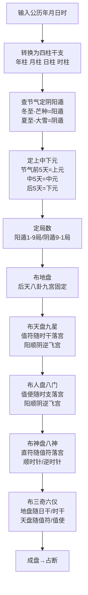

# 奇门遁甲基础体系

> 本页面依据《图解中国传统决策学·奇门遁甲大全》（白话图解版《古今图书集成》术数部汇考）等典籍，系统梳理奇门遁甲的核心理论框架与实操流程，旨在建立结构化、可交叉引用的知识库页面。

---

## 一、 三式定位：奇门在术数体系中的坐标

### 三式并立：太乙、奇门、六壬
在中国传统预测决策术中，最高层次者为「三式」，历史上由掌管天文、历法、军国大事的少数人掌握。三式皆以特制**式盘**推演，故名。

| 术数 | 核心定位 | 主占领域 | 代表典籍 |
|------|----------|----------|----------|
| **太乙** | 君国大事、自然灾异 | 国家政务、天象灾变 | 《太乙神数》 |
| **奇门遁甲** | 行军制敌、时空决策 | 军事战略、人生重大决策 | 《烟波钓叟歌》《景祐遁甲符应经》 |
| **六壬** | 日用百事、人事吉凶 | 生活琐事、具体事务断验 | 《六壬大全》《毕法赋》 |

> **交叉引用**：[[taiyi-shenshu]]、[[liuren-shen-ke-daquan]]、[[qimen-dunjia-fundamentals]]

### 奇门遁甲的综合性地位
- **理论基石**：《易经》八卦、阴阳五行、天干地支、河图洛书、古历法、星相术
- **模型特征**：将天时、地利、人和、神秘能量场与时空巧妙组合，形成**立体动态数理模型**
- **历史评价**：《四库全书》提要称「于方技之中，最有理致」；《中国神秘文化百科全书》称「式占集大成者」
- **别称**：「帝王之学」、「遁甲」、「阴符」（周秦）、 「六甲」（汉魏）

---

## 二、 奇门遁甲名义：四字拆解与核心符号系统

### 名称溯源与演变
| 时期 | 称谓 | 备注 |
|------|------|------|
| 周秦 | 阴符 | 《黄帝阴符经》关联 |
| 汉魏 | 六甲 | 强调六甲隐遁 |
| 晋宋 | 遁甲 | 侧重隐遁排布法 |
| 明清至今 | 奇门遁甲 | 合称三奇、八门、遁甲 |

### 「奇门」与「遁甲」双轴结构

#### 奇门 = 三奇 + 八门
| 范畴 | 符号 | 别称/属性 | 吉凶基调 | 盘面分布 |
|------|------|-----------|----------|----------|
| **三奇** | 乙、丙、丁 | 日奇、月奇、星奇 | 遇之皆吉 | 天盘、地盘随盘转动 |
| **六仪** | 戊、己、庚、辛、壬、癸 | 配合三奇布局 | 中性/视生克 | 天盘、地盘随盘转动 |
| **八门** | 休、生、伤、杜、景、死、惊、开 | 人盘八方向 | 三吉(开休生)、三凶(死惊伤)、二平(杜景) | 人盘随时辰转动 |

#### 遁甲 = 六甲隐于六仪
| 隐遁对应关系 | 甲子→戊 | 甲戌→己 | 甲申→庚 | 甲午→辛 | 甲辰→壬 | 甲寅→癸 |
|----------------|----------|----------|----------|----------|----------|----------|
| **原理一（避克说）** | 甲木尊贵怕庚金克，故隐于六仪之下 | | | | | |
| **原理二（行走说）** | 九宫布局时，六甲依次行走转移：甲子→甲戌→甲申→甲午→甲辰→甲寅 | | | | | |

> **核心洞见**：「奇门遁甲」四字实为军事隐语，取「用兵神妙、天机不泄」之意。

### 两大流派分野
| 分类 | 核心工具 | 代表典籍 | 特征 |
|------|----------|----------|------|
| **数理奇门** | 式盘(九星、八门、八神、八卦、三奇六仪) | 《烟波钓叟歌》 | 象数与五行融合，信息纵横成网，主预测决策 |
| **法术奇门** | 符咒、踏罡步斗、掐诀念咒 | 《六阴洞微真经》 | 融入道教法术，3600法门分大小上中下，修炼条件苛刻 |

> **现状**：数理奇门应用最广；法术奇门因迷信色彩重、传承窄，多被鄙弃。

---

## 三、 四盘符号：立体动态模型的四层架构

奇门式盘由**地、天、人、神**四盘叠合而成，每盘均按**九宫八卦**排布。

### 四盘职能对照表

| 盘面 | 象征维度 | 核心符号 | 排布规则 | 转动性质 |
|------|----------|----------|----------|----------|
| **地盘** | 地利、空间方位 | 八卦(坎离震兑乾坤艮巽)、九宫数 | **固定不动**，后天八卦定位(坎一、坤二、震三、巽四、中五、乾六、兑七、艮八、离九) | 静止，为坐标系 |
| **天盘** | 天时、星象能量 | 九星(蓬任冲辅英芮柱心禽)、三奇六仪(天干) | 随**时干**落宫转动 | 动，主天时 |
| **人盘** | 人事、行动方向 | 八门(休生伤杜景死惊开)、值使 | 随**时支(时宫)**落宫转动 | 动，主人事 |
| **神盘** | 神秘能量场、不可知因素 | 八神(直符腾蛇太阴六合勾陈朱雀九地九天)、直符 | 随**值符**落宫转动 | 动，主神机 |

### 九星、八门、八神核心象意速查

#### 九星（天盘）
| 星名 | 五行 | 吉凶 | 主象 |
|------|------|------|------|
| 天蓬 | 水 | 凶 | 贼盗、逃亡、水难、阴私 |
| 天任 | 土 | 吉 | 田宅、财物、安稳 |
| 天冲 | 木 | 凶 | 奔波、冲突、车马 |
| 天辅 | 木 | 吉 | 扶助、贵人、文书 |
| 天英 | 火 | 凶 | 争斗、文书、火灾 |
| 天芮 | 金 | 凶 | 疾病、丧葬、金属 |
| 天柱 | 金 | 吉 | 建筑、柱梁、官职 |
| 天心 | 火 | 吉 | 喜庆、婚姻、心意 |
| 天禽 | 土 | 凶/中 | 文书、飞禽、网罗 |

#### 八门（人盘）
| 门名 | 宫位(后天) | 五行 | 吉凶 | 主象 |
|------|------------|------|------|------|
| 休门 | 坎一 | 水 | **吉** | 休息、谋划、求财、出行 |
| 生门 | 坤二 | 土 | **吉** | 生长、医药、开业、捕捉 |
| 伤门 | 震三 | 木 | **凶** | 伤残、手术、竞技、捕猎 |
| 杜门 | 巽四 | 木 | 平 | 闭塞、隐遁、堵截、缉私 |
| 景门 | 中五/离九 | 火 | 平 | 文书、考试、显扬、火光 |
| 死门 | 乾六 | 金 | **凶** | 死亡、囚禁、终结、埋葬 |
| 惊门 | 兑七 | 金 | **凶** | 惊恐、官非、口舌、奔波 |
| 开门 | 艮八 | 土 | **吉** | 开通、见贵、建造、远行 |

#### 八神（神盘）
| 神名 | 别称 | 吉凶 | 主象 |
|------|------|------|------|
| 直符 | 值符 | 吉 | 统领、主帅、自身、贵人 |
| 腾蛇 |  | 凶 | 惊恐、虚诈、怪异、缠绕 |
| 太阴 |  | 吉 | 隐秘、女性、阴谋、保护 |
| 六合 |  | 吉 | 婚姻、和合、合伙、绳索 |
| 勾陈 | 白虎 | 凶 | 病伤、丧葬、官讼、阻滞 |
| 朱雀 | 玄武 | 凶 | 口舌、文书、火灾、盗贼 |
| 九地 |  | 平/凶 | 地理、农田、隐伏、埋葬 |
| 九天 |  | 吉 | 高远、飞行、显达、军机 |

---

## 四、 阴阳二遁：时间维度的二元动力学

### 分界节气：冬至、夏至
- **冬至**（阳极生阴）起 **阳遁** → 至芒种前止
- **夏至**（阴极生阳）起 **阴遁** → 至大雪前止
- **置闰/接气/超神**：节气与干支不齐时的特殊调整规则（芒种、大雪前后）

### 阳遁 vs 阴遁 核心差异

| 维度 | 阳遁（冬至→芒种） | 阴遁（夏至→大雪） |
|------|-------------------|-------------------|
| **六仪布局** | **顺布**（一宫→九宫） | **逆布**（一宫→九宫） |
| **三奇布局** | **逆布** | **顺布** |
| **九宫转动** | 顺时针(洛书顺序) | 逆时针(洛书逆序) |
| **值符起宫** | 冬至上元起坎一 | 夏至上元起离九 |
| **值使起宫** | 冬至上元起坎一 | 夏至上元起离九 |
| **主客倾向** | 利客、进攻、外向 | 利主、守御、内向 |
| **五阳/五阴时** | 五阳时利客 | 五阴时利主 |

### 三元九局结构
- **一气统三**：一节气(15天)分上、中、下三元，每元5天
- **五日一元，一元一局**：每5天为一局
- **阴阳各九局**：阳遁一至九局、阴遁一至九局，共**18个基本格局**
- **时家奇门总局数**：18局 × 60时辰 = **1080局**（去重后）

> **关联页面**：[[ye-hongsheng-qi-men-ji-chu-yu-qi-ju]]（叶鸿生体系阴阳遁起局实例）、[[bu-chui-niu-qimen-jiangyi-yi]]（不吹牛基础篇阴阳遁局数）

---

## 五、 排盘流程：从起时到定局的标准化操作

### 核心流程图（时家奇门）

### 关键步骤详解

#### 步骤1：定时（四柱八字）
- 年柱：以立春为界，查万年历
- 月柱：以节交为界（非月中气），**五虎遁**起月干
- 日柱：以子时(23:00)为界换日，查万年历
- 时柱：**五鼠遁**起时干，以日干定时干

#### 步骤2：定局数（阴阳遁+三元）
| 节气范围 | 遁别 | 上元 | 中元 | 下元 |
|----------|------|------|------|------|
| 冬至~小寒 | 阳遁 | 1局 | 2局 | 3局 |
| 大寒~雨水 | 阳遁 | 4局 | 5局 | 6局 |
| 惊蛰~清明 | 阳遁 | 7局 | 8局 | 9局 |
| 立夏~芒种 | 阳遁 | 9局 | 8局 | 7局 |
| 小暑~大暑 | 阴遁 | 9局 | 8局 | 7局 |
| 立秋~白露 | 阴遁 | 6局 | 5局 | 4局 |
| 寒露~大雪 | 阴遁 | 3局 | 2局 | 1局 |

> **特殊规则**：**接气**（节气未至而用下一元局）、**超神**（节气已过仍用上一元局）、**置闰**（芒种、大雪前后调整）

#### 步骤3：值符值使定位
- **值符（天盘统领）**：随**时干**落宫。如时干为戊，值符落戊所在宫
- **值使（人盘统领）**：随**时支(时宫)**落宫。如时支为子(坎宫)，值使落坎宫
- **直符（神盘统领）**：随**值符**所在宫位起布

#### 步骤4：三盘转动规则
| 盘面 | 转动依据 | 阳遁方向 | 阴遁方向 |
|------|----------|----------|----------|
| 天盘(九星) | 值符随时干落宫后，**九星随宫转** | 顺飞(洛书顺) | 逆飞(洛书逆) |
| 人盘(八门) | 值使随时支落宫后，**八门随宫转** | 顺飞 | 逆飞 |
| 神盘(八神) | 直符随值符落宫后，**八神随宫转** | 顺时针 | 逆时针 |

#### 步骤5：三奇六仪布局（地盘、天盘）
- **地盘干支**：以局数起宫布六仪(戊己庚辛壬癸)，**阳顺阴逆**；三奇(乙丙丁)插入六仪间，**阴阳相反**
- **天盘干支**：值符所在宫得时干，余随盘转动

---

## 六、 占断框架：从局象到决策的方法论体系

### 占断总纲：五大分析维度
1. **主客论**：值符/日干=主(我/坐守)，时干/时支=客(来/动/求)——**成败关键**
2. **用神取象**：按测事类别选定代表符号（如求财用生门、天盘甲子戊、地盘时干）
3. **生克制化**：天地盘干支、九星、八门、八神、九宫五行间的生克关系
4. **格局识别**：吉格(三奇得使、青龙返首等)、凶格(伏吟、反吟、三奇入墓等)
5. **动静应期**：旺相休囚、空亡、入墓、门迫、星门时辰克应

### 核心断验原则速查

#### 趋避原则
> **「急则从神，缓则从门」**
- 紧急事(逃难、救急)看**值符/九星/八神**(天盘、神盘)
- 缓慢事(求财、谋划)看**值使/八门**(人盘)

#### 十干克应（天地二盘干支生克）
| 关系 | 含义 | 典型断语 |
|------|------|----------|
| 天干生地干 | 外来生我/助我 | 贵人相助、顺利 |
| 地干生天干 | 我生外来/耗我 | 付出、投资、被利用 |
| 天干克地干 | 外来克我/压我 | 受制、受害、官非 |
| 地干克天干 | 我克外来/制外 | 掌控、克敌、获利 |
| 比和 | 势均力敌 | 僵持、竞争 |

#### 八门克应（门临门、门临干）
- **门迫**：宫位五行克门五行（如坤二土宫克坎一水休门）→ 门受制，事阻
- **门临旺相宫**：门得令 → 吉
- **门临休囚死墓宫**：门失令 → 凶

#### 九星值时克应
- 星临旺相时辰 → 星吉凶显著
- 星临休囚时辰 → 星力减半
- **天禽星**为总领，值时最重

#### 三奇到宫克应
- 乙奇到宫：文书、医药、阴谋
- 丙奇到宫：火灾、文书、显扬
- 丁奇到宫：兵戎、惊恐、阴私

### 经典吉凶格局谱系（节选）

| 类别 | 格局名 | 成格条件 | 主断 |
|------|--------|----------|------|
| **大吉格** | 三奇得使 | 三奇(乙丙丁)落宫得值使(八门)相合 | 百事大吉、有求必应 |
| | 青龙返首 | 地盘甲(六丙)加天盘丙 | 百事称心、失物自回 |
| | 飞鸟跌穴 | 天盘丙加地盘甲(六丙) | 诸事皆吉、远信来 |
| | 三遁(天/地/人) | 丙+生门/乙+开门/丁+休门+太阴 | 藏形遁迹、出奇制胜 |
| **大凶格** | 伏吟 | 九星/值符/八门不动(重叠) | 事阻滞、久不决、病难愈 |
| | 反吟 | 九星/值符/八门对冲(一九、二八等) | 变动大、反复、惊恐 |
| | 三奇入墓 | 乙丙丁落入墓库宫(辰戌丑未) | 万事不可举、才华被埋 |
| | 太白入荧 | 天盘庚加地盘丙 | 防盗贼、火灾、损财 |
| | 荧惑入太白 | 天盘丙加地盘庚 | 贼逃、凶中生吉 |
| | 天乙伏干 | 六庚加值符 | 主客两败俱伤 |
| | 青龙逃走 | 乙加辛 | 计谋泄露、谋划落空 |
| | 白虎猖狂 | 辛加乙 | 口舌官非、凶险 |

### 专项占断用神速查表（节选自卷五）

| 测事类别 | 核心用神 | 辅助参考 | 关键宫位 |
|----------|----------|----------|----------|
| **求财/生意** | 生门、天盘甲子戊、地盘时干 | 值符、天乙、九星旺相 | 生门落宫、值符落宫 |
| **功名/考试** | 景门、日干、值符、天乙 | 天辅、六丁 | 景门落宫、日干落宫 |
| **婚姻/姻缘** | 天盘乙庚、六合神 | 值符、日干、时干 | 乙庚落宫、六合落宫 |
| **疾病/医药** | 天芮星、生门、死门 | 值符、日干、八神 | 天芮落宫、生死门落宫 |
| **行人/失物** | 值符、天乙、时干 | 丁奇、八门 | 值符天乙落宫、时干落宫 |
| **词讼/官司** | 值符、天乙、开门、惊门 | 日干、庚辛壬 | 开惊门落宫、值符天乙生克 |
| **出行/避难** | 休门、生门、杜门 | 值符、天蓬、天辅 | 休生杜门落宫、值符落宫 |
| **风水/阴宅** | 腾蛇、勾陈、元武、朱雀四神 | 九星、八门、干支 | 四神落宫生克 |

---

## 七、 批判传承观：去伪存真、辩证扬弃

### 三大历史尘垢（编者序批判）

| 问题维度 | 具体表现 | 批判要点 |
|----------|----------|----------|
| **来源神化** | 托名黄帝、九天玄女传授、河图洛书硬扯关联 | 两晋前史志无完整记载，假托古人增权威 |
| **动应唯心** | 「惊门出，三十里鸟雀噪、六畜相斗」类偶然现象强因果 | 无理论依据，今常识不可通，理论体系内无依据 |
| **法术迷信** | 符咒、踏罡步斗、祭神乞灵、玉女反闭局等 | 与数理推衍理性精神背离，乞求神灵非客观推演 |

### 合理内核的现代价值
1. **数理模型价值**：时空多维融合、象数五行互证、信息全息编码——**先人独特认知科学范式**
2. **决策方法论**：趋吉避凶的时空选择、主客动静辩证、格局识别与应期把握——**复杂系统决策启发**
3. **文化认知功能**：理解古代军事、政治、社会心理、宇宙观——**人文历史研究素材**

### 研究立场建议
> **「在批判保留与扬弃的正确前提下，作为一个学术项目去研究与探讨应该是正当的、积极的。」**
- **取精华**：立体动态数理模型、全息信息分析框架、时空决策思维
- **去糟粕**：神化传说、唯心动应、法术符咒、封建等级伦理
- **新发展**：结合现代系统论、信息论、复杂性科学重释；以实战验证为标准建立可复核知识库

---

## 八、 知识图谱交叉引用索引

### 本体系内核心节点
- [[qimen-dunjia-fundamentals]] ← 当前页面
- 三式体系：[[taiyi-shenshu]]、[[liuren-shen-ke-daquan]]
- 叶鸿生体系：[[ye-hongsheng-qi-men-ji-chu-yu-qi-ju]]、[[ye-hongsheng-qi-men-yu-ce-yu-yong-shen]]、[[ye-hongsheng-qi-men-dun-jia-ti-xi]]
- 不吹牛体系：[[bu-chui-niu-qimen-jiangyi-yi]]、[[bu-chui-niu-qimen-jiangyi-er-gongzuo-shiye-yuce]]、[[bu-chui-niu-qimen-jiangyi-liu-ban-34-shengyi-caiyun-yuce]]
- 王凤麟阴盘体系：[[fenglin-yinpan-qimen-lilun]]、[[yin-pan-qimen-paipan-shi-yi-bu]]、[[fenglin-qimen-xiangyi-zheng-shu]]
- 周纳羽意识奇门：[[yi-shi-qi-men-du-xiang-fa]]、[[zhou-nayu-yinpan-qimen]]、[[zhou-nayu-sihai-huajie]]
- 东方宇龙金口奇门：[[东方宇龙金口奇门]]
- 子奇九宫奇门：[[jiu-gong-qi-men]]、[[jiu-gong-qi-men-2-liu-ci-yuan-gai-yun-shu]]
- 于城道人天目奇门：[[于城道人天目奇门]]
- 于成道人法术奇门：[[于成道人法术奇门]]
- 一妙山人六甲法术奇门：[[liu-jia-fa-shu-qi-men-ji-chu-pian]]、[[liu-jia-fa-shu-qi-men-fa-shu-pian]]、[[liu-jia-fa-shu-qi-men-yu-ce-pian]]

### 跨学科关联节点
- 易学基础：[[zhanxing-tianwen-jichu-yu-huangdao-tixi]]（天文历法）、[[liuyao-qimeng-jieyao]]（八卦纳甲）、[[si-zhu-liu-yao-ying-yong-tou-jie]]（四柱干支）
- 中医关联：[[阴阳二十五形人]]、[[yi-fei-wei-zong]]、[[wang-wei-gong-mai-bo-lun]]（脉诊与五行）
- 风水关联：[[fengshui-bao-di-mo-shi]]、[[fenglin-qimen-fengshui]]、[[yin-pan-qimen-paipan-shi-yi-bu]]（移星换斗）
- 心理/决策：[[ken-robinson-element-theory]]（天命决策）、[[luck-creation-principles]]（运气与时空选择）、[[zhanxing-zhe-xue-ji-chu-bohm-hun-dun-jung]]（占星哲学基础）

---

## 九、 附录：时家奇门1080局速查入口

> 本书第二、三部（卷六至卷十）收录**阳遁540局、阴遁540局**完整盘面详解，可作为「词典式」工具书直接核对用盘，免去手工排盘耗时。电子版建议配合[[bu-chui-niu-qimen-jiangyi-yi]]等现代排盘软件/网站使用。

| 卷册 | 内容范围 | 局数 | 适用场景 |
|------|----------|------|----------|
| 卷七 | 阳遁一至四局 | 240局 | 冬至~春分前后 |
| 卷八 | 阳遁五至九局 | 300局 | 春分~芒种前 |
| 卷九 | 阴遁九至五局 | 300局 | 夏至~白露前 |
| 卷十 | 阴遁四至一局 | 240局 | 白露~大雪前 |

---

## 十、 版本记录与贡献指引

| 版本 | 日期 | 修订要点 | 贡献者 |
|------|------|----------|--------|
| 1.0 | 2025-01-15 | 初版：依《图解奇门遁甲大全》导读卷及卷一~卷五核心内容建立结构化知识页 | 知识库策展人 |

> **持续完善方向**：
> 1. 补全卷六~卷十1080局盘面数据结构化入库
> 2. 增补《烟波钓叟歌》原文与白话对照表
> 3. 建立「格局-用神-断验」三维检索矩阵
> 4. 接入现代实战案例库（如不吹牛、叶鸿生、王凤麟案例）做交叉验证
> 5. 开发排盘算法伪代码与关键边界条件（接气/超神/置闰）标准化文档

---

**页面定位**：本页为奇门遁甲知识库的**核心枢纽页**，承上接下连接基础理论、排盘实操、占断方法、流派体系与批判传承，供后续专题页（如工作事业、生意财运、婚姻姻缘、疾病医药、风水调理、符咒法术等）交叉引用。

## 来源

- [图解奇门遁甲大全一](../sources/图解奇门遁甲大全一.md)
