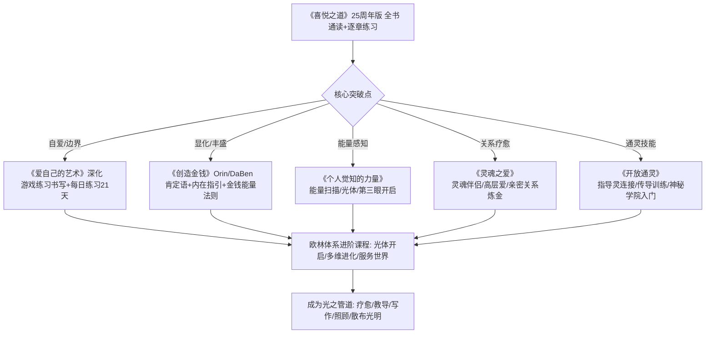

## 核心定位与传承脉络

### 书籍基本信息
- **作者/传导者**：珊娜雅·罗曼 传导 **欧林**
- **版本**：《喜悦之道》二十五周年纪念版
- **核心主张**：**经由喜悦而非挣扎或痛苦来成长**，宇宙是友善的、丰富的，人类正处于重要的过渡与觉醒期
- **定位**：欧林教导体系的**奠基之作**（“几乎定义了欧林教导的所有重点，它是最初，也是最终的”）

### 传导者与灵性导师
- **珊娜雅·罗曼**：清醒通灵状态传导，全然觉知自我与欧林思维，声音不变、不失去意识
- **欧林**：自称**光之存有**、**心灵教师**、**旅行于许多实相系统**，曾在地球活过一生，理解物质实相
- **教导风格**：温和、充满爱与智慧、从不命令、提供建议与想法助人觉知更多选择
- **核心讯息**：“宇宙是友善的，永远在为我们工作，宇宙的丰富是无限的，我们可以经由喜悦得到成长”

### 版本演进与新增内容
| 版本 | 核心内容 | 新增要素 |
|------|----------|----------|
| 原版 | 章节教导、游戏练习 | — |
| 25周年纪念版 | 全部原始资料 + 增修深化 | **每日喜悦练习**、**喜悦肯定语**、读者故事分享、更新讯息 |

> **交叉引用**：欧林体系其他著作见《[[chang-zao-jin-qian-tong-wang-feng-yu-zhi-lu]]》（与达本合著《创造金钱》）、《[[ge-ren-jue-zhi-de-li-liang]]》（个人觉知的力量）；同属新时代灵性显化谱系的 [[abraham-hicks-law-of-attraction]]、[[michael-losier-law-of-attraction]]、[[xianhua-shijian-yu-zhuanzhu-lianci]]、[[xiang-yu-zhou-xia-ding-dan]]。

---

## 核心理论框架：三大支柱

### 成长范式转移：喜悦 vs. 挣扎
- **旧范式**：集体信念认为“成长必经痛苦与挣扎”、“外在世界比内在重要”、“物质匮乏”
- **新范式**：**选择喜悦之路**——以内在导向运作、认同灵魂而非人格、专注当下而非未来
- **关键区分**：
  - **人格导向活动**：建立在“应该”上，被感官分心，耗散能量
  - **灵魂导向活动**：以更高目的为念，协调内在本质，提升能量

### 实相创造机制：信念→振动→吸引
- **信念创造实相**：“你对实相的信念，创造你对实相的经验”
- **情绪体振幅**：负面思想降低振幅→吸引低频人事物；正面意象提高振幅→吸引高频机会
- **磁力法则**：感恩有磁力；专注美善→美善增长；[[abraham-hicks-law-of-attraction]] 情绪引导系统同构
- **显化公式**：**意向设定 + 与最内在自己连接 + 带情感重复肯定语 = 实相转化**

### 三层自我架构与连接层级
| 层级 | 名称 | 功能 | 连接方式 |
|------|------|------|----------|
| **表层** | 人格/个性 | 感官导向、权力斗争、罪恶感控制 | 需超越 |
| **中层** | 心智体/情绪体 | 思想模式、情绪振幅、潜意识程式 | 通过肯定语重塑 |
| **核心层** | **最内在的自己/灵魂/大我/心灵** | 纯粹无条件的爱、最高智慧、永远为至善工作 | **核心练习目标** |

> **关键洞见**：“当你有意识地与你的灵魂连接，其能量会**先你而行**，清除障碍、安排更好的一天。” 此即 [[abraham-hicks-law-of-attraction]] “有形与无形自我振动一致性”、[[xianhua-shijian-yu-zhuanzhu-lianci]] “本源连结” 的欧林版表述。

---

## 实操体系：三大工具箱

### A. 游戏练习—— 认知与行为重构
每章配套，引导读者从觉察转向行动。示例：

| 章节 | 练习焦点 | 核心步骤 |
|------|----------|----------|
| Ch.2 你能喜悦地生活 | 识别喜悦来源/障碍 | 列7件爱做的事→写阻碍→选1-2件定下一步→排入日历 |
| Ch.3 化负面为正面 | 影子整合/投射化解 | 找批评对象→自查同类批评→回忆己犯同错→带慈悲眼光看对方/自己 |
| Ch.4 爱自己的艺术 | 自爱行为化 | 问“如何知我在爱自己？”→三领域（身/亲密/事业）设想自爱日→列3件具体行动 |
| Ch.5 重视自我价值 | 价值观对齐/边界建立 | 列“应当”值→实测是否适合→练习说“不”→按内在真理行动 |

### B. 每日喜悦练习—— 早晚锚定流程
**统一结构**（每章末尾定制化）：
1. **暂停·呼吸·意向连接**最内在自己（哪怕几秒、哪怕像在想象）
2. **预演一天**：想象带着本章特质（喜悦/正面/自爱/自尊……）度过一天的感受、互动、结果
3. **晚间复盘**：反省事件、觉察新机会、感受新反应模式、确认与内在自我合作产生的具体改变
4. **延展建议**：录音成冥想、随时随地练习、向内在自我请求更多灵魂特质指引

> **方法论对照**：[[ming-xiang-gai-lun]] “接触-练习-融入”三要素、[[zhi-yao-hui-hu-xi-jiu-neng-zuo-ming-xiang]] 100天计划、[[buddhas-brain-rick-hanson]] HEAL内化法（激活-安装-连结）、[[shakti-gawain-chuang-zao-xing-xiang-ti-xi]] 粉色泡泡可视化。

### C. 喜悦肯定语—— 活生生的意识种子
**设计原则**：
- 每句携带**一个全新意识种子**，甚至一次诵读即播种
- **文字无力量，召唤出的最内在自我能量有力量**
- 必须**带情感、带了解、带意向声明**重复，直至感知转变
- 可**自选共鸣者**、改写措辞、自制卡片/录音/贴纸环绕生活

**分类示例**（节选）：
| 主题 | 代表肯定语 |
|------|------------|
| **选择喜悦** | “我选择喜悦地活着。” “我愿意经由喜悦而非痛苦或挣扎来成长。” |
| **化负面** | “每件事的发生都是为了我的更高善。” “我专注于我生活中好的一面，因而好的一面会增长。” |
| **爱自己** | “我毫无保留地爱我自己。” “我宽恕我自己，知道我一直都会尽我所能做到最好。” |
| **自我价值** | “我按照我的价值和我所相信的去行动。” “我维护我最内在的真理，让我自己而非他人主宰我的感情。” |
| **连接内在** | “我觉知我最内在的存在。它指引并指导我。” “我把那些与我最内在存在频率一致的环境、活动、人们吸引到我身边来。” |

> **跨流派映照**：[[michael-losier-law-of-attraction]] “愿望实现陈述”、[[abraham-hicks-law-of-attraction]] “创造性工作坊”、[[belief-creates-reality-practice]] 王怡仁四步法（赞美催化）、[[zero-limits-hooponopono-system]] “四句话清理”、[[law-of-attraction-canfield]] 宣言与视觉化。

---

## 章节知识图谱与进阶主题

### 第一章：欧林向你问候—— 觉醒召唤与集体使命
- **你是先驱**：“所有读这本书的人都是先驱，因为若不超前于时代，不会被此讯息吸引”
- **播种新思想形式**：个人持有高频信念→贡献给“周遭氛围”→群体放大十倍→助人类进化
- **跨界传播**：鼓励在不同兴趣/工作场域交叉传播，价值随连接点增加
- **服务形式多元**：手疗愈、言写分享智慧、照顾他人、散布光明与爱

### 第二章：你能喜悦地生活—— 喜悦之路的地图
- **喜悦定义**：一种态度、对自己与他人爱的临在、内心宁静感、给受能力、感恩慈悲境界
- **自由创造**：不被自己创造的形式（工作/关系）羁绊，而被其提升
- **下一步指引**：内心低语总示以简单、喜爱的具体行动（打电话/看书），顺势而为即现道路
- **权力中心管理**：不让第三轮/太阳神经丛被他人拉入负面能量，退后一步、深呼吸、连接大我
- **慈悲≠盲目善良**：看清对方真相，问“能否助其触及更高憧憬？”，否则保护自己能量

### 第三章：化负面为正面—— 认知重构的精密操作
- **宏大视角法**：站在整体人生之上看单一事件；过去是成长垫脚石，爱过去即释放过去
- **未来自我回溯**：想象5年后回望今朝，或引入未来自己的智慧/能量入当下
- **关系炼金术**：聚焦对方美好→自行化解困扰；戴“粉红眼镜”即赠予对方创造美好的磁场
- **环境筛选**：拒绝低频媒体/对话/抱怨，主动安置自己于最高支持性环境
- **宇宙友善论**：恐惧讯息曾是进化催化剂，今潮流转向“传播希望与乐观”

### 第四章：爱自己的艺术—— 从罪恶感走向自爱
| 障碍层面 | 核心机制 | 破解钥匙 |
|------------|----------|----------|
| **罪恶感控制** | 太阳神经丛权力游戏：用愤怒/撤回爱/罪恶感操纵 | 放弃罪恶感，给予他人自由，建立诚实与爱的新层次 |
| **外置权威** | 将“何者有益”决定权交给老师/书/朋友 | 追问“适合我？带来喜悦？做时快乐？”——**自己的经验才算数** |
| **批判投射** | 批判他人=在潜意识建立“仅特定条件下接受自己” | 练习接纳不带贬损、微笑、友善、让他人感觉良好 |
| **信念实相** | 信念精准显化：信“冷酷世界”→遇冷酷人；信“微笑得回应”→选会回应者微笑 | 改变预期→改变遇合；“世界不一定公正，但很精确” |
| **宽恕与谦逊** | 愤怒滞留光环吸引同频；谦逊=开放+极大自信 | 宽恕洗净光环；谦逊非卑微，乃“我愿意倾听、不必知所有答案” |
| **行动与接受** | 光付出不够，须**敞开接受爱**（关系成败看接收度） | 接纳礼物/友谊/支持；对真实的自己说真话、采取行动 |
| **幽默超然** | 幽默是进化技巧，自爱者常幽默、随兴、让人轻松 | 置之一笑、将问题放远看，绝非世界末日 |

### 第五章：重视自我价值—— 自尊的内在建构
- **最高自尊源于灵魂正直**：言行反映大我价值观，非说服他人信同一套
- **价值观实测**：“好人该早起”→试早起→发现是他人“应当”→保留或丢弃
- **力量 vs. 弱点**：抱怨他人让你悲伤=失去力量；问“我为何选择此反应？”→夺回力量
- **边界即自尊**：不敢说“不”=潜意识信“别人感受/权利更重要”→能量阻塞→吸引更多怨恨
- **意志力双刃**：若用个人意志对抗自己（惩罚拖延/强迫条理）=内战；若与心协同、顺流而下=河流之力
- **床位风水隐喻**：“住别人家想走却不敢伤其心”=视他人重于自己→发出“可视我为理所当然”讯息

---

## 进阶整合：欧林体系内的连接与外部映照

### 欧林六书知识串联
| 书名 | 核心领域 | 与《喜悦之道》关系 |
|------|----------|---------------------|
| **喜悦之道** | 基础范式、日常实操、自我关系 | **奠基总纲** |
| [[chang-zao-jin-qian-tong-wang-feng-yu-zhi-lu]] 创造金钱 | 丰盛显化、金钱能量、事业使命 | 将喜悦原则应用于物质创造 |
| [[ge-ren-jue-zhi-de-li-liang]] 个人觉知的力量 | 能量感知、内在觉知、灵性成长 | 深化“连接最内在自己”技法 |
| 灵性成长 | 光体开启、多维进化 | 进阶意识状态稳定化 |
| 灵魂之爱 | 亲密关系、灵魂伴侣、高层爱 | 将自爱延展为双人/群体共修 |
| 开放通靈 | 通灵技能、指导灵连接、传导训练 | 方法论源头：“你也可以学习通灵” |

### 跨传承技法对照表
| 核心技法 | 欧林《喜悦之道》 | 亚伯拉罕-希克斯 | 赛斯/王怡仁 | 霍欧波诺波诺 | 迈克尔·劳塞尔 | 香功/高文 |
|----------|-------------------|------------------|-------------|--------------|--------------|----------|
| **核心框架** | 喜悦成长/内在连接 | 情绪引导/漩涡 | 信念创造实相/四步法 | 100%责任/清理记忆 | 三步公式/差异明晰 | 创造性想像/四步法 |
| **日常锚定** | 每日喜悦练习(早/晚) | 焦点轮/网格填写 | 静心-觉察-感受-赞美 | HA呼吸/四句话/金鼓 | 愿望/实现陈述/心灵感应罩 | 肯定陈述/粉色泡泡/圣地 |
| **肯定语机制** | 活生生能量/意向声明 | 创造性工作坊/振动吸引 | 活生生能量/赞美催化 | 零分状态/灵感区分 | 愿望实现陈述/高度重视 | 肯定陈述/感受胜于形式 |
| **负面转化** | 宏大视角/未来自我/环境筛选 | 情绪阶梯/向上跨越 | 觉察外境观照内在信念 | 清理记忆/不探究起因 | 差异明晰进程表/抗拒释放 | 灵性悖论/三要素/接地 |
| **显化加速** | 连接灵魂→能量先行 | 有形/无形自我一致 | 身心灵整合/临床实践 | 切断阿卡连/事前清理 | 心灵感应罩/贾妮丝案例 | 接地/能量中心/向导 |

### 身心能量解剖对应
| 欧林术语 | 对应传统/现代概念 | 相关页面 |
|----------|-------------------|----------|
| **第三轮/太阳神经丛** | 权力/情绪中心、脐轮 | [[villoldo-chakra-system]]、[[chakra-clearing-doreen-virtue]]、[[zhong-mai-qi-lun]] |
| **第七轮/顶轮/百会穴** | 灵性连接、松果体、MAY唱诵 | [[zhong-mai-qi-lun]]、[[you-can-channel]]、[[activating-mystical-healing-power]] |
| **情绪体** | 能量场层级、哈拉层、核星层 | [[光之手与人体能量场体系]]、[[light-hand-2-healing-paradigm]]、[[light-hand-3-core-healing]] |
| **大我/最内在自己** | 超意识、神圣智能、阿赖耶识 | [[you-can-channel]]、[[seth-philosophy-jane-roberts]]、[[buddhist-mantra-quantum-theory]] |
| **光之存有** | 天使、升天大师、指导灵 | [[yu-tian-shi-lian-jie]]、[[zhao-huan-tian-shi-doreen-virtue]]、[[you-can-channel]] |

---

## 读者实证与应用场景库

### 典型转化轨迹（基于书中读者故事）
1. **抑郁/低潮期入口** → 每日练习建立微小喜悦锚点 → 认知重构化解受害者叙事
2. **人际边界崩塌** → “爱自己=说不”练习 → 能量不再外泄 → 吸引尊重型关系
3. **事业/金钱匮乏** → 连接大我预演丰盛一日 → 灵感行动替代挣扎努力 → [[chang-zao-jin-qian-tong-wang-feng-yu-zhi-lu]] 案例复现
4. **灵性探索者** → 书成“随手翻阅神谕” → 确认内在指引真实性 → 进阶光体/通灵课程
5. **治疗师/教师** → 将原理教学 → 群体放大效应 → 学生/客户同步受益

### 实操组合包（按需自选）
| 需求 | 推荐组合 | 频率 |
|------|----------|------|
| **晨间启动** | 每日喜悦练习(本章) + 3句共鸣肯定语 + 想像美好一天 | 每日早起 |
| **情绪急救** | 暂停-呼吸-连接内在 + “每件事为我最高善” + 宏大视角回望 | 当下触发时 |
| **关系修复** | 慈悲眼光看对方/自己 + 宽恕肯定语 + 拒绝低频对话 | 互动前/中/后 |
| **显化加速** | 预演未来自我回溯 + 感恩清单 + 灵魂特质冥想(平和/丰盛/自由) | 晚间/周末 |
| **深度整合** | 完整章节研读 + 游戏练习书写 + 晚间复盘日记 + 与伙伴共读分享 | 逐章 1-2 周 |

---

## 关键概念速查索引

| 概念 | 定义 | 核心章节 | 实操入口 |
|------|------|----------|----------|
| **喜悦之路** | 以灵魂导向、当下喜悦、内在宁静替代挣扎成长 | Ch.1-2 | 每日喜悦练习·选择喜悦肯定语 |
| **最内在的自己** | 灵魂/大我/心灵，纯粹爱、最高智慧、永远为至善工作 | 全书 | 练习首步“暂停连接” |
| **情绪体振幅** | 负面思低频吸引苦，正面思高频吸引乐，可意向调节 | Ch.3 | 化负面练习·环境筛选 |
| **罪恶感控制** | 太阳神经丛权力游戏，用义务/愤怒/撤回爱操纵 | Ch.4 | 放弃罪恶感·给予自由 |
| **信念实相** | 精准显化：信什么遇什么，改预期改遇合 | Ch.4 | 观察自语·改写预期 |
| **自尊=正直** | 言行反映大我价值，非说服他人，按内在真理行动 | Ch.5 | 价值观实测·练习说不 |
| **意志力协同** | 个人意志若对抗自己=内战；与心协同=顺流河力 | Ch.5 | 觉察强迫感·转向爱做之事 |
| **群体思想形式** | 集体信念场（如“成长需痛苦”），个人可投入新高频形式 | Ch.1,3 | 持有高频信念·跨界传播 |

---

## 进阶研习路线图

---

## 版本迭代与资源链接

- **官网资源**：www.orindaben.com
  - 免费“肯定语室”收录全书肯定语
  - “开创你的美好未来”随机摘句页面
  - 每日喜悦练习/游戏练习/肯定语**官方引导音频**
- **中文译本**：珊娜雅·罗曼授权、罗孝英翻译、心靈工坊/相关出版社发行
- **配套社群**：“欧林光爱关怀协会”、各地授证教师工作坊、读书会

---

## 结语：欧林的邀请

> “以此书，我邀请你提升你的精神，而与我一同**选择喜悦、放下挣扎、向你个人力量与灵性转变的无限潜能敞开**。”
>
> “当你请求并敞开心去接受时，欧林与你最内在自己的爱与支持，**永远都垂手可得**。”

> **本页面定位**：作为《喜悦之道》二十五周年纪念版的**结构化知识地图**，服务于：
> 1. **系统研习者**——快速把握全书架构、核心概念、实操工具箱
> 2. **跨流派研究者**——对照亚伯拉罕、赛斯、霍欧波诺波诺、香功等显化/灵性体系
> 3. **实操落地者**——按需调取每日练习/肯定语/游戏练习组合包
> 4. **教学/引导者**——设计工作坊、读书会、陪伴课程的模块化素材库

> **持续更新建议**：随个人实证深化、新版音频/译本发布、跨页面交叉引用丰富，本页将迭代为**活的知识中枢**。

## 来源

- [喜悦之道](../sources/喜悦之道.md)
