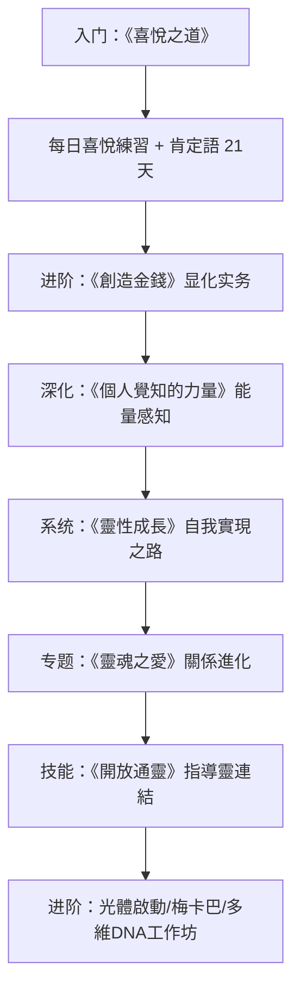

## 概览

**珊娜雅·罗曼** 是国际知名通灵者，自 1980 年代起开始传导 **欧林**，一位自称“光之存有”、游历多重实相系统的灵性导师。欧林的教导以“喜悦而非挣扎成长”为核心轴心，融合显化法则、能量感知、灵魂进化、光体激活等层面，形成一套结构完整、可落地实修的灵性成长体系。至今已出版六大核心中文著作，由译者 **罗孝英** 陆续引介台湾，构成“欧林系列”的完整谱系。

> **定位声明**（欧林原话）：  
> “我是个光的存在体……我在此就是要教导那些放诸四海皆准的原理及其应用，它们能协助你过一个更喜悅、圆满的生活。” ——《喜悦之道》第 1 章

---

## 核心实体与传导关系

| 实体 | 角色/定位 | 关键著作 | 备注 |
|------|-----------|----------|------|
| **Sanaya Roman** (珊娜雅·罗曼) | 通灵者/传导者/作者 | 全系列 | 清醒通灵状态，声音不变，意识扩展 |
| **Orin** (欧林) | 光之存有、灵性导师、心智教师 | 六大核心书 | 自述曾在地球活过一生，游历多实相系统 |
| **DaBen** (达本) | 合著导师（与欧林同源） | 《创造金钱》 | 侧重丰裕显化与事业创造 |
| **Lucia Luo** (罗孝英) | 中文版译者、授证教师 | 六书译本 | 创办“欧林光爱关怀协会”，推广光体课程 |

---

## 六大核心著作谱系

### 《喜悦之道》 —— 系列基石与入门总纲
- **文件** `sanaya-roman-orin-path-of-joy.md`  
- **核心主张**：选择“经由喜悅而非掙扎或痛苦成长”；提供“每日喜悅練習”与“喜悅肯定語”两大实操工具。  
- **结构**：25 周年纪念版含原版全文 + 新增每章结尾练习/肯定语 + 读者故事。  
- **关键概念**：与最內在的自己/靈魂連結、化負面為正面、愛自己藝術、重視自我價值、內在平靜與自由。

### 《创造金钱：通往丰裕之路》 —— 显化与丰裕实务
- **文件** `chuang-zao-jin-qian-tong-wang-feng-yu-zhi-lu.md`  
- **合著**：Sanaya Roman & Duane Packer 传导 Orin & DaBen  
- **四部架構**：創造金钱秘密 → 掌握吸引力技巧 → 開創人生事業 → 擁有金钱智慧  
- **核心法則**：思想創造實相、內在指引、信念轉化、金錢即能量。

### 《个人觉知的力量》 —— 能量感知与内在觉知手册
- **文件** `个人觉知的力量.md`  
- **定位**：指导手册，聚焦“能量感知、內在覺知、靈性成長”三大支柱。  
- **适用**：作为进阶实修者的能量辨识与自我校准工具书。

### 《灵性成长》 —— 自我实现之路的系统课程
- **主题**：欧林“自我实现之路”核心课程的书面化呈现。  
- **涵盖**：靈魂覺醒階段、光體啟動前備、多維意識整合、服務與貢獻。  
- **衔接**：为后续“光體進化課程”铺设理论与能量基础。

### 《灵魂之爱》 —— 亲密关系与灵魂伴侣的进化视角
- **主题**：以靈魂層面重新定義愛、親密、關係功課。  
- **关联**：呼应韩良露《千里姻缘何处牵》中婚神星/智神星/靈神星/愛神星的演化占星框架，可交叉研读。

### 《开放通灵》 —— 通灵技能教学与指导灵连结
- **文件** `开放通灵.md`（待建立）  
- **定位**：“欧林已用它教导上千人通灵”的标准化教材。  
- **内容**：八週通靈課程、陽關通靈法、指導靈類型辨識、安全通靈原則。  
- **交叉引用**：`you-can-channel.md`、`与你的指导灵成为好麻吉.md`、`与指导灵沟通.md`、`指导灵的类型.md`、`安全通灵与ESP超觉阅读.md`。

---

## 教导体系三大支柱

### 喜悅成長範式
- **核心信念**：宇宙友善、豐富無限、成長可經由喜悅而非痛苦。  
- **操作工具**：每日喜悅練習、喜悅肯定語、遊戲練習、內在連結冥想。  
- **心法**：與最內在的自己/靈魂合作，其能量「先你而行」，清理障礙、安排最高善。

### 自我實現之路
| 階段 | 主題 | 對應著作/課程 |
|------|------|---------------|
| 入門 | 喜悅態度建立、負面轉化、自愛自重 | 《喜悅之道》 |
| 進階 | 显化丰裕、事業使命、金錢能量 | 《創造金錢》 |
| 深化 | 能量感知、內在覺知、多維意識 | 《個人覺知的力量》《靈性成長》 |
| 圓滿 | 靈魂關係、通靈能力、光體激活 | 《靈魂之愛》《開放通靈》《光體課程》 |

### 光體進化課程
- **来源**：欧林通过珊娜雅传导的进阶能量传输与冥想体系。  
- **内容**：脉轮升级、光纖激活、多維DNA啟動、梅卡巴/ Merkaba 整合。  
- **实践**：罗孝英老师带领“欧林光体冥想班”、开启光体系列工作坊。  
- **关联页**：`cong-xin-jue-xing.md`（德隆瓦洛·默基瑟德梅卡巴体系）、`zhong-mai-qi-lun.md`（中脉七轮激活唱诵 THOH/MAY）。

---

## 关键概念速查

| 概念 | 定义/内涵 | 主要出处 | 实操入口 |
|------|-----------|----------|----------|
| **光之存有** | 欧林自我定位；游历多实相、传递普世真理 | 《喜悦之道》第1章 | 阅读前言、每章开头传导语 |
| **最內在的自己/靈魂/大我** | 可互换词汇；纯粹无条件爱、智慧、喜悅源头 | 全系列 | 每日喜悅練習步骤 1：連結 |
| **喜悅肯定語** | 活生生的能量种子；需带情感、意图、连感重复 | 《喜悅之道》各章末 | 录音回放、卡片随身、睡前默念 |
| **化負面為正面** | 从宏大视角重构过去/当下/未来；释放情绪体低频 | 《喜悅之道》第3章 | 遊戲練習 1-5、每日練習 |
| **內在指引** | 心中低语的下一步；总是简单、喜悅、可行动 | 《喜悅之道》第2章 | 晨间静坐 5 分钟倾听 |
| **通靈** | 可学习的技能；扩展身份感进入更广阔视野 | 《開放通靈》 | 八週課程、陽關通靈法 |
| **光體** | 多維能量载具；激活后加速進化、显化、服务 | 进阶课程/工作坊 | 罗孝英光体冥想班、梅卡巴静心 |

---

## 交叉引用网络（知识库内既有页面）

### 同系列核心页
- [[sanaya-roman-orin-path-of-joy]] — 《喜悅之道》深度解析
- [[chuang-zao-jin-qian-tong-wang-feng-yu-zhi-lu]] — 《創造金錢》显化体系
- [[个人觉知的力量]] — 能量感知手册
- [[灵性成长]] / [[灵魂之爱]] / [[开放通灵]] — 待建立/补充

### 通靈与指導靈专题
- [[you-can-channel]] — 古代神秘学院入门书/通灵基础
- [[与你的指导灵成为好麻吉]] — 八週陽關通靈課程
- [[与指导灵沟通]] — 约书亚/帕梅拉框架
- [[指导灵的类型]] — 内在/外在、地球/非地球分类
- [[安全通灵与ESP超觉阅读]] — 安全原则、辨识流程

### 显化与吸引力法则关联
- [[abraham-hicks-law-of-attraction]] / [[abraham-hicks-the-vortex]] — 亚伯拉罕-希克斯情绪引导系统
- [[michael-losier-law-of-attraction]] — 三步骤公式/差异明晰进程表
- [[law-of-attraction-comprehensive-guide]] — 亚伯拉罕核心教导总览
- [[xianhua-shijian-yu-zhuanzhu-lianci]] — 吸引力法则原始核心教导溯源

### 光體/梅卡巴/脉轮进阶
- [[cong-xin-jue-xing]] — 德隆瓦洛·默基瑟德：心的神圣空间、梅卡巴静心
- [[zhong-mai-qi-lun]] — 中脉七轮、THOH/MAY 唱诵、松果体/脑下垂体激活
- [[activating-mystical-healing-power]] — 道格拉斯·德龙：AME唱诵、神经经络/能量经络双轨
- [[soham-healing-system]] — 哈根·海满恩：以太体/星光体/心智体/灵性体四层疗愈

### 灵魂计划与出生前契约
- [[灵魂的出生前计划]] / [[从未知中解脱]] — 罗伯特·舒华兹：灵魂小组、反面学习
- [[身体病痛与出生前计划案例]] / [[流产与灵性觉醒的出生前计划案例]] — 实证案例库
- [[灵魂小组与集体出生前计划]] — 布莱恩·魏斯凯瑟琳个案实证

---

## 学习路径建议

---

## 版本与传承说明

| 版本/里程碑 | 年份 | 关键事件 |
|-------------|------|----------|
| 原版《喜悅之道》出版 | 1990s | 霍尔·克莱莫出版，封面画作“花之光” |
| 中文版引进（罗孝英译） | 2000s起 | 六书陆续出版，建立繁中读者群 |
| 25 周年纪念新版 | 2010s | 新增每日练习/肯定语/读者故事 |
| 光體課程推广 | 2010s-今 | 罗孝英授证教师体系、工作坊常态化 |
| 数字化知识库建立 | 2025 | 本页面作为系列导航枢纽上线 |

---

## 延伸阅读与资源

- **官网**：www.orindaben.com（英文原版、音频、肯定语室、免费随机摘句“创造你的美好未来”）  
- **中文社群**：欧林光爱关怀协会（罗孝英主理）、相关读书会/冥想小组  
- **音频资源**：六书均有有声书版本，适合晨间/通勤/睡前聆听强化潜意识  
- **跨派系对照**：  
  - 亚伯拉罕-希克斯：情绪引导系统 ↔ 欧林“喜悅频率先行”  
  - 赛斯（珍·罗伯茲）：信念创造实相 ↔ 欧林“思想创造现实/内在指引”  
  - 德隆瓦洛·默基瑟德：梅卡巴/心的神圣空间 ↔ 欧林光体/最內在自己  
  - 巴夏：兴奋公式 ↔ 欧林“下一步总是简单喜悅的事”

---

> **欧林临别赠言**  
> “当你阅读此书，请觉知欧林正在跟你说话，而且他早就知道你会读这本书，并实践书里教导的原则。……当你请求并敞开心去接受时，欧林与你最內在自己的爱与支持，永远都垂手可得。”  
> ——《喜悅之道》作者序

---

*本页面为「珊娜雅·罗曼与欧林教导系列」知识网络的总导航页，后续将持续扩充六大核心著作深度解析页、光体课程实修笔记、通灵案例库等子页面，形成可检索、可实践、可传承的结构化知识资产。*

## 来源

- [喜悦之道](../sources/喜悦之道.md)
