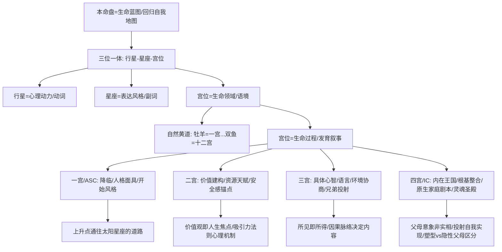

# 萨司波塔斯《占星十二宫位研究》核心体系

## 书籍定位与理论渊源

《占星十二宫位研究》（The Twelve Houses）是霍华德·萨司波塔斯（Howard Sasportas）的奠基之作，被公认为**心理占星学**领域的经典教科书。丽兹·格林在两版前言中均强调：本书不随波逐流，融合了对占星符号学的深入理解与对人性的深刻洞见，超越了传统占星的宿命论，将宫位诠释为**个体实现内在潜能、完成生命蓝图的心理过程**。

萨司波塔斯的理论基石来自：
- **丹恩·鲁依尔** 的“人格占星学”与“法性”概念：宫位显示“天命的指导”，告知个体如何在该生命领域最自然地揭露人生安排
- **荣格心理学** 的个体化进程：心理层面的现实是核心，宫位不是静态“地点”，而是从内而外赋予个人完整生命意义的动态场域
- **人本主义心理学** 的自我实现观：成为真正的自己是永恒探索，本命盘是回归自我的地图

> **核心前提**：“一个人的现实遭遇源自于他内心的思想、感受、期望和信念。”（第一章）星盘不描述“发生在身上”的事件，而是描绘“让事件发生”的心理蓝图。

## 第一部：人生景观——宫位的本质架构

### 行星、星座、宫位的三位一体动态模型

| 元素 | 角色 | 关键词 | 运作逻辑 |
|------|------|--------|----------|
| **行星** | 动词/心理动力 | 火星=坚持、金星=和谐、木星=扩张、土星=限制 | 代表“正在发生什么” |
| **星座** | 副词/表达风格 | 火星在牡羊座=直接、火星在金牛座=缓慢持续 | 代表“如何发生” |
| **宫位** | 语境/生命领域 | 火星在十宫=事业领域、火星在七宫=关系领域 | 代表“在哪里发生” |

**宫位如相机镜头**，将星盘蓝图聚焦于实际人生，赋予个性化特色。忽略宫位核心原则、只记关键词（如十一宫=“朋友、团体、愿望”），无法理解为何这些看似无关主题归于一宫——**十一宫核心是“超越小我的渴望”**，朋友、团体、愿望皆是实现此目的的路径。

### 空间、时间与界线：宫位的天文几何基础

#### 双重运动与双重分割系统
1. **黄道十二星座（空间分割）**：以春分点为起点，太阳视行路径分十二等分，对应**行星公转周期**（外部时间）
2. **十二宫位（时间分割）**：以地平线、子午线四基本点为轴，将地球自转的24小时分十二段，对应**地球自转周期**（内部时间）

#### 四个基本点与四轴线
| 基本点 | 符号 | 天文定义 | 心理意义 |
|--------|------|----------|----------|
| **上升点** | ASC | 黄道与东方地平线交点 | 人格面具、出生时刻的第一口呼吸、面对世界的风格 |
| **下降点** | DSC | 黄道与西方地平线交点 | 他者投射、亲密关系镜像 |
| **中天/天顶** | MC | 黄道与南方子午线交点 | 社会角色、公共形象、职业顶点 |
| **天底/下中天** | IC | 黄道与北方子午线交点 | 根基、原生家庭、内在灵魂圣殿 |

**两大轴线**：
- **地平轴线（ASC-DSC）**：自我 ↔ 他者，人格面具 ↔ 投射对象
- **子午轴线（MC-IC）**：公共/社会 ↔ 私人/根基，外在成就 ↔ 内在安全感

#### 宫位制争议与萨司波塔斯立场
- **等宫制**：以ASC为起点，每宫30°，MC不必落入十宫
- **象限宫制（萨司波塔斯偏好）**：四基本点分别为一、四、七、十宫宫头，中间宫位按空间或时间计算
- **自然黄道**：牡羊座0°=ASC、金牛座0°=二宫头……双鱼座0°=十二宫头，**仅具象征教学意义**，实盘极少完全吻合

> **鲁依尔的哲学诠释**：每象限三宫，对应生命三部曲——**行动、反应、后果**。二三宫落实一宫/ASC意图；五六宫落实四宫/IC任务；八九宫延续七宫/DSC功课；十一十二宫完成十宫/MC使命。

### 宫位作为生命过程的展现

萨司波塔斯批评机械论世界观导致占星失去“过程觉知”：**宫位非孤立区块，而是从出生到圆满的完整发育叙事**。

> **隐喻**：玛格丽特·米德童年学做乳酪，母亲说“先看小牛如何出生”。生命须经历“开始→中间→结束”的完整过程。现代文化被指为“年龄过程中断”的受害者——只知开关结果，不知中间律动。

**十二宫位 = 个体从无形意识海洋具象化，再融合回海洋的完整旅程**：
- **一宫/ASC**：破壳而出，建立“我”与世界的初始界线
- **二宫**：确立“我拥有”，界定资源价值，建立安全感基石
- **三宫**：探索环境，发展语言/心智，区分主客体
- **四宫/IC**：内返奠基，整合碎片经验为核心身份，连接根源
- **五宫**：创造性自我表达，冒险展现独特性
- **六宫**：技能精炼、服务、身心整合，为进入社会准备
- **七宫/DSC**：一对一关系镜像，遭遇他者即遭遇自我阴影
- **八宫**：深度合融、共享资源、危机转化、心理重生
- **九宫**：意义建构、高等心智、跨越边界的探索
- **十宫/MC**：社会定位、权威内化、生命使命公开化
- **十一宫**：超越小我，加入集体理想、友谊网络、未来愿景
- **十二宫**：溶解边界、超个人合一、业力完成、为下一轮回准备

## 第二部：生命旅程的开展——前四宫深度心理诠释

### 第三章：上升点与第一宫——“我降临”的原型时刻

#### 上升星座：人生的第一副眼镜
- **定义**：出生瞬间东方地平线升起的黄道星座精确度数，一宫宫头
- **功能**：区隔光明与黑暗，宣告离开母体融合状态，降临人世
- **核心隐喻**：“我们会根据上升星座去‘梦想这个世界’，然后实践梦想。这是我们自己创造的迷宫，也是走出迷宫的方式。”

| 上升星座 | 世界观/人生隐喻 | 面对新机遇的典型反应 |
|----------|-----------------|----------------------|
| **射手座** | 世界充满令人兴奋的选择与可能 | “太棒了！何时开始？” |
| **摩羯座** | 世界充满责任、限制、需谨慎 | “我一定要做吗？我够好吗？责任重大” |
| **巨蟹座** | 世界需防护，熟悉最安全 | 轻啄蛋壳，决定仍待壳内 |
| **狮子座** | 世界是舞台，等待宏大登场 | 万事具备后戏剧性高贵登场 |
| **金牛座** | 世界需缓慢建构，持久才真实 | 慢慢孵化，一旦开始坚定完成 |

#### 第一宫行星/星座：出生创伤与自体启动模式
- **土星/摩羯座**：冗长、延宕、难产；一生“开始”皆带退缩、迟疑
- **火星/牡羊座**：一马当先闯入人世，急于“脱离那里，开始有所作为”
- **冥王星/天蝎座**：生死边缘挣扎，母婴均面临危险
- **木星**：出生即随父母迁徙/变换国籍
- **天王星/水瓶座**：诞生即意味崩解与改变，改变周围人命运

#### 上升点与太阳星座的动态关系
> **丽兹·格林喻**：“太阳星座代表我们是何种英雄，上升星座是完成英雄之旅的方式。”上升点是通往太阳星座的道路。
- 太阳牡羊/上升处女：以专注精准态度衡量精力，发掘开创领导本能
- 太阳双鱼/上升天秤：通过一对一关系或艺术投入，发掘治疗服务他人之道

#### 第一宫的童年印记与身体投射
- **早年环境氛围**：一宫行星描绘童年塑模期体验（如土星=艰困限制，木星=流动扩展）
- **身份认同锚点**：“幼苗树皮上刮一道痕，长大后成裂痕”
- **对他人的影响**：一宫能量随行所至（水瓶/天王=崩解改变，冥王/天蝎=危机重组）
- **身体显现**：整张星盘通过身体活化，非单凭上升星座推断体貌；涉及上升主星位置、一宫/十二宫行星、太阳星座等综合因子

### 第四章：第二宫——“我拥有”的价值建构与安全感锚定

#### 从“分离”到“拥有”的发育跃迁
- **前提**：六个月前婴儿未觉有身体；发现“这是我的脚趾、非母亲的” → 唤醒**脆弱感、有限感、死亡恐惧** → 产生**对抗毁灭、保护自我、渴望稳固充实**的驱力
- **核心任务**：通过认同“所拥有”（身体、天赋、金钱、记忆、信仰），建立**实质感、重要性、价值感、安全感**

#### 第二宫的双重面向：资源库存单 × 金钱态度镜像
| 维度 | 诠释焦点 | 案例 |
|------|----------|------|
| **天赋资源库** | 落入星座/行星显示“可具体展现的天赋”，耕耘即开花结果 | 火星/牡羊=勇气率直直接追求；金星/天秤=品味艺术社交魅力 |
| **物质世界态度** | 视财富为神（Mammon）还是幻象（Maya）；赚钱风格：积极/懒散/紧抓/溜走 | 李柏拉契（双鱼/天王二宫）炫耀财富极端品味；马基维里（火星二宫）信结果合理化行为；马克思（太阳月亮金牛二宫）以理论改变历史 |

#### 价值观即人生焦点：吸引力法则的心理机制
- **核心洞见**：“我们重视、渴望、欣赏的事物，绝大部分会受自我吸引而进入生命”
- **寓言印证**：小镇居民深切渴望艺术家 → 成立研究社、立雕像 → 艺术家被吸引造访定居
- **行星推进/移位入二宫** = 渴望本质的根本转换
- **1960年代白领弃职赴加州** = 价值观重组导致人生焦点剧变

#### 安全感的终极悖论
> **荣格**：“唯有那些我们自认可依靠的事物，不再得以依靠时，才会发现什么才是真正的依靠。”
- **印第安传统**：年末最富有者（最成功赚钱者）必须舍弃一切所得
- **心理占星结论**：以外在相对事物（身体、家庭、存款、配偶、信仰）建立认同**极其危险**；唯一真正安全感来自**对自我的认同**——失去一切仍不改本色

### 第五章：第三宫——“具体心智”的语言建构与环境协商

#### 从身体分离到心智解放的认知革命
- **发育里程碑**：爬行、学走路、语言习得 → **名词/动词结构分辨主客体**（“小约翰不是球，他能扔球”）
- **左脑/具体心智觉醒**：理智、逻辑、事实蒐集、经验分析归类、谈论经验的能力
- **第三宫行星 = 心智活动风格**：敏捷/迟缓、条理/模糊、原创/回响环境

#### 知识关系与环境投射：“所见即所得”
| 落入星体 | 知识观/环境滤镜 | 行为倾向 |
|----------|----------------|----------|
| **火星** | 知识即力量 | 主动攻克、竞争性学习 |
| **月亮** | 追求带来保障的知识 | 专精特定领域获安全感 |
| **金星** | 品味环境中和谐愉悦面向 | 友善回应、忽略冲突丑陋 |
| **土星** | 意识到环境冷酷受限 | 带着忧虑恐惧去探索发现 |

#### 兄弟姐妹：早期社会化实验场与投射镜像
- **第三宫 = 兄弟姊妹、邻里、堂表亲关系本质**
- **心理定律**：“我们会诱使他人‘呈现’自己心理上舍弃的部分” → 土星三宫者感兄弟冷酷无爱，实为自我投射
- **早期相处模式** → 重复于日后配偶、同事、上司、朋友关系
- **求学经验**：学校让我们比较“父母话语”与“外界规则”，吸收资讯形成秩序意义

#### 沟通、短途旅行与职业指向
- **水星神话使命** = 众神间传递讯息 → 掌管一切沟通形式（写作、言说、媒体）
- **短途旅行类态** = 土星三宫 = 学习/兄弟/短途旅行中遇阻，象征“带着忧虑恐惧去探索人生”
- **频繁搬迁/环境变动** → 极佳适应力 或 终生渴望稳定家庭补偿破碎童年
- **职业关联**：教学、写作、新闻、印刷、媒体、演讲、推销、运输、秘书
  - 强尼·卡森（木星月亮合相三宫）= 史上最高薪脱口秀主持
  - 安徒生（金星双鱼三宫，太阳水星牡羊三宫）= 想象力豐富童话作家
  - 伦尼·布鲁斯（天王星三宫）= 讽刺喜剧挑战禁忌

#### 印第安寓言：蛇还是绳子？
> **黄昏误认绳为蛇** → 全镇惊恐动员 → 黎明发现是绳 → **“我们时常忘了自己在世界中扮演的角色”**
- 第三宫 = 看待环境的因果脉络 → **内容是因果脉络作用的结果**
- 意识到三宫偏见态度 → 在人生架构中展现更多创造力

### 第六章：天底与第四宫——“我就在这里”的内在王国与根基重建

#### 生命上半场的暂停与整合：从碎片到核心
- **前三宫轨迹**：一宫=我即一切 → 二宫=我有界线 → 三宫=关注外物界线
- **四宫任务**：“蒐集碎片资讯，朝中心‘我’整合” → **“我”成为身份认同根基**
- **现代病**：“年龄过程中断”受害者 → 忙碌外在目标，失联内在主体 → **抽离短暂经验目标，重连深层“我”**

#### 天底/四宫：灵魂圣殿与经验深化器
> **詹姆斯·希尔曼**：“灵魂是让生命产生意义的未知部分。我们和事件之间有一个反省时刻，灵魂锻炼就是分辨这个中间地带。”
- **传统关键词**：家庭、根源、灵魂、晚年
- **印第安智慧**：“邀人入家 = 敞开灵魂”
- **四宫 = 内在王国** = 休息补给站 = 经营人生基地 = 事件转化为经验的微妙炼金炉

#### 原生家庭：氛围、剧本与跨代传承
| 落入配置 | 家庭氛围体验 | 心理剧本 |
|----------|--------------|----------|
| **土星/摩羯天底** | 冷酷、严厉、无情、保守僵化 | “必须符合标准” |
| **金星/天秤天底** | 爱、和谐、珍视传统 | “关系即安全” |
| **月亮/巨蟹四宫** | 易融入、情感共鸣深 | “家是避风港” |
| **天王/水瓶四宫** | 陌生土地上的陌生人 | “为何我落入这个家庭？” |

**马塞尔·普鲁斯特**（太阳水星木星天王全落四宫巨蟹） → 《追忆似水年华》极致呈现四宫深度内省

#### 父母归属争议：第四宫 vs 第十宫
| 观点 | 论据 | 萨司波塔斯综合建议 |
|------|------|----------------------|
| **传统**：四宫=母亲(巨蟹/月亮)、十宫=父亲(摩羯/土星) | 子宫=最初之家；母亲情感回应更易获；父亲对外负责、子承父业 | **不预设**，视个案而定 |
| **格林逆向**：四宫=父亲、十宫=母亲 | 月亮=根源=父姓；十宫更显著像母爱公开保护；父爱隐晦像四宫神秘；母亲是主要社会化源头/否认者/如厕训练者(土星/十宫) | **“塑型父母”（投入最多时间社会化者）=十宫；“隐性父母”（较少出现/难觉察者）=四宫** |

#### 父母意象 vs 父母实相：投射的自我实现预言
- **核心原则**：四宫行星描述**孩子对父母的潜在印象**，不一定是父母实相
- **案例**：土星四宫小女孩 → 父亲75%温暖，她只记住25%冷酷吹毛求疵 → 形成“父亲不爱我/男人都混蛋”内核信念
- **跨代呼应**：孩子四宫土星 ↔ 父亲太阳/上升摩羯或太阳合土星
- **投射实相化**：持续表现“父亲不好” → 父亲挫折冷淡放弃 → 女孩确认“我就知道他是这样” → **至少孩子负一半责任**

#### 家庭环境共鸣与“结束”的姿态
- **家庭氛围创造**：四宫行星显示“我们在家中创造什么氛围/吸引什么/天生共鸣什么”
- **结束方式**：金星四宫=俐落公平收尾；土星=拖延不愿；月亮/海王星=安静和平；火星/天王星=爆炸性收场
- **晚年揭示**：四十岁后因父母离世渐觉死亡，知时光不多 → **四宫显示下半生遭遇及尾声将揭露的深层核心**

## 理论体系总结与交叉引用网络

### 核心概念图谱

### 与现有知识库页面的交叉引用

| 核心主题 | 关联页面 | 连接点 |
|----------|----------|--------|
| **宫位制与自然黄道** | [[zheng-gong-zhi-yu-shier-gong-wei]]、[[zhenggongzhi-yu-shier-gongwei]]、[[huangdao-shier-gong-tixi]] | 整宫制/象限宫制比较、黄道十二宫身体对应 |
| **上升点/一宫深度** | [[shengshang-xingzuo]]、[[zhanxing-quan-fang-wei]]、[[zhanxing-shi-xing-san-wei]] | 韩良露上升星座生命剧本、錠堅十星三位说、上升点作为人格面具 |
| **心理占星学渊源** | [[arroyo-astrology-karma-transformation]]、[[nei-xing-xing]]、[[neizai-de-tiankong]] | 阿若优业力转化、萨司波塔斯内行星讲座、福里斯特进化占星 |
| **天底/四宫与原生家庭** | [[ming-wang-xing-ling-hun-yan-hua-zhi-lv-juan-yi]]、[[brian-weiss-many-lives-many-masters]] | 冥王星灵魂演化/南北交点、前世回溯视角下的家庭业力 |
| **行星状态与诠释伦理** | [[planetary-condition-traditional-astrology]]、[[zhanxing-yu-zhen-wo]] | 传统行星状态量化、迪米特拉·喬治咨询伦理与橡实理论 |
| **生命过程与个体化** | [[aqal整合图谱]]、[[buddhas-brain-rick-hanson]] | 肯·威尔伯AQAL全象限模型、神经科学视角的冥想与大脑可塑性 |

### 实务应用框架：从“食谱”到“整盘综合”

> **萨司波塔斯警示**：“不要把建议的联想视为真理，也不要过于严苛地应用……坚信必须以整张星盘角度切入，才能完全体悟每个元素意义……占星学中任何行星排列的表现都取决于星盘主人的意识层次。”

**四步诠释流程**：
1. **识别核心原型**：宫位核心原则（如十一宫=超越小我）+ 落入星座/行星特质
2. **揭露内在期待**：案主如何通过该原型过滤现实？（如冥王七宫女透过冥王镜片看伴侣）
3. **追踪投射循环**：外在遭遇如何回饋内在信念？（如土星十一宫男“朋友限制我”实为“自我设限拒绝融入群体”）
4. **引导意识转化**：将“无意识重复”转为“有意识选择”，发掘行星建设性表达（冥王=毁灭→转化重生）

## 附录：书籍版本脉络与传承

| 版本 | 年份 | 序言作者 | 关键背景 |
|------|------|----------|----------|
| **初版** | 1985 | 丽兹·格林 | 确立心理占星学教科书地位，填补宫位深度诠释空白 |
| **修订版** | 2007 | 丽兹·格林 | 萨司波塔斯辞世15年后，肯定其超越时代的永恒价值 |
| **中文版** | 2010 | 胡因梦审订 | 积木文化“深度占星系列”，沁林翻译 |

**作者著作谱系**：
- 单著：《占星十二宫位研究》、《变化的众神》、《太阳星座职业指南》（合著）、《出生星盘的指引与命运》
- 与丽兹·格林合著研讨会系列：《人格的发展》、《无意识的动力》、《天体之光》、《内行星》 → 详见 [[nei-xing-xing]]
- 逝后出版：AstroLogos Studyshops 系列（研讨会实况录音+图解）

> **结语**：萨司波塔斯将神秘主义与实用主义兼容并蓄，从最高形而上思考进入最实际星盘相位观察。他不宣称“唯一真实占星学”，不攻击异派，只专注**个案生命的完整性与重要议题**——这正是本书历久弥新、跨流派通用的根本原因。

## 来源

- [占星十二宫位研究](../sources/占星十二宫位研究.md)
