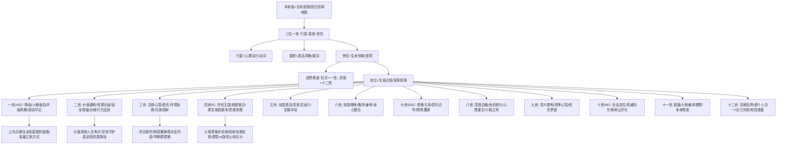

# 萨司波塔斯《占星十二宫位研究》核心体系

## 书籍定位与理论渊源

《占星十二宫位研究》（The Twelve Houses）是霍华德·萨司波塔斯（Howard Sasportas）的奠基之作，被公认为**心理占星学**领域的经典教科书。丽兹·格林在两版前言中均强调：本书不随波逐流，融合了对占星符号学的深入理解与对人性的深刻洞见，超越了传统占星的宿命论，将宫位诠释为**个体实现内在潜能、完成生命蓝图的心理过程**。

萨司波塔斯的理论基石来自：
- **丹恩·鲁依尔** 的“人格占星学”与“法性”概念：宫位显示“天命的指导”，告知个体如何在该生命领域最自然地揭露人生安排
- **荣格心理学** 的个体化进程：心理层面的现实是核心，宫位不是静态“地点”，而是从内而外赋予个人完整生命意义的动态场域
- **人本主义心理学** 的自我实现观：成为真正的自己是永恒探索，本命盘是回归自我的地图

> **核心前提**：“一个人的现实遭遇源自于他内心的思想、感受、期望和信念。”（第一章）星盘不描述“发生在身上”的事件，而是描绘“让事件发生”的心理蓝图。

## 第一部：人生景观——宫位的本质架构

### 行星、星座、宫位的三位一体动态模型

| 元素 | 角色 | 关键词 | 运作逻辑 |
|------|------|--------|----------|
| **行星** | 动词/心理动力 | 火星=坚持、金星=和谐、木星=扩张、土星=限制 | 代表“正在发生什么” |
| **星座** | 副词/表达风格 | 火星在牡羊座=直接、火星在金牛座=缓慢持续 | 代表“如何发生” |
| **宫位** | 语境/生命领域 | 火星在十宫=事业领域、火星在七宫=关系领域 | 代表“在哪里发生” |

**宫位如相机镜头**，将星盘蓝图聚焦于实际人生，赋予个性化特色。忽略宫位核心原则、只记关键词（如十一宫=“朋友、团体、愿望”），无法理解为何这些看似无关主题归于一宫——**十一宫核心是“超越小我的渴望”**，朋友、团体、愿望皆是实现此目的的路径。

### 空间、时间与界线：宫位的天文几何基础

#### 双重运动与双重分割系统
1. **黄道十二星座（空间分割）**：以春分点为起点，太阳视行路径分十二等分，对应**行星公转周期**（外部时间）
2. **十二宫位（时间分割）**：以地平线、子午线四基本点为轴，将地球自转的24小时分十二段，对应**地球自转周期**（内部时间）

#### 四个基本点与四轴线
| 基本点 | 符号 | 天文定义 | 心理意义 |
|--------|------|----------|----------|
| **上升点** | ASC | 黄道与东方地平线交点 | 人格面具、出生时刻的第一口呼吸、面对世界的风格 |
| **下降点** | DSC | 黄道与西方地平线交点 | 他者投射、亲密关系镜像 |
| **中天/天顶** | MC | 黄道与南方子午线交点 | 社会角色、公共形象、职业顶点 |
| **天底/下中天** | IC | 黄道与北方子午线交点 | 根基、原生家庭、内在灵魂圣殿 |

**两大轴线**：
- **地平轴线（ASC-DSC）**：自我 ↔ 他者，人格面具 ↔ 投射对象
- **子午轴线（MC-IC）**：公共/社会 ↔ 私人/根基，外在成就 ↔ 内在安全感

#### 宫位制争议与萨司波塔斯立场
- **等宫制**：以ASC为起点，每宫30°，MC不必落入十宫
- **象限宫制（萨司波塔斯偏好）**：四基本点分别为一、四、七、十宫宫头，中间宫位按空间或时间计算
- **自然黄道**：牡羊座0°=ASC、金牛座0°=二宫头……双鱼座0°=十二宫头，**仅具象征教学意义**，实盘极少完全吻合

> **鲁依尔的哲学诠释**：每象限三宫，对应生命三部曲——**行动、反应、后果**。二三宫落实一宫/ASC意图；五六宫落实四宫/IC任务；八九宫延续七宫/DSC功课；十一十二宫完成十宫/MC使命。

### 宫位作为生命过程的展现

萨司波塔斯批评机械论世界观导致占星失去“过程觉知”：**宫位非孤立区块，而是从出生到圆满的完整发育叙事**。

> **隐喻**：玛格丽特·米德童年学做乳酪，母亲说“先看小牛如何出生”。生命须经历“开始→中间→结束”的完整过程。现代文化被指为“年龄过程中断”的受害者——只知开关结果，不知中间律动。

**十二宫位 = 个体从无形意识海洋具象化，再融合回海洋的完整旅程**：
- **一宫/ASC**：破壳而出，建立“我”与世界的初始界线
- **二宫**：确立“我拥有”，界定资源价值，建立安全感基石
- **三宫**：探索环境，发展语言/心智，区分主客体
- **四宫/IC**：内返奠基，整合碎片经验为核心身份，连接根源
- **五宫**：创造性自我表达，冒险展现独特性
- **六宫**：技能精炼、服务、身心整合，为进入社会准备
- **七宫/DSC**：一对一关系镜像，遭遇他者即遭遇自我阴影
- **八宫**：深度合融、共享资源、危机转化、心理重生
- **九宫**：意义建构、高等心智、跨越边界的探索
- **十宫/MC**：社会定位、权威内化、生命使命公开化
- **十一宫**：超越小我，加入集体理想、友谊网络、未来愿景
- **十二宫**：溶解边界、超个人合一、业力完成、为下一轮回准备

---

## 补充视角：十二宫位生命循环——从婴儿期到老年期的发展阶段核心课题

> 资料来源：《占星扬升指南》「人類生命循環」章节，提供从生到死的宏观发育叙事，与萨司波塔斯“宫位即生命过程”论点高度共振。

### 第一宫：降临与生存——婴儿期（0-1岁）
- **核心课题**：**建立“我”的边界，启动生存本能**。
- **心理状态**：纯然无知无能，完全依赖母体照料。口会吃吐拉撒，无思想只求生存。
- **原型创伤**：产道挤压或首次饥饿未获即时回应。
- **上升点/ASC 作为人生启动印记**：出生第一口呼吸刻下的“面对世界风格”。越靠近上升点的行星，越早、越强烈地塑模自我特质。
- **关键词**：求生存、索讳、自我预言的起点。

### 第二宫：价值分化与资源确权——幼儿期（1-3岁）
- **核心课题**：**“我拥有”的认知，建立物质与情感安全感锚点**。
- **心理状态**：能提起脖子、眼神对焦，用感官探索世界（触摸、啃咬、把东西放入口中）。学会分辨“自我”与“他人”，紧抓能抓之物。
- **心理机制**：价值观即人生焦点（吸引力法则心理机制）。早年吸引的人物/事件，塑造价值观模板。
- **空宫分析提示**：若二宫无星，看宫头星座守护星（如金牛座看金星）落宫，揭示资源获取路径与自我价值建构方式。

### 第三宫：认知建构与语言习得——学龄前/童年早期（3-12岁）
- **核心课题**：**具体心智觉醒，建立语言逻辑与环境协商能力**。
- **心理状态**：命名、说话、用语言表达而非哭闹。学习社会规则（幼儿园/小学），与同辈比较，内化“事实”与秩序。
- **心理功能**：左脑/具体心智——逻辑思考、经验分析归类、短途旅行/邻里互动模式。
- **投射镜像**：兄弟姐妹/邻里作为早期社会化实验场，投射自我未整合部分。

### 第四宫/天底 IC：根基整合与内在王国——青春期/建立家庭前夜（12-20岁）
- **核心课题**：**收集碎片经验，整合为核心身份，连接根源/原生家庭剧本**。
- **心理状态**：从外向探索转向内向奠基。发现家庭应对技巧在外界失效，或觉察外界精彩与家庭落差。
- **灵魂圣殿**：事件转化为经验的“微妙炼金炉”。情绪出口、安全归属感成形处。
- **父母意象 vs 实相**：四宫行星描述**孩子对父母的潜在印象**（投射），非父母实相。投射会自我实现（如土星四宫只覚父亲冷酷，导致父亲退缩）。

### 第五宫：创造性自我表达与恋爱试运行——青年早期（20-30岁）
- **核心课题**：**冒险展现独特性，模仿原生家庭结构进行“试恋爱”，体验生殖/创作冲动**。
- **心理状态**：单纯激情中模仿父母关系模式；若对象无法提供崇拜感易更换。可能不经深思即繁衍/创作。
- **核心张力**：自我膨胀极限 vs 真实创造力的孕育。需从“被爱”转向“表达爱”。

### 第六宫：技能精炼、服务与现实磨砺——职业建立期（30-40岁）
- **核心课题**：**放弃完美幻想，习得谦卑与技艺，身心整合进入社会分工**。
- **心理状态**：发现非完美王子/公主，工作非易事。学会处女座式筛选、调节虚妄，承担生活责任。
- **关键转折**：第五宫的“玩家”转化为第六宫的“工匠”。为深度关系（七宫）准备成熟容器。

### 第七宫/下降点 DSC：镜像关系与契约合作——亲密关系确立期（30-45岁）
- **核心课题**：**遭遇他者即遭遇阴影，建立平等契约，体验“万物为一”**。
- **心理状态**：成熟理解世界不只关于自我。工作伙伴/伴侣成为镜像，映照未整合特质。
- **理想轨迹**：经历前六宫半圆历练，具备真正合作能力。

### 第八宫：深度合融、危机转化与心理重生——中年危机/深度转化期（40-55岁）
- **核心课题**：**小我必须死，从灰烬重生；共享资源、面对禁忌、灵魂群组互动**。
- **心理状态**：婚姻证书不保证幸福。隐秘恐惧暴露，发现伴侣是父母印象投射。深度亲密迫使踏出舒适区。
- **核心隐喻**：蛇蜕皮——极度痛苦但唯一成长路径。涉及遗产、税务、性、死亡、神秘体验。

### 第九宫：意义建构与高等心智扩展——人生哲理确立期（50-60岁）
- **核心课题**：**超越个人经验，构建信念体系，追寻“为何而活”**。
- **心理状态**：八宫深渊后，陷入恐惧深渊，追问：信念建构了何种人生？能否与他人共享愿景？
- **功能**：高等心智、远行、出版、教学、法律、哲学。为十宫社会使命提供指引罗盘。

### 第十宫/中天 MC：社会定位与使命公开化——事业巅峰/社会责任期（55-70岁）
- **核心课题**：**内化权威，公开生命使命，面对“社会眼中的我”**。
- **心理状态**：带着九宫信念深入社会。夫妻/家庭在社会框架下的呈现、分工、责任落差。原生家庭模式在公共舞台重演。
- **终极追问**：我是否满意这段关系在外界的样貌？我是否同意责任划分？

### 第十一宫：超越小我与集体理想——智慧传承/社会贡献期（65-80岁）
- **核心课题**：**突破自我局限，连接集体心智，实现未来愿景**。
- **心理状态**：若亲密关系非志同道合伙伴，此处获检视学习。拓开界限看高远理想，或拉回高度营造当下。平衡二者，成就更美好社会。
- **核心动力**：友谊网络、团体参与、人道主义关怀、科技/改革群体。

### 第十二宫：边界溶解与超个人合一——生命完成/过渡期（80岁至终）
- **核心课题**：**彻底合一，业力完成，为下一轮回准备**。
- **心理状态**：无法用世俗价值衡量。慢性奉献、迷惘失落中听到合一喜悦。回到出生前“Cozy海洋”，遇见包容无批判的神性。
- **核心张力**：保留独立自我 vs 渴望回归源头。明白挚爱带来的艰辛皆为灵魂协议。
- **螺旋跃升**：带着深化理解跨过第一个12宫循环，以全新自我踏入下一轮一宫。

---

## 空宫分析实操法：守护星追踪与宫位对话

> 综合萨司波塔斯“宫位核心原则”与《占星扬升指南》「空宮的分析方式」。

### 核心原则
**空宫 ≠ 无能量/无重要性**。行星是主角，但每宫有守护星，宫位间存“心理对话”。

### 三步追踪法
1. **识别宫头星座**：如一宫头落射手座。
2. **定位守护星**：射手座守护星木星，查木星落入哪宫（如木星落四宫）。
3. **解读互动逻辑**：
   - 木星如何掌控一宫行事风格？（如：以四宫“家庭/根基”能量强化一宫“自我展现”，表现为“以家庭为后盾的自信出发”）
   - 个体如何利用木星落宫（四宫）能量加强一宫自我结构？（如：通过深耕内在根基/修缮居所，获得外向扩张的底气）
   - **自然黄道对应参考**：一宫对应牡羊/火星，同时参考火星落宫/相位，形成双重解读视角。

### 实战示例
| 空宫 | 宫头星座 | 守护星 | 守护星落宫 | 核心解读线索 |
|------|----------|--------|------------|--------------|
| 二宫 | 天蝎座 | 冥王星/火星 | 八宫 | 价值建构通过“危机转化/共享资源/深度合融”实现；安全感源于心理重生而非存款。 |
| 七宫 | 双子座 | 水星 | 十二宫 | 关系模式由“隐性/超个人/牺牲”主导；伴侣可能是灵性向导或投射阴影的镜像。 |
| 十宫 | 处女座 | 水星 | 三宫 | 事业通过“沟通/写作/教学/短途奔波”建立；公共形象由具体技能与信息传递构成。 |

> **萨司波塔斯警示**：切勿机械套用“关键词食谱”，须以**整盘综合**切入，考量案主意识层次。同一配置，低层次显现“受害者叙事”，高层次显现“主动转化”。

---

## 上升点/第一宫：人生启动印记的深度实操意义

### 上升星座 = 面对世界的“第一副眼镜” & “破壳姿态”
| 上升星座 | 世界观隐喻 | 面对新机遇典型反应 | 身体/能量投射 |
|----------|------------|----------------------|---------------|
| **牡羊/火星** | 战场/竞技场 | “立刻行动！” | 急性、开创性、头部/面部特征显著 |
| **金牛/金星** | 花园/建筑工地 | “慢慢来，质量第一” | 嚎缓稳健、嗓音好、颈喉强壮 |
| **双子/水星** | 图书馆/集市 | “这是什么？告诉我更多” | 好动、手部灵活、眼神机敏 |
| **巨蟹/月亮** | 避风港/巢穴 | “安全吗？熟悉吗？” | 圆润、胸腹部丰满、情绪外露 |
| **狮子/太阳** | 舞台/王座 | “看我！” | 戏剧性、背部/脊椎挺拔、发量足 |
| **处女/水星** | 实验室/诊所 | “细节如何？标准是什么？” | 精致、肠胃敏感、动作精准 |
| **天秤/金星** | 外交厅/美术馆 | “大家意见呢？公平吗？” | 匀称、腰肾部优雅、社交润滑剂 |
| **天蝎/冥王星** | 迷宫/熔炉 | “底牌是什么？值得信任吗？” | 穿透力强、生殖/排泄系统能量强 |
| **射手/木星** | 广阔原野/大学 | “意义在哪里？更远方！” | 大腿/臀部发达、步伐大、乐观 |
| **摩羯/土星** | 高山/公司 | “责任几何？结构稳固吗？” | 骨骼/关节/皮肤紧致、晚熟显老 |
| **水瓶/天王星** | 实验室/网络 | “规则能改吗？创新在哪？” | 小腿/脚踝/神经系统独特、打破常规 |
| **双鱼/海王星** | 梦境/海洋 | “感觉如何？合一在哪里？” | 双脚/淋巴/免疫敏感、边界模糊 |

### 第一宫行星 = 出生创伤与自体启动程序
- **土星/摩羯**：难产、延迟、早年限制 → 一生“开始”带迟疑、退缩，需建立内在权威。
- **火星/牡羊**：闯入人世急促 → 终身“我要马上行动”，易冲动受伤，也极具开创力。
- **冥王星/天蝎**：生死边缘（母婴险象） → 深层生存焦虑，极强再生力，人生多重大蜕变。
- **木星**：出生即迁徙/变国籍 → 人生主题“扩张/流浪/信仰重构”。
- **天王星/水瓣**：诞生即崩解旧秩序 → 改变周围人命运，本身即“变革催化剂”。

### 上升点通往太阳星座的道路
> **丽兹·格林喻**：“太阳星座代表我们是何种英雄，上升星座是完成英雄之旅的方式。”
- **实操**：咨询时先问“当你想开始新事物，第一反应是什么？”→ 直指上升点/一宫模式。
- **整合路径**：上升点风格（如何开始）若能服务于太阳星座意图（要成为什么英雄），生命流畅度显著提升。如：太阳双鱼（治疗师/艺术家英雄）+ 上升天秤（通过关系/美学启动）→ 以艺术疗愈关系、以咨询美学呈现专业。

---

## 第二部深度诠释：前四宫心理核心（萨司波塔斯原著重点）

### 第三章：上升点与第一宫——“我降临”的原型时刻
（详见上文“上升点/第一宫”展开，此处聚焦萨司波塔斯独特贡献）
- **童年印记**：一宫行星描绘童年塑模期体验（土星=艰困，木星=流动扩展）。
- **身份认同锚点**：“幼苗树皮刮一道痕，长大成裂痕”。
- **对他人的影响**：一宫能量随行所至（水瓶/天王=崩解改变，冥王/天蝎=危机重组）。
- **身体显现**：整盘通过身体活化，非单凭上升星座推断；涉及上升主星位置、一/十二宫行星、太阳星座等综合因子。

### 第四章：第二宫——“我拥有”的价值建构与安全感锚定
- **发育跃迁**：六月前婴儿未觉有身体 → 发现“这是我的脚趾” → 唤醒脆弱感/死亡恐惧 → 产生对抗毁灭、渴望稳固驱力。
- **双重面向**：
  - **天赋资源库**：落入星座/行星显示“可具体展现天赋”（火星/牡羊=勇气直接追求；金星/天秤=品味艺术社交魅力）。
  - **物质世界态度**：视财富为神（Mammon）还是幻象（Maya）。
- **价值观即人生焦点**：“我们重视、渴望、欣赏的事物，绝大部分会受自我吸引而进入生命”（小镇渴望艺术家 → 成立研究社 → 艺术家被吸引定居寓言）。
- **安全感悖论**：以外在相对事物建立认同极危险；唯一真安全感来自**对自我的认同**——失去一切仍不改本色（荣格语、印第安年末舍弃财富传统）。

### 第五章：第三宫——“具体心智”的语言建构与环境协商
- **认知革命**：爬行/走路/语言 → 名词动词分辨主客体（“小约翰不是球，他能扔球”） → 左脑/具体心智觉醒。
- **知识关系/环境滤镜**：火星=知识即力量/主动攻克；月亮=追求保障知识；金星=品味和谐/忽略丑陋；土星=意识冷酷受限/带忧虑探索。
- **兄弟姐妹投射镜像**：“我们诱使他人呈现自己舍弃的部分”（土星三宫感兄弟冷酷，实为自我投射）。
- **沟通/短途旅行/职业**：水星神话使命=传递讯息；频繁搬迁→适应力强或渴望稳定补偿；职业关联教学/写作/媒体/运输。

### 第六章：天底与第四宫——“我就在这里”的内在王国与根基重建
- **生命上半场暂停/整合**：前三宫向外，“我即一切→我有界线→关注外物界线” → 四宫任务“蒐集碎片朝中心整合” → “我”成身份根基。
- **天底/IC=灵魂圣殿**：休息补给站、经营人生基地、事件转化为经验的炼金炉（希尔曼“灵魂让生命产生意义的未知部分”）。
- **原生家庭氛围/剧本/跨代传承**：土星/摩羯天底=冷酷严厉“必须符合标准”；天王/水瓶天底=陌生土地陌生人“为何落入此家庭”。
- **父母归属综合建议**：**不预设**，视个案而定。“塑型父母（投入最多时间社会化者）=十宫”；“隐性父母（较少出现/难觉察者）=四宫”。
- **父母意象 vs 实相**：四宫行星描述**孩子潜在印象**，非父母实相。投射实相化循环：持续表现“父亲不好” → 父亲挫折冷淡 → 孩子确认“我就知道” → **孩子至少负一半责任**。
- **家庭环境共鸣/结束姿态/晚年揭示**：四宫行星显示“创造何种氛围/吸引什么”；结束方式（金星=俐落，土星=拖延）；四十岁后因父母离世渐觉死亡，四宫显示下半生尾声将揭露的深层核心。

---

## 理论体系总结与交叉引用网络

### 核心概念图谱

### 与现有知识库页面交叉引用

| 核心主题 | 关联页面 | 连接点 |
|----------|----------|--------|
| **宫位制与自然黄道** | [[zheng-gong-zhi-yu-shier-gong-wei]]、[[zhenggongzhi-yu-shier-gongwei]]、[[huangdao-shier-gong-tixi]] | 整宫制/象限宫制比较、黄道十二宫身体对应 |
| **上升点/一宫深度** | [[shengshang-xingzuo]]、[[zhanxing-quan-fang-wei]]、[[zhanxing-shi-xing-san-wei]] | 韩良露上升星座生命剧本、錠堅十星三位说、上升点作为人格面具 |
| **心理占星学渊源** | [[arroyo-astrology-karma-transformation]]、[[nei-xing-xing]]、[[neizai-de-tiankong]] | 阿若优业力转化、萨司波塔斯内行星讲座、福里斯特进化占星 |
| **天底/四宫与原生家庭** | [[ming-wang-xing-ling-hun-yan-hua-zhi-lv-juan-yi]]、[[brian-weiss-many-lives-many-masters]] | 冥王星灵魂演化/南北交点、前世回溯视角下的家庭业力 |
| **行星状态与诠释伦理** | [[planetary-condition-traditional-astrology]]、[[zhanxing-yu-zhen-wo]] | 传统行星状态量化、迪米特拉·喬治咨询伦理与橡实理论 |
| **生命过程与个体化** | [[aqal整合图谱]]、[[buddhas-brain-rick-hanson]] | 肯·威尔伯AQAL全象限模型、神经科学视角的冥想与大脑可塑性 |
| **空宫分析/守护星追踪** | [[zhanxing-quan-fang-wei]]、[[zhanxing-shi-xing-san-wei]] | 錠堅生命三机制/十星三位说中的宫位联动逻辑 |

---

## 实务应用框架：从“食谱”到“整盘综合”

> **萨司波塔斯警示**：“不要把建议的联想视为真理，也不要过于严苛地应用……坚信必须以整张星盘角度切入，才能完全体悟每个元素意义……占星学中任何行星排列的表现都取决于星盘主人的意识层次。”

### 四步诠释流程
1. **识别核心原型**：宫位核心原则（如十一宫=超越小我）+ 落入星座/行星特质 + 生命循环阶段课题。
2. **揭露内在期待**：案主如何通过该原型过滤现实？（如冥王七宫女透过冥王镜片看伴侣 → “伴侣必须深度转化我”）。
3. **追踪投射循环**：外在遭遇如何回饋内在信念？（如土星十一宫男“朋友限制我”实为“自我设限拒绝融入群体”）。
4. **引导意识转化**：将“无意识重复”转为“有意识选择”，发掘行星建设性表达（冥王=毁灭→转化重生；土星=压抑→结构支撑）。

### 咨询实操检查清单
- [ ] **上升点/一宫**：客户“如何开始”？（启动印记、早期创伤、身体投射）
- [ ] **空宫守护星追踪**：关键空宫的守护星落宫揭示何种补偿/整合路径？
- [ ] **生命循环定位**：客户当前处于哪个宫位发展阶段？（年龄、行运触发、心理任务）
- [ ] **四轴线张力**：ASC-DSC（自我/他者）、MC-IC（公共/私人）当前如何对话？
- [ ] **意识层次评估**：同一配置，低层次=宿命剧本，高层次=主动创造。

---

## 附录：书籍版本脉络与传承

| 版本 | 年份 | 序言作者 | 关键背景 |
|------|------|----------|----------|
| **初版** | 1985 | 丽兹·格林 | 确立心理占星学教科书地位，填补宫位深度诠释空白 |
| **修订版** | 2007 | 丽兹·格林 | 萨司波塔斯辞世15年后，肯定其超越时代的永恒价值 |
| **中文版** | 2010 | 胡因梦审订 | 积木文化“深度占星系列”，沁林翻译 |

**作者著作谱系**：
- 单著：《占星十二宫位研究》、《变化的众神》、《太阳星座职业指南》（合著）、《出生星盘的指引与命运》
- 与丽兹·格林合著研讨会系列：《人格的发展》、《无意识的动力》、《天体之光》、《内行星》 → 详见 [[nei-xing-xing]]
- 逝后出版：AstroLogos Studyshops 系列（研讨会实况录音+图解）

> **结语**：萨司波塔斯将神秘主义与实用主义兼容并蓄，从最高形而上思考进入最实际星盘相位观察。他不宣称“唯一真实占星学”，不攻击异派，只专注**个案生命的完整性与重要议题**——这正是本书历久弥新、跨流派通用的根本原因。结合《占星扬升指南》的生命循环视角与空宫守护星追踪法，可使十二宫位诠释从静态“领域清单”升维为动态“进化地图”，真正服务于个体的个体化旅程。

## 来源

- [占星十二宫位研究](../sources/占星十二宫位研究.md)
- [占星扬升指南](../sources/占星扬升指南.md)
