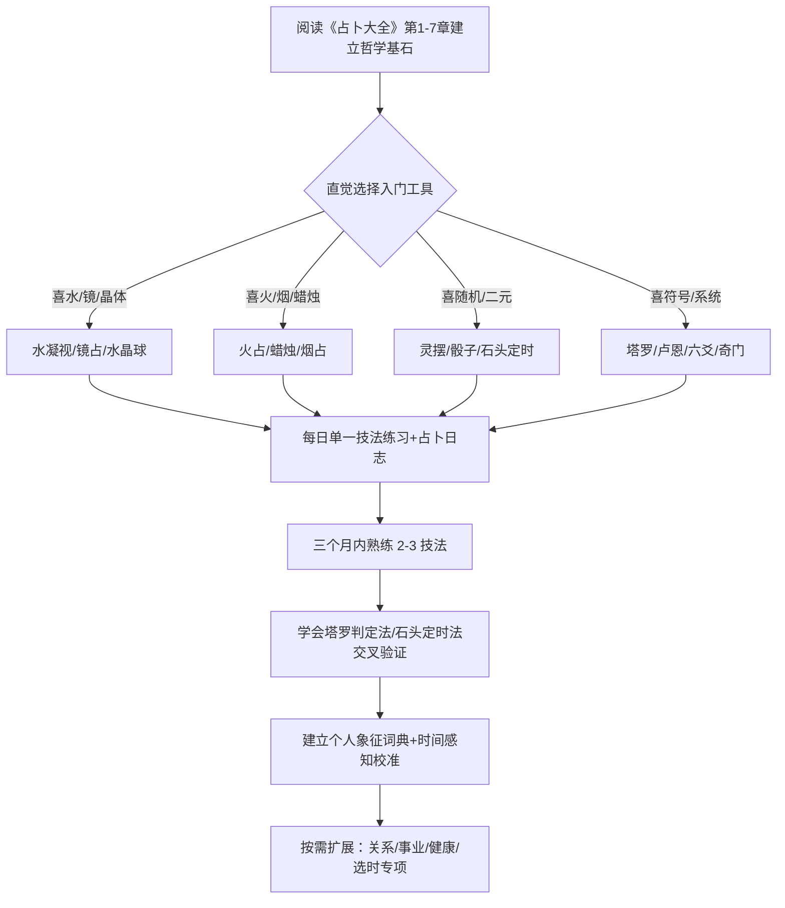

## 书目与定位

**《占卜大全》** 是史考特·康宁罕（Scott Cunningham）晚期代表作之一，由卢埃林全球出版。本书定位为**「占卜术完整指南」**，旨在让读者无需通灵天赋、即可自行操作百余种占卜技法，核心主张：**无固定命运、未来可改、占卜是重塑生活的工具而非宿命预言**。

> 「没有所谓的命运或注定的事。我们的人生几乎完全掌握在我们自己手中。占卜可以是我们强大的盟友，协助我们重塑生活，并让我们的生活符合我们的希望及向往。」——序言

全书三部结构：
1. **第一部分·占卜入门**：古代占卜史（巴比伦、罗马、日耳曼、西藏）、象征性思维、时间幻象理论、占卜艺术（态度/提问/准备/解读）、判定适合占卜法（塔罗判定法）、时间范围测定（石头定时法）、业力与恐惧释放、改变未来实操框架。
2. **第二部分·具体技法**：按工具/媒介分类详解水、火、蜡烛、烟、灰、云、镜、晶体、沙、土、盐、油、蛋、骰子、牌、卢恩、易经、塔罗、掌相、灵摆、徒手占卜等百余种技法。
3. **第三部分·进阶占卜**：更高阶系统的简要介绍。
4. **附录**：占卜字典（70+ 占法简表）、注释参考书目。

## 核心哲学：未来可改、无固定命运

### 三大支柱

| 支柱 | 说明 | 对应章节 |
|------|------|----------|
| **能量波塑造未来** | 思想、行为、情绪产生非实体能量波，延伸至未来绘制「明日地图」；占卜即检视这些能量波描绘的可能路径。 | 第1章·运作原理 |
| **时间即幻象** | 时间非线性物理实在，而是感知构建的维度；过去/现在/未来同步存在，占卜提供超越时间限制的感知手段。 | 第5章·时间的性质 |
| **自由意志优先** | 占卜回应仅为「若维持现状的可能未来」，非不可逆宿命；负面预兆视为预警，可透过改变当下行动重写未来。 | 第7章·改变你的未来 |

### 业力与恐惧的处理

- **业力视为能量回溯**：过去行为形成的能量流返回，非不可逃避的惩罚；可透过当下正向行动「预还」业力、降低冲击。
- **恐惧是显化燃料**：对负面预兆的恐惧会为其赋予能量使其实现；需以**肯定句+积极行动**双轨释放恐惧（参考 [[EFT情绪释放技巧]] 的敲拍确认语句与 [[零极限与荷欧波诺波诺体系]] 的清理四句）。
- **改变未来五步法**：重新训练心灵→占卜判定最有效改变法→逐个击破→依需采取实质行动→为人生负责（含原谅自己、切断有害关系）。

## 百种占法分类体系

### 两大基本形式

| 分类 | 定义 | 典型代表 | 核心差异 |
|------|------|----------|----------|
| **操作型占卜** | 人为操控特定工具（烟、水中油、蛋、骰子、纸、刀、石等）判定未来 | 茶占、蛋占、骰子占、纸占、刀占、石占 | 工具为占卜专用，后期发展产物 |
| **自然型占卜** | 观察自然界自发现象（鸟飞、云象、风向、流星、闪电、动物行为、星象） | 云占、鸟占、风占、星象占、火占、水占、树占、花占 | 需刻意设定时空「请求预兆」，区别于随意观察 |

> 「随意观察可能意外发生的预兆并不是真正的占卜。在预兆发生之前，必须先有请求给予讯息的动作，才能被归类为占卜，而这类预兆被称为诱发预兆。」——第1章

### 三种回应模式

| 模式 | 特征 | 适用场景 | 典型技法 |
|------|------|----------|----------|
| **二元回应** | 是/否/可能；最明确、最易操作 | 具体单一决策、寻物、验证假设 | [[pendulum-divination]] 灵摆、骰子占、指环占、石头定时法 |
| **象征回应** | 图像/符号/模式需解读；可洞察广泛未来图景 | 复杂情境全景、心理深层、长期趋势 | [[cloud-divination]] 云占、火占、水凝视、镜占、茶占、塔罗牌阵 |
| **选择回应** | 将备选项写于载体随机抽取得答案 | 多方案决策、方向选择 | 纸片占、叶占、石占、圣经占 |

## 独创工具法：塔罗判定法与时间范围测定

### 塔罗判定法（Determining the Proper Method）

**目的**：在数十种可用技法中快速锁定「当下问题最适合的占卜法」。

**流程**：
1. 取一副塔罗牌，移除小阿尔卡那，仅留 22 张大阿尔卡那。
2. 洗牌并祈求指引，随机抽 1 张正位置。
3. 对照下表读取对应技法：

| 牌 | 对应占卜法 | 备注 |
|----|------------|------|
| 0 愚人 | 暂无立即适用法 | 建议稍后再占 |
| 1 魔术师 | [[water-divination]] 水晶球/水凝视 | 象征回应 |
| 2 女祭司 | 月光凝视（直视月或水面月影） | 自然型 |
| 3 皇后 | 植物/草药占卜 | 操作型 |
| 4 皇帝 | 刀占 | 金属工具 |
| 5 教皇 | 石头占卜 | 自然物 |
| 6 恋人 | 玫瑰与苹果占卜 | 植物双元素 |
| 7 战车 | 公共场合偶听话语 | 自然型听觉预兆 |
| 8 力量 | [[fire-candle-smoke-ash]] 火/蜡烛/焚香/烟 | 火元素系 |
| 9 隐士 | 旅程预兆 / [[bibliomancy]] 圣经占卜 | 移动/书籍 |
| 10 命运之轮 | [[pendulum-divination]] 灵摆 | 二元回应利器 |
| 11 正义 | 鸟占 | 自然型 |
| 12 吊人 | 指环占卜 | 操作型 |
| 13 死神 | 暂无立即适用法 | 建议稍后再占 |
| 14 节制 | 酒占 | 液体工具 |
| 15 恶魔 | 暂无立即适用法 | 建议稍后再占 |
| 16 高塔 | [[cleromancy]] 卜卦/骰子占 | 随机性工具 |
| 17 星星 | 星象/气象/天空预兆 | 自然型宏观 |
| 18 月亮 | [[water-divination]] 水占 | 水元素核心 |
| 19 太阳 | 蜡烛占 | 火元素细分 |
| 20 审判 | 火占 | 火元素核心 |
| 21 世界 | 任何形式皆可 | 万能牌 |

> **跨页引用**：塔罗牌义体系详见 [[tarot-keyword-correspondence]]、[[78度的智慧塔罗体系]]、[[大阿尔卡那三分结构与愚者之旅]]；灵摆实操见 [[pendulum-divination]]；水/火/烟/云等自然型技法见对应技法页。

### 石头定时法（四阶时间范围测定）

**核心逻辑**：时间非固定刻度，而是能量波到达节点的概率窗口；以同质石头承载时间标记，通过随机抽取读取「最可能发生时段」。

| 时间跨度 | 工具配置 | 读取规则 | 适用场景 |
|----------|----------|----------|----------|
| **即将到来（小时/天/周）** | 14 颗光滑石：1-12 数字×2 面、1 颗黑石、1 颗白石 | 数字石=时刻；最先抽到白石=上午、黑石=下午；先抽黑/白=暂无答案 | 近期事件定时 |
| **一周内** | 7 颗写星期石 + 2 颗白石 | 抽到星期石=该日；白石=无答案 | 短期规划 |
| **数月内（季节/月数）** | 4 颗色石：白(冬/1月)、绿(春/2月)、红(夏/3月)、棕(秋/4月) | 双重读取：颜色=季节/月数 | 中期趋势 |
| **一年内** | 同组 4 色石，改读：白=1月、绿=2月、红=3月、棕=4月…循环 | 同组石头双重编码，按问题意图切换读取层级 | 年度规划 |

> **校验机制**：所有定时占卜需**重复三次**、**交叉验证**（换系统/换时段再占），若冲突则暂缓行动。事件未在预测时刻发生 ≠ 占卜失效，而是证明未来处于流动中——可作为「行动窗口」提前化解风险或备战良机（见第7章·改变你的未来）。

## 古代占卜史料速览（交叉引用索引）

| 文明 | 核心技法 | 关键概念 | 现代传承/对应页面 |
|------|----------|----------|----------------------|
| **巴比伦** | 天象预测官、油占、烟占、预兆诱发/分类、神裁、卜卦、早期占星（行星/月相预兆）、南布尔比净化仪式 | 占卜=探询神意→后改为「可能未来」；复查制、诚实原则 | [[divination-fundamentals]] 古代占卜史节；[[liuyao-foundation-basics]] 卜卦源流 |
| **罗马** | 解梦 incubation、鸟占（食鸡/飞行）、自然/诱发预兆分类、肤卜、偶听语、雷电/隕石/身体颤动预兆 | 神靈主動創造預兆；官方占卜師問責制 | [[qimen-basis]] 奇门预兆体系对照 |
| **日耳曼/北欧** | 卜卦（刻符木条/卢恩前身）、女性主导卜卦、马行为观察、决斗判神意 | 接受女性占卜师；奥丁祈祷；符号刻写更新制 | [[lunwen-fuwen-hexin-tixi]] 卢恩起源；[[rune-divination]] 卢恩占卜 |
| **西藏** | 莫巴/祖古体系、镜/天空/湖凝视、玛拉念珠占卜（108珠四四计数法）、酥油灯火观、骰子、鸦鸟占 | 唯心所造；象征回应为主；准确度为生存准则 | [[cloud-divination]] 云/镜凝视；[[mala-divination]] 念珠占卜 |

## 实操准则速查表

| 环节 | 核心要点 | 避坑指南 |
|------|----------|----------|
| **态度** | 严肃敬畏、真心想知、非娱乐测试 | 玩笑心态→无回应/误导 |
| **选法** | 直觉优先（喜水用水、喜火用火）；关键决策可多法交叉 | 强行用不擅长工具 |
| **提问** | 单一明确、可二元拆解、避免模糊复合句 | 「我明年春天去克里夫兰或波特兰？」→拆三问 |
| **重复** | 关键事项**三占取同**；巴比伦复查制传承 | 单次占断定大事 |
| **解读** | 象征回应：即时解读、信任个人象征系统、勿套用书本死义 | 盲信茶占象征词典 |
| **为人占** | 自身熟练后、对方明确同意、限频次(周/月)、告知「未来可改」、不收费、正向措辞 | 偷占隐私、权威姿态、制造依赖 |
| **自我占** | 清空预设、不选读利己、不过度依赖占卜决策 | 带着「我不想失业」去占事业 |

## 关键技法页交叉引用地图

### 自然元素系
- [[water-divination]] 水占/水凝视/酒占/杯占/湖泊占/金鱼占/蒸汽占
- [[fire-candle-smoke-ash]] 火占/蜡烛占/烟占/灰占/草药占/烧纸占/火柴占
- [[cloud-divination]] 云占/天空预兆/气象占
- [[mirror-divination]] 镜占/魔镜/水镜/指甲盖镜
- [[crystal-gazing]] 水晶球凝视

### 工具操作系
- [[pendulum-divination]] 灵摆（是非/寻物/能量测/多选）
- [[cleromancy]] 骰子/骨牌/签筒/竹签/卢恩石抽取
- [[bibliomancy]] 书占/圣经占/随机开页
- [[egg-divination]] 蛋占/破蛋读象
- [[wax-divination]] 蜡滴水/蜡形占
- [[salt-divination]] 盐占/撒盐读纹

### 体系化占卜
- [[tarot-spreads-index]] 塔罗牌阵库（凯尔特十字/年轮/脉轮/三牌/单牌）
- [[liuyao-foundation-basics]] 六爻/纳甲/世应/六亲/用神
- [[qimen-basis]] 奇门遁甲/九宫/八门/九星/值符值使
- [[bazi-mingli-xue-jichu-jiaocheng]] 四柱八字/十神/大运流年
- [[ziwei-doushu-an-xing-fa]] 紫微斗数/安星/四化/飞星
- [[lunwen-fuwen-hexin-tixi]] 卢恩符文/24符/本命符/塔罗对应
- [[iching-divination]] 易经/卦象/爻辞/变卦

### 身体/直觉系
- [[palmistry]] 手相/掌丘/纹路/指型
- [[face-reading]] 面相/五官/十二宫/气色
- [[body-divination]] 身体颤动/打喷嚏/耳鸣/眼跳预兆
- [[dream-divination]] 梦占/清醒梦/孵梦/解梦
- [[automatic-writing]] 自动书写/灵笔/通灵书写

## 进阶专题延伸

| 专题 | 核心页面 | 关联说明 |
|------|----------|----------|
| **象征性思维训练** | [[symbolic-thinking]] | 每日 5-10 分钟观察物品联想象征，强化右脑解读力 |
| **时间观重塑** | [[time-illusion]] | 练习「站在平原中央看四面八方路径」冥想，弱化线性时间束缚 |
| **业力/恐惧清理** | [[EFT情绪释放技巧]]、[[零极限与荷欧波诺波诺体系]] | 负面预兆出现即启动：敲拍确认语句→四句清理→肯定句重塑→实质行动 |
| **显化与逆显化** | [[显化实践与专注力训练]]、[[心灵魔法显化的神经科学]] | 占卜得「负面」→恐惧释放→目标锚定→行动干预；得「正面」→感恩锚定→防止自毁 |
| **占卜伦理与边界** | [[divination-ethics]] | 隐私权/知情同意/不制造依赖/不绝对化预测/收费红线 |

## 学习路径建议

## 版本与研读提示

- **中译本**：卢埃林授权繁体版《史考特·康宁罕的占卜大全》（尖端出版/其他版本），译名统一性较好，附录占卜字典完整。
- **重点研读章节**：第1章(运作原理/分类/回应)、第3章(占卜艺术/提问/准备)、第4章(象征性思维练习)、第5章(时间幻象)、第6章(塔罗判定法/石头定时法)、第7章(业力/恐惧/改变未来五步法)。
- **实操建议**：将第6章两大独创法制作成**便携速查卡**（塔罗判定对照表+四组石头配色/编码规则），随身携带实战内化。

---

> 「占卜不是要让我们退回到主要由迷信和误解主宰的年代。正好相反，想要真正理解创造我们的生命且仍在运作的力量是需要深思熟虑的。」——序言

**愿此页成为你探索「未知讯息工具箱」的导航枢纽，助你在能量波中看清最可能的路径，并拥有重写它的勇气与方法。**

## 来源

- [占卜大全](../sources/占卜大全.md)
