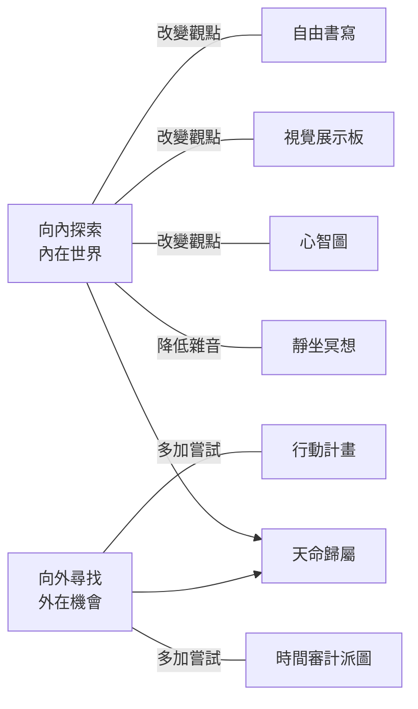

# 發現天賦之旅實作工具箱

> **書名**：《發現天賦之旅》  
> **作者**：肯·羅賓森、盧·亞若尼卡  
> **核心論點**：天命 = 天賦 ∩ 熱情。尋找天命是一場「向內探索天賦、向外尋找機會」的雙向旅程。  
> **書中工具箱**：五大實作練習——靜坐冥想、心智圖、視覺展示板、自由書寫(晨間日記)、時間審計派圖。

---

## 核心框架：三大原則與雙向旅程

### 三大基本原則
| 原則 | 核心內容 | 對應工具 |
|------|----------|----------|
| **原則一：人生獨一無二** | 生物遺傳與文化背景交織出獨特性；八百億分一的降生機率 | 靜坐冥想、心智圖、時間審計 |
| **原則二：人生自我創造** | 想像力與創造力是人類區別於其他生物的關鍵；出生證明不附履歷表 | 視覺展示板、自由書寫 |
| **原則三：人生有機變動** | 非線性發展，而是即興過程；大衛·奧格威從廚師到廣告鉅子的轉折 | 多加嘗試、行動計畫 |

### 雙向旅程模型


---

## 五大實作工具詳解

### 靜坐冥想——降低雜音的基石
> 「我們活在一個充滿『雜音』與干擾的時代……靜坐的目的之一，就是減少內在雜音，以體驗更深層次的意識。」

#### 操作步驟（練習一）
1. **姿勢**：背肩挺直放鬆，舒適坐姿，閉目
2. **呼吸**：鼻吸深氣→閉氣數秒→慢吐，重複 4–5 次
3. **觀察**：恢復自然呼吸，將注意力錨定於呼吸感覺
4. **處理思緒**：思緒浮現時不阻擋、不評判，溫柔拉回呼吸
5. **時長**：5–10 分鐘，結束後靜坐片刻再睜眼

#### 關鍵心法
- **非思考**：目的非思考，而是讓思緒波浪平息（湖面喻意）
- **微量高頻**：即使每天僅 5 分鐘，持續勝過一次長坐
- **工具輔助**：瑜伽、引導音頻、計時器皆可；關鍵在「持續」

> **交叉引用**：[[buddhas-brain-rick-hanson]] 中的「數息法、定冥想法、甜蜜冥想法」；[[ming-xiang-gai-lun]] 的「接觸-練習-融入」三要素。

---

### 心智圖——以視覺釐清思維結構
> 「心智圖可以幫助你自由發揮創造力，並且拓展全新的思考方式。」

#### 繪製原則（東尼·博讚法）
| 原則 | 說明 |
|------|------|
| **中心主題** | 核心概念置中、圓圈圈起 |
| **輻射線條** | 從中心向外發散，每條線承載一關鍵詞/圖形 |
| **層次色彩** | 不同層次用不同字形/顏色區分 |
| **有機曲線** | 線條呈流動曲線，非直線銳角 |
| **粗細漸變** | 越靠近中心線條越粗，外分支越細 |
| **圖文並重** | 視覺效果與文字同等重要 |

#### 書中範例：本書結構心智圖
```text
發現你的天賦
├─ 內容：故事、概念、練習、資源
├─ 幸福快樂：遺傳、環境、行為
├─ 族人：啟發、合作、引導、肯定
├─ 天賦：能力、才華、一般、個人
├─ 態度：個性、性情、氣質
├─ 兩個世界：內在(探索/反省)、外在(探索/反省)
├─ 潛藏天賦：機會、教育、學習風格
├─ 熱情：能量、心靈、流動
└─ 下一步？：評估、計劃、視覺化
```

> **應用場景**：盤點天賦分類（練習四）、規劃行動步驟、釐清人生方向。

---

### 視覺展示板——具象化夢想與渴望
> 「視覺展示板是各種圖像的拼貼集錦，上面集結了你的憧憬、希望與夢想……把這些東西『呈現出來』。」

#### 製作流程
1. **蒐集素材**：從雜誌/網路剪下引起共鳴的圖片、標題、文字（避免用自家照片，因代表過去而非未來）
2. **自由編排**：大紙板/軟木板/鏡子任選，用圖釘、魔鬼氈、保麗龍膠固定（可移動調整）
3. **動態更新**：隨天命探索深入，隨時替換、增減圖像
4. **放置位置**：私密可見處（臥室牆面、辦公桌、隱蔽角落）

#### 核心功能
- **外化內在渴望**：將模糊渴望轉為可視物件
- **繞過線性邏輯**：透過圖像聯想激活右腦直覺
- **錨定目標**：每日視覺提醒，強化「朝向天命」的神經迴路

> **關聯概念**：[[shakti-gawain-chuang-zao-xing-xiang-ti-xi]] 的「粉色泡泡」視覺化技法；[[chuang-zao-jin-qian-tong-wang-feng-yu-zhi-lu]] 的「夢想板」實踐。

---

### 自由書寫——繞過審查器的潛意識探針
> 「自由書寫指在不刻意控制內容下，以無意識、未經規劃、不假思索的方式探索想法與感覺。」

#### 基本操作
| 要素 | 建議 |
|------|------|
| **環境** | 放鬆空間、充足紙張、喜愛筆具 |
| **觸發詞** | 如「我熱愛的事物」、「我擅長的事」 |
| **規則** | 不停筆、不修改、不評判、不規劃、不管錯別字/標點 |
| **時長** | 起步 5 分鐘，熟練延至 10–20 分鐘 |
| **事後** | 圈出關鍵字句作下次起點，或以關鍵詞任一字自由聯想 |

#### 晨間日記——茱莉亞·卡麥隆特定版本
- **時機**：起床後、做任何事前
- **量**：三頁或二十分鐘（先達標者為準）
- **處理**：寫完不回讀，碎紙機銷毀或封入信封/收起筆記本
- **功能**：「清運腦中雜亂思緒，讓一天更無拘無束地展開」

> **交叉引用**：[[xie-xia-lai-qi-ji-jiu-hui-fa-sheng]] 的「百日奇迹书写法、憋氣書寫儀式」；[[nei-zhi-liao-yu-taro]] 的書寫療癒牌陣。

---

### 時間審計派圖——量化人生現況的鏡子
> 「這個練習的目的，是幫助你盤點自己的人生現況，以及你對自身狀況的感受。」

#### 製作步驟（練習二）
1. **列出活動**：大張紙寫出一週內所有活動（會議、郵件、家務、通勤、閱讀、健身…）
2. **分類著色**：有薪/無薪/休閒/社交/興趣/健身等，依直覺分類
3. **繪製面積圖**：另一張紙畫圓圈，面積大小對應每週耗時比例
4. **情感標記**：三色筆標記每項活動——A 喜歡、B 中性、C 不喜歡
5. **派狀圖轉化**：大圓按 A/B/C 三類時間比例切割，可延伸至月/年視角

#### 診斷提問
- 這張圖是否忠實反映你的感受？
- 哪裡有調整空間？哪些改變「現在就能做」？哪些「須長期規劃」？
- A 區（喜歡）佔比多少？C 區（不喜歡）能否外包/刪減/重構？

> **延伸工具**：[[yi-fei-wei-zong]] 的「以肺為宗」呼吸法可作為微觀時間切片的能量審計；[[lu-li-zhan-xing-xue]] 的「逆行實證」提供時間質性分析視角。

---

## 章節速覽與工具對應表

| 章節 | 主題 | 核心工具/練習 | 輸出成果 |
|------|------|---------------|----------|
| **Ch1** | 天命的歸屬 | 練習一：靜坐、練習二：時間審計派圖 | 現況基線、內在平靜錨點 |
| **Ch2** | 你擅長什麼？ | 練習三：活動分類、練習四：天賦三欄表 | 天賦清單（擅長/平平/不擅長） |
| **Ch3** | 為何不了解天賦 | 潛藏天賦發掘、學習風格檢視 | 隱性天賦線索、教育創傷釐清 |
| **Ch4** | 找出熱情所在 | 視覺展示板、心智圖（熱情分支） | 熱情地圖、能量流向圖 |
| **Ch5** | 快樂與天命 | 心流體驗記錄、能量增減日誌 | 活力/耗能活動清單 |
| **Ch6** | 態度檢視 | 自由書寫（態度主題）、信念盤點 | 限制性信念識別表 |
| **Ch7** | 盤點現況創造契機 | SWOT 個人版、機會成本分析 | 行動優先序矩陣 |
| **Ch8** | 連結族人 | 社交網絡圖、導師/夥伴畫像 | 支援系統地圖 |
| **Ch9** | 行動計畫 | 視覺展示板更新、SMART 目標拆解 | 90 天行動路線圖 |
| **Ch10** | 總結與再出發 | 完整工具箱複盤、儀式性慶祝 | 持續探索承諾書 |

---

## 關鍵概念辨析

### 天賦 vs. 能力
| 維度 | 天賦 | 能力 |
|------|------|------|
| **來源** | 與生俱來的潛能 | 經教育/訓練發展 |
| **表徵** | 「我天生擅長…」 | 「我是一位…專家」 |
| **發展** | 需應用與精進才轉化為能力 | 可通過刻意練習提升 |
| **關係** | 天賦讓學習較輕鬆愉快 | 能力是天賦的具體化 |

### 一般 vs. 獨特天賦
- **一般天賦**：人類共享（語言、想像、大拇指對握、社交協作…）
- **獨特天賦**：個體基因組合產出的特定強項（如德瑞克的引擎聽診天賦）

### 潛藏天賦發掘三路徑
1. **機會觸發**：委內瑞拉「系統教育」讓 40 萬兒童發現音樂天賦
2. **學習風格匹配**：視覺/聽覺/動覺/讀寫四類風格對應不同天賦表達
3. **跨域嘗試**：「多加嘗試」原則——到新環境、試新工具、識新友

---

## 避坑指南：巴納姆效應與主觀確認

> 書中引用福瑞爾 1948 實驗：同一份模糊人格描述（巴納姆陳述）發給所有受測者，平均契合度 4.26/5 分。

### 識別與對策
| 陷阱 | 特徵 | 破解工具 |
|------|------|----------|
| **星座/測驗框架** | 籠統描述套用全人類 | 具體情境回溯、行為級觀察 |
| **一廂情願** | 只看支持證據 | 自由書寫「反證」版本、找異見者回饋 |
| **標籤固化** | 「我是 X 型人所以…」 | 心智圖「標籤解構」分支、時間審計實證 |

---

## 交叉引用知識網絡

### 同作者體系
- [[ken-robinson-element-theory]] —— 核心理論總覽（天命定義、三大原則、雙向旅程、關鍵案例）
- 《讓天賦自由》、《讓創意自由》前作脈絡

### 工具同源頁面
| 工具 | 關聯頁面 | 互補視角 |
|------|----------|----------|
| 靜坐冥想 | [[buddhas-brain-rick-hanson]]、[[ming-xiang-gai-lun]]、[[chu-xue-zhe-de-ming-xiang-shu]] | 神經機制、世俗化教學、內觀傳承 |
| 心智圖 | [[zhanxing-biji-zhaohui-zhenshi-ziji]]（星盤+筆記雙軌）、[[river-diagram-tarot]]（河圖結構） | 視覺化思維結構化 |
| 視覺展示板 | [[shakti-gawain-chuang-zao-xing-xiang-ti-xi]]、[[chuang-zao-jin-qian-tong-wang-feng-yu-zhi-lu]] | 吸引力法則具象化、顯化儀式 |
| 自由書寫 | [[xie-xia-lai-qi-ji-jiu-hui-fa-sheng]]、[[nei-zhi-liao-yu-taro]] | 療癒書寫、塔羅提問書寫 |
| 時間審計 | [[liang-zi-zhan-xing-xue]]（量子時間觀）、[[zhanxing-liu-nian-rudolf]]（流年時間切片） | 時間質性與量化雙重審計 |

### 進階應用頁面
- [[AI时代全球未来趋势与职业转型]] —— 天命在 AI 時代的職業轉化路徑
- [[tian-ming-bian-shi-yu-tian-ming-mu-ma-qing-li]] —— 天命木馬清理與校準方法
- [[yuan-fang-li-ji]] —— 圓方出版社「破除迷信、重人生智慧」出版觀照本書定位

---

## 實作清單：你的 30 天啟動計畫

| 週次 | 重點工具 | 每日微行動 | 週末複盤 |
|------|----------|------------|----------|
| **第 1 週** | 靜坐 + 時間審計 | 早 5 分鐘靜坐、晚記錄時間流向 | 繪製時間派圖、標記 A/B/C |
| **第 2 週** | 心智圖 + 自由書寫 | 晨 10 分鐘自由書寫、繪 1 張心智圖 | 梳理天賦三欄表、熱情關鍵詞 |
| **第 3 週** | 視覺展示板 | 每天剪 3 張共鳴圖像、週末組板 | 板面解讀：哪些圖像最有張力？ |
| **第 4 週** | 行動原型 | 設計 1 個微實驗（體驗疑似天命活動） | 記錄能量增減、修正視覺板 |

> **原則**：工具服務於探索，而非探索服務於工具。隨時調整頻率與深度，**持續 > 完美**。

---

## 結語：旅程無終點

> 「尋找天命不代表你要忽略其他人的需求，也不意味著你要放棄現在所做的一切。它只代表你必須認真檢視自己……到最後，只有你自己知道，你是否已經歸屬於天命。」

這套工具箱的價值不在於「找到正確答案」，而在於**建立一套可持續的自我對話系統**——  
每一次靜坐、每一張心智圖、每一版視覺板、每一頁晨間日記、每一張派圖，都是你與真我之間的**可靠通訊協定**。  
願你在降低雜音、改變觀點、多加嘗試的螺旋上升中，聽見那句來自內心的：「這就是我。」

## 来源

- [发现天赋之旅](../sources/发现天赋之旅.md)
