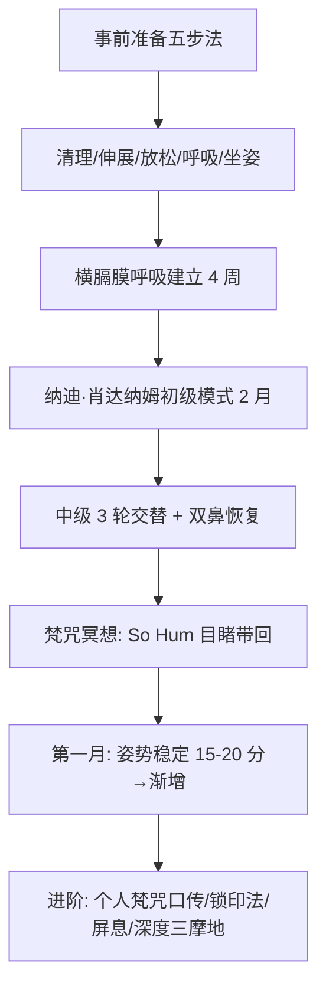

# 斯瓦米·拉玛《冥想：认识内在自我》——喜马拉雅瑜伽冥想体系

> **核心定位**：本书是喜马拉雅瑜伽传承大师斯瓦米·拉玛系统阐述冥想科学的奠基之作，区分“冥想技巧”与“冥想本身”，依托帕坦迦利八肢瑜伽哲学，提供从事前准备、姿势、呼吸、梵咒到进阶计划的完整实操指南。

---

## 一、 核心哲学框架

### 八肢瑜伽的内外二分
- **外在瑜伽（可练习）**：夜摩（Yama）、尼夜摩（Niyama）、体式（Asana）、调息（Pranayama）、内摄（Pratyahara）——属于练习者可主动操作的领域。
- **内在瑜伽（自然发生）**：专注（Dharana）、禅那（Dhyana）、三摩地（Samadhi）——是练习外在瑜伽后自然涌现的结果，**不可强求、不可人为制造**。

> 💡 **关键洞见**：冥想不是思考、沉思、催眠、白日梦，也非宗教仪式。它是一种**清醒、放松、内向的专注觉知**，旨在搭建内在世界与外在世界的桥梁，最终认识阿特曼（Atman，真我）。

### 冥想的三重定义
| 维度 | 说明 |
|------|------|
| **词源** | 同 "medical/medicated" 词根，意为“注意、关注某物”——关注平时难以觉察的最深层维度。 |
| **过程** | 让心念放下思考/分析/回忆/判断/执着/期待，减缓运转速度，以内在觉察与专注取而代之。 |
| **目标** | 形成信道，发现阿特曼的存在并引导之；体验三摩地——所有疑问烟消云散、烦恼不复存在的喜乐内在状态。 |

### 与易混淆状态的辨析
| 状态 | 与冥想的区别 |
|------|--------------|
| **沉思/思考** | 需启动心念理解观念；冥想则超越精神活动，不思考任何观念。 |
| **催眠/自我暗示** | 受外部或内部暗示操纵心念；冥想不施加暗示，只是观察、让心念安静。 |
| **宗教** | 传授“信仰什么”；冥想给予“直接自我体验”，不改变信仰文化，属实用科学技能。 |
| **睡眠/做梦/幻想** | 意识涣散或投射外在；冥想完全清醒、觉察、内向。 |

---

## 二、 冥想事前准备五步法

> **原则**：无准备则生理/心理/情绪干扰将限制冥想深度。按序执行，循序渐进。

| 步骤 | 内容 | 关键要点 |
|------|------|----------|
| **1. 清理** | 淋浴/洗脸手脚/排便 | 身体精力充沛、舒适、轻盈、放松。 |
| **2. 伸展** | 哈达瑜伽体位法/缓慢伸展 | 至少 5–10 分钟；柔和唤醒、放松肌肉、减轻压力、集中注意力；推荐《瑜伽：基础精通》。 |
| **3. 放松** | 摊尸式 Shavasana | 仰卧、薄枕、盖毯、掌心向上、双腿分开；顺序关注肌群→全身；≤10 分钟，保持清醒。 |
| **4. 呼吸练习** | 横膈膜呼吸/调息法 | 使精神平静，助专注集中稳定；呼吸状态影响情绪平衡与心理稳定。 |
| **5. 冥想坐姿** | 采用稳定舒适姿势 | 头颈躯干一线，自由使用横膈膜；心念关注梵咒 "so hum" 配合呼吸。 |

### 影响冥想的生活因素
- **饮食**：清晨最佳（已消化前日食物）；避免大量肉类后 3–4 小时冥想；新鲜、简单、不油腻、充分咀嚼、愉悦氛围进食。
- **睡眠**：不足→昏沉；过多→无精打采；随练习深入，睡眠需求自然降低。
- **原始本能管理**：食物、性、睡眠、自我保护——失衡将破坏专注力。
- **禁忌**：酒精、毒品、麻醉剂会制造躁动/迟钝，严重干扰冥想。

---

## 三、 冥想姿势体系

> **核心原则**：**头部、颈部、躯干保持一条直线**，以便自由使用横膈膜呼吸。双腿位置次于脊柱挺直。

### 推荐三大基础坐姿（由易到难）

| 姿势 | 梵文名 | 适用人群 | 要领 |
|------|--------|----------|------|
| **高位坐** | Maitri Asana | 所有人，尤其身体不灵活/不习惯坐地者 | 坐椅子/长凳，双脚平放地面，双手搭大腿。 |
| **简易坐** | Sukhasana | 身体较柔软者 | 盘腿，双脚掌置对侧膝下，膝盖轻放对应脚上；臀下垫折叠厚毯保护膝踝。 |
| **吉祥坐** | Swastikasana | 双腿足够灵活、长时间冥想者 | 双膝直贴地板，根基更宽广稳定；左脚抵右大腿内侧，右脚脚趾插入左大腿小腿间，左脚脚趾勾入右大腿小腿间。 |

### 进阶/特殊坐姿（谨慎使用）

| 姿势 | 梵文名 | 说明 |
|------|--------|------|
| **雷电坐** | Zen Sitting | 跪坐臀部放脚踝；易过度伸展足踝，建议用禅凳；长时不够稳定。 |
| **至善坐** | Siddhasana | 传统教高阶出家男性；需根锁法配合，左脚跟压会阴，右脚跟压耻骨；能持 3 小时无痛即得“体位成就”。女性亦可练习。 |
| **莲花坐** | Padmasana | 除非极准确舒适否则无益；难配合锁印法；建议仅作柔韧练习，不用于冥想。 |

### 让坐姿更舒适的实操建议
- 臀部下垫折叠毯/枕头抬高 → 减轻髋膝压力，更易挺直脊柱。
- 座位稳定、不软塌、不晃动、高度适中。
- 随柔韧性增加逐渐降低垫高，最终直接坐地。
- **不建议躺着冥想** → 易入睡失去觉察；深层冥想需脊柱直立贯通精微能量（参阅《光与火之路》）。

---

## 四、 呼吸科学与调息法体系

### 呼吸：身心之桥
- **普拉那**：初始能量，连接身心、协调机能。
- **呼吸反映心念状态**：惊吓→屏息；焦虑→短浅急促；长期压力→呼吸模式扭曲。
- **四大不规律**：太浅、声音太大、吸呼间隔过长、起伏不定——均干扰心念、阻碍专注。

### 横膈膜式呼吸——基石
- **机制**：横膈膜上下移动，吸气肋骨下侧微扩、呼气腹部向脊柱收；全程鼻呼吸、安静、均匀、吸呼等长、无停顿。
- **前提**：头颈躯干一线，脊柱不弯曲。
- **重建方法**：
  1. 摊尸式，一手胸一手脐感受腹部起伏；
  2. 腹部置沙袋（3–5 kg）温和训练横膈肌；
  3. 鳄鱼式 Makarasana（俯卧额抵前臂）感受腹部贴地动作；
  4. 日常有意识关注约 4 周内化为自然模式。

### 辅助呼吸练习
| 练习 | 方法 | 效果 |
|------|------|------|
| **1:2 呼吸法** | 呼气时长为吸气 2 倍（如吸 4 数、呼 8 数），无屏息 | 放松、减少气息浪费、增活力耐力。 |
| **唤醒中脉** | 双鼻孔同时顺畅呼吸 | 产生独特澄明，心念愉悦不游荡，通往深度冥想。 |

### 纳迪·肖达纳姆——净化气脉法/鼻孔交替呼吸法
> **核心调息法**，平衡神经系统、净化气脉、使气息双鼻均匀、达清晰静谧冥想状态。

#### 能量解剖学基础
| 气脉 | 位置/功能 | 对应 |
|------|-----------|------|
| **中脉 Sushumna** | 中央信道，脊柱底至顶 | 打开后双鼻均匀呼吸，心念愉悦易入深度冥想 |
| **左脉 Ida** | 脊柱左侧，终点左鼻孔 | 控制左鼻呼吸 |
| **右脉 Pingala** | 脊柱右侧，终点右鼻孔 | 控制右鼻呼吸 |

- **鼻孔主导交替**：健康人每 90–120 分钟左右/右鼻孔交替主导；可用指尖感受气流或镜面水汽判断。

#### 三种初级模式（择一练习 2 月至熟练）
| 模式 | 特点 | 适用 |
|------|------|------|
| **方式 1** | 最完善，控制鼻孔频率最高 | 主要练习方式 |
| **方式 2** | 易记忆记录，交替与呼吸完成对应 | 便于记录 |
| **方式 3** | 操控鼻孔最少，最易掌握 | 初期困难者首选 |

#### 基本流程
1. 坐定，检查脊柱挺直，呼吸顺畅。
2. 依模式决定起始鼻孔（早/晚/午餐前空腹练习）。
3. 横膈膜呼吸，吸呼等长、顺畅、缓慢、无强迫。
4. 右手食中指屈掌，拇指控右鼻、无名指控左鼻，轻触即可。
5. 先关一侧鼻孔，另一侧柔顺彻底呼气。
6. 呼气末按模式切换/持续吸气，吸呼等长。
7. 完成一轮 → 双鼻深长顺畅呼吸。

#### 中级进阶
- 每次练 3 轮，轮间双鼻同时 3 次呼吸恢复自然节奏。
- 第二组 3 轮从相反侧鼻孔起始，以降交替。
- **屏息仅限高阶学员**，须在合格老师指导下、掌握锁印法 Bandhas 与手印 Mudras 后进行。

---

## 五、 冥想核心：心念、梵咒与专注

### 专注的真义
- **非努力/紧张/压力**，而是“警觉中放松”的注意力集中。
- 专注是冥想基础；无法专注 = 对心念流引导能力受损。

### 梵咒 Mantra——心念的焦点与支撑
| 层面 | 说明 |
|------|------|
| **定义** | 特殊声音/音节/词汇，非普通语言；振动创造形态，非外在物体关联。 |
| **作用** | 平息心灵细小混乱波动，引入和谐；连接尘世与不朽的桥梁；死时留印助超越死亡之旅。 |
| **传授** | **仅限资深合格老师一对一口传**；书本学无效。老师依学生心灵状态与探索渴望挑选。 |
| **通用入门咒** | **So Hum（搜瀚）**："我即它"（内在与宇宙意识合一）；配合呼吸——吸 "so"，呼 "hum"；不属任何宗教。 |
| **其他常见** | Om/Aum（最高等级）、Omkar、Amen、Shalom。 |

### 实操要领：目睹而非压制
1. 静坐，呼吸安定，心聆听 "so hum"。
2. 心念飘离 → **中立觉察/目睹** 思绪存在 → **轻柔带回** "so hum"。
3. **严禁**：思想对抗、愤怒、自我评判、强化特定想法。
4. 随进步，心念运转减慢、稳定；分神频率降低。

### 进阶评估
- **不可靠指标**：坐时长、神奇体验（幻觉/光/色）、生理反应（痛/抽搐=张力未释放）。
- **可靠指标**：稳定感、静谧感、愉悦幸福感、负面情绪/欲望干扰减少、觉察力提升、将体验应用于生活平衡协调。

---

## 六、 冥想进阶计划：第一月目标

| 维度 | 具体要求 |
|------|----------|
| **时间** | 固定时段，初 15–20 分钟，每 3 天延长 3 分钟。 |
| **姿势** | 养成稳定舒适坐姿；首周可背靠墙检查脊柱，后须独立坐姿；臀下垫两块四折毯。 |
| **应对困难** | 身体抖动/出汗/麻木、面部肌肉抽动 → **无需理睬**，管教反而引发反抗；喉咙干/唾液多多因饮食不当。 |
| **心态** | 向内在生命之神祈祷冥想精进、有动力、渴望下次；不祈祷私利。 |
| **结束** | 起身按摩脚趾/小腿/大腿缓解不适。 |

---

## 七、 交叉引用与关联体系

| 本书概念 | 关联知识页面 | 关联说明 |
|----------|--------------|----------|
| **八肢瑜伽/帕坦迦利** | [[buddhas-brain-rick-hanson]] | 该页详述帕坦迦利八支、数息法、定冥想法、神经机制对照。 |
| **横膈膜呼吸/调息法** | [[yi-fei-wei-zong]]、[[neijing-huxi-yangsheng-fa]]、[[soham-healing-system]] | 肺为宗气之源、内经呼吸养生、SoHam 普拉那能量体系互证。 |
| **纳迪/气脉/中脉/左脉/右脉** | [[ren-shen-shu-san-yi-neng-liang-liu]]、[[neng-liang-ping-heng]] | 仁神术三一能量流、能量平衡核心通道与四向流动对应。 |
| **梵咒/So Hum/声音振动** | [[ming-xiang-gai-lun]]、[[shakti-gawain-chuang-zao-xing-xiang-ti-xi]] | 正念冥想意象法、创造性想象肯定陈述与声音工具共振。 |
| **冥想姿势/脊柱直立/精微能量** | [[zhongshen-de-xing-kong]]、[[ren-shen-shu]] | 众神的星空身心同构、仁神术安全能量锁与能量通道。 |
| **摊尸式/放松/体位法** | [[guang-liao-yang-liao-hua-jing-zheng-he-liao-fa]]、[[zhongshen-de-xing-kong]] | 光疗氧疗花精整合疗法中的身心放松协议。 |
| **阿特曼/三摩地/真我** | [[ming-xiang-ri-ji-zi-wo-guan-li]]、[[cong-xin-jue-xing]] | 冥想日记自我管理、从心觉醒梅尔卡巴与真我体验。 |

---

## 八、 关键术语速查表

| 术语 | 梵文/英文 | 定义 |
|------|-----------|------|
| **阿特曼** | Atman | 内在真我、本我、自我。 |
| **三摩地** | Samadhi | 融入阿特曼的喜乐内在状态，疑问烦恼全无。 |
| **梵咒** | Mantra | 特定振动声音，心念焦点，连接尘世不朽桥梁。 |
| **So Hum** | So Hum | 通用入门梵咒，"我即它"，配合呼吸吸"so"呼"hum"。 |
| **横膈膜呼吸** | Diaphragmatic Breath | 肋骨下扩、腹部向脊柱，鼻吸鼻呼、均匀安静、吸呼等长。 |
| **纳迪·肖达纳姆** | Nadi Shodhanam | 净化气脉法/鼻孔交替呼吸法，平衡左右脉、中枢神经。 |
| **中脉/左脉/右脉** | Sushumna/Ida/Pingala | 三大能量信道，中脉贯脊柱，左脉至左鼻，右脉至右鼻。 |
| **锁印法** | Bandha | 身体内在收缩/紧锁，引导普拉那能量。 |
| **手印** | Mudra | 手指特定姿势，深化冥想/引导能量。 |
| **摊尸式** | Shavasana | 仰卧放松体位，冥想前深度放松核心练习。 |
| **体位成就** | Asana Siddhi | 至善坐保持 3 小时无痛，姿势完美状态。 |

---

## 九、 实践路线图总览

---

> **结语**：冥想是一段“愉悦的内在之旅”。无需特殊吃力之举，只须**规律、固定时间、循序渐进**地练习准备、姿势、呼吸、梵咒四大支柱，身心将自然呈现稳定、静谧、洞察与喜乐。正如斯瓦米·拉玛所言：“你就是和平、幸福和快乐。自由是你的本性，要反反复复地体验它，直到它与你同化。”

## 来源

- [冥想：认识内在自我](../sources/冥想：认识内在自我.md)
