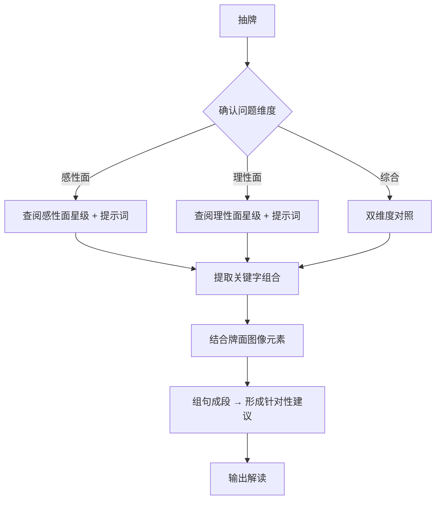

## 概述

《塔罗事典》由资深塔罗占卜师孟小靖编著，独创**塔罗指数速查系统**，将 78 张塔罗牌（22 大阿尔卡那 + 56 小阿尔卡那）按「感性面」与「理性面」两大维度，以五星评分、重点提示词、关键字组合三层结构呈现，旨在帮助占卜者**快速破题**、多面向延伸解读，将塔罗牌从「需翻书查义」的工具转化为「即抽即读、直切核心」的决策辅助系统。

> **核心理念**：塔罗牌是「神秘学的语言」，78 张牌即 78 个字母；掌握关键字与评分指标，即能像拼字造句般组合出针对性建议。

---

## 系统架构

### 双维度五星评分矩阵

| 维度 | 定义 | 适用问题类型 | 评分含义 |
|------|------|--------------|----------|
| **感性面** | 象徵「情感、人际、内心」领域 | 爱情、友情、家庭、婚姻、心情、人际关系 | ★☆☆☆☆ 极不利 → ★★★★★ 极有利 |
| **理性面** | 象徵「行动、事务、外在」领域 | 工作、学业、投资、财务、梦想、健康 | ★☆☆☆☆ 极不利 → ★★★★★ 极有利 |

> **使用原则**：抽牌后先看对应维度星级，快速判断「整体吉凶倾向」，再结合提示词与关键字组合做精细解读。

### 三层信息结构

```
单张牌条目
├─ 感性面：★★★☆☆ ｜ 重点提示：「情感沟通受阻，需主动表达」
├─ 理性面：★★★★☆ ｜ 重点提示：「计划推进顺利，把握关键节点」
└─ 关键字组合：[沟通/启动/技巧/表达/桥梁] → 可自由组句延伸
```

---

## 张牌指数速查总表（框架示例）

> 完整 78 张牌的详细星级、提示词、关键字组合请参阅《塔罗事典》Chapter 7〈找答案：了解塔罗说什么〉。下表仅列示结构与部分代表牌例。

### 大阿尔卡那（22 张）

| 牌名 | 编号 | 感性面 | 理性面 | 重点提示词（感性/理性） | 核心关键字组合 |
|------|------|--------|--------|--------------------------|----------------|
| 愚者 | 0 | ★★★☆☆ | ★★★☆☆ | 接纳未知 / 开启新局 | [起点/冒险/直觉/零/自由] |
| 魔术师 | I | ★★★★☆ | ★★★★★ | 善用资源 / 创造开端 | [创造/开端/技巧/工具/意志] |
| 女教皇 | II | ★★★★★ | ★★★☆☆ | 信任直觉 / 暂缓行动 | [直觉/奥秘/潜意识/等待/智慧] |
| 女帝 | III | ★★★★★ | ★★★★☆ | 滋养关系 / 物质丰盈 | [丰饶/母性/感官/创造/享受] |
| 皇帝 | IV | ★★★☆☆ | ★★★★★ | 建立秩序 / 掌控局面 | [权威/结构/规则/父性/执行] |
| 教皇 | V | ★★★★☆ | ★★★★☆ | 寻求指引 / 遵循传统 | [信仰/导师/传统/道德/仪式] |
| 恋人 | VI | ★★★★★ | ★★★☆☆ | 选择契合 / 价值对齐 | [选择/伙伴/和谐/价值/誓约] |
| 战车 | VII | ★★★☆☆ | ★★★★★ | 克服阻力 / 目标达成 | [胜利/控制/前进/对立/整合] |
| 力量 | VIII | ★★★★★ | ★★★★☆ | 柔韧驾驭 / 内在力量 | [勇气/耐心/驯服/同理/掌控] |
| 隐者 | IX | ★★★☆☆ | ★★★★☆ | 独处省思 / 寻找答案 | [独处/智慧/指引/内省/灯] |
| 命运之轮 | X | ★★★★☆ | ★★★★★ | 顺应周期 / 把握转机 | [循环/转折/机会/宿命/流动] |
| 正义 | XI | ★★★★☆ | ★★★★★ | 公平裁断 / 因果法则 | [平衡/真相/法律/抉择/公正] |
| 吊人 | XII | ★★★☆☆ | ★★★☆☆ | 换位思考 / 自愿牺牲 | [暂停/视角/奉献/等待/顿悟] |
| 死神 | XIII | ★★★☆☆ | ★★★★☆ | 结束旧局 / 必然蜕变 | [终结/转化/必然/重生/切割] |
| 节制 | XIV | ★★★★★ | ★★★★★ | 融合调和 / 循序渐进 | [平衡/融合/耐心/疗愈/中道] |
| 恶魔 | XV | ★★☆☆☆ | ★★★☆☆ | 觉察束缚 / 打破成瘾 | [束缚/阴影/欲望/物质/解脱] |
| 高塔 | XVI | ★★☆☆☆ | ★★☆☆☆ | 突发变故 / 旧构崩塌 | [突变/毁灭/觉醒/释放/重建] |
| 星星 | XVII | ★★★★★ | ★★★★☆ | 重燃希望 / 指引方向 | [希望/灵感/疗愈/指引/宁静] |
| 月亮 | XVIII | ★★☆☆☆ | ★★☆☆☆ | 情绪迷雾 / 潜意识投射 | [幻象/恐惧/直觉/周期/深层] |
| 太阳 | XIX | ★★★★★ | ★★★★★ | 光明呈现 / 成果显现 | [喜悦/成功/活力/清晰/显化] |
| 审判 | XX | ★★★★☆ | ★★★★☆ | 内在召唤 / 觉醒升级 | [觉醒/召唤/审视/升华/新生] |
| 世界 | XXI | ★★★★★ | ★★★★★ | 圆满完成 / 整合合一 | [完成/整合/旅行/圆满/奖赏] |

### 小阿尔卡那四组元素（各 14 张）

#### 权杖组 🔥 火｜行动・能量・挑战

| 牌名 | 感性面 | 理性面 | 重点提示词 | 关键字组合 |
|------|--------|--------|------------|------------|
| 权杖 Ace | ★★★★☆ | ★★★★★ | 灵感迸发 / 行动起点 | [火种/创意/冲动/开始/种子] |
| 权杖 2 | ★★★★☆ | ★★★★☆ | 规划远景 / 掌控主动 | [规划/掌控/视野/等待/决定] |
| 权杖 3 | ★★★★☆ | ★★★★★ | 成果初现 / 扩展版图 | [拓展/远眺/合作/成长/企业] |
| 权杖 4 | ★★★★★ | ★★★★☆ | 庆祝里程 / 奠定基础 | [庆典/家园/稳定/和谐/根基] |
| 权杖 5 | ★★☆☆☆ | ★★☆☆☆ | 冲突竞争 / 无序耗能 | [冲突/竞争/混乱/自我/斗争] |
| 权杖 6 | ★★★★★ | ★★★★★ | 胜利认可 / 公开荣誉 | [胜利/认可/奖赏/自信/通过] |
| 权杖 7 | ★★★☆☆ | ★★★★☆ | 坚守阵地 / 逆境自强 | [挑战/防卫/坚持/立场/优势] |
| 权杖 8 | ★★★☆☆ | ★★★★★ | 极速推进 / 讯息来临 | [速度/行动/讯息/旅行/飞跃] |
| 权杖 9 | ★★★☆☆ | ★★★★☆ | 临门一脚 / 疲劳坚持 | [防备/韧性/压力/最后/警戒] |
| 权杖 10 | ★★☆☆☆ | ★★★☆☆ | 负重过重 / 需放下分担 | [负担/责任/压力/完成/释放] |
| 权杖 随从 | ★★★★☆ | ★★★★☆ | 火花初现 / 学习行动 | [探索/热情/学徒/信息/火种] |
| 权杖 骑士 | ★★★☆☆ | ★★★★★ | 冲锋陷阵 / 急速执行 | [冲动/行动/冒险/速度/使命] |
| 权杖 王后 | ★★★★★ | ★★★★★ | 魅力领导 / 热情感染 | [自信/独立/热情/社交/创意] |
| 权杖 国王 | ★★★★☆ | ★★★★★ | 远见统御 / 创业典范 | [领袖/愿景/企业家/权威/火] |

#### 圣杯组 💧 水｜情感・关系・直觉

| 牌名 | 感性面 | 理性面 | 重点提示词 | 关键字组合 |
|------|--------|--------|------------|------------|
| 圣杯 Ace | ★★★★★ | ★★★☆☆ | 情感新生 / 直觉开启 | [爱/直觉/新情/灵感/恩典] |
| 圣杯 2 | ★★★★★ | ★★★★☆ | 互相吸引 / 伙伴契合 | [伙伴/连结/誓约/和谐/互换] |
| 圣杯 3 | ★★★★★ | ★★★☆☆ | 共同庆祝 / 社群支持 | [庆祝/友情/社群/分享/重逢] |
| 圣杯 4 | ★★★☆☆ | ★★★☆☆ | 情绪倦怠 / 错失良机 | [冷漠/厌倦/冥想/拒绝/重评] |
| 圣杯 5 | ★★☆☆☆ | ★★★☆☆ | 遗憾沉溺 / 忽视既有 | [失落/遗憾/悲伤/放下/剩余] |
| 圣杯 6 | ★★★★★ | ★★★☆☆ | 纯真回忆 / 往昔重逢 | [童年/怀旧/给予/纯真/回馈] |
| 圣杯 7 | ★★★☆☆ | ★★☆☆☆ | 幻想过多 / 需落地筛选 | [幻想/选择/诱惑/迷茫/清醒] |
| 圣杯 8 | ★★★☆☆ | ★★★☆☆ | 勇敢离场 / 寻找更深 | [离开/探索/放弃/转折/深层] |
| 圣杯 9 | ★★★★★ | ★★★★☆ | 愿望达成 / 情感满足 | [满足/愿望/享受/自足/丰盈] |
| 圣杯 10 | ★★★★★ | ★★★★☆ | 圆满家庭 / 代际传承 | [家庭/和谐/传承/幸福/归属] |
| 圣杯 随从 | ★★★★★ | ★★★☆☆ | 纯真表达 / 讯息传递 | [讯息/梦境/提议/直觉/敏感] |
| 圣杯 骑士 | ★★★★★ | ★★★☆☆ | 浪漫追求 / 理想行动 | [浪漫/提议/骑士/理想/情感] |
| 圣杯 王后 | ★★★★★ | ★★★★☆ | 共情疗愈 / 情感智慧 | [共情/直觉/母亲/疗愈/宁静] |
| 圣杯 国王 | ★★★★★ | ★★★★★ | 情感掌控 / 智慧慈悲 | [外交/平衡/顾问/掌控/深度] |

#### 宝剑组 ♠ 风｜思维・沟通・冲突

| 牌名 | 感性面 | 理性面 | 重点提示词 | 关键字组合 |
|------|--------|--------|------------|------------|
| 宝剑 Ace | ★★★☆☆ | ★★★★★ | 真相穿透 / 思维突破 | [真相/清晰/突破/决定/思想] |
| 宝剑 2 | ★★★☆☆ | ★★★☆☆ | 僵持回避 / 需做决定 | [平衡/僵局/回避/决定/两难] |
| 宝剑 3 | ★★☆☆☆ | ★★★☆☆ | 心痛分离 / 认清真相 | [伤痛/分离/真相/释放/悲伤] |
| 宝剑 4 | ★★★☆☆ | ★★★★☆ | 休整蓄力 / 战略暂停 | [休息/冥想/恢复/静观/庇护] |
| 宝剑 5 | ★★☆☆☆ | ★★☆☆☆ | 空手而归 / 破坏性胜利 | [冲突/失败/欺骗/空虚/教训] |
| 宝剑 6 | ★★★☆☆ | ★★★★☆ | 过渡离开 / 寻求庇护 | [过渡/旅行/离开/解脱/指引] |
| 宝剑 7 | ★★☆☆☆ | ★★★☆☆ | 策略撤退 / 自欺欺人 | [策略/欺骗/偷窃/逃避/计谋] |
| 宝剑 8 | ★★☆☆☆ | ★★★☆☆ | 自我设限 / 破除迷思 | [束缚/受限/迷思/释放/心结] |
| 宝剑 9 | ★★☆☆☆ | ★★★☆☆ | 焦虑失眠 / 负面投射 | [焦虑/噩梦/愧疚/恐惧/释放] |
| 宝剑 10 | ★★☆☆☆ | ★★☆☆☆ | 触底反弹 / 彻底结束 | [终结/背叛/崩溃/重生/彻底] |
| 宝剑 随从 | ★★★☆☆ | ★★★★☆ | 好奇探究 / 讯息侦测 | [好奇/讯息/观察/学习/尖锐] |
| 宝剑 骑士 | ★★★☆☆ | ★★★★★ | 迅速果断 / 直冲目标 | [速度/果断/冲动/行动/智力] |
| 宝剑 王后 | ★★★★☆ | ★★★★★ | 清晰洞察 / 独立判断 | [洞察/真相/独立/敏锐/清晰] |
| 宝剑 国王 | ★★★★☆ | ★★★★★ | 权威裁决 / 逻辑统御 | [权威/逻辑/法官/真理/掌控] |

#### 钱币组 ♦ 土｜物质・财务・显化

| 牌名 | 感性面 | 理性面 | 重点提示词 | 关键字组合 |
|------|--------|--------|------------|------------|
| 钱币 Ace | ★★★★☆ | ★★★★★ | 物质机会 / 种子落地 | [机会/种子/繁荣/显化/新始] |
| 钱币 2 | ★★★☆☆ | ★★★★☆ | 灵活周转 / 平衡多务 | [平衡/适应/周转/优先/灵活] |
| 钱币 3 | ★★★★☆ | ★★★★★ | 精湛工艺 / 团队协作 | [技艺/合作/学习/成就/品质] |
| 钱币 4 | ★★★☆☆ | ★★★★☆ | 守成保守 / 恐惧匮乏 | [保守/安全/控制/囤积/稳定] |
| 钱币 5 | ★★☆☆☆ | ★★☆☆☆ | 资源匮乏 / 求助无门 | [贫穷/孤立/担忧/失落/信仰] |
| 钱币 6 | ★★★★☆ | ★★★★★ | 给予受惠 / 资源流通 | [给予/接受/慈善/平衡/流通] |
| 钱币 7 | ★★★☆☆ | ★★★★☆ | 耐心评估 / 长期投资 | [评估/耐心/投资/等待/收成] |
| 钱币 8 | ★★★★☆ | ★★★★★ | 精进技艺 / 专注当下 | [专注/技艺/勤奋/学徒/细节] |
| 钱币 9 | ★★★★★ | ★★★★★ | 富足自足 / 享受成果 | [富足/独立/享受/成熟/优雅] |
| 钱币 10 | ★★★★★ | ★★★★★ | 传承富足 / 家族根基 | [传承/家族/传统/稳固/完成] |
| 钱币 随从 | ★★★★☆ | ★★★★★ | 勤学实干 / 规划起步 | [学习/规划/实干/机会/勤奋] |
| 钱币 骑士 | ★★★★☆ | ★★★★★ | 执行落实 / 稳健推进 | [例行/责任/执行/耐心/可靠] |
| 钱币 王后 | ★★★★★ | ★★★★★ | 滋养经营 / 丰盛生活 | [滋养/实务/丰盛/母性/管理] |
| 钱币 国王 | ★★★★★ | ★★★★★ | 事业巅峰 / 资源掌控 | [成功/权威/富有/掌控/大师] |

---

## 速查使用流程



### 实操三步骤

1. **定维度**：按问题性质锁定「感性面」或「理性面」（或双维）。
2. **看星级**：五星制直观判断「支持/阻碍」强度。
3. **组关键字**：从关键字池中挑选 3–5 个与当下情境共振的词，串联成建议语句。

> **示例**：问「能否升职？」属理性面 → 抽到 **权杖 6**（理性 ★★★★★，提示「胜利认可，公开荣誉」）→ 关键字 [胜利/认可/奖赏/自信/通过] → 组句：「近期表现将获上级公开肯定，晋升通过率高，建议主动汇报成果以强化胜利讯号。」

---

## 多面向延伸解读技法

### 关键字延伸法（核心）

- **原则**：将关键字视为「字母」，围绕提问情境自由拼句。
- **操作**：朗读该牌全部关键字 → 直觉挑选共振词 → 结合「谁/何地/何时/如何/何物」五问法扩展。

### 图像元素解读法（辅助）

| 观察层面 | 关注点 | 解读线索 |
|----------|--------|----------|
| 主角人物 | 面容、服饰、姿态、眼神 | 当事人心态、角色原型 |
| 场景背景 | 建筑、自然、色调、天气 | 环境氛围、资源条件 |
| 配角/生物 | 数量、互动、种类 | 外部势力、协作/对抗关系 |
| 道具物品 | 位置、状态、象征意义 | 工具、阻碍、机会具象化 |
| 符号色彩 | 数字、几何、色相、元素 | 能量性质、时机、隐性信息 |

> **重复元素预警**：同一牌阵中若某元素（权杖/圣杯/宝剑/钱币）高频出现，对应维度讯息被放大，需优先处理。

### 逆位/正位弹性运用

本书建议**初学者可暂不使用逆位**，以正位关键字+星级为主；进阶者可参考以下四种逆位解读模式并存：

| 模式 | 说明 | 适用场景 |
|------|------|----------|
| 负面反义 | 能量受阻、内化、延迟 | 快速判断阻力 |
| 能量内化 | 向内发展、潜伏期 | 心理成长、酝酿期 |
| 过犹不及 | 能量过度、极端化 | 修正偏激行为 |
| 延迟显化 | 时间轴拉长、需等待 | 时机未至、耐心等待 |

---

## 与既有知识库交叉引用

| 相关页面 | 连结点 | 互补价值 |
|----------|--------|----------|
| [[tarot-major-arcana-consulting-0-6]] | 大阿尔卡那 0–VI 牌义深度 | 提供神话原型与社会原型交叉佐证 |
| [[tarot-wands-suit-analysis]] | 权杖组 14 张正逆位详解 | 补充火元素叙事与两性关系专解 |
| [[tarot-keyword-correspondence]] | 主题速查关键词对照表 | 死亡/金钱/搬家/怀孕等专题快速定牌 |
| [[tarot-nine-chapters]] | 三昧塔罗命运学框架 | 命运五性质/三大律/节点催运技术延伸 |
| [[tarot-sanmei-system]] | 三昧塔罗体系 | 飞星/四化/命理理命的动态断验法 |
| [[tarot-jungian-framework]] | 荣格心理学机制 | 集体潜意识/原型/共时性理论支撑 |
| [[tarot-astrology-golden-dawn-correspondences]] | 黄金黎明占星对应 | 行星/星座/十度面/宫位的多维定位 |
| [[illustrated-first-tarot-reading-guide]] | 入门全流程 | 三步提问法/五大牌阵/ATA职业道德 |
| [[consulting-tarot-framework]] | 咨商塔罗实务 | 中性解读/金三角对话/直觉训练/生命灵数 |

---

## 方法论溯源（书内 Chapter 1–6 精华）

| 章节 | 核心贡献 | 对指数系统的支撑 |
|------|----------|------------------|
| Ch.1 占卜前准备 | 四件事：清点、欣赏、定程序、发挥想像 | 确保牌组完整、建立默契、固定流程、激活直觉 |
| Ch.2 知识力 | 历史溯源、心理学(冰山/共时性)、占星对应表 | 为关键字池提供神话、原型、元素、星座理论底本 |
| Ch.3 统整力 | 三步提问法：定大方向→缩小范围→避免预设 | 保证「问题-维度-牌义」精准对齐，避免泛泛而问 |
| Ch.4 逻辑力 | 五大牌阵：是非/圣三角/选择/六芒星/赛尔特十字 | 为不同复杂度问题提供标准化「底座」 |
| Ch.5 创造力 | 实操流程：静心→洗牌→切牌→抽/数牌 | 标准化物理操作，降低噪音，提升讯号清晰度 |
| Ch.6 理解力 | **塔罗指数速查法** + 关键字延伸 + 图像元素 + 逆位四法 | 本系统的直接理论与工具来源 |

---

## 进阶应用建议

1. **建立个人关键字库**：将书中关键字组合结合自身阅历、案例积累，形成「私有词汇表」。
2. **牌阵×指数矩阵**：为常用牌阵每个位置预设「默认维度」（如赛尔特十字位置 1 现况→双维、位置 7 态度→感性、位置 10 结果→理性），抽牌后即刻套用。
3. **流年/流月关键牌追踪**：以生日牌、年牌、月牌为核心，按月记录星级变化趋势，形成「能量天气图」。
4. **教学/督导工具**：督导时以「星级+提示词」为共同语言，快速定位学员解读偏差。

---

## 版本与维护说明

- **数据源**：孟小靖《塔罗事典》Chapter 7 完整 78 张牌指数条目。
- **更新策略**：随实战案例积累，逐张补充「实战高频组句」「易混淆牌辨析」「元素重复预警案例」。
- **贡献入口**：欢迎在对应牌条目下追加 `💡 实战注记` 标签，汇总后定期合并至知识库。

> 「塔罗牌不是给你答案，而是给你方向与建议。最后决定命运的，永远是你自己。」—— 孟小靖

## 来源

- [塔罗事典](../sources/塔罗事典.md)
